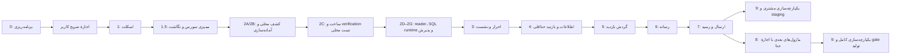

# برنامهٔ مرجع پیاده‌سازی Backend بازدید

تاریخ: `2026-11-03`؛ مخزن: `C:\Projects\vehicle-inspection-backend`. **P0 امکان‌سنجی تکمیل شد؛ Checkpoint2F هنوز پذیرش متصل ندارد و پیشرفت20% است.** [نمونهٔ جدا و walkthrough](docs/implementation/CHECKPOINT-02F-P0-MIGRATION-FEASIBILITY_FA.md) با مجوز `700bf7eb-76b8-4b84-ad87-1096b3eb12dd` ساخته شد: .NET10/MDS6.1.7 با pin امنیتی Pkcs10.0.14، build بدون warning/error،۱۴ تست و سه HTTP smoke موفق. regression اصلی تازه۱۰۹unit+۵۰offline موفق/۸SQL Skipped؛ canonical2.1، تمام package/lockfileها و gate بدون تغییر. هیچ SQL connection/metadata، permission/account یا IIS در P0 اجرا نشد. [برنامهٔ فایل‌به‌فایل](docs/checkpoint2f/P0_MIGRATION_FILE_PLAN_FA.md) و [بستهٔ P1/P2](docs/checkpoint2f/CONTINUATION_APPROVAL_FA.md) آماده‌اند؛ مهاجرت واقعی و هر عملیات زیرساخت/SQL مجوز جدا می‌خواهد.2G شروع نشده است.

## هدف، معماری و وابستگی

هدف Phase 1، مسیر کامل مشتری از referral/OTP تا اطلاعات منشأدار، بازدید، دریافت خصوصی ۱۱ عکس و یک ویدیو، کیلومتر، submit و receipt/status است. پیشنهاد معماری: یک پروژهٔ API ماژولار `netcoreapp2.1`، SQL پارامتری، adapter فقط‌خواندنی مبدأ، session SQL و cookie امن، filesystem خصوصی. [معماری و ساختار فایل](docs/ARCHITECTURE_FA.md)، [داده](docs/DATABASE_DESIGN_FA.md) و [API](docs/API_IMPLEMENTATION_FA.md) جزئیات مرجع‌اند.

شمارهٔ 8 مطابق درخواست مالک حفظ شده، اما اجرای staff پیش‌شرط staging مسیر مشتری نیست. انتشار کامل با ادعای Reviewer/forwarding به اجرای واقعی همان ماژول‌ها نیاز دارد.

## فهرست پیشرفت

- [x] Phase 0 / Checkpoint 0: مطالعهٔ گزینشی منابع و کد Frontend، بررسی ابزار، تحلیل تعارض‌ها و تهیهٔ اسناد.
- [x] اعتبارسنجی نهایی Phase 0: فایل‌ها، پیوندهای تازه، قواعد، hash منابع و عدم تغییر Frontend؛ نتیجه در گزارش اعتبارسنجی ثبت است.
- [x] ثبت محلی بستهٔ Phase 0 در Git مستقل Backend؛ شناسهٔ commit از `git log -1` خوانده شود.
- [x] تصویب صریح کاربر برای Checkpoint 1 در پیوست `9a55d0f7-876a-466b-b0d7-355974f22b9d`، تاریخ `2026-11-01`.
- [x] Phase 1 / Checkpoint 1: اسکلت ASP.NET Core 2.1؛ restore/build، ۴۳ آزمون، HTTP واقعی loopback و publish محلی موفق.
- [x] Checkpoint 1.5: ممیزی امن DuberFront، ماتریس نگاشت مبتنی بر شاهد، تصمیم‌های باز و برنامهٔ SQL؛ طبق پیوست `a325fb13-5239-47f3-9898-b258aed137e3` در `2026-11-01`. گزارش و کنترل‌های این بسته در [DUBERFRONT_CODE_AUDIT_FA.md](docs/DUBERFRONT_CODE_AUDIT_FA.md) است؛ هیچ پیاده‌سازی SQL آغاز نشد.
- [x] Checkpoint 2A/2B در دامنهٔ کشف/آماده‌سازی؛ نبود DB در زمان تحویل آن‌ها تاریخی است و سپس در 2C ساخته شد. schema کارگزاری همچنان حل نشده است. [گزارش همان مرحله](docs/CHECKPOINT2A_2B_REPORT_FA.md).
- [x] Checkpoint 2C: provisioning پایگاه و سه جدول؛ ۳۵ آزمون SQL rollback-only، verification metadata و ۴۳ آزمون موجود برنامه موفق؛ [walkthrough و شواهد](docs/implementation/CHECKPOINT-02C-DATABASE-CREATION_FA.md).
- [x] Checkpoint 2D: reader/قرارداد/fixture ساختگی، DI امن و ۱۰۸ آزمون؛ [walkthrough و شواهد](docs/implementation/CHECKPOINT-02D-BROKERAGE-READER_FA.md).
- [x] Checkpoint 2E فقط طراحی: قرارداد ماندگاری/refresh و manifest آینده، بدون Info/DDL/runtime؛ [طرح و شواهد](docs/implementation/CHECKPOINT-02E-INFO-PERSISTENCE-DESIGN_FA.md).
- [ ] Phase 1 / Checkpoint 2 کامل: 2F فقط آفلاین تحویل شد؛ پذیرش SQL متصل با O24/O26 مسدود است. 2G و adapter واقعی شروع نشده‌اند.
- [ ] Phase 1 / Checkpoint 3: OTP و session.
- [ ] Phase 1 / Checkpoint 4: اطلاعات و `BAZDIDInfo`.
- [ ] Phase 1 / Checkpoint 5: گردش بازدید و سیاست مدرک.
- [ ] Phase 1 / Checkpoint 6: دریافت خصوصی عکس/ویدیو.
- [ ] Phase 1 / Checkpoint 7: submit، رسید و وضعیت.
- [ ] فاز بعد / Checkpoint 8: staff/admin/reviewer/corrections/forwarding؛ مجوز مستقل.
- [ ] Checkpoint 9: یکپارچه‌سازی staging مشتری، سپس در زمان مناسب پذیرش کامل و انتشار مصوب.

## Checkpoint 0 — بنیاد برنامه‌ریزی؛ انجام‌شده در مرحلهٔ قبل

- **پیش‌نیاز:** درخواست مالک و اسناد مرجع؛ دسترسی Frontend صرفاً خواندنی.
- **دامنه:** شناخت رفتار و فرم‌های واقعی، سلسله‌مراتب منابع، سازگاری 2.1، معماری، کاهش طرح ۳۷ جدول، نقشهٔ API، امنیت و برنامهٔ اجرا.
- **فایل‌ها:** `AGENTS.md`، `PLAN.md`، `README.md`، `.gitignore`، `.gitattributes` و پانزده سند اصلی داخل `docs/` به‌همراه گزارش اعتبارسنجی؛ منابع قدیمی بدون تغییر بایت حفظ شوند.
- **جدول/API/کد:** هیچ ساخت یا اجرا؛ SQL موجود در `docs/reference/sql/` فقط مرجع تاریخی است.
- **اعتبارسنجی:** وجود همهٔ فایل‌ها، پیوندهای تازه، قواعد قطعی، نبود credential، hash منابع، وضعیت/اثر انگشت Frontend، Git مستقل.
- **تعریف انجام:** بستهٔ مستندات فارسی و قابل بازبینی، طرح‌ها برچسب‌دار، مانع‌های واقعی معلوم، نتیجهٔ کنترل در [PHASE0_VALIDATION_FA.md](docs/PHASE0_VALIDATION_FA.md).
- **وابستگی باز:** هیچ mapping Production برای تکمیل برنامه لازم نیست؛ موانع اجرای واقعی ثبت شده‌اند.
- **نقطهٔ تأیید تاریخی:** Phase 0 در اینجا متوقف شد؛ سپس کاربر فقط Checkpoint 1 را صریحاً مجاز کرد. نبود مجوز checkpoint بعد، اجازهٔ ادامه نیست.

## Checkpoint 1 — اسکلت پروژه

- **پیش‌نیاز:** اجازهٔ صریح آغاز Phase 1 و بازبینی پیشنهاد معماری؛ SDK 2.1 نصب‌شده، feed restore معتبر و بررسی آسیب‌پذیری‌ها.
- **دامنه:** solution، API ماژولار، pin SDK، تنظیمات بدون راز و validation startup، logging امن/correlation، middleware خطای JSON، health، Swagger و publish سازگار IIS out-of-process. بدون اتصال SQL واقعی یا endpoint تجاری صوری.
- **جدول‌ها:** هیچ‌کدام.
- **APIها:** `GET /API/BAZDID/health/live` و UI/JSON مستندات همان برنامه؛ readiness دارای جزئیات فقط داخلی.
- **فایل‌ها/اجزا:** `Bazdid.sln`، `global.json`، `src/Bazdid.Api/Bazdid.Api.csproj`، `Program.cs`، `Startup.cs`، `Controllers/HealthController.cs`، `Middleware/ExceptionMiddleware.cs`، `Configuration/`، `Infrastructure/Logging/` و دو پروژهٔ آزمون؛ template IIS بدون راز در `deployment/iis/` پس از publish.
- **آزمون‌ها:** restore/build با SDK دقیق، پاسخ health و خطای امن، تنظیم نامعتبر، Swagger JSON معتبر و UI زیر PathBase، نبود API جدیدتر، بررسی dependencyهای انتقالی. بسته/runner آزمون فقط پس از احراز سازگاری pin شوند.
- **تعریف انجام:** اجرای واقعی و دستورهای موفق در README ثبت، artifact قابل بازبینی، هیچ راز یا fixture Production، target همچنان `netcoreapp2.1`؛ موفقیت IIS تنها در صورت آزمون میزبان واقعی ادعا شود.
- **وابستگی باز:** feed/compatibility بسته‌ها، نسخهٔ سرور و ANCM؛ نبود سرور مانع ساخت محلی نیست، اما پذیرش hosting را باز نگه می‌دارد.
- **نقطهٔ بازبینی:** diff و خروجی واقعی اسکلت تحویل؛ scope مرحلهٔ بعد و dependencyها ثبت شود. نصب نرم‌افزار EOL بدون تصویب مستقل انجام نشود.

## Checkpoint 1.5 — ممیزی سورس و آمادگی اتصال؛ بدون پیاده‌سازی

- **دامنهٔ انجام‌شده:** central directory آرشیو بیرونی، خواندن محدود متن در حافظه، شناسایی فناوری/درخواست/موبایل/OTP/Session/EF و تفکیک سورس فعال از کامنت؛ بدون استخراج، اجرا، نصب یا اتصال پایگاه.
- **نتیجه:** `Duber.OrderSales` در دو context صریح است و رابطهٔ درخواست/مشتری و candidateهای موبایل دیده شدند؛ پایگاه authoritative، schema جاری، referral و trusted mobile هنوز مصوب نیستند. کد تخفیف و نمایش شمارهٔ پیگیری جای resolver معرفی نیستند.
- **فایل‌ها:** فقط گزارش ممیزی، PLAN، [نگاشت](docs/BROKERAGE_DATA_MAPPING_FA.md)، [تصمیم‌های باز](docs/OPEN_DECISIONS_FA.md) و [ادامهٔ AI](docs/AI_CONTINUATION_FA.md). سیاست دائمی گزارش فارسی در AGENTS از قبل برقرار است.
- **اعتبارسنجی:** ۳۱ پیوند Markdown و ۳۱ کنترل ساختاری شاهد عبور کردند؛ ۱۰۳ فایل نسخهٔ قابل انتشار و ۱۲۱ blob تاریخی main بدون هشدار راز باقی‌مانده بررسی شدند. تنها fixture URL اعتبارسنجیِ تست موجود جداگانه تأیید شد. diff فقط پنج سند است و hash آرشیو تغییر نکرده؛ fetch پیش از commit اختلاف `0/0` با origin/main داشت. source/API/SQL و رفتار برنامه تغییر نمی‌کنند؛ ۴۳ آزمون موفق، نتیجهٔ تاریخی Checkpoint 1 است.
- **نقطهٔ توقف:** پس از ثبت و همگام‌سازی همین بسته توقف؛ بسته‌های زیر برنامه‌اند و مجوز اجرا نیستند.

## Checkpoint 2 — SQL Server تست و adapter کارگزاری؛ تحویل آفلاین 2F، پذیرش متصل باز

- **پیش‌نیاز ادامه:** 2C محلی اجرا و تأیید شد؛ دامنهٔ بعدی به دستور جدا و بررسی دوبارهٔ پیش‌نیاز نیاز دارد. Production، هویت‌های runtime و reader واقعی مجوز/قرارداد جدا می‌خواهند.
- **دامنه:** connection factory، transaction، scriptهای شماره‌دار تست، تفکیک source read/BAZDID write، قرارداد منطقی reader و fixture کاملاً ساختگی. adapter واقعی فقط با mapping و مجوز جدا.
- **جدول‌ها:** `BAZDIDCustomerLinks`، `BAZDIDRequestContexts` و `BAZDIDAuditLogs` در پایگاه تست؛ schema مالک با DBA. journal اختیاری SQL نیاز به نام و تصویب تازه دارد.
- **APIها:** endpoint عمومی جدید ندارد؛ resolver از طریق service داخلی و آزمون adapter کنترل می‌شود.
- **فایل‌ها/اجزا:** `Brokerage/IBrokerageRequestReader.cs`، `BrokerageRequestSnapshot.cs`، `SyntheticBrokerageRequestReader.cs`، `Infrastructure/Sql/ConnectionFactory.cs` و repositoryهای linkage، `database/001_*`، fixture غیرحساس.
- **آزمون‌ها:** SQL Server واقعی تست، ساخت از صفر/اجرای دوبارهٔ کنترل‌شده، linkage یک مشتری/دو درخواست، missing/zero mapping، ambiguity، timeout، rollback و عدم دسترسی نوشتن مبدأ.
- **تعریف انجام:** هیچ query به جدول مبدأ حدسی وجود ندارد؛ fixture `A4K9P2` حل می‌شود؛ دادهٔ واقعی/credential در source نیست؛ نتیجهٔ integration ثبت شده است.
- **وابستگی باز:** schema واقعی و حساب SELECT مبدأ برای adapter واقعی؛ نبود آن با fixture تست پوشش می‌یابد و Production همچنان بسته است.
- **نقطهٔ تأیید:** نام پایگاه تست و scriptها قبل از اجرای DDL مشخص باشند؛ درخواست استفاده از Production مجوز این مرحله نیست.

### بسته‌های اجرایی پیشنهادی Checkpoint 2 پس از تصویب

- [x] **2A — کشف محلی و ثبت ابهام منبع:** اتصال Windows روی shared memory به همان رایانه موفق بود؛ SQL Server Standard x64 نسخهٔ `15.0.2000.5 / RTM`، چهار پایگاه سیستمی با compatibility `150` و collation `SQL_Latin1_General_CP1_CI_AS` مشاهده شدند. پایگاه کاربری و linked server وجود نداشت؛ Cluster/HADR غیرفعال بود. فقط master catalog خوانده شد. script فقط‌خواندنیِ metadata شیء برای DBA آماده است؛ تعیین authoritative context، schema جاری، referral، trusted mobile و eligibility در O01/O20–O22 باز می‌ماند و Production خوانده نشده است.
- [x] **2B — آماده‌سازی برای بازبینی:** کاربر نام `BAZDID_Development` و Windows Authentication محلی را تأیید کرد؛ DB_ID آن NULL است و پایگاه ساخته نشده. طرح سه جدول، factory/مجوز/fixture و scriptهای ساخت پایگاه، سه جدول و نقش‌ها آماده شدند؛ تمام DDLها با flag صفر بسته‌اند. حساب فعلی sysadmin فقط برای discovery استفاده شد؛ دو حساب کم‌اختیار برنامه هنوز تعیین/ساخته/آزموده نشده‌اند. این تکمیل، آماده‌سازی است و provision شدن محیط تست را ادعا نمی‌کند.
- [x] **2C — provisioning محلی طبق دامنهٔ تازهٔ مالک:** فقط `dbo.BAZDIDCustomerLinks`، `dbo.BAZDIDRequestContexts` و `dbo.BAZDIDAuditLogs` ساخته شدند. compatibility 150، collation مصوب محلی و SIMPLE؛ ۳۹ ستون، ۱۰ index، سه PK، سه unique، یک FK، ۱۳ CHECK trusted/فعال، دو rowversion و دو computed key تأیید شدند. عیب alphabet در CHECKهای tenant در همان سه جدول با WITH CHECK رفع و ۳۵ CASE با rollback و صفر ردیف نهایی موفق شدند. نقش/حساب جدید یا journal ساخته نشد؛ O24 طبق دستور جدید به SQL runtime آینده موکول شد و dependency برنامه تغییر نکرد.
- [x] **2D — reader و قرارداد در دامنهٔ مصوب:** `IBrokerageRequestReader` با ResolveReferralAsync/GetRequestSnapshotAsync، نتیجهٔ typed، scope/reference دقیق، snapshot منشأدار و سرویس داخلی پیاده شد. ۱۸ رکورد حافظه‌ای، حالات نتیجه و Missing/Invalid/Unavailable، صفر با سیاست مستقل، شناسهٔ بزرگ، موبایل متعارض و cancellation آزموده شدند. Synthetic فقط Development/Testing و Production fail-closed است؛ SqlBrokerageRequestReader تنها Unavailable/SourceNotConfigured می‌دهد و query ندارد. هیچ احراز هویت، seed یا SQL runtime پیاده نشد.
- [x] **2E — فقط طرح persistence اطلاعات:** ماتریس فیلدهای واقعی Frontend به reader/DTO/ستون، هفت خانوادهٔ provenance، جداسازی وضعیت مبدأ و منشأ Manual، طرح ۱۳۱ ستون و ۱۹ قاعدهٔ constraint، FK مالک پین‌شدهٔ inspection آینده، refresh با پذیرش صریح، CAS/transaction و ۲۴ سناریوی طراحی ثبت شدند. نسخهٔ بدون version، crypto و policyهای کسب‌وکار gateهای صریح دارند. ساخت/نوشتن Info، repository، API و migration در این بسته انجام نشد؛ اجرای آن در Checkpoint 4 با تصویب وابستگی‌هاست.
- [ ] **2F — SQL runtime/repository و آزمون واقعی:** طبق مجوز 2026-11-03، کد مستقل آفلاین و ۵۱ case تازه موفق تحویل شد؛ سه repository روی schema موجود، transaction صریح، owner/CAS و audit INSERT-only. gate اتصال بسته است؛ provider امنِ متصل و دو principal مصوب موجود نیستند. ۸ تست SQL صریحاً Skipped و اجرای connected صفر؛ effective permissions، رقابت/rollback واقعی و پذیرش کامل انجام نشده‌اند. [راهنما و شواهد](docs/implementation/CHECKPOINT-02F-SQL-REPOSITORIES_FA.md).
- [ ] **2G — rollback و پذیرش:** scriptهای شماره‌دار forward/revert فقط برای اشیای BAZDID با guard مقصد تست و پیش‌شرط نسخه آماده و پیش از اجرا بازبینی شوند؛ حفظ داده و backup لازم در طرح درج شود. ساخت از صفر، اجرای تکراری کنترل‌شده، rollback و بازاعمال روی تست اثبات شوند؛ حذف/تغییر جدول مبدأ یا اجرای Production مجاز نیست. خروجی واقعی آزمون، طرح/تفاوت schema و محدودیت‌ها پیش از تکمیل checkpoint ثبت شوند.

endpoint عمومی تازه، OTP، cookie احراز هویت، آپلود و ماژول کارکنان در این بسته‌ها پیاده نمی‌شوند. موارد O01/O02/O20 تا O22 در دفتر تصمیم‌ها، gateهای adapter واقعی و محیط تست را مشخص می‌کنند.

### پذیرش و نقطهٔ توقف 2A/2B

مجوز تکمیلی کاربر صریح است: فقط کشف metadata محلی، تهیهٔ script پایگاه و جدول‌ها برای بازبینی و **عدم اجرای DDL تا تصویب تازه**. scriptهای [database/discovery](database/discovery/server_inventory.sql) و [پیش‌نویس‌ها](database/README.md) runtime برنامه را تغییر نمی‌دهند؛ migration قابل اجرا یا repository ساخته نشده است. نبود پایگاه کارگزاری در instance محلی در زمان کشف، تأیید schema Production یا تضمین وضعیت آینده نیست؛ پیش‌شرط مقصد قبل از هر اجرای بعدی دوباره بررسی شود.

build تازه با SDK `2.1.818` صفر warning/error و هر ۴۳ آزمون موجود، شامل ۱۵ unit و ۲۸ integration، موفق بودند. پنج SQL با `TSql150Parser` بدون خطای syntax بررسی شدند؛ دو discovery از نظر tokenهای تغییر داده/DDL فقط‌خواندنی‌اند و سه پیش‌نویس guard پیش‌فرض بسته دارند. ۶۴ پیوند، scope سیزده فایل، ۱۰۹ فایل فعلی و ۱۲۶ blob تاریخی main بررسی شدند؛ هشدار راز باقی‌مانده صفر است. parser و TestServer، رفتار constraint/permission/SQL Server برنامه یا IIS را اثبات نمی‌کنند. SQL client جدید نصب یا به پروژه اضافه نشده؛ pin پیشنهادی 4.8.6 به‌دلیل قید framework به gate سازگاری 2C نیاز دارد. شواهد در [گزارش 2A/2B](docs/CHECKPOINT2A_2B_REPORT_FA.md) آمده‌اند؛ SHA/همگام‌سازی نهایی از Git و گزارش تحویل خوانده شود.

### درصد کل پیشرفت Backend؛ قاعدهٔ دائمی

در پایان هر checkpoint، درصد فعلی، مبنای وزن‌دهی، معیارهای تکمیل و برآورد مشروط مرحلهٔ بعد در PLAN و گزارش نهایی بیاید. کار ناتمام امتیاز ندارد؛ این درصد معیار آمادگی Production نیست. تغییر وزن به توضیح تغییر دامنه نیاز دارد.

| checkpoint | وزن از کل | سهم تکمیل‌شدهٔ فعلی |
|---|---|---|
| 0 | 3% | 3% |
| 1 | 6% | 6% |
| 1.5 | 3% | 3% |
| 2 | 12% | 8% شامل 2A/2B، provisioning واقعی 2C، reader ساختگی 2D و طرح 2E |
| 3 | 12% | 0% |
| 4 | 10% | 0% |
| 5 | 8% | 0% |
| 6 | 16% | 0% |
| 7 | 8% | 0% |
| 8 | 12% | 0% |
| 9 | 10% | 0% |
| مجموع | 100% | **20%** |

مبنای پیش از 2A/2B برابر `12%` و سهم آن‌ها جمعاً `3` بود؛ 2C دو واحد، 2D دو واحد و طرح مصوب 2E یک واحد کسب کردند: **12 + 3 + 2 + 2 + 1 = 20%**. تحویل آفلاین 2F به‌دلیل مسدودبودن gateهای حیاتی سهم صفر دارد؛ باقی‌ماندهٔ کل ۸۰٪. از وزن ۱۲واحدی Checkpoint 2، هشت واحد تکمیل و چهار واحد باقی است؛ هدف پایان آن **24%** تغییر نکرده است. ادامهٔ همین 2F پس از رفع O24/O26 و پذیرش کامل حداکثر دو واحد تا **22%** دارد؛ 2G با مجوز جدا پس از آن بررسی می‌شود. Checkpoint 4، auth و استقرار خودکار نیستند.

## Checkpoint 3 — احراز هویت و نشست

- **پیش‌نیاز:** Checkpoint 2؛ تصویب policy تست OTP/session/rate و ذخیرهٔ secret/key ring توسعه؛ طراحی CORS/CSRF.
- **دامنه:** referral context، masked phone، `IOtpService`، fixture OTP بدون SMS، چالش SQL یک‌بارمصرف، rate مشترک، verify در BAZDID، HMAC نسخه‌دار، cookie و ticket store پایدار، logout و کنترل محیط.
- **جدول‌ها:** `BAZDIDOtpChallenges`، `BAZDIDCustomerSessions` و `BAZDIDRateLimitBuckets`؛ استفاده از linkage/audit موجود.
- **APIها:** `auth/csrf`، `referrals/validate`، `auth/otp/request`، `auth/otp/verify`، `me` و `auth/logout` زیر پایهٔ قطعی؛ اطلاعات بازدید هنوز ایجاد نمی‌شود.
- **فایل‌ها/اجزا:** `Controllers/AuthController.cs`، `Application/Auth/`، `Authentication/` برای session/HMAC/antiforgery، `Brokerage/` و `Configuration/AuthOptions.cs`، script مرحلهٔ 3.
- **آزمون‌ها:** expiry/attempt/cooldown/window، دو verify هم‌زمان، resend و replay، تغییر موبایل مبدأ، جعل mobile/tenant، key rotation، restart/دو instance، CSRF/preflight و عدم redirect، fail-closed fixture در Production و نبود SMS mock.
- **تعریف انجام:** `12345` فقط Development/Test، چالش پس از مصرف دیگر نشست صادر نمی‌کند، نشست به درخواست/مشتری/mobile/auth time/expiry/scope متصل است، اسرار یا OTP در پاسخ/log نیستند.
- **وابستگی باز:** قرارداد واقعی SMS و secret store/TTL Production؛ fixture برای تست کافی است، auth Production بدون adapter واقعی مجاز نیست.
- **نقطهٔ تأیید:** policy تست در [OPEN_DECISIONS_FA.md](docs/OPEN_DECISIONS_FA.md) با محیط ثبت شود؛ اجازهٔ استفادهٔ fixture به Production تعمیم نیابد.

## Checkpoint 4 — اطلاعات مشتری/خودرو و `BAZDIDInfo`

- **پیش‌نیاز:** Checkpoint 3، تعیین فیلد/validation/منشأ و DTO با مصرف‌کننده، طرح snapshot و رفتار source change.
- **دامنه:** ایجاد/resume حداقل inspection برای رابطهٔ Info؛ normalization field-specific، خروجی readOnly، ورود فقط missing، validation، گزارش مغایرت بدون بازنویسی trusted، concurrency و snapshot منبع.
- **جدول‌ها:** `BAZDIDInspections`، `BAZDIDInfo`، `BAZDIDInspectionStatusHistory` و `BAZDIDIdempotencyRecords`؛ checkpoint بعد این aggregate را تکمیل می‌کند.
- **APIها:** `POST inspections`، `GET inspections/current`، `GET inspections/{id}` و `GET/PUT inspections/{id}/information`؛ scope فقط درخواست نشست.
- **فایل‌ها/اجزا:** `Application/Information/`، `Application/Inspections/` حداقلی، `Domain/FieldOrigin.cs`، DTOهای اطلاعات ناقص و validation، `InformationController/InspectionsController` و SQL repositories؛ script مرحلهٔ 4.
- **آزمون‌ها:** همهٔ ترکیب‌های trusted/missing/invalid/zero، overposting، تغییر trusted، دو درخواست یک مشتری، owner mismatch، source change، CAS، retry create و ایجاد هم‌زمان current attempt.
- **تعریف انجام:** داده و منشأ پایدارند؛ session پاک شود Info باقی است؛ مقدار trusted قابل تغییر نیست؛ خطای validation ذخیرهٔ جزئی ایجاد نمی‌کند؛ Frontend برای فیلد مفقود placeholder دریافت نمی‌کند.
- **وابستگی باز:** تقویم سال، VIN/شاسی، قالب پلاک غیرعادی، سیاست InvalidSource و UI تکمیل missing؛ Backend مستقلاً Frontend را تغییر نمی‌دهد.
- **نقطهٔ تأیید:** schema Info و DTO نهایی این بسته قبل از migration تست بازبینی شوند؛ فرم‌های ناسازگار در کار مستقل Frontend پیگیری شوند.

## Checkpoint 5 — گردش بازدید و سیاست مدرک

- **پیش‌نیاز:** Checkpoint 4، نسخهٔ شرایط رضایت و validation موقعیت/کیلومتر مصوب تست.
- **دامنه:** create/resume تکمیل‌شده، رضایت نسخه‌دار، موقعیت، projection خودرو، تأیید اطلاعات، کیلومتر، manifest قالب v1/v2 و سیاست دقیق الزام‌ها و وضعیت پیش از ارسال؛ بدون upload واقعی.
- **جدول‌ها:** `BAZDIDInspectionLocations` و `BAZDIDInspectionConsents`؛ افزودن ستون‌های مصوب کیلومتر/confirmation در Info در صورت مرحله‌بندی schema؛ جدول template/attempt جدا فعلاً نیست.
- **APIها:** consent، location، vehicle خواندنی، odometer و capture-plan زیر inspection؛ فرمان اطلاعات واحد باقی می‌ماند و PUT موازی خودرو ساخته نمی‌شود.
- **فایل‌ها/اجزا:** `Domain/EvidencePolicy.cs`، `Domain/InspectionLifecycle.cs`، `Application/Inspections/`، `Contracts/Location*` و `Odometer*`، manifestهای ثابت نسخه‌دار template و repositoryهای location/consent.
- **آزمون‌ها:** ۱۰ fixed+یک VIN، هر چهار alternative، استقلال engine-bay، historical ۱۲ عکس، کیلومتر صفر/منفی/اعشار/overflow، موقعیت دستی accuracy null، consent کهنه و قفل scope.
- **تعریف انجام:** capture-plan معتبر از pinned snapshot می‌آید؛ شمار رسانه با شمار عکس و عدد کیلومتر مخلوط نیست؛ هیچ migration خودکار v1 به v2 نیست.
- **وابستگی باز:** سقف واقعی کیلومتر، نسخهٔ نهایی رضایت و قرارداد reverse map مرکزی؛ نبود reverse نباید آدرس دستی معتبر را جعل یا مسدود کند.
- **نقطهٔ بازبینی:** manifest و fixtureهای تاریخی همراه نتیجهٔ policy test تحویل شوند.

## Checkpoint 6 — عکس/ویدیو و ذخیرهٔ خصوصی

- **پیش‌نیاز:** Checkpoint 5، root و ACL محیط تست، policy محدود حجم/codec و ابزار کنترل فایل مصوب، طراحی reconcile.
- **دامنه:** register/stream/complete/reconcile/cancel، فایل با نام سروری، temporary/finalized، revision، owner retrieval، checksum، limits و idempotency. انتقال whole-file با retry؛ chunk resume/transcode ازپیش‌وعده‌داده‌شده نیست.
- **جدول‌ها:** `BAZDIDInspectionEvidence`، `BAZDIDEvidenceVersions`، `BAZDIDMediaFiles`؛ upload state در MediaFiles، history/audit/idempotency قبلی. اگر async ضروری شد، طرح job پایدار پیش از افزودن تصویب شود.
- **APIها:** evidence registration/list/file، uploads content، evidence complete و cancel-upload؛ عکس و video از همان جریان kind-aware استفاده می‌کنند.
- **فایل‌ها/اجزا:** `Infrastructure/Media/PrivateFileStorage.cs`، `MediaValidator`، `MediaReconciler`، `Application/Evidence/`، DTOهای ticket/receipt و controllerهای upload/evidence، script مرحلهٔ 6 و روش اجرای reconcile خارج وابستگی timer حافظه‌ای.
- **آزمون‌ها:** traversal/ADS/reparse، فایل مخرب/MIME دروغین، بیش‌ازحد/قطع stream، upload موازی، hash mismatch، crash پیش/پس rename و commit، retry و stale worker، privacy، Range و ACL.
- **تعریف انجام:** receipt فقط برای بایت پایدار و معتبر، SQL بدون رسانه، root پنهان، فایل تاریخی حفظ و تمام حالت‌های crash قابل آشتی‌اند؛ هیچ public static mapping وجود ندارد.
- **وابستگی باز:** policy Production حجم/مدت/retention، زیرساخت storage و backup، تأیید ابزار codec/scan؛ بدون آن‌ها Production باز نمی‌شود.
- **نقطهٔ تأیید:** limits و root تست پیش از فعال‌سازی upload؛ تغییر پشتهٔ پردازش یا افزودن worker جدید نیاز به scope مشخص دارد.

## Checkpoint 7 — ارسال، رسید و وضعیت مشتری

- **پیش‌نیاز:** Checkpoint 6؛ receipt پایدار نسخه‌های هدف، فیلدها/رضایت/موقعیت/کیلومتر معتبر و قفل مالکیت.
- **دامنه:** summary authoritative، submit اتمیک و idempotent، snapshot immutable، tracking/receipt صادرشدهٔ سرور، قفل پس از ارسال و بازیابی status/receipt؛ توقف در SUBMITTED بدون جعل review/forwarding.
- **جدول‌ها:** `BAZDIDInspectionSubmissions` و `BAZDIDSubmissionEvidence`؛ Info/status/history/audit/idempotency در همان transaction.
- **APIها:** inspection summary، submit، status و receipt؛ retry همان کلید پاسخ یکسان دارد و payload متفاوت conflict می‌دهد.
- **فایل‌ها/اجزا:** `Application/Submission/SubmitInspectionService.cs`، `Domain/SubmissionReadiness.cs`، `Contracts/Receipt*`، controllerهای summary/submit/status و SQL transaction مرحلهٔ 7.
- **آزمون‌ها:** هر الزام مفقود، ۱۱ عکس تکراری، دو VIN، نبود video/کیلومتر/consent، receipt نسخهٔ اشتباه، submit هم‌زمان، rollback/fault، retry پاسخ گم‌شده، tracking uniqueness و مالکیت receipt.
- **تعریف انجام:** دقیقاً یک ارسال برای فرمان تکراری، snapshot و نسخه‌ها ثابت، پاسخ سرور با پیگیری مشتری سازگار، هیچ داده‌ای پس از submit بدون جریان آینده تغییر نمی‌کند.
- **وابستگی باز:** DTO نهایی receipt/status و سیاست tracking؛ SLA و تأیید نهایی کارگزاری جزو این مرحله نیستند.
- **نقطهٔ بازبینی:** [معیار پذیرش مشتری](docs/PHASE1_ACCEPTANCE_FA.md) و بستهٔ قرارداد Frontend تحویل شود.

## Checkpoint 8 — ماژول‌های بعدی با دامنه و مجوز مستقل

- **پیش‌نیاز:** پایان مسیر مشتری و اجازهٔ صریح فاز staff/reviewer؛ روش bootstrap/password/نقش و قرارداد review/forwarding مصوب.
- **دامنه:** Admin اولیه و ساخت Admin/Reviewer، حساب و role مشترک، ارجاع، تصمیم نسخه و کل، اصلاح محدود، رد و تلاش تازه، outbox تحویل و ack واقعی؛ مدیریت قالب/برند/اعلان فقط طبق نیاز مصوب.
- **جدول‌ها:** ابتدا `BAZDIDStaffUsers`، `BAZDIDStaffRoleAssignments`، `BAZDIDAdmin` و `BAZDIDReviewerAssignments`؛ سپس جدول‌های review/correction/internal notes/forwarding با پیشوند BAZDID مطابق [بازبینی ۳۷ جدول](docs/DATABASE_DESIGN_FA.md). فهرست دقیق DDL هر زیرمرحله دوباره تصویب می‌شود.
- **APIها:** staff/bootstrap عملیاتی امن و بدون endpoint عمومی پیش‌فرض، admin staff/roles/assignment، reviewer case/decision/correction، customer scoped correction/attempt و forwarding retry مدیریتی؛ endpointهای مرجع فقط پس از تصمیم نیاز واقعی انتخاب شوند.
- **فایل‌ها/اجزا:** `Application/Staff/Review/Corrections/Forwarding`، policyهای permission/assignment، bootstrap ابزار محدود و outbox worker پایدار؛ solution فعلاً به microservice شکسته نمی‌شود.
- **آزمون‌ها:** credential واحد، bootstrap یک‌بار، revoke role/session، reviewer فقط assigned، CAS تصمیم، حفظ original/correction scope، restart attempt خالی، outbox retry و ack گم‌شده/نامعتبر.
- **تعریف انجام:** مدیر فقط با permission نقش می‌سازد، مدیر خودکار Reviewer نیست، تأیید review مساوی FORWARDED نیست، receipt مقصد تنها مبنای تحویل و راز bootstrap پاک است.
- **وابستگی باز:** bootstrap/SSO کارکنان، قرارداد بیمه/ack/query و SLA/اعلان/retention؛ برای شروع مشتری مانع نیستند.
- **نقطهٔ تأیید:** قبل از هر زیرماژول خارج Phase 1، دامنه و policy مصوب ثبت شود؛ این برنامه اجازهٔ اجرای زودهنگام آن نیست.

## Checkpoint 9 — یکپارچه‌سازی و استقرار

- **پیش‌نیاز:** برای staging مشتری پایان Checkpoint 7؛ برای سرویس کامل پایان قابلیت‌های مصوب Checkpoint 8. دامنه و سرور staging واقعی، ANCM و policyها و secret management مشخص باشند.
- **دامنه:** OpenAPI واقعی، adapterهای Frontend در مخزن خودش با مجوز مستقل، fixture و HTTPS staging، مرورگر/دستگاه، smoke IIS/PathBase/CORS/CSRF، SQL/files/keys backup و restore، security review و سپس فقط با تصویب نشر Production.
- **جدول‌ها:** جدول جدید پیش‌فرض ندارد؛ script نسخه‌دار مصوب BAZDID و دادهٔ تست، بدون تغییر جدول‌های مبدأ.
- **APIها:** قراردادهای واقعاً اجراشدهٔ دامنهٔ مصوب؛ API جعلی آینده نمایش داده نمی‌شود؛ Swagger محافظت‌شده و URL واقعی قابل تحویل.
- **فایل‌ها/اجزا:** templateهای بازبینی‌شدهٔ `deployment/iis/`، release/rollback runbook، package نسخه‌دار OpenAPI و integration notes، نتیجهٔ آزمون و تصمیم ریسک؛ README با فرمان‌های اجراشده به‌روز شود.
- **آزمون‌ها:** origin واقعی، cookie مرورگر، preflight/CSRF، PathBase و prefix دوبرابر، upload و Range، restart/چند instance، account کم‌اختیار، restore، dependency scan و عدم اخلال سرویس‌های موجود.
- **تعریف انجام:** staging مشتری با مدرک پذیرفته شده؛ Production فقط با تأیید امنیت EOL و مجوز تغییر SQL/IIS و نشر جدا. آمادگی Frontend static، Backend و فرآیند کامل جدا گزارش شوند.
- **وابستگی باز:** mapping/SMS Production، سرور/دامنه/root، retention، امنیت و تأیید ریسک؛ static export کامل Frontend در اسناد هنوز اثبات‌نشده و در این مخزن حل نمی‌شود.
- **نقطهٔ تأیید:** deployment واقعی، تغییر Production SQL و پذیرش عمومی هرکدام مجوز مشخص لازم دارند؛ اجازهٔ اسکلت یا build کافی نیست.

## تعریف انجام مشترک و مدیریت تغییر

تکمیل هر checkpoint پیاده‌سازی به همهٔ معیارهای مرتبط زیر وابسته است؛ این تعریف برای تمام checkpointهای آینده اعمال می‌شود:

- قابلیت در scope مصوب پیاده و schema/DTO/رفتار واقعی همسو باشد؛ آیندهٔ طراحی‌شده قابلیت اجراشده معرفی نشود.
- آزمون‌های خودکار لازم واقعاً اجرا و موفق باشند و نتیجه/فرمان دقیق ثبت شود.
- بازبینی دستیِ مناسب همان محیط، در صورت کاربرد، با نتیجه و محدودیت ثبت شود؛ TestServer معادل IIS و parser معادل اجرای SQL نیست.
- **walkthrough فارسی فرایند انجام کار** طبق بیست موضوع AGENTS به‌روز و از [فهرست راهنماها](docs/implementation/README.md) قابل دسترسی باشد؛ مسئله، تصمیم، مراحل، source، کد مهم، فرمان و شیوهٔ بازآزمایی مرتبط پوشش داده شوند.
- ملاحظات امنیت، خطاهای واقعی/رفع آن‌ها، محدودیت‌ها و تصمیم‌های باز گزارش شوند؛ راز یا source اختصاصی منتشر نشود.
- PLAN با کار انجام‌شده، مانع و گام بعد به‌روز شود؛ درصد قبلی، سهم کسب‌شده با شاهد، درصد جدید و کار باقی‌مانده طبق وزن مصوب ثبت شوند.
- بستهٔ کوچک و قابل بازبینی با حفظ تغییرهای نامرتبط کاربر، فقط فایل‌های امن را در بر گیرد.
- commit و push امن، در صورت دسترسی، انجام و HEAD/فایل‌های remote بررسی شوند؛ نبود دسترسی، مانع واقعی گزارش شود و موفقیت ادعا نشود.

برای کار صرفاً مستنداتی، وجود فایل، UTF-8/fence/پیوند، سازگاری قواعد و نبود راز/diff نامرتبط کنترل می‌شود؛ الزام تازهٔ build، runtime یا اجرای SQL ایجاد نمی‌شود. تنها پس از پذیرش معیارهای مربوط، checkbox تکمیل شود. دستور اجراشده از دستور پیشنهادی بازتولید تفکیک شود و log/زمان/آزمون مفقود جعل نشود.

خطرهای اصلی: runtime EOL، schema/SMS نامعلوم، تکثیر prefix، کوکی cross-origin، OTP abuse، نشت فایل، تعارض نسخه و ناکامل‌بودن restore. مالک و gate هرکدام در [تصمیم‌های باز](docs/OPEN_DECISIONS_FA.md)، [امنیت](docs/SECURITY_FA.md) و [آزمون](docs/TESTING_STRATEGY_FA.md) است.

### نگهداری سیاست walkthrough — بدون checkpoint اجرایی تازه

در `2026-11-01` و پیوست `3d0d6a79-4b95-4875-88b4-571e799beb75`، کاربر فقط نگهداری دستورها/مستندات و راهنمای VS Code را مجاز کرد. مبنای Git شروع `a2e0958` و worktree پاک بود. AGENTS الزام بیست موضوع، DoD و تفکیک شاهد را دارد؛ README و ادامهٔ AI راه‌های مطالعه را معرفی می‌کنند. فهرست implementation به چهار گزارش موجود ارجاع می‌دهد؛ گزارش‌های 0/1/1.5/2A–2B با توضیح فرایند محدود تکمیل شدند و برای مراحل آینده فایل صوری ساخته نشد.

[راهنمای VS Code SQL Server](docs/guides/VSCODE_SQLSERVER_SETUP_FA.md) نصب رسمی، اتصال، Explorer، metadata، نمونه‌های SELECT و رفع خطای متعارف را توضیح می‌دهد. وجود افزونهٔ `ms-mssql.mssql@1.47.0` با CLI تأیید شد؛ هیچ نصب، اتصال VS Code یا SQL، ساخت پایگاه/جدول یا build/test تازه انجام نشد. نمونه‌ها دستور اجرای دستیِ بعدی‌اند و نتایج SQL/۴۳ آزمون به گزارش قبلی تعلق دارند.

نتیجهٔ validation این بسته: ۱۰ Markdown، ۱۲۷ پیوند محلی و یک anchor صریح معتبر؛ ۲۰ موضوع اجباری و تطابق قطعه‌کد با source تأیید شدند. پنج بلوک SQL با parser نسل 2019 بدون خطا و بدون token تغییر داده بررسی شدند؛ پنج بلوک PowerShell نیز parse شدند، هیچ نمونه‌ای اجرا نشد. ۱۱۱ فایل فعلی و ۱۳۹ blob تاریخی main بدون هشدار راز باقی‌مانده اسکن شدند؛ fixture URL موجودِ آزمون جداگانه تأیید شد. diff runtime/SQL/dependency صفر است و فایل صوری آینده ساخته نشد. SHA نهایی و نتیجهٔ واقعی push از Git و گزارش تحویل خوانده شوند.

پیشرفت: **قبلی 15% + سهم این نگهداری 0 = فعلی 15%**؛ کار باقی‌مانده و وزن‌ها تغییر ندارند. 2C هنوز شروع نشده و به تصویب صریح مالک/schema/DDL و حل O24/O25 نیاز دارد؛ برآورد مشروط پس از پذیرش آن `17%` است.

## نقطهٔ تحویل و ادامه

### بررسی مستقل پیش‌نیاز 2D — توقف به‌علت تکمیل‌نشدن 2C

این بخش، ثبت تاریخیِ پیش از مجوز 2C است؛ فقدان پایگاه و توقف 2D در آن زمان صحیح بود. رفع مانع provisioning در بخش 2C و اجرای جدید reader در بخش تحویل 2D پایین ثبت شده‌اند.

در `2026-11-01`، پیوست `3c739830-e19a-4456-beac-0d6f003b18a4` اجرای 2D را **فقط پس از احراز مستقل تکمیل 2C** مجاز کرد و در صورت ناقص‌بودن آن توقف خواست. مبنای Git این بررسی `7da8a42` بود؛ پس از fetch، HEAD و origin/main اختلاف `0/0` داشتند. فایل ثبت‌نشدهٔ `src/Bazdid.Api/Properties/launchSettings.json` از قبل وجود داشت و خارج از این کار حفظ شد.

بررسی تازه با Windows Authentication به `lpc:.\SQLSERVER2019` فقط master catalog را خواند: InstanceName برابر `SQLSERVER2019`، نسخهٔ `15.0.2000.5`، transport برابر Shared memory و تطبیق ماشین با رایانهٔ محلی موفق بود. هویت بررسی sysadmin و دارای VIEW ANY DATABASE بود؛ بنابراین فقدان پایگاه ناشی از محدودیت دید catalog نبود. `DB_ID(N'BAZDID_Development')` مقدار NULL داد؛ فقط چهار پایگاه سیستمی در فهرستِ محدود بررسی دیده شدند. هیچ پایگاه کارگزاری یا ردیف تجاری خوانده نشد. استثنای TrustServerCertificate فقط برای همین اتصال metadata روی lpc محلی بود و به تنظیمات برنامه منتقل نشد.

| پیش‌نیاز 2C | نتیجهٔ احراز فعلی |
|---|---|
| وجود `BAZDID_Development` | ناموفق؛ پایگاه وجود ندارد |
| وجود سه جدول اولیه | قابل احراز نیست؛ پایگاه مقصد وجود ندارد و query جدول‌ها اجرا نشد |
| کلید/index/constraint/FK آزموده‌شده | شاهد اجرای schema یا آزمون واقعی ثبت نشده؛ parser پیش‌نویس 2A/2B جای آن نیست |
| آزمون موفق 2C و walkthrough | در تاریخچه و فهرست راهنماهای فعلی ثبت نشده‌اند |
| پذیرش در PLAN | checkbox 2C باز است؛ پیش‌نویس‌ها همچنان فاقد مجوز اجرای DDL هستند |
| نبود مانع schema/اتصال | قابل تأیید نیست؛ O24 برای سازگاری SQL client و O25 برای تصویب schema/مجوز اجرا بازند |

**نتیجه: 2D شروع نشد.** هیچ interface، DTO، service، reader، fixture، DI، endpoint، SQL یا dependency ایجاد/اصلاح نشد؛ DDL، build و تست برنامه اجرا نشدند. گزارش پیاده‌سازی صوری 2D ساخته نمی‌شود؛ همین بخش شاهد بررسی پیش‌نیاز و توقف است. کنترل تحویل: ۲۴ پیوند PLAN معتبر، تنها فایل tracked تغییرکرده PLAN، ۱۱۱ فایل tracked و ۱۴۹ blob تاریخی main بدون هشدار راز باقی‌مانده؛ hash فایل ثبت‌نشدهٔ کاربر ثابت بود. SHA و نتیجهٔ ثبت/همگام‌سازی از Git و گزارش تحویل خوانده شوند.

کار لازم قبل از تلاش دوبارهٔ 2D: تصویب و اجرای جداگانهٔ 2C؛ نهایی‌سازی schema و SQL client، ساخت مصوب پایگاه و سه جدول، احراز کلید/index/constraint/FK و آزمون‌های واقعی/مجوزهای مربوط، ثبت walkthrough و پذیرش در PLAN. این درخواست مجوز تکمیل پنهانی 2C یا ایجاد DB/جدول نیست. **پیشرفت قبلی 15% + سهم این بررسی 0 = فعلی 15%**؛ پیش‌نیاز تغییر baseline به ۱۷٪ محقق نشده و 2D انجام نشده است. گام پیشنهادی بعد، 2C با تصویب صریح جداگانه است.

### تحویل Checkpoint 2C و توقف

این بخش شاهد تاریخی تحویل 2C است؛ وضعیت تازهٔ reader در بخش 2D پایین ثبت شده است.

مجوز جدید مالک فقط DB محلی و سه جدول را پوشش داد. هویت SQL Server 2019 همان ماشین/Shared memory/Windows، نبود DB هدف و هر DB کاربری دیگر، نبود linked server/Cluster/HADR، defaults model و بیش از ۲۰۰ GiB فضای آزاد تازه بررسی شد. CREATE DATABASE و transaction ساخت سه جدول با فایل‌های guarded و نسخهٔ صرفاً حافظه‌ایِ مجاز اجرا شدند؛ reviewهای commitشونده همچنان flag صفر دارند. فقط یک اصلاح محدود سه CHECK لازم شد و هیچ constraint غیرفعال نشد.

شواهد واقعی در [walkthrough 2C](docs/implementation/CHECKPOINT-02C-DATABASE-CREATION_FA.md)، [schema](docs/checkpoint2c/SCHEMA_VERIFICATION.json)، [۳۵ آزمون SQL](docs/checkpoint2c/ROLLBACK_TEST_RESULTS.json) و [restore/build/43 آزمون برنامه](docs/checkpoint2c/APPLICATION_VALIDATION.json) هستند. build صفر warning/error و هر سه فرمان exit صفر داشتند. تست‌های موجود برنامه، SQL repository یا permission runtime را ثابت نمی‌کنند. جدول‌ها صفر ردیف دارند؛ identity/rowversion counter ممکن است جلو رفته باشند.

کنترل بسته پیش از commit: ۲۳ فایل، ۱۰ Markdown، ۱۴۳ پیوند محلی/یک anchor معتبر و اسکن ۱۲۲ فایل فعلی/۱۵۰ blob تاریخی main بدون هشدار راز باقی‌مانده. ۴۸ واحد SQL و پنج نمونهٔ PowerShell parse شدند؛ چهار آزمون منفی guard بدون mutation موفق بودند. source/runtime/dependency تغییر نکرده و فایل کاربر ثابت ماند؛ هیچ آرشیو، دادهٔ DB یا backup به بسته اضافه نشده است. این اعتبارسنجی جای آزمون‌های واقعی SQL و برنامه نیست و شواهد هرکدام جدا هستند.

فقط schema/provisioning بخش O25 محلی حل شد. دو principal کم‌اختیار مصوب تحویل نشده‌اند؛ هیچ role/login/user یا grant ساخته/اعمال نشد. O24 برای runtime حل نشده و با System.Data در PowerShell دور زده یا بسته اعلام نمی‌شود. schema کارگزاری همچنان ناشناخته، audit امنیت قبلی پاک‌نشده و IIS واقعی آزموده‌نشده است. فایل untracked کاربر حفظ و API/Frontend/dependency دست‌نخورده‌اند. **پیشرفت 17%؛ توقف پس از 2C.** گام بعد 2D در درخواست جداگانه و پس از احراز دوبارهٔ این پیش‌نیاز است؛ برآورد پیشنهادی مالک پس از پذیرش آن ۱۹٪ است. برای ادامه [AI_CONTINUATION_FA.md](docs/AI_CONTINUATION_FA.md) را بخوانید.

commit پیاده‌سازی `bf1c3c759d163ee716947af46f074b20d60fc043` با push عادی منتشر و HEAD محلی/remote با اختلاف `0/0` تأیید شد؛ walkthrough و schema از GitHub با blob SHA برابر خوانده شدند. [گزارش همگام‌سازی](docs/GITHUB_SYNC_FA.md) شاهد این بررسی است؛ تکمیل همین ثبت مستنداتی سهم پیشرفت تازه ندارد و مجوز شروع 2D نیست.

### تحویل Checkpoint 2D و توقف

این بخش شاهد تاریخی تحویل کد 2D است؛ وضعیت جدید طرح 2E در بخش بعد ثبت شده است.

در `2026-11-02` با مبنای Git `b495b10` و مجوز `2df8399e-d511-49b7-af28-a075f801dd57`، verification خواندنی قبل/بعد همان schema 2C و صفر ردیف را تأیید کرد. interface، قراردادهای دامنه، field validation/provenance، ۱۸ fixture حافظه‌ای، دو مرز adapter و سرویس scope-bound/DI پیاده شدند؛ هویت resolution مجوز مالکیت نیست و endpoint تازه‌ای وجود ندارد. config پایه Disabled و Development/Testing صریحاً Synthetic است؛ Production با synthetic یا scope آزمایشی startup را رد می‌کند. SQL واقعی تنظیم نشده و O24/O26 و mappingهای O01/O20–O22 بازند.

restore قفل‌شده و build Release با SDK 2.1.818 موفق؛ build صفر warning/error. ۶۵ unit + ۴۳ integration برابر **۱۰۸/۱۰۸** موفق شدند؛ شامل همهٔ ۴۳ قبلی و ۶۵ جدید. اولین اجرا یک شکست کنترل case نام محیط داشت که با مقایسهٔ دقیق سازنده، بدون تضعیف آزمون، رفع شد. smoke واقعی Kestrel روی loopback: health و Swagger 200، فقط یک مسیر و basePath صحیح، snapshot ناشناس 404؛ process اختصاصی متوقف شد. [walkthrough](docs/implementation/CHECKPOINT-02D-BROKERAGE-READER_FA.md)، [آزمون برنامه](docs/checkpoint2d/APPLICATION_VALIDATION.json)، [metadata](docs/checkpoint2d/DATABASE_VERIFICATION.json) و [HTTP](docs/checkpoint2d/HTTP_SMOKE.json) شواهدند. integration این مرحله SQL repository، IIS یا Production نیست؛ ۳۵ SQL CASE قبلی دوباره اجرا نشدند.

**قبلی 17% + سهم پذیرفتهٔ 2D برابر 2 = فعلی 19%؛ باقی 81%.** فقط طرح 2E در درخواست جداگانه پیشنهاد می‌شود؛ برآورد مشروط یک واحد تا ۲۰٪، نه امتیاز فعلی. 2E–2G، OTP/Session/Info/media، query کارگزاری، migration/جدول اضافه و Frontend اجرا نشدند. فایل untracked کاربر حفظ شد؛ target و dependency/lockfile و SQL scriptها تغییر نکردند. commit پیاده‌سازی `30112f104d9def9a5ea91cfd56b78d21e581685a` با push عادی منتشر، HEAD محلی/remote برابر و قرارداد/راهنما/شاهد آزمون از GitHub با blob SHA برابر تأیید شدند؛ [گزارش همگام‌سازی](docs/GITHUB_SYNC_FA.md) جزئیات را ثبت می‌کند. تکمیل این ثبت مستنداتی سهم تازه ندارد.

### تحویل Checkpoint 2E و توقف

در `2026-11-02`، مجوز `20acc386-4be3-48e7-84da-a7457cf34b6f` با مبنای `d704ad2` فقط طراحی آینده را مجاز کرد. interface/metadata/DI/tests واقعی 2D بررسی و restore/build/test تازه با SDK 2.1.818 و exit صفر اجرا شدند؛ build صفر warning/error و ۶۵ unit + ۴۳ integration برابر ۱۰۸ موفق بود. آزمون جدید یا کد runtime اضافه نشد؛ طرح 2E runtime-tested معرفی نمی‌شود.

۲۶ فایل Frontend working tree با hash خوانده شدند؛ تغییرات قبلی آن حفظ شد. schema سه جدول از فایل guarded و شاهد 2D تطبیق داده شد و اتصال/نوشتن SQL انجام نشد. [walkthrough طراحی](docs/implementation/CHECKPOINT-02E-INFO-PERSISTENCE-DESIGN_FA.md)، [manifest پیشنهادی](docs/design/BAZDIDINFO_SCHEMA_PROPOSAL.json)، [شاهد اجرای تازه](docs/checkpoint2e/APPLICATION_VALIDATION.json)، [بررسی Frontend](docs/checkpoint2e/FRONTEND_REVIEW.json) و [اعتبارسنجی طراحی](docs/checkpoint2e/DESIGN_VALIDATION.json) مرجع‌اند. source/DTO/storage/validation/lock، schema ۱۳۱ ستونِ پیشنهاد، ۱۹ قاعدهٔ constraint و ۲۴ سناریوی تحلیلی پوشش داده شدند؛ FK parent، crypto و policyهای production هنوز اجرا/تصویب نشده‌اند.

**قبلی 19% + سهم طراحی 2E برابر 1 = فعلی 20%؛ باقی 80%.** Info و Inspections ایجاد نشدند؛ هیچ endpoint/Swagger، repository، migration، SQL، auth/OTP/Session/media یا Frontend تغییر نکرد. O24/O26 و mapping واقعی بازند؛ O27–O30 جزئیات policy/crypto/freshness و تطبیق قرارداد قبل از Checkpoint 4 را ثبت می‌کنند. گام پیشنهادی بعد 2F با مجوز جدا و هدف مشروط ۲۲٪ است؛ این مرحله شروع نشد. commit طرح `9f5f7df94dc6f1dd6e854af8d52e2d4818fd3d06` منتشر و HEAD محلی/remote و سه فایل GitHub با blob SHA برابر تأیید شدند؛ [گزارش همگام‌سازی](docs/GITHUB_SYNC_FA.md) شاهد است. ثبت تکمیلی انتشار سهم تازه ندارد.

## وظیفهٔ مستقل GitHub و گزارش‌دهی

در `2026-11-01` کاربر فقط اتصال مخزن موجود به GitHub و الزام گزارش فارسی را مجاز کرد. برای منع انتشار ZIP مرجع، سپس صریحاً پاک‌سازی تاریخچهٔ ارسالی با نگهداری SHAهای اصلی فقط محلی را تأیید کرد. `main` قابل انتشار از branch محلی `local-original-history-2026-11-01` جداست؛ branch اصلی هرگز push/merge به main نمی‌شود. [وضعیت همگام‌سازی](docs/GITHUB_SYNC_FA.md) و [نقشهٔ SHAها](docs/GIT_HISTORY_EXPORT.json) مرجع نتیجه‌اند. این کار هیچ مجوزی برای Checkpoint 2 یا تغییر رفتار برنامه ایجاد نمی‌کند.

### تحویل بخش آفلاین Checkpoint 2F و توقف

در `2026-11-03`، مجوز `ea650fd0-47e2-4d02-bf9b-0fb87f03a254` فقط 2F را پوشش داد. قراردادها، سه repository، transaction و DI با gate بسته پیاده شدند؛ O24/O26 مانع پذیرش متصل‌اند. ۱۰۹ unit و ۵۰ integration آفلاین موفق، صفر شکست و ۸ SQL Skipped؛ build صفر warning/error. verification خواندنی schema/ردیف قبل و بعد برابر و سه جدول خالی‌اند. DDL، DML repository، grant و اتصال runtime انجام نشدند. **پیشرفت 20%؛ توقف در 2F ناقص، بدون شروع 2G.**

[شاهد برنامه](docs/checkpoint2f/APPLICATION_VALIDATION.json)، [SQL مجزا](docs/checkpoint2f/SQL_TEST_RESULTS.json)، [provider](docs/checkpoint2f/PROVIDER_AUDIT.json)، [حساب‌ها](docs/checkpoint2f/RUNTIME_PRINCIPALS.json)، [schema قبل/بعد](docs/checkpoint2f/DATABASE_VERIFICATION.json) و [smoke Kestrel](docs/checkpoint2f/HTTP_SMOKE.json) ثبت شدند. تمام ۱۰۸ baseline دوباره موفق و ۵۱ موفق تازه آفلاین‌اند؛ شمار کل ۱۶۷ شامل ۸ skip است. شواهد ۳۵ CASE مربوط به 2C تاریخی ماندند. PackageReference/lockfile/target و SQL scriptها تغییر نکردند؛ reader و HTTP/CORS/auth و فایل untracked کاربر حفظ شدند. منبع واقعی کارگزاری تنظیم‌نشده است.

**قبلی 20% + سهم پذیرفتهٔ فعلی 0 = جدید 20%؛ باقی 80%.** از وزن ۱۲واحدی Checkpoint 2، همان هشت واحد پذیرفته شده است. پیشنهاد مشروط ادامهٔ همین 2F دو واحد تا **22%**، فقط پس از provider واقعی، عملیات SQL، هویت‌های کم‌اختیار/effective permission، concurrency/rollback و regression/docs کامل است؛ پایان Checkpoint 2 همچنان 24%. این تحویل امتیاز SQL یا مجوز 2G نمی‌دهد. گام بعد رفع O24/O26 و ادامهٔ کنترل‌شدهٔ همین 2F است؛ نام دو principal و permissions و هر DDL دسترسی تصویب جدا می‌خواهد. commit `f3bf660cc640eebd20ed348cdda181b041d0d799` با push عادی منتشر و HEAD محلی/remote و سه فایل GitHub با blob SHA برابر تأیید شدند؛ [گزارش GitHub](docs/GITHUB_SYNC_FA.md) شواهد را ثبت می‌کند. ثبت تکمیلی همین مستندات سهم تازه ندارد و SHA نهایی آن از Git واقعی خوانده می‌شود.

### ادامهٔ 2F — آماده‌سازی تصویب O24/O26، بدون فعال‌سازی

مجوز `e252dad0-0bb1-4058-ab9b-f757dd2b272a` از مبنای `3b5e78dd8c35d7da6b0550d92220b782ac1acc12` فقط تحلیل، metadata و پیشنهادهای قابل بازبینی را تا تصویب بعدی مجاز کرد. [ماتریس و بستهٔ تصویب](docs/checkpoint2f/CONTINUATION_APPROVAL_FA.md)، [metadata نه provider و تقاطع قیود](docs/checkpoint2f/PROVIDER_CANDIDATES.json) و [شاهد تازهٔ metadata/regression/parse](docs/checkpoint2f/CONTINUATION_REVIEW.json) ثبت شدند. منشأ بالاسقف System.Data.SqlClient، خود Microsoft.AspNetCore.App2.1.30 است؛ CodePages و در نامزدهای جدید Caching/Pkcs/Channels هم تعارض دارند. هیچ بسته یا target عوض نشد؛ توصیهٔ طرح مهاجرت جداگانهٔ .NET10 LTS با ارزیابی Microsoft.Data.SqlClient6.1.7 LTS صرفاً منتظر تصمیم مالک است.

نام‌های `.\BAZDIDDevWriter` و `.\BAZDIDDevReader` فقط پیشنهادند و وجود ندارند. پیش‌نویس login جدید و permissions اصلاح‌شده (حذف UPDATE CustomerLinks، منع SELECT audit و حذف source grant اختیاری) با guard صفر و approval/SIDهای NULL باقی‌اند. دو script و دو template فقط آفلاین parse شدند؛ هیچ account/login/user/role، GRANT/DENY، TLS/registry/ACL یا schema تغییر نکرد. SQL متصل، effective permissions و DML repository صفر؛ ۱۵۹ موفق و ۸ Skip تازه همان baseline هستند و تست جدیدی ساخته نشد.

**قبلی 20% + سهم آماده‌سازی 0 = فعلی 20%؛ باقی 80%.** پذیرش کامل 2F هنوز دو واحد تا 22% مشروط به provider مصوب/متصل، دو هویت واقعی، effective permissions، عملیات/transaction/concurrency SQL و regression/docs است. هدف پایان Checkpoint 2 برابر 24% باقی است. تصمیم بعدی P0 دربارهٔ طرح provider/migration و P1/P2 دربارهٔ نام‌ها، حقوق و scriptهای دارای hash است؛ P3/P4/P5 دربارهٔ TLS، activation و fixture commitشده بعداً آماده/تصویب شوند. قبل از تغییر نامصوب توقف؛ 2G، auth/Info/media/Production شروع نمی‌شوند. commit `19ac050f885a6cd77dbbf11d740ab45bf1d9d11a` با push عادی منتشر و HEAD/سه فایل GitHub برابر تأیید شد؛ گزارش GitHub شاهد است. ثبت تکمیلی همین مستندات سهم تازه ندارد و SHA نهایی آن از Git واقعی خوانده می‌شود.

## تحویل P0 امکان‌سنجی؛ بدون مهاجرت canonical

مجوز `700bf7eb-76b8-4b84-ad87-1096b3eb12dd` فقط مطالعه/نمونهٔ ignored را پوشش داد. [walkthrough](docs/implementation/CHECKPOINT-02F-P0-MIGRATION-FEASIBILITY_FA.md)، [ماتریس فایل‌به‌فایل](docs/checkpoint2f/P0_MIGRATION_FILE_PLAN_FA.md) و [شاهد امن](docs/checkpoint2f/P0_FEASIBILITY_RESULTS.json) تحویل‌اند. Generic Host با حفظ Startup و Newtonsoft عملی شد؛ WebHost قدیمی warning داشت. حداقل Pkcs9.0.11 در گراف driver دو advisory داد و در نمونه با pin سازگار10.0.14 رفع شد. runner جدید MTP و تست validation زمان Build اصلاح شدند؛ build نهایی صفر warning/error،۱۴ تست و سه HTTP smoke موفق‌اند. audit نمونه صفر flagged؛ امنیت گراف canonical عوض نشد.

regression تازهٔ canonical:۱۰۹unit+۵۰offline موفق/صفر شکست و۸SQL Skipped. تمام۶۴فایل محافظت‌شده و فایل شخصی untracked یکسان ماندند؛ هیچ SQL اتصال/metadata، native execution، schema، account/permission، TLS یا IIS در این وظیفه اجرا نشد. توصیه A: port آفلاین .NET10/MDS6.1.7 با pinهای امنیتی و gate بسته؛ برآورد۶–۱۰روز کاری. hosting staging و پذیرش واقعی2F هرکدام۲–۴روز کاریِ وابسته به مجوز/محیط، مجموع۱۰–۱۸روز کاری؛ زمان انتظار و توسعهٔ featureهای بعدی خارج برآورد است. Swagger parity، native/SSPI/TLS، effective permission و transaction واقعی بازند.

**قبلی20 + سهم این P0 صفر = جدید20%؛ باقی80%.** پایهٔ12 + 2A/2B:3 + 2C:2 + 2D:2 + طراحی2E:1 =20؛ وزن‌های کل PLAN تغییر نکردند. ۲امتیاز2F تنها با پذیرش متصل کامل تحت تصویب مستقل کسب می‌شود؛ هدف مشروط پس از آن22% و پایانCheckpoint2 برابر24% است. P0، طرح یا اسناد، امتیاز پذیرش نیستند. گام پیشنهادی بعد: تصویب صریح جایگزینی الزام canonical2.1 با.NET10 فقط برای port آفلاین سه project/host/MVC/JSON/OpenAPI/provider/tests/lockfiles/docs. P1/P2/TLS/SQL activation و OS/IIS/deployment جدا تصویب شوند.2G شروع نشده و این تحویل در P0 متوقف است. SHA/push/remote و مشاهدهٔ فایل‌ها در [گزارش GitHub](docs/GITHUB_SYNC_FA.md) با شواهد واقعی ثبت می‌شوند.

بستهٔ P0 در `55573fda0c2741f103760c3e959c7ff108e10431` ثبت و push شد؛ HEAD محلی/remote و سه فایل GitHub مستقلاً برابر تأیید شدند. اسکن۳۰۴blob،۲۳۰پیوند، پوشش۳۳فایل C# و حفظ۶۴hash تأیید شد. گزارش همگام‌سازی و ارجاع‌های تحویل در commit تکمیلی ثبت می‌شوند؛ این نگهداری سهم پیشرفت ندارد.
