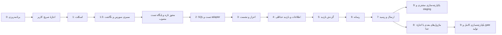

# برنامهٔ مرجع پیاده‌سازی Backend بازدید

تاریخ: `2026-11-01`؛ مخزن: `C:\Projects\vehicle-inspection-backend`. **Phase 0 و Checkpoint 1 کامل‌اند؛ Checkpoint 1.5 شامل ممیزی سورس مرجع، آماده‌سازی نگاشت و همگام‌سازی GitHub است.** دامنهٔ مجاز در Checkpoint 1.5 پایان می‌یابد؛ شروع Checkpoint 2 اجازهٔ تازه و پایگاه تست مصوب می‌خواهد. این مجوز، تصویب Production یا schemaهای آینده نیست.

## هدف، معماری و وابستگی

هدف Phase 1، مسیر کامل مشتری از referral/OTP تا اطلاعات منشأدار، بازدید، دریافت خصوصی ۱۱ عکس و یک ویدیو، کیلومتر، submit و receipt/status است. پیشنهاد معماری: یک پروژهٔ API ماژولار `netcoreapp2.1`، SQL پارامتری، adapter فقط‌خواندنی مبدأ، session SQL و cookie امن، filesystem خصوصی. [معماری و ساختار فایل](docs/ARCHITECTURE_FA.md)، [داده](docs/DATABASE_DESIGN_FA.md) و [API](docs/API_IMPLEMENTATION_FA.md) جزئیات مرجع‌اند.

شمارهٔ 8 مطابق درخواست مالک حفظ شده، اما اجرای staff پیش‌شرط staging مسیر مشتری نیست. انتشار کامل با ادعای Reviewer/forwarding به اجرای واقعی همان ماژول‌ها نیاز دارد.

## فهرست پیشرفت

- [x] Phase 0 / Checkpoint 0: مطالعهٔ گزینشی منابع و کد Frontend، بررسی ابزار، تحلیل تعارض‌ها و تهیهٔ اسناد.
- [x] اعتبارسنجی نهایی Phase 0: فایل‌ها، پیوندهای تازه، قواعد، hash منابع و عدم تغییر Frontend؛ نتیجه در گزارش اعتبارسنجی ثبت است.
- [x] ثبت محلی بستهٔ Phase 0 در Git مستقل Backend؛ شناسهٔ commit از `git log -1` خوانده شود.
- [x] تصویب صریح کاربر برای Checkpoint 1 در پیوست `9a55d0f7-876a-466b-b0d7-355974f22b9d`، تاریخ `2026-11-01`.
- [x] Phase 1 / Checkpoint 1: اسکلت ASP.NET Core 2.1؛ restore/build، ۴۳ آزمون، HTTP واقعی loopback و publish محلی موفق.
- [x] Checkpoint 1.5: ممیزی امن DuberFront، ماتریس نگاشت مبتنی بر شاهد، تصمیم‌های باز و برنامهٔ SQL؛ طبق پیوست `a325fb13-5239-47f3-9898-b258aed137e3` در `2026-11-01`. گزارش و کنترل‌های این بسته در [DUBERFRONT_CODE_AUDIT_FA.md](docs/DUBERFRONT_CODE_AUDIT_FA.md) است؛ هیچ پیاده‌سازی SQL آغاز نشد.
- [ ] Phase 1 / Checkpoint 2: SQL تست و adapter مبدأ.
- [ ] Phase 1 / Checkpoint 3: OTP و session.
- [ ] Phase 1 / Checkpoint 4: اطلاعات و `BAZDIDInfo`.
- [ ] Phase 1 / Checkpoint 5: گردش بازدید و سیاست مدرک.
- [ ] Phase 1 / Checkpoint 6: دریافت خصوصی عکس/ویدیو.
- [ ] Phase 1 / Checkpoint 7: submit، رسید و وضعیت.
- [ ] فاز بعد / Checkpoint 8: staff/admin/reviewer/corrections/forwarding؛ مجوز مستقل.
- [ ] Checkpoint 9: یکپارچه‌سازی staging مشتری، سپس در زمان مناسب پذیرش کامل و انتشار مصوب.

## Checkpoint 0 — بنیاد برنامه‌ریزی؛ انجام‌شده در مرحلهٔ قبل

- **پیش‌نیاز:** درخواست مالک و اسناد مرجع؛ دسترسی Frontend صرفاً خواندنی.
- **دامنه:** شناخت رفتار و فرم‌های واقعی، سلسله‌مراتب منابع، سازگاری 2.1، معماری، کاهش طرح ۳۷ جدول، نقشهٔ API، امنیت و برنامهٔ اجرا.
- **فایل‌ها:** `AGENTS.md`، `PLAN.md`، `README.md`، `.gitignore`، `.gitattributes` و پانزده سند اصلی داخل `docs/` به‌همراه گزارش اعتبارسنجی؛ منابع قدیمی بدون تغییر بایت حفظ شوند.
- **جدول/API/کد:** هیچ ساخت یا اجرا؛ SQL موجود در `docs/reference/sql/` فقط مرجع تاریخی است.
- **اعتبارسنجی:** وجود همهٔ فایل‌ها، پیوندهای تازه، قواعد قطعی، نبود credential، hash منابع، وضعیت/اثر انگشت Frontend، Git مستقل.
- **تعریف انجام:** بستهٔ مستندات فارسی و قابل بازبینی، طرح‌ها برچسب‌دار، مانع‌های واقعی معلوم، نتیجهٔ کنترل در [PHASE0_VALIDATION_FA.md](docs/PHASE0_VALIDATION_FA.md).
- **وابستگی باز:** هیچ mapping Production برای تکمیل برنامه لازم نیست؛ موانع اجرای واقعی ثبت شده‌اند.
- **نقطهٔ تأیید تاریخی:** Phase 0 در اینجا متوقف شد؛ سپس کاربر فقط Checkpoint 1 را صریحاً مجاز کرد. نبود مجوز checkpoint بعد، اجازهٔ ادامه نیست.

## Checkpoint 1 — اسکلت پروژه

- **پیش‌نیاز:** اجازهٔ صریح آغاز Phase 1 و بازبینی پیشنهاد معماری؛ SDK 2.1 نصب‌شده، feed restore معتبر و بررسی آسیب‌پذیری‌ها.
- **دامنه:** solution، API ماژولار، pin SDK، تنظیمات بدون راز و validation startup، logging امن/correlation، middleware خطای JSON، health، Swagger و publish سازگار IIS out-of-process. بدون اتصال SQL واقعی یا endpoint تجاری صوری.
- **جدول‌ها:** هیچ‌کدام.
- **APIها:** `GET /API/BAZDID/health/live` و UI/JSON مستندات همان برنامه؛ readiness دارای جزئیات فقط داخلی.
- **فایل‌ها/اجزا:** `Bazdid.sln`، `global.json`، `src/Bazdid.Api/Bazdid.Api.csproj`، `Program.cs`، `Startup.cs`، `Controllers/HealthController.cs`، `Middleware/ExceptionMiddleware.cs`، `Configuration/`، `Infrastructure/Logging/` و دو پروژهٔ آزمون؛ template IIS بدون راز در `deployment/iis/` پس از publish.
- **آزمون‌ها:** restore/build با SDK دقیق، پاسخ health و خطای امن، تنظیم نامعتبر، Swagger JSON معتبر و UI زیر PathBase، نبود API جدیدتر، بررسی dependencyهای انتقالی. بسته/runner آزمون فقط پس از احراز سازگاری pin شوند.
- **تعریف انجام:** اجرای واقعی و دستورهای موفق در README ثبت، artifact قابل بازبینی، هیچ راز یا fixture Production، target همچنان `netcoreapp2.1`؛ موفقیت IIS تنها در صورت آزمون میزبان واقعی ادعا شود.
- **وابستگی باز:** feed/compatibility بسته‌ها، نسخهٔ سرور و ANCM؛ نبود سرور مانع ساخت محلی نیست، اما پذیرش hosting را باز نگه می‌دارد.
- **نقطهٔ بازبینی:** diff و خروجی واقعی اسکلت تحویل؛ scope مرحلهٔ بعد و dependencyها ثبت شود. نصب نرم‌افزار EOL بدون تصویب مستقل انجام نشود.

## Checkpoint 1.5 — ممیزی سورس و آمادگی اتصال؛ بدون پیاده‌سازی

- **دامنهٔ انجام‌شده:** central directory آرشیو بیرونی، خواندن محدود متن در حافظه، شناسایی فناوری/درخواست/موبایل/OTP/Session/EF و تفکیک سورس فعال از کامنت؛ بدون استخراج، اجرا، نصب یا اتصال پایگاه.
- **نتیجه:** `Duber.OrderSales` در دو context صریح است و رابطهٔ درخواست/مشتری و candidateهای موبایل دیده شدند؛ پایگاه authoritative، schema جاری، referral و trusted mobile هنوز مصوب نیستند. کد تخفیف و نمایش شمارهٔ پیگیری جای resolver معرفی نیستند.
- **فایل‌ها:** فقط گزارش ممیزی، PLAN، [نگاشت](docs/BROKERAGE_DATA_MAPPING_FA.md)، [تصمیم‌های باز](docs/OPEN_DECISIONS_FA.md) و [ادامهٔ AI](docs/AI_CONTINUATION_FA.md). سیاست دائمی گزارش فارسی در AGENTS از قبل برقرار است.
- **اعتبارسنجی:** ۳۱ پیوند Markdown و ۳۱ کنترل ساختاری شاهد عبور کردند؛ ۱۰۳ فایل نسخهٔ قابل انتشار و ۱۲۱ blob تاریخی main بدون هشدار راز باقی‌مانده بررسی شدند. تنها fixture URL اعتبارسنجیِ تست موجود جداگانه تأیید شد. diff فقط پنج سند است و hash آرشیو تغییر نکرده؛ fetch پیش از commit اختلاف `0/0` با origin/main داشت. source/API/SQL و رفتار برنامه تغییر نمی‌کنند؛ ۴۳ آزمون موفق، نتیجهٔ تاریخی Checkpoint 1 است.
- **نقطهٔ توقف:** پس از ثبت و همگام‌سازی همین بسته توقف؛ بسته‌های زیر برنامه‌اند و مجوز اجرا نیستند.

## Checkpoint 2 — SQL Server تست و adapter کارگزاری؛ هنوز شروع نشده

- **پیش‌نیاز:** بازبینی Checkpoint 1.5، مجوز تازهٔ کاربر، مقصد پایگاه تست و نسخه/compatibility معلوم، اختیار مجاز تست و بازبینی طرح linkage؛ Production ممنوع.
- **دامنه:** connection factory، transaction، scriptهای شماره‌دار تست، تفکیک source read/BAZDID write، قرارداد منطقی reader و fixture کاملاً ساختگی. adapter واقعی فقط با mapping و مجوز جدا.
- **جدول‌ها:** `BAZDIDCustomerLinks`، `BAZDIDRequestContexts` و `BAZDIDAuditLogs` در پایگاه تست؛ schema مالک با DBA. journal اختیاری SQL نیاز به نام و تصویب تازه دارد.
- **APIها:** endpoint عمومی جدید ندارد؛ resolver از طریق service داخلی و آزمون adapter کنترل می‌شود.
- **فایل‌ها/اجزا:** `Brokerage/IBrokerageRequestReader.cs`، `BrokerageRequestSnapshot.cs`، `SyntheticBrokerageRequestReader.cs`، `Infrastructure/Sql/ConnectionFactory.cs` و repositoryهای linkage، `database/001_*`، fixture غیرحساس.
- **آزمون‌ها:** SQL Server واقعی تست، ساخت از صفر/اجرای دوبارهٔ کنترل‌شده، linkage یک مشتری/دو درخواست، missing/zero mapping، ambiguity، timeout، rollback و عدم دسترسی نوشتن مبدأ.
- **تعریف انجام:** هیچ query به جدول مبدأ حدسی وجود ندارد؛ fixture `A4K9P2` حل می‌شود؛ دادهٔ واقعی/credential در source نیست؛ نتیجهٔ integration ثبت شده است.
- **وابستگی باز:** schema واقعی و حساب SELECT مبدأ برای adapter واقعی؛ نبود آن با fixture تست پوشش می‌یابد و Production همچنان بسته است.
- **نقطهٔ تأیید:** نام پایگاه تست و scriptها قبل از اجرای DDL مشخص باشند؛ درخواست استفاده از Production مجوز این مرحله نیست.

### بسته‌های اجرایی پیشنهادی Checkpoint 2 پس از تصویب

- [ ] **2A — رفع ابهام منبع و metadata:** DBA مرجع authoritative از بین دو context، نگاشت referral، اولویت موبایل معتبر و eligibility را تعیین کند. نسخه با `SERVERPROPERTY('ProductVersion')` و compatibility/collation از metadata پایگاه مصوب شناسایی شود؛ خروجی حداقلی `sys.schemas/tables/columns/foreign_keys/indexes` نام، نوع، nullability، کلیدها و indexهای اشیای مرتبط را تأیید کند. در این checkpoint تحلیلی هیچ‌یک اجرا نشده‌اند؛ metadata قرارداد دادهٔ مشتری نیست.
- [ ] **2B — محیط تست مستقل:** نام/شناسهٔ مقصد SQL Server، نسخه، compatibility، collation و حساب‌های کم‌اختیار ثبت شوند؛ داده‌ها کاملاً ساختگی باشند. SELECT مبدأ و DML اشیای BAZDID تفکیک شوند؛ اتصال‌های آرشیو و دادهٔ Production وارد محیط تست نشوند. نبود منبع مصوب، adapter واقعی را بسته نگه می‌دارد و تست مصنوعی را مبدأ واقعی معرفی نمی‌کند.
- [ ] **2C — طراحی و scriptهای اولیه:** پیش از افزودن SQL client، سازگاری دقیق با .NET Core 2.1 و وابستگی‌ها/امنیت بررسی و نسخه pin شود. طرح فقط `BAZDIDCustomerLinks`، `BAZDIDRequestContexts` و `BAZDIDAuditLogs` را با نوع، nullability، طول، UTC، constraint، index و `rowversion` متناسب نهایی کند. schema مالک با DBA مصوب؛ تاریخچهٔ migration در صورت تصویب نیز پیشوند BAZDID داشته باشد. هیچ تغییر به جدول/index مبدأ، FK حدسی یا DDL خودکار startup مجاز نیست.
- [ ] **2D — reader و قرارداد:** `IBrokerageRequestReader` و snapshot از ماتریس نگاشت پیاده شوند؛ حالت‌های Found/NotFound/Ambiguous/Ineligible/Unavailable و Missing/Invalid جدا باشند. fixture مستقل `A4K9P2` فقط Development/Test و بدون SMS باشد. real reader فقط پس از تصویب mapping/مجوز، با SQL پارامتری و SELECT محدود به اشیای دقیق ساخته شود؛ وجود نام `Duber.OrderSales` در source به‌تنهایی مجوز query نیست.
- [ ] **2E — طرح persistence اطلاعات:** قرارداد snapshot و فهرست فیلدهای نهایی `BAZDIDInfo`، مقدار/منشأ/وضعیت اعتبار، شناسه و نسخهٔ منبع، زمان دریافت UTC، رفتار Missing/Invalid/zero و refresh مشخص شوند. ذخیرهٔ نهایی و منشأ هر فیلد باید transaction و کنترل نسخه داشته باشد و به Session متکی نباشد. این بسته طرح ورودی Checkpoint 4 را آماده می‌کند؛ ساخت/نوشتن `BAZDIDInfo` همچنان در Checkpoint 4 است و scope سه جدول اولیه افزایش نمی‌یابد.
- [ ] **2F — قیود و آزمون:** یکتایی linkage در حوزهٔ tenant/source و شناسه‌های مبدأ، ارتباط BAZDID درخواست/مشتری و indexهای lookup با نمونه‌های ساختگی بازبینی شوند؛ bigint درخواست در adapter به رشتهٔ دقیق تبدیل شود. unit برای normalization/نتایج/missing-vs-zero و شناسهٔ بزرگ؛ integration روی SQL Server تست واقعی برای یک مشتری/دو درخواست، مشتری null، موبایل متعارض، referral مبهم، timeout، منع نوشتن مبدأ، transaction، concurrency و idempotency موردنیاز همین repositories اجرا شود. SQLite/InMemory جای این شواهد نیست.
- [ ] **2G — rollback و پذیرش:** scriptهای شماره‌دار forward/revert فقط برای اشیای BAZDID با guard مقصد تست و پیش‌شرط نسخه آماده و پیش از اجرا بازبینی شوند؛ حفظ داده و backup لازم در طرح درج شود. ساخت از صفر، اجرای تکراری کنترل‌شده، rollback و بازاعمال روی تست اثبات شوند؛ حذف/تغییر جدول مبدأ یا اجرای Production مجاز نیست. خروجی واقعی آزمون، طرح/تفاوت schema و محدودیت‌ها پیش از تکمیل checkpoint ثبت شوند.

endpoint عمومی تازه، OTP، cookie احراز هویت، آپلود و ماژول کارکنان در این بسته‌ها پیاده نمی‌شوند. موارد O01/O02/O20 تا O22 در دفتر تصمیم‌ها، gateهای adapter واقعی و محیط تست را مشخص می‌کنند.

## Checkpoint 3 — احراز هویت و نشست

- **پیش‌نیاز:** Checkpoint 2؛ تصویب policy تست OTP/session/rate و ذخیرهٔ secret/key ring توسعه؛ طراحی CORS/CSRF.
- **دامنه:** referral context، masked phone، `IOtpService`، fixture OTP بدون SMS، چالش SQL یک‌بارمصرف، rate مشترک، verify در BAZDID، HMAC نسخه‌دار، cookie و ticket store پایدار، logout و کنترل محیط.
- **جدول‌ها:** `BAZDIDOtpChallenges`، `BAZDIDCustomerSessions` و `BAZDIDRateLimitBuckets`؛ استفاده از linkage/audit موجود.
- **APIها:** `auth/csrf`، `referrals/validate`، `auth/otp/request`، `auth/otp/verify`، `me` و `auth/logout` زیر پایهٔ قطعی؛ اطلاعات بازدید هنوز ایجاد نمی‌شود.
- **فایل‌ها/اجزا:** `Controllers/AuthController.cs`، `Application/Auth/`، `Authentication/` برای session/HMAC/antiforgery، `Brokerage/` و `Configuration/AuthOptions.cs`، script مرحلهٔ 3.
- **آزمون‌ها:** expiry/attempt/cooldown/window، دو verify هم‌زمان، resend و replay، تغییر موبایل مبدأ، جعل mobile/tenant، key rotation، restart/دو instance، CSRF/preflight و عدم redirect، fail-closed fixture در Production و نبود SMS mock.
- **تعریف انجام:** `12345` فقط Development/Test، چالش پس از مصرف دیگر نشست صادر نمی‌کند، نشست به درخواست/مشتری/mobile/auth time/expiry/scope متصل است، اسرار یا OTP در پاسخ/log نیستند.
- **وابستگی باز:** قرارداد واقعی SMS و secret store/TTL Production؛ fixture برای تست کافی است، auth Production بدون adapter واقعی مجاز نیست.
- **نقطهٔ تأیید:** policy تست در [OPEN_DECISIONS_FA.md](docs/OPEN_DECISIONS_FA.md) با محیط ثبت شود؛ اجازهٔ استفادهٔ fixture به Production تعمیم نیابد.

## Checkpoint 4 — اطلاعات مشتری/خودرو و `BAZDIDInfo`

- **پیش‌نیاز:** Checkpoint 3، تعیین فیلد/validation/منشأ و DTO با مصرف‌کننده، طرح snapshot و رفتار source change.
- **دامنه:** ایجاد/resume حداقل inspection برای رابطهٔ Info؛ normalization field-specific، خروجی readOnly، ورود فقط missing، validation، گزارش مغایرت بدون بازنویسی trusted، concurrency و snapshot منبع.
- **جدول‌ها:** `BAZDIDInspections`، `BAZDIDInfo`، `BAZDIDInspectionStatusHistory` و `BAZDIDIdempotencyRecords`؛ checkpoint بعد این aggregate را تکمیل می‌کند.
- **APIها:** `POST inspections`، `GET inspections/current`، `GET inspections/{id}` و `GET/PUT inspections/{id}/information`؛ scope فقط درخواست نشست.
- **فایل‌ها/اجزا:** `Application/Information/`، `Application/Inspections/` حداقلی، `Domain/FieldOrigin.cs`، DTOهای اطلاعات ناقص و validation، `InformationController/InspectionsController` و SQL repositories؛ script مرحلهٔ 4.
- **آزمون‌ها:** همهٔ ترکیب‌های trusted/missing/invalid/zero، overposting، تغییر trusted، دو درخواست یک مشتری، owner mismatch، source change، CAS، retry create و ایجاد هم‌زمان current attempt.
- **تعریف انجام:** داده و منشأ پایدارند؛ session پاک شود Info باقی است؛ مقدار trusted قابل تغییر نیست؛ خطای validation ذخیرهٔ جزئی ایجاد نمی‌کند؛ Frontend برای فیلد مفقود placeholder دریافت نمی‌کند.
- **وابستگی باز:** تقویم سال، VIN/شاسی، قالب پلاک غیرعادی، سیاست InvalidSource و UI تکمیل missing؛ Backend مستقلاً Frontend را تغییر نمی‌دهد.
- **نقطهٔ تأیید:** schema Info و DTO نهایی این بسته قبل از migration تست بازبینی شوند؛ فرم‌های ناسازگار در کار مستقل Frontend پیگیری شوند.

## Checkpoint 5 — گردش بازدید و سیاست مدرک

- **پیش‌نیاز:** Checkpoint 4، نسخهٔ شرایط رضایت و validation موقعیت/کیلومتر مصوب تست.
- **دامنه:** create/resume تکمیل‌شده، رضایت نسخه‌دار، موقعیت، projection خودرو، تأیید اطلاعات، کیلومتر، manifest قالب v1/v2 و سیاست دقیق الزام‌ها و وضعیت پیش از ارسال؛ بدون upload واقعی.
- **جدول‌ها:** `BAZDIDInspectionLocations` و `BAZDIDInspectionConsents`؛ افزودن ستون‌های مصوب کیلومتر/confirmation در Info در صورت مرحله‌بندی schema؛ جدول template/attempt جدا فعلاً نیست.
- **APIها:** consent، location، vehicle خواندنی، odometer و capture-plan زیر inspection؛ فرمان اطلاعات واحد باقی می‌ماند و PUT موازی خودرو ساخته نمی‌شود.
- **فایل‌ها/اجزا:** `Domain/EvidencePolicy.cs`، `Domain/InspectionLifecycle.cs`، `Application/Inspections/`، `Contracts/Location*` و `Odometer*`، manifestهای ثابت نسخه‌دار template و repositoryهای location/consent.
- **آزمون‌ها:** ۱۰ fixed+یک VIN، هر چهار alternative، استقلال engine-bay، historical ۱۲ عکس، کیلومتر صفر/منفی/اعشار/overflow، موقعیت دستی accuracy null، consent کهنه و قفل scope.
- **تعریف انجام:** capture-plan معتبر از pinned snapshot می‌آید؛ شمار رسانه با شمار عکس و عدد کیلومتر مخلوط نیست؛ هیچ migration خودکار v1 به v2 نیست.
- **وابستگی باز:** سقف واقعی کیلومتر، نسخهٔ نهایی رضایت و قرارداد reverse map مرکزی؛ نبود reverse نباید آدرس دستی معتبر را جعل یا مسدود کند.
- **نقطهٔ بازبینی:** manifest و fixtureهای تاریخی همراه نتیجهٔ policy test تحویل شوند.

## Checkpoint 6 — عکس/ویدیو و ذخیرهٔ خصوصی

- **پیش‌نیاز:** Checkpoint 5، root و ACL محیط تست، policy محدود حجم/codec و ابزار کنترل فایل مصوب، طراحی reconcile.
- **دامنه:** register/stream/complete/reconcile/cancel، فایل با نام سروری، temporary/finalized، revision، owner retrieval، checksum، limits و idempotency. انتقال whole-file با retry؛ chunk resume/transcode ازپیش‌وعده‌داده‌شده نیست.
- **جدول‌ها:** `BAZDIDInspectionEvidence`، `BAZDIDEvidenceVersions`، `BAZDIDMediaFiles`؛ upload state در MediaFiles، history/audit/idempotency قبلی. اگر async ضروری شد، طرح job پایدار پیش از افزودن تصویب شود.
- **APIها:** evidence registration/list/file، uploads content، evidence complete و cancel-upload؛ عکس و video از همان جریان kind-aware استفاده می‌کنند.
- **فایل‌ها/اجزا:** `Infrastructure/Media/PrivateFileStorage.cs`، `MediaValidator`، `MediaReconciler`، `Application/Evidence/`، DTOهای ticket/receipt و controllerهای upload/evidence، script مرحلهٔ 6 و روش اجرای reconcile خارج وابستگی timer حافظه‌ای.
- **آزمون‌ها:** traversal/ADS/reparse، فایل مخرب/MIME دروغین، بیش‌ازحد/قطع stream، upload موازی، hash mismatch، crash پیش/پس rename و commit، retry و stale worker، privacy، Range و ACL.
- **تعریف انجام:** receipt فقط برای بایت پایدار و معتبر، SQL بدون رسانه، root پنهان، فایل تاریخی حفظ و تمام حالت‌های crash قابل آشتی‌اند؛ هیچ public static mapping وجود ندارد.
- **وابستگی باز:** policy Production حجم/مدت/retention، زیرساخت storage و backup، تأیید ابزار codec/scan؛ بدون آن‌ها Production باز نمی‌شود.
- **نقطهٔ تأیید:** limits و root تست پیش از فعال‌سازی upload؛ تغییر پشتهٔ پردازش یا افزودن worker جدید نیاز به scope مشخص دارد.

## Checkpoint 7 — ارسال، رسید و وضعیت مشتری

- **پیش‌نیاز:** Checkpoint 6؛ receipt پایدار نسخه‌های هدف، فیلدها/رضایت/موقعیت/کیلومتر معتبر و قفل مالکیت.
- **دامنه:** summary authoritative، submit اتمیک و idempotent، snapshot immutable، tracking/receipt صادرشدهٔ سرور، قفل پس از ارسال و بازیابی status/receipt؛ توقف در SUBMITTED بدون جعل review/forwarding.
- **جدول‌ها:** `BAZDIDInspectionSubmissions` و `BAZDIDSubmissionEvidence`؛ Info/status/history/audit/idempotency در همان transaction.
- **APIها:** inspection summary، submit، status و receipt؛ retry همان کلید پاسخ یکسان دارد و payload متفاوت conflict می‌دهد.
- **فایل‌ها/اجزا:** `Application/Submission/SubmitInspectionService.cs`، `Domain/SubmissionReadiness.cs`، `Contracts/Receipt*`، controllerهای summary/submit/status و SQL transaction مرحلهٔ 7.
- **آزمون‌ها:** هر الزام مفقود، ۱۱ عکس تکراری، دو VIN، نبود video/کیلومتر/consent، receipt نسخهٔ اشتباه، submit هم‌زمان، rollback/fault، retry پاسخ گم‌شده، tracking uniqueness و مالکیت receipt.
- **تعریف انجام:** دقیقاً یک ارسال برای فرمان تکراری، snapshot و نسخه‌ها ثابت، پاسخ سرور با پیگیری مشتری سازگار، هیچ داده‌ای پس از submit بدون جریان آینده تغییر نمی‌کند.
- **وابستگی باز:** DTO نهایی receipt/status و سیاست tracking؛ SLA و تأیید نهایی کارگزاری جزو این مرحله نیستند.
- **نقطهٔ بازبینی:** [معیار پذیرش مشتری](docs/PHASE1_ACCEPTANCE_FA.md) و بستهٔ قرارداد Frontend تحویل شود.

## Checkpoint 8 — ماژول‌های بعدی با دامنه و مجوز مستقل

- **پیش‌نیاز:** پایان مسیر مشتری و اجازهٔ صریح فاز staff/reviewer؛ روش bootstrap/password/نقش و قرارداد review/forwarding مصوب.
- **دامنه:** Admin اولیه و ساخت Admin/Reviewer، حساب و role مشترک، ارجاع، تصمیم نسخه و کل، اصلاح محدود، رد و تلاش تازه، outbox تحویل و ack واقعی؛ مدیریت قالب/برند/اعلان فقط طبق نیاز مصوب.
- **جدول‌ها:** ابتدا `BAZDIDStaffUsers`، `BAZDIDStaffRoleAssignments`، `BAZDIDAdmin` و `BAZDIDReviewerAssignments`؛ سپس جدول‌های review/correction/internal notes/forwarding با پیشوند BAZDID مطابق [بازبینی ۳۷ جدول](docs/DATABASE_DESIGN_FA.md). فهرست دقیق DDL هر زیرمرحله دوباره تصویب می‌شود.
- **APIها:** staff/bootstrap عملیاتی امن و بدون endpoint عمومی پیش‌فرض، admin staff/roles/assignment، reviewer case/decision/correction، customer scoped correction/attempt و forwarding retry مدیریتی؛ endpointهای مرجع فقط پس از تصمیم نیاز واقعی انتخاب شوند.
- **فایل‌ها/اجزا:** `Application/Staff/Review/Corrections/Forwarding`، policyهای permission/assignment، bootstrap ابزار محدود و outbox worker پایدار؛ solution فعلاً به microservice شکسته نمی‌شود.
- **آزمون‌ها:** credential واحد، bootstrap یک‌بار، revoke role/session، reviewer فقط assigned، CAS تصمیم، حفظ original/correction scope، restart attempt خالی، outbox retry و ack گم‌شده/نامعتبر.
- **تعریف انجام:** مدیر فقط با permission نقش می‌سازد، مدیر خودکار Reviewer نیست، تأیید review مساوی FORWARDED نیست، receipt مقصد تنها مبنای تحویل و راز bootstrap پاک است.
- **وابستگی باز:** bootstrap/SSO کارکنان، قرارداد بیمه/ack/query و SLA/اعلان/retention؛ برای شروع مشتری مانع نیستند.
- **نقطهٔ تأیید:** قبل از هر زیرماژول خارج Phase 1، دامنه و policy مصوب ثبت شود؛ این برنامه اجازهٔ اجرای زودهنگام آن نیست.

## Checkpoint 9 — یکپارچه‌سازی و استقرار

- **پیش‌نیاز:** برای staging مشتری پایان Checkpoint 7؛ برای سرویس کامل پایان قابلیت‌های مصوب Checkpoint 8. دامنه و سرور staging واقعی، ANCM و policyها و secret management مشخص باشند.
- **دامنه:** OpenAPI واقعی، adapterهای Frontend در مخزن خودش با مجوز مستقل، fixture و HTTPS staging، مرورگر/دستگاه، smoke IIS/PathBase/CORS/CSRF، SQL/files/keys backup و restore، security review و سپس فقط با تصویب نشر Production.
- **جدول‌ها:** جدول جدید پیش‌فرض ندارد؛ script نسخه‌دار مصوب BAZDID و دادهٔ تست، بدون تغییر جدول‌های مبدأ.
- **APIها:** قراردادهای واقعاً اجراشدهٔ دامنهٔ مصوب؛ API جعلی آینده نمایش داده نمی‌شود؛ Swagger محافظت‌شده و URL واقعی قابل تحویل.
- **فایل‌ها/اجزا:** templateهای بازبینی‌شدهٔ `deployment/iis/`، release/rollback runbook، package نسخه‌دار OpenAPI و integration notes، نتیجهٔ آزمون و تصمیم ریسک؛ README با فرمان‌های اجراشده به‌روز شود.
- **آزمون‌ها:** origin واقعی، cookie مرورگر، preflight/CSRF، PathBase و prefix دوبرابر، upload و Range، restart/چند instance، account کم‌اختیار، restore، dependency scan و عدم اخلال سرویس‌های موجود.
- **تعریف انجام:** staging مشتری با مدرک پذیرفته شده؛ Production فقط با تأیید امنیت EOL و مجوز تغییر SQL/IIS و نشر جدا. آمادگی Frontend static، Backend و فرآیند کامل جدا گزارش شوند.
- **وابستگی باز:** mapping/SMS Production، سرور/دامنه/root، retention، امنیت و تأیید ریسک؛ static export کامل Frontend در اسناد هنوز اثبات‌نشده و در این مخزن حل نمی‌شود.
- **نقطهٔ تأیید:** deployment واقعی، تغییر Production SQL و پذیرش عمومی هرکدام مجوز مشخص لازم دارند؛ اجازهٔ اسکلت یا build کافی نیست.

## تعریف انجام مشترک و مدیریت تغییر

هر checkpoint: scope مصوب، تغییر کوچک، schema و DTO همسو، آزمون مرتبط اجراشده با نتیجهٔ واقعی، مستندات فارسی به‌روز، بدون راز/تغییر نامرتبط، ریسک و وابستگی باقی‌مانده روشن، و commit محلی قابل بازبینی. تنها پس از احراز این موارد checkbox تکمیل شود. دستور و نتیجه در README/گزارش همان مرحله ثبت شود؛ «آماده است» بدون اجرا معادل تست موفق نیست.

خطرهای اصلی: runtime EOL، schema/SMS نامعلوم، تکثیر prefix، کوکی cross-origin، OTP abuse، نشت فایل، تعارض نسخه و ناکامل‌بودن restore. مالک و gate هرکدام در [تصمیم‌های باز](docs/OPEN_DECISIONS_FA.md)، [امنیت](docs/SECURITY_FA.md) و [آزمون](docs/TESTING_STRATEGY_FA.md) است.

## نقطهٔ تحویل و ادامه

آخرین کار مجاز فعلی **Checkpoint 1.5** است؛ [گزارش ممیزی](docs/DUBERFRONT_CODE_AUDIT_FA.md) و ماتریس mapping، نتیجه و ابهام‌های آن را ثبت می‌کنند. foundation دست‌نخورده است؛ ۴۳ آزمون موفق و build صفر warning/error متعلق به [اجرای Checkpoint 1](docs/CHECKPOINT1_IMPLEMENTATION_FA.md) است و در این تغییر مستنداتی تکرار نشده. audit امنیت پاک نیست و IIS واقعی آزموده نشده است. Checkpoint 2 شروع نشده؛ پیش از آن بازبینی، مجوز تازهٔ کاربر، مقصد پایگاه تست و نسخه/compatibility SQL لازم‌اند. OTP، جدول SQL و استقرار واقعی همچنان خارج دامنه‌اند. برای ادامه پس از قطع نشست، [AI_CONTINUATION_FA.md](docs/AI_CONTINUATION_FA.md) را بخوانید.

## وظیفهٔ مستقل GitHub و گزارش‌دهی

در `2026-11-01` کاربر فقط اتصال مخزن موجود به GitHub و الزام گزارش فارسی را مجاز کرد. برای منع انتشار ZIP مرجع، سپس صریحاً پاک‌سازی تاریخچهٔ ارسالی با نگهداری SHAهای اصلی فقط محلی را تأیید کرد. `main` قابل انتشار از branch محلی `local-original-history-2026-11-01` جداست؛ branch اصلی هرگز push/merge به main نمی‌شود. [وضعیت همگام‌سازی](docs/GITHUB_SYNC_FA.md) و [نقشهٔ SHAها](docs/GIT_HISTORY_EXPORT.json) مرجع نتیجه‌اند. این کار هیچ مجوزی برای Checkpoint 2 یا تغییر رفتار برنامه ایجاد نمی‌کند.
