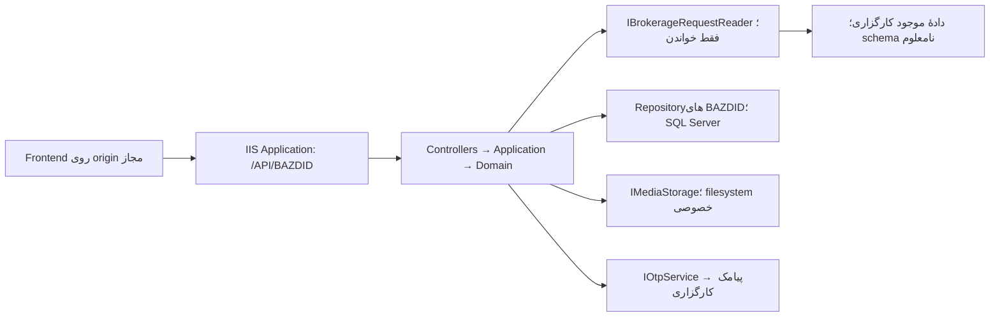

# معماری پیشنهادی و سازگاری محیط

وضعیت: **پیشنهاد برای بازبینی؛ کد هنوز ایجاد نشده است.** معماری یک برنامهٔ ماژولار، با یک deployable و دو پروژهٔ آزمون است. microservice، message broker یا لایه‌های متعدد project برای دامنهٔ فعلی لازم نیست.



## ساختار پیشنهادی پس از تصویب

```text
Bazdid.sln
global.json                         # SDK 2.1.818؛ در Checkpoint 1
src/Bazdid.Api/
  Bazdid.Api.csproj                  # netcoreapp2.1؛ C# 7.3
  Program.cs                        # WebHost.CreateDefaultBuilder
  Startup.cs                        # AddMvc/UseMvc
  Controllers/
  Application/                      # Auth, Information, Inspections, Evidence, Submission
  Domain/                           # قوانین و انتقال‌های وضعیت بدون وابستگی HTTP/SQL
  Contracts/                        # Request/Response DTO؛ جدا از entity و مدل UI
  Validation/
  Authentication/                   # cookie handler، session store، HMAC، CSRF
  Brokerage/                        # interface، synthetic و adapter واقعی جدا
  Infrastructure/Sql/               # connection factory، repositories، transactions
  Infrastructure/Media/
  Infrastructure/Logging/
  Configuration/                    # Options و اعتبارسنجی startup
  Middleware/                       # خطای JSON، correlation، کنترل نرخ
  Fixtures/                         # فقط synthetic؛ gate محیط
tests/Bazdid.UnitTests/
tests/Bazdid.IntegrationTests/       # HTTP، SQL Server تست و فایل موقت
database/                           # scriptهای شماره‌دار BAZDID؛ آینده
deployment/iis/                     # راهنمای عملی و template بدون راز؛ آینده
docs/
```

Controller فقط HTTP/validation ابتدایی را مدیریت می‌کند؛ Application عملیات و transaction را هماهنگ، Domain سیاست را اعمال و Infrastructure ورودی/خروجی را اجرا می‌کند. Interfaceهای کوچک شامل `IBrokerageRequestReader`، `IOtpService`، `ICustomerSessionStore`، `IIdentityDeriver`، `IInspectionRepository`، `IMediaStorage` و `IClock` هستند؛ generic repository سراسری نیاز نیست.

## دسترسی داده و مرز مبدأ

| گزینه | مزیت | هزینه و محدودیت |
|---|---|---|
| EF Core 2.1 | mapping و CRUD و unit of work آشنا؛ migration نسخه‌دار | بدون پشتیبانی؛ خطر migration روی پایگاه مشترک؛ نیاز به mapping دقیق و کنترل SQL؛ schema مبدأ را کشف یا معتبر نمی‌کند |
| ADO.NET با SQL پارامتری | وابستگی کمتر، transaction و permission روشن، script قابل بازبینی DBA | mapping و مدیریت null/پارامتر/خواندن دستی؛ آزمون integration ضروری |
| Dapper سازگار | mapping کم‌حجم‌تر روی SQL کنترل‌شده | dependency اضافه؛ همچنان نیازمند transaction، parameterization و آزمون؛ نسخهٔ جدید قابل فرض نیست |

**پیشنهاد:** ADO.NET پارامتری برای جدول‌های BAZDID و adapter مستقلِ فقط‌خواندنی برای مبدأ؛ Dapper فقط در صورت نیاز واقعی و بررسی نسخه. EF Core 2.1 انتخاب پیش‌فرض نیست. هیچ ORM یا reverse engineering از schema ناشناخته، مجوز تولید query خیالی نیست. queryهای مبدأ فقط پس از دریافت mapping مصوب نوشته می‌شوند.

scriptهای BAZDID در آینده شماره‌دار، دارای checksum و بازبینی هستند. حساب برنامه DDL ندارد و startup migration خودکار انجام نمی‌دهد. به‌جای جدول تاریخچهٔ عمومی یک ابزار، manifest انتشار/DBA نگهداری شود؛ اگر journal در SQL لازم شد، نامش باید `BAZDIDSchemaVersions` باشد و به شمار جدول‌های طرح با تصویب افزوده شود.

## ابزار محلی و نیاز ساخت

بررسی واقعی `2026-11-01`: Windows `10.0.26200`، `win-x64`؛ Git `2.55.0.windows.3`. SDKهای نصب‌شده: `2.1.818`، `3.1.426`، `8.0.427`، `9.0.320`، `10.0.302`، `10.0.400` و `10.0.403`. Runtimeهای لازم `Microsoft.NETCore.App 2.1.30` و `Microsoft.AspNetCore.App 2.1.30` موجودند. انتخاب پیش‌فرض فعلی SDK برابر `10.0.403` است؛ `global.json` وجود ندارد. pin در Checkpoint 1 لازم است.

مبنای ساخت پیشنهادی SDK `2.1.818`، Runtime `2.1.30`، C# `7.3` و editor دلخواه با CLI قدیمی است؛ وجود Visual Studio جدید، سازگاری پروژهٔ قدیمی را تضمین نمی‌کند. نسخه‌ها و نیاز Hosting Bundle در [صفحهٔ رسمی .NET Core 2.1](https://dotnet.microsoft.com/en-us/download/dotnet/2.1) آمده‌اند. دسترسی restore به feed معتبر، صحت TLS، cache بسته‌ها و انتشار x64 باید در محیط جدا و بدون راز Production آزمایش شوند.

## ماتریس dependency پیشنهادی

نسخه‌های زیر **نامزد سازگار از نظر target** هستند، نه مجموعهٔ restore/build/security تأییدشده. هیچ بسته‌ای نصب نشده است. در Checkpoint 1، گراف کامل، advisoryها و سازگاری واقعی بررسی و نسخه‌های دقیق ثبت شوند.

| جزء | پیشنهاد و مدرک |
|---|---|
| ASP.NET Core | `Microsoft.AspNetCore.App` از نسل 2.1 و Runtime نهایی `2.1.30`؛ فایل پروژه مطابق SDK قدیمی، بدون ترکیب packageهای نسل جدید |
| JSON و MVC | serializer موجود MVC یعنی Newtonsoft.Json؛ camelCase، UTC و رفتار null صریح؛ `System.Text.Json` فرض نشود |
| Swagger | نامزد `Swashbuckle.AspNetCore 4.0.1`، target `netstandard2.0`؛ [metadata بسته](https://www.nuget.org/packages/Swashbuckle.AspNetCore/4.0.1). خروجی Swagger 2.0 و UI همان نسخه؛ OpenAPI 3 ادعا نشود |
| SQL client | نامزد `System.Data.SqlClient 4.8.6` با asset `netcoreapp2.1`؛ [metadata بسته](https://www.nuget.org/packages/System.Data.SqlClient/4.8.6). وضعیت منسوخ/امنیت و وابستگی‌های native هنگام restore بازبینی شود |
| گزینهٔ EF | صرفاً مقایسه: `Microsoft.EntityFrameworkCore.SqlServer 2.1.14` با target `netstandard2.0`؛ [metadata بسته](https://www.nuget.org/packages/Microsoft.EntityFrameworkCore.SqlServer/2.1.14) |
| گزینهٔ Dapper | صرفاً در صورت نیاز: `1.60.6` با target `netstandard1.3`؛ [metadata بسته](https://www.nuget.org/packages/Dapper/1.60.6) |
| logging، cookie، antiforgery، Data Protection | قابلیت‌های سازگار پشتهٔ 2.1؛ dependencyهای جدید صرفاً برای تقلید APIهای جدید افزوده نشوند |
| آزمون | xUnit و TestHost از نسل سازگار 2.1؛ نسخهٔ دقیق runner/Test SDK/TestHost پس از بررسی واقعی در Checkpoint 1 تعیین شود |

`UseRouting/UseEndpoints`، Minimal APIs، `IWebHostEnvironment`، `TimeProvider`، `RandomNumberGenerator.GetBytes(int)` و `CryptographicOperations.FixedTimeEquals` در این هدف قابل فرض نیستند؛ معادل سازگار و مقایسهٔ ثابت‌زمان بازبینی‌شده لازم است. از SDK جدید برای توجیه تغییر target استفاده نشود.

## میزبانی، امنیت و مهاجرت

مدل IIS پیشنهادی **out-of-process** است: ANCM درخواست را به Kestrel خصوصی می‌دهد. hosting درون‌پردازه‌ای قابلیت مبنای 2.1 نیست؛ [اعلام رسمی انتقال این قابلیت به نسخهٔ بعد](https://github.com/aspnet/Announcements/issues/302). pool، PathBase و Swagger در [IIS_DEPLOYMENT_FA.md](IIS_DEPLOYMENT_FA.md) تعریف شده‌اند.

نصب محلی Hosting Bundle احراز نشد: فایل‌های متداول ANCM و `appcmd.exe` یافت نشدند؛ این بررسی محدود، inventory کامل registry یا سرور نیست. مقصد باید runtime 2.1 و ANCM سازگار، OS/bitness، TLS و SQL واقعی را اثبات کند. هیچ Windows Server جدیدی صرفاً با اتکا به اجرای احتمالی runtime قدیمی «پشتیبانی‌شده» اعلام نمی‌شود.

پس از رفع الزام زیرساخت، مهاجرت به نسخهٔ دارای پشتیبانی با اجازهٔ مالک برنامه‌ریزی شود: جایگزینی runtime/dependencyها، hosting و cookie، اجرای آزمون قرارداد و SQL و media، حفظ شناسه‌ها و snapshot و بدون شکستن Frontend. اکنون target تغییر نمی‌کند.
