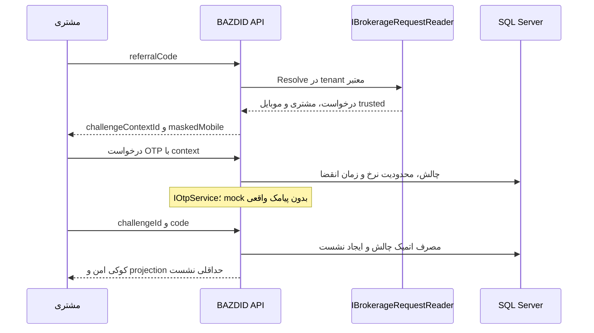

# احراز هویت، هویت مستعار و نشست

وضعیت در پایان Checkpoint 1: این سند همچنان **طراحی آینده** است؛ هیچ OTP، Session، cookie authentication یا CSRF عملیاتی ساخته نشده است. تنظیمات رزروشده فعال نمی‌شوند و `Authentication:Enabled=true` startup را رد می‌کند. در foundation، CORS read-only بدون credential است.

## جریان تأییدشده و طرح پیشنهادی

کد معرفی به‌تنهایی مجوز نیست. موبایل از مبدأ می‌آید و ورودی درخواست OTP/verify شامل موبایل قابل‌انتخاب نیست. context پیش از ورود با nonce تصادفیِ مرورگر و tenant/request معتبر پیوند می‌خورد؛ نمایش فقط شمارهٔ پوشانده است. برای خطاهای resolution پاسخ عمومی و زمان‌بندی کنترل‌شده به‌کار رود؛ افشای معتبر بودن کد یا دو رقم موبایل نیز با محدودیت نرخ کاهش یابد.

`IOtpService` مسئول تولید/ارسال امن کد و نتیجهٔ تحویل است؛ **مرجع verify و مصرف چالش خود BAZDID است**. adapter SMS آینده فقط سرویس کارگزاری را صدا می‌زند. اگر سرویس کارگزاری فقط verify خارجی دارد، این تعارض قبل از integration حل شود و جریان قطعی بی‌اجازه تغییر نکند.

## چرخهٔ چالش و کنترل سوءاستفاده

حالت‌ها: `Resolved → PendingSend → Sent → Consumed` یا `Expired/Locked/SendFailed/Superseded`. در `BAZDIDOtpChallenges`، مرحلهٔ `Resolved` همان context کوتاه‌عمر referral است؛ handle تصادفی و hash nonce مرورگر دارد و OTP MAC هنوز null است. صدور OTP همان زنجیره را به generation قابل verify تبدیل می‌کند؛ context برای درخواست یا مرورگر دیگر قابل استفاده نیست. به این ترتیب context پیش از ورود هم پایدار و بین instanceها معتبر است و به جدول master جدید نیاز ندارد.

OTP با RNG سازگار امن تولید و با secret جدا + `challengeId` به‌صورت MAC ذخیره می‌شود؛ hash بدون secret برای فضای کوچک OTP کافی نیست. کد خام فقط تا فراخوانی SMS در حافظه لازم است؛ در response/log/SQL plaintext نمی‌ماند.

چالش شامل ID تصادفی opaque، context/request/customer، مرجع موبایل معتبر حفاظت‌شده، TTL، شمار تلاش، زمان resend، generation، زمان مصرف و `rowversion` است. مقایسه ثابت‌زمان و UPDATE شرطی باید رقابت دو verify را به دقیقاً یک مصرف و یک نشست محدود کند. تلاش ناموفق، قفل و rate counter در SQL و بین instanceها اتمیک‌اند. resend شمار تلاش/سقف پنجره را دور نمی‌زند؛ نسل قبلی را نامعتبر می‌کند.

| سیاست | پیشنهاد اولیه، نیازمند تصویب امنیت/محصول |
|---|---|
| زمان اعتبار OTP | ۱۲۰ ثانیه |
| تلاش هر چالش | حداکثر ۵ |
| فاصلهٔ resend | ۶۰ ثانیه |
| سقف ارسال | ۵ ارسال در ۱۵ دقیقه برای زمینهٔ موبایل/درخواست؛ محدودیت مستقل IP و tenant |
| context پیش از ورود | ۵ دقیقه؛ مصرف فقط برای همان مرورگر/درخواست |

این اعداد از رفتار mock الهام گرفته‌اند و policy Production نیستند. نرخ lookup referral، verify و resend مستقل است؛ پیام `429` و `Retry-After` بدون اطلاعات حساس داده شود. IP از header دلخواه client پذیرفته نمی‌شود. اختلال SQL یا rate store دسترسی آزاد ایجاد نمی‌کند. timeout SMS با correlation/generation و dedupe مدیریت شود؛ کلید idempotency نباید OTP یا `Set-Cookie` را ذخیره/بازپخش کند.

برای verify تکرارشده پس از پاسخ گم‌شده، چالش مصرف‌شده قابل ورود دوباره نیست؛ مرورگر ابتدا نشست خود را می‌خواند و اگر کوکی دریافت نشده باشد OTP تازه می‌گیرد. این محدودیت امن صریح است و با replay کد حل نمی‌شود.

## fixture و جلوگیری از bypass

`A4K9P2` و `12345` فقط در `Development` یا `Test` **و** flag صریح fixture مجازند. موبایل، مشتری و درخواست همگی ساختگی و خروجی شبکهٔ SMS در این حالت مسدودند. Production باید با هر کدام از adapterهای ساختگی، flag تست، secret پیش‌فرض یا نبود provider واقعی متوقف شود. هیچ fallback به `12345` پس از خطای سرویس وجود ندارد. آزمون startup با ترکیب‌های محیط/flag و کد ثابت در محیط غیرآزمایشی لازم است.

## نشست سروری پایدار

پیشنهاد: cookie authentication سازگار 2.1 با ticket store SQL (`ICustomerSessionStore` و adapter `ITicketStore`)؛ مرورگر فقط handle تصادفی و حفاظت‌شده دارد. رکورد `BAZDIDCustomerSessions` شامل session ID/handle hash، RequestContextId، CustomerLinkId، مرجع موبایل تأییدشده یا hash آن با key version، `AuthenticatedAt`، idle/absolute expiry، `LastSeenAt`، `RevokedAt` و concurrency است. ticket حساس در سرور با Data Protection حفاظت می‌شود. اعتبار نشست در هر درخواست، مستقل از ادعای معتبر بودن cookie، بررسی می‌شود.

پیشنهاد زمان نشست: idle برابر ۳۰ دقیقه و absolute برابر ۸ ساعت؛ هر دو بازند. sliding، absolute را افزایش نمی‌دهد. تمدید و آخرین‌دیدن write amplification کنترل‌شده دارد؛ logout و ابطال در SQL اتمیک‌اند. پس از verify شناسهٔ تازه صادر و context ناشناس مصرف شود؛ session fixation مردود است. scope مشتری همان درخواست است و چک مالکیت SQL برای هر inspection/evidence دوباره انجام می‌شود.

cookie پیشنهادی: نام اختصاصی `BAZDID.Customer`، `HttpOnly`، `Secure`، بدون Domain مشترک، `Path=/API/BAZDID` و expiry همسو با سرور. از پیشوند `__Host-` با این Path استفاده نشود، چون آن پیشوند `Path=/` می‌خواهد. API برای ناشناس `401` و برای منع مجوز `403` می‌دهد؛ redirect HTML به login نمی‌دهد. نشست در localStorage یا JSON حاوی token عمومی ذخیره نمی‌شود.

دو subdomain HTTPS یک دامنهٔ ثبت‌پذیر معمولاً same-site و cross-origin هستند؛ پیشنهاد اولیه `SameSite=Lax` همراه `credentials: include` و CORS دقیق است. اگر دامنه‌ها واقعاً cross-site شدند، `None; Secure` و محدودیت مرورگرها باید جدا بررسی شوند. در 2.1 semantics وصله‌های SameSite و نبود enum جدید `Unspecified` را رعایت کنید؛ نمونهٔ 3.1 را مستقیم کپی نکنید. [توضیح رسمی وصله‌های SameSite](https://devblogs.microsoft.com/dotnet/upcoming-samesite-cookie-changes-in-asp-net-and-asp-net-core/).

CSRF برای تمام mutationهای cookie-based، از جمله ورود/خروج و upload لازم است. یک GET پیشنهادی `auth/csrf`، request token را در JSON با `no-store` به origin مجاز می‌دهد؛ cookie antiforgery مستقل و امن می‌ماند. Frontend token را در `X-CSRF-TOKEN` می‌فرستد؛ پس از تغییر هویت token تازه می‌گیرد. کنترل `Origin`/`Referer` معتبر مکمل است؛ CORS یا SameSite جای token نیست. preflight بدون احراز، ولی با origin/method/header allowlist پاسخ می‌گیرد.

## Data Protection و restart

key ring خارج از پوشهٔ release و media، با ACL اختصاصی pool و application discriminator ثابت و مختص نصب نگهداری شود. persist فایل به‌تنهایی encryption-at-rest را تضمین نمی‌کند؛ DPAPI متناسب با حساب/ماشین یا گواهی مصوب لازم است. در چند instance، SQL مشترک و key ring و گواهی قابل استفادهٔ همهٔ instanceهای مجاز لازم است؛ DPAPI وابسته به یک ماشین کافی نیست. کلیدهای قدیمی تا پوشش ticketها، داده‌های حفاظت‌شده و backupهای لازم حفظ و بازیابی آزمایش شود. [ملاحظات ذخیرهٔ کلید در Microsoft Learn](https://learn.microsoft.com/en-us/aspnet/core/security/data-protection/implementation/key-storage-providers?view=aspnetcore-5.0).

## HMAC هویت درخواست

پیشنهاد تابع: `HMAC-SHA256(K_identity_vN, CanonicalPayload)` با خروجی کامل ۲۵۶بیتی و encoding مشخص base64url یا hex. ورودی شامل نسخهٔ فرمت، BrokerageId، `NormalizedMobile` و referral معتبر همان درخواست است. فیلدها با UTF-8 و length-prefix encode شوند؛ اتصال مبهم با `|` و نبود escaping مجاز نیست. شمارهٔ ایران پس از تبدیل ارقام، حذف جداکنندهٔ مجاز و اعتبارسنجی، به `+98...` canonical می‌شود. referral فعلی trim و uppercase و شش ASCII alphanumeric است؛ این رفتار منبع واقعی باید تأیید شود. Tenant از تنظیمات سرور می‌آید.

این خروجی `RequestIdentityHmac` است؛ یک مشتری با دو referral دو HMAC دارد. `BAZDIDCustomerLinks.Id` تصادفی و ثابت، نگاشت حداقلی مشتری مبدأ و کلید پوشه است. شناسهٔ درخواست مبدأ جدا حفظ می‌شود؛ HMAC نه master مشتری، نه تنها کلید مالکیت است. اگر referral برای دو درخواست قابل تکرار باشد، lookup باید با `sourceRequestId` تفکیک شود؛ به یکتایی HMAC به‌تنهایی تکیه نمی‌شود.

کلید HMAC خارج Git در secret store مصوب با ACL است و از secret OTP و Data Protection جداست. در `BAZDIDRequestContexts`، hash/keyId جاری و قبلی برای overlap محدود نگه داشته شود. lookup اول با sourceRequestId معتبر و سپس hash نسخه‌های فعال انجام می‌شود؛ در ورود معتبر بعدی با دادهٔ trusted، hash تازه محاسبه و linkage ثابت حفظ می‌شود. کلید قبلی تا پایان بازنگاشت لازم نگه داشته و rotation دوم پیش از اتمام overlap انجام نشود. برای پروندهٔ غیرفعال، hash بدون موبایل خام قابل بازتولید نیست؛ از source adapter معتبر یا نگهداری محدود کلید قبلی طبق policy استفاده شود. collision احتمالی نباید باعث اتصال خودکار دو مشتری شود.

plaintext موبایل در جدول اصلی تکرار نمی‌شود؛ برای ارسال، موقتاً از adapter یا ciphertext کوتاه‌عمر چالش استفاده می‌شود. HMAC دادهٔ مستعار و همچنان حساس است؛ در پاسخ عمومی و log لازم نیست. password کارکنان از این الگوریتم هویت جداست؛ [طرح staff و امنیت](SECURITY_FA.md).
