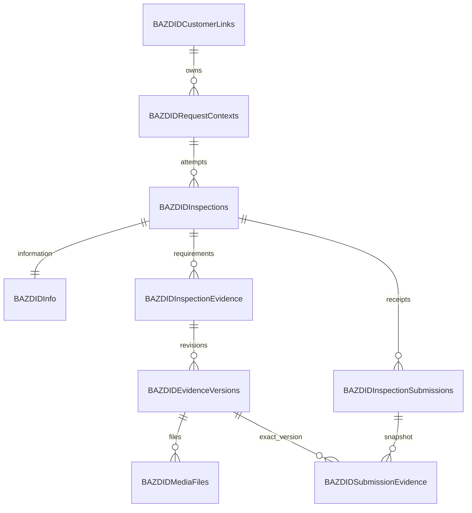

# طرح پیشنهادی SQL Server

**وضعیت: طراحی، بدون DDL جدید یا اجرای SQL.** SQL Server موجود کارگزاری مقصد نهایی است، اما نسخه، compatibility، collation، schema و نام اشیای مبدأ نامعلوم‌اند. طرح تاریخی [۳۷ جدول](reference/sql/schema-manifest.json) یک پیشنهاد کامل محصول بود؛ اجرای یکجای آن برای شروع مشتری توصیه نمی‌شود.

## اصول و تصمیم پیشنهادی

تمام جدول‌های تازه با `BAZDID` شروع می‌شوند. نام schema مالک BAZDID باید با DBA تعیین شود؛ استفاده از `dbo` یا ایجاد schema تازه اکنون قطعی نیست. جدول‌های اصلی مشتری و درخواست بیمه تکثیر نمی‌شوند. دو جدول linkage زیر فقط شناسه و رابطهٔ لازم BAZDID را دارند و master تجاری نیستند. هیچ نام یا FK خیالی برای جداول کارگزاری تعریف نمی‌شود.

ADO.NET و SQL پارامتری، connection کوتاه‌عمر، timeout/cancellation، transaction صریح و retry محدود برای عملیات واقعاً قابل تکرار پیشنهاد می‌شود. account برنامه DDL ندارد. script شماره‌دار فقط در پایگاه تست مصوب اجرا می‌شود؛ پیش از Production، diff و permission و backup/restore باید تصویب شوند. schema قدیمی مرجع با نام‌های بدون پیشوند قابل اجرا نیست.

شناسه‌های داخلی `uniqueidentifier` تصادفی سمت سرور، شناسهٔ خارجی رشته با طول مصوب mapping و زمان‌ها UTC با `datetime2(3)` پیشنهاد می‌شوند. فیلد nullable واقعاً `NULL` است. نسخهٔ هم‌زمانی `rowversion`، opaque و در DTO به base64 منتقل می‌شود؛ زمان یا عدد قابل افزایش در مرورگر نیست. هزینهٔ random GUID index در تست حجم سنجیده شود؛ clustered index فیزیکی الزاماً PK GUID نیست.

## ۱۷ جدول پیشنهادی مشتری؛ ساخت تدریجی

| جدول | مسئولیت و حداقل کلیدها | checkpoint ایجاد |
|---|---|---|
| `BAZDIDCustomerLinks` | `Id`، `BrokerageId/SourceSystem/SourceCustomerId` یکتا؛ فقط linkage، بدون پروفایل یا credential مشتری | 2 |
| `BAZDIDRequestContexts` | `Id`، CustomerLinkId، sourceRequestId معتبر، referral lookup HMAC، HMAC هویت/keyId جاری و قبلی، نسخهٔ منبع و زمان | 2 |
| `BAZDIDAuditLogs` | عامل مستعار، action/resource/correlation، metadata حداقلی و UTC؛ append-only | 2 |
| `BAZDIDOtpChallenges` | context کوتاه‌عمر با حالت Resolved و nonce مرورگر، challenge handle hash، purpose، ciphertext حداقلی موبایل، OTP MAC nullable تا صدور، generation، تلاش و send/expiry/consumption/rowversion | 3 |
| `BAZDIDCustomerSessions` | handle hash یکتا، request/customer، مرجع موبایل verified، زمان احراز/انقضا/ابطال و ticket حفاظت‌شده | 3 |
| `BAZDIDRateLimitBuckets` | کلید مستعار محدودیت، operation/window، counter و expires؛ uniqueness و UPDATE اتمیک بین instanceها | 3 |
| `BAZDIDInspections` | context، attemptNumber، previousInspectionId، IsCurrent، status، tracking، snapshot قالب/version/hash و rowversion | 4 |
| `BAZDIDInfo` | یک ردیف برای هر inspection؛ دادهٔ خودرو/هویت مرجع، منشأ، اعتبارسنجی، کیلومتر و تأییدها | 4 |
| `BAZDIDInspectionStatusHistory` | inspection، from/to، actor، reason و زمان؛ تغییرناپذیر | 4 |
| `BAZDIDIdempotencyRecords` | scope+command+key یکتا، requestHash، حالت/lease، نتیجهٔ مجاز و expiry؛ بدون OTP/cookie | 4 |
| `BAZDIDInspectionLocations` | InspectionId یکتا، lat/lng، accuracy nullable، آدرس/جزئیات و client/server timestamps | 5 |
| `BAZDIDInspectionConsents` | inspection، نسخهٔ شرایط، عامل معتبر، acceptedAt؛ unique نسخهٔ رضایت در همان تلاش | 5 |
| `BAZDIDInspectionEvidence` | جایگاه logical الزام، inspection و current/pending version؛ unique `(InspectionId, RequirementKey)` | 6 |
| `BAZDIDEvidenceVersions` | evidence، inspection، revision/replaces، alternative واقعی، وضعیت انتقال/بررسی و زمان | 6 |
| `BAZDIDMediaFiles` | version، variant، relativePath یکتا، hash/size/MIME، ابعاد/مدت، upload handle/state/lease/expiry و retention | 6 |
| `BAZDIDInspectionSubmissions` | inspection، شمارهٔ ارسال، tracking/receipt یکتا، snapshot و hash نسخهٔ ثابت، submittedAt | 7 |
| `BAZDIDSubmissionEvidence` | submission+evidence، ارجاع به **نسخهٔ دقیق** با مالکیت همان inspection | 7 |

شمار ۱۷ پیشنهادِ پایان دامنهٔ مشتری است؛ همه در Checkpoint 2 ساخته نمی‌شوند. journal اختیاری migration جزو این شمار نیست؛ [معماری](ARCHITECTURE_FA.md) دربارهٔ `BAZDIDSchemaVersions` توضیح می‌دهد. جدول جداگانهٔ `BAZDIDInspectionAttempts` لازم نیست، چون هر inspection همان تلاش مستقل است.

## محور `BAZDIDInfo`

پیشنهاد ساده، ستون‌های typed و منشأ صریح کنار هر فیلد است؛ EAV و جدول عمومی field-value برای چند فیلد محدود نیاز نیست. snapshot کامل ارسال در `BAZDIDInspectionSubmissions` قرار می‌گیرد و جای ستون‌های قابل query را نمی‌گیرد.

| گروه | ستون‌های پیشنهادی و قواعد |
|---|---|
| رابطه و منبع | `InspectionId` به‌عنوان PK/FK، `RequestContextId`، `SourceCustomerReference`، `SourceRequestReference`، `SourceSnapshotVersion` و `SourceRetrievedAt`؛ consistency با context بازدید |
| خودرو | `Make/Model` حداکثر پیشنهادی ۱۰۰ نویسه، `ModelYear int NULL`، `ColorName nvarchar(80) NULL`، `ColorHex char(7) NULL` |
| پلاک | `PlateFirstTwo char(2)`، `PlateLetter nvarchar(3)`، `PlateThree char(3)` و `PlateRegion char(2)`؛ یک فیلد منطقی اتمیک، نه مخلوط قطعه‌های trusted و manual |
| VIN/شاسی | `VinMasked`؛ در صورت اثبات نیاز، مقدار کامل در ciphertext حفاظت‌شده همراه key/purpose version، بدون بازگرداندن عمومی. masked value به‌عنوان VIN کامل validate نشود |
| منشأ و وضعیت | برای هر فیلد منطقی `XSource = Brokerage/Manual/NULL` و `XStatus = Missing/Valid/InvalidSource`؛ برای دادهٔ manual تأییدنشده `PendingValidation` مجاز؛ `XValidatedAt` در صورت نیاز |
| کیلومتر | `OdometerKm bigint NULL`، `OdometerUpdatedAt` و مرجع عکس اختیاری؛ CHECK بازهٔ فنی و سپس سقف مصوب؛ صفر معتبر |
| تأیید و مغایرت | `VehicleConfirmedAt`، `ValidationRuleVersion`، `ValidationStatus`، گزارش مغایرت محدود و غیرمحرمانه؛ ردیابی قفل پس از submit |
| نسخه و زمان | `CreatedAt/UpdatedAt/FinalizedAt`، `rowversion`؛ actor از نشست، نه payload |

حداکثر طول، نیاز full VIN، تقویم سال و enumهای SQL در Checkpoint 4 پیش از DDL نهایی تصویب شوند. به‌جای JSON آزادِ منشأ، ستون‌های محدود و قابل constraint انتخاب شده‌اند. فیلد اختیاری `colorHex` و صفرهای معنادار از دادهٔ مفقود تفکیک می‌شوند. origin `Brokerage` بدون مقدار معتبر و فیلد manual با مقدار invalid، تأیید نهایی نمی‌شود.

در ایجاد inspection، snapshot خواندنی + Info اولیه + status history + نتیجهٔ idempotency یک transaction دارند. تغییر Info با `WHERE InspectionId + ExpectedRowVersion` و کنترل owner/status انجام می‌شود. صفر ردیف به معنای موفقیت نیست؛ stale برابر `409 VERSION_CONFLICT` است. submit، Info را قفل و دادهٔ نهایی و منشأ را در snapshot تغییرناپذیر تثبیت می‌کند؛ پس از آن refresh منبع آن را بازنویسی نمی‌کند.

## روابط و قیود حیاتی

- یکتایی درخواست: `(BrokerageId, SourceSystem, SourceRequestId)`؛ مشتری مبدأ با دو درخواست، یک link و دو context دارد.
- یک تلاش current در هر context با index فیلترشده در صورت پشتیبانی نسخهٔ SQL؛ در غیر این صورت قفل/transaction معادل پس از تعیین نسخه. `attemptNumber` یکتا و previousInspectionId متعلق به همان context است.
- pointer نسخه و همهٔ FKهای evidence/submission باید همان inspection را تضمین کنند؛ FK ترکیبی و کنترل transaction از اتصال نسخهٔ پروندهٔ دیگر جلوگیری می‌کند. حذف cascade تاریخچه/receipt توصیه نمی‌شود.
- revision key برای همان evidence یکتا؛ فایل immutable با relativePath یکتا؛ hash `binary(32)` فقط checksum است، باینری رسانه نیست.
- snapshot JSON، metadata است و SQL Server جدید/قابلیت JSON فرض نمی‌شود. parse/validation در برنامه انجام می‌شود؛ `ISJSON/OPENJSON` تنها پس از احراز نسخه/compatibility.
- شناسه‌های مبدأ و HMACها با collation/encoding صریح و مناسب مقایسه شوند؛ طول، index bytes و semantics case قبل از DDL بررسی شوند.

## بازبینی هر ۳۷ جدول مرجع

| پیشنهاد قدیمی | تصمیم برای دامنهٔ مشتری |
|---|---|
| `Customers` | فقط linkage در `BAZDIDCustomerLinks`؛ master جدید ممنوع |
| `SourceInsuranceRequests` | linkage در `BAZDIDRequestContexts`؛ master درخواست تکثیر نشود |
| `InspectionTemplates` | فعلاً manifest نسخه‌دارِ ثابت در کد آینده و snapshot روی inspection؛ مدیریت قالب در Checkpoint 8 |
| `EvidenceRequirements` | فعلاً از همان manifest پین‌شده؛ جدول مستقل اکنون لازم نیست |
| `RequirementAlternatives` | فعلاً چهار گزینه در همان manifest معتبر؛ جدول مستقل اکنون لازم نیست |
| `Inspections` | `BAZDIDInspections`؛ تلاش‌ها در همین جدول |
| `Vehicles` | ادغام در `BAZDIDInfo` با منشأ و metadata |
| `InspectionLocations` | `BAZDIDInspectionLocations` |
| `InspectionConsents` | `BAZDIDInspectionConsents` |
| `OdometerReadings` | ستون‌های عددی و نسخه‌دار `BAZDIDInfo`؛ مستقل از عکس |
| `InspectionEvidence` | `BAZDIDInspectionEvidence` |
| `EvidenceVersions` | `BAZDIDEvidenceVersions` |
| `MediaFiles` | `BAZDIDMediaFiles`؛ فقط metadata |
| `UploadSessions` | برای whole-file retry فعلاً در `BAZDIDMediaFiles`؛ uploadId/lease/state مجزا؛ chunk resume آینده نیازمند بازبینی |
| `MediaProcessingJobs` | کنترل امنیتی دریافت در completion؛ transcoding/worker تخصصی بعداً؛ job پایدار تنها اگر پردازش async لازم شود |
| `StaffUsers` | آینده: `BAZDIDStaffUsers`؛ credential واحد |
| `StaffRoleAssignments` | آینده: `BAZDIDStaffRoleAssignments` |
| `StaffOperationsSettings` | Checkpoint 8؛ شروع مشتری نیاز ندارد |
| `ReviewerAssignments` | Checkpoint 8؛ با تاریخچه و مجوز لحظهٔ تصمیم |
| `InspectionSubmissions` | `BAZDIDInspectionSubmissions` |
| `SubmissionEvidence` | `BAZDIDSubmissionEvidence` |
| `EvidenceReviews` | Checkpoint 8؛ تصمیم نسخهٔ دقیق |
| `InspectionReviews` | Checkpoint 8؛ مستقل از forwarding |
| `CorrectionRequests` | Checkpoint 8؛ scope اصلاح |
| `CorrectionItems` | Checkpoint 8؛ نسخه و اصل محفوظ |
| `InternalNotes` | Checkpoint 8؛ خارج projection مشتری |
| `InspectionStatusHistory` | `BAZDIDInspectionStatusHistory` |
| `IdempotencyRecords` | `BAZDIDIdempotencyRecords` |
| `ForwardingJobs` | Checkpoint 8؛ outbox و ack مصوب |
| `ForwardingAttempts` | Checkpoint 8؛ تلاش‌ها و نتیجهٔ مبهم |
| `BrandingAssets` | Checkpoint 8؛ مستقل از media خصوصی |
| `SiteSettingsVersions` | Checkpoint 8؛ انتشار برند |
| `SiteSettings` | Checkpoint 8؛ اکنون provider موجود Frontend بازطراحی نمی‌شود |
| `SiteSettingsAssetLinks` | Checkpoint 8؛ در صورت نیاز واقعی |
| `WebhookSubscriptions` | بعداً و تنها با مقصد allowlist؛ برای مشتری لازم نیست |
| `AuditLogs` | `BAZDIDAuditLogs`؛ از ابتدا |
| `NotificationOutbox` | مشروط به قرارداد اعلان؛ خارج شروع مشتری |

auth/session/rate جدول‌های تازهٔ پیشنهادی‌اند که در ۳۷ جدول پوشش کافی نداشتند. هیچ‌یک از نام‌های آینده بدون پیشوند مجاز نیست. `BAZDIDAdmin` نیز الزام جدید مالک است و در طرح آینده به staff مشترک پیوند می‌خورد؛ [امنیت و کارکنان](SECURITY_FA.md).

## برنامهٔ پایگاه و بازیابی

ابتدا نسخه/compatibility و دسترسی تست تحویل، سپس scriptهای BAZDID هر checkpoint بازبینی و روی test DB مستقل اجرا شوند. آزمون از پایگاه خالی، ارتقای نسخهٔ قبلی، اجرای دوبارهٔ امن، rollback عملیاتی و restore لازم است. rollback destructive دادهٔ مشتری پذیرفته نیست؛ ترجیح rollback برنامه با schema سازگار و forward-fix است. برنامهٔ واقعی index/حجم، retention و recovery قبل از انتشار نهایی با DBA تعیین شود.

grant SELECT مبدأ و DML اشیای BAZDID جداست؛ کاربر برنامه `db_owner` یا دسترسی عمومی به جدول‌های دیگر نمی‌گیرد. SQL audit، backup رمزگذاری‌شده و پیوند backup فایل/DB باید هماهنگ باشند. Production تا mapping و مجوز مستقل مسدود می‌ماند، ولی fixture تست مانع برنامه‌ریزی نیست.
