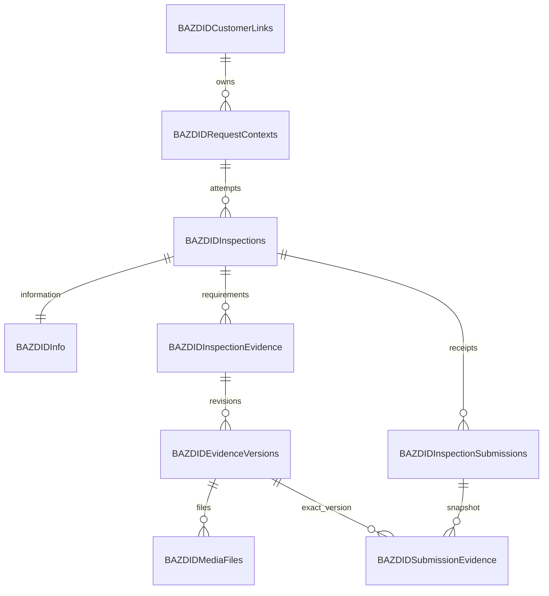

# طرح پیشنهادی SQL Server

**وضعیت 2C: سه جدول اولیه در `BAZDID_Development` ساخته و روی SQL Server واقعی بررسی شدند.** instance محلی `SQLSERVER2019` نسخهٔ `15.0.2000.5` دارد؛ پایگاه تازه با compatibility `150`، collation برابر `SQL_Latin1_General_CP1_CI_AS` و recovery برابر SIMPLE است. چهار پایگاه سیستمی از نظر تنظیمات بررسی‌شده تغییر نکردند. این، schema کارگزاری یا SQL runtime برنامه نیست؛ نسخه/schema Production هنوز تأیید نشده‌اند. [فرایند و شواهد واقعی 2C](implementation/CHECKPOINT-02C-DATABASE-CREATION_FA.md). طرح تاریخی [۳۷ جدول](reference/sql/schema-manifest.json) پیشنهاد محصول است و یکجا اجرا نمی‌شود.

## اصول و تصمیم پیشنهادی

تمام جدول‌های تازه با `BAZDID` شروع می‌شوند. نام schema مالک BAZDID باید با DBA تعیین شود؛ استفاده از `dbo` یا ایجاد schema تازه اکنون قطعی نیست. جدول‌های اصلی مشتری و درخواست بیمه تکثیر نمی‌شوند. دو جدول linkage زیر فقط شناسه و رابطهٔ لازم BAZDID را دارند و master تجاری نیستند. هیچ نام یا FK خیالی برای جداول کارگزاری تعریف نمی‌شود.

ADO.NET و SQL پارامتری، connection کوتاه‌عمر، timeout/cancellation، transaction صریح و retry محدود برای عملیات واقعاً قابل تکرار پیشنهاد می‌شود. account برنامه DDL ندارد. script شماره‌دار فقط در پایگاه تست مصوب اجرا می‌شود؛ پیش از Production، diff و permission و backup/restore باید تصویب شوند. schema قدیمی مرجع با نام‌های بدون پیشوند قابل اجرا نیست.

شناسه‌های داخلی `uniqueidentifier` تصادفی سمت سرور، شناسهٔ خارجی رشته با طول مصوب mapping و زمان‌ها UTC با `datetime2(3)` پیشنهاد می‌شوند. فیلد nullable واقعاً `NULL` است. نسخهٔ هم‌زمانی `rowversion`، opaque و در DTO به base64 منتقل می‌شود؛ زمان یا عدد قابل افزایش در مرورگر نیست. هزینهٔ random GUID index در تست حجم سنجیده شود؛ clustered index فیزیکی الزاماً PK GUID نیست.

## سه جدول اولیه — طراحی اجرا و آزموده‌شده در 2C محلی

در 2A/2B فقط script برای بازبینی تهیه شد؛ سپس مالک در `553dc9cd-5abe-4eb0-9856-ee1763d5250b` اجرای محدود پایگاه/سه جدول را صریحاً مجاز کرد. schema تست محلی **dbo** است. [نسخهٔ نهایی guarded جدول‌ها](../database/proposals/initial_tables.review.sql) با وضعیت واقعی تطبیق داده شد؛ اصلاح CHECK tenant در بخش بعد شرح دارد. تمام طول‌ها و نام‌های زیر BAZDID متعلق به این schema محلی هستند و mapping فیزیکی کارگزاری محسوب نمی‌شوند. هیچ master مشتری، موبایل plaintext، referral خام یا رسانه‌ای ذخیره نمی‌شود؛ همهٔ داده‌های آزمایش rollback شدند.

verification واقعی ۳ جدول/۳۹ ستون/۱۰ index، سه PK، سه unique، یک FK و ۱۳ CHECK فعال و trusted را تأیید کرد. دو rowversion، دو computed persisted، زمان UTC، حفظ case/فاصله/Unicode/شناسهٔ بزرگ و ۳۵ CASEِ rollback-only آزموده شدند. عبارت قدیمی `[^A-Za-z0-9_-]` خط تیره/زیرخط را رد می‌کرد؛ سه CHECK با `REPLACE(value,N'-',N'') NOT LIKE N'%[^A-Za-z0-9_]%'` و WITH CHECK تصحیح شدند. این REPLACE فقط در آزمون alphabet است و شناسهٔ ذخیره‌شده را تغییر نمی‌دهد. [metadata](checkpoint2c/SCHEMA_VERIFICATION.json) و [نتایج SQL](checkpoint2c/ROLLBACK_TEST_RESULTS.json) جزئیات واقعی را دارند؛ parser به‌تنهایی معیار نبود.

### `BAZDIDCustomerLinks`

هدف: یک linkage به مشتری خارجی در محدودهٔ tenant/source؛ بدون تکثیر پروفایل یا credential مشتری.

| ستون | نوع و nullability | قاعده |
|---|---|---|
| `Id` | `uniqueidentifier NOT NULL` | PK؛ تصادفی سمت سرور، بدون default مرورگر |
| `BrokerageId`, `SourceSystem` | هرکدام `nvarchar(32) NOT NULL` | شناسهٔ تنظیم‌شدهٔ سرور؛ collation برابر `Latin1_General_100_BIN2`؛ CHECK غیرخالی و حروف ASCII/رقم/خط تیره/زیرخط؛ شکل canonical در برنامه |
| `SourceCustomerId` | `nvarchar(128) NOT NULL` | opaque؛ حفظ UTF-16 دقیق، CHECK طول بایتی مثبت؛ طول واقعی پس از mapping بازبینی شود |
| `SourceCustomerIdKey` | computed persisted از `CONVERT(varbinary(256), SourceCustomerId)` | کلید مقایسهٔ دقیق، بدون trim/case folding؛ بایت رسانه یا credential نیست |
| `CreatedAtUtc`, `UpdatedAtUtc` | هرکدام `datetime2(3) NOT NULL` | default برابر `SYSUTCDATETIME()`؛ CHECK ترتیب زمان؛ UpdatedAt در UPDATE صریح تغییر می‌کند |
| `RowVersion` | `rowversion NOT NULL` | CAS در repository آینده؛ زمان نیست |

قید unique روی `(BrokerageId, SourceSystem, SourceCustomerIdKey)` و unique کمکی روی `(BrokerageId, SourceSystem, Id)` برای FK همان tenant است. `BIN2` به‌تنهایی تمایز trailing space در مقایسهٔ رشته‌ای SQL را تضمین نمی‌کند؛ کلید محاسبه‌شدهٔ بایتی، مورد `A` و `A ` را جدا نگه می‌دارد. با سقف پیشنهادی طول‌ها، کلید unique اصلی ۳۸۴ بایت است. PK از نوع clustered GUID صرفاً مبنای تست کم‌حجم است؛ هزینهٔ index/fragmentation پیش از حجم واقعی سنجیده شود. FK به Customer کارگزاری ساخته نمی‌شود.

### `BAZDIDRequestContexts`

هدف: linkage یک درخواست بیمه به مشتریِ حل‌شده؛ یک مشتری می‌تواند چند context داشته باشد. درخواست بدون مالک قابل تأیید، با ساخت مشتری حدسی وارد این جدول نمی‌شود.

| ستون | نوع و nullability | قاعده |
|---|---|---|
| `Id` | `uniqueidentifier NOT NULL` | PK؛ تولید سروری |
| `BrokerageId`, `SourceSystem` | هرکدام `nvarchar(32) NOT NULL` | همان قرارداد و collation جدول links |
| `CustomerLinkId` | `uniqueidentifier NOT NULL` | FK ترکیبی با tenant/source به links؛ بدون cascade |
| `SourceRequestId` | `nvarchar(128) NOT NULL` | شناسهٔ opaque؛ `OrderSales.Id` در صورت تصویب mapping، بدون کاهش bigint به int/عدد JavaScript رشته می‌شود |
| `SourceRequestIdKey` | computed persisted از `CONVERT(varbinary(256), SourceRequestId)` | کلید unique همراه tenant/source؛ حفظ مقایسهٔ دقیق |
| `ReferralLookupHmac` | `binary(32) NULL` | HMAC-SHA256 با purpose/key جدا و ورودی قاب‌بندی‌شدهٔ tenant/source/code؛ lookup است، مجوز نیست |
| `ReferralKeyId` | `varchar(32) NULL` | فقط همراه HMAC مقدار دارد؛ key در SQL نیست |
| `IdentityHmac`, `PreviousIdentityHmac` | هرکدام `binary(32) NULL` | شناسهٔ مستعار جاری/قبلی؛ تا پیاده‌سازی احراز مقداردهی نمی‌شوند |
| `IdentityKeyId`, `PreviousIdentityKeyId` | هرکدام `varchar(32) NULL` | هر زوج hash/keyId با CHECK هم‌زمان NULL یا non-NULL |
| `EligibilityStatus` | `varchar(16) NOT NULL` | `Eligible/Ineligible/Unknown`؛ نگاشت Status منبع نیست و Unknown مجوز ورود نمی‌دهد |
| `SourceVersion` | `nvarchar(128) NULL` | نسخهٔ opaque مصوب؛ نبود نسخه، زمان دریافت را معادل آن نمی‌کند |
| `SourceRetrievedAtUtc` | `datetime2(3) NOT NULL` | زمان دریافت trusted snapshot سمت سرور |
| `CreatedAtUtc`, `UpdatedAtUtc` | هرکدام `datetime2(3) NOT NULL` | default UTC، CHECK ترتیب و UPDATE صریح |
| `RowVersion` | `rowversion NOT NULL` | UPDATE با Id/tenant/نسخهٔ مورد انتظار؛ صفر ردیف موفقیت نیست |

unique روی `(BrokerageId, SourceSystem, SourceRequestIdKey)`؛ index برای `CustomerLinkId` و index فیلترشدهٔ غیرunique برای `(BrokerageId, SourceSystem, ReferralKeyId, ReferralLookupHmac)` پیشنهاد شد. uniqueness کد معرفی هنوز نامعلوم است؛ چند نتیجه باید `Ambiguous` بماند. index hash نباید باعث انتخاب اولین درخواست شود. FK داخلی ترکیبی از اتصال مشتری tenant دیگر جلوگیری می‌کند؛ هیچ FK به OrderSales کارگزاری وجود ندارد. refresh موبایل/مالک/eligibility و ابطال چالش/نشست در طراحی Checkpoint 3 با transaction همسو خواهد شد.

### `BAZDIDAuditLogs`

هدف: رویداد حداقلی append-only، مستقل از حفظ دائمی ردیف منبع و بدون payload آزاد.

| ستون | نوع و nullability | قاعده |
|---|---|---|
| `Id` | `bigint IDENTITY(1,1) NOT NULL` | PK clustered؛ ترتیب تخصیص شناسه تضمین ترتیب commit نیست |
| `OccurredAtUtc` | `datetime2(3) NOT NULL` | default UTC؛ ساعت سرور مبناست |
| `BrokerageId`, `SourceSystem` | هرکدام `nvarchar(32) NOT NULL` | context معتبر تنظیمات؛ collation BIN2 |
| `RequestContextId` | `uniqueidentifier NULL` | مرجع داخلی اختیاری؛ resolve ناموفق ممکن است context نداشته باشد |
| `ActorType` | `varchar(16) NOT NULL` | CHECK برابر `System/Anonymous/Customer/Staff` |
| `ActorId` | `uniqueidentifier NULL` | شناسهٔ داخلی معتبر؛ نه header یا payload مشتری |
| `ActionCode` | `varchar(64) NOT NULL` | کد allowlist، بدون متن آزاد |
| `OutcomeCode`, `ResourceType` | هرکدام `varchar(32) NOT NULL` | کدهای محدود و اعتبارسنجی‌شده |
| `ResourceId` | `uniqueidentifier NULL` | شناسهٔ داخلی؛ نه referral یا شناسهٔ خام بیرونی |
| `CorrelationId` | `char(32) NOT NULL` | CHECK حروف hex کوچک؛ تولید سروری |
| `MetadataCode` | `varchar(64) NULL` | کد allowlist؛ exception/query/mobile/OTP در آن قرار نمی‌گیرد |

indexهای `(RequestContextId, OccurredAtUtc, Id)` و `CorrelationId`؛ uniqueness تجاری اضافه ندارد. FK اجباری audit به منبع/actor/context ساخته نشد تا ثبت تلاش ناموفق و حفظ تاریخچه ممکن بماند؛ صحت context/actor در برنامهٔ آینده کنترل می‌شود. rowversion برای ردیف append-only نیاز نیست. طرح account نوشتن فقط INSERT audit است؛ در 2C هیچ role/user/grant ایجاد نشده و منع UPDATE/DELETE برای runtime هنوز باید با account کم‌اختیار عملیاتی/آزموده شود. خواندن/export/retention مسیر مدیریتی جدا می‌خواهد؛ CHECKهای داده جای permission را نمی‌گیرند.

## اتصال، مجوز و SQL client آینده

- factory اتصال read و write مستقل می‌سازد؛ اتصال باز singleton یا داخل Session نگهداری نمی‌شود. هر عملیات با `using` و reader/command/transaction مشخص پایان می‌یابد و pooling اتصال را مدیریت می‌کند.
- کلیدهای پیشنهادی آینده `ConnectionStrings:BrokerageRead` و `ConnectionStrings:BazdidWrite` هستند؛ مقدار هر محیط از secret store/فایل ACLدار یا environment حفاظت‌شده می‌آید. اکنون در runtime ثبت یا فعال نشده‌اند. نام پایگاه قابل تنظیم و هنگام اجرا با مقصد مصوب تطبیق داده می‌شود؛ هیچ اتصال آرشیو استفاده نمی‌شود.
- Windows Authentication با دو هویت کم‌اختیار مستقل پیشنهاد شد؛ مالک اجرای script، account برنامه نیست. [پیش‌نویس مجوز](../database/proposals/permissions.review.sql) نه login می‌سازد و نه رمز دارد. خواننده فقط SELECT شیء ساختگی/مصوب را می‌گیرد؛ writer فقط SELECT/INSERT/UPDATE دو جدول linkage و INSERT audit دارد؛ account برنامه DDL، db_owner و sysadmin نمی‌گیرد. مجوز مؤثر، نقش‌های ارثی و دسترسی دو حساب باید در مرحلهٔ بعد آزموده شوند.
- SQL با `SqlParameter` دارای نوع/طول صریح است؛ نام schema/table از mapping مصوب allowlist می‌آید، نه ورودی مرورگر. `AddWithValue`، الحاق مقدار و انتخاب نام شیء از URL مجاز نیستند. برای هر command timeout محدود و cancellation درخواست منتقل می‌شود؛ ConnectTimeout مستقل است. برای تست، مقادیر اولیهٔ پیشنهادی ۵ ثانیهٔ اتصال/۱۰ ثانیهٔ command پس از سنجش بازبینی شوند.
- repository یک transaction صریح روی همان اتصال برای تغییرهای مرتبط می‌گیرد؛ تعامل read منبع و write BAZDID، transaction توزیع‌شدهٔ خودکار ایجاد نمی‌کند. constraint/rowversion مبنای race است و نتیجهٔ مبهم timeout با retry کور به موفقیت تبدیل نمی‌شود. deadlock/timeout/unique conflict به خطای دامنهٔ امن نگاشت می‌شوند؛ SqlException.Message، connection string یا parameter در log نمی‌آید. retry فقط برای عملیات واقعاً idempotent و با سقف/مهلت مشخص طراحی شود.
- برای اتصال شبکه‌ای، `Encrypt=True` و `TrustServerCertificate=False` و گواهی/نام معتبر لازم است. تنها اتصال metadata همین مرحله روی `lpc` و shared memory با Windows Authentication و `Encrypt=True; TrustServerCertificate=True` انجام شد؛ این استثنای محلی به تنظیمات برنامه یا Production منتقل نمی‌شود.

**بررسی نسخهٔ بسته در `2026-11-01`:** نسخهٔ فعلی lockfile، `System.Data.SqlClient 4.5.3` انتقالی با قید framework برابر `[4.5.3,4.6.0)` است. pin پیشنهادی برای آزمایش سازگاری بعدی `System.Data.SqlClient 4.8.6` است؛ NuGet برای آن target مستقیم `.NETCoreApp 2.1` و وابستگی‌های حداقل `Microsoft.Win32.Registry 4.7.0`، `runtime.native.System.Data.SqlClient.sni 4.7.0`، `System.Diagnostics.DiagnosticSource 4.7.0`، `System.Security.Principal.Windows 4.7.0` و `System.Text.Encoding.CodePages 4.7.0` را اعلام می‌کند. [metadata رسمی بسته](https://www.nuget.org/packages/System.Data.SqlClient/4.8.6).

این pin در **طرح** ثابت است؛ هیچ PackageReference/lockfile تغییر نکرده. افزودن 4.8.6 از قید framework فعلی خارج است و تا حل تعارض گراف، بررسی انتقالی‌ها/SNI، audit و restore/build/runtime واقعی در checkpoint مربوط به SQL runtime تأیید اجرایی ندارد. طبق مجوز جدید مالک، 2C فقط provisioning بود و این تعارض برای DDL از System.Data در PowerShell لازم نبود؛ O24 باز است. هشدار dependency پنهان یا سرکوب نشد. `System.Data.SqlClient` deprecated است؛ [وضعیت رسمی](https://www.nuget.org/packages/System.Data.SqlClient/4.9.1). جایگزین `Microsoft.Data.SqlClient 2.1.7` نیز target 2.1 دارد ولی dependencyهای Identity/SNI بیشتری می‌آورد و خودش خارج پشتیبانی است؛ جایگزینی خودکار مصوب نیست. [بستهٔ جایگزین](https://www.nuget.org/packages/Microsoft.Data.SqlClient/2.1.7)، [چرخهٔ پشتیبانی](https://learn.microsoft.com/en-us/sql/connect/ado-net/sqlclient-driver-support-lifecycle). سازگاری TFM با پشتیبانی امنیتی برابر نیست؛ هیچ ORM جدیدی لازم نیست.

## fixture و آماده‌سازی تست؛ بدون seed

زنجیرهٔ ساختگی: `TEST-BROKERAGE / A4K9P2 → TEST-REQUEST-001 → TEST-CUSTOMER-001 → 09000000001`. شماره صرفاً fixture است و ادعای رزروشده‌بودن ندارد. OTP برابر `12345` فقط برای Development/Testing آینده است؛ هیچ SMS، seed، challenge یا منطق OTP در این مرحله اجرا/پیاده نشده. حالت دو درخواست برای یک مشتری، missing/zero، مشتری null، موبایل متعارض و شناسهٔ bigint بزرگ نیز باید ساخته شوند؛ اطلاعات Production به تست کپی نمی‌شود.

اجرای محدود 2C انجام شد؛ فایل‌های [ساخت پایگاه](../database/proposals/create_development_database.review.sql)، جدول‌ها و repair همچنان flag صفر دارند و فقط نسخهٔ حافظه‌ایِ مجاز با hash کنترل‌شده اجرا شد. پایگاه موجود خودکار جایگزین یا reset نمی‌شود. metadata، رفتار قیود، rowversion/CAS SQL و rollback همین schema روی موتور واقعی تأیید شدند؛ migration ارتقایی، بازاعمال از نسخهٔ کسب‌وکاری، concurrency بین repositoryها، منع write مبدأ و permission مؤثر runtime هنوز اجرا نشده‌اند. هیچ `BAZDIDInfo`، journal، OTP یا جدول دیگری ساخته نشد. حساب‌ها، patch/TLS و O24 برای دامنهٔ بعدی باقی‌اند.

## ۱۷ جدول پیشنهادی مشتری؛ ساخت تدریجی

| جدول | مسئولیت و حداقل کلیدها | checkpoint ایجاد |
|---|---|---|
| `BAZDIDCustomerLinks` | `Id`، `BrokerageId/SourceSystem/SourceCustomerId` یکتا؛ فقط linkage، بدون پروفایل یا credential مشتری | 2 |
| `BAZDIDRequestContexts` | `Id`، CustomerLinkId، sourceRequestId معتبر، referral lookup HMAC، HMAC هویت/keyId جاری و قبلی، نسخهٔ منبع و زمان | 2 |
| `BAZDIDAuditLogs` | عامل مستعار، action/resource/correlation، metadata حداقلی و UTC؛ append-only | 2 |
| `BAZDIDOtpChallenges` | context کوتاه‌عمر با حالت Resolved و nonce مرورگر، challenge handle hash، purpose، ciphertext حداقلی موبایل، OTP MAC nullable تا صدور، generation، تلاش و send/expiry/consumption/rowversion | 3 |
| `BAZDIDCustomerSessions` | handle hash یکتا، request/customer، مرجع موبایل verified، زمان احراز/انقضا/ابطال و ticket حفاظت‌شده | 3 |
| `BAZDIDRateLimitBuckets` | کلید مستعار محدودیت، operation/window، counter و expires؛ uniqueness و UPDATE اتمیک بین instanceها | 3 |
| `BAZDIDInspections` | context، attemptNumber، previousInspectionId، IsCurrent، status، tracking، snapshot قالب/version/hash و rowversion | 4 |
| `BAZDIDInfo` | یک ردیف برای هر inspection؛ دادهٔ خودرو/هویت مرجع، منشأ، اعتبارسنجی، کیلومتر و تأییدها | 4 |
| `BAZDIDInspectionStatusHistory` | inspection، from/to، actor، reason و زمان؛ تغییرناپذیر | 4 |
| `BAZDIDIdempotencyRecords` | scope+command+key یکتا، requestHash، حالت/lease، نتیجهٔ مجاز و expiry؛ بدون OTP/cookie | 4 |
| `BAZDIDInspectionLocations` | InspectionId یکتا، lat/lng، accuracy nullable، آدرس/جزئیات و client/server timestamps | 5 |
| `BAZDIDInspectionConsents` | inspection، نسخهٔ شرایط، عامل معتبر، acceptedAt؛ unique نسخهٔ رضایت در همان تلاش | 5 |
| `BAZDIDInspectionEvidence` | جایگاه logical الزام، inspection و current/pending version؛ unique `(InspectionId, RequirementKey)` | 6 |
| `BAZDIDEvidenceVersions` | evidence، inspection، revision/replaces، alternative واقعی، وضعیت انتقال/بررسی و زمان | 6 |
| `BAZDIDMediaFiles` | version، variant، relativePath یکتا، hash/size/MIME، ابعاد/مدت، upload handle/state/lease/expiry و retention | 6 |
| `BAZDIDInspectionSubmissions` | inspection، شمارهٔ ارسال، tracking/receipt یکتا، snapshot و hash نسخهٔ ثابت، submittedAt | 7 |
| `BAZDIDSubmissionEvidence` | submission+evidence، ارجاع به **نسخهٔ دقیق** با مالکیت همان inspection | 7 |

شمار ۱۷ پیشنهادِ پایان دامنهٔ مشتری است؛ همه در Checkpoint 2 ساخته نمی‌شوند. journal اختیاری migration جزو این شمار نیست؛ [معماری](ARCHITECTURE_FA.md) دربارهٔ `BAZDIDSchemaVersions` توضیح می‌دهد. جدول جداگانهٔ `BAZDIDInspectionAttempts` لازم نیست، چون هر inspection همان تلاش مستقل است.

## محور `BAZDIDInfo`

پیشنهاد ساده، ستون‌های typed و منشأ صریح کنار هر فیلد است؛ EAV و جدول عمومی field-value برای چند فیلد محدود نیاز نیست. snapshot کامل ارسال در `BAZDIDInspectionSubmissions` قرار می‌گیرد و جای ستون‌های قابل query را نمی‌گیرد.

| گروه | ستون‌های پیشنهادی و قواعد |
|---|---|
| رابطه و منبع | `InspectionId` به‌عنوان PK/FK، `RequestContextId`، `SourceCustomerReference`، `SourceRequestReference`، `SourceSnapshotVersion` و `SourceRetrievedAt`؛ consistency با context بازدید |
| خودرو | `Make/Model` حداکثر پیشنهادی ۱۰۰ نویسه، `ModelYear int NULL`، `ColorName nvarchar(80) NULL`، `ColorHex char(7) NULL` |
| پلاک | `PlateFirstTwo char(2)`، `PlateLetter nvarchar(3)`، `PlateThree char(3)` و `PlateRegion char(2)`؛ یک فیلد منطقی اتمیک، نه مخلوط قطعه‌های trusted و manual |
| VIN/شاسی | `VinMasked`؛ در صورت اثبات نیاز، مقدار کامل در ciphertext حفاظت‌شده همراه key/purpose version، بدون بازگرداندن عمومی. masked value به‌عنوان VIN کامل validate نشود |
| منشأ و وضعیت | برای هر فیلد منطقی `XSource = Brokerage/Manual/NULL` و `XStatus = Missing/Valid/InvalidSource`؛ برای دادهٔ manual تأییدنشده `PendingValidation` مجاز؛ `XValidatedAt` در صورت نیاز |
| کیلومتر | `OdometerKm bigint NULL`، `OdometerUpdatedAt` و مرجع عکس اختیاری؛ CHECK بازهٔ فنی و سپس سقف مصوب؛ صفر معتبر |
| تأیید و مغایرت | `VehicleConfirmedAt`، `ValidationRuleVersion`، `ValidationStatus`، گزارش مغایرت محدود و غیرمحرمانه؛ ردیابی قفل پس از submit |
| نسخه و زمان | `CreatedAt/UpdatedAt/FinalizedAt`، `rowversion`؛ actor از نشست، نه payload |

حداکثر طول، نیاز full VIN، تقویم سال و enumهای SQL در Checkpoint 4 پیش از DDL نهایی تصویب شوند. به‌جای JSON آزادِ منشأ، ستون‌های محدود و قابل constraint انتخاب شده‌اند. فیلد اختیاری `colorHex` و صفرهای معنادار از دادهٔ مفقود تفکیک می‌شوند. origin `Brokerage` بدون مقدار معتبر و فیلد manual با مقدار invalid، تأیید نهایی نمی‌شود.

در ایجاد inspection، snapshot خواندنی + Info اولیه + status history + نتیجهٔ idempotency یک transaction دارند. تغییر Info با `WHERE InspectionId + ExpectedRowVersion` و کنترل owner/status انجام می‌شود. صفر ردیف به معنای موفقیت نیست؛ stale برابر `409 VERSION_CONFLICT` است. submit، Info را قفل و دادهٔ نهایی و منشأ را در snapshot تغییرناپذیر تثبیت می‌کند؛ پس از آن refresh منبع آن را بازنویسی نمی‌کند.

## روابط و قیود حیاتی

- یکتایی درخواست: `(BrokerageId, SourceSystem, SourceRequestId)`؛ مشتری مبدأ با دو درخواست، یک link و دو context دارد.
- یک تلاش current در هر context با index فیلترشده در صورت پشتیبانی نسخهٔ SQL؛ در غیر این صورت قفل/transaction معادل پس از تعیین نسخه. `attemptNumber` یکتا و previousInspectionId متعلق به همان context است.
- pointer نسخه و همهٔ FKهای evidence/submission باید همان inspection را تضمین کنند؛ FK ترکیبی و کنترل transaction از اتصال نسخهٔ پروندهٔ دیگر جلوگیری می‌کند. حذف cascade تاریخچه/receipt توصیه نمی‌شود.
- revision key برای همان evidence یکتا؛ فایل immutable با relativePath یکتا؛ hash `binary(32)` فقط checksum است، باینری رسانه نیست.
- snapshot JSON، metadata است و SQL Server جدید/قابلیت JSON فرض نمی‌شود. parse/validation در برنامه انجام می‌شود؛ `ISJSON/OPENJSON` تنها پس از احراز نسخه/compatibility.
- شناسه‌های مبدأ و HMACها با collation/encoding صریح و مناسب مقایسه شوند؛ طول، index bytes و semantics case قبل از DDL بررسی شوند.

## بازبینی هر ۳۷ جدول مرجع

| پیشنهاد قدیمی | تصمیم برای دامنهٔ مشتری |
|---|---|
| `Customers` | فقط linkage در `BAZDIDCustomerLinks`؛ master جدید ممنوع |
| `SourceInsuranceRequests` | linkage در `BAZDIDRequestContexts`؛ master درخواست تکثیر نشود |
| `InspectionTemplates` | فعلاً manifest نسخه‌دارِ ثابت در کد آینده و snapshot روی inspection؛ مدیریت قالب در Checkpoint 8 |
| `EvidenceRequirements` | فعلاً از همان manifest پین‌شده؛ جدول مستقل اکنون لازم نیست |
| `RequirementAlternatives` | فعلاً چهار گزینه در همان manifest معتبر؛ جدول مستقل اکنون لازم نیست |
| `Inspections` | `BAZDIDInspections`؛ تلاش‌ها در همین جدول |
| `Vehicles` | ادغام در `BAZDIDInfo` با منشأ و metadata |
| `InspectionLocations` | `BAZDIDInspectionLocations` |
| `InspectionConsents` | `BAZDIDInspectionConsents` |
| `OdometerReadings` | ستون‌های عددی و نسخه‌دار `BAZDIDInfo`؛ مستقل از عکس |
| `InspectionEvidence` | `BAZDIDInspectionEvidence` |
| `EvidenceVersions` | `BAZDIDEvidenceVersions` |
| `MediaFiles` | `BAZDIDMediaFiles`؛ فقط metadata |
| `UploadSessions` | برای whole-file retry فعلاً در `BAZDIDMediaFiles`؛ uploadId/lease/state مجزا؛ chunk resume آینده نیازمند بازبینی |
| `MediaProcessingJobs` | کنترل امنیتی دریافت در completion؛ transcoding/worker تخصصی بعداً؛ job پایدار تنها اگر پردازش async لازم شود |
| `StaffUsers` | آینده: `BAZDIDStaffUsers`؛ credential واحد |
| `StaffRoleAssignments` | آینده: `BAZDIDStaffRoleAssignments` |
| `StaffOperationsSettings` | Checkpoint 8؛ شروع مشتری نیاز ندارد |
| `ReviewerAssignments` | Checkpoint 8؛ با تاریخچه و مجوز لحظهٔ تصمیم |
| `InspectionSubmissions` | `BAZDIDInspectionSubmissions` |
| `SubmissionEvidence` | `BAZDIDSubmissionEvidence` |
| `EvidenceReviews` | Checkpoint 8؛ تصمیم نسخهٔ دقیق |
| `InspectionReviews` | Checkpoint 8؛ مستقل از forwarding |
| `CorrectionRequests` | Checkpoint 8؛ scope اصلاح |
| `CorrectionItems` | Checkpoint 8؛ نسخه و اصل محفوظ |
| `InternalNotes` | Checkpoint 8؛ خارج projection مشتری |
| `InspectionStatusHistory` | `BAZDIDInspectionStatusHistory` |
| `IdempotencyRecords` | `BAZDIDIdempotencyRecords` |
| `ForwardingJobs` | Checkpoint 8؛ outbox و ack مصوب |
| `ForwardingAttempts` | Checkpoint 8؛ تلاش‌ها و نتیجهٔ مبهم |
| `BrandingAssets` | Checkpoint 8؛ مستقل از media خصوصی |
| `SiteSettingsVersions` | Checkpoint 8؛ انتشار برند |
| `SiteSettings` | Checkpoint 8؛ اکنون provider موجود Frontend بازطراحی نمی‌شود |
| `SiteSettingsAssetLinks` | Checkpoint 8؛ در صورت نیاز واقعی |
| `WebhookSubscriptions` | بعداً و تنها با مقصد allowlist؛ برای مشتری لازم نیست |
| `AuditLogs` | `BAZDIDAuditLogs`؛ از ابتدا |
| `NotificationOutbox` | مشروط به قرارداد اعلان؛ خارج شروع مشتری |

auth/session/rate جدول‌های تازهٔ پیشنهادی‌اند که در ۳۷ جدول پوشش کافی نداشتند. هیچ‌یک از نام‌های آینده بدون پیشوند مجاز نیست. `BAZDIDAdmin` نیز الزام جدید مالک است و در طرح آینده به staff مشترک پیوند می‌خورد؛ [امنیت و کارکنان](SECURITY_FA.md).

## برنامهٔ پایگاه و بازیابی

ابتدا نسخه/compatibility و دسترسی تست تحویل، سپس scriptهای BAZDID هر checkpoint بازبینی و روی test DB مستقل اجرا شوند. آزمون از پایگاه خالی، ارتقای نسخهٔ قبلی، اجرای دوبارهٔ امن، rollback عملیاتی و restore لازم است. rollback destructive دادهٔ مشتری پذیرفته نیست؛ ترجیح rollback برنامه با schema سازگار و forward-fix است. برنامهٔ واقعی index/حجم، retention و recovery قبل از انتشار نهایی با DBA تعیین شود.

grant SELECT مبدأ و DML اشیای BAZDID جداست؛ کاربر برنامه `db_owner` یا دسترسی عمومی به جدول‌های دیگر نمی‌گیرد. SQL audit، backup رمزگذاری‌شده و پیوند backup فایل/DB باید هماهنگ باشند. Production تا mapping و مجوز مستقل مسدود می‌ماند، ولی fixture تست مانع برنامه‌ریزی نیست.
