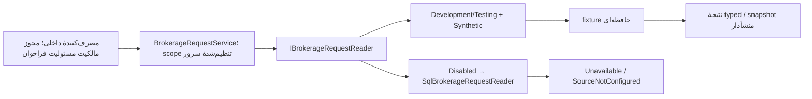

# فرایند پیاده‌سازی خوانندهٔ درخواست کارگزاری — Checkpoint 2D

تاریخ `2026-11-02`؛ مجوز `2df8399e-d511-49b7-af28-a075f801dd57`؛ مبنای شروع Git برابر `b495b10a5519818d44053206c964b21dc051b813`. این راهنما رفتار واقعی کد 2D را توضیح می‌دهد. **17% + 2 = 19%**؛ پیشرفت معادل آمادگی Production نیست.

## مسئله، پیش‌نیاز و بررسی اولیه

ماژول‌های آینده به دریافت درخواست بیمه از یک منبع معتبر نیاز دارند؛ استفادهٔ مستقیم از مدل Frontend یا SQL حدسی مجاز نیست. در شروع، فقط foundation، health/Swagger و ابزار/schema محلی 2C وجود داشتند و interface یا reader تجاری پیاده نشده بود. تنها تغییر قبلی کاربر `src/Bazdid.Api/Properties/launchSettings.json` ثبت‌نشده بود؛ بدون تغییر و خارج commit حفظ شد.

AGENTS، PLAN، README، معماری، طراحی داده، ماتریس نگاشت، ممیزی DuberFront، دفتر تصمیم، امنیت، قرارداد API و walkthrough 2C خوانده شدند. Startup/Options/config، middleware، controller، دو پروژهٔ آزمون، csprojها، Directory.Build.props و lockfileها بررسی شدند. Frontend و آرشیو خصوصی تغییر/اجرا نشدند؛ نقل کد اختصاصی یا اطلاعات واقعی لازم نبود.

پیش از پیاده‌سازی، فرمان زیر از ریشهٔ مخزن واقعاً اجرا شد و پس از آزمون‌ها نیز تکرار شد:

```powershell
.\database\tools\Invoke-BazdidDevelopmentDatabase.ps1 -Action Verify
```

اتصال فقط Windows Authentication و Shared Memory به `(local)\SQLSERVER2019` بود. هر دو بررسی، پایگاه `BAZDID_Development` و همان سه جدول، ۳۹ ستون، ۱۰ index، سه PK، سه unique، یک FK، ۱۳ CHECK trusted، دو rowversion و دو computed persisted key را تأیید کردند؛ هر سه جدول صفر ردیف داشتند. [شاهد تازهٔ قبل/بعد](../checkpoint2d/DATABASE_VERIFICATION.json). در 2D هیچ DDL، درج fixture، migration، grant یا آزمون rollback SQL اجرا نشد؛ ۳۵ CASE مرحلهٔ 2C شاهد تاریخی همان مرحله‌اند.

## معماری و فایل‌های کد

یک deployable موجود حفظ شد؛ پروژه یا package تازه لازم نبود. `Domain/Brokerage` قرارداد بدون HTTP/SQL، `Application` هماهنگی scope/خطا و `Infrastructure/Brokerage` adapterها را نگه می‌دارند. این قراردادها DTO داخلی‌اند و در controller/Swagger پاسخ مشتری ثبت نشده‌اند.

| فایل نسبت به `src/Bazdid.Api/` | مسئولیت واقعی |
|---|---|
| `Domain/Brokerage/BrokerageContracts.cs` | interface، scope و reference دقیق، نتیجهٔ typed، eligibility و IClock |
| `Domain/Brokerage/BrokerageField.cs` | مقدار/منشأ/وضعیت/قفل و شاهد اعتبارسنجی هر فیلد |
| `Domain/Brokerage/BrokerageRequestSnapshot.cs` | مرجع موبایل، هفت فیلد خودرو و snapshot داخلی درخواست |
| `Application/BrokerageRequestService.cs` | scope سروری، کنترل هویت خروجی adapter، timeout/cancellation و منع fallback |
| `Infrastructure/Brokerage/SyntheticBrokerageRequestReader.cs` | خواندن حافظه‌ای محدود به Development/Testing |
| `Infrastructure/Brokerage/SqlBrokerageRequestReader.cs` | مرز تنظیم‌نشدهٔ منبع واقعی؛ فقط Unavailable، بدون اتصال/query |
| `Infrastructure/Brokerage/BrokerageServiceCollectionExtensions.cs` | انتخاب DI صریح و clock سیستم |
| `Fixtures/SyntheticBrokerageFixtures.cs` | ۱۸ رکورد ساختگی ثابت و سیاست‌های محدود همان fixtureها |
| `Configuration/FoundationOptions.cs` و `Startup.cs` | اعتبارسنجی محیط/scope و اتصال registration به برنامهٔ موجود |
| `appsettings.json` و overrideهای Development/Testing | پیش‌فرض Disabled، فعال‌سازی صریح Synthetic فقط در دو محیط مجاز |

دو فایل آزمون `BrokerageReaderTests.cs` و `BrokerageIntegrationTests.cs` به پروژه‌های موجود افزوده شدند. در `FoundationOptionsTests.cs` فقط نام یک آزمون با رفتار جدید هماهنگ شد؛ assertionهای قبلی حفظ شدند. فایل‌های شواهد، همین walkthrough، PLAN، README، AGENTS و اسناد مرتبط معماری/نگاشت/داده/امنیت/API/آزمون/ادامه/فهرست به‌روز شدند؛ source، lockfile و فایل آزمون، مرجع شمارش واقعی تغییرها در Git هستند.



هیچ API ورودی، احراز هویت، context/challenge ذخیره‌شده یا transaction کسب‌وکاری در این فلو وجود ندارد. جدول‌های SQL صرفاً پیش‌نیاز تأییدشده‌اند؛ reader به آن‌ها متصل نیست. snapshot، Session یا `BAZDIDInfo` ذخیره نمی‌کند.

## interface، ورودی و خروجی

قطعهٔ واقعی از [قرارداد](../../src/Bazdid.Api/Domain/Brokerage/BrokerageContracts.cs):

```csharp
Task<BrokerageReadResult<BrokerageRequestReference>> ResolveReferralAsync(
    BrokerageScope serverScope, string referralCode, CancellationToken cancellationToken);
Task<BrokerageReadResult<BrokerageRequestSnapshot>> GetRequestSnapshotAsync(
    BrokerageRequestReference serverAuthorizedRequest, CancellationToken cancellationToken);
```

نتیجه یکی از `Found/NotFound/Ambiguous/Ineligible/Unavailable` است؛ فقط Found مقدار دارد. نتیجهٔ resolve تنها scope و شناسهٔ درخواست را می‌دهد و شامل موبایل، مشتری یا خودرو نیست. چند match به Ambiguous می‌رسد و اولین درخواست انتخاب نمی‌شود. referral در fixture با مقایسهٔ Ordinal حل می‌شود؛ trim/upper، طول شش‌تایی یا semantics منبع واقعی به‌صورت عمومی فرض نشده‌اند. ورودی غیرخالی حداکثر ۱۲۸ نویسه است.

`BrokerageScope` دو شناسهٔ ASCII حداکثر ۳۲ نویسه دارد؛ application service آن را از تنظیمات DI می‌گیرد و ورودی tenant مرورگر ندارد. `BrokerageRequestReference` شناسهٔ درخواست opaque حداکثر ۱۲۸ نویسه را بدون trim، تبدیل عددی یا تغییر case نگه می‌دارد. snapshot شامل همین reference، `SourceCustomerId`، `TrustedMobile`، eligibility، خودرو، `SourceVersion` و `RetrievedAtUtc` است. شناسه‌های `9223372036854775807` و `9007199254740993` در JSON نیز رشته می‌مانند.

**reference و نتیجهٔ Found مجوز ورود یا مالکیت نیستند.** نام پارامتر serverAuthorizedRequest بیانگر پیش‌شرط فراخوان است؛ احراز مالکیت باید در ماژول مصوب آینده انجام شود. کنترل scope در سرویس جای آن را نمی‌گیرد. هیچ controller ناشناس به این سرویس متصل نشده است؛ موبایل کامل و snapshot داخلی نباید بعداً مستقیم به HTTP serialize شوند. پاسخ masked/projection مشتری هنوز پیاده نشده است.

## provenance و سیاست فیلد

هفت فیلد `Manufacturer/Model/ModelYear/Color/LicensePlate/Vin/ChassisNumber` از `BrokerageField` استفاده می‌کنند. مقادیر رشته‌اند؛ تقویم سال، lookup و پلاک واقعی بدون mapping تفسیر نمی‌شوند. `Validation` دارای `PolicyId/Status/Code` است؛ field source در این reader برابر Brokerage می‌ماند. source در Missing یعنی منشأ اعلام فقدان، نه دادهٔ Manual ذخیره‌شده.

| وضعیت | مقدار و قابلیت تغییر |
|---|---|
| Present | مقدار معتبر حفظ می‌شود؛ Valid و IsReadOnly=true |
| Missing | مقدار null؛ فقط با manualAllowed سیاست همان فیلد، IsReadOnly=false |
| Invalid | مقدار و وضعیت نامعتبر حفظ می‌شوند؛ IsReadOnly=true؛ خودکار Missing نمی‌شود |
| Unavailable | null و NotEvaluated؛ IsReadOnly=true؛ شکست کلی منبع نیز نتیجهٔ Unavailable بدون snapshot می‌دهد |

قطعهٔ واقعی [مدل فیلد](../../src/Bazdid.Api/Domain/Brokerage/BrokerageField.cs):

```csharp
IsReadOnly = status != BrokerageFieldStatus.Missing || !manualAllowed;
```

سیاست‌های fixture عمداً محدودند: سال فقط `1399` معتبر است؛ null یا `0` طبق سیاست صریح همان سال Missing، و `invalid` نامعتبر است. رنگ یک label آزمایشی است؛ `0` در سیاست جدا معتبر و فقط‌خواندنی می‌ماند. VIN آزمایشی با prefix ساختگی سنجیده می‌شود؛ این اعتبارسنجی VIN واقعی نیست. فقدان year/color/VIN در fixture اجازهٔ تکمیل آیندهٔ همان فیلد را می‌دهد. کیلومتر از کارگزاری فرض نشده و به snapshot افزوده نشده است؛ اعتبار صفر کیلومتر طبق قواعد کسب‌وکار آینده حفظ می‌شود.

## fixtureها و مرجع موبایل

scope اصلی `TEST-BROKERAGE / SYNTHETIC` است. زنجیرهٔ مصوب `A4K9P2 → TEST-REQUEST-001 → TEST-CUSTOMER-001 → 09000000001` فقط دادهٔ ساختگی است و SMS نمی‌فرستد. شمارهٔ fixture، ادعای رزروشده/تخصیص‌نیافته‌بودن ندارد. کد OTP در این پیاده‌سازی تولید یا بررسی نمی‌شود.

| referral | سناریو |
|---|---|
| `A4K9P2` | موفق با هفت فیلد خودرو |
| `UNKNOWN` | فاقد match؛ رکوردی برای آن وجود ندارد |
| `SECOND` | درخواست دوم همان مشتری |
| `MISS01 / BAD001 / ZERO01` | فیلد مفقود / نامعتبر / صفر با دو سیاست متفاوت |
| `AMB001` | دو درخواست و نتیجهٔ Ambiguous |
| `INEL01 / DOWN01` | Ineligible / Unavailable |
| `MOB001 / MOB002 / MOB003` | تعارض / فقدان / قالب نامعتبر candidateهای موبایل |
| `CUST00 / ELIG00` | هویت مشتری مفقود / eligibility نامعلوم؛ Unavailable |
| `BIG001 / OPAQUE` | شناسهٔ بزرگ / Unicode و فاصلهٔ انتهایی حفظ‌شده |

همان A4K9P2 در `OTHER-BROKERAGE / SYNTHETIC` و `TEST-BROKERAGE / OTHER-SYNTHETIC` فقط درخواست متعلق به scope خودش را حل می‌کند. این دو scope برای آزمون adapterند؛ scope سرویس DI ساختگی اصلی ثابت است. candidateهای موبایل fixture باید هر دو موجود، یکسان و با قالب آزمایشی معتبر باشند؛ اختلاف هیچ‌گاه با انتخاب اولویت حدسی حل نمی‌شود. موبایل و هویت setter عمومی ندارند و با خرابی منبع قابل ویرایش نمی‌شوند.

## محیط، DI و خطا

تنظیم پایه `BrokerageAdapterMode=Disabled` و scope خالی است. overrideهای committed Development/Testing صریحاً `Synthetic`، `TEST-BROKERAGE` و `SYNTHETIC` دارند. تنها modeهای Disabled و Synthetic پذیرفته می‌شوند؛ Sql/Automatic یا محیط ناشناس startup را رد می‌کنند. Production حتی در حالت Disabled، scope با شناسهٔ TEST- یا منبع SYNTHETIC را رد می‌کند؛ Synthetic در Production همیشه مردود است. سازندهٔ synthetic نیز مستقلاً نام دقیق محیط را کنترل می‌کند. محیط میزبان ورودی trusted زیرساخت است و نباید از درخواست مشتری تعیین شود.

نمونهٔ تنظیم موجود در محیط غیرتولیدی:

```json
{ "Bazdid": { "BrokerageAdapterMode": "Synthetic", "BrokerageId": "TEST-BROKERAGE", "BrokerageSourceSystem": "SYNTHETIC" } }
```

`Startup.ConfigureServices` افزونهٔ AddBrokerageReader را فراخوانی می‌کند؛ interface و سرویس داخلی singleton و بدون state قابل تغییر مصرف‌کننده‌اند. clock سیستم زمان دریافت UTC می‌دهد؛ unit test clock ثابت تزریق می‌کند و SourceVersion مستقل `synthetic-v1` است. زمان دریافت، نسخه یا قاعدهٔ freshness واقعی منبع را ثابت نمی‌کند.

`SqlBrokerageRequestReader` نام مرز آینده است؛ حتی با scope واقعی تنظیم‌شده، فقط `Unavailable/SourceNotConfigured` می‌دهد. هیچ System.Data/SqlConnection/query یا fallback در آن نیست. سرویس، TimeoutException و cancellation خود منبع را Unavailable می‌کند؛ لغو درخواست فراخوان را منتشر می‌کند و پس از await هم token را کنترل می‌کند. خطای برنامه‌نویسی ناشناخته به NotFound تبدیل نمی‌شود. هویت خروجی ناسازگار adapter آزاد نمی‌شود. هیچ referral/mobile/VIN یا متن exception منبع در log خواننده نوشته نمی‌شود؛ خطای عمومی HTTP همچنان middleware امن موجود را دارد.

## ترتیب واقعی و آزمون

۱. وضعیت Git/مجوز و 2C بررسی شد؛ verification خواندنی موفق بود.
۲. قرارداد immutable، مدل فیلد/snapshot، fixture مستقل و adapterها ساخته شدند.
۳. سرویس scope-bound، registration و validation/config به Startup موجود وصل شدند؛ PathBase و routeها تغییر نکردند.
۴. آزمون‌های unit برای نتایج، provenance، صفر، شناسه و خطا/cancellation و integration برای DI/Production/privacy/HTTP اضافه شدند.
۵. restore/build موفق شدند؛ اولین test run یک عیب کنترل محیط نشان داد. پس از اصلاح و افزودن پوشش خطای snapshot، build/test دوباره اجرا شدند.
۶. smoke واقعی Kestrel و بررسی دوبارهٔ خواندنی DB موفق شدند؛ مستندات و شواهد تکمیل شدند.

فرمان‌های زیر واقعاً از `C:\Projects\vehicle-inspection-backend` اجرا شدند:

```powershell
dotnet restore Bazdid.sln --locked-mode
dotnet build Bazdid.sln --configuration Release --no-restore
dotnet test Bazdid.sln --configuration Release --no-build --no-restore
```

SDK `2.1.818`، target `netcoreapp2.1` و C# `7.3` حفظ شدند. اجرای نهایی سه فرمان exit صفر، build صفر warning/error و **۶۵ unit + ۴۳ integration = ۱۰۸ موفق، صفر شکست** داشت. هر ۴۳ آزمون قبلی حفظ و ۶۵ مورد افزوده شد. این integrationها DI/TestServer/منبع حافظه‌ای‌اند؛ SQL repository یا Production را اثبات نمی‌کنند. [شاهد برنامه و خطای اولیه](../checkpoint2d/APPLICATION_VALIDATION.json).

خطای واقعی نخست: test سازنده با محیط `development` انتظار ردشدن داشت، اما helper قدیمی IsDevelopment مقایسهٔ بدون حساسیت به حروف داشت؛ ۶۱ از ۶۲ unit و ۴۲ integration آن اجرا موفق بودند. سازنده با مقایسهٔ دقیق EnvironmentName، همسو با FoundationOptions، اصلاح شد؛ آزمون حذف یا انتظار آن تضعیف نشد. اجرای نهایی پس از اصلاح و پوشش تکمیلی ۱۰۸/۱۰۸ موفق بود. خطای SQL یا build رخ نداد.

بازبینی دستی شامل تطبیق کد/قرارداد، نبود query/اتصال/نوشتن و نبود route snapshot بود. smoke واقعی با اجرای dotnet DLL ساخته‌شده در cwd برابر `src/Bazdid.Api`، محیط Development و URL `http://127.0.0.1:5082` انجام شد: health 200 با alive، Swagger UI/JSON موفق با basePath صحیح و فقط یک مسیر، snapshot ناشناس 404. process اختصاصی پس از بررسی متوقف شد؛ [شاهد HTTP](../checkpoint2d/HTTP_SMOKE.json). IIS و مرورگر واقعی در این مرحله آزمایش نشدند.

برای بازآزمایی پیشنهادیِ همان نسخه پس از build، بدون استفاده از launchSettings کاربر:

```powershell
$env:ASPNETCORE_ENVIRONMENT = 'Development'
dotnet run --project src/Bazdid.Api/Bazdid.Api.csproj --configuration Release --no-build --no-launch-profile -- --urls http://127.0.0.1:5082
```

این دستور run، دستور پیشنهادی بازتولید است؛ smoke ثبت‌شده خود DLL را با process پنهان و کنترل‌شده اجرا کرد. reader endpoint ندارد؛ برای مشاهدهٔ خروجی‌های داخلی، آزمون‌های BrokerageReaderTests و BrokerageIntegrationTests مرجع اجرایی‌اند. شماره/کد fixture در URL ورود واقعی قرار نمی‌گیرند.

## وابستگی، امنیت، Git و ادامه

در csproj و هر سه lockfile هیچ تغییری داده نشد. graph فعلی System.Data.SqlClient 4.5.3 و قید framework `[4.5.3,4.6.0)` را دارد؛ 4.8.6 بدون رفع تعارض افزوده نشد. 2D به provider SQL نیاز ندارد و **O24 حل‌شده یا تست‌شده نیست**. .NET Core 2.1 بدون پشتیبانی و audit قبلی دارای ریسک باقی است؛ build پاک، تأیید امنیت Production نیست.

برای adapter واقعی، DBA/مالک باید پایگاه authoritative، schema/table/view/join و type/nullability/uniqueness، صدور و case/انقضای referral، مرجع verified موبایل و تعارض/تغییر مالک، eligibility، mapping و validation/missing/zero هر فیلد، version/freshness و مجوز SELECT دقیق را تصویب کنند. credential فقط در کانال امن تحویل شود. حساب runtime کم‌اختیار O26 نیز موجود/آزموده نشده است؛ sysadmin ابزار discovery حساب برنامه نمی‌شود. [دفتر تصمیم‌ها](../OPEN_DECISIONS_FA.md) و [ماتریس نگاشت](../BROKERAGE_DATA_MAPPING_FA.md) مرجع‌اند.

کنترل پیش از commit پیاده‌سازی: ۳۲ فایل بسته، ۱۳ Markdown، ۱۴۲ پیوند محلی و یک anchor معتبر؛ ۱۳۶ فایل فعلی و ۱۷۶ blob تاریخی main اسکن شدند و هشدار راز باقی‌مانده صفر بود. URL دارای credential در آزمون قدیمی origin، fixture ساختگیِ تأییدشده است. diff وابستگی/SQL/controller صفر، hash فایل کاربر ثابت و فایل صوری 2E–2G وجود ندارد. این کنترل استاتیک از اجرای ۱۰۸ آزمون و verification DB جداست.

مقصد Git فقط مخزن موجود است؛ URL/refs، بسته و تاریخچهٔ reachable برای راز/آرشیو/دادهٔ DB بررسی شدند. branch اصل خصوصی ارسال/merge نمی‌شود و فایل untracked کاربر حفظ می‌ماند. SHA واقعی implementation و نتیجهٔ تأییدشدهٔ HEAD/فایل GitHub پس از انتشار در [گزارش همگام‌سازی](../GITHUB_SYNC_FA.md) ثبت می‌شوند؛ پیش از بررسی، موفقیت push ادعا نمی‌شود.

**2D کامل: 17% + 2 = 19%؛ باقی‌مانده 81%.** از وزن ۱۲واحدی Checkpoint 2، هفت واحد پذیرفته شده و پنج واحد باقی است؛ وزن کلی تغییر نکرد. گام پیشنهادی بعد 2E، فقط طرح persistence و refresh اطلاعات، با مجوز جداگانه است؛ ساخت/نوشتن BAZDIDInfo در Checkpoint 4 می‌ماند. پیشنهاد مشروط پذیرش 2E یک واحد تا ۲۰٪ است و هنوز کسب نشده؛ تخصیص تفصیلی باقی‌مانده پیش از شروع بسته‌های بعدی تصویب شود. هیچ کار 2E–2G، auth/OTP/Session/Info/media، SQL واقعی کارگزاری یا Frontend در این مرحله اجرا نشد.
