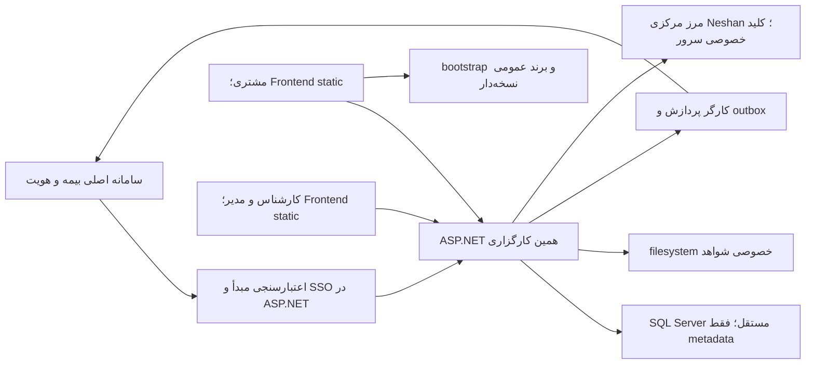
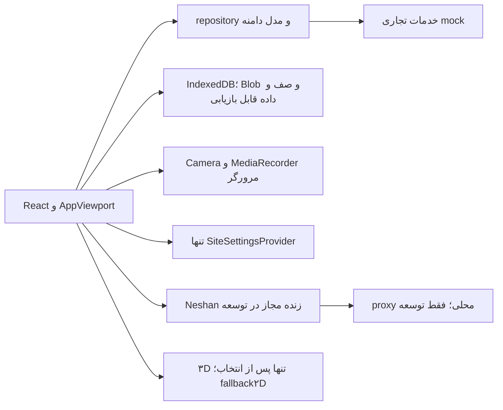

# معماری موجود و پیشنهاد تولید

وضعیت این فصل: مرزهای Frontend موجودند؛ خدمات تولیدی نمودار زیر **پیشنهاد نیازمند تصویب** هستند. دو audience و دو مرجع هویت با یک نشست معتبر Backend به هم متصل می‌شوند.

## آنچه واقعاً اکنون اجرا می‌شود

نمونه local proxy Node برای reverse و runtime settings فقط توسعه است؛ وارد بسته تولیدی نمی‌شود. production نباید با قراردادن private service key در `NEXT_PUBLIC_*` یا browser fetch مستقیم به سرویس خصوصی نشان حل شود. ساختار جدید Backend می‌تواند facade همان `/maps/reverse` را به زیرساخت مرکزی وصل کند.

## مرزهای اعتماد و داده

| مرز | الزام |
|---|---|
| مرورگر → API | cookie/session معتبر، CSRF برای mutation، اعتبارسنجی DTO و مالکیت هر منبع |
| مبدأ → auth Backend | issuer/audience/expiry/nonce و امضای معتبر یا introspection مورد توافق، مصرف یک‌بار بلیت |
| API → SQL | connection نصب از پیکربندی trusted، پارامترگذاری query و حداقل اختیار |
| API → filesystem | مسیر از ID معتبر DB، ریشه خصوصی، ACL و جلوگیری از traversal/reparse |
| worker → سامانه بیمه | مقصد allowlist، credential سروری، کلید ثابت، تأیید دریافت و retry قابل مشاهده |
| تنظیمات عمومی | فقط whitelist؛ کلید عمومی نقشه با محدودیت دامنه، نه کلید خصوصی یا connection string |

طرح SQL در [فصل ۶](06-DATABASE-DESIGN.md) و مرز تراکنش در [فصل ۷](07-DATABASE-RELATIONSHIPS.md) است. یک پایگاه مستقل به تنهایی مجوز کاربر داخل آن را ثابت نمی‌کند. API باید مالکیت customer/sourceRequest/inspection و ارجاع staff را دوباره بررسی کند.

## انتخاب‌های باز

نسخه پشتیبانی‌شده ASP.NET/SQL، محل اجرای worker، OIDC یا ticket، reverse proxy هم‌origin یا CORS دقیق، فرمت انتقال و پروتکل acknowledgement هنوز توافق می‌خواهند. static frontend می‌تواند از ASP.NET برای auth/cookie/gateway استفاده کند؛ این وابستگی Backend است، نه Node Frontend. افزودن fallback عمومی IIS به تنهایی route‌های dynamic و payload‌های Next را تولید نمی‌کند.
