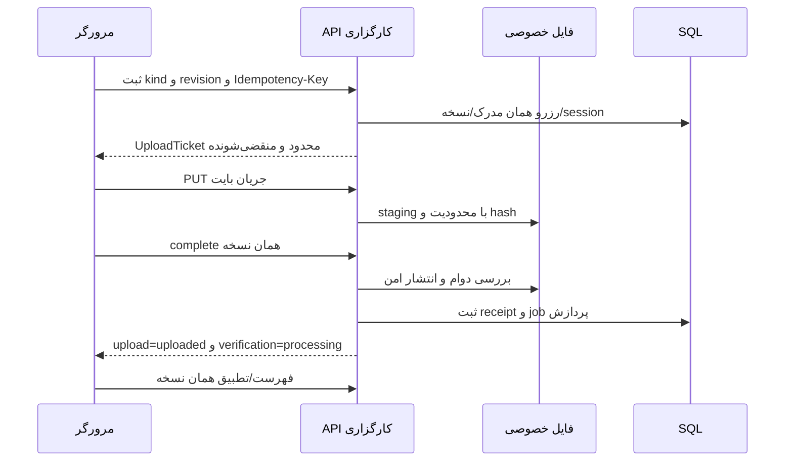

# انتقال و پردازش رسانه

مرز فعلی یک UploadCoordinator/UploadTransport برای عکس و ویدیو است. Blob پیش از enqueue در IndexedDB ذخیره می‌شود و job فقط به `localBlobKey` اشاره دارد. Backend نباید این key را path سرور بداند یا برای هر retry نسخه/evidence تازه بسازد.

## کیفیت و نوع فایل

بهینه‌سازی Frontend موجود را تکرار یا جایگزین نکنید. مسیر پیش‌فرض عکس بایت منبع را حفظ می‌کند؛ پردازش تصویری اختیاری/آزمایشی worker، provenance و اصل خوب را نگه می‌دارد. preview/thumbnail، فایل پذیرفته‌شده یا اثبات کاهش حجم پیش‌فرض نیست. Backend باید فایل واقعاً پذیرفته‌شده را ثبت کند؛ تولید مشتق server-side جدا و نسخه‌دار است. خوانایی کد/پلاک/کیلومتر از کوچک‌سازی اجباری مهم‌تر است.

در کد فعلی سقف محلی عکس ۲۰ MiB و ویدیو ۲۵۰ MiB و مدت ویدیو مثبت/finite است. این‌ها سیاست قطعی تولید نیستند. زمان هدف ۶۰ ثانیه راهنما، حداقل/حداکثر اجباری یا auto-stop نیست. MIME ضبط بر اساس پشتیبانی واقعی انتخاب می‌شود؛ WebM VP8، MP4، WebM عمومی و VP9 انتخاب‌های قابل بررسی‌اند. server allowlist فرمت/codec/رزولوشن/مدت/کیفیت، HEIC/AVIF و نیاز transcoding باید تصویب شوند. header یا پسوند ارسالی به تنهایی معتبر نیست؛ signature و decode محدود سرور لازم است.

از `IFormFile`/buffering نامحدود برای ویدیوی بزرگ پرهیز و streaming محدود، cancellation، quota و backpressure انتخاب شود. راهنمای رسمی [آپلود ASP.NET](https://learn.microsoft.com/en-us/aspnet/core/mvc/models/file-uploads?view=aspnetcore-10.0) کنترل نام، نوع، سقف و فضای خارج از app را توضیح می‌دهد؛ انتخاب این محصول صریحاً filesystem خصوصی است. پروفایل worker اختیاری باید timeout/CPU/memory، quarantine و نسخه پروفایل داشته باشد؛ اجرای فایل کاربر ممنوع است.

## انتقال، پردازش و تأیید جدا

| بُعد | مقادیر فعلی/نگاشت |
|---|---|
| صف مرورگر | local، queued، uploading، uploaded، failed، cancelled |
| پردازش/verification | not-started، processing، verified، retake-requested |
| تصمیم کارشناس | approved/rejected برای evidenceId+revision دقیق |
| چرخه بازدید | DRAFT تا FORWARDED؛ مستقل از سه ردیف بالا |

HTTP موفق PUT تنها staged است؛ complete باید دوام و integrity را تأیید کند. `upload=uploaded + verification=processing` باینری کامل و قابل شمارش در readiness است، ولی verified یا approved نیست. درصد فقط از bytesReceived/bytesUploaded واقعی می‌آید؛ processing بدون درصد جعلی نمایش می‌یابد. اگر signature/انتقال خراب است receipt کامل صادر نشود. شکست پردازش، خطای recoverable یا retake باید کد مشخص و نسخه دقیق داشته باشد، نه تغییر مبهم یک status.

هم‌زمانی فعلی صف ۲، lease محلی ۲۰ ثانیه و heartbeat نزدیک یک‌سوم lease است؛ این‌ها الزام TTL پروتکل سرور نیستند. retry خودکار فعلی برای خطای retryable و تلاش کمتر از ۳ با backoff از ۱ ثانیه تا ۳۰ ثانیه است؛ manual retry/retry-all جدا می‌ماند. resume با شروع برنامه، online، بازکردن مرکز ارسال و اقدام کاربر انجام می‌شود؛ Background Sync فقط بهبود اختیاری است. انتقال بایتی resumable اکنون پیاده نیست؛ restart امن همان فایل با key/session معتبر قابل قبول است.

offline، انقضای مجوز انتقال، ۴۱۳، ۴۱۵، ۴۲۲ و خطای دائمی credentials نباید حلقه retry نامحدود بسازند. مجوز منقضی‌شده برای همان revision نوسازی شود؛ نام/فایل تازه تولید نشود. صف پس از refresh با metadata/receipt سرور reconcile می‌شود و job منسوخ current نمی‌شود. ویدیو از همین pipeline است و به Base64، state پایدار React/Zustand یا JSON فایل تبدیل نمی‌شود.

original، thumbnail و preview/transcode در MediaFiles مستقل و دارای profile/hash هستند؛ مشتق ناموفق اصل را حذف نمی‌کند. Range ویدیو و thumbnail هم از مجوز server پیروی می‌کنند. acknowledgement و cleanup در [فصل ۸](08-MEDIA-FILE-STORAGE.md) و خطاها در [فصل ۱۷](17-ERRORS-AND-HTTP-STATUS-CODES.md) آمده‌اند.

## منشأ فایل دریافتی و مشتق‌های اختیاری

در transport فعلی، بایت انتخاب‌شده و پذیرفته‌شده کاربر ارسال می‌شود؛ این بایت ممکن است source یا نتیجه بهینه‌سازی اختیاری مرورگر باشد. Variant=original در مدل سرور یعنی همان بایت دریافتی این revision، نه ادعای اینکه دوربین اصلی یاگزینه انتخاب‌نشده هم به سرور ارسال شده است. Frontend provenance محلی دارد، ولی MediaReference فعلی آن را به صورت قراردادی منتقل نمی‌کند؛ افزودن انتقال آن باید در D07/OpenAPI تصویب شود. داده اعلامی مشتری گواه اندازه/کیفیت واقعی نیست.

مشتق thumbnail/preview/transcode در MediaFiles با DerivedFromFileId به فایل والد همان EvidenceVersion و با ProfileVersion به نسخه پروفایل سرور متصل می‌شود. FK ترکیبی مانع اتصال مشتق به نسخه دیگر است؛ سرویس باید cycle، عمق زنجیره، نوع فایل و job دیررس را نیز کنترل کند. تولید مشتق اختیاری است، مدرک accepted را درجا بازنویسی نمی‌کند و خطای آن مجوز حذف بایت خوب نیست. شناسه نسخه پروفایل و hash در SQL metadata هستند، نه بایت رسانه.

Content-Length درصورت ارسال توسط مرورگر/پروتکل با ticket تطبیق شود؛ JavaScript نباید مجبوربه تنظیم دستی header ممنوع مرورگر شود. در stream بدون این header، اندازه واقعی با counter محدود و ExpectedBytes کنترل شود؛ نبود header بهمعنای مجوزفایل نامحدود نیست.
