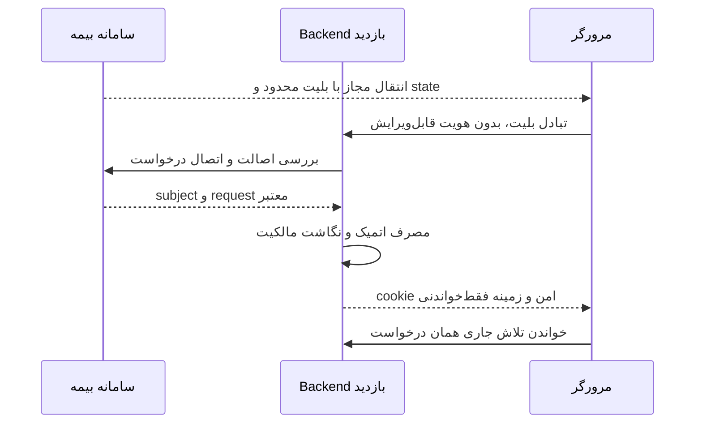

# احراز هویت مشتری و ورود سازمانی کارکنان

این فصل قرارداد امنیتی **پیشنهادی** است. restore سی‌دقیقه‌ای mock در sessionStorage و انتخاب نقش نمونه، احراز هویت تولیدی نیستند. هیچ مسیر API نباید با اعتماد به شماره، trackingCode، tenantId یا role دریافتی از مرورگر مجوز صادر کند.

## ورود مشتری از سامانه بیمه

۱. مبدأ، مشتری و درخواست بیمه را در سامانه خود معتبر می‌کند. شناسه درخواست و خودرو باید به همان subject متصل باشند.
۲. یکی از پروتکل‌های مورد توافق، نشست Backend را ایجاد می‌کند: تبادل server-validated بلیت opaque کوتاه‌عمر و یک‌بارمصرف، یا جریان استاندارد هویت مورد پشتیبانی مبدأ. صادرکننده، audience، tenant/host، expiry، nonce/state، مقصد callback و اتصال درخواست بررسی شوند. امضای JWT بدون بررسی issuer/audience/alg/key/expiry کافی نیست؛ بلیت opaque به اعتبارسنجی امن سرور مبدأ نیاز دارد.
۳. بلیت یک‌بار به‌صورت اتمیک مصرف و اثر replay به طور پایدار نگهداری شود؛ raw ticket در SQL/audit/log ذخیره نشود. hash/شناسه امن رویداد برای بازیابی لازم است. پاسخ گم‌شده نباید نشست/بازدید اضافی بسازد.
۴. Backend، CustomerSourceContext معتبر با شماره فقط‌خواندنی و sourceRequestId را به UI می‌دهد. شماره در request احتمالی فقط باید با زمینه trusted تطبیق شود، نه اینکه هویت جدید بسازد. تغییر شماره یا انتقال درخواست فقط در سامانه مبدأ و با قرارداد جدا انجام می‌شود.
۵. cookie نشست HttpOnly/Secure و ترجیحاً host-only، با rotation هنگام ورود و expiry/revocation مشخص صادر شود. تاریخ صدور و عمر نشست، سیاست سرور است؛ زمان mock سیاست تولید نیست.

بلیت در URL طولانی‌عمر، referer یا log نماند؛ exchange بدنه POST و پاک‌کردن نشانی طبق پروتکل مصوب ترجیح دارد. returnPath باید canonical و فقط مسیر مجاز همان origin و بازدید مجاز باشد؛ `//host`، backslash، encoding فرار و open redirect مردودند. یک regex ابتدایی کافی نیست. اطلاعات خودروی درخواست دیگر یا گزینه tenant در query نمی‌تواند scope را عوض کند.

## OTP و بازگشت کاربر

نقش OTP بعد از SSO نیازمند تصویب است: اثبات تکمیلی یا سیاست معرفی‌نامه، نه جایگزین مالکیت مبدأ. درخواست/ارسال دوباره باید همان شماره trusted، challenge، sourceRequest و نرخ مجاز را رعایت کند. تعداد تلاش، expiry، cooldown و مصرف چالش در سرور باشد؛ پیام خطا شماره وجوددار را لو ندهد. UI فعلی پنج رقم می‌پذیرد؛ طول/قدرت OTP تولید باید با تیم هویت تصویب شود، و تغییر به شش رقم نیاز به تغییر مصوب Frontend دارد. `A4K9P2` و `12345` فقط نمونه توسعه‌اند و backdoor تولید نیستند.

در مراجعه دوباره، نشست معتبر و مالکیت درخواست بازخوانی شود، سپس current attempt همان کلید tenant/subject/sourceRequest انتخاب شود. هیچ تلاش تازه‌ای روی GET ساخته نشود. نشست منقضی به بازیابی هویت هدایت شود و داده پذیرفته‌شده محلی پاک نشود. چند tab و چند درخواست یک مشتری باید scope مستقل داشته باشند. خروج، cookie/نشست و مجوز درخواست‌های بعدی را باطل می‌کند؛ logout سراسری مبدأ یا فقط برنامه باید توافق شود.

## کارکنان و SSO

دو گزینه قابل بررسی‌اند: **OIDC Authorization Code + PKCE با مدیریت secret/token در ASP.NET**، یا **بلیت Backend-validated کوتاه‌عمر و یک‌بارمصرف**. گزینه پشتیبانی‌شده را تیم مبدأ تعیین می‌کند؛ در نبود تأیید نباید هر دو را موازی و ناامن ساخت. راهنمای رسمی [OIDC در ASP.NET](https://learn.microsoft.com/en-us/aspnet/core/security/authentication/configure-oidc-web-authentication) جریان code و PKCE را توضیح می‌دهد؛ نسخه/framework واقعی تیم Backend باید تثبیت شود. secret کلاینت محرمانه در static JS جای ندارد.

نگاشت issuer/subject/group به StaffUsers/StaffRoleAssignments و permissions نصب انجام شود. نقش‌های فعلی `platform-admin`، `reviewer`، `template-editor` و `viewer` هستند؛ نام platform-admin در UI به معنی مدیر همین کارگزاری است، نه مالک کلید خصوصی مرکزی نشان. مجوزهای موجود شامل templates:read/edit، settings:write، staff:manage، inspections:read/assign، evidence:decide و inspection:decide است. مدیر حق تصمیم کارشناس را خودکار ندارد؛ Reviewer باید در لحظه تصمیم ارجاع فعال همان پرونده داشته باشد.

اطلاعات لازم از مبدأ: discovery/issuer، JWKS یا روش introspection، client registration، callback/logout URI، PKCE، scopes/audience، subject/request IDs، نقش‌ها، expiry/revocation، کلید امضا/rotation، پروتکل nonce/state و نمونه تست غیرواقعی. [فصل ۱۹](19-BACKEND-TEAM-QUESTIONS.md) مسئول پاسخ را مشخص می‌کند.

## topology نشست

gateway هم‌origin در ASP.NET بدون Node ترجیح پیشنهادی است. در origin جدا، CORS دقیق و credentials و CSRF/Origin باید طراحی و تست شوند؛ CORS به تنهایی CSRF نیست. دامنه‌های sibling ممکن است same-site ولی cross-origin باشند. برای cross-site واقعی، SameSite=None/Secure نیز ممکن است زیر محدودیت third-party cookie کار نکند؛ باید روی Safari/Android آزمایش شود. [راهنمای SameSite](https://learn.microsoft.com/en-us/aspnet/core/security/samesite?view=aspnetcore-10.0) و [ضد CSRF](https://learn.microsoft.com/en-us/aspnet/core/security/anti-request-forgery?view=aspnetcore-10.0) مرجع‌اند؛ از رفتار پیش‌فرض یک نسخه framework برای همه JSON mutation‌ها نتیجه امنیت قطعی نگیرید.
