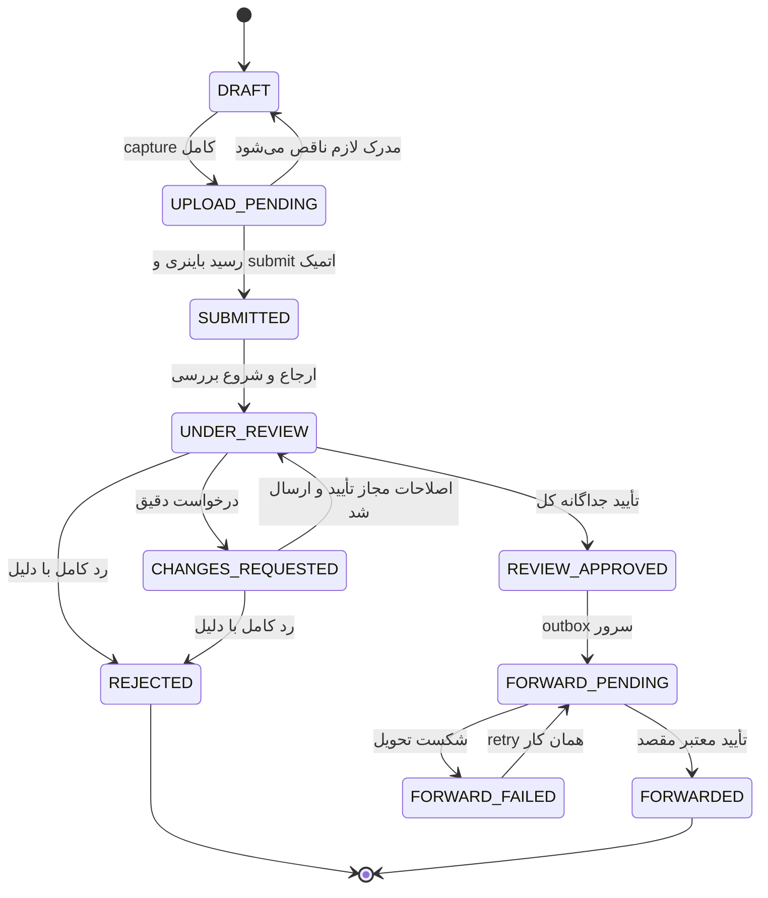

# چرخه عمر و ابعاد مستقل وضعیت

نام‌های این جدول از `src/features/inspection-status/lifecycle-model.ts` بررسی شده‌اند. Backend مرجع نسخه‌دار وضعیت تولید است. وضعیت upload، پردازش، تصمیم مدرک، تصمیم کل و تحویل مقصد را داخل یک status مبهم ادغام نکنید.

| وضعیت بازدید | معنا و شرط |
|---|---|
| DRAFT | حقایق یا capture لازم کامل نیست |
| UPLOAD_PENDING | capture کامل است؛ رسید همه نسخه‌های رسانه ممکن است نرسیده باشد |
| SUBMITTED | receipt رسمی پایدار و snapshot قفل‌شده وجود دارد |
| UNDER_REVIEW | ارجاع معتبر و بررسی در جریان است |
| CHANGES_REQUESTED | فقط اقلام رسانه یا فیلدهای مشخص درخواست شده‌اند |
| REJECTED | تصمیم جداگانه رد کل با دلیل عمومی؛ این تلاش حفظ و بسته است |
| REVIEW_APPROVED | کل نسخه‌های لازم و فیلدها تأیید شده‌اند؛ تحویل مقصد اثبات نشده |
| FORWARD_PENDING | ارسال/تلاش مجدد سرور در انتظار acknowledgement است |
| FORWARDED | مقصد، شناسه و زمان دریافت معتبر داده است |
| FORWARD_FAILED | تحویل پس از تأیید شکست خورده؛ عکاسی دوباره لازم نیست |

## مالک و پیش‌شرط انتقال

| فرمان | عامل/پیش‌شرط | اثر اتمیک |
|---|---|---|
| ثبت تازه | هویت معتبر و current-attempt uniqueness | تلاش و قالب پین‌شده با کلید ثابت |
| submit | مالک، fact/capture کامل، receipt نسخه‌های هدف، آنلاین، CAS | receipt و snapshot و status و audit |
| ارجاع | مدیر مجاز، کارشناس فعال و دارای ظرفیت | ارجاع فعال و نسخه پرونده |
| اصلاح مدرک | کارشناس همان پرونده، evidenceId+revision جاری | دلیل عمومی و اقلام دقیق با اصل محفوظ |
| اصلاح فیلد | فقط plate/color/modelYear و دلیل | task محدود؛ سایر فیلدها قفل |
| resubmit | مالک، request/version فعال، candidate‌های همان اقلام با ack | receipt دور اصلاح و promote نسخه‌های مجاز |
| رد کامل | کارشناس ارجاع‌شده، نسخه جاری، دلیل عمومی | تصمیم کل؛ supersede درخواست‌های باز بدون حذف سابقه |
| تلاش جدید | مالک تلاش ردشده، تأیید صریح، کلید ثابت | inspectionId/namespace خالی جدید با previousAttemptId |
| تأیید کل | همه نسخه‌های لازم approved و task‌های فیلد بسته، CAS | تصمیم جداگانه کل و outbox همان snapshot |
| ack مقصد | کارگر و پاسخ معتبر همان deliveryKey | ثبت acknowledgement و FORWARDED |

رد از پرونده submitted پس از بارگذاری/احراز ارجاع نیز می‌تواند طبق سیاست جاری سرویس انجام شود؛ صرف ورود به URL تصمیم معتبر ایجاد نمی‌کند. گذارهای نهایی با پاسخ دیررس capture/review یا import mock دوباره باز نمی‌شوند. آینده additional-evidence پس از final به transition/version مصوب تازه نیاز دارد؛ unlock عمومی وجود ندارد.

## ابعاد مستقل

capture پذیرفته‌شدن محلی/وجود نسخه معتبر است. upload از `local/queued/uploading/uploaded/failed/cancelled` می‌آید. verification جداگانه `not-started/processing/verified/retake-requested` است. ReviewDecision برای نسخه دقیق approved/rejected است و finalDecision کل پرونده مستقل است. ForwardingProjection نیز ready/sending/retrying/acknowledged/failed است. processing یا حتی verified به تنهایی تأیید حقوقی Reviewer یا تحویل به کارگزاری نیست.

در درخواست اصلاح، شناسه logical VIN همان spec-plate است و سه گزینه خالی ساخته نمی‌شود. accepted A و candidate B هر دو history معتبر دارند؛ هویت alternative بایت‌ها عوض نمی‌شود. receipt همان request/نسخه‌ها معیار جاری‌شدن است، نه ترتیب job‌های IndexedDB یا timestamp مرورگر. بازدید تاریخی v1 بدون migrate خودکار خوانده می‌شود.

snapshot اولیه ارسال ثابت است؛ پیشنهاد تأییدشده پلاک/رنگ/سال projection بررسی‌شده را تغییر می‌دهد، نه source insurance record یا snapshot اصلی. حتی شکست تحویل و retry، بازدید تأییدشده را به DRAFT برنمی‌گرداند. history زمان/عامل سروری، rowversion، کلید فرمان و audit برای هر انتقال لازم است.

## حالت در حال تحویل

کد فعلی enum مستقلی به نام FORWARDING_IN_PROGRESS ندارد. ارسال فعال یا retry با forwarding.phase برابر sending/retrying زیر وضعیت FORWARD_PENDING نمایش می‌یابد؛ enum تازه و ناسازگار ساخته نشود. فقط acknowledged دارای acknowledgementId و acknowledgedAt به FORWARDED می‌رسد.
