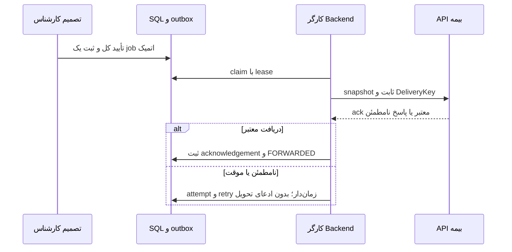

# تحویل نهایی به سامانه بیمه و outbox

تحویل مسئولیت سرور است. مرورگر مشتری، service worker یا بازبودن صفحه نباید شرط reliability آن باشد. `REVIEW_APPROVED` یعنی تأیید کارشناس؛ `FORWARDED` تنها پس از acknowledgement معتبر مقصد مجاز است.

## قرارداد سروری پیشنهادی

۱. RV08 در تراکنش تصمیم کل، snapshot نسخه‌های approved، audit و ForwardingJob یکتا برای همان decision/destination را ثبت کند. payload از SubmissionEvidence و اصلاحات تأییدشده خوانده شود، نه pointer قابل تغییر یا صف browser.
۲. مقصد از sourceRequest/sourceSystem و پیکربندی allowlist سرور به دست آید. browser هیچ URL، root یا credential انتخاب نمی‌کند. private key/token در secret store سرور، با rotation و اختیار کم نگهداری شود.
۳. worker با lease محدود job را claim کند؛ network call بیرون تراکنش SQL باشد. DeliveryKey پایدار، نسخه snapshot، hash و association درخواست مبدأ به مقصد ارسال شوند. فرمت multipart/metadata و روش انتقال فایل باید با تیم بیمه توافق شود؛ فایل بزرگ به Base64/JSON تبدیل نشود.
۴. پاسخ مقصد باید با receipt schema مصوب validate شود. HTTP ۲۰۰ بدون ack معتبر، timeout یا ۲۰۲ صرفاً پذیرش برای پردازش، به تنهایی تأیید durable receipt نیست. اگر مقصد ۲۰۴ را به معنی رسید تعریف می‌کند، شناسه/قرارداد تأیید همان باید تصویب و قابل بازیابی باشد.
۵. acknowledgementId/time و نتیجه همان DeliveryKey در SQL ثبت و projection مشتری به FORWARDED تغییر کند. بازیابی نتیجه نامطمئن با query/retry همان key انجام شود؛ job تازه ساخته نشود.

## خطا و retry

شبکه/timeout/۵xx با backoff محدود، jitter و سقف مصوب retry شوند.۴۲۹ طبق Retry-After، ۴۰۱/۴۰۳ یا payload نامعتبر نیاز به اصلاح عملیاتی دارند؛ حلقه خودکار دائمی نسازید. تعداد تلاش، timeout، dead-letter/escalation و نگهداری history تصمیم باز هستند و SLA جعلی ندارند. crash پس از دریافت مقصد و پیش از commit داخلی باید با DeliveryKey و query تأیید، بدون تحویل دوباره معنایی بازیابی شود.

ForwardingAttempts هر تلاش را با زمان، کد HTTP، failureCode امن ثبت می‌کند؛ response خام، credential، signedURL یا رسانه وارد log نمی‌شوند. FW01 فقط برای مدیر دارای اختیار بازیابی است و همان job/version را requeue می‌کند؛ دوباره عکاسی، تأیید کل یا inspectionId جدید نمی‌خواهد.

مشتری در sending/retrying پیام «در انتظار تأیید دریافت» و در failed پیام بازیابی تحویل می‌بیند. هیچ دکمه Frontend نباید ادعا کند خودش پرونده را به بیمه تحویل داده است. نسخه‌های forwarded و سوابق رد/اصلاح طبق retention/hold محفوظ‌اند. ارسال موفق، مجوز حذف فوری فایل یا بستن audit نیست.

تیم بیمه باید schema payload، هویت destination، idempotency، حد فایل/codec، ack/query، اعتبارسنجی درخواست مبدأ، authentication و تست قرارداد را ارائه کند. در نبود این موارد G01-G03 و FW01 صرفاً مشخصات پیشنهادی‌اند و انتقال تولیدی پیاده نشده است.
