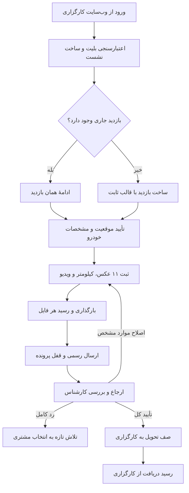
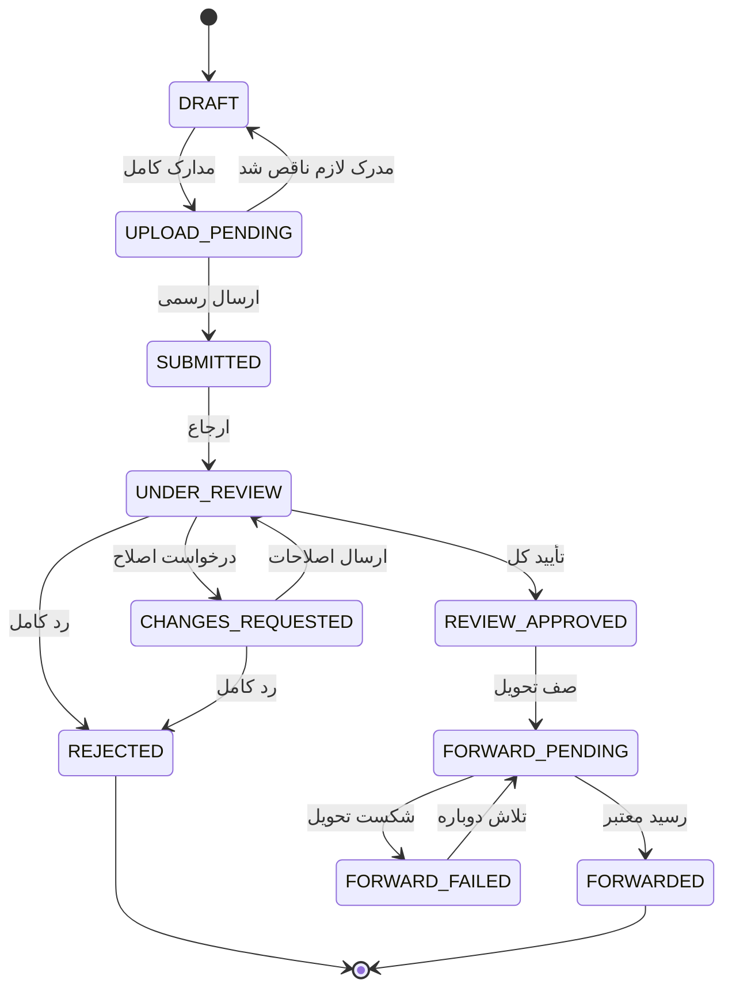

# سند ضروری تحویل بک‌اند سامانهٔ بازدید خودرو

این سند نخستین و اصلی‌ترین سندی است که تیم بک‌اند باید بخواند. هدف آن این است که در یک یا دو جلسهٔ مطالعه، تصویر کامل و قابل اجرایی از پروژه به دست بیاید. جزئیات کامل هر بخش در مرجع‌های فنی فصل ۱۶ آمده است و برای شروع کار لازم نیست همه را بخوانید.

> **وضعیت قراردادها:** همهٔ API‌ها، جدول‌ها و چیدمان پوشه‌ها **پیشنهادی** هستند و پیش از پیاده‌سازی باید تیم بک‌اند آن‌ها را تصویب کند. تنها استثنا فایل ایستای `site-bootstrap.json` است که هم‌اکنون وجود دارد. اسکریپت SQL روی هیچ پایگاه داده‌ای اجرا نشده است.

| شاخص | مقدار فعلی منابع مرجع |
|---|---|
| عملیات منطقی | ۶۳ |
| مسیر پیشنهادی HTTP | ۵۵ مسیر API به‌علاوهٔ ۱ فایل ایستا |
| مسیرهای پیشنهادی انتشار اول | ۴۳ |
| جدول پیشنهادی SQL Server | ۳۷ جدول (۳۴ الزامی و ۳ اختیاری) |
| ستون و کلید خارجی | ۳۰۲ ستون و ۵۵ کلید خارجی |
| تعریف DTO | ۸۰ |

## ۱. معرفی پروژه

این سامانه یک برنامهٔ وب **خودبازدید خودرو** برای کارگزاری بیمه است. مشتری پیش از صدور بیمه، با گوشی خود و با راهنمای تصویری، از خودرو عکس و ویدیو می‌گیرد. کارشناس کارگزاری مدارک را بررسی می‌کند و نتیجهٔ تأییدشده به سامانهٔ اصلی کارگزاری فرستاده می‌شود.

کاربران سامانه سه گروه‌اند:

- **مشتری:** از وب‌سایت کارگزاری وارد می‌شود و مدارک خودرو را ثبت می‌کند.
- **کارشناس:** پرونده‌های ارجاع‌شده را بررسی می‌کند و دربارهٔ آن‌ها تصمیم می‌گیرد.
- **مدیر کارگزاری:** ارجاع پرونده‌ها، کارکنان، قالب عکاسی و ظاهر سامانه را مدیریت می‌کند.

این سامانه جایگزین سامانهٔ اصلی فروش بیمه نیست. هویت مشتری، شماره موبایل، درخواست بیمه و اطلاعات اولیهٔ خودرو در سامانهٔ کارگزاری می‌مانند. سامانهٔ بازدید فقط از آن‌ها استفاده می‌کند.

هر کارگزاری نصب مستقل خود را دارد: بک‌اند، پایگاه دادهٔ SQL Server و پوشهٔ خصوصی فایل‌ها برای هر کارگزاری جداست.

### تقسیم مسئولیت

| بخش | مسئولیت |
|---|---|
| فرانت‌اند (موجود) | رابط کاربری فارسی، دوربین و ضبط ویدیو، صف بارگذاری پایدار در مرورگر، نمایش وضعیت |
| بک‌اند ASP.NET Core (جدید) | احراز هویت، کنترل دسترسی، قواعد کسب‌وکار، تراکنش، دریافت فایل، تصمیم کارشناس، ممیزی و تحویل به کارگزاری |
| پایگاه دادهٔ SQL Server هر کارگزاری | فراداده، روابط، نسخه‌ها، رسیدها و صف تحویل؛ بدون بایت عکس و ویدیو |
| پوشهٔ خصوصی سرور | فایل واقعی عکس و ویدیو |
| سامانهٔ کارگزاری | هویت مشتری، درخواست بیمه، ورود کارکنان و API دریافت نتیجه |

فرانت‌اند اکنون با داده‌های نمونه (mock) کار می‌کند. همهٔ ارتباط‌ها پشت لایهٔ repository تایپ‌شده قرار دارند. بنابراین با آماده‌شدن API واقعی، فقط همین لایه جایگزین می‌شود و رابط کاربری بازنویسی نمی‌شود.

## ۲. روند کلی عملکرد سامانه

1. مشتری از وب‌سایت کارگزاری با یک بلیت کوتاه‌عمر وارد سامانه می‌شود.
2. بک‌اند بلیت را نزد سامانهٔ کارگزاری اعتبارسنجی می‌کند و نشست امن می‌سازد. شماره موبایل فقط‌خواندنی است.
3. اگر برای همان درخواست بیمه بازدید جاری وجود دارد، ادامه پیدا می‌کند؛ وگرنه بازدید تازه با قالب عکاسی ثابت ساخته می‌شود.
4. مشتری شرایط را می‌پذیرد، موقعیت را روی نقشه و مشخصات خودرو را تأیید می‌کند.
5. مشتری ۱۱ عکس، عدد کیلومتر و یک ویدیوی دور خودرو ثبت می‌کند.
6. فایل‌ها به بک‌اند بارگذاری می‌شوند و هر فایل رسید دریافت پایدار می‌گیرد.
7. پس از دریافت همهٔ فایل‌ها، مشتری بازدید را به‌طور رسمی ارسال می‌کند و پرونده قفل می‌شود.
8. مدیر پرونده را به کارشناس ارجاع می‌دهد و کارشناس مدارک را بررسی می‌کند.
9. کارشناس ممکن است اصلاح چند مدرک یا فیلد مشخص را بخواهد، یا کل پرونده را رد کند. پس از رد کامل، مشتری می‌تواند تلاش تازه‌ای شروع کند.
10. پس از تأیید کل، بک‌اند نتیجه را به سامانهٔ کارگزاری می‌فرستد.
11. پرونده فقط پس از دریافت رسید معتبر از کارگزاری «تحویل‌شده» محسوب می‌شود.



## ۳. نقش‌ها و سطح دسترسی

نقش و مجوز همیشه از نشست معتبر سرور خوانده می‌شود. هیچ مقدار ارسالی مرورگر، مانند نقش، شماره موبایل یا شناسهٔ کارگزاری، منشأ دسترسی نیست.

| عامل | چه می‌خواند | چه تغییری می‌دهد | چه کاری ممنوع است |
|---|---|---|---|
| مشتری مالک | بازدیدهای همان درخواست بیمه، رسیدها و دلیل‌های عمومی | اطلاعات و مدارک پیش از ارسال؛ پس از ارسال فقط موارد درخواست اصلاح | پروندهٔ دیگران، یادداشت داخلی، تصمیم کارشناس |
| کارشناس (`reviewer`) | فقط پرونده‌های ارجاع‌شده به خودش | تصمیم دربارهٔ هر مدرک، درخواست اصلاح، یادداشت داخلی، تصمیم کل | پروندهٔ ارجاع‌نشده، تصمیم روی نسخهٔ کهنه، ارسال مستقیم به کارگزاری |
| مدیر کارگزاری (`platform-admin`) | پرونده‌ها، کارکنان، قالب‌ها و تنظیمات | ارجاع، ظرفیت کارشناسان، نقش کارکنان، انتشار تنظیمات، تکرار تحویل | تصمیم کارشناسی فقط به دلیل مدیر بودن |
| ویرایشگر قالب (`template-editor`) | قالب‌های عکاسی | پیش‌نویس قالب | انتشار، مدارک مشتری، نقش کارکنان |
| بیننده (`viewer`) | قالب‌های مجاز | ندارد | هر تغییری |
| سامانهٔ کارگزاری | — | صدور زمینهٔ معتبر مشتری و رسید دریافت نتیجه | اعتماد به داده‌ای که از مرورگر آمده |
| کارگر پس‌زمینهٔ بک‌اند | کار تحویل و نسخهٔ ثابت پرونده | پردازش فایل، اعلان و تحویل | تغییر تصمیم کارشناس یا ادعای تحویل بدون رسید |

مجوزهای فعلی کارکنان:

`templates:read`، `templates:edit`، `settings:write`، `staff:manage`، `inspections:read`، `inspections:assign`، `evidence:decide`، `inspection:decide`

کارشناس باید **در لحظهٔ تصمیم** ارجاع فعال همان پرونده را داشته باشد. این کنترل در همان تراکنش تصمیم دوباره بررسی می‌شود.

## ۴. قواعد اصلی پروژه

این قواعد مصوب‌اند و در فرانت‌اند فعلی پیاده شده‌اند. بک‌اند باید همین قواعد را سمت سرور نیز اعمال کند.

### مدارک لازم برای بازدید تازه

بازدید تازه **۱۱ عکس** لازم دارد: ۱۰ عکس ثابت و یک عکس شمارهٔ شاسی (VIN) که مشتری محل آن را از چهار گزینه انتخاب می‌کند.

| عکس ثابت | شناسه |
|---|---|
| جلو ۴۵ درجه راست | `front-45-right` |
| عقب ۴۵ درجه راست | `back-45-right` |
| جلو ۴۵ درجه چپ | `front-45-left` |
| عقب ۴۵ درجه چپ | `back-45-left` |
| کیلومترشمار روشن | `odometer-on` |
| کابین از سمت راننده | `driver-interior` |
| محفظهٔ موتور | `engine-bay` |
| سقف | `car-roof` |
| جلو با پلاک | `front-plate` |
| عقب با پلاک | `rear-plate` |

عکس یازدهم همیشه `requirementId` برابر `spec-plate` دارد. محل انتخاب‌شده در `alternativeId` می‌آید و یکی از این چهار مقدار است:

| `alternativeId` | محل شمارهٔ شاسی |
|---|---|
| `pillar` | ستون کنار در راننده |
| `engine` | دیوارهٔ موتور |
| `seat` | زیر صندلی |
| `windshield` | حاشیهٔ شیشهٔ جلو |

قواعد تکمیلی:

- عکس شاسی از دیوارهٔ موتور (`engine`) جای عکس کامل محفظهٔ موتور (`engine-bay`) را نمی‌گیرد؛ این دو الزام مستقل‌اند.
- سه گزینهٔ انتخاب‌نشدهٔ شاسی «مفقود» محسوب نمی‌شوند. اگر `spec-plate` گزینهٔ معتبری نداشته باشد، پاسخ `422` است.
- بک‌اند باید کامل‌بودن مدارک را از قالب ثابت‌شدهٔ همان بازدید بررسی کند، نه فقط با شمارش ۱۱ فایل.
- یک **ویدیوی پیوستهٔ دور خودرو** (ویدیوی ۳۶۰ درجه) الزامی است.
- **کیلومتر** عدد صحیح نامنفی است و جدا از عکس کیلومترشمار ذخیره می‌شود. عدد منفی، اعشاری یا متنی مثل `48km` پذیرفته نمی‌شود.
- تعداد فایل‌های رسانهٔ قالب فعلی ۱۲ است (۱۱ عکس و ۱ ویدیو). کیلومتر فایل نیست.

### قالب و سازگاری تاریخی

- قالب فعلی `body-image-guided` نسخهٔ ۲ با `photoPolicyVersion=2` است و هفت بخش دارد.
- هر بازدید هنگام ساخت به یک نسخهٔ قالب **ثابت** می‌شود. انتشار قالب تازه، بازدیدهای قبلی را تغییر نمی‌دهد.
- بازدیدهای تاریخی نسخهٔ ۱ دوازده عکس مستقل دارند و باید بدون تبدیل خودکار خوانده شوند.

### مشتری بازگشتی، نسخه‌ها و اصلاح

- مشتری بازگشتی به همان بازدید جاری برمی‌گردد. درخواست `GET` هرگز بازدید تازه نمی‌سازد.
- هر عکس جایگزین یک **نسخهٔ تازه** است. نسخهٔ قبلی حذف یا بازنویسی نمی‌شود و در سوابق ارسال باقی می‌ماند.
- درخواست اصلاح فقط همان مدارک یا فیلدهای مشخص را باز می‌کند. فیلدهای قابل اصلاح فعلاً پلاک، رنگ و سال ساخت هستند.
- رد کامل، همان تلاش را می‌بندد. شروع دوباره، بازدید تازه و خالی با شناسهٔ جدید می‌سازد و مدارک قبلی به آن کپی نمی‌شوند.
- **تأیید کارشناس با تحویل موفق یکی نیست.** وضعیت تحویل‌شده فقط پس از رسید معتبر کارگزاری ثبت می‌شود.

### آمادگی ارسال

ارسال رسمی فقط وقتی مجاز است که همهٔ عکس‌های الزامی، عدد کیلومتر و ویدیو پذیرفته شده باشند و همهٔ فایل‌ها رسید دریافت پایدار سرور را داشته باشند. فایلی که در حال بارگذاری یا ناموفق است، مانع ارسال است.

## ۵. API‌های موردنیاز

### قراردادهای مشترک

همهٔ مسیرها با پیشوند زیر شروع می‌شوند. نشانی پایهٔ نهایی قابل پیکربندی است و فقط یک‌بار به مسیرها اضافه می‌شود. نمونه:

```text
/api
/api/bazdid
```

- همهٔ فرمان‌های تغییردهنده سرآیند `Idempotency-Key` دارند. تکرار همان فرمان با همان کلید، همان نتیجهٔ قبلی را برمی‌گرداند و رکورد تازه نمی‌سازد.
- فرمان‌هایی که دادهٔ موجود را تغییر می‌دهند، فیلد `expectedVersion` را می‌فرستند. اگر نسخهٔ سرور تغییر کرده باشد، پاسخ `409` است.
- خطاها با قالب Problem Details برمی‌گردند. پیام خطا هرگز مسیر فایل، SQL یا راز سرور را نشان نمی‌دهد.
- در نشست مبتنی بر cookie، محافظت CSRF طبق پروتکل مصوب لازم است.

نمونهٔ پاسخ خطا:

```json
{
  "type": "https://inspection.example.invalid/problems/UPLOAD_INCOMPLETE",
  "title": "برخی فایل‌ها هنوز ارسال نشده‌اند.",
  "status": 422,
  "code": "UPLOAD_INCOMPLETE",
  "traceId": "fixture-trace-001",
  "errors": {
    "evidence": [
      "نسخه انتخاب‌شده هنوز رسید پایدار ندارد."
    ]
  }
}
```

### الگوی نمونه: ثبت یک عکس

ثبت هر عکس یا ویدیو سه گام دارد. نخست، فرانت‌اند نسخهٔ مدرک را ثبت می‌کند:

```http
POST /api/inspections/{inspectionId}/evidence
```

```json
{
  "kind": "photo",
  "requirementId": "spec-plate",
  "alternativeId": "pillar",
  "templateId": "body-image-guided",
  "templateVersion": 2,
  "photoPolicyVersion": 2,
  "revision": "client-revision-0002",
  "mimeType": "image/jpeg",
  "byteSize": 420000,
  "capturedAt": "2026-10-26T09:00:00Z",
  "expectedVersion": "AAAAAAAAB9E="
}
```

بک‌اند در پاسخ، مجوز انتقال فایل را برمی‌گرداند:

```json
{
  "evidenceId": "11111111-1111-4111-8111-111111111111",
  "evidenceVersionId": "22222222-2222-4222-8222-222222222222",
  "uploadId": "33333333-3333-4333-8333-333333333333",
  "uploadUrl": "/api/bazdid/uploads/33333333-3333-4333-8333-333333333333/content",
  "method": "PUT",
  "expiresAt": "2026-10-26T09:00:00Z",
  "version": "AAAAAAAAB9E="
}
```

سپس بایت‌های فایل با `PUT` به نشانی `uploadUrl` فرستاده می‌شود. در پایان، فرانت‌اند دریافت پایدار را با این درخواست تأیید می‌کند:

```http
POST /api/evidence/{evidenceId}/complete
```

### فهرست کامل عملیات

در فهرست زیر، «اولویت» پیشنهاد این سند برای ترتیب توسعه است و خودش مصوب نیست. سه برچسب استفاده شده است:

- **الزامی انتشار اول:** بدون آن روند اصلی کار نمی‌کند.
- **مشروط:** فقط اگر تصمیم باز مربوط آن را لازم کند.
- **مرحلهٔ بعد:** در انتشار اول می‌توان داده را با migration مقداردهی کرد؛ مثلاً قالب نسخهٔ ۲ و تنظیمات منتشرشده.

در ستون ورودی، `expectedVersion` برای خوانایی تکرار نشده است. فیلدهای کامل هر DTO در [قرارداد کامل API](02-api/API-CONTRACTS.md) آمده‌اند.

### هویت و نشست

#### `P00` — فایل عمومی هویت نصب

```http
GET /site-bootstrap.json
```

- **عامل:** عمومی، بدون نشست
- **عملیات منطقی:** `A01`
- **ورودی اصلی:** `Bootstrap` — `schemaVersion`، `tenantId`، `apiBaseUrl`، `siteSettingsEndpoint`، `settingsSource`
- **خروجی اصلی:** `Bootstrap` — `schemaVersion`، `tenantId`، `apiBaseUrl`، `siteSettingsEndpoint`، `settingsSource`
- **جدول‌های اصلی:** —
- **اولویت:** فاز ۱، الزامی انتشار اول؛ **وضعیت:** فایل ایستای موجود

#### `P01` — تنظیمات عمومی منتشرشده

```http
GET /api/public/site-settings
```

- **عامل:** عمومی، بدون نشست
- **عملیات منطقی:** `A02`، `F05`
- **ورودی اصلی:** بدون بدنه
- **خروجی اصلی:** `PublicSettings` — `schemaVersion`، `tenantId`، `version`، `publishedAt`، `identity`، `theme`، …
- **جدول‌های اصلی:** `BrandingAssets`، `SiteSettings`، `SiteSettingsAssetLinks`، `SiteSettingsVersions`
- **اولویت:** فاز ۱، الزامی انتشار اول؛ **وضعیت:** پیشنهادی؛ نیازمند تصویب

#### `AU01` — تبادل بلیت مشتری مبدأ

```http
POST /api/auth/customer-handoff
```

- **عامل:** مشتری در زمینهٔ ورود از کارگزاری
- **عملیات منطقی:** `A03`
- **ورودی اصلی:** `TicketRequest` — `ticket`، `state`، `returnPath`
- **خروجی اصلی:** `Session` — `state`، `kind`
- **جدول‌های اصلی:** `AuditLogs`، `Customers`، `IdempotencyRecords`، `SourceInsuranceRequests`
- **اولویت:** فاز ۱، الزامی انتشار اول؛ **وضعیت:** پیشنهادی؛ نیازمند تصویب

#### `AU02` — تبادل بلیت کارکنان؛ مشروط به انتخاب این روش SSO

```http
POST /api/auth/staff/exchange
```

- **عامل:** کارمند در حال ورود
- **عملیات منطقی:** `A04`
- **ورودی اصلی:** `TicketRequest` — `ticket`، `state`، `returnPath`
- **خروجی اصلی:** `Session` — `state`، `kind`
- **جدول‌های اصلی:** `AuditLogs`، `IdempotencyRecords`، `StaffRoleAssignments`، `StaffUsers`
- **اولویت:** فاز ۱، مشروط به D01؛ **وضعیت:** پیشنهادی؛ نیازمند تصویب

#### `AU03` — وضعیت نشست

```http
GET /api/me
```

- **عامل:** هر نشست معتبر
- **عملیات منطقی:** `A05`
- **ورودی اصلی:** بدون بدنه
- **خروجی اصلی:** `Session` — `state`، `kind`
- **جدول‌های اصلی:** `Customers`، `SourceInsuranceRequests`، `StaffRoleAssignments`، `StaffUsers`
- **اولویت:** فاز ۱، الزامی انتشار اول؛ **وضعیت:** پیشنهادی؛ نیازمند تصویب

#### `AU04` — ابطال نشست

```http
POST /api/auth/logout
```

- **عامل:** هر نشست معتبر
- **عملیات منطقی:** `A06`
- **ورودی اصلی:** بدون بدنه
- **خروجی اصلی:** `Acknowledgement` — `acknowledged`، `version`، `at`
- **جدول‌های اصلی:** `AuditLogs`
- **اولویت:** فاز ۱، الزامی انتشار اول؛ **وضعیت:** پیشنهادی؛ نیازمند تصویب

#### `AU05` — اعتبار معرفی‌نامه در زمینه مبدأ

```http
POST /api/referrals/validate
```

- **عامل:** مشتری در زمینهٔ ورود از کارگزاری
- **عملیات منطقی:** `A07`
- **ورودی اصلی:** `ReferralRequest` — `code`
- **خروجی اصلی:** `ReferralResult` — `valid`
- **جدول‌های اصلی:** `Customers`، `SourceInsuranceRequests`
- **اولویت:** فاز ۱، مشروط به D01؛ **وضعیت:** پیشنهادی؛ نیازمند تصویب

#### `AU06` — صدور یا ارسال دوباره چالش OTP

```http
POST /api/auth/otp/request
```

- **عامل:** مشتری در زمینهٔ ورود از کارگزاری
- **عملیات منطقی:** `A08`
- **ورودی اصلی:** `OtpRequest` — `referralCode`، `challengeContextId`
- **خروجی اصلی:** `OtpChallenge` — `challengeId`، `expiresAt`، `retryAfterSeconds`، `remainingAttempts`، `codeLength`
- **جدول‌های اصلی:** `Customers`، `SourceInsuranceRequests`
- **اولویت:** فاز ۱، مشروط به D01؛ **وضعیت:** پیشنهادی؛ نیازمند تصویب

#### `AU07` — تأیید چالش و صدور نشست محدود

```http
POST /api/auth/otp/verify
```

- **عامل:** مشتری در زمینهٔ ورود از کارگزاری
- **عملیات منطقی:** `A09`
- **ورودی اصلی:** `OtpVerification` — `challengeId`، `code`
- **خروجی اصلی:** `Session` — `state`، `kind`
- **جدول‌های اصلی:** `AuditLogs`، `Customers`، `IdempotencyRecords`، `SourceInsuranceRequests`
- **اولویت:** فاز ۱، مشروط به D01؛ **وضعیت:** پیشنهادی؛ نیازمند تصویب

### پرونده بازدید و اطلاعات پایه

#### `I01` — ایجاد بازدید و تثبیت نسخه قالب

```http
POST /api/inspections
```

- **عامل:** مشتری مالک
- **عملیات منطقی:** `B01`
- **ورودی اصلی:** `CreateInspection` — `sourceRequestId`
- **خروجی اصلی:** `Inspection` — `inspectionId`، `sourceRequestId`، `trackingCode`، `status`، `templateId`، `templateVersion`، …
- **جدول‌های اصلی:** `AuditLogs`، `IdempotencyRecords`، `InspectionTemplates`، `Inspections`، `SourceInsuranceRequests`، …
- **اولویت:** فاز ۲، الزامی انتشار اول؛ **وضعیت:** پیشنهادی؛ نیازمند تصویب

#### `I02` — دریافت حقایق بازدید

```http
GET /api/inspections/{inspectionId}
```

- **عامل:** مشتری مالک یا کارکنان مجاز
- **عملیات منطقی:** `B02`
- **ورودی اصلی:** بدون بدنه
- **خروجی اصلی:** `Inspection` — `inspectionId`، `sourceRequestId`، `trackingCode`، `status`، `templateId`، `templateVersion`، …
- **جدول‌های اصلی:** `InspectionLocations`، `Inspections`، `Vehicles`
- **اولویت:** فاز ۲، الزامی انتشار اول؛ **وضعیت:** پیشنهادی؛ نیازمند تصویب

#### `I03` — تلاش جاری درخواست بیمه

```http
GET /api/inspections/current
```

- **عامل:** مشتری مالک
- **عملیات منطقی:** `B03`
- **ورودی اصلی:** بدون بدنه
- **خروجی اصلی:** `InspectionOrNone` — بازدید جاری یا هیچ
- **جدول‌های اصلی:** `Inspections`، `SourceInsuranceRequests`
- **اولویت:** فاز ۲، الزامی انتشار اول؛ **وضعیت:** پیشنهادی؛ نیازمند تصویب

#### `I04` — پیگیری مالک یا صف و جست‌وجوی مجاز کارکنان

```http
GET /api/inspections
```

- **عامل:** مشتری مالک یا کارکنان مجاز
- **عملیات منطقی:** `B04`، `E01`
- **ورودی اصلی:** بدون بدنه
- **خروجی اصلی:** `InspectionPage` — `items`، `nextCursor`، `total`
- **جدول‌های اصلی:** `Customers`، `Inspections`، `ReviewerAssignments`، `SourceInsuranceRequests`، `StaffUsers`
- **اولویت:** فاز ۲، الزامی انتشار اول؛ **وضعیت:** پیشنهادی؛ نیازمند تصویب

#### `I05` — قالب ثابت همان بازدید

```http
GET /api/inspections/{inspectionId}/capture-plan
```

- **عامل:** مشتری مالک یا کارکنان مجاز
- **عملیات منطقی:** `B05`
- **ورودی اصلی:** بدون بدنه
- **خروجی اصلی:** `CapturePlan` — `templateId`، `templateVersion`، `photoPolicyVersion`، `sections`، `captureRequirements`
- **جدول‌های اصلی:** `EvidenceRequirements`، `InspectionTemplates`، `RequirementAlternatives`
- **اولویت:** فاز ۲، الزامی انتشار اول؛ **وضعیت:** پیشنهادی؛ نیازمند تصویب

#### `I06` — ثبت پذیرش شرایط

```http
POST /api/inspections/{inspectionId}/consent
```

- **عامل:** مشتری مالک
- **عملیات منطقی:** `B06`
- **ورودی اصلی:** `ConsentRequest` — `accepted`، `termsVersion`
- **خروجی اصلی:** `Acknowledgement` — `acknowledged`، `version`، `at`
- **جدول‌های اصلی:** `AuditLogs`، `IdempotencyRecords`، `InspectionConsents`
- **اولویت:** فاز ۲، الزامی انتشار اول؛ **وضعیت:** پیشنهادی؛ نیازمند تصویب

#### `I07` — ثبت موقعیت تأییدشده

```http
PUT /api/inspections/{inspectionId}/location
```

- **عامل:** مشتری مالک
- **عملیات منطقی:** `B07`
- **ورودی اصلی:** `LocationRequest` — `latitude`، `longitude`، `accuracyMeters`، `formattedAddress`، `buildingNumber`، `unitFloor`، …
- **خروجی اصلی:** `Location` — `latitude`، `longitude`، `accuracyMeters`، `formattedAddress`
- **جدول‌های اصلی:** `AuditLogs`، `IdempotencyRecords`، `InspectionLocations`، `Inspections`
- **اولویت:** فاز ۲، الزامی انتشار اول؛ **وضعیت:** پیشنهادی؛ نیازمند تصویب

#### `I08` — مشخصات خودرو

```http
GET /api/inspections/{inspectionId}/vehicle
```

- **عامل:** مشتری مالک یا کارکنان مجاز
- **عملیات منطقی:** `B08`
- **ورودی اصلی:** بدون بدنه
- **خروجی اصلی:** `Vehicle` — `id`، `make`، `model`، `modelYear`، `color`، `plate`، …
- **جدول‌های اصلی:** `Vehicles`
- **اولویت:** فاز ۲، الزامی انتشار اول؛ **وضعیت:** پیشنهادی؛ نیازمند تصویب

#### `I09` — تأیید مشخصات و مغایرت مجاز

```http
PUT /api/inspections/{inspectionId}/vehicle
```

- **عامل:** مشتری مالک
- **عملیات منطقی:** `B09`
- **ورودی اصلی:** `VehicleRequest` — `confirmed`
- **خروجی اصلی:** `Vehicle` — `id`، `make`، `model`، `modelYear`، `color`، `plate`، …
- **جدول‌های اصلی:** `AuditLogs`، `IdempotencyRecords`، `Inspections`، `Vehicles`
- **اولویت:** فاز ۲، الزامی انتشار اول؛ **وضعیت:** پیشنهادی؛ نیازمند تصویب

#### `I10` — نام مستعار سازگار برای اصلاح پلاک پیش از ارسال

```http
PUT /api/inspections/{inspectionId}/vehicle/plate
```

- **عامل:** مشتری مالک
- **عملیات منطقی:** `B09`
- **ورودی اصلی:** `PlateRequest` — `plate`
- **خروجی اصلی:** `Vehicle` — `id`، `make`، `model`، `modelYear`، `color`، `plate`، …
- **جدول‌های اصلی:** `AuditLogs`، `IdempotencyRecords`، `Inspections`، `Vehicles`
- **اولویت:** فاز ۲، مشروط به D08؛ **وضعیت:** پیشنهادی؛ نیازمند تصویب

#### `I11` — کیلومتر عددی؛ خواندن از summary

```http
PUT /api/inspections/{inspectionId}/odometer
```

- **عامل:** مشتری مالک
- **عملیات منطقی:** `B10`
- **ورودی اصلی:** `OdometerRequest` — `kilometers`
- **خروجی اصلی:** `Odometer` — `kilometers`، `updatedAt`
- **جدول‌های اصلی:** `AuditLogs`، `IdempotencyRecords`، `Inspections`، `OdometerReadings`
- **اولویت:** فاز ۲، الزامی انتشار اول؛ **وضعیت:** پیشنهادی؛ نیازمند تصویب

#### `M01` — مرز مرکزی نشانی نشان

```http
GET /api/maps/reverse
```

- **عامل:** مشتری مالک
- **عملیات منطقی:** `B11`
- **ورودی اصلی:** بدون بدنه
- **خروجی اصلی:** `ReverseAddress` — `formatted_address`
- **جدول‌های اصلی:** —
- **اولویت:** فاز ۲، مشروط به D16؛ **وضعیت:** پیشنهادی؛ نیازمند تصویب

### عکس و ویدیو

#### `EV01` — ثبت نسخه و قرارداد انتقال مشترک عکس و ویدیو

```http
POST /api/inspections/{inspectionId}/evidence
```

- **عامل:** مشتری مالک
- **عملیات منطقی:** `C01`، `D06`
- **ورودی اصلی:** `EvidenceRegistration` — `kind`، `templateId`، `templateVersion`، `photoPolicyVersion`، `revision`، `mimeType`، …
- **خروجی اصلی:** `UploadTicket` — `evidenceId`، `evidenceVersionId`، `uploadId`، `uploadUrl`، `method`، `expiresAt`، …
- **جدول‌های اصلی:** `AuditLogs`، `CorrectionItems`، `EvidenceVersions`، `IdempotencyRecords`، `InspectionEvidence`، …
- **اولویت:** فاز ۳، الزامی انتشار اول؛ **وضعیت:** پیشنهادی؛ نیازمند تصویب

#### `EV02` — جریان فایل به فضای موقت خصوصی

```http
PUT /api/uploads/{uploadId}/content
```

- **عامل:** مالک همان انتقال
- **عملیات منطقی:** `C02`
- **ورودی اصلی:** `BinaryTransfer` — بایت‌های خام فایل
- **خروجی اصلی:** `TransferResult` — `uploadId`، `state`، `bytesReceived`
- **جدول‌های اصلی:** `AuditLogs`، `EvidenceVersions`، `IdempotencyRecords`، `MediaFiles`، `UploadSessions`
- **اولویت:** فاز ۳، الزامی انتشار اول؛ **وضعیت:** پیشنهادی؛ نیازمند تصویب

#### `EV03` — تأیید پایدار انتقال و اعلام پردازش

```http
POST /api/evidence/{evidenceId}/complete
```

- **عامل:** مالک همان انتقال
- **عملیات منطقی:** `C03`، `D06`
- **ورودی اصلی:** `CompleteUpload` — `revision`، `byteSize`
- **خروجی اصلی:** `Evidence` — `evidenceId`، `evidenceVersionId`، `inspectionId`، `kind`، `revision`، `upload`، …
- **جدول‌های اصلی:** `AuditLogs`، `CorrectionItems`، `EvidenceVersions`، `IdempotencyRecords`، `MediaFiles`، …
- **اولویت:** فاز ۳، الزامی انتشار اول؛ **وضعیت:** پیشنهادی؛ نیازمند تصویب

#### `EV04` — فهرست و تطبیق نسخه و وضعیت پردازش

```http
GET /api/inspections/{inspectionId}/evidence
```

- **عامل:** مشتری مالک یا کارکنان مجاز
- **عملیات منطقی:** `C04`، `C05`
- **ورودی اصلی:** بدون بدنه
- **خروجی اصلی:** `EvidencePage` — `items`، `nextCursor`
- **جدول‌های اصلی:** `EvidenceReviews`، `EvidenceVersions`، `InspectionEvidence`، `MediaFiles`، `MediaProcessingJobs`
- **اولویت:** فاز ۳، الزامی انتشار اول؛ **وضعیت:** پیشنهادی؛ نیازمند تصویب

#### `EV05` — دریافت مجاز نسخه و Range ویدیو

```http
GET /api/inspections/{inspectionId}/evidence/{evidenceId}/file
```

- **عامل:** مشتری مالک یا کارکنان مجاز
- **عملیات منطقی:** `C06`
- **ورودی اصلی:** بدون بدنه
- **خروجی اصلی:** `BinaryTransfer` — بایت‌های خام فایل
- **جدول‌های اصلی:** `EvidenceVersions`، `MediaFiles`، `ReviewerAssignments`
- **اولویت:** فاز ۳، الزامی انتشار اول؛ **وضعیت:** پیشنهادی؛ نیازمند تصویب

#### `EV06` — لغو انتقال منسوخ بدون حذف مدرک خوب

```http
POST /api/evidence/{evidenceId}/cancel-upload
```

- **عامل:** مالک همان انتقال
- **عملیات منطقی:** `C07`
- **ورودی اصلی:** `Command` — —
- **خروجی اصلی:** `Acknowledgement` — `acknowledged`، `version`، `at`
- **جدول‌های اصلی:** `AuditLogs`، `EvidenceVersions`، `IdempotencyRecords`، `UploadSessions`
- **اولویت:** فاز ۳، الزامی انتشار اول؛ **وضعیت:** پیشنهادی؛ نیازمند تصویب

### ارسال رسمی و وضعیت

#### `I12` — مرور نهایی و موانع مشتق

```http
GET /api/inspections/{inspectionId}/summary
```

- **عامل:** مشتری مالک
- **عملیات منطقی:** `D01`، `B10`
- **ورودی اصلی:** بدون بدنه
- **خروجی اصلی:** `Summary` — `inspection`، `photos`، `video360`، `media`، `readiness`، `blockers`
- **جدول‌های اصلی:** `AuditLogs`، `EvidenceVersions`، `IdempotencyRecords`، `InspectionEvidence`، `Inspections`، …
- **اولویت:** فاز ۴، الزامی انتشار اول؛ **وضعیت:** پیشنهادی؛ نیازمند تصویب

#### `I13` — ارسال رسمی و بازیابی همان فرمان

```http
POST /api/inspections/{inspectionId}/submit
```

- **عامل:** مشتری مالک
- **عملیات منطقی:** `D02`، `D03`
- **ورودی اصلی:** `Command` — —
- **خروجی اصلی:** `Receipt` — `reference`، `submittedAt`، `status`، `inspectionId`، `version`
- **جدول‌های اصلی:** `AuditLogs`، `IdempotencyRecords`، `InspectionStatusHistory`، `InspectionSubmissions`، `Inspections`، …
- **اولویت:** فاز ۴، الزامی انتشار اول؛ **وضعیت:** پیشنهادی؛ نیازمند تصویب

#### `I14` — وضعیت امن و رسید تأیید مقصد

```http
GET /api/inspections/{inspectionId}/status
```

- **عامل:** مشتری مالک یا کارکنان مجاز
- **عملیات منطقی:** `D04`، `G05`
- **ورودی اصلی:** بدون بدنه
- **خروجی اصلی:** `Status` — `inspectionId`، `status`، `trackingCode`، `version`، `updatedAt`، `corrections`
- **جدول‌های اصلی:** `CorrectionRequests`، `ForwardingJobs`، `InspectionStatusHistory`، `Inspections`
- **اولویت:** فاز ۴، الزامی انتشار اول؛ **وضعیت:** پیشنهادی؛ نیازمند تصویب

### اصلاح و تلاش دوباره

#### `R01` — اقلام و دلایل دقیق اصلاح

```http
GET /api/inspections/{inspectionId}/evidence-requests
```

- **عامل:** مشتری مالک یا کارکنان مجاز
- **عملیات منطقی:** `D05`
- **ورودی اصلی:** بدون بدنه
- **خروجی اصلی:** `EvidenceRequestPage` — `items`
- **جدول‌های اصلی:** `CorrectionItems`، `CorrectionRequests`، `InspectionSubmissions`
- **اولویت:** فاز ۵، الزامی انتشار اول؛ **وضعیت:** پیشنهادی؛ نیازمند تصویب

#### `R02` — پوسته سازگار ثبت جایگزین؛ همان سرویس EV01

```http
POST /api/evidence-requests/{requestId}/replacement
```

- **عامل:** مشتری مالک با درخواست اصلاح فعال
- **عملیات منطقی:** `D06`
- **ورودی اصلی:** `EvidenceRegistration` — `kind`، `templateId`، `templateVersion`، `photoPolicyVersion`، `revision`، `mimeType`، …
- **خروجی اصلی:** `UploadTicket` — `evidenceId`، `evidenceVersionId`، `uploadId`، `uploadUrl`، `method`، `expiresAt`، …
- **جدول‌های اصلی:** `AuditLogs`، `CorrectionItems`، `EvidenceVersions`، `IdempotencyRecords`، `MediaFiles`، …
- **اولویت:** فاز ۵، مشروط به D08؛ **وضعیت:** پیشنهادی؛ نیازمند تصویب

#### `R03` — ثبت دور اصلاحات تأییدشده و برگشت به بررسی

```http
POST /api/inspections/{inspectionId}/resubmit
```

- **عامل:** مشتری مالک با درخواست اصلاح فعال
- **عملیات منطقی:** `D07`
- **ورودی اصلی:** `ResubmitRequest` — `requestId`، `requestVersion`، `candidateEvidenceIds`
- **خروجی اصلی:** `Receipt` — `reference`، `submittedAt`، `status`، `inspectionId`، `version`
- **جدول‌های اصلی:** `AuditLogs`، `CorrectionItems`، `CorrectionRequests`، `IdempotencyRecords`، `InspectionEvidence`، …
- **اولویت:** فاز ۵، الزامی انتشار اول؛ **وضعیت:** پیشنهادی؛ نیازمند تصویب

#### `R04` — پیشنهاد اصلاح همان فیلد

```http
PUT /api/inspections/{inspectionId}/field-corrections/{taskId}
```

- **عامل:** مشتری مالک با درخواست اصلاح فعال
- **عملیات منطقی:** `D08`
- **ورودی اصلی:** `FieldProposal` — `field`، `value`
- **خروجی اصلی:** `Acknowledgement` — `acknowledged`، `version`، `at`
- **جدول‌های اصلی:** `AuditLogs`، `CorrectionItems`، `IdempotencyRecords`
- **اولویت:** فاز ۵، الزامی انتشار اول؛ **وضعیت:** پیشنهادی؛ نیازمند تصویب

#### `I15` — تلاش جدید خالی پس از رد کامل

```http
POST /api/inspections/{inspectionId}/attempts
```

- **عامل:** مشتری مالک
- **عملیات منطقی:** `D09`
- **ورودی اصلی:** `Command` — —
- **خروجی اصلی:** `Inspection` — `inspectionId`، `sourceRequestId`، `trackingCode`، `status`، `templateId`، `templateVersion`، …
- **جدول‌های اصلی:** `AuditLogs`، `IdempotencyRecords`، `InspectionStatusHistory`، `Inspections`، `SourceInsuranceRequests`، …
- **اولویت:** فاز ۵، الزامی انتشار اول؛ **وضعیت:** پیشنهادی؛ نیازمند تصویب

### کارشناس و ارجاع

#### `RV01` — پرونده کارشناس با یادداشت خصوصی

```http
GET /api/reviewer/cases/{caseId}
```

- **عامل:** کارشناس ارجاع‌شده یا مدیر با مجوز خواندن
- **عملیات منطقی:** `E02`
- **ورودی اصلی:** بدون بدنه
- **خروجی اصلی:** `Case` — `caseId`، `inspection`، `version`، `evidence`، `reference`، `submittedAt`، …
- **جدول‌های اصلی:** `EvidenceReviews`، `Inspections`، `InternalNotes`، `ReviewerAssignments`
- **اولویت:** فاز ۵، الزامی انتشار اول؛ **وضعیت:** پیشنهادی؛ نیازمند تصویب

#### `RV02` — ارجاع اتمیک و کنترل ظرفیت

```http
POST /api/admin/inspections/{inspectionId}/assignment
```

- **عامل:** مدیر کارگزاری
- **عملیات منطقی:** `E03`
- **ورودی اصلی:** `AssignmentRequest` — `reviewerId`، `reassign`
- **خروجی اصلی:** `Acknowledgement` — `acknowledged`، `version`، `at`
- **جدول‌های اصلی:** `AuditLogs`، `IdempotencyRecords`، `InspectionStatusHistory`، `Inspections`، `ReviewerAssignments`، …
- **اولویت:** فاز ۵، الزامی انتشار اول؛ **وضعیت:** پیشنهادی؛ نیازمند تصویب

#### `RV03` — حالت و ظرفیت ارجاع؛ خواندن از workspace

```http
PUT /api/admin/reviewer-policy
```

- **عامل:** مدیر کارگزاری
- **عملیات منطقی:** `E04`
- **ورودی اصلی:** `ReviewerPolicy` — `mode`، `capacities`
- **خروجی اصلی:** `Acknowledgement` — `acknowledged`، `version`، `at`
- **جدول‌های اصلی:** `AuditLogs`، `IdempotencyRecords`، `StaffOperationsSettings`، `StaffUsers`
- **اولویت:** فاز ۵، الزامی انتشار اول؛ **وضعیت:** پیشنهادی؛ نیازمند تصویب

#### `RV04` — تصمیم یک نسخه عکس یا ویدیو

```http
POST /api/reviewer/cases/{caseId}/evidence-decisions
```

- **عامل:** کارشناس ارجاع‌شده
- **عملیات منطقی:** `E05`
- **ورودی اصلی:** `EvidenceDecision` — `evidenceId`، `revision`، `decision`
- **خروجی اصلی:** `Acknowledgement` — `acknowledged`، `version`، `at`
- **جدول‌های اصلی:** `AuditLogs`، `CorrectionItems`، `CorrectionRequests`، `EvidenceReviews`، `IdempotencyRecords`، …
- **اولویت:** فاز ۵، الزامی انتشار اول؛ **وضعیت:** پیشنهادی؛ نیازمند تصویب

#### `RV05` — ایجاد درخواست اصلاح مشخصات

```http
POST /api/reviewer/cases/{caseId}/field-corrections
```

- **عامل:** کارشناس ارجاع‌شده
- **عملیات منطقی:** `E06`
- **ورودی اصلی:** `FieldRequest` — `field`، `customerReason`
- **خروجی اصلی:** `Acknowledgement` — `acknowledged`، `version`، `at`
- **جدول‌های اصلی:** `AuditLogs`، `CorrectionItems`، `CorrectionRequests`، `IdempotencyRecords`، `InspectionStatusHistory`، …
- **اولویت:** فاز ۵، الزامی انتشار اول؛ **وضعیت:** پیشنهادی؛ نیازمند تصویب

#### `RV06` — تأیید پیشنهاد فیلد؛ بازگشایی نیازمند تصمیم جدا

```http
POST /api/reviewer/field-corrections/{taskId}/decision
```

- **عامل:** کارشناس ارجاع‌شده
- **عملیات منطقی:** `E07`
- **ورودی اصلی:** `FieldDecision` — `decision`، `proposalVersion`
- **خروجی اصلی:** `Acknowledgement` — `acknowledged`، `version`، `at`
- **جدول‌های اصلی:** `AuditLogs`، `CorrectionItems`، `IdempotencyRecords`، `Inspections`، `Vehicles`
- **اولویت:** فاز ۵، الزامی انتشار اول؛ **وضعیت:** پیشنهادی؛ نیازمند تصویب

#### `RV07` — یادداشت صرفاً کارکنان

```http
POST /api/reviewer/cases/{caseId}/notes
```

- **عامل:** کارشناس ارجاع‌شده
- **عملیات منطقی:** `E08`
- **ورودی اصلی:** `NoteRequest` — `text`
- **خروجی اصلی:** `Acknowledgement` — `acknowledged`، `version`، `at`
- **جدول‌های اصلی:** `AuditLogs`، `IdempotencyRecords`، `InternalNotes`
- **اولویت:** فاز ۵، الزامی انتشار اول؛ **وضعیت:** پیشنهادی؛ نیازمند تصویب

#### `RV08` — تصمیم جداگانه کل بازدید

```http
POST /api/reviewer/cases/{caseId}/decision
```

- **عامل:** کارشناس ارجاع‌شده
- **عملیات منطقی:** `E09`
- **ورودی اصلی:** `FinalDecision` — `decision`
- **خروجی اصلی:** `Acknowledgement` — `acknowledged`، `version`، `at`
- **جدول‌های اصلی:** `AuditLogs`، `ForwardingJobs`، `IdempotencyRecords`، `InspectionReviews`، `InspectionStatusHistory`، …
- **اولویت:** فاز ۵، الزامی انتشار اول؛ **وضعیت:** پیشنهادی؛ نیازمند تصویب

#### `RV09` — تاریخچه صفحه‌بندی‌شده نسخه و تصمیم

```http
GET /api/reviewer/cases/{caseId}/history
```

- **عامل:** کارشناس ارجاع‌شده یا مدیر با مجوز خواندن
- **عملیات منطقی:** `E10`
- **ورودی اصلی:** بدون بدنه
- **خروجی اصلی:** `HistoryPage` — `items`، `nextCursor`
- **جدول‌های اصلی:** `AuditLogs`، `EvidenceReviews`، `EvidenceVersions`، `InspectionStatusHistory`
- **اولویت:** فاز ۵، الزامی انتشار اول؛ **وضعیت:** پیشنهادی؛ نیازمند تصویب

### مدیریت و تنظیمات

#### `AD01` — قالب‌ها، کارکنان و سیاست در محدوده مجوز

```http
GET /api/admin/workspace
```

- **عامل:** مدیر یا کارکنان با مجوز خواندن
- **عملیات منطقی:** `F01`، `F10`، `E04`
- **ورودی اصلی:** بدون بدنه
- **خروجی اصلی:** `AdminWorkspace` — `templates`، `staff`، `version`، `audit`، `webhooks`، `assignmentPolicy`
- **جدول‌های اصلی:** `AuditLogs`، `IdempotencyRecords`، `InspectionTemplates`، `StaffOperationsSettings`، `StaffRoleAssignments`، …
- **اولویت:** فاز ۶، الزامی انتشار اول؛ **وضعیت:** پیشنهادی؛ نیازمند تصویب

#### `AD02` — ایجاد قالب یا draft بر پایه نسخه موجود

```http
POST /api/admin/capture-templates
```

- **عامل:** ویرایشگر قالب یا مدیر
- **عملیات منطقی:** `F02`
- **ورودی اصلی:** `TemplateDraftRequest` — `title`
- **خروجی اصلی:** `CapturePlan` — `templateId`، `templateVersion`، `photoPolicyVersion`، `sections`، `captureRequirements`
- **جدول‌های اصلی:** `AuditLogs`، `EvidenceRequirements`، `IdempotencyRecords`، `InspectionTemplates`، `RequirementAlternatives`
- **اولویت:** فاز ۶، مرحلهٔ بعد؛ **وضعیت:** پیشنهادی؛ نیازمند تصویب

#### `AD03` — ذخیره draft با قفل نسخه

```http
PUT /api/admin/capture-templates/{templateId}/versions/{version}/draft
```

- **عامل:** ویرایشگر قالب یا مدیر
- **عملیات منطقی:** `F03`
- **ورودی اصلی:** `TemplateSaveRequest` — `template`
- **خروجی اصلی:** `CapturePlan` — `templateId`، `templateVersion`، `photoPolicyVersion`، `sections`، `captureRequirements`
- **جدول‌های اصلی:** `AuditLogs`، `EvidenceRequirements`، `IdempotencyRecords`، `InspectionTemplates`، `RequirementAlternatives`
- **اولویت:** فاز ۶، مرحلهٔ بعد؛ **وضعیت:** پیشنهادی؛ نیازمند تصویب

#### `AD04` — انتشار یا بایگانی immutable

```http
POST /api/admin/capture-templates/{templateId}/versions/{version}/publication
```

- **عامل:** مدیر کارگزاری
- **عملیات منطقی:** `F04`
- **ورودی اصلی:** `PublicationRequest` — `action`
- **خروجی اصلی:** `Acknowledgement` — `acknowledged`، `version`، `at`
- **جدول‌های اصلی:** `AuditLogs`، `IdempotencyRecords`، `InspectionTemplates`
- **اولویت:** فاز ۶، مرحلهٔ بعد؛ **وضعیت:** پیشنهادی؛ نیازمند تصویب

#### `AD05` — workspace واحد تنظیمات

```http
GET /api/admin/site-settings
```

- **عامل:** مدیر کارگزاری
- **عملیات منطقی:** `F06`
- **ورودی اصلی:** بدون بدنه
- **خروجی اصلی:** `SettingsWorkspace` — `published`، `draft`، `version`
- **جدول‌های اصلی:** `AuditLogs`، `IdempotencyRecords`، `SiteSettings`، `SiteSettingsAssetLinks`، `SiteSettingsVersions`
- **اولویت:** فاز ۶، الزامی انتشار اول؛ **وضعیت:** پیشنهادی؛ نیازمند تصویب

#### `AD06` — ذخیره برندینگ در همان مخزن

```http
PUT /api/admin/site-settings/draft
```

- **عامل:** مدیر کارگزاری
- **عملیات منطقی:** `F06`، `F09`
- **ورودی اصلی:** `SettingsDraft` — `identity`، `theme`، `images`، `template`
- **خروجی اصلی:** `SettingsWorkspace` — `published`، `draft`، `version`
- **جدول‌های اصلی:** `AuditLogs`، `IdempotencyRecords`، `SiteSettings`، `SiteSettingsAssetLinks`، `SiteSettingsVersions`
- **اولویت:** فاز ۶، الزامی انتشار اول؛ **وضعیت:** پیشنهادی؛ نیازمند تصویب

#### `AD07` — انتشار draft؛ reset از همین مسیر ویرایش draft

```http
POST /api/admin/site-settings/publish
```

- **عامل:** مدیر کارگزاری
- **عملیات منطقی:** `F07`
- **ورودی اصلی:** `Command` — —
- **خروجی اصلی:** `PublicSettings` — `schemaVersion`، `tenantId`، `version`، `publishedAt`، `identity`، `theme`، …
- **جدول‌های اصلی:** `AuditLogs`، `IdempotencyRecords`، `SiteSettings`، `SiteSettingsVersions`
- **اولویت:** فاز ۶، الزامی انتشار اول؛ **وضعیت:** پیشنهادی؛ نیازمند تصویب

#### `AD08` — دارایی برند عمومیِ ایمن، جدا از شواهد خصوصی

```http
POST /api/admin/branding-assets
```

- **عامل:** مدیر کارگزاری
- **عملیات منطقی:** `F08`
- **ورودی اصلی:** `BrandUpload` — `slot`، `file`
- **خروجی اصلی:** `BrandAsset` — `assetId`، `url`، `mimeType`، `byteSize`، `width`، `height`
- **جدول‌های اصلی:** `AuditLogs`، `BrandingAssets`، `IdempotencyRecords`، `SiteSettingsAssetLinks`
- **اولویت:** فاز ۶، مرحلهٔ بعد؛ **وضعیت:** پیشنهادی؛ نیازمند تصویب

#### `AD09` — نگاشت نقش فعال نصب از هویت مبدأ

```http
PUT /api/admin/staff/{staffId}/roles
```

- **عامل:** مدیر کارگزاری
- **عملیات منطقی:** `F10`
- **ورودی اصلی:** `StaffRolesRequest` — `roles`، `active`
- **خروجی اصلی:** `Acknowledgement` — `acknowledged`، `version`، `at`
- **جدول‌های اصلی:** `AuditLogs`، `IdempotencyRecords`، `StaffRoleAssignments`، `StaffUsers`
- **اولویت:** فاز ۶، الزامی انتشار اول؛ **وضعیت:** پیشنهادی؛ نیازمند تصویب

#### `AD10` — فعال‌بودن مقصد سروری whitelist

```http
PUT /api/admin/webhooks/{webhookId}
```

- **عامل:** مدیر کارگزاری
- **عملیات منطقی:** `F11`
- **ورودی اصلی:** `WebhookRequest` — `enabled`
- **خروجی اصلی:** `Acknowledgement` — `acknowledged`، `version`، `at`
- **جدول‌های اصلی:** `AuditLogs`، `IdempotencyRecords`، `WebhookSubscriptions`
- **اولویت:** فاز ۶، مرحلهٔ بعد؛ **وضعیت:** پیشنهادی؛ نیازمند تصویب

#### `AD11` — سلامت واقعی بدون مسیر و راز

```http
GET /api/admin/system/health
```

- **عامل:** مدیر کارگزاری
- **عملیات منطقی:** `F12`
- **ورودی اصلی:** بدون بدنه
- **خروجی اصلی:** `Health` — `state`، `checkedAt`، `components`
- **جدول‌های اصلی:** —
- **اولویت:** فاز ۶، الزامی انتشار اول؛ **وضعیت:** پیشنهادی؛ نیازمند تصویب

### تحویل به کارگزاری

#### `FW01` — تلاش مجدد همان کار تحویل

```http
POST /api/admin/forwarding-jobs/{jobId}/retry
```

- **عامل:** مدیر با مجوز عملیات تحویل
- **عملیات منطقی:** `G04`
- **ورودی اصلی:** `Command` — —
- **خروجی اصلی:** `Acknowledgement` — `acknowledged`، `version`، `at`
- **جدول‌های اصلی:** `AuditLogs`، `ForwardingAttempts`، `ForwardingJobs`، `IdempotencyRecords`
- **اولویت:** فاز ۶، الزامی انتشار اول؛ **وضعیت:** پیشنهادی؛ نیازمند تصویب

### وظایف سروری بدون مسیر HTTP

این سه عملیات را کارگر پس‌زمینهٔ بک‌اند اجرا می‌کند و مرورگر آن‌ها را صدا نمی‌زند.

| شناسه | کار | اولویت |
|---|---|---|
| `G01` | اعلان رویداد وضعیت (اختیاری) | فاز ۶، مرحلهٔ بعد |
| `G02` | ساخت کار تحویل پس از تأیید کل | فاز ۶، الزامی انتشار اول |
| `G03` | ارسال به سامانهٔ بیمه و ثبت رسید دریافت | فاز ۶، الزامی انتشار اول |

### API‌هایی که سامانهٔ کارگزاری باید فراهم کند

این API‌ها متعلق به کارگزاری‌اند و جزو مسیرهای بالا نیستند. نشانی، روش احراز هویت و قالب دقیق آن‌ها را باید تیم کارگزاری اعلام کند.

| قابلیت | ورودی | خروجی لازم |
|---|---|---|
| اعتبارسنجی ورود مشتری | بلیت کوتاه‌عمر یا کد OIDC | شناسهٔ مشتری، `sourceRequestId`، موبایل معتبر و زمان انقضا |
| خواندن درخواست بیمه | شناسهٔ مشتری و درخواست | وضعیت درخواست و اطلاعات مجاز خودرو |
| ورود کارکنان | کد OIDC یا بلیت معتبر | شناسهٔ کارمند، گروه یا نقش، زمان انقضا |
| ارسال پیامک (در صورت تصویب OTP) | شماره معتبر و چالش | شناسهٔ چالش و نتیجهٔ ارسال |
| دریافت نتیجهٔ تأییدشده | `DeliveryKey`، نتیجهٔ نهایی و مراجع مدارک | `acknowledgementId` و زمان دریافت |
| استعلام دریافت | همان `DeliveryKey` | همان رسید یا وضعیت دقیق در انتظار |

## ۶. جداول پیشنهادی SQL Server

همهٔ جدول‌ها در طرح‌واره `dbo` پیشنهاد شده‌اند و **نیازمند بازبینی و تصویب** هستند. شناسهٔ داخلی همهٔ جدول‌ها `uniqueidentifier` است و جدول‌های قابل ویرایش ستون `RowVersion` برای کنترل هم‌زمانی دارند.

ستون «وضعیت» نشان می‌دهد جدول الزامی است یا اختیاری، و آیا می‌توان آن را به جدول موجود کارگزاری نگاشت. نگاشت به جدول موجود فقط وقتی مجاز است که کلیدها، مجوزها، تاریخچه و کنترل هم‌زمانی معادل باشند.

### مشتری و خودرو

| جدول | هدف | ستون‌های کلیدی | ارجاع به | API مرتبط | وضعیت |
|---|---|---|---|---|---|
| `Customers` | نگاشت حداقلی هویت مبدأ؛ بدون رمز یا تکثیر پروفایل بیمه | `Id`، `SourceIssuer`، `SourceSubjectId` | — | `AU01`، `AU03`، `AU05`، `AU06`، `AU07`، `I04` | الزامی؛ امکان نگاشت به جدول موجود |
| `SourceInsuranceRequests` | درخواست بیمه متعلق به مشتری | `Id`، `CustomerId`، `SourceSystem`، `ExternalRequestId` | `Customers` | `AU01`، `AU03`، `AU05`، `AU06`، `AU07`، `I01`، … | الزامی؛ امکان نگاشت به جدول موجود |
| `Vehicles` | تصویر اطلاعاتی خودرو همان تلاش؛ منبع بیمه بازنویسی نمی‌شود | `Id`، `InspectionId` | `Inspections` | `I01`، `I02`، `I08`، `I09`، `I10`، `I15`، … | الزامی؛ جدول جدید |
| `InspectionLocations` | محل تأییدشده بازدید | `InspectionId` | `Inspections` | `I02`، `I07` | الزامی؛ جدول جدید |
| `InspectionConsents` | رسید پذیرش نسخه شرایط | `Id`، `InspectionId`، `TermsVersion` | `Inspections` | `I06` | الزامی؛ جدول جدید |
| `OdometerReadings` | کیلومتر عددی، مستقل از رسانه | `InspectionId`، `EvidenceVersionId` | `EvidenceVersions`، `Inspections` | `I11`، `I12` | الزامی؛ جدول جدید |

### پرونده بازدید و ارسال

| جدول | هدف | ستون‌های کلیدی | ارجاع به | API مرتبط | وضعیت |
|---|---|---|---|---|---|
| `Inspections` | هر ردیف یک تلاش مستقل و دارای سابقه | `Id`، `SourceRequestId`، `TemplateId`، `PreviousInspectionId`، `PublicId`، … | `InspectionTemplates`، `Inspections`، `SourceInsuranceRequests` | `G01`، `G02`، `G03`، `I01`، `I02`، `I03`، … | الزامی؛ جدول جدید |
| `InspectionStatusHistory` | تاریخچه تغییر چرخه عمر | `Id`، `InspectionId` | `Inspections` | `G02`، `G03`، `I13`، `I14`، `I15`، `R03`، … | الزامی؛ جدول جدید |
| `InspectionSubmissions` | رسید و نسخه ثابت ارسال اولیه/اصلاح | `Id`، `InspectionId`، `CorrectionRequestId`، `SubmissionNumber` | `CorrectionRequests`، `Inspections` | `G02`، `I13`، `R01`، `R03` | الزامی؛ جدول جدید |
| `SubmissionEvidence` | نسخه دقیق هر مدرک در رسید ارسال | `SubmissionId`، `EvidenceId`، `InspectionId`، `EvidenceVersionId` | `EvidenceVersions`، `InspectionEvidence`، `InspectionSubmissions` | `I13`، `R03` | الزامی؛ جدول جدید |

### قالب و الزامات مدرک

| جدول | هدف | ستون‌های کلیدی | ارجاع به | API مرتبط | وضعیت |
|---|---|---|---|---|---|
| `InspectionTemplates` | نسخه مستقل قالب؛ پس از انتشار تغییرناپذیر | `Id`، `TemplateKey`، `Version` | — | `AD01`، `AD02`، `AD03`، `AD04`، `I01`، `I05` | الزامی؛ جدول جدید |
| `EvidenceRequirements` | جایگاه الزام؛ عکس و ویدیو جدا هستند | `Id`، `TemplateId`، `RequirementKey`، `HasChoice` | `InspectionTemplates` | `AD02`، `AD03`، `I05` | الزامی؛ جدول جدید |
| `RequirementAlternatives` | چهار محل مجاز همان یک الزام VIN | `Id`، `RequirementId`، `AlternativeKey` | `EvidenceRequirements` | `AD02`، `AD03`، `I05` | الزامی؛ جدول جدید |

### فرادادهٔ عکس و ویدیو

| جدول | هدف | ستون‌های کلیدی | ارجاع به | API مرتبط | وضعیت |
|---|---|---|---|---|---|
| `InspectionEvidence` | جایگاه مدرک و اشاره‌گر نسخه خوب/جایگزین منتظر | `Id`، `InspectionId`، `TemplateId`، `RequirementId`، `CurrentVersionId`، … | `EvidenceRequirements`، `EvidenceVersions`، `Inspections` | `EV01`، `EV04`، `I12`، `R03` | الزامی؛ جدول جدید |
| `EvidenceVersions` | نسخه مستقل با هویت واقعی گزینه و بایت‌ها | `Id`، `EvidenceId`، `InspectionId`، `RequirementId`، `HasChoice`، … | `EvidenceRequirements`، `EvidenceVersions`، `InspectionEvidence`، `RequirementAlternatives` | `EV01`، `EV02`، `EV03`، `EV04`، `EV05`، `EV06`، … | الزامی؛ جدول جدید |
| `MediaFiles` | فقط فراداده و مسیر فایل خصوصی؛ بدون باینری رسانه | `Id`، `EvidenceVersionId`، `DerivedFromFileId`، `RelativePath` | `EvidenceVersions`، `MediaFiles` | `EV01`، `EV02`، `EV03`، `EV04`، `EV05`، `G03`، … | الزامی؛ جدول جدید |
| `UploadSessions` | مجوز و انتقال قابل بازیابی همان فایل | `Id`، `MediaFileId` | `MediaFiles` | `EV01`، `EV02`، `EV03`، `EV06`، `R02` | الزامی؛ جدول جدید |
| `MediaProcessingJobs` | کار اعتبارسنجی و تولید مشتق اختیاری | `Id`، `MediaFileId`، `JobKind`، `ProfileVersion` | `MediaFiles` | `EV03`، `EV04` | اختیاری؛ جدول جدید |

### کارشناس و اصلاح

| جدول | هدف | ستون‌های کلیدی | ارجاع به | API مرتبط | وضعیت |
|---|---|---|---|---|---|
| `ReviewerAssignments` | سابقه ارجاع؛ یک ارجاع فعال هر پرونده | `Id`، `InspectionId`، `ReviewerId`، `AssignedBy` | `Inspections`، `StaffUsers` | `EV05`، `I04`، `RV01`، `RV02` | الزامی؛ جدول جدید |
| `EvidenceReviews` | رویداد تغییرناپذیر تصمیم یک نسخه | `Id`، `EvidenceVersionId`، `InspectionId`، `AssignmentId` | `EvidenceVersions`، `ReviewerAssignments` | `RV01`، `RV04`، `RV09` | الزامی؛ جدول جدید |
| `InspectionReviews` | تصمیم کل مستقل از تحویل به مقصد | `Id`، `AssignmentId`، `InspectionId`، `SubmissionId` | `InspectionSubmissions`، `ReviewerAssignments` | `G02`، `RV08` | الزامی؛ جدول جدید |
| `CorrectionRequests` | دور اصلاح نسخه‌دار با حفظ اصل | `Id`، `OriginalSubmissionId`، `InspectionId`، `RequestedByAssignmentId`، `RoundNumber` | `InspectionSubmissions`، `ReviewerAssignments` | `I14`، `R01`، `R03`، `RV04`، `RV05` | الزامی؛ جدول جدید |
| `CorrectionItems` | قلم مشخص رسانه یا فیلد در درخواست | `Id`، `RequestId`، `InspectionId`، `EvidenceId`، `OriginalVersionId`، … | `CorrectionRequests`، `EvidenceVersions`، `InspectionEvidence` | `EV01`، `EV03`، `R01`، `R02`، `R03`، `R04`، … | الزامی؛ جدول جدید |
| `InternalNotes` | یادداشت خصوصی کارکنان، خارج از DTO مشتری | `Id`، `AssignmentId`، `InspectionId` | `ReviewerAssignments` | `RV01`، `RV07` | الزامی؛ جدول جدید |

### کارکنان و مدیریت

| جدول | هدف | ستون‌های کلیدی | ارجاع به | API مرتبط | وضعیت |
|---|---|---|---|---|---|
| `StaffUsers` | نگاشت کارکنان SSO؛ بدون حساب/رمز تکراری | `Id`، `ExternalIssuer`، `ExternalSubject` | — | `AD01`، `AD09`، `AU02`، `AU03`، `I04`، `RV02`، … | الزامی؛ امکان نگاشت به جدول موجود |
| `StaffRoleAssignments` | نقش کارکنان در همان نصب | `StaffId`، `RoleCode` | `StaffUsers` | `AD01`، `AD09`، `AU02`، `AU03` | الزامی؛ امکان نگاشت به جدول موجود |
| `StaffOperationsSettings` | سیاست ارجاع مستقل از برند | `Id` | — | `AD01`، `RV03` | الزامی؛ جدول جدید |
| `SiteSettings` | اشاره‌گر تنها ارائه‌دهنده تنظیمات | `Id`، `PublishedVersionId`، `DraftVersionId` | `SiteSettingsVersions` | `AD05`، `AD06`، `AD07`، `P01` | الزامی؛ جدول جدید |
| `SiteSettingsVersions` | نسخه draft یا عمومی، بدون راز زیرساخت | `Id`، `CreatedBy`، `Version` | `StaffUsers` | `AD05`، `AD06`، `AD07`، `P01` | الزامی؛ جدول جدید |
| `SiteSettingsAssetLinks` | ارجاع نسخه تنظیمات به دارایی برند | `SettingsVersionId`، `SlotCode`، `BrandingAssetId` | `BrandingAssets`، `SiteSettingsVersions` | `AD05`، `AD06`، `AD08`، `P01` | الزامی؛ جدول جدید |
| `BrandingAssets` | دارایی عمومی ایمن برند، جدا از شواهد | `Id`، `PublicRelativePath` | — | `AD08`، `P01` | الزامی؛ جدول جدید |
| `WebhookSubscriptions` | رویداد و مقصد سروری شناخته‌شده | `Id`، `EventCode`، `DestinationKey` | — | `AD10`، `G01` | اختیاری؛ جدول جدید |

### تحویل به کارگزاری

| جدول | هدف | ستون‌های کلیدی | ارجاع به | API مرتبط | وضعیت |
|---|---|---|---|---|---|
| `ForwardingJobs` | outbox پایدار نسخه تأییدشده | `Id`، `InspectionReviewId`، `InspectionId`، `SubmissionId`، `DestinationKey`، … | `InspectionReviews`، `InspectionSubmissions` | `FW01`، `G02`، `G03`، `I14`، `RV08` | الزامی؛ جدول جدید |
| `ForwardingAttempts` | تلاش‌های تحویل مستقل و محفوظ | `Id`، `JobId`، `AttemptNumber` | `ForwardingJobs` | `FW01`، `G03` | الزامی؛ جدول جدید |
| `NotificationOutbox` | اعلان اختیاری مصوب؛ نه جایگزین وضعیت سامانه | `Id`، `InspectionId`، `EventId`، `ChannelCode` | `Inspections` | `G01` | اختیاری؛ امکان نگاشت به جدول موجود |

### ممیزی و زیرساخت فرمان

| جدول | هدف | ستون‌های کلیدی | ارجاع به | API مرتبط | وضعیت |
|---|---|---|---|---|---|
| `AuditLogs` | audit سرور، بدون راز یا رسانه | `Id`، `InspectionId` | `Inspections` | `AD01`، `AD02`، `AD03`، `AD04`، `AD05`، `AD06`، … | الزامی؛ امکان نگاشت به جدول موجود |
| `IdempotencyRecords` | رزرو و نتیجه پایدار فرمان | `Id`، `ScopeKey`، `CommandKey` | — | `AD01`، `AD02`، `AD03`، `AD04`، `AD05`، `AD06`، … | الزامی؛ جدول جدید |

تعریف کامل همهٔ ستون‌ها، نوع داده، قیدها، شاخص‌ها و نمونهٔ هر ردیف در [شناسنامهٔ جدول‌ها](03-database/DATABASE-TABLE-BLUEPRINTS.md) آمده است. روابط در [نمودار پایگاه داده](03-database/sql/DATABASE_DIAGRAM.md) و اسکریپت کامل در [اسکریپت پیشنهادی](03-database/sql/PROPOSED_SCHEMA.sql) است.

## ۷. معماری ذخیره‌سازی تصاویر و ویدیو

**قاعدهٔ قطعی:** فایل واقعی عکس و ویدیو در پوشهٔ خصوصی سرور ذخیره می‌شود. SQL Server فقط مسیر نسبی و فراداده را نگه می‌دارد. ذخیرهٔ فایل در `VARBINARY(MAX)`، `FILESTREAM` یا به‌صورت Base64 در JSON مجاز نیست.

چیدمان پیشنهادی پوشه‌ها، که مالک محصول آن را ترجیح داده است:

```text
PrivateMediaRoot/
└── GUI_{CustomerId}/
    └── INSPECTION_{InspectionId}/
        ├── temporary/
        │   ├── photos/
        │   └── videos/
        └── finalized/
            ├── photos/
            └── videos/
```

> **وضعیت تصمیم D05:** این چیدمان پیشنهاد مرجح محصول است، اما **هنوز تصویب بک‌اند را ندارد.** چیدمان قدیمی‌تر که `INSPECTION_{InspectionId}` را مستقیم زیر ریشه می‌گذاشت، تاریخی است و پیاده نشده است.

نام هر فایل فقط از شناسه‌های داخلی سرور ساخته می‌شود:

```text
<EvidenceId>-<RevisionId>.<ext>
```

قواعد عملی:

- `CustomerId` و `InspectionId` در مسیر، شناسه‌های داخلی و تغییرناپذیر سرورند. شماره موبایل یا کد پیگیری در مسیر نمی‌آید.
- نام یا مسیر ارسالی مرورگر هرگز در نام فایل استفاده نمی‌شود.
- پسوند فایل از محتوای واقعی فایل تعیین می‌شود، نه از نام آن.
- فایل در حال انتقال در `temporary` نوشته می‌شود. پس از بررسی اندازه، نوع و hash، فقط **یک‌بار** به `finalized` منتقل می‌شود.
- پوشهٔ `finalized` یعنی فایل پایدار و تغییرناپذیر است؛ به معنی تأیید کارشناس نیست.
- هر نسخهٔ جایگزین فایل جدیدی است. هیچ فایلی بازنویسی نمی‌شود.
- ترتیب ثابت ثبت این است: رزرو ردیف در SQL، نوشتن فایل، سپس تأیید نهایی در SQL. اگر انتقال یا جابه‌جایی شکست بخورد، فایل خوب قبلی دست نمی‌خورد و کار با همان کلید تکرار می‌شود.
- مسیر ریشه یا مسیر فایل هرگز به مرورگر برنمی‌گردد. فایل فقط از API شناسه‌محور و با کنترل دسترسی هر درخواست خوانده می‌شود.
- حذف خودکار فایل تا تصویب سیاست نگهداری (D12) غیرفعال است.

جزئیات کامل، از جمله جدول بازیابی خطا، در [ذخیره‌سازی فایل](04-media/MEDIA-FILE-STORAGE.md) آمده است.

## ۸. احراز هویت و امنیت

### ورود مشتری

- مشتری با بلیت کوتاه‌عمر و یک‌بارمصرف از سامانهٔ کارگزاری وارد می‌شود. بک‌اند بلیت را نزد سامانهٔ کارگزاری اعتبارسنجی و به‌صورت اتمیک مصرف می‌کند.
- صادرکننده، مخاطب، کارگزاری، زمان انقضا و پیوند بلیت با درخواست بیمه بررسی می‌شود. خود بلیت در SQL یا لاگ ذخیره نمی‌شود.
- نشست با cookie از نوع `HttpOnly` و `Secure` صادر می‌شود.
- شماره موبایل از سامانهٔ کارگزاری می‌آید و در این برنامه **فقط‌خواندنی** است.
- دسترسی مشتری به همان درخواست بیمه محدود است؛ داشتن کد پیگیری به تنهایی مجوز نیست.

### ورود کارکنان

ورود کارکنان از راه SSO سازمانی کارگزاری انجام می‌شود. دو گزینه مطرح است:

1. OIDC با Authorization Code و PKCE که در ASP.NET Core مدیریت می‌شود.
2. بلیت کوتاه‌عمر و یک‌بارمصرف که بک‌اند اعتبارسنجی می‌کند.

گزینهٔ نهایی را تیم کارگزاری تعیین می‌کند. هر دو گزینه نباید هم‌زمان ساخته شوند. راز کلاینت فقط در بک‌اند نگهداری می‌شود.

### کنترل دسترسی و جداسازی

- در هر فرمان این ترتیب رعایت می‌شود: نشست و کارگزاری، مالکیت یا مجوز، ارجاع و نسخه، سپس قاعدهٔ کسب‌وکار.
- داده و فایل هر کارگزاری کاملاً جداست؛ پایگاه داده و ریشهٔ فایل هر نصب مستقل است.
- پاسخ دسترسی غیرمجاز، وجود پروندهٔ دیگران را فاش نمی‌کند (`404` یا `403` طبق سیاست مصوب).
- یادداشت داخلی کارکنان در هیچ پاسخ مشتری، اعلان یا دادهٔ تحویل نمی‌آید.
- ارتباط فقط با HTTPS است. کلید خصوصی سرویس نقشهٔ نشان در زیرساخت مرکزی است و به مرورگر نمی‌رسد.
- همهٔ تغییرهای مهم در `AuditLogs` ثبت می‌شوند، بدون راز و بدون محتوای رسانه.

### تصمیم‌های باز احراز هویت

| موضوع | تصمیم لازم |
|---|---|
| D01 | پروتکل ورود مشتری و کارکنان؛ نقش OTP و طول کد آن |
| D02 | دروازهٔ هم‌مبدأ یا CORS؛ سیاست cookie و CSRF |
| — | عمر نشست، تمدید و خروج: فقط از این برنامه یا از کل سامانهٔ کارگزاری |

## ۹. چرخهٔ وضعیت پرونده

مقدارهای زیر دقیقاً همان مقدارهای کد فعلی فرانت‌اند هستند. وضعیت بارگذاری فایل، پردازش، تصمیم هر مدرک و تحویل، بُعدهای جداگانه‌اند و نباید در یک وضعیت مبهم ادغام شوند.

| وضعیت | معنا |
|---|---|
| `DRAFT` | اطلاعات یا مدارک هنوز کامل نیست |
| `UPLOAD_PENDING` | مدارک کامل است؛ ممکن است رسید همهٔ فایل‌ها نرسیده باشد |
| `SUBMITTED` | ارسال رسمی ثبت و پرونده قفل شده است |
| `UNDER_REVIEW` | پرونده ارجاع شده و در حال بررسی است |
| `CHANGES_REQUESTED` | اصلاح مدارک یا فیلدهای مشخص خواسته شده است |
| `REJECTED` | کل پرونده با دلیل رد شده و این تلاش بسته است |
| `REVIEW_APPROVED` | کارشناس کل پرونده را تأیید کرده؛ تحویل هنوز انجام نشده |
| `FORWARD_PENDING` | تحویل به کارگزاری در صف یا در حال تلاش است |
| `FORWARDED` | کارگزاری دریافت را با رسید معتبر تأیید کرده است |
| `FORWARD_FAILED` | تحویل شکست خورده؛ عکاسی دوباره لازم نیست |



نکته‌ها:

- وضعیتی به نام `FORWARDING_IN_PROGRESS` وجود ندارد. ارسال در جریان با فیلد `forwarding.phase` (`sending` یا `retrying`) زیر `FORWARD_PENDING` نشان داده می‌شود.
- هر تغییر وضعیت با زمان سرور، عامل، کلید فرمان و ثبت ممیزی در `InspectionStatusHistory` ذخیره می‌شود.
- شکست تحویل هرگز پرونده را به `DRAFT` برنمی‌گرداند.

## ۱۰. امکانات پنل کارشناس و مدیر

### کارشناس

| قابلیت | API | دادهٔ اصلی |
|---|---|---|
| صف پرونده‌های ارجاع‌شده | `I04` | `Inspections`، `ReviewerAssignments` |
| جزئیات پرونده و نسخهٔ جاری مدارک | `RV01` | `Inspections`، `EvidenceReviews`، `InternalNotes` |
| مشاهدهٔ عکس و پخش ویدیو | `EV05` | `MediaFiles` |
| تصمیم دربارهٔ یک مدرک | `RV04` | `EvidenceReviews`، `CorrectionItems` |
| درخواست اصلاح فیلد و بررسی پیشنهاد مشتری | `RV05`، `RV06` | `CorrectionRequests`، `CorrectionItems` |
| یادداشت داخلی | `RV07` | `InternalNotes` |
| تصمیم کل پرونده | `RV08` | `InspectionReviews`، `ForwardingJobs` |
| تاریخچهٔ نسخه‌ها و تصمیم‌ها | `RV09` | `EvidenceReviews`، `InspectionStatusHistory` |

قواعد مهم:

- تصمیم دربارهٔ هر مدرک باید `evidenceId` و `revision` را بفرستد. تصمیم روی نسخهٔ کهنه `409` می‌گیرد.
- رد یک مدرک به معنی رد کل پرونده نیست.
- تأیید همهٔ مدارک به‌طور خودکار تأیید کل نیست. `RV08` باید کامل‌بودن مدارک و بسته‌بودن درخواست‌های اصلاح را دوباره بررسی کند.
- تأیید کل در همان تراکنش، نسخهٔ ثابت مدارک تأییدشده و یک کار تحویل می‌سازد.

### مدیر

| قابلیت | API | دادهٔ اصلی |
|---|---|---|
| فضای مدیریت: قالب‌ها، کارکنان و سیاست ارجاع | `AD01` | `InspectionTemplates`، `StaffUsers`، `StaffOperationsSettings` |
| ارجاع و ارجاع مجدد با کنترل ظرفیت | `RV02` | `ReviewerAssignments` |
| حالت و ظرفیت ارجاع | `RV03` | `StaffOperationsSettings` |
| نقش و فعال‌بودن کارکنان | `AD09` | `StaffRoleAssignments` |
| قالب عکاسی: پیش‌نویس و انتشار | `AD02`، `AD03`، `AD04` | `InspectionTemplates`، `EvidenceRequirements` |
| تنظیمات و برند کارگزاری | `AD05` تا `AD08` | `SiteSettings`، `SiteSettingsVersions`، `BrandingAssets` |
| سلامت سامانه | `AD11` | — |
| تکرار تحویل ناموفق | `FW01` | `ForwardingJobs`، `ForwardingAttempts` |

مدیر نمی‌تواند جای کارشناس تصمیم بگیرد. دسترسی مدیر به یادداشت‌های داخلی هنوز تصمیم باز است (D10)؛ تا آن زمان یادداشت‌ها در پاسخ مدیر نمی‌آیند.

## ۱۱. ارتباط با سامانهٔ اصلی کارگزاری

### ورود و زمینهٔ درخواست

- کارگزاری مشتری و درخواست بیمه را در سامانهٔ خود معتبر می‌کند و بلیت ورود صادر می‌کند.
- بک‌اند ترکیب شناسهٔ مشتری، `sourceRequestId` و کارگزاری را به بازدید متصل می‌کند.
- یک مشتری می‌تواند چند درخواست بیمه داشته باشد و هر درخواست می‌تواند چند تلاش بازدید داشته باشد؛ همه از هم مستقل‌اند.

### تحویل نتیجه

1. تأیید کل در یک تراکنش، تصمیم، نسخهٔ ثابت مدارک و کار تحویل (`ForwardingJobs`) را ثبت می‌کند.
2. کارگر پس‌زمینه کار را با lease برمی‌دارد و بیرون از تراکنش SQL به کارگزاری می‌فرستد.
3. هر ارسال یک `DeliveryKey` پایدار دارد. تکرار ارسال با همان کلید، تحویل تکراری نمی‌سازد.
4. فقط پاسخ معتبر همراه `acknowledgementId` وضعیت را به `FORWARDED` می‌رساند. پاسخ `200` بدون رسید یا timeout، تحویل نیست.
5. اگر نتیجه نامطمئن بود، با همان `DeliveryKey` استعلام یا تکرار می‌شود و کار تازه ساخته نمی‌شود.
6. خطای موقت با backoff محدود تکرار می‌شود. خطای `401`، `403` یا دادهٔ نامعتبر به اصلاح عملیاتی نیاز دارد و حلقهٔ بی‌پایان نمی‌سازد.

فایل‌ها با stream یا روشی که با کارگزاری توافق شود منتقل می‌شوند، نه با Base64 در JSON. قالب دقیق دادهٔ تحویل، روش احراز هویت و معنای رسید را تیم کارگزاری باید اعلام کند (D11).

## ۱۲. محدودیت‌ها و الزامات مهم

| موضوع | الزام |
|---|---|
| امنیت | هر مجوز سمت سرور بررسی می‌شود؛ پنهان‌بودن دکمه در رابط کاربری کنترل امنیتی نیست |
| پایگاه داده | هر کارگزاری SQL Server مستقل دارد؛ نسخه، collation و مالک migration باید تعیین شود (D06) |
| فایل‌ها | فقط پوشهٔ خصوصی بیرون از webroot؛ بدون فهرست پوشه یا نشانی عمومی دائمی |
| اندازه و قالب فایل | سقف حجم، مدت ویدیو، فرمت‌ها و codec‌ها هنوز تصویب نشده‌اند (D07) |
| White-Label | برند و تنظیمات هر کارگزاری مستقل است؛ سرویس نقشهٔ نشان مرکزی است |
| سازگاری API | مسیرها، نام فیلدها و مقدارهای enum بدون توافق تغییر نکنند؛ OpenAPI نسخه‌دار لازم است |
| میزبانی فرانت‌اند | هدف نهایی میزبانی ایستا بدون Node است، اما مسیرهای پویای فعلی هنوز مانع آن‌اند (D13) |
| سرویس‌های بیرونی | ورود، پیامک و دریافت نتیجه به سامانهٔ کارگزاری وابسته‌اند |
| نگهداری داده | مدت نگهداری، حذف و توقیف حقوقی هنوز تصویب نشده است؛ تا آن زمان حذف خودکار ممنوع است (D12) |
| پایداری | crash، تکرار درخواست و پاسخ گم‌شده نباید رکورد تکراری یا موفقیت جعلی بسازند؛ پشتیبان SQL و فایل با هم سازگار باشند |

## ۱۳. ترتیب پیشنهادی توسعهٔ بک‌اند

پیش از هر فاز، قرارداد OpenAPI همان فاز و تصمیم‌های مسدودکنندهٔ آن تصویب شود.

| فاز | محدوده | الزامی انتشار اول | مشروط یا مرحلهٔ بعد |
|---|---|---|---|
| ۱ | هویت، نشست و پایهٔ پایگاه داده | `P00`، `P01`، `AU01`، `AU03`، `AU04` | `AU02`، `AU05`، `AU06`، `AU07` |
| ۲ | پرونده بازدید و اطلاعات پایه | `I01`، `I02`، `I03`، `I04`، `I05`، `I06`، `I07`، `I08`، `I09`، `I11` | `I10`، `M01` |
| ۳ | بارگذاری عکس و ویدیو | `EV01`، `EV02`، `EV03`، `EV04`، `EV05`، `EV06` | — |
| ۴ | ارسال رسمی و وضعیت | `I12`، `I13`، `I14` | — |
| ۵ | کارشناس، اصلاح و تلاش دوباره | `R01`، `R03`، `R04`، `I15`، `RV01`، `RV02`، `RV03`، `RV04`، `RV05`، `RV06`، `RV07`، `RV08`، `RV09` | `R02` |
| ۶ | مدیریت و تحویل به کارگزاری | `AD01`، `AD05`، `AD06`، `AD07`، `AD09`، `AD11`، `FW01`، `G02`، `G03` | `AD02`، `AD03`، `AD04`، `AD08`، `AD10`، `G01` |

| فاز | خروجی قابل تحویل |
|---|---|
| ۱ | ورود مشتری و کارکنان، نشست، جدول‌های پایهٔ مشتری، کارکنان، ممیزی و idempotency |
| ۲ | ساخت و ادامهٔ بازدید، قالب ثابت، موقعیت، خودرو و کیلومتر |
| ۳ | ثبت نسخهٔ مدرک، انتقال فایل، رسید پایدار، خواندن امن فایل و بازیابی پس از خطا |
| ۴ | خلاصهٔ آمادگی، ارسال رسمی اتمیک و وضعیت پرونده |
| ۵ | ارجاع، تصمیم کارشناس، درخواست اصلاح، ارسال اصلاحات و تلاش تازه |
| ۶ | مدیریت کارکنان و تنظیمات، صف تحویل، ارسال به کارگزاری و تکرار تحویل |
| ۷ | آزمون یکپارچهٔ سرتاسری با فرانت‌اند، دو کارگزاری جدا، بازیابی پشتیبان و استقرار آزمایشی |

خروجی هر فاز: OpenAPI نسخه‌دار، نمونهٔ DTO و خطا، آزمون امنیت و هم‌زمانی، migration همراه rollback و دادهٔ آزمایشی ساختگی.

## ۱۴. اطلاعات موردنیاز از تیم بک‌اند

برای اتصال فرانت‌اند به API واقعی، این موارد لازم است:

- [ ] نشانی Swagger UI محیط آزمایشی
- [ ] فایل OpenAPI JSON نسخه‌دار برای هر انتشار
- [ ] محیط staging با HTTPS
- [ ] حساب یا بلیت آزمایشی برای مشتری، کارشناس و مدیر
- [ ] چند پروندهٔ نمونه در وضعیت‌های مختلف
- [ ] نشانی پایهٔ API و سیاست CORS یا دروازهٔ هم‌مبدأ
- [ ] سقف حجم، مدت و فرمت‌های مجاز عکس و ویدیو
- [ ] پاسخ تصمیم‌های فصل ۱۵
- [ ] جزئیات اتصال به سامانهٔ کارگزاری: ورود، دریافت نتیجه و رسید

## ۱۵. تصمیمات باز

| شناسه | پرسش | پیشنهاد پیش‌فرض | مسئول | مسدودکننده |
|---|---|---|---|---|
| D01 | پروتکل ورود مشتری و کارکنان؛ نقش OTP | بلیت یک‌بارمصرف برای مشتری؛ گزینهٔ کارکنان با کارگزاری | هویت کارگزاری و امنیت بک‌اند | بله، فاز ۱ |
| D02 | دروازهٔ هم‌مبدأ یا CORS؛ cookie و CSRF | دروازهٔ هم‌مبدأ در ASP.NET Core | زیرساخت و امنیت | بله، فاز ۱ |
| D03 | شناسهٔ داخلی، شناسهٔ عمومی و دادهٔ قدیمی | `uniqueidentifier` داخلی و `PublicId` جدا، طبق طرح فعلی | بک‌اند و کارگزاری | بله، فاز ۱ |
| D04 | روش کنترل هم‌زمانی و idempotency | `RowVersion` و `Idempotency-Key`، طبق طرح فعلی | بک‌اند | بله، فاز ۱ |
| D05 | چیدمان فیزیکی پوشهٔ فایل‌ها | چیدمان `GUI_{CustomerId}/INSPECTION_{InspectionId}` فصل ۷ | بک‌اند و زیرساخت | بله، فاز ۳ |
| D06 | نسخهٔ SQL Server، collation و migration | — | معمار پایگاه داده | بله، پیش از DDL |
| D07 | سقف حجم، مدت و فرمت رسانه | — | بک‌اند و محصول | بله، فاز ۳ |
| D08 | فهرست نهایی مسیرها و DTO‌ها | فهرست فصل ۵ | بک‌اند و فرانت‌اند | بله، هر فاز |
| D10 | ظرفیت ارجاع و دسترسی مدیر به یادداشت | یادداشت فقط برای کارشناس | عملیات و محصول | جزئی، فاز ۵ |
| D11 | قرارداد دریافت نتیجه در کارگزاری | — | API کارگزاری و بک‌اند | بله، فاز ۶ |
| D12 | مدت نگهداری، حذف و توقیف حقوقی | حذف خودکار غیرفعال | حقوقی و محصول | فقط برای پاک‌سازی |
| D16 | سرویس مرکزی نقشهٔ نشان | زیرساخت مرکزی | زیرساخت مرکزی | فقط `M01` |

فهرست کامل، شامل تصمیم‌های کم‌اولویت‌تر، در [دفتر تصمیم‌های باز](08-implementation/OPEN-DECISIONS.md) آمده است.

## ۱۶. منابع فنی تکمیلی

این منابع برای جزئیات پیاده‌سازی‌اند و خواندن همهٔ آن‌ها پیش از شروع لازم نیست.

| موضوع | مرجع |
|---|---|
| قرارداد کامل API‌ها، DTO‌ها و نمونه‌ها | [قرارداد کامل API](02-api/API-CONTRACTS.md) |
| تعریف ستون‌به‌ستون همهٔ جدول‌ها | [شناسنامهٔ جدول‌ها](03-database/DATABASE-TABLE-BLUEPRINTS.md) |
| اسکریپت پیشنهادی ساخت پایگاه داده | [اسکریپت SQL](03-database/sql/PROPOSED_SCHEMA.sql) |
| نمودار روابط جدول‌ها | [نمودار پایگاه داده](03-database/sql/DATABASE_DIAGRAM.md) |
| ذخیره‌سازی فایل و بازیابی | [ذخیره‌سازی فایل](04-media/MEDIA-FILE-STORAGE.md) |
| احراز هویت و SSO | [احراز هویت](05-auth-security/AUTHENTICATION-AND-SSO.md) |
| نقش‌ها و مجوزها | [نقش‌ها و مجوزها](05-auth-security/ROLES-AND-PERMISSIONS.md) |
| امنیت و جداسازی کارگزاری | [امنیت](05-auth-security/SECURITY-AND-TENANT-ISOLATION.md) |
| نگاشت هر API به جدول‌ها | [نگاشت API و پایگاه داده](03-database/API-DATABASE-MAPPING.md) |
| خطاها و کدهای HTTP | [خطاها](02-api/ERRORS-AND-STATUS-CODES.md) |
| آزمون و معیار پذیرش | [آزمون و پذیرش](08-implementation/TESTING-AND-ACCEPTANCE.md) |
| دفتر کامل تصمیم‌ها | [تصمیم‌های باز](08-implementation/OPEN-DECISIONS.md) |

مشخصات جامع ۳۰ فصلی و سند جامع ۲۷ بخشی فقط در بستهٔ کامل فنی (`BACKEND_HANDOVER.zip`) قرار دارند. آن‌ها **مرجع اختیاری جزئیات** برای پرسش‌های دقیق و حالت‌های خاص‌اند و برای شروع کار لازم نیستند.
