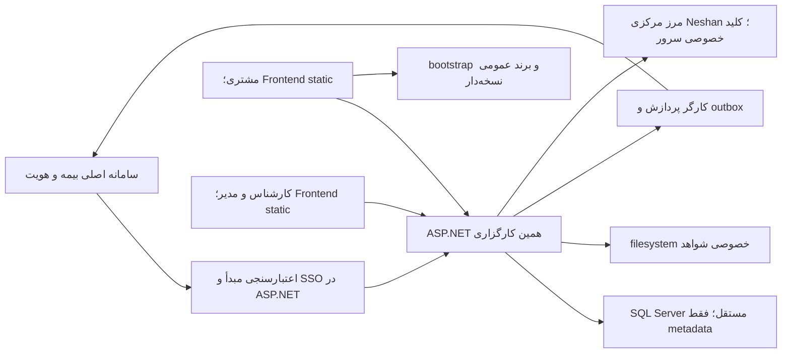
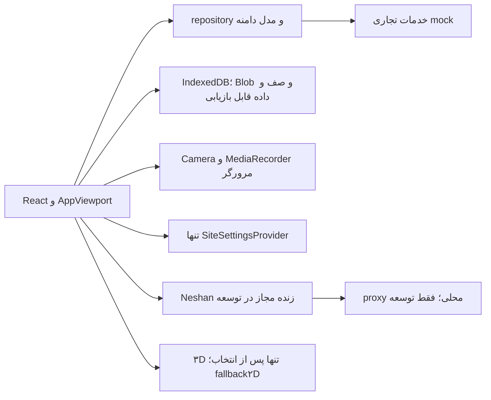
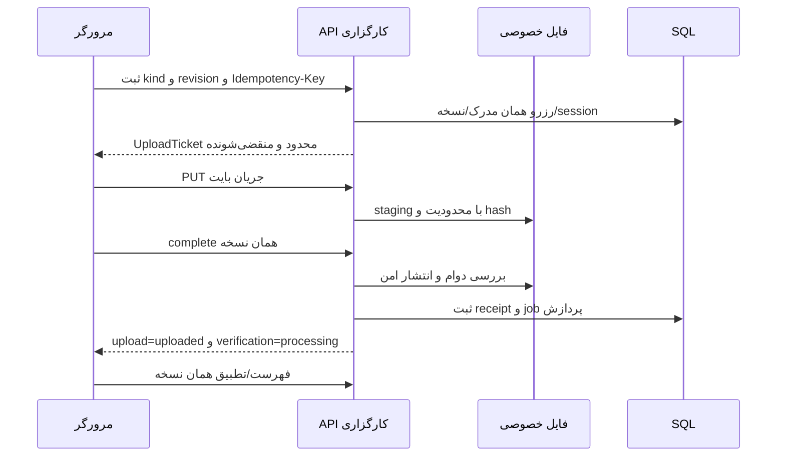
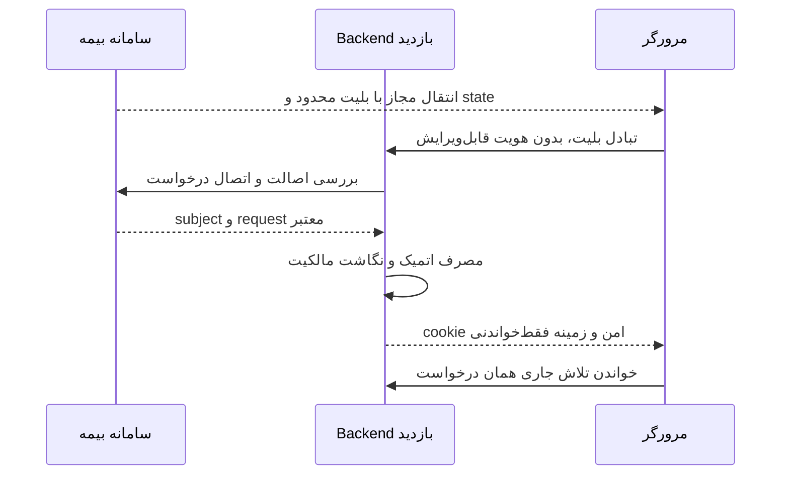
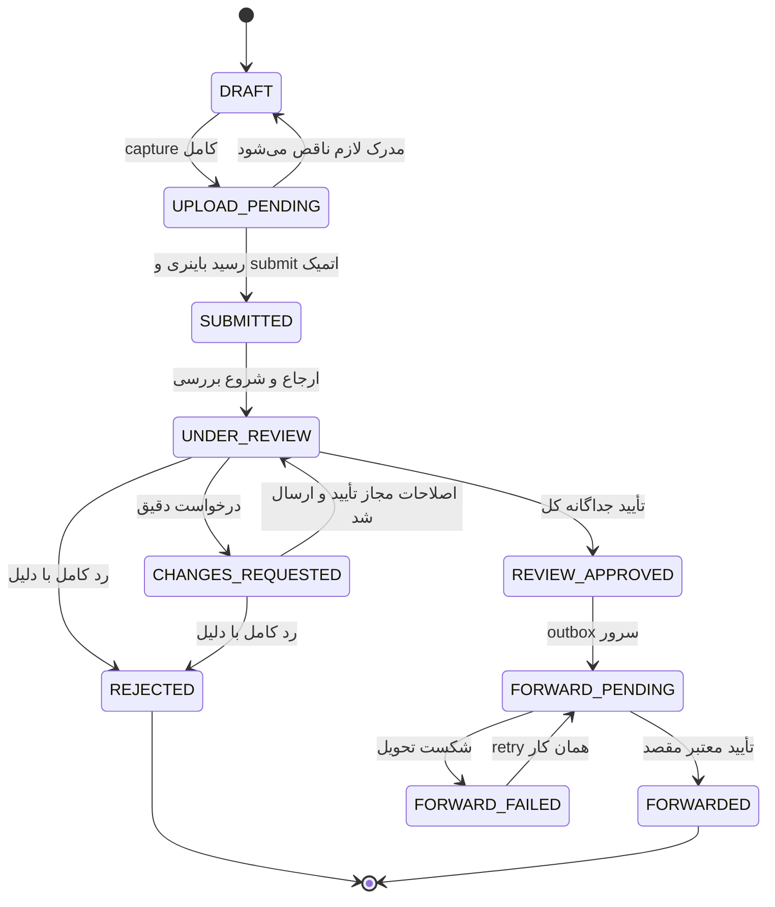
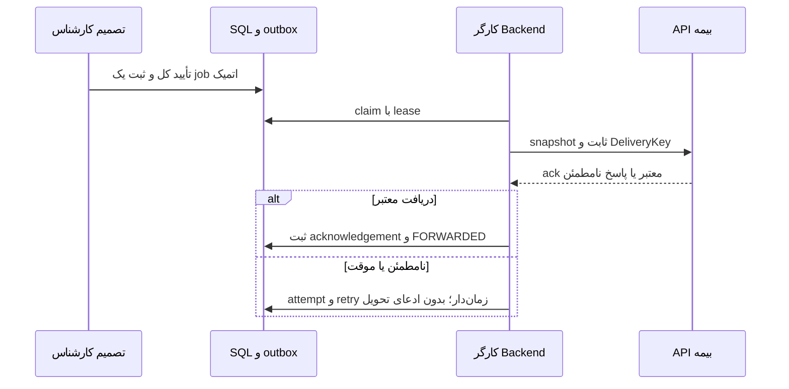

# مشخصات کامل و مستقل تحویل Backend بازدید خودرو

تاریخ تدوین: 2026-10-28؛ شاخهٔ مبنا `feat/unified-ui-admin-3d`؛ Git مبنا `74ef004836021656aa4d7ad8d31af9c7ae6551fe`. این فایل نمای ۳۰ فصلیِ همگام از منابع موجود است و برای مطالعه به هیچ فایل دیگری وابسته نیست. تمام API‌های تجاری و DDL، **پیشنهادی و نیازمند تصویب** هستند؛ Backend تولیدی و Static Export کامل از این مستند اثبات نمی‌شوند. هیچ SQL اجرا نشده است.

مرجع ویرایش قراردادها و طرح پایگاه همچنان `docs/API_FA/` و پنج ورودی ماشینی آن است؛ این فایل و سند جامع قبلی، خروجی دو چیدمان از همان منابع‌اند و دو قرارداد مستقل نیستند. برای بازتولید `python tools/build_backend_handover.py --zip` و برای کنترل بدون نوشتن `python tools/build_backend_handover.py --check --zip` اجرا می‌شود. منشأ و hash منابع در انتهای فصل ۳۰ درج شده است. تغییرات محلیِ نامرتبطِ کد و دارایی‌ها وارد این تحویل نمی‌شوند.

شمارش مستقیم منابع: 63 عملیات منطقی؛ 55 ترکیب HTTP method/path پیشنهادی؛ 1 فایل عمومی موجود؛ سه قرارداد پیام/کارگر G01/G02/G03؛ 80 تعریف DTO؛ 37 جدول، 302 ستون و 55 کلید خارجی. عملیات منطقی با تعداد endpoint برابر نیست. این تعدادها تصویب نهایی OpenAPI نیستند.

### راهنمای مطالعه و ماتریس پوشش

| فصل | موضوع و محل پوشش |
| --- | --- |
| 01 | [معرفی کامل پروژه](#فصل-01--معرفی-کامل-پروژه) |
| 02 | [معماری کلی سامانه](#فصل-02--معماری-کلی-سامانه) |
| 03 | [نقش‌های کاربران و سطح دسترسی](#فصل-03--نقشهای-کاربران-و-سطح-دسترسی) |
| 04 | [روند کامل کار پروژه](#فصل-04--روند-کامل-کار-پروژه) |
| 05 | [قوانین کسب‌وکار](#فصل-05--قوانین-کسبوکار) |
| 06 | [فهرست کامل API‌های موردنیاز](#فصل-06--فهرست-کامل-apiهای-موردنیاز) |
| 07 | [قرارداد کامل تمامی API‌ها](#فصل-07--قرارداد-کامل-تمامی-apiها) |
| 08 | [طراحی کلی پایگاه داده SQL Server](#فصل-08--طراحی-کلی-پایگاه-داده-sql-server) |
| 09 | [جدول‌های پیشنهادی دیتابیس](#فصل-09--جدولهای-پیشنهادی-دیتابیس) |
| 10 | [شمای کامل ستون‌های تمام جدول‌ها](#فصل-10--شمای-کامل-ستونهای-تمام-جدولها) |
| 11 | [روابط دیتابیس](#فصل-11--روابط-دیتابیس) |
| 12 | [اسکریپت پیشنهادی ساخت دیتابیس](#فصل-12--اسکریپت-پیشنهادی-ساخت-دیتابیس) |
| 13 | [ارتباط API‌ها با جداول دیتابیس](#فصل-13--ارتباط-apiها-با-جداول-دیتابیس) |
| 14 | [ذخیره‌سازی عکس‌ها و ویدیوها](#فصل-14--ذخیرهسازی-عکسها-و-ویدیوها) |
| 15 | [فرایند آپلود تصاویر و ویدیو](#فصل-15--فرایند-آپلود-تصاویر-و-ویدیو) |
| 16 | [احراز هویت و امنیت](#فصل-16--احراز-هویت-و-امنیت) |
| 17 | [چرخهٔ عمر پرونده و وضعیت‌ها](#فصل-17--چرخهٔ-عمر-پرونده-و-وضعیتها) |
| 18 | [عملیات کارشناسی](#فصل-18--عملیات-کارشناسی) |
| 19 | [عملیات مدیریت](#فصل-19--عملیات-مدیریت) |
| 20 | [ارسال نهایی به سامانهٔ کارگزاری](#فصل-20--ارسال-نهایی-به-سامانهٔ-کارگزاری) |
| 21 | [ویژگی‌ها و امکانات پروژه](#فصل-21--ویژگیها-و-امکانات-پروژه) |
| 22 | [محدودیت‌ها و الزامات پروژه](#فصل-22--محدودیتها-و-الزامات-پروژه) |
| 23 | [معماری White-Label](#فصل-23--معماری-white-label) |
| 24 | [استقرار پروژه روی سرور](#فصل-24--استقرار-پروژه-روی-سرور) |
| 25 | [مدیریت خطا](#فصل-25--مدیریت-خطا) |
| 26 | [ترتیب پیشنهادی پیاده‌سازی Backend](#فصل-26--ترتیب-پیشنهادی-پیادهسازی-backend) |
| 27 | [سناریوهای تست و معیارهای پذیرش](#فصل-27--سناریوهای-تست-و-معیارهای-پذیرش) |
| 28 | [موارد نامشخص و تصمیمات موردنیاز](#فصل-28--موارد-نامشخص-و-تصمیمات-موردنیاز) |
| 29 | [چک‌لیست کامل تحویل Backend](#فصل-29--چکلیست-کامل-تحویل-backend) |
| 30 | [واژه‌نامهٔ تخصصی](#فصل-30--واژهنامهٔ-تخصصی) |

## فصل 01 — معرفی کامل پروژه

### شناخت محصول و مرز مسئولیت‌ها

این محصول برای خودبازدید خودرو پیش از بررسی بیمه است. مشتری فارسی‌زبان با موبایل و راهنمای تصویری مدارک را جمع می‌کند؛ کارشناس پرونده ارجاع‌شده را بررسی می‌کند و مدیر کارگزاری قالب، برند، انتشار و ارجاع را مدیریت می‌کند. این برنامه جای سامانه اصلی فروش/صدور بیمه یا مرجع هویت مشتری نیست.

#### رابطه با سامانه بیمه

سامانه بیمه مالک هویت تأییدشده مشتری، شماره موبایل، درخواست بیمه و زمینه خودرو است. ورود باید همان `subjectId + sourceRequestId + tenant` را به بازدید متصل کند. Backend نگاشت داخلی را می‌سازد؛ مرورگر با ارسال یک شماره یا trackingCode مالکیت ایجاد نمی‌کند. شماره داخل برنامه فقط‌خواندنی است. چند درخواست یک مشتری و چند تلاش یک درخواست باید مستقل باشند. ارجاع به بازدید جاری یک read است و نباید تلاش تازه بسازد.

مسیر محصول: ورود معتبر از سامانه بیمه ← معرفی‌نامه/OTP مطابق سیاست مصوب ← آمادگی و رضایت ← موقعیت و خودرو ←۱۱ عکس و کیلومتر و ویدیوی دور خودرو ← صف ارسال پایدار ← مرور نهایی و ارسال رسمی ← بررسی کارشناس ← در صورت نیاز اصلاح محدود یا رد کامل ← تأیید کل ← تحویل سروری به سامانه بیمه و رسید مقصد. مشتری پس از قطع اینترنت یا مراجعت از همان مرحله امن ادامه می‌دهد.

#### مالکیت اجزا

| بخش | مسئولیت |
|---|---|
| Frontend | نمایش RTL، راهنما، permission مرورگر، ثبت دوربین/ویدیو، IndexedDB، صف و پیش‌نمایش محلی، نمایش وضعیت دریافتی |
| ASP.NET Core | هویت معتبر، مجوز، مالکیت، قالب پین‌شده، صحت قرارداد، تراکنش، رسید انتقال، قفل ارسال، تصمیم، audit و تحویل نهایی |
| SQL Server همان کارگزاری | metadata و روابط، نسخه‌ها، درخواست‌ها، رسیدها و outbox؛ بدون بایت عکس/ویدیو |
| filesystem خصوصی همان نصب | فایل واقعی و مشتق‌های مجاز، ACL، نگهداری و بازیابی |
| سامانه بیمه | هویت و درخواست اصلی، SSO/بلیت معتبر و API دریافت نتیجه |
| زیرساخت مرکزی | پیکربندی عمومی نقشه و نگهداری کلید خصوصی سرویس Neshan؛ نه مدیر هر کارگزاری |

#### وضع موجود و آینده

Next.js16.3.8، React، TypeScript و مخزن‌های typed فعلی وجود دارند. state سروری از مرز repository/adapter می‌آید، Zustand فقط وضعیت موقت است و Blob/صف در IndexedDB پایدار می‌شوند. داده محلی mock تضمین امنیت، هم‌زمانی کارکنان یا انتشار بین دستگاه‌ها نیست. Backend باید همان قواعد را سمت سرور enforce کند؛ SQL یا اعتبارسنجی فرمت جای احراز هویت نیست.

تجربه پیش‌فرض عکاسی ۲D می‌ماند. مدل سدان اختیاری، دارایی نمایش مشترک است و به بازدیدها upload نمی‌شود. منبع آن takeover/Sketchfab با CC BY4 است؛ بررسی مستقل حقوق طرح بدنه هنوز مانع انتشار تجاری ۳D است. ویدیوی ۳۶۰ یک ضبط واقعی پیاده‌روی مشتری است، نه GLB، panorama یا خروجی مدل.

هر کارگزاری استقرار، SQL و media root خود را دارد؛ برند/تنظیمات عمومی مستقل و سرویس نشان مرکزی‌اند. هدف نهایی Frontend فایل static بدون Node تولیدی است، ولی مسیرهای dynamic فعلی هنوز مانع export هستند. این بسته ادعای پایان آن مهاجرت را ندارد.

### گزارش کشف و ارزیابی منابع Backend

تاریخ بررسی: 2026-10-27؛ پروژهٔ مرجع `C:/Projects/vehicle-inspection-integrated`؛ شاخه `feat/unified-ui-admin-3d`؛ Git مبنا `a0786ab51df6de1faaeeed989f647060c439453d`. ساختار واقعی کل `docs/`، ورودی‌های README، پوشه‌های API_FA، handover و AI_HANDOFF و منابع محصول، معماری، رسانه و استقرار بررسی شدند. مسیرهای زیر مسیر واقعی فعلی‌اند و بر نام‌های تاریخی فرض‌شده تکیه ندارند.

#### پاسخ صریح دربارهٔ سند جامع قبلی

**نزدیک‌ترین سند موجود که همهٔ عملیات و قراردادهای API، جدول‌ها، ستون‌ها، DDL، ERD و هستهٔ گردش پروژه را یکجا دارد، `docs/handover/00-COMPLETE-BACKEND-SPECIFICATION-FA.md` است.** این سند واقعاً خودبسنده و تفصیلی است و ۲۷ بخش دارد؛ فقط مجموعه‌ای از لینک‌ها نیست. هستهٔ API و SQL آن دوباره طراحی نمی‌شود و فایل قبلی حفظ می‌شود.

هیچ سند موجودی تمام دامنهٔ درخواست تازه، شامل ساختار دقیق ۳۰ فصلی، گردش مستقل ۲۰ مرحله‌ای، فهرست تفصیلی قابلیت‌ها و محدودیت‌ها، گزارش کشف، ماتریس پوشش و اصلاحیهٔ تازهٔ Static Export را یکجا ندارد. بنابراین `handover_full.md` نمای همگام و قابل بازتولید تازه‌ای از همان منابع است. ایجاد آن برای تکمیل دامنه لازم است؛ ایجاد قرارداد یا schema مستقل و رقیب لازم نیست.

«کامل پیشنهادی» در جدول یعنی جزئیات برای بررسی و پیاده‌سازی پس از تصویب موجود است، نه اینکه API یا migration تولیدی اجرا شده باشد. «جاری» تازگی قاعده/مرز را بیان می‌کند، نه تضمین آمادگی تولید.

| موضوع | مسیر دقیق و بخش مربوط | کفایت | تازگی | اعتبار |
|---|---|---|---|---|
| ۱. هدف کسب‌وکار | `docs/02-project-overview/PROJECT_HANDBOOK.md`، محصول و مسئولیت‌ها؛ `docs/02-project-overview/PRODUCT_REQUIREMENTS.md`، محصول و نقش‌ها؛ `docs/API_FA/01-PROJECT-OVERVIEW.md`، رابطه با سامانه بیمه | کامل ترکیبی | جاری | قواعد محصول؛ طرح Backend پیشنهادی |
| ۲. تمام گردش مشتری | `docs/04-customer-workflow/CUSTOMER_WORKFLOW.md`، جدول مراحل، بازگشت، سیاست یازده‌عکسی؛ `docs/04-customer-workflow/CUSTOMER_MANUAL_FA.md`؛ `docs/API_FA/03-BUSINESS-REQUIREMENTS.md` | کامل ترکیبی | v2 جاری؛ v1 تاریخی | رفتار Frontend/قواعد قطعی؛ transport پیشنهادی |
| ۳. کارشناس و مدیر | `docs/API_FA/12-REVIEWER-OPERATIONS.md`، تراکنش تصمیم؛ `docs/API_FA/13-ADMIN-AND-SITE-SETTINGS.md`؛ `docs/05-admin-reviewer/REVIEWER_MANUAL_FA.md` و `ADMIN_MANUAL_FA.md` | کامل دامنهٔ فعلی؛ اختیارهای D10 باز | جاری و mock | الزام نقش/ارجاع قطعی؛ enforce سروری پیشنهادی |
| ۴. تمام عملیات Backend | `docs/12-api-reference/FRONTEND_API_REQUIREMENTS.md`، A تا G؛ `docs/API_FA/04-COMPLETE-API-REQUIREMENTS.md`؛ `docs/API_FA/contracts/operations.json` | کامل: ۶۳ عملیات | جاری؛ عملیات با endpoint فرق دارد | مرجع نیاز Frontend؛ قرارداد Backend پیشنهادی |
| ۵. قرارداد و JSON | `docs/API_FA/05-API-CONTRACTS.md`، P00 تا FW01، G01 تا G03 و فرهنگ DTO؛ `docs/API_FA/contracts/endpoints.json`، `schemas.json` و `examples.json` | کامل پیشنهادی: ۵۵ method/path و ۸۰ DTO؛ یک فایل عمومی جدا | جاری؛ AU02 مشروط | PROPOSED؛ D01/D04/D08 باز |
| ۶. تمام جدول‌ها | `docs/API_FA/06-DATABASE-DESIGN.md`؛ `docs/API_FA/sql/schema-manifest.json`، tables/classification | کامل: ۳۷ جدول؛ ۳۴ مسئولیت الزامی و ۳ مشروط | پیشنهاد جاری | SQL مصوب نیست؛ reuse نیازمند تصویب |
| ۷. تمام ستون‌ها | `docs/API_FA/24-DATABASE-TABLE-BLUEPRINTS.md`، شناسنامه و نمونهٔ هر جدول؛ `docs/API_FA/06-DATABASE-DESIGN.md` | کامل پیشنهادی: ۳۰۲ ستون، NULL، کلید، default، قید و index | همگام با manifest | اجرا نشده؛ نیازمند بررسی SQL |
| ۸. روابط و ERD | `docs/API_FA/07-DATABASE-RELATIONSHIPS.md`، جدول FK، قواعد فراتر از FK؛ `docs/API_FA/sql/DATABASE_DIAGRAM.md` | کامل: ۵۵ FK و کلید ترکیبی | جاری | پیشنهادی؛ تست migration واقعی لازم |
| ۹. نگاشت API/SQL | `docs/API_FA/20-API-DATABASE-MAPPING.md`، ماتریس و اثر تفصیلی عملیات | کامل برای ۶۳ عملیات | جاری | طرح پیشنهادیِ خواندن/نوشتن/فایل/تراکنش |
| ۱۰. رسانه و filesystem | `docs/12-api-reference/BROKERAGE_STORAGE_SPEC.md`، قواعد قطعی/چرخه؛ `docs/API_FA/08-MEDIA-FILE-STORAGE.md` و `09-UPLOAD-AND-MEDIA-PROCESSING.md` | کامل قواعد؛ limits/retention/path باز | جاری؛ ریشه مستقیم INSPECTION در BROKERAGE_STORAGE_SPEC و کد handoff Frontend تاریخی است | filesystem خصوصی قطعی؛ چیدمان `GUI_{CustomerId}/INSPECTION_{InspectionId}` پیشنهاد مرجح محصول و نیازمند تصویب Backend (D05) |
| ۱۱. هویت و SSO | `docs/08-auth-security/BROKERAGE_SSO_REQUIREMENTS.md`، توافق هویت؛ `docs/API_FA/10-AUTHENTICATION-AND-SSO.md`، مشتری/OTP/کارکنان/topology؛ `26-ROLES-AND-PERMISSIONS.md` در همان پوشه | الزام کامل؛ پروتکل/نشست تولیدی باز | جاری؛ restore محلی امنیت تولید نیست | مالکیت مبدأ قطعی؛ OIDC/ticket پیشنهادی |
| ۱۲. انتقال وضعیت | `docs/03-architecture/INSPECTION_STATE_MACHINE.md`؛ `docs/API_FA/11-INSPECTION-LIFECYCLE.md`؛ `src/features/inspection-status/lifecycle-model.ts` | کامل enum/محافظ فعلی؛ موتور سروری آینده | جاری؛ sending/retrying زیر FORWARD_PENDING | enum فعلی؛ تراکنش سروری پیشنهادی |
| ۱۳. امنیت و محدودیت دسترسی | `docs/08-auth-security/DATA_OWNERSHIP_AND_SECURITY.md`؛ `docs/API_FA/15-SECURITY-AND-TENANT-ISOLATION.md` و `26-ROLES-AND-PERMISSIONS.md` | کامل الزام؛ آزمون تولیدی تحویل نشده | جاری | معیار پذیرش، نه تضمین guard مرورگر |
| ۱۴. ارسال نهایی | `docs/API_FA/14-BROKERAGE-FORWARDING.md`، outbox/retry؛ `29-SOURCE-SYSTEM-CONTRACTS.md` در همان پوشه، تحویل نهایی؛ G02/G03/FW01 در قرارداد | مسئولیت کامل؛ URL/auth/payload نهایی باز | جاری؛ approval و delivery جدا | ack قطعی؛ قرارداد مقصد D11 پیشنهادی |
| ۱۵. White-Label | `docs/03-architecture/WHITE_LABEL_ARCHITECTURE.md`، تصمیم استقرار؛ `docs/09-deployment/WHITE_LABEL_CONFIGURATION.md`؛ `docs/API_FA/13-ADMIN-AND-SITE-SETTINGS.md` | کامل ترکیبی | معماری جاری؛ تعداد ۱۲ در سابقهٔ فاز ۱ تاریخی است | نصب/SQL/فایل مستقل و Neshan مرکزی قطعی؛ انتشار فعلاً mock |
| ۱۶. سرور و استقرار | `docs/API_FA/16-DEPLOYMENT-AND-SERVER-REQUIREMENTS.md`؛ `docs/09-deployment/STATIC_EXPORT_AUDIT.md`، موانع دقیق و اصلاحیه 2026-10-27؛ `STATIC_DEPLOYMENT_DECISION.md` در همان پوشه، گزینه A/دروازه؛ `docs/AI_HANDOFF/FULL_PROJECT_DEBUGGING_REPORT.md`، بخش ۸ | کامل موانع/طرح رفع؛ artifact کامل نداریم | probe تازه بر مسیر خطای probe قدیمی مقدم است | BLOCKED؛ مهاجرت منتظر تصویب |
| ۱۷. امکانات و محدودیت‌ها | `docs/02-project-overview/FEATURE_INVENTORY.md`، تمام ردیف‌ها و اجرا‌نشده‌ها؛ `PROJECT_STATUS_AND_NEXT_STEPS.md` در همان پوشه؛ `docs/AI_HANDOFF/FULL_PROJECT_DEBUGGING_REPORT.md`، بخش‌های ۶ تا ۱۰ | کامل ترکیبی؛ سند قبلی فصل مستقل همهٔ امکانات ندارد | inventory دارای baseline تاریخی؛ نتیجهٔ آزمون قبلی تضمین اکنون نیست | شواهد Frontend، mock و gate‌های Backend تفکیک‌شده |
| ۱۸. پرسش/تصمیم باز | `docs/API_FA/19-BACKEND-TEAM-QUESTIONS.md`، سه گروه پاسخ‌دهنده؛ `23-OPEN-DECISIONS.md`، D01 تا D18؛ `25-CONTRACT-STATUS-AND-PROVENANCE.md` در همان پوشه | کامل دفتر موجود؛ پاسخ هنوز ارائه نشده | جاری؛ هیچ موردی ضمنی بسته نمی‌شود | باز، نیازمند مالک/نسخه/تصویب |

#### مسیرهای واقعی و منشأ خروجی

DDL مرجع `docs/API_FA/sql/PROPOSED_SCHEMA.sql` و کپی توزیعی آن `docs/handover/03-database/sql/PROPOSED_SCHEMA.sql` است. `DATABASE-DESIGN.md` در مسیر فعلی `docs/handover/03-database/DATABASE-DESIGN.md` و معادل مرجع `docs/API_FA/06-DATABASE-DESIGN.md` یافت شد. `FRONTEND_API_REQUIREMENTS.md` و `API_PHASE_READINESS.md` اکنون زیر `docs/12-api-reference/` هستند. فایل مستقلی با نام تاریخی `MASTER_PRODUCT_BUSINESS_SPECIFICATION_FA.md` در فهرست فعلی وجود ندارد؛ پوشش محصول از منابع بالا تأمین می‌شود، نه از سند فرضی. اطلاعات قیمت‌گذاری، درآمد یا پژوهش بازار در این تحویل ساخته نشده است.

`tools/generate-api-handoff.mjs` کاتالوگ/قرارداد/طرح/blueprint/DDL/ERD را از JSON مرجع می‌سازد. `tools/build_backend_handover.py` ماژول‌ها، هر دو نمای جامع، README، manifest و ZIP را تولید می‌کند. اصلاح قرارداد در مرجع انجام می‌شود؛ سپس خروجی‌ها همگام بازتولید می‌شوند. اسناد قدیمی حذف یا به قرارداد مستقلی تبدیل نمی‌شوند.

### مسئله، هدف و ارزش برای ذی‌نفعان

مشتری برای تشکیل پروندهٔ بررسی بیمهٔ خودرو، به‌جای هماهنگی مراجعهٔ حضوری برای جمع‌آوری اولیهٔ مدارک، با موبایل خود شواهد موردنیاز را ثبت می‌کند. راهنمای مخصوص هر عکس، حفظ محلی، ادامهٔ کار قطع‌شده و اصلاح محدود، رفت‌وبرگشت و ثبت دوبارهٔ غیرضروری را کاهش می‌دهند. این ارزش پیشنهادی است؛ کاهش هزینه یا زمان با عدد اثبات‌نشده ادعا نمی‌شود.

کارگزاری بسته‌ای منظم با هویت معتبر، درخواست بیمهٔ مرتبط، مدارک نسخه‌دار، کیلومتر و موقعیت، تصمیم قابل ردیابی کارشناس و رسید تحویل نهایی می‌گیرد. مدیر مسئول ظرفیت، ارجاع، قالب و برند است؛ کارشناس مسئول ارزیابی همان پروندهٔ مجاز است. سامانه جای صدور بیمه، تعیین حق‌بیمه، مرجع هویت، ثبت اصلی خودرو یا تصمیم خودکار خسارت را نمی‌گیرد. Frontend ثبت و نمایش را انجام می‌دهد؛ Backend باید اعتماد، صحت، دوام، مجوز و انتقال را اعمال کند.

## فصل 02 — معماری کلی سامانه

### معماری موجود و پیشنهاد تولید

وضعیت این فصل: مرزهای Frontend موجودند؛ خدمات تولیدی نمودار زیر **پیشنهاد نیازمند تصویب** هستند. دو audience و دو مرجع هویت با یک نشست معتبر Backend به هم متصل می‌شوند.



#### آنچه واقعاً اکنون اجرا می‌شود



نمونه local proxy Node برای reverse و runtime settings فقط توسعه است؛ وارد بسته تولیدی نمی‌شود. production نباید با قراردادن private service key در `NEXT_PUBLIC_*` یا browser fetch مستقیم به سرویس خصوصی نشان حل شود. ساختار جدید Backend می‌تواند facade همان `/maps/reverse` را به زیرساخت مرکزی وصل کند.

#### مرزهای اعتماد و داده

| مرز | الزام |
|---|---|
| مرورگر → API | cookie/session معتبر، CSRF برای mutation، اعتبارسنجی DTO و مالکیت هر منبع |
| مبدأ → auth Backend | issuer/audience/expiry/nonce و امضای معتبر یا introspection مورد توافق، مصرف یک‌بار بلیت |
| API → SQL | connection نصب از پیکربندی trusted، پارامترگذاری query و حداقل اختیار |
| API → filesystem | مسیر از ID معتبر DB، ریشه خصوصی، ACL و جلوگیری از traversal/reparse |
| worker → سامانه بیمه | مقصد allowlist، credential سروری، کلید ثابت، تأیید دریافت و retry قابل مشاهده |
| تنظیمات عمومی | فقط whitelist؛ کلید عمومی نقشه با محدودیت دامنه، نه کلید خصوصی یا connection string |

طرح SQL در [فصل 8](#فصل-08--طراحی-کلی-پایگاه-داده-sql-server) و مرز تراکنش در [فصل 11](#فصل-11--روابط-دیتابیس) است. یک پایگاه مستقل به تنهایی مجوز کاربر داخل آن را ثابت نمی‌کند. API باید مالکیت customer/sourceRequest/inspection و ارجاع staff را دوباره بررسی کند.

#### انتخاب‌های باز

نسخه پشتیبانی‌شده ASP.NET/SQL، محل اجرای worker، OIDC یا ticket، reverse proxy هم‌origin یا CORS دقیق، فرمت انتقال و پروتکل acknowledgement هنوز توافق می‌خواهند. static frontend می‌تواند از ASP.NET برای auth/cookie/gateway استفاده کند؛ این وابستگی Backend است، نه Node Frontend. افزودن fallback عمومی IIS به تنهایی route‌های dynamic و payload‌های Next را تولید نمی‌کند.

### مرز معماری اجرایی و هدف استقرار

App Router، React/TypeScript، فرم RHF/Zod، TanStack Query و repository‌های تایپ‌شده در Frontend موجودند. Zustand فقط گردش گذرا و IndexedDB فقط داده/رسانه و صف محلی را نگه می‌دارند. Server Component پیش‌فرض و client leaf برای API مرورگر به کار می‌رود. API DTO پیش از ورود به UI به domain model تبدیل می‌شود. کلاینت تولیدشدهٔ OpenAPI پس از تصویب قرارداد، پشت همان adapter جای mock را می‌گیرد.

معماری ASP.NET Core، SQL Server و filesystem خصوصی در این سند **طرح Backend** است. نسخهٔ پشتیبانی‌شدهٔ .NET/SQL، worker host و topology نهایی در D06/D02 باز هستند. Frontend static هدف است و اکنون یک انتشار کاملِ تأییدشده نیست. gateway هم‌origin پیشنهادی، auth و API را در ASP.NET نگه می‌دارد؛ reverse نشان به سرویس مرکزی مجاز متصل می‌شود. Node proxy توسعهٔ نشان و Route Handler پیش‌نمایش مدل، سرویس تولیدی نیستند.

## فصل 03 — نقش‌های کاربران و سطح دسترسی

### نقش‌ها، مجوزها و دامنه دسترسی

این ماتریس بازتاب الزامات موجود و پیشنهاد enforce در Backend است. نقش و permission باید از نشست معتبر همان نصب صادر شوند؛ query، body، localStorage و انتخابگر mock منشأ اختیار نیستند.

| عامل | خواندن | تغییر مجاز | ممنوعیت مهم |
|---|---|---|---|
| مشتری مالک | تلاش‌های همان subject/sourceRequest، رسید، دلایل عمومی و مدرک خود | حقایق و ثبت قبل submit؛ بعد submit فقط اقلام درخواست فعال | درخواست/پرونده دیگر، شماره مبدأ، یادداشت خصوصی، تصمیم کارشناس |
| `viewer` | قالب‌های مجاز | ندارد | مدیریت، تصمیم، فایل خصوصی بدون مجوز مستقل |
| `template-editor` | قالب‌ها و نسخه‌ها | پیش‌نویس با `templates:edit` و مجوز فعلی editDraft | انتشار، SSO، نقش‌ها، مدارک مشتری و تغییر قالب تاریخی |
| `platform-admin` | قالب، تنظیمات، عملیات و پرونده در محدوده مجاز | انتشار، برند، کارکنان، ظرفیت، ارجاع و بازیابی تحویل با مجوز جدا | تصمیم کارشناس صرفاً به دلیل admin بودن، کلید خصوصی نشان، دورزدن قفل نهایی |
| `reviewer` | پرونده ارجاع فعال و نسخه‌های مجاز | `evidence:decide` و `inspection:decide`، دلیل اصلاح و یادداشت خصوصی | پرونده ارجاع‌نشده، تغییر هویت، ارسال مستقیم مقصد، تصمیم روی revision کهنه |
| سرویس مبدأ | رابطه trusted مشتری/درخواست/خودرو و تحویل توافق‌شده | صدور زمینه معتبر و تأیید دریافت مقصد | واگذاری اعتماد به نقش یا شماره دلخواه مرورگر |
| کارگر سرور | job دارای lease و snapshot دقیق | پردازش/اعلان/forwarding با کمترین اختیار | تغییر تصمیم Reviewer، مسیر یا مقصد دلخواه، ادعای ack بدون رسید |

مجوزهای فعلی کارکنان: `templates:read`، `templates:edit`، `settings:write`، `staff:manage`، `inspections:read`، `inspections:assign`، `evidence:decide` و `inspection:decide`. نگاشت publish/branding/policies/webhooks/users در UI موجود نیز باید با policy سمت سرور همسو شود؛ صرف داشتن templates:edit به معنی publish نیست.

#### نگاشت نشست و DTO

`Session.kind=staff` با state=authenticated باید tenantId، subjectId، role، permissions، authority=backend-session و expiresAt داشته باشد. آداپتور به AuthenticatedStaffSession فعلی نگاشت می‌کند؛ cookie/token خصوصی در این DTO قرار نمی‌گیرد. برای customer، source همان زمینه trusted شامل tenantId، subjectId، sourceRequestId و mobile فقط‌خواندنی است. نقش کارکنان از customer context ساخته نشود.

در هر فرمان: ابتدا نشست و نصب، سپس مالکیت درخواست یا permission، سپس ارجاع/قفل/نسخه و قواعد کسب‌وکار بررسی شود. کنترل هنگام خواندن کافی نیست؛ revoke/reassign میان بازکردن صفحه و تصمیم باید در تراکنش دوباره enforce شود. پاسخ نامرئی ۴۰۴ یا ۴۰۳ طبق سیاست مصوب، بدون افشای وجود پرونده دیگر، برگردد.

یادداشت داخلی در CustomerStatus، receipt، notification یا forwarding عمومی نیاید. حق خواندن یادداشت توسط Admin هنوز تصمیم D10 است؛ حذف از projection پیش‌فرض لازم است. خروج و انقضا درخواست بعدی را نامعتبر می‌کنند، ولی بهانه پاک‌کردن خودکار مدرک خوب IndexedDB نیستند. سیاست دستگاه مشترک در D14 تصویب شود.

### مسئولیت، احراز هویت و وابستگی هر عامل

| عامل | احراز هویت و scope | عملیات وابسته | محدودیت |
|---|---|---|---|
| مشتری | نشست معتبر مبدأ، subject/request/tenant و مالکیت بازدید | A03/A05/A07–A09، B01–B10، C01–C07، D01–D09 | شمارهٔ مبدأ فقط‌خواندنی؛ پس از submit فقط قلم/فیلد درخواست فعال |
| کارشناس | SSO مصوب، reviewer، permission و ارجاع فعال در لحظهٔ commit | A04/A05، E01/E02/E05–E10، C06 | مدیر بودن یا داشتن URL حق تصمیم نمی‌دهد؛ تصمیم نسخهٔ دقیق لازم است |
| مدیر | SSO مصوب و مجوز همان نصب | E01/E03/E04، F01–F12، G04 | مدیریت ارجاع و انتشار؛ حق تصمیم کارشناس خودکار ندارد |
| سامانهٔ کارگزاری مبدأ/مقصد | اعتبارنامهٔ سرور و issuer/audience یا قرارداد trusted | A03/A04 و قراردادهای پیام G02/G03 | body مرورگر جای هویت معتبر نیست؛ URL مقصد از allowlist می‌آید |
| کارگر سرور | هویت سرویس با حداقل اختیار، job/lease و snapshot دقیق | پردازش رسانه، G01/G02/G03 | حق تغییر تصمیم کارشناس، انتخاب مقصد آزاد یا جعل ack ندارد |

نقش‌های محدودتر viewer و template-editor در ماتریس اصلی حفظ شده‌اند. نقش تجاری و permission ریزدانه هر دو بررسی می‌شوند؛ اتکا به مخفی‌بودن دکمه کافی نیست.

## فصل 04 — روند کامل کار پروژه

### گردش اصلی از ورود تا رسید مقصد

| گام | رفتار مشتری/عملیات و شرط پذیرش | API/دادهٔ Backend و نتیجه |
|---|---|---|
| ۱ | ورود از وب‌سایت کارگزاری و درخواست بیمهٔ معتبر | A03/A05؛ نصب از host/config trusted، درخواست متعلق به subject |
| ۲ | انتقال هویت تأییدشده؛ نمایش موبایل فقط‌خواندنی؛ معرفی‌نامه/OTP مطابق توافق | A07/A08/A09؛ challenge محدود و مصرف اتمیک؛ سیاست OTP تولید هنوز D01 |
| ۳ | خواندن تلاش جاری؛ فقط در نبود آن ایجاد صریح و idempotent | B03 سپس B01/B02/B05؛ Inspections با template/version/policy پین‌شده؛ GET تلاش تازه نمی‌سازد |
| ۴ | بررسی دوربین/ضبط/ذخیره‌سازی دستگاه | قابلیت مرورگر؛ endpoint تازه ندارد؛ GPS اختیاری و WebGL پیش‌نیاز نیست |
| ۵ | پذیرش صریح شرایط/حریم خصوصی | B06؛ InspectionConsents با نسخهٔ متن و زمان سرور؛ failure داده را حفظ می‌کند |
| ۶ | خواندن/تأیید خودرو و پلاک ساختاریافته | B08/B09؛ Vehicles snapshot همان تلاش؛ تغییر master بیمه ضمنی نیست |
| ۷ | انتخاب نقشه/GPS/دستی و تأیید نشانی | B07/B11؛ lat/lng معتبر، address و accuracy nullable؛ در UI فعلی صفحهٔ موقعیت پیش از خودروست و ترتیب ۶/۷ این جدول ترتیب مفهومی است |
| ۸ | ثبت ده عکس ثابت در هفت بخش با راهنمای مخصوص و تأیید محلی | B05؛ C01–C03 پس از ذخیرهٔ Blob در IndexedDB؛ requirement/revision دقیق |
| ۹ | انتخاب فقط یک محل VIN و ثبت عکس واقعی آن | spec-plate با alternativeId یکی از pillar/engine/seat/windshield؛ سه گزینهٔ دیگر missing نیستند |
| ۱۰ | ورود عدد صحیح کیلومتر، مستقل از عکس odometer-on | B10؛ OdometerReadings؛ صفر معتبر، فقدان عدد مانع تکمیل بسته |
| ۱۱ | ضبط زندهٔ پیوستهٔ ویدیوی دور خودرو، مرور و تأیید | همان خانوادهٔ evidence/upload با kind=video-360؛ ویدیو عکس یازدهم نیست |
| ۱۲ | انتقال تمام نسخه‌های انتخابی از صف پایدار مشترک | C01–C07؛ ثبت، stream، complete و reconcile؛ receipt هر نسخه قابل بازیابی |
| ۱۳ | ارزیابی آمادگی از دادهٔ معتبر سرور | D01؛ facts/consent/template/required‌ها/عدد/ویدیو و رسید نسخه‌های هدف؛ شمار ۱۱ به تنهایی کافی نیست |
| ۱۴ | ارسال رسمی آنلاین با فرمان ثابت و نسخهٔ مورد انتظار | D02/D03؛ snapshot، SubmissionEvidence، receipt، status/audit در تراکنش؛ قفل ویرایش |
| ۱۵ | ارجاع مجاز و بررسی مدارک واقعی نسخه‌دار | E03 و E01/E02/C06؛ ظرفیت/فعال‌بودن کارشناس، دسترسی خصوصی و Range |
| ۱۶ | تأیید/رد مدرک یا درخواست فیلد؛ تصمیم نهایی کل مستقل است | E05/E06/E07/E08/E09؛ دلیل عمومی رد لازم؛ notes خصوصی |
| ۱۷ | اصلاح فقط قلم/فیلد درخواست فعال و ارسال مجدد همان دور | D05–D08؛ اصل و تاریخچه باقی؛ revision/requestVersion و receipt نامزد کنترل شود |
| ۱۸ | پس از تأیید کل، ساخت کار ارسالِ همان snapshot | E09/G02؛ تصمیم + outbox اتمیک، ارسال شبکه بیرون تراکنش |
| ۱۹ | انتقال سروری و ثبت رسید معتبر مقصد | G03؛ DeliveryKey ثابت، ack/query و ForwardingAttempts؛ timeout نتیجهٔ نامعلوم است |
| ۲۰ | نمایش وضعیت نهایی درست و امکان پیگیری مجاز | D04/G05؛ REVIEW_APPROVED با FORWARDED فرق دارد؛ FORWARDED فقط با شناسه/زمان ack |

### مسیرهای جایگزین و استثنا

- بازگشت به DRAFT از مرحلهٔ امن ذخیره‌شده ادامه می‌یابد؛ بستهٔ محلی کامل به مرکز ارسال، حالت ارسال‌شده/در بررسی به رسید و CHANGES_REQUESTED به اقلام محدود هدایت می‌شود. scope درخواست مبدأ در تمام بازیابی‌ها ثابت است.
- قطع شبکه، refresh یا گم‌شدن پاسخ با همان job/نسخه/Idempotency-Key بازیابی می‌شود؛ عکس و مدرک خوب پاک نمی‌شوند. ارسال رسمی آفلاین موفق اعلام نمی‌شود.
- رد اجازهٔ GPS انتخاب دستی را حذف نمی‌کند؛ خطای reverse نباید نشانی دستی را پاک کند. دوربین/ضبط/سهمیهٔ storage مسدود، پیام واقعی و retry لازم دارد؛ موفقیت اجازه یا کیفیت جعل نمی‌شود.
- جایگزینی پیش از ارسال، اصل accepted را تا تأیید پایدار نگه می‌دارد. انتخاب راهنمای محل جدید، alternative عکس accepted قبلی را بازبرچسب‌گذاری نمی‌کند.
- رد یک عکس به رد کل تبدیل نمی‌شود. اصلاح پلاک/رنگ/سال، فقط همان field task را باز می‌کند و همهٔ خودرو را قابل ویرایش نمی‌سازد.
- REJECTED همان تلاش را با دلیل می‌بندد؛ D09 فقط با اقدام صریح مالک، تلاش خالی جدید با previousAttemptId می‌سازد. هیچ عکس، ویدیو، کیلومتر یا رضایتی کپی نمی‌شود؛ فعال‌سازی تکراری همان تلاش تازه را بازیابی می‌کند.
- شکست forwarding به ثبت مجدد نیاز ندارد؛ G04 همان job را با مجوز مدیر بازیابی می‌کند. نبود پیامک مانع خواندن وضعیت نیست.

## فصل 05 — قوانین کسب‌وکار

### قواعد کسب‌وکار و الزامات مدرک

#### قاعده قطعی بازدید تازه

**۱۱ عکس = ۱۰ عکس ثابت + فقط یکی از چهار گزینه محل VIN**. یک کیلومتر عددی و یک ویدیوی الزامی پیاده‌روی دور خودرو نیز لازم‌اند. شمار رسانه از قالب مشتق می‌شود: در نسخه فعلی ۱۱ عکس + ۱ ویدیو = ۱۲ فایل؛ کیلومتر عددی به این شمار اضافه نمی‌شود.

| عکس ثابت | شناسه دقیق |
|---|---|
| جلو ۴۵ درجه راست | `front-45-right` |
| عقب ۴۵ درجه راست | `back-45-right` |
| جلو ۴۵ درجه چپ | `front-45-left` |
| عقب ۴۵ درجه چپ | `back-45-left` |
| کیلومترشمار روشن | `odometer-on` |
| کابین از سمت راننده | `driver-interior` |
| محفظه موتور | `engine-bay` |
| سقف | `car-roof` |
| نمای جلو با پلاک | `front-plate` |
| نمای عقب با پلاک | `rear-plate` |

جایگاه یازدهم همیشه `requirementId=spec-plate`، با `choice.groupId=vehicle-identification` است. مقدار `alternativeId` یکی از این موارد است:

| شناسه | محل و راهنمای متناظر |
|---|---|
| `pillar` | ستون کنار در راننده؛ بیشتر خودروهای خارجی؛ `spec-plate.webp` |
| `engine` | دیواره موتور؛ بیشتر خودروهای داخلی؛ `chassis-number.webp` |
| `seat` | زیر صندلی راننده یا شاگرد؛ برخی خارجی؛ `spec-plate-2.webp` |
| `windshield` | حاشیه شیشه جلو؛ برخی خارجی؛ مرجع عمومی `windshield-vin.webp` |

`engine` عکس خوانای کد روی دیواره است و جای عکس کامل `engine-bay` را نمی‌گیرد. سه گزینه استفاده‌نشده مفقود نیستند. انتخاب guide، وجود Blob بدون metadata معتبر یا draft به تنهایی completion نیست. هفت بخش با ترتیب فعلی: نمای راست، نمای چپ، جلو، عقب، کابین، موتور و مشخصات، سقف. تعداد عکس هر بخش به ترتیب ۲، ۲، ۱، ۱، ۲، ۲، ۱ است.

#### ذخیره و نسخه

در API، شناسه logical و alternative جدا از ID داخلی SQL هستند. RequirementAlternatives فرزند همان گروه است؛ نسخه مدرک actual alternative را نگه می‌دارد. برای v2، spec-plate بدون یکی از چهار مقدار معتبر ۴۲۲ می‌دهد. backend باید عضویت قالب پین‌شده، required‌ها و مستقل بودن موتور را از داده معتبر بررسی کند؛ صرف شمار ۱۱ کافی نیست. ارسال ۱۱ نسخه تکراری یا گزینه‌های متعدد VIN جای requirement مفقود را نمی‌گیرد.

قالب `body-image-guided` نسخه ۲ و `photoPolicyVersion=2` برای تازه‌هاست. داده پین‌شده نسخه ۱ عمداً ۱۲ عکس مستقل دارد و تغییر خودکار نمی‌کند. انتشار Admin یا مراجعه دوباره مشتری نباید pinned template/metadata را عوض کند. شروع تلاش تازه پس از رد، شناسه/namespace تازه دارد؛ تاریخچه و مدرک قبلی به آن کپی نمی‌شوند.

اصل پذیرفته‌شده A همراه draft یا جایگزین B اعتبار قبلی خود را نگه می‌دارد و توجه/نیاز به بررسی مستقل نمایش داده می‌شود. ترجیح راهنمای B نمی‌تواند accepted A را relabel کند. پس از تأیید B و دریافت پایدار، pointer فقط با کنترل نسخه جابه‌جا می‌شود؛ نسخه A برای snapshot‌های قبلی باقی می‌ماند. پاسخ worker/job قدیمی نباید A را دوباره جاری کند.

#### کیلومتر و ویدیو

`kilometers` عدد صحیح بین ۰ و ۹۰۰۷۱۹۹۲۵۴۷۴۰۹۹۱ است؛ سقف فیزیکی/کسب‌وکاری دقیق نیازمند تصویب است. Frontend ارقام فارسی، عربی و لاتین و جداکننده هزارگان معتبر را normalize می‌کند؛ Backend JSON عددی معتبر را کنترل می‌کند. عدد منفی، اعشار، overflow یا متن ۴۸km مردود است. نمایش ۴۸٬۳۲۰ از مقدار 48320 جداست. تعویض عکس کیلومتر نباید عدد را بی‌دلیل پاک کند؛ ویرایش پیش از ارسال یا task صریح مجاز است.

ویدیو ضبط پیوسته حرکت آرام دور خودرو است. ضبط browser با MediaRecorder و MIME پشتیبانی‌شده یا fallback مجاز دستگاه انجام می‌شود. زمان هدف راهنما، minimum/maximum قانونی یا اثبات پوشش فیزیکی نیست. سرعت/تراز/نور تحلیل خودکار پیاده نشده‌اند؛ نباید کیفیت یا محل واقعی کاربر جعل شود. ghost عکس، راهنمای ویدیوی ۳۶۰ نیست. دارایی سدان چرخان آموزشیِ cleared هنوز موضوع جداگانه است.

#### آمادگی و قفل

captureComplete: تمام عکس‌های الزامی معتبر و پذیرفته‌شده + عدد کیلومتر معتبر + ویدیوی پذیرفته‌شده. canSubmit علاوه بر آن حقایق تأییدشده، receipt باینری نسخه هدف همه رسانه‌ها و نبود retake/خطای مسدودکننده را لازم دارد. `upload=uploaded` همراه `verification=processing` از نظر انتقال کامل است؛ processing تأیید کارشناس نیست. محلی/queued/uploading/failed مانع ارسال رسمی‌اند. پس از ارسال، فقط اقلام/فیلدهای درخواست اصلاح فعال باز می‌شوند؛ checkbox تأیید دستی کیفیت مشتری وجود ندارد.

منابع بررسی‌شده: `src/features/photography/inspection-template.ts`، `photo-choice.ts` در همان feature، `src/features/capture-package/capture-package-model.ts`، `src/features/upload/upload-model.ts` و `src/features/submission/submission-model.ts`.

### حقایق، مالکیت و قفل‌ها

موقعیت به مختصات و نشانی معتبر نیاز دارد؛ GPS الزام هویت یا اثبات حضور نیست و accuracy برای انتخاب دستی NULL است. شناسهٔ مشتری/درخواست/خودرو از مبدأ trusted می‌آید؛ شماره، tenant query و کد پیگیری به تنهایی مالکیت نمی‌سازند. مشتری با چند درخواست بیمه scope و تلاش جاری مستقل دارد.

رضایت، location و vehicle تأییدشده، نسخهٔ ثابت قالب، عکس‌های الزامی و گزینهٔ معتبر VIN، کیلومتر عددی و ویدیوی جدا، پیش‌شرط بسته‌اند. فقط receipt پایدار نسخهٔ هدف انتقال را ثابت می‌کند. uploaded+processing می‌تواند شرط باینری را برآورده کند؛ بررسی حقوقی کارشناس و verified مستقل‌اند. هنگام ثبت رسمی، نسخه‌های snapshot قفل می‌شوند؛ publication مدیر گذشته را تغییر نمی‌دهد.

## فصل 06 — فهرست کامل API‌های موردنیاز

| عملیات | نام/هدف | گروه | روش و مسیر | ماژول فراخوان | احراز هویت/مجوز | جدول‌ها | وضعیت پیاده‌سازی | اعتبار قرارداد |
| --- | --- | --- | --- | --- | --- | --- | --- | --- |
| A01 | بارگذاری هویت نصب و نشانی‌های عمومی | A | `GET /site-bootstrap.json` | شروع برنامه | بدون نشست؛ فقط داده عمومی مجاز نصب | ندارد | CURRENT_FRONTEND_IMPLEMENTATION | CURRENT_FRONTEND_IMPLEMENTATION |
| A02 | خواندن تنظیمات منتشرشده | A | `GET /api/public/site-settings` | همه صفحه‌ها | بدون نشست؛ فقط داده عمومی مجاز نصب | BrandingAssets, SiteSettings, SiteSettingsAssetLinks, SiteSettingsVersions | CURRENT_FRONTEND_IMPLEMENTATION | PROPOSED_BACKEND_CONTRACT, PENDING_BACKEND_APPROVAL |
| A03 | تحویل هویت مشتری از سامانه بیمه | A | `POST /api/auth/customer-handoff` | ورود از کارگزاری | بلیت معتبر مبدأ و ضد replay؛ روش نهایی نیازمند تصویب | AuditLogs, Customers, IdempotencyRecords, SourceInsuranceRequests | CURRENT_MOCK | PROPOSED_BACKEND_CONTRACT, PENDING_BACKEND_APPROVAL |
| A04 | ورود سازمانی کارکنان | A | `POST /api/auth/staff/exchange` | ورود مدیریت و کارشناسی | بلیت معتبر مبدأ و ضد replay؛ روش نهایی نیازمند تصویب | AuditLogs, IdempotencyRecords, StaffRoleAssignments, StaffUsers | CURRENT_MOCK | PROPOSED_BACKEND_CONTRACT, PENDING_BACKEND_APPROVAL |
| A05 | بررسی تداوم نشست | A | `GET /api/me` | بازگشت کاربر و حفاظت مسیرها | نشست امن HttpOnly/Secure؛ نقش، مالکیت و ارجاع سمت سرور؛ نه localStorage/URL | Customers, SourceInsuranceRequests, StaffRoleAssignments, StaffUsers | CURRENT_MOCK | PROPOSED_BACKEND_CONTRACT, PENDING_BACKEND_APPROVAL |
| A06 | خروج و ابطال نشست | A | `POST /api/auth/logout` | خروج مشتری یا کارکنان | نشست امن HttpOnly/Secure؛ نقش، مالکیت و ارجاع سمت سرور؛ نه localStorage/URL | AuditLogs | CURRENT_MOCK | PROPOSED_BACKEND_CONTRACT, PENDING_BACKEND_APPROVAL |
| A07 | اعتبارسنجی معرفی‌نامه | A | `POST /api/referrals/validate` | ورود مشتری | بلیت معتبر مبدأ و ضد replay؛ روش نهایی نیازمند تصویب | Customers, SourceInsuranceRequests | CURRENT_MOCK | PROPOSED_BACKEND_CONTRACT, PENDING_BACKEND_APPROVAL |
| A08 | صدور و ارسال دوباره چالش پیامکی | A | `POST /api/auth/otp/request` | ورود و OTP | بلیت معتبر مبدأ و ضد replay؛ روش نهایی نیازمند تصویب | Customers, SourceInsuranceRequests | CURRENT_MOCK | PROPOSED_BACKEND_CONTRACT, PENDING_BACKEND_APPROVAL |
| A09 | تأیید چالش پیامکی | A | `POST /api/auth/otp/verify` | صفحه OTP | بلیت معتبر مبدأ و ضد replay؛ روش نهایی نیازمند تصویب | AuditLogs, Customers, IdempotencyRecords, SourceInsuranceRequests | CURRENT_MOCK | PROPOSED_BACKEND_CONTRACT, PENDING_BACKEND_APPROVAL |
| B01 | ساخت اولین تلاش بازدید | B | `POST /api/inspections` | ورود مشتری جدید | نشست امن HttpOnly/Secure؛ نقش، مالکیت و ارجاع سمت سرور؛ نه localStorage/URL | AuditLogs, IdempotencyRecords, InspectionTemplates, Inspections, SourceInsuranceRequests, Vehicles | CURRENT_MOCK | PROPOSED_BACKEND_CONTRACT, PENDING_BACKEND_APPROVAL |
| B02 | خواندن بازدید مجاز | B | `GET /api/inspections/{inspectionId}` | حفاظت مسیر و ادامه بازدید | نشست امن HttpOnly/Secure؛ نقش، مالکیت و ارجاع سمت سرور؛ نه localStorage/URL | InspectionLocations, Inspections, Vehicles | CURRENT_MOCK | PROPOSED_BACKEND_CONTRACT, PENDING_BACKEND_APPROVAL |
| B03 | یافتن تلاش جاری همان درخواست | B | `GET /api/inspections/current` | مراجعه دوباره مشتری | نشست امن HttpOnly/Secure؛ نقش، مالکیت و ارجاع سمت سرور؛ نه localStorage/URL | Inspections, SourceInsuranceRequests | CURRENT_MOCK | PROPOSED_BACKEND_CONTRACT, PENDING_BACKEND_APPROVAL |
| B04 | پیگیری و جست‌وجوی مجاز | B | `GET /api/inspections` | پیگیری مشتری و فهرست عملیات | نشست امن HttpOnly/Secure؛ نقش، مالکیت و ارجاع سمت سرور؛ نه localStorage/URL | Customers, Inspections, SourceInsuranceRequests | CURRENT_MOCK | PROPOSED_BACKEND_CONTRACT, PENDING_BACKEND_APPROVAL |
| B05 | خواندن قالب ثابت بازدید | B | `GET /api/inspections/{inspectionId}/capture-plan` | عکاسی، راهنما و بازبینی | نشست امن HttpOnly/Secure؛ نقش، مالکیت و ارجاع سمت سرور؛ نه localStorage/URL | EvidenceRequirements, InspectionTemplates, RequirementAlternatives | CURRENT_MOCK | PROPOSED_BACKEND_CONTRACT, PENDING_BACKEND_APPROVAL |
| B06 | ثبت پذیرش نسخه شرایط | B | `POST /api/inspections/{inspectionId}/consent` | رضایت‌نامه | نشست امن HttpOnly/Secure؛ نقش، مالکیت و ارجاع سمت سرور؛ نه localStorage/URL | AuditLogs, IdempotencyRecords, InspectionConsents | CURRENT_MOCK | PROPOSED_BACKEND_CONTRACT, PENDING_BACKEND_APPROVAL |
| B07 | ثبت محل تأییدشده | B | `PUT /api/inspections/{inspectionId}/location` | انتخاب موقعیت | نشست امن HttpOnly/Secure؛ نقش، مالکیت و ارجاع سمت سرور؛ نه localStorage/URL | AuditLogs, IdempotencyRecords, InspectionLocations, Inspections | CURRENT_MOCK | PROPOSED_BACKEND_CONTRACT, PENDING_BACKEND_APPROVAL |
| B08 | نمایش مشخصات خودرو | B | `GET /api/inspections/{inspectionId}/vehicle` | تأیید خودرو و خلاصه | نشست امن HttpOnly/Secure؛ نقش، مالکیت و ارجاع سمت سرور؛ نه localStorage/URL | Vehicles | CURRENT_MOCK | PROPOSED_BACKEND_CONTRACT, PENDING_BACKEND_APPROVAL |
| B09 | تأیید خودرو یا اصلاح مجاز پلاک | B | `PUT /api/inspections/{inspectionId}/vehicle`؛ `PUT /api/inspections/{inspectionId}/vehicle/plate` | هویت خودرو | نشست امن HttpOnly/Secure؛ نقش، مالکیت و ارجاع سمت سرور؛ نه localStorage/URL | AuditLogs, IdempotencyRecords, Inspections, Vehicles | CURRENT_MOCK | PROPOSED_BACKEND_CONTRACT, PENDING_BACKEND_APPROVAL |
| B10 | ثبت و ویرایش کیلومتر عددی | B | `PUT /api/inspections/{inspectionId}/odometer`؛ `GET /api/inspections/{inspectionId}/summary` | بازبینی عکس کیلومتر و خلاصه | نشست امن HttpOnly/Secure؛ نقش، مالکیت و ارجاع سمت سرور؛ نه localStorage/URL | AuditLogs, IdempotencyRecords, Inspections, OdometerReadings | CURRENT_MOCK | PROPOSED_BACKEND_CONTRACT, PENDING_BACKEND_APPROVAL |
| B11 | دریافت نشانی فارسی مختصات | B | `GET /api/maps/reverse` | انتخاب موقعیت | نشست امن HttpOnly/Secure؛ نقش، مالکیت و ارجاع سمت سرور؛ نه localStorage/URL | ندارد | CURRENT_FRONTEND_IMPLEMENTATION | PROPOSED_BACKEND_CONTRACT, PENDING_BACKEND_APPROVAL |
| C01 | ثبت نسخه مدرک و قرارداد انتقال | C | `POST /api/inspections/{inspectionId}/evidence` | مرکز ارسال عکس و ویدیو | نشست امن HttpOnly/Secure؛ نقش، مالکیت و ارجاع سمت سرور؛ نه localStorage/URL | AuditLogs, EvidenceVersions, IdempotencyRecords, InspectionEvidence, MediaFiles, UploadSessions | CURRENT_MOCK | PROPOSED_BACKEND_CONTRACT, PENDING_BACKEND_APPROVAL |
| C02 | انتقال بایت‌های رسانه | C | `PUT /api/uploads/{uploadId}/content` | مرکز ارسال | نشست امن HttpOnly/Secure؛ نقش، مالکیت و ارجاع سمت سرور؛ نه localStorage/URL | AuditLogs, EvidenceVersions, IdempotencyRecords, MediaFiles, UploadSessions | CURRENT_MOCK | PROPOSED_BACKEND_CONTRACT, PENDING_BACKEND_APPROVAL |
| C03 | تأیید دریافت پایدار فایل | C | `POST /api/evidence/{evidenceId}/complete` | مرکز ارسال | نشست امن HttpOnly/Secure؛ نقش، مالکیت و ارجاع سمت سرور؛ نه localStorage/URL | AuditLogs, EvidenceVersions, IdempotencyRecords, MediaFiles, MediaProcessingJobs, UploadSessions | CURRENT_MOCK | PROPOSED_BACKEND_CONTRACT, PENDING_BACKEND_APPROVAL |
| C04 | بازخوانی و تطبیق وضعیت مدارک | C | `GET /api/inspections/{inspectionId}/evidence` | مرکز ارسال، refresh و خلاصه | نشست امن HttpOnly/Secure؛ نقش، مالکیت و ارجاع سمت سرور؛ نه localStorage/URL | EvidenceVersions, InspectionEvidence, MediaFiles | CURRENT_MOCK | PROPOSED_BACKEND_CONTRACT, PENDING_BACKEND_APPROVAL |
| C05 | خواندن نتیجه پردازش مدرک | C | `GET /api/inspections/{inspectionId}/evidence` | مرکز ارسال و بازبینی | نشست امن HttpOnly/Secure؛ نقش، مالکیت و ارجاع سمت سرور؛ نه localStorage/URL | EvidenceReviews, EvidenceVersions, MediaFiles, MediaProcessingJobs | CURRENT_MOCK | PROPOSED_BACKEND_CONTRACT, PENDING_BACKEND_APPROVAL |
| C06 | نمایش امن عکس یا پخش ویدیو | C | `GET /api/inspections/{inspectionId}/evidence/{evidenceId}/file` | بازبینی مشتری و کارشناس | نشست امن HttpOnly/Secure؛ نقش، مالکیت و ارجاع سمت سرور؛ نه localStorage/URL | EvidenceVersions, MediaFiles, ReviewerAssignments | CURRENT_MOCK | PROPOSED_BACKEND_CONTRACT, PENDING_BACKEND_APPROVAL |
| C07 | لغو انتقال نسخه منسوخ | C | `POST /api/evidence/{evidenceId}/cancel-upload` | تعویض مدرک و صف ارسال | نشست امن HttpOnly/Secure؛ نقش، مالکیت و ارجاع سمت سرور؛ نه localStorage/URL | AuditLogs, EvidenceVersions, IdempotencyRecords, UploadSessions | CURRENT_MOCK | PROPOSED_BACKEND_CONTRACT, PENDING_BACKEND_APPROVAL |
| D01 | خلاصه و آمادگی ارسال | D | `GET /api/inspections/{inspectionId}/summary` | مرور نهایی | نشست امن HttpOnly/Secure؛ نقش، مالکیت و ارجاع سمت سرور؛ نه localStorage/URL | EvidenceVersions, InspectionEvidence, Inspections, OdometerReadings | CURRENT_MOCK | PROPOSED_BACKEND_CONTRACT, PENDING_BACKEND_APPROVAL |
| D02 | ارسال رسمی بازدید | D | `POST /api/inspections/{inspectionId}/submit` | خلاصه و CTA نهایی | نشست امن HttpOnly/Secure؛ نقش، مالکیت و ارجاع سمت سرور؛ نه localStorage/URL | AuditLogs, IdempotencyRecords, InspectionStatusHistory, InspectionSubmissions, Inspections, SubmissionEvidence | CURRENT_MOCK | PROPOSED_BACKEND_CONTRACT, PENDING_BACKEND_APPROVAL |
| D03 | بازیابی نتیجه ارسال نامطمئن | D | `POST /api/inspections/{inspectionId}/submit` | بارگذاری دوباره خلاصه یا رسید | نشست امن HttpOnly/Secure؛ نقش، مالکیت و ارجاع سمت سرور؛ نه localStorage/URL | IdempotencyRecords, InspectionSubmissions | CURRENT_MOCK | PROPOSED_BACKEND_CONTRACT, PENDING_BACKEND_APPROVAL |
| D04 | وضعیت و رسید مشتری | D | `GET /api/inspections/{inspectionId}/status` | پیگیری و بازگشت پس از ارسال | نشست امن HttpOnly/Secure؛ نقش، مالکیت و ارجاع سمت سرور؛ نه localStorage/URL | CorrectionRequests, ForwardingJobs, InspectionStatusHistory, Inspections | CURRENT_MOCK | PROPOSED_BACKEND_CONTRACT, PENDING_BACKEND_APPROVAL |
| D05 | درخواست دقیق مدرک تکمیلی | D | `GET /api/inspections/{inspectionId}/evidence-requests` | فهرست اصلاحات | نشست امن HttpOnly/Secure؛ نقش، مالکیت و ارجاع سمت سرور؛ نه localStorage/URL | CorrectionItems, CorrectionRequests, InspectionSubmissions | CURRENT_MOCK | PROPOSED_BACKEND_CONTRACT, PENDING_BACKEND_APPROVAL |
| D06 | پیوند نسخه جایگزین به قلم درخواست | D | `POST /api/inspections/{inspectionId}/evidence`؛ `POST /api/evidence/{evidenceId}/complete`؛ `POST /api/evidence-requests/{requestId}/replacement` | بازبینی اصلاح عکس/ویدیو | نشست امن HttpOnly/Secure؛ نقش، مالکیت و ارجاع سمت سرور؛ نه localStorage/URL | AuditLogs, CorrectionItems, EvidenceVersions, IdempotencyRecords, MediaFiles, UploadSessions | CURRENT_MOCK | PROPOSED_BACKEND_CONTRACT, PENDING_BACKEND_APPROVAL |
| D07 | ارسال دوباره اصلاحات مشخص | D | `POST /api/inspections/{inspectionId}/resubmit` | مرکز ارسال اصلاحات | نشست امن HttpOnly/Secure؛ نقش، مالکیت و ارجاع سمت سرور؛ نه localStorage/URL | AuditLogs, CorrectionItems, CorrectionRequests, IdempotencyRecords, InspectionEvidence, InspectionStatusHistory, InspectionSubmissions, Inspections, SubmissionEvidence | CURRENT_MOCK | PROPOSED_BACKEND_CONTRACT, PENDING_BACKEND_APPROVAL |
| D08 | پیشنهاد اصلاح فیلد خواسته‌شده | D | `PUT /api/inspections/{inspectionId}/field-corrections/{taskId}` | ویرایش پلاک، رنگ یا سال | نشست امن HttpOnly/Secure؛ نقش، مالکیت و ارجاع سمت سرور؛ نه localStorage/URL | AuditLogs, CorrectionItems, IdempotencyRecords | CURRENT_MOCK | PROPOSED_BACKEND_CONTRACT, PENDING_BACKEND_APPROVAL |
| D09 | تلاش تازه پس از رد کامل | D | `POST /api/inspections/{inspectionId}/attempts` | صفحه رد و تأیید شروع دوباره | نشست امن HttpOnly/Secure؛ نقش، مالکیت و ارجاع سمت سرور؛ نه localStorage/URL | AuditLogs, IdempotencyRecords, InspectionStatusHistory, Inspections, SourceInsuranceRequests, Vehicles | CURRENT_MOCK | PROPOSED_BACKEND_CONTRACT, PENDING_BACKEND_APPROVAL |
| E01 | فهرست پرونده‌ها و آمار واقعی | E | `GET /api/inspections` | داشبورد و صف عملیات | نشست امن HttpOnly/Secure؛ نقش، مالکیت و ارجاع سمت سرور؛ نه localStorage/URL | Inspections, ReviewerAssignments, StaffUsers | CURRENT_MOCK | PROPOSED_BACKEND_CONTRACT, PENDING_BACKEND_APPROVAL |
| E02 | پرونده ارجاع‌شده و جزئیات | E | `GET /api/reviewer/cases/{caseId}` | محیط شواهد کارشناس | نشست کارکنان؛ کارشناس دارای ارجاع یا مدیر دارای مجوز خواندن همان پرونده. پاسخ براساس نقش پالایش شود؛ یادداشت خصوصی فقط با اختیار صریح و تصمیم فقط برای کارشناس مجاز است. | EvidenceReviews, Inspections, InternalNotes, ReviewerAssignments | CURRENT_MOCK | PROPOSED_BACKEND_CONTRACT, PENDING_BACKEND_APPROVAL |
| E03 | ارجاع و ارجاع مجدد | E | `POST /api/admin/inspections/{inspectionId}/assignment` | مدیریت کارشناسان | نشست امن HttpOnly/Secure؛ نقش، مالکیت و ارجاع سمت سرور؛ نه localStorage/URL | AuditLogs, IdempotencyRecords, InspectionStatusHistory, Inspections, ReviewerAssignments, StaffUsers | CURRENT_MOCK | PROPOSED_BACKEND_CONTRACT, PENDING_BACKEND_APPROVAL |
| E04 | تنظیم حالت و ظرفیت ارجاع | E | `PUT /api/admin/reviewer-policy`؛ `GET /api/admin/workspace` | مدیریت کارشناسان | نشست امن HttpOnly/Secure؛ نقش، مالکیت و ارجاع سمت سرور؛ نه localStorage/URL | AuditLogs, IdempotencyRecords, StaffOperationsSettings, StaffUsers | CURRENT_MOCK | PROPOSED_BACKEND_CONTRACT, PENDING_BACKEND_APPROVAL |
| E05 | تصمیم درباره یک نسخه مدرک | E | `POST /api/reviewer/cases/{caseId}/evidence-decisions` | کارشناس، عکس یا ویدیو | نشست امن HttpOnly/Secure؛ نقش، مالکیت و ارجاع سمت سرور؛ نه localStorage/URL | AuditLogs, CorrectionItems, CorrectionRequests, EvidenceReviews, IdempotencyRecords, InspectionStatusHistory, Inspections | CURRENT_MOCK | PROPOSED_BACKEND_CONTRACT, PENDING_BACKEND_APPROVAL |
| E06 | درخواست اصلاح مشخصات خودرو | E | `POST /api/reviewer/cases/{caseId}/field-corrections` | کارشناس و مشخصات | نشست امن HttpOnly/Secure؛ نقش، مالکیت و ارجاع سمت سرور؛ نه localStorage/URL | AuditLogs, CorrectionItems, CorrectionRequests, IdempotencyRecords, InspectionStatusHistory, Inspections | CURRENT_MOCK | PROPOSED_BACKEND_CONTRACT, PENDING_BACKEND_APPROVAL |
| E07 | بررسی پیشنهاد اصلاح فیلد | E | `POST /api/reviewer/field-corrections/{taskId}/decision` | کارشناس و اصلاحات | نشست امن HttpOnly/Secure؛ نقش، مالکیت و ارجاع سمت سرور؛ نه localStorage/URL | AuditLogs, CorrectionItems, IdempotencyRecords, Inspections, Vehicles | CURRENT_MOCK | PROPOSED_BACKEND_CONTRACT, PENDING_BACKEND_APPROVAL |
| E08 | ثبت یادداشت خصوصی | E | `POST /api/reviewer/cases/{caseId}/notes` | پرونده کارشناس | نشست امن HttpOnly/Secure؛ نقش، مالکیت و ارجاع سمت سرور؛ نه localStorage/URL | AuditLogs, IdempotencyRecords, InternalNotes | CURRENT_MOCK | PROPOSED_BACKEND_CONTRACT, PENDING_BACKEND_APPROVAL |
| E09 | تصمیم جداگانه کل بازدید | E | `POST /api/reviewer/cases/{caseId}/decision` | اقدام نهایی کارشناس | نشست امن HttpOnly/Secure؛ نقش، مالکیت و ارجاع سمت سرور؛ نه localStorage/URL | AuditLogs, ForwardingJobs, IdempotencyRecords, InspectionReviews, InspectionStatusHistory, Inspections | CURRENT_MOCK | PROPOSED_BACKEND_CONTRACT, PENDING_BACKEND_APPROVAL |
| E10 | تاریخچه نسخه‌ها و تصمیم‌ها | E | `GET /api/reviewer/cases/{caseId}/history` | تاریخچه پرونده | نشست کارکنان؛ کارشناس دارای ارجاع یا مدیر دارای مجوز خواندن همان پرونده. پاسخ براساس نقش پالایش شود؛ یادداشت خصوصی فقط با اختیار صریح و تصمیم فقط برای کارشناس مجاز است. | AuditLogs, EvidenceReviews, EvidenceVersions, InspectionStatusHistory | CURRENT_MOCK | PROPOSED_BACKEND_CONTRACT, PENDING_BACKEND_APPROVAL |
| F01 | خواندن محیط مدیریت و قالب‌ها | F | `GET /api/admin/workspace` | مدیریت | نشست امن HttpOnly/Secure؛ نقش، مالکیت و ارجاع سمت سرور؛ نه localStorage/URL | AuditLogs, InspectionTemplates, StaffRoleAssignments, StaffUsers | CURRENT_MOCK | PROPOSED_BACKEND_CONTRACT, PENDING_BACKEND_APPROVAL |
| F02 | ایجاد قالب یا پیش‌نویس | F | `POST /api/admin/capture-templates` | ویرایشگر قالب | نشست امن HttpOnly/Secure؛ نقش، مالکیت و ارجاع سمت سرور؛ نه localStorage/URL | AuditLogs, EvidenceRequirements, IdempotencyRecords, InspectionTemplates, RequirementAlternatives | CURRENT_MOCK | PROPOSED_BACKEND_CONTRACT, PENDING_BACKEND_APPROVAL |
| F03 | ویرایش و ذخیره پیش‌نویس | F | `PUT /api/admin/capture-templates/{templateId}/versions/{version}/draft` | ویرایشگر قالب | نشست امن HttpOnly/Secure؛ نقش، مالکیت و ارجاع سمت سرور؛ نه localStorage/URL | AuditLogs, EvidenceRequirements, IdempotencyRecords, InspectionTemplates, RequirementAlternatives | CURRENT_MOCK | PROPOSED_BACKEND_CONTRACT, PENDING_BACKEND_APPROVAL |
| F04 | انتشار یا بایگانی نسخه قالب | F | `POST /api/admin/capture-templates/{templateId}/versions/{version}/publication` | مدیر سایت | نشست امن HttpOnly/Secure؛ نقش، مالکیت و ارجاع سمت سرور؛ نه localStorage/URL | AuditLogs, IdempotencyRecords, InspectionTemplates | CURRENT_MOCK | PROPOSED_BACKEND_CONTRACT, PENDING_BACKEND_APPROVAL |
| F05 | خواندن عمومی برند | F | `GET /api/public/site-settings` | صفحات مشتری | بدون نشست؛ فقط داده عمومی مجاز نصب | BrandingAssets, SiteSettings, SiteSettingsAssetLinks, SiteSettingsVersions | CURRENT_FRONTEND_IMPLEMENTATION | PROPOSED_BACKEND_CONTRACT, PENDING_BACKEND_APPROVAL |
| F06 | خواندن و ذخیره پیش‌نویس تنظیمات | F | `GET /api/admin/site-settings`؛ `PUT /api/admin/site-settings/draft` | تنظیمات سایت | نشست امن HttpOnly/Secure؛ نقش، مالکیت و ارجاع سمت سرور؛ نه localStorage/URL | AuditLogs, IdempotencyRecords, SiteSettings, SiteSettingsAssetLinks, SiteSettingsVersions | CURRENT_MOCK | PROPOSED_BACKEND_CONTRACT, PENDING_BACKEND_APPROVAL |
| F07 | انتشار تنظیمات یا بازنشانی بصری پیش‌نویس | F | `POST /api/admin/site-settings/publish` | تنظیمات سایت | نشست امن HttpOnly/Secure؛ نقش، مالکیت و ارجاع سمت سرور؛ نه localStorage/URL | AuditLogs, IdempotencyRecords, SiteSettings, SiteSettingsVersions | CURRENT_MOCK | PROPOSED_BACKEND_CONTRACT, PENDING_BACKEND_APPROVAL |
| F08 | بارگذاری دارایی برند و حل مرجع | F | `POST /api/admin/branding-assets` | تنظیمات تصاویر | نشست امن HttpOnly/Secure؛ نقش، مالکیت و ارجاع سمت سرور؛ نه localStorage/URL | AuditLogs, BrandingAssets, IdempotencyRecords, SiteSettingsAssetLinks | CURRENT_MOCK | PROPOSED_BACKEND_CONTRACT, PENDING_BACKEND_APPROVAL |
| F09 | سازگاری تنظیمات قدیمی برند | F | `PUT /api/admin/site-settings/draft` | پنل قدیمی برندینگ | نشست امن HttpOnly/Secure؛ نقش، مالکیت و ارجاع سمت سرور؛ نه localStorage/URL | AuditLogs, IdempotencyRecords, SiteSettings, SiteSettingsAssetLinks, SiteSettingsVersions | CURRENT_MOCK | PROPOSED_BACKEND_CONTRACT, PENDING_BACKEND_APPROVAL |
| F10 | نقش و فعال‌بودن کارکنان | F | `GET /api/admin/workspace`؛ `PUT /api/admin/staff/{staffId}/roles` | مدیریت دسترسی | نشست امن HttpOnly/Secure؛ نقش، مالکیت و ارجاع سمت سرور؛ نه localStorage/URL | AuditLogs, IdempotencyRecords, StaffRoleAssignments, StaffUsers | CURRENT_MOCK | PROPOSED_BACKEND_CONTRACT, PENDING_BACKEND_APPROVAL |
| F11 | فعال‌سازی وب‌هوک ازپیش‌تعریف‌شده | F | `PUT /api/admin/webhooks/{webhookId}` | تنظیمات عملیات | نشست امن HttpOnly/Secure؛ نقش، مالکیت و ارجاع سمت سرور؛ نه localStorage/URL | AuditLogs, IdempotencyRecords, WebhookSubscriptions | CURRENT_MOCK | PROPOSED_BACKEND_CONTRACT, PENDING_BACKEND_APPROVAL |
| F12 | سلامت، ذخیره‌سازی و سیاست قابل مشاهده | F | `GET /api/admin/system/health` | مدیریت زیرساخت | نشست امن HttpOnly/Secure؛ نقش، مالکیت و ارجاع سمت سرور؛ نه localStorage/URL | ندارد | CURRENT_MOCK | PROPOSED_BACKEND_CONTRACT, PENDING_BACKEND_APPROVAL |
| G01 | اعلان رویداد وضعیت | G | رویداد/کارگر سرور؛ endpoint مرورگر ندارد | کارگر سرور | tenant از نصب و نشست معتبر؛ اتصال subject/sourceRequest/inspection و برای Reviewer ارجاع فعال. کارگر سرور یا مدیر دارای مجوز عملیاتی؛ مشتری فقط projection امن | AuditLogs, IdempotencyRecords, Inspections, NotificationOutbox, WebhookSubscriptions | CURRENT_MOCK | PROPOSED_BACKEND_CONTRACT, PENDING_BACKEND_APPROVAL |
| G02 | ایجاد کار تحویل نسخه تأییدشده | G | رویداد/کارگر سرور؛ endpoint مرورگر ندارد | تراکنش تأیید کل | tenant از نصب و نشست معتبر؛ اتصال subject/sourceRequest/inspection و برای Reviewer ارجاع فعال. کارگر سرور یا مدیر دارای مجوز عملیاتی؛ مشتری فقط projection امن | AuditLogs, ForwardingJobs, IdempotencyRecords, InspectionReviews, InspectionStatusHistory, InspectionSubmissions, Inspections | CURRENT_MOCK | PROPOSED_BACKEND_CONTRACT, PENDING_BACKEND_APPROVAL |
| G03 | ارسال به سامانه بیمه و تأیید دریافت | G | رویداد/کارگر سرور؛ endpoint مرورگر ندارد | کارگر سرور | tenant از نصب و نشست معتبر؛ اتصال subject/sourceRequest/inspection و برای Reviewer ارجاع فعال. کارگر سرور یا مدیر دارای مجوز عملیاتی؛ مشتری فقط projection امن | AuditLogs, ForwardingAttempts, ForwardingJobs, IdempotencyRecords, InspectionStatusHistory, Inspections, MediaFiles | CURRENT_MOCK | PROPOSED_BACKEND_CONTRACT, PENDING_BACKEND_APPROVAL |
| G04 | بازیابی عملیاتی ارسال به کارگزاری | G | `POST /api/admin/forwarding-jobs/{jobId}/retry` | مدیر مجاز | نشست امن HttpOnly/Secure؛ نقش، مالکیت و ارجاع سمت سرور؛ نه localStorage/URL | AuditLogs, ForwardingAttempts, ForwardingJobs, IdempotencyRecords | CURRENT_MOCK | PROPOSED_BACKEND_CONTRACT, PENDING_BACKEND_APPROVAL |
| G05 | نمایش وضعیت تحویل | G | `GET /api/inspections/{inspectionId}/status` | مشتری و کارکنان مجاز | نشست امن HttpOnly/Secure؛ نقش، مالکیت و ارجاع سمت سرور؛ نه localStorage/URL | ForwardingJobs | CURRENT_MOCK | PROPOSED_BACKEND_CONTRACT, PENDING_BACKEND_APPROVAL |

### فهرست کامل عملیات موردنیاز Backend

وضعیت: **پیشنهادی و نیازمند تصویب Backend**. تاریخ بررسی منابع: 2026-10-27. این اسناد هیچ سرویس تولیدی یا migration اجراشده‌ای را اثبات نمی‌کنند.

این فصل هر ۶۳ شناسه کاتالوگ فعلی را یک‌بار پوشش می‌دهد. F05 همان A02، F09 سازگارکننده F06/F07، G05 نمایش D04/E01 و D03 بازیابی همان فرمان D02 است. A01 فایل عمومی است. G01 تا G03 رویداد/کارگر سرورند. عملیات محلی دوربین، انتخاب راهنما و ذخیره Blob endpoint نیستند.

مرجع قابل ویرایش این فصل [operations.json](#فصل-06--فهرست-کامل-apiهای-موردنیاز) است؛ خروجی با `node tools/generate-api-handoff.mjs` بازتولید و با `--check` کنترل می‌شود. [قراردادها](#فصل-07--قرارداد-کامل-تمامی-apiها)، [چرخه عمر](#فصل-17--چرخهٔ-عمر-پرونده-و-وضعیتها) و [اولویت‌ها](#فصل-26--ترتیب-پیشنهادی-پیادهسازی-backend) مکمل‌اند.

#### پیکربندی و هویت

##### A01 — بارگذاری هویت نصب و نشانی‌های عمومی

| موضوع | الزام |
|---|---|
| وضعیت موجود / قرارداد | CURRENT_FRONTEND_IMPLEMENTATION / CURRENT_FRONTEND_IMPLEMENTATION |
| هدف | بارگذاری هویت نصب و نشانی‌های عمومی |
| صفحه وابسته | شروع برنامه |
| عامل | خواننده عمومی تنظیمات همین نصب |
| ورودی | origin مورد اعتماد |
| خروجی | SiteBootstrap معتبر، نه هویت کاربر |
| اعتبارسنجی | ساختار SiteBootstrap، origin مجاز و URL عمومی معتبر؛ فایل هیچ کلید خصوصی، session یا هویت مشتری ندارد. |
| مجوز و tenant | بدون نشست؛ فقط داده عمومی مجاز نصب |
| اثر ذخیره‌سازی | داده استقرار/هویت بیرونی یا سرویس مرکزی؛ فایل رسانه/جدول کسب‌وکار ایجاد نمی‌شود |
| اثر وضعیت | خواندن بدون تغییر چرخه عمر |
| خطا | 404 پیکربندی/فایل یافت نشد؛ 503 پیکربندی یا میزبان در دسترس نیست؛ داده خصوصی یا fallback موفق جعلی منتشر نشود. |
| تکرار و retry | خواندن قابل تکرار؛ backoff محدود روی خطای موقت و رعایت Retry-After |
| پیاده‌سازی فعلی | A01 فایل عمومی واقعی؛ A02/F05 بارگذار واقعی و انتشار محلی؛ B11 مرز توسعه زنده مجاز. این مورد تضمین Backend تولید نیست |
| مرز منبع | src/config/site-settings.loader.ts |
| پیشنهاد Backend | برای A01 فایل عمومی استقرار موجود کافی است؛ A02/F05 فقط یک projection عمومی از نسخه منتشرشده همان provider تنظیمات می‌خواهند، بدون نشست/SQL تجاری اضافه. |
| وابستگی | توافق هویت/نصب و قرارداد عمومی |
| قرارداد مرتبط | P00 |
| خواندن SQL | بدون جدول برنامه |
| نوشتن SQL | بدون تغییر SQL برنامه |
| خواندن فایل | ندارد؛ URL راهنما و برند فقط reference عمومی مجاز است، نه بایت مدرک. |
| نوشتن فایل | ندارد؛ اثر این عملیات روی داده یا نشست است، نه تولید/حذف رسانه. |
| تراکنش | خواندن scope دار بدون تغییر چرخه؛ نشست/چالش در provider هویت مصوب مدیریت می‌شود و جدول خیالی به SQL اضافه نمی‌شود. |
| تصمیم باز | D01, D02 |

##### A02 — خواندن تنظیمات منتشرشده

| موضوع | الزام |
|---|---|
| وضعیت موجود / قرارداد | CURRENT_FRONTEND_IMPLEMENTATION / PROPOSED_BACKEND_CONTRACT, PENDING_BACKEND_APPROVAL |
| هدف | خواندن تنظیمات منتشرشده |
| صفحه وابسته | همه صفحه‌ها |
| عامل | خواننده عمومی تنظیمات همین نصب |
| ورودی | نصب و نسخه انتشار |
| خروجی | SiteSettings عمومی بدون راز |
| اعتبارسنجی | schemaVersion و tenant نصب و نسخه انتشار معتبر؛ projection فقط عمومی است و secret سرویس یا مسیر خصوصی ندارد. |
| مجوز و tenant | بدون نشست؛ فقط داده عمومی مجاز نصب |
| اثر ذخیره‌سازی | BrandingAssets، SiteSettings، SiteSettingsAssetLinks، SiteSettingsVersions |
| اثر وضعیت | خواندن بدون تغییر چرخه عمر |
| خطا | 404 پیکربندی/فایل یافت نشد؛ 503 پیکربندی یا میزبان در دسترس نیست؛ داده خصوصی یا fallback موفق جعلی منتشر نشود. |
| تکرار و retry | خواندن قابل تکرار؛ backoff محدود روی خطای موقت و رعایت Retry-After |
| پیاده‌سازی فعلی | A01 فایل عمومی واقعی؛ A02/F05 بارگذار واقعی و انتشار محلی؛ B11 مرز توسعه زنده مجاز. این مورد تضمین Backend تولید نیست |
| مرز منبع | src/config/site-settings.loader.ts |
| پیشنهاد Backend | برای A01 فایل عمومی استقرار موجود کافی است؛ A02/F05 فقط یک projection عمومی از نسخه منتشرشده همان provider تنظیمات می‌خواهند، بدون نشست/SQL تجاری اضافه. |
| وابستگی | توافق هویت/نصب و قرارداد عمومی |
| قرارداد مرتبط | P01 |
| خواندن SQL | BrandingAssets، SiteSettings، SiteSettingsAssetLinks، SiteSettingsVersions |
| نوشتن SQL | بدون تغییر SQL برنامه |
| خواندن فایل | ندارد؛ URL راهنما و برند فقط reference عمومی مجاز است، نه بایت مدرک. |
| نوشتن فایل | ندارد؛ اثر این عملیات روی داده یا نشست است، نه تولید/حذف رسانه. |
| تراکنش | خواندن scope دار بدون تغییر چرخه؛ نشست/چالش در provider هویت مصوب مدیریت می‌شود و جدول خیالی به SQL اضافه نمی‌شود. |
| تصمیم باز | D01, D02 |

##### A03 — تحویل هویت مشتری از سامانه بیمه

| موضوع | الزام |
|---|---|
| وضعیت موجود / قرارداد | CURRENT_MOCK / PROPOSED_BACKEND_CONTRACT, PENDING_BACKEND_APPROVAL |
| هدف | تحویل هویت مشتری از سامانه بیمه |
| صفحه وابسته | ورود از کارگزاری |
| عامل | source |
| ورودی | ticket یک‌بارمصرف و state |
| خروجی | CustomerSourceContext با شماره فقط‌خواندنی |
| اعتبارسنجی | issuer، audience، expiry، state/nonce و اتصال subject به sourceRequest؛ مصرف اتمیک بلیت یک‌بارمصرف و رد replay. |
| مجوز و tenant | بلیت معتبر مبدأ و ضد replay؛ روش نهایی نیازمند تصویب |
| اثر ذخیره‌سازی | AuditLogs، Customers، IdempotencyRecords، SourceInsuranceRequests |
| اثر وضعیت | فرمان تراکنشی و audit مطابق خروجی؛ جدول انتقال فصل 17 حاکم است |
| خطا | 400/422 اعتبارسنجی ساختاریافته؛ 401 نشست؛ 403 اختیار؛ 404 منبع نامرئی؛ 409 تعارض نسخه/کلید؛ 429 زمان retry؛ 5xx خطای موقت بدون حذف داده |
| تکرار و retry | Idempotency-Key پایدار + hash درخواست + scope و expectedVersion؛ همان کلید/بدنه همان نتیجه، بدنه متفاوت 409؛ retry نامطمئن همان فرمان |
| پیاده‌سازی فعلی | مرز فعلی src/features/identity/source-context.ts؛ رفتار تجاری محلی/mock است |
| مرز منبع | src/features/identity/source-context.ts |
| پیشنهاد Backend | پیشنهاد نیازمند تصویب؛ سرویس ASP.NET با احراز هویت/مجوز، DTO معتبر و SQL metadata/فایل خصوصی در صورت ارتباط |
| وابستگی | توافق هویت/نصب و قرارداد عمومی |
| قرارداد مرتبط | AU01 |
| خواندن SQL | Customers، IdempotencyRecords، SourceInsuranceRequests |
| نوشتن SQL | AuditLogs، Customers، IdempotencyRecords، SourceInsuranceRequests |
| خواندن فایل | ندارد؛ URL راهنما و برند فقط reference عمومی مجاز است، نه بایت مدرک. |
| نوشتن فایل | ندارد؛ اثر این عملیات روی داده یا نشست است، نه تولید/حذف رسانه. |
| تراکنش | پیشنهادی: احراز scope/CAS، ثبت فرمان و تغییرات Customers,SourceInsuranceRequests,AuditLogs,IdempotencyRecords در تراکنش کوتاه؛ I/O یا شبکه بیرون تراکنش و از طریق receipt/outbox/lease بازیابی شود. |
| تصمیم باز | D01, D02 |

##### A04 — ورود سازمانی کارکنان

| موضوع | الزام |
|---|---|
| وضعیت موجود / قرارداد | CURRENT_MOCK / PROPOSED_BACKEND_CONTRACT, PENDING_BACKEND_APPROVAL |
| هدف | ورود سازمانی کارکنان |
| صفحه وابسته | ورود مدیریت و کارشناسی |
| عامل | staff-handoff |
| ورودی | ticket معتبر یا callback مورد توافق OIDC |
| خروجی | StaffSession شامل نقش و مجوزهای نصب |
| اعتبارسنجی | پروتکل SSO مصوب، issuer/audience/callback/PKCE یا بلیت محدود؛ نگاشت subject به نقش فعال از مرجع trusted. |
| مجوز و tenant | بلیت معتبر مبدأ و ضد replay؛ روش نهایی نیازمند تصویب |
| اثر ذخیره‌سازی | AuditLogs، IdempotencyRecords، StaffRoleAssignments، StaffUsers |
| اثر وضعیت | فرمان تراکنشی و audit مطابق خروجی؛ جدول انتقال فصل 17 حاکم است |
| خطا | 400/422 اعتبارسنجی ساختاریافته؛ 401 نشست؛ 403 اختیار؛ 404 منبع نامرئی؛ 409 تعارض نسخه/کلید؛ 429 زمان retry؛ 5xx خطای موقت بدون حذف داده |
| تکرار و retry | Idempotency-Key پایدار + hash درخواست + scope و expectedVersion؛ همان کلید/بدنه همان نتیجه، بدنه متفاوت 409؛ retry نامطمئن همان فرمان |
| پیاده‌سازی فعلی | مرز فعلی src/features/identity/staff-session.ts؛ رفتار تجاری محلی/mock است |
| مرز منبع | src/features/identity/staff-session.ts |
| پیشنهاد Backend | پیشنهاد نیازمند تصویب؛ سرویس ASP.NET با احراز هویت/مجوز، DTO معتبر و SQL metadata/فایل خصوصی در صورت ارتباط |
| وابستگی | توافق هویت/نصب و قرارداد عمومی |
| قرارداد مرتبط | AU02 |
| خواندن SQL | IdempotencyRecords، StaffRoleAssignments، StaffUsers |
| نوشتن SQL | AuditLogs، IdempotencyRecords، StaffRoleAssignments، StaffUsers |
| خواندن فایل | ندارد؛ URL راهنما و برند فقط reference عمومی مجاز است، نه بایت مدرک. |
| نوشتن فایل | ندارد؛ اثر این عملیات روی داده یا نشست است، نه تولید/حذف رسانه. |
| تراکنش | پیشنهادی: احراز scope/CAS، ثبت فرمان و تغییرات StaffUsers,StaffRoleAssignments,AuditLogs,IdempotencyRecords در تراکنش کوتاه؛ I/O یا شبکه بیرون تراکنش و از طریق receipt/outbox/lease بازیابی شود. |
| تصمیم باز | D01, D02 |

##### A05 — بررسی تداوم نشست

| موضوع | الزام |
|---|---|
| وضعیت موجود / قرارداد | CURRENT_MOCK / PROPOSED_BACKEND_CONTRACT, PENDING_BACKEND_APPROVAL |
| هدف | بررسی تداوم نشست |
| صفحه وابسته | بازگشت کاربر و حفاظت مسیرها |
| عامل | session |
| ورودی | نشست امن مرورگر |
| خروجی | نشست معتبر یا پاسخ انقضا |
| اعتبارسنجی | اعتبار نشست سرور، expiry/revocation و scope نصب؛ بازگردانی sessionStorage mock مدرک احراز هویت تولیدی نیست. |
| مجوز و tenant | نشست امن HttpOnly/Secure؛ نقش، مالکیت و ارجاع سمت سرور؛ نه localStorage/URL |
| اثر ذخیره‌سازی | Customers، SourceInsuranceRequests، StaffRoleAssignments، StaffUsers |
| اثر وضعیت | خواندن بدون تغییر چرخه عمر |
| خطا | 400/422 اعتبارسنجی ساختاریافته؛ 401 نشست؛ 403 اختیار؛ 404 منبع نامرئی؛ 409 تعارض نسخه/کلید؛ 429 زمان retry؛ 5xx خطای موقت بدون حذف داده |
| تکرار و retry | خواندن قابل تکرار؛ backoff محدود روی خطای موقت و رعایت Retry-After |
| پیاده‌سازی فعلی | مرز فعلی src/features/identity/source-context.ts؛ رفتار تجاری محلی/mock است |
| مرز منبع | src/features/identity/source-context.ts |
| پیشنهاد Backend | پیشنهاد نیازمند تصویب؛ سرویس ASP.NET با احراز هویت/مجوز، DTO معتبر و SQL metadata/فایل خصوصی در صورت ارتباط |
| وابستگی | توافق هویت/نصب و قرارداد عمومی |
| قرارداد مرتبط | AU03 |
| خواندن SQL | Customers، SourceInsuranceRequests، StaffRoleAssignments، StaffUsers |
| نوشتن SQL | بدون تغییر SQL برنامه |
| خواندن فایل | ندارد؛ URL راهنما و برند فقط reference عمومی مجاز است، نه بایت مدرک. |
| نوشتن فایل | ندارد؛ اثر این عملیات روی داده یا نشست است، نه تولید/حذف رسانه. |
| تراکنش | خواندن scope دار بدون تغییر چرخه؛ نشست/چالش در provider هویت مصوب مدیریت می‌شود و جدول خیالی به SQL اضافه نمی‌شود. |
| تصمیم باز | D01, D02 |

##### A06 — خروج و ابطال نشست

| موضوع | الزام |
|---|---|
| وضعیت موجود / قرارداد | CURRENT_MOCK / PROPOSED_BACKEND_CONTRACT, PENDING_BACKEND_APPROVAL |
| هدف | خروج و ابطال نشست |
| صفحه وابسته | خروج مشتری یا کارکنان |
| عامل | session |
| ورودی | نشست جاری و حفاظت CSRF |
| خروجی | تأیید خروج و توقف دسترسی بعدی |
| اعتبارسنجی | نشست معتبر و ضد CSRF؛ ابطال سرور و cookie؛ logout سراسری مبدأ فقط طبق توافق. |
| مجوز و tenant | نشست امن HttpOnly/Secure؛ نقش، مالکیت و ارجاع سمت سرور؛ نه localStorage/URL |
| اثر ذخیره‌سازی | AuditLogs |
| اثر وضعیت | فرمان تراکنشی و audit مطابق خروجی؛ جدول انتقال فصل 17 حاکم است |
| خطا | 400/422 اعتبارسنجی ساختاریافته؛ 401 نشست؛ 403 اختیار؛ 404 منبع نامرئی؛ 409 تعارض نسخه/کلید؛ 429 زمان retry؛ 5xx خطای موقت بدون حذف داده |
| تکرار و retry | Idempotency-Key پایدار + hash درخواست + scope و expectedVersion؛ همان کلید/بدنه همان نتیجه، بدنه متفاوت 409؛ retry نامطمئن همان فرمان |
| پیاده‌سازی فعلی | سرویس خروج/ابطال تولید وجود ندارد؛ قرارداد باید با تأمین‌کننده هویت توافق شود. |
| مرز منبع | src/features/identity/staff-session.ts |
| پیشنهاد Backend | پیشنهاد نیازمند تصویب؛ سرویس ASP.NET با احراز هویت/مجوز، DTO معتبر و SQL metadata/فایل خصوصی در صورت ارتباط |
| وابستگی | توافق هویت/نصب و قرارداد عمومی |
| قرارداد مرتبط | AU04 |
| خواندن SQL | بدون جدول برنامه |
| نوشتن SQL | بدون تغییر SQL برنامه |
| خواندن فایل | ندارد؛ URL راهنما و برند فقط reference عمومی مجاز است، نه بایت مدرک. |
| نوشتن فایل | ندارد؛ اثر این عملیات روی داده یا نشست است، نه تولید/حذف رسانه. |
| تراکنش | خواندن scope دار بدون تغییر چرخه؛ نشست/چالش در provider هویت مصوب مدیریت می‌شود و جدول خیالی به SQL اضافه نمی‌شود. |
| تصمیم باز | D01, D02 |

##### A07 — اعتبارسنجی معرفی‌نامه

| موضوع | الزام |
|---|---|
| وضعیت موجود / قرارداد | CURRENT_MOCK / PROPOSED_BACKEND_CONTRACT, PENDING_BACKEND_APPROVAL |
| هدف | اعتبارسنجی معرفی‌نامه |
| صفحه وابسته | ورود مشتری |
| عامل | source |
| ورودی | code و زمینه معتبر درخواست بیمه |
| خروجی | اعتبار، شریک یا خطای معرفی‌نامه |
| اعتبارسنجی | معرفی‌نامه معتبر، انقضا و اتصال به درخواست و شماره trusted؛ پاسخ نباید شماره دیگران را افشا کند. |
| مجوز و tenant | بلیت معتبر مبدأ و ضد replay؛ روش نهایی نیازمند تصویب |
| اثر ذخیره‌سازی | Customers، SourceInsuranceRequests |
| اثر وضعیت | خواندن بدون تغییر چرخه عمر |
| خطا | 400/422 اعتبارسنجی ساختاریافته؛ 401 نشست؛ 403 اختیار؛ 404 منبع نامرئی؛ 409 تعارض نسخه/کلید؛ 429 زمان retry؛ 5xx خطای موقت بدون حذف داده |
| تکرار و retry | خواندن قابل تکرار؛ backoff محدود روی خطای موقت و رعایت Retry-After |
| پیاده‌سازی فعلی | مرز فعلی src/lib/api/repositories.ts؛ رفتار تجاری محلی/mock است |
| مرز منبع | src/lib/api/repositories.ts |
| پیشنهاد Backend | پیشنهاد نیازمند تصویب؛ سرویس ASP.NET با احراز هویت/مجوز، DTO معتبر و SQL metadata/فایل خصوصی در صورت ارتباط |
| وابستگی | توافق هویت/نصب و قرارداد عمومی |
| قرارداد مرتبط | AU05 |
| خواندن SQL | Customers، SourceInsuranceRequests |
| نوشتن SQL | بدون تغییر SQL برنامه |
| خواندن فایل | ندارد؛ URL راهنما و برند فقط reference عمومی مجاز است، نه بایت مدرک. |
| نوشتن فایل | ندارد؛ اثر این عملیات روی داده یا نشست است، نه تولید/حذف رسانه. |
| تراکنش | خواندن scope دار بدون تغییر چرخه؛ نشست/چالش در provider هویت مصوب مدیریت می‌شود و جدول خیالی به SQL اضافه نمی‌شود. |
| تصمیم باز | D01, D02 |

##### A08 — صدور و ارسال دوباره چالش پیامکی

| موضوع | الزام |
|---|---|
| وضعیت موجود / قرارداد | CURRENT_MOCK / PROPOSED_BACKEND_CONTRACT, PENDING_BACKEND_APPROVAL |
| هدف | صدور و ارسال دوباره چالش پیامکی |
| صفحه وابسته | ورود و OTP |
| عامل | source |
| ورودی | زمینه هویت مبدأ و referralCode |
| خروجی | challengeId، انقضا، زمان ارسال دوباره و تعداد تلاش |
| اعتبارسنجی | همان شماره فقط‌خواندنی منبع، challenge/sourceRequest، cooldown و rate limit؛ هیچ شماره قابل‌ویرایش هویت نمی‌سازد. |
| مجوز و tenant | بلیت معتبر مبدأ و ضد replay؛ روش نهایی نیازمند تصویب |
| اثر ذخیره‌سازی | Customers، SourceInsuranceRequests |
| اثر وضعیت | فرمان تراکنشی و audit مطابق خروجی؛ جدول انتقال فصل 17 حاکم است |
| خطا | 400/422 اعتبارسنجی ساختاریافته؛ 401 نشست؛ 403 اختیار؛ 404 منبع نامرئی؛ 409 تعارض نسخه/کلید؛ 429 زمان retry؛ 5xx خطای موقت بدون حذف داده |
| تکرار و retry | Idempotency-Key پایدار + hash درخواست + scope و expectedVersion؛ همان کلید/بدنه همان نتیجه، بدنه متفاوت 409؛ retry نامطمئن همان فرمان |
| پیاده‌سازی فعلی | مرز فعلی src/lib/api/repositories.ts؛ رفتار تجاری محلی/mock است |
| مرز منبع | src/lib/api/repositories.ts |
| پیشنهاد Backend | پیشنهاد نیازمند تصویب؛ سرویس ASP.NET با احراز هویت/مجوز، DTO معتبر و SQL metadata/فایل خصوصی در صورت ارتباط |
| وابستگی | توافق هویت/نصب و قرارداد عمومی |
| قرارداد مرتبط | AU06 |
| خواندن SQL | Customers، SourceInsuranceRequests |
| نوشتن SQL | بدون تغییر SQL برنامه |
| خواندن فایل | ندارد؛ URL راهنما و برند فقط reference عمومی مجاز است، نه بایت مدرک. |
| نوشتن فایل | ندارد؛ اثر این عملیات روی داده یا نشست است، نه تولید/حذف رسانه. |
| تراکنش | خواندن scope دار بدون تغییر چرخه؛ نشست/چالش در provider هویت مصوب مدیریت می‌شود و جدول خیالی به SQL اضافه نمی‌شود. |
| تصمیم باز | D01, D02 |

##### A09 — تأیید چالش پیامکی

| موضوع | الزام |
|---|---|
| وضعیت موجود / قرارداد | CURRENT_MOCK / PROPOSED_BACKEND_CONTRACT, PENDING_BACKEND_APPROVAL |
| هدف | تأیید چالش پیامکی |
| صفحه وابسته | صفحه OTP |
| عامل | source |
| ورودی | challengeId و code در همان زمینه |
| خروجی | نشست محدود به درخواست و بازدید مجاز |
| اعتبارسنجی | challenge فعال، کد با طول مصوب، expiry و سقف تلاش؛ مصرف اتمیک؛ کد پنج‌رقمی mock قاعده تولیدی نیست. |
| مجوز و tenant | بلیت معتبر مبدأ و ضد replay؛ روش نهایی نیازمند تصویب |
| اثر ذخیره‌سازی | AuditLogs، Customers، IdempotencyRecords، SourceInsuranceRequests |
| اثر وضعیت | فرمان تراکنشی و audit مطابق خروجی؛ جدول انتقال فصل 17 حاکم است |
| خطا | 400/422 اعتبارسنجی ساختاریافته؛ 401 نشست؛ 403 اختیار؛ 404 منبع نامرئی؛ 409 تعارض نسخه/کلید؛ 429 زمان retry؛ 5xx خطای موقت بدون حذف داده |
| تکرار و retry | Idempotency-Key پایدار + hash درخواست + scope و expectedVersion؛ همان کلید/بدنه همان نتیجه، بدنه متفاوت 409؛ retry نامطمئن همان فرمان |
| پیاده‌سازی فعلی | مرز فعلی src/lib/api/repositories.ts؛ رفتار تجاری محلی/mock است |
| مرز منبع | src/lib/api/repositories.ts |
| پیشنهاد Backend | پیشنهاد نیازمند تصویب؛ سرویس ASP.NET با احراز هویت/مجوز، DTO معتبر و SQL metadata/فایل خصوصی در صورت ارتباط |
| وابستگی | توافق هویت/نصب و قرارداد عمومی |
| قرارداد مرتبط | AU07 |
| خواندن SQL | Customers، SourceInsuranceRequests |
| نوشتن SQL | بدون تغییر SQL برنامه |
| خواندن فایل | ندارد؛ URL راهنما و برند فقط reference عمومی مجاز است، نه بایت مدرک. |
| نوشتن فایل | ندارد؛ اثر این عملیات روی داده یا نشست است، نه تولید/حذف رسانه. |
| تراکنش | خواندن scope دار بدون تغییر چرخه؛ نشست/چالش در provider هویت مصوب مدیریت می‌شود و جدول خیالی به SQL اضافه نمی‌شود. |
| تصمیم باز | D01, D02 |

#### بازدید و حقایق

##### B01 — ساخت اولین تلاش بازدید

| موضوع | الزام |
|---|---|
| وضعیت موجود / قرارداد | CURRENT_MOCK / PROPOSED_BACKEND_CONTRACT, PENDING_BACKEND_APPROVAL |
| هدف | ساخت اولین تلاش بازدید |
| صفحه وابسته | ورود مشتری جدید |
| عامل | customer |
| ورودی | sourceRequestId، کلید فرمان |
| خروجی | inspectionId، trackingCode و قالب پین‌شده |
| اعتبارسنجی | مالکیت درخواست مبدأ و قالب منتشرشده؛ عدم ایجاد current دوم؛ کلید ثابت و شماره attempt در تراکنش. |
| مجوز و tenant | نشست امن HttpOnly/Secure؛ نقش، مالکیت و ارجاع سمت سرور؛ نه localStorage/URL |
| اثر ذخیره‌سازی | AuditLogs، IdempotencyRecords، InspectionTemplates، Inspections، SourceInsuranceRequests، Vehicles |
| اثر وضعیت | فرمان تراکنشی و audit مطابق خروجی؛ جدول انتقال فصل 17 حاکم است |
| خطا | 400/422 اعتبارسنجی ساختاریافته؛ 401 نشست؛ 403 اختیار؛ 404 منبع نامرئی؛ 409 تعارض نسخه/کلید؛ 429 زمان retry؛ 5xx خطای موقت بدون حذف داده |
| تکرار و retry | Idempotency-Key پایدار + hash درخواست + scope و expectedVersion؛ همان کلید/بدنه همان نتیجه، بدنه متفاوت 409؛ retry نامطمئن همان فرمان |
| پیاده‌سازی فعلی | مرز فعلی src/features/inspection-status/lifecycle-repository.ts؛ رفتار تجاری محلی/mock است |
| مرز منبع | src/features/inspection-status/lifecycle-repository.ts |
| پیشنهاد Backend | پیشنهاد نیازمند تصویب؛ سرویس ASP.NET با احراز هویت/مجوز، DTO معتبر و SQL metadata/فایل خصوصی در صورت ارتباط |
| وابستگی | A03/A05؛ قالب منتشرشده و مالکیت درخواست |
| قرارداد مرتبط | I01 |
| خواندن SQL | IdempotencyRecords، InspectionTemplates، Inspections، SourceInsuranceRequests، Vehicles |
| نوشتن SQL | AuditLogs، IdempotencyRecords، Inspections، Vehicles |
| خواندن فایل | ندارد؛ URL راهنما و برند فقط reference عمومی مجاز است، نه بایت مدرک. |
| نوشتن فایل | ندارد؛ اثر این عملیات روی داده یا نشست است، نه تولید/حذف رسانه. |
| تراکنش | پیشنهادی: احراز scope/CAS، ثبت فرمان و تغییرات Inspections,Vehicles,AuditLogs,IdempotencyRecords در تراکنش کوتاه؛ I/O یا شبکه بیرون تراکنش و از طریق receipt/outbox/lease بازیابی شود. |
| تصمیم باز | D04, D08 |

##### B02 — خواندن بازدید مجاز

| موضوع | الزام |
|---|---|
| وضعیت موجود / قرارداد | CURRENT_MOCK / PROPOSED_BACKEND_CONTRACT, PENDING_BACKEND_APPROVAL |
| هدف | خواندن بازدید مجاز |
| صفحه وابسته | حفاظت مسیر و ادامه بازدید |
| عامل | owner-staff |
| ورودی | inspectionId |
| خروجی | حقایق و نسخه بازدید با projection مجاز |
| اعتبارسنجی | شناسه opaque و اتصال مالک یا اختیار کارکنان؛ نسخه قالب و حقایق همان تلاش، نه رکورد ساختگی جدید. |
| مجوز و tenant | نشست امن HttpOnly/Secure؛ نقش، مالکیت و ارجاع سمت سرور؛ نه localStorage/URL |
| اثر ذخیره‌سازی | InspectionLocations، Inspections، Vehicles |
| اثر وضعیت | خواندن بدون تغییر چرخه عمر |
| خطا | 400/422 اعتبارسنجی ساختاریافته؛ 401 نشست؛ 403 اختیار؛ 404 منبع نامرئی؛ 409 تعارض نسخه/کلید؛ 429 زمان retry؛ 5xx خطای موقت بدون حذف داده |
| تکرار و retry | خواندن قابل تکرار؛ backoff محدود روی خطای موقت و رعایت Retry-After |
| پیاده‌سازی فعلی | مرز فعلی src/lib/api/repositories.ts؛ رفتار تجاری محلی/mock است |
| مرز منبع | src/lib/api/repositories.ts |
| پیشنهاد Backend | پیشنهاد نیازمند تصویب؛ سرویس ASP.NET با احراز هویت/مجوز، DTO معتبر و SQL metadata/فایل خصوصی در صورت ارتباط |
| وابستگی | A03/A05؛ قالب منتشرشده و مالکیت درخواست |
| قرارداد مرتبط | I02 |
| خواندن SQL | InspectionLocations، Inspections، Vehicles |
| نوشتن SQL | بدون تغییر SQL برنامه |
| خواندن فایل | ندارد؛ URL راهنما و برند فقط reference عمومی مجاز است، نه بایت مدرک. |
| نوشتن فایل | ندارد؛ اثر این عملیات روی داده یا نشست است، نه تولید/حذف رسانه. |
| تراکنش | خواندن scope دار بدون تغییر چرخه؛ نشست/چالش در provider هویت مصوب مدیریت می‌شود و جدول خیالی به SQL اضافه نمی‌شود. |
| تصمیم باز | D04, D08 |

##### B03 — یافتن تلاش جاری همان درخواست

| موضوع | الزام |
|---|---|
| وضعیت موجود / قرارداد | CURRENT_MOCK / PROPOSED_BACKEND_CONTRACT, PENDING_BACKEND_APPROVAL |
| هدف | یافتن تلاش جاری همان درخواست |
| صفحه وابسته | مراجعه دوباره مشتری |
| عامل | customer |
| ورودی | زمینه نشست و sourceRequestId |
| خروجی | تلاش قبلی و مقصد امن؛ بدون ایجاد خودکار |
| اعتبارسنجی | sourceRequest متعلق به subject نشست؛ پاسخ nullable برای نبود current؛ GET اجازه ساخت تلاش ندارد. |
| مجوز و tenant | نشست امن HttpOnly/Secure؛ نقش، مالکیت و ارجاع سمت سرور؛ نه localStorage/URL |
| اثر ذخیره‌سازی | Inspections، SourceInsuranceRequests |
| اثر وضعیت | خواندن بدون تغییر چرخه عمر |
| خطا | 400/422 اعتبارسنجی ساختاریافته؛ 401 نشست؛ 403 اختیار؛ 404 منبع نامرئی؛ 409 تعارض نسخه/کلید؛ 429 زمان retry؛ 5xx خطای موقت بدون حذف داده |
| تکرار و retry | خواندن قابل تکرار؛ backoff محدود روی خطای موقت و رعایت Retry-After |
| پیاده‌سازی فعلی | مرز فعلی src/features/inspection-status/customer-entry.tsx؛ رفتار تجاری محلی/mock است |
| مرز منبع | src/features/inspection-status/customer-entry.tsx |
| پیشنهاد Backend | پیشنهاد نیازمند تصویب؛ سرویس ASP.NET با احراز هویت/مجوز، DTO معتبر و SQL metadata/فایل خصوصی در صورت ارتباط |
| وابستگی | A03/A05؛ قالب منتشرشده و مالکیت درخواست |
| قرارداد مرتبط | I03 |
| خواندن SQL | Inspections، SourceInsuranceRequests |
| نوشتن SQL | بدون تغییر SQL برنامه |
| خواندن فایل | ندارد؛ URL راهنما و برند فقط reference عمومی مجاز است، نه بایت مدرک. |
| نوشتن فایل | ندارد؛ اثر این عملیات روی داده یا نشست است، نه تولید/حذف رسانه. |
| تراکنش | خواندن scope دار بدون تغییر چرخه؛ نشست/چالش در provider هویت مصوب مدیریت می‌شود و جدول خیالی به SQL اضافه نمی‌شود. |
| تصمیم باز | D04, D08 |

##### B04 — پیگیری و جست‌وجوی مجاز

| موضوع | الزام |
|---|---|
| وضعیت موجود / قرارداد | CURRENT_MOCK / PROPOSED_BACKEND_CONTRACT, PENDING_BACKEND_APPROVAL |
| هدف | پیگیری و جست‌وجوی مجاز |
| صفحه وابسته | پیگیری مشتری و فهرست عملیات |
| عامل | owner-staff |
| ورودی | trackingCode یا فیلتر و cursor |
| خروجی | نتیجه محدود به مالک یا اختیار کارکنان |
| اعتبارسنجی | scope مشتری یا permission کارکنان، cursor و pageSize محدود؛ trackingCode به تنهایی مجوز نیست. |
| مجوز و tenant | نشست امن HttpOnly/Secure؛ نقش، مالکیت و ارجاع سمت سرور؛ نه localStorage/URL |
| اثر ذخیره‌سازی | Customers، Inspections، SourceInsuranceRequests |
| اثر وضعیت | خواندن بدون تغییر چرخه عمر |
| خطا | 400/422 اعتبارسنجی ساختاریافته؛ 401 نشست؛ 403 اختیار؛ 404 منبع نامرئی؛ 409 تعارض نسخه/کلید؛ 429 زمان retry؛ 5xx خطای موقت بدون حذف داده |
| تکرار و retry | خواندن قابل تکرار؛ backoff محدود روی خطای موقت و رعایت Retry-After |
| پیاده‌سازی فعلی | مرز فعلی src/features/review-operations/model.ts؛ رفتار تجاری محلی/mock است |
| مرز منبع | src/features/review-operations/model.ts |
| پیشنهاد Backend | پیشنهاد نیازمند تصویب؛ سرویس ASP.NET با احراز هویت/مجوز، DTO معتبر و SQL metadata/فایل خصوصی در صورت ارتباط |
| وابستگی | A03/A05؛ قالب منتشرشده و مالکیت درخواست |
| قرارداد مرتبط | I04 |
| خواندن SQL | Customers، Inspections، SourceInsuranceRequests |
| نوشتن SQL | بدون تغییر SQL برنامه |
| خواندن فایل | ندارد؛ URL راهنما و برند فقط reference عمومی مجاز است، نه بایت مدرک. |
| نوشتن فایل | ندارد؛ اثر این عملیات روی داده یا نشست است، نه تولید/حذف رسانه. |
| تراکنش | خواندن scope دار بدون تغییر چرخه؛ نشست/چالش در provider هویت مصوب مدیریت می‌شود و جدول خیالی به SQL اضافه نمی‌شود. |
| تصمیم باز | D04, D08 |

##### B05 — خواندن قالب ثابت بازدید

| موضوع | الزام |
|---|---|
| وضعیت موجود / قرارداد | CURRENT_MOCK / PROPOSED_BACKEND_CONTRACT, PENDING_BACKEND_APPROVAL |
| هدف | خواندن قالب ثابت بازدید |
| صفحه وابسته | عکاسی، راهنما و بازبینی |
| عامل | owner-staff |
| ورودی | inspectionId و نسخه پین‌شده |
| خروجی | هفت بخش، شناسه‌ها، انتخاب VIN و الزام‌های جداگانه |
| اعتبارسنجی | قالب immutable پین‌شده همین تلاش؛ requirementId‌های یکتا و گزینه‌های همان نسخه؛ نسخه قدیمی بازنویسی نشود. |
| مجوز و tenant | نشست امن HttpOnly/Secure؛ نقش، مالکیت و ارجاع سمت سرور؛ نه localStorage/URL |
| اثر ذخیره‌سازی | EvidenceRequirements، InspectionTemplates، RequirementAlternatives |
| اثر وضعیت | خواندن بدون تغییر چرخه عمر |
| خطا | 400/422 اعتبارسنجی ساختاریافته؛ 401 نشست؛ 403 اختیار؛ 404 منبع نامرئی؛ 409 تعارض نسخه/کلید؛ 429 زمان retry؛ 5xx خطای موقت بدون حذف داده |
| تکرار و retry | خواندن قابل تکرار؛ backoff محدود روی خطای موقت و رعایت Retry-After |
| پیاده‌سازی فعلی | مرز فعلی src/lib/api/repositories.ts؛ رفتار تجاری محلی/mock است |
| مرز منبع | src/lib/api/repositories.ts |
| پیشنهاد Backend | پیشنهاد نیازمند تصویب؛ سرویس ASP.NET با احراز هویت/مجوز، DTO معتبر و SQL metadata/فایل خصوصی در صورت ارتباط |
| وابستگی | A03/A05؛ قالب منتشرشده و مالکیت درخواست |
| قرارداد مرتبط | I05 |
| خواندن SQL | EvidenceRequirements، InspectionTemplates، RequirementAlternatives |
| نوشتن SQL | بدون تغییر SQL برنامه |
| خواندن فایل | ندارد؛ URL راهنما و برند فقط reference عمومی مجاز است، نه بایت مدرک. |
| نوشتن فایل | ندارد؛ اثر این عملیات روی داده یا نشست است، نه تولید/حذف رسانه. |
| تراکنش | خواندن scope دار بدون تغییر چرخه؛ نشست/چالش در provider هویت مصوب مدیریت می‌شود و جدول خیالی به SQL اضافه نمی‌شود. |
| تصمیم باز | D04, D08 |

##### B06 — ثبت پذیرش نسخه شرایط

| موضوع | الزام |
|---|---|
| وضعیت موجود / قرارداد | CURRENT_MOCK / PROPOSED_BACKEND_CONTRACT, PENDING_BACKEND_APPROVAL |
| هدف | ثبت پذیرش نسخه شرایط |
| صفحه وابسته | رضایت‌نامه |
| عامل | customer |
| ورودی | accepted=true و termsVersion |
| خروجی | رسید با زمان سرور |
| اعتبارسنجی | accepted=true، نسخه شرایط مجاز و عدم جعل زمان/هویت؛ رسید سرور و نسخه بازدید ثبت شود. |
| مجوز و tenant | نشست امن HttpOnly/Secure؛ نقش، مالکیت و ارجاع سمت سرور؛ نه localStorage/URL |
| اثر ذخیره‌سازی | AuditLogs، IdempotencyRecords، InspectionConsents |
| اثر وضعیت | فرمان تراکنشی و audit مطابق خروجی؛ جدول انتقال فصل 17 حاکم است |
| خطا | 400/422 اعتبارسنجی ساختاریافته؛ 401 نشست؛ 403 اختیار؛ 404 منبع نامرئی؛ 409 تعارض نسخه/کلید؛ 429 زمان retry؛ 5xx خطای موقت بدون حذف داده |
| تکرار و retry | Idempotency-Key پایدار + hash درخواست + scope و expectedVersion؛ همان کلید/بدنه همان نتیجه، بدنه متفاوت 409؛ retry نامطمئن همان فرمان |
| پیاده‌سازی فعلی | مرز فعلی src/lib/api/repositories.ts؛ رفتار تجاری محلی/mock است |
| مرز منبع | src/lib/api/repositories.ts |
| پیشنهاد Backend | پیشنهاد نیازمند تصویب؛ سرویس ASP.NET با احراز هویت/مجوز، DTO معتبر و SQL metadata/فایل خصوصی در صورت ارتباط |
| وابستگی | A03/A05؛ قالب منتشرشده و مالکیت درخواست |
| قرارداد مرتبط | I06 |
| خواندن SQL | IdempotencyRecords، InspectionConsents |
| نوشتن SQL | AuditLogs، IdempotencyRecords، InspectionConsents |
| خواندن فایل | ندارد؛ URL راهنما و برند فقط reference عمومی مجاز است، نه بایت مدرک. |
| نوشتن فایل | ندارد؛ اثر این عملیات روی داده یا نشست است، نه تولید/حذف رسانه. |
| تراکنش | پیشنهادی: احراز scope/CAS، ثبت فرمان و تغییرات InspectionConsents,AuditLogs,IdempotencyRecords در تراکنش کوتاه؛ I/O یا شبکه بیرون تراکنش و از طریق receipt/outbox/lease بازیابی شود. |
| تصمیم باز | D04, D08 |

##### B07 — ثبت محل تأییدشده

| موضوع | الزام |
|---|---|
| وضعیت موجود / قرارداد | CURRENT_MOCK / PROPOSED_BACKEND_CONTRACT, PENDING_BACKEND_APPROVAL |
| هدف | ثبت محل تأییدشده |
| صفحه وابسته | انتخاب موقعیت |
| عامل | customer |
| ورودی | مختصات، دقت، نشانی، پلاک ساختمان، واحد و توضیح پارک |
| خروجی | InspectionLocation و نسخه جدید |
| اعتبارسنجی | lat/lng محدود، accuracy غیرمنفی و رشته‌های محدود؛ نسخه و اجازه ویرایش؛ درخواست مجدد GPS لازم نیست. |
| مجوز و tenant | نشست امن HttpOnly/Secure؛ نقش، مالکیت و ارجاع سمت سرور؛ نه localStorage/URL |
| اثر ذخیره‌سازی | AuditLogs، IdempotencyRecords، InspectionLocations، Inspections |
| اثر وضعیت | فرمان تراکنشی و audit مطابق خروجی؛ جدول انتقال فصل 17 حاکم است |
| خطا | 400/422 اعتبارسنجی ساختاریافته؛ 401 نشست؛ 403 اختیار؛ 404 منبع نامرئی؛ 409 تعارض نسخه/کلید؛ 429 زمان retry؛ 5xx خطای موقت بدون حذف داده |
| تکرار و retry | Idempotency-Key پایدار + hash درخواست + scope و expectedVersion؛ همان کلید/بدنه همان نتیجه، بدنه متفاوت 409؛ retry نامطمئن همان فرمان |
| پیاده‌سازی فعلی | مرز فعلی src/lib/media/inspection-facts-store.ts؛ رفتار تجاری محلی/mock است |
| مرز منبع | src/lib/media/inspection-facts-store.ts |
| پیشنهاد Backend | پیشنهاد نیازمند تصویب؛ سرویس ASP.NET با احراز هویت/مجوز، DTO معتبر و SQL metadata/فایل خصوصی در صورت ارتباط |
| وابستگی | A03/A05؛ قالب منتشرشده و مالکیت درخواست |
| قرارداد مرتبط | I07 |
| خواندن SQL | IdempotencyRecords، InspectionLocations، Inspections |
| نوشتن SQL | AuditLogs، IdempotencyRecords، InspectionLocations، Inspections |
| خواندن فایل | ندارد؛ URL راهنما و برند فقط reference عمومی مجاز است، نه بایت مدرک. |
| نوشتن فایل | ندارد؛ اثر این عملیات روی داده یا نشست است، نه تولید/حذف رسانه. |
| تراکنش | پیشنهادی: احراز scope/CAS، ثبت فرمان و تغییرات InspectionLocations,Inspections,AuditLogs,IdempotencyRecords در تراکنش کوتاه؛ I/O یا شبکه بیرون تراکنش و از طریق receipt/outbox/lease بازیابی شود. |
| تصمیم باز | D04, D08 |

##### B08 — نمایش مشخصات خودرو

| موضوع | الزام |
|---|---|
| وضعیت موجود / قرارداد | CURRENT_MOCK / PROPOSED_BACKEND_CONTRACT, PENDING_BACKEND_APPROVAL |
| هدف | نمایش مشخصات خودرو |
| صفحه وابسته | تأیید خودرو و خلاصه |
| عامل | owner-staff |
| ورودی | inspectionId |
| خروجی | Vehicle، پلاک ساختاریافته، VIN پوشانده‌شده |
| اعتبارسنجی | snapshot خودرو همین بازدید؛ پلاک ساختاریافته، VIN با projection مناسب و مجوز خواندن. |
| مجوز و tenant | نشست امن HttpOnly/Secure؛ نقش، مالکیت و ارجاع سمت سرور؛ نه localStorage/URL |
| اثر ذخیره‌سازی | Vehicles |
| اثر وضعیت | خواندن بدون تغییر چرخه عمر |
| خطا | 400/422 اعتبارسنجی ساختاریافته؛ 401 نشست؛ 403 اختیار؛ 404 منبع نامرئی؛ 409 تعارض نسخه/کلید؛ 429 زمان retry؛ 5xx خطای موقت بدون حذف داده |
| تکرار و retry | خواندن قابل تکرار؛ backoff محدود روی خطای موقت و رعایت Retry-After |
| پیاده‌سازی فعلی | مرز فعلی src/lib/api/repositories.ts؛ رفتار تجاری محلی/mock است |
| مرز منبع | src/lib/api/repositories.ts |
| پیشنهاد Backend | پیشنهاد نیازمند تصویب؛ سرویس ASP.NET با احراز هویت/مجوز، DTO معتبر و SQL metadata/فایل خصوصی در صورت ارتباط |
| وابستگی | A03/A05؛ قالب منتشرشده و مالکیت درخواست |
| قرارداد مرتبط | I08 |
| خواندن SQL | Vehicles |
| نوشتن SQL | بدون تغییر SQL برنامه |
| خواندن فایل | ندارد؛ URL راهنما و برند فقط reference عمومی مجاز است، نه بایت مدرک. |
| نوشتن فایل | ندارد؛ اثر این عملیات روی داده یا نشست است، نه تولید/حذف رسانه. |
| تراکنش | خواندن scope دار بدون تغییر چرخه؛ نشست/چالش در provider هویت مصوب مدیریت می‌شود و جدول خیالی به SQL اضافه نمی‌شود. |
| تصمیم باز | D04, D08 |

##### B09 — تأیید خودرو یا اصلاح مجاز پلاک

| موضوع | الزام |
|---|---|
| وضعیت موجود / قرارداد | CURRENT_MOCK / PROPOSED_BACKEND_CONTRACT, PENDING_BACKEND_APPROVAL |
| هدف | تأیید خودرو یا اصلاح مجاز پلاک |
| صفحه وابسته | هویت خودرو |
| عامل | customer |
| ورودی | حقایق تأییدشده یا IranianPlate و expectedVersion |
| خروجی | رسید تأیید و حقایق معتبر |
| اعتبارسنجی | IranianPlate segment‌ها، حقایق مجاز و نسخه؛ پس از ارسال تغییر آزاد ممنوع و field correction باید scoped باشد. |
| مجوز و tenant | نشست امن HttpOnly/Secure؛ نقش، مالکیت و ارجاع سمت سرور؛ نه localStorage/URL |
| اثر ذخیره‌سازی | AuditLogs، IdempotencyRecords، Inspections، Vehicles |
| اثر وضعیت | فرمان تراکنشی و audit مطابق خروجی؛ جدول انتقال فصل 17 حاکم است |
| خطا | 400/422 اعتبارسنجی ساختاریافته؛ 401 نشست؛ 403 اختیار؛ 404 منبع نامرئی؛ 409 تعارض نسخه/کلید؛ 429 زمان retry؛ 5xx خطای موقت بدون حذف داده |
| تکرار و retry | Idempotency-Key پایدار + hash درخواست + scope و expectedVersion؛ همان کلید/بدنه همان نتیجه، بدنه متفاوت 409؛ retry نامطمئن همان فرمان |
| پیاده‌سازی فعلی | مرز فعلی src/lib/api/repositories.ts؛ رفتار تجاری محلی/mock است |
| مرز منبع | src/lib/api/repositories.ts |
| پیشنهاد Backend | پیشنهاد نیازمند تصویب؛ سرویس ASP.NET با احراز هویت/مجوز، DTO معتبر و SQL metadata/فایل خصوصی در صورت ارتباط |
| وابستگی | A03/A05؛ قالب منتشرشده و مالکیت درخواست |
| قرارداد مرتبط | I09، I10 |
| خواندن SQL | IdempotencyRecords، Inspections، Vehicles |
| نوشتن SQL | AuditLogs، IdempotencyRecords، Inspections، Vehicles |
| خواندن فایل | ندارد؛ URL راهنما و برند فقط reference عمومی مجاز است، نه بایت مدرک. |
| نوشتن فایل | ندارد؛ اثر این عملیات روی داده یا نشست است، نه تولید/حذف رسانه. |
| تراکنش | پیشنهادی: احراز scope/CAS، ثبت فرمان و تغییرات Vehicles,Inspections,AuditLogs,IdempotencyRecords در تراکنش کوتاه؛ I/O یا شبکه بیرون تراکنش و از طریق receipt/outbox/lease بازیابی شود. |
| تصمیم باز | D04, D08 |

##### B10 — ثبت و ویرایش کیلومتر عددی

| موضوع | الزام |
|---|---|
| وضعیت موجود / قرارداد | CURRENT_MOCK / PROPOSED_BACKEND_CONTRACT, PENDING_BACKEND_APPROVAL |
| هدف | ثبت و ویرایش کیلومتر عددی |
| صفحه وابسته | بازبینی عکس کیلومتر و خلاصه |
| عامل | customer |
| ورودی | kilometers صحیح، evidenceId اختیاری و نسخه |
| خروجی | OdometerReading عددی؛ نه فایل |
| اعتبارسنجی | kilometers صحیح و امن، صفر مجاز؛ evidenceId در صورت وجود به عکس کیلومتر همین بازدید؛ replacement عدد را خودکار پاک نکند. |
| مجوز و tenant | نشست امن HttpOnly/Secure؛ نقش، مالکیت و ارجاع سمت سرور؛ نه localStorage/URL |
| اثر ذخیره‌سازی | AuditLogs، IdempotencyRecords، Inspections، OdometerReadings |
| اثر وضعیت | فرمان تراکنشی و audit مطابق خروجی؛ جدول انتقال فصل 17 حاکم است |
| خطا | 400/422 اعتبارسنجی ساختاریافته؛ 401 نشست؛ 403 اختیار؛ 404 منبع نامرئی؛ 409 تعارض نسخه/کلید؛ 429 زمان retry؛ 5xx خطای موقت بدون حذف داده |
| تکرار و retry | Idempotency-Key پایدار + hash درخواست + scope و expectedVersion؛ همان کلید/بدنه همان نتیجه، بدنه متفاوت 409؛ retry نامطمئن همان فرمان |
| پیاده‌سازی فعلی | مرز فعلی src/lib/media/capture-data-store.ts؛ رفتار تجاری محلی/mock است |
| مرز منبع | src/lib/media/capture-data-store.ts |
| پیشنهاد Backend | پیشنهاد نیازمند تصویب؛ سرویس ASP.NET با احراز هویت/مجوز، DTO معتبر و SQL metadata/فایل خصوصی در صورت ارتباط |
| وابستگی | A03/A05؛ قالب منتشرشده و مالکیت درخواست |
| قرارداد مرتبط | I11، I12 |
| خواندن SQL | IdempotencyRecords، Inspections، OdometerReadings |
| نوشتن SQL | AuditLogs، IdempotencyRecords، Inspections، OdometerReadings |
| خواندن فایل | ندارد؛ URL راهنما و برند فقط reference عمومی مجاز است، نه بایت مدرک. |
| نوشتن فایل | ندارد؛ اثر این عملیات روی داده یا نشست است، نه تولید/حذف رسانه. |
| تراکنش | پیشنهادی: احراز scope/CAS، ثبت فرمان و تغییرات OdometerReadings,Inspections,AuditLogs,IdempotencyRecords در تراکنش کوتاه؛ I/O یا شبکه بیرون تراکنش و از طریق receipt/outbox/lease بازیابی شود. |
| تصمیم باز | D04, D08 |

##### B11 — دریافت نشانی فارسی مختصات

| موضوع | الزام |
|---|---|
| وضعیت موجود / قرارداد | CURRENT_FRONTEND_IMPLEMENTATION / PROPOSED_BACKEND_CONTRACT, PENDING_BACKEND_APPROVAL |
| هدف | دریافت نشانی فارسی مختصات |
| صفحه وابسته | انتخاب موقعیت |
| عامل | customer |
| ورودی | lat و lng |
| خروجی | formatted_address یا خطای قابل بازیابی |
| اعتبارسنجی | مختصات محدود، مجوز و quota درخواست؛ کلید خصوصی Neshan فقط سرور مرکزی و پاسخ عمومی نشانی فارسی. |
| مجوز و tenant | نشست امن HttpOnly/Secure؛ نقش، مالکیت و ارجاع سمت سرور؛ نه localStorage/URL |
| اثر ذخیره‌سازی | داده استقرار/هویت بیرونی یا سرویس مرکزی؛ فایل رسانه/جدول کسب‌وکار ایجاد نمی‌شود |
| اثر وضعیت | خواندن بدون تغییر چرخه عمر |
| خطا | 400/422 اعتبارسنجی ساختاریافته؛ 401 نشست؛ 403 اختیار؛ 404 منبع نامرئی؛ 409 تعارض نسخه/کلید؛ 429 زمان retry؛ 5xx خطای موقت بدون حذف داده |
| تکرار و retry | خواندن قابل تکرار؛ backoff محدود روی خطای موقت و رعایت Retry-After |
| پیاده‌سازی فعلی | A01 فایل عمومی واقعی؛ A02/F05 بارگذار واقعی و انتشار محلی؛ B11 مرز توسعه زنده مجاز. این مورد تضمین Backend تولید نیست |
| مرز منبع | src/lib/map/reverse-geocoder.ts |
| پیشنهاد Backend | پیشنهاد نیازمند تصویب؛ سرویس ASP.NET با احراز هویت/مجوز، DTO معتبر و SQL metadata/فایل خصوصی در صورت ارتباط |
| وابستگی | A03/A05؛ قالب منتشرشده و مالکیت درخواست |
| قرارداد مرتبط | M01 |
| خواندن SQL | بدون جدول برنامه |
| نوشتن SQL | بدون تغییر SQL برنامه |
| خواندن فایل | ندارد؛ URL راهنما و برند فقط reference عمومی مجاز است، نه بایت مدرک. |
| نوشتن فایل | ندارد؛ اثر این عملیات روی داده یا نشست است، نه تولید/حذف رسانه. |
| تراکنش | خواندن scope دار بدون تغییر چرخه؛ نشست/چالش در provider هویت مصوب مدیریت می‌شود و جدول خیالی به SQL اضافه نمی‌شود. |
| تصمیم باز | D04, D08 |

#### مدرک و انتقال

##### C01 — ثبت نسخه مدرک و قرارداد انتقال

| موضوع | الزام |
|---|---|
| وضعیت موجود / قرارداد | CURRENT_MOCK / PROPOSED_BACKEND_CONTRACT, PENDING_BACKEND_APPROVAL |
| هدف | ثبت نسخه مدرک و قرارداد انتقال |
| صفحه وابسته | مرکز ارسال عکس و ویدیو |
| عامل | customer |
| ورودی | kind، requirementId، alternativeId، revision و فراداده |
| خروجی | شناسه ثابت مدرک، نسخه و UploadTicket |
| اعتبارسنجی | kind و revision ثابت؛ requirement عضو قالب پین‌شده؛ spec-plate نسخه ۲ دقیقاً یک alternative معتبر؛ video فاقد photoId؛ فراداده نوع/اندازه و scope اصلاح. |
| مجوز و tenant | نشست امن HttpOnly/Secure؛ نقش، مالکیت و ارجاع سمت سرور؛ نه localStorage/URL |
| اثر ذخیره‌سازی | AuditLogs، EvidenceVersions، IdempotencyRecords، InspectionEvidence، MediaFiles، UploadSessions |
| اثر وضعیت | فرمان تراکنشی و audit مطابق خروجی؛ جدول انتقال فصل 17 حاکم است |
| خطا | 400/422 اعتبارسنجی ساختاریافته؛ 401 نشست؛ 403 اختیار؛ 404 منبع نامرئی؛ 409 تعارض نسخه/کلید؛ 429 زمان retry؛ 5xx خطای موقت بدون حذف داده |
| تکرار و retry | Idempotency-Key پایدار + hash درخواست + scope و expectedVersion؛ همان کلید/بدنه همان نتیجه، بدنه متفاوت 409؛ retry نامطمئن همان فرمان |
| پیاده‌سازی فعلی | مرز فعلی src/features/upload/upload-transport.ts؛ رفتار تجاری محلی/mock است |
| مرز منبع | src/features/upload/upload-transport.ts |
| پیشنهاد Backend | پیشنهاد نیازمند تصویب؛ سرویس ASP.NET با احراز هویت/مجوز، DTO معتبر و SQL metadata/فایل خصوصی در صورت ارتباط |
| وابستگی | A03/A05، B01/B05؛ سیاست نوع/اندازه و فضای خصوصی |
| قرارداد مرتبط | EV01 |
| خواندن SQL | EvidenceVersions، IdempotencyRecords، InspectionEvidence، MediaFiles، UploadSessions |
| نوشتن SQL | AuditLogs، EvidenceVersions، IdempotencyRecords، InspectionEvidence، MediaFiles، UploadSessions |
| خواندن فایل | ندارد؛ URL راهنما و برند فقط reference عمومی مجاز است، نه بایت مدرک. |
| نوشتن فایل | رزرو مسیر نسخه در metadata؛ هنوز هیچ بایتی از مرورگر دریافت نشده است. |
| تراکنش | پیشنهادی: احراز scope/CAS، ثبت فرمان و تغییرات InspectionEvidence,EvidenceVersions,MediaFiles,UploadSessions,AuditLogs,IdempotencyRecords در تراکنش کوتاه؛ I/O یا شبکه بیرون تراکنش و از طریق receipt/outbox/lease بازیابی شود. |
| تصمیم باز | D04, D08 |

##### C02 — انتقال بایت‌های رسانه

| موضوع | الزام |
|---|---|
| وضعیت موجود / قرارداد | CURRENT_MOCK / PROPOSED_BACKEND_CONTRACT, PENDING_BACKEND_APPROVAL |
| هدف | انتقال بایت‌های رسانه |
| صفحه وابسته | مرکز ارسال |
| عامل | upload-owner |
| ورودی | uploadId و جریان Blob بدون Base64 |
| خروجی | بایت دریافت‌شده در staging؛ هنوز تأیید نهایی انتقال نیست |
| اعتبارسنجی | upload session متعلق به همان نسخه، expiry و سقف stream؛ signature/hash واقعی در سرور؛ فایل بدون Base64 و بدون مسیر دلخواه نوشته شود. |
| مجوز و tenant | نشست امن HttpOnly/Secure؛ نقش، مالکیت و ارجاع سمت سرور؛ نه localStorage/URL |
| اثر ذخیره‌سازی | AuditLogs، EvidenceVersions، IdempotencyRecords، MediaFiles، UploadSessions |
| اثر وضعیت | فرمان تراکنشی و audit مطابق خروجی؛ جدول انتقال فصل 17 حاکم است |
| خطا | 400/422 اعتبارسنجی ساختاریافته؛ 401 نشست؛ 403 اختیار؛ 404 منبع نامرئی؛ 409 تعارض نسخه/کلید؛ 429 زمان retry؛ 5xx خطای موقت بدون حذف داده |
| تکرار و retry | Idempotency-Key پایدار + hash درخواست + scope و expectedVersion؛ همان کلید/بدنه همان نتیجه، بدنه متفاوت 409؛ retry نامطمئن همان فرمان |
| پیاده‌سازی فعلی | مرز فعلی src/features/upload/upload-coordinator.ts؛ رفتار تجاری محلی/mock است |
| مرز منبع | src/features/upload/upload-coordinator.ts |
| پیشنهاد Backend | پیشنهاد نیازمند تصویب؛ سرویس ASP.NET با احراز هویت/مجوز، DTO معتبر و SQL metadata/فایل خصوصی در صورت ارتباط |
| وابستگی | A03/A05، B01/B05؛ سیاست نوع/اندازه و فضای خصوصی |
| قرارداد مرتبط | EV02 |
| خواندن SQL | EvidenceVersions، IdempotencyRecords، MediaFiles، UploadSessions |
| نوشتن SQL | AuditLogs، EvidenceVersions، IdempotencyRecords، MediaFiles، UploadSessions |
| خواندن فایل | ندارد؛ URL راهنما و برند فقط reference عمومی مجاز است، نه بایت مدرک. |
| نوشتن فایل | نوشتن stream محدود در staging همان uploadId؛ بدون بازنویسی اصل خوب. |
| تراکنش | پیشنهادی: احراز scope/CAS، ثبت فرمان و تغییرات UploadSessions,MediaFiles,EvidenceVersions,AuditLogs,IdempotencyRecords در تراکنش کوتاه؛ I/O یا شبکه بیرون تراکنش و از طریق receipt/outbox/lease بازیابی شود. |
| تصمیم باز | D04, D08 |

##### C03 — تأیید دریافت پایدار فایل

| موضوع | الزام |
|---|---|
| وضعیت موجود / قرارداد | CURRENT_MOCK / PROPOSED_BACKEND_CONTRACT, PENDING_BACKEND_APPROVAL |
| هدف | تأیید دریافت پایدار فایل |
| صفحه وابسته | مرکز ارسال |
| عامل | upload-owner |
| ورودی | evidenceId، revision و اندازه/هش مورد توافق |
| خروجی | رسید باینری و وضعیت پردازش جدا |
| اعتبارسنجی | بایت پایدار، اندازه و hash سرور، revision هدف و receipt قابل بازیابی؛ پردازش جدا؛ اصل خوب قبل از موفقیت حفظ شود. |
| مجوز و tenant | نشست امن HttpOnly/Secure؛ نقش، مالکیت و ارجاع سمت سرور؛ نه localStorage/URL |
| اثر ذخیره‌سازی | AuditLogs، EvidenceVersions، IdempotencyRecords، MediaFiles، MediaProcessingJobs، UploadSessions |
| اثر وضعیت | پس از hash/size و دوام فایل، رسید uploaded ثبت می‌شود؛ processing/verified مستقل‌اند. کاندیدای دور اصلاح تا resubmit تأییدشده جای اصل را نمی‌گیرد. |
| خطا | 400/422 اعتبارسنجی ساختاریافته؛ 401 نشست؛ 403 اختیار؛ 404 منبع نامرئی؛ 409 تعارض نسخه/کلید؛ 429 زمان retry؛ 5xx خطای موقت بدون حذف داده |
| تکرار و retry | Idempotency-Key پایدار + hash درخواست + scope و expectedVersion؛ همان کلید/بدنه همان نتیجه، بدنه متفاوت 409؛ retry نامطمئن همان فرمان |
| پیاده‌سازی فعلی | مرز فعلی src/features/upload/upload-transport.ts؛ رفتار تجاری محلی/mock است |
| مرز منبع | src/features/upload/upload-transport.ts |
| پیشنهاد Backend | پیشنهاد نیازمند تصویب؛ سرویس ASP.NET با احراز هویت/مجوز، DTO معتبر و SQL metadata/فایل خصوصی در صورت ارتباط |
| وابستگی | A03/A05، B01/B05؛ سیاست نوع/اندازه و فضای خصوصی |
| قرارداد مرتبط | EV03 |
| خواندن SQL | EvidenceVersions، IdempotencyRecords، MediaFiles، MediaProcessingJobs، UploadSessions |
| نوشتن SQL | AuditLogs، EvidenceVersions، IdempotencyRecords، MediaFiles، MediaProcessingJobs، UploadSessions |
| خواندن فایل | ندارد؛ URL راهنما و برند فقط reference عمومی مجاز است، نه بایت مدرک. |
| نوشتن فایل | verify/hash/flush، انتشار فایل همان نسخه و در صورت تصویب enqueue مشتق؛ SQL و filesystem نیاز به reconciliation دارند. |
| تراکنش | پیشنهادی: احراز scope/CAS، ثبت فرمان و تغییرات UploadSessions,MediaFiles,EvidenceVersions,MediaProcessingJobs,AuditLogs,IdempotencyRecords در تراکنش کوتاه؛ I/O یا شبکه بیرون تراکنش و از طریق receipt/outbox/lease بازیابی شود. |
| تصمیم باز | D04, D08 |

##### C04 — بازخوانی و تطبیق وضعیت مدارک

| موضوع | الزام |
|---|---|
| وضعیت موجود / قرارداد | CURRENT_MOCK / PROPOSED_BACKEND_CONTRACT, PENDING_BACKEND_APPROVAL |
| هدف | بازخوانی و تطبیق وضعیت مدارک |
| صفحه وابسته | مرکز ارسال، refresh و خلاصه |
| عامل | owner-staff |
| ورودی | inspectionId، current/history و cursor |
| خروجی | نسخه‌ها و رسیدهای همان بازدید |
| اعتبارسنجی | scope پرونده/نسخه و cursor محدود؛ نمایش current/history دقیق؛ localBlobKey مرجع فایل سرور نیست. |
| مجوز و tenant | نشست امن HttpOnly/Secure؛ نقش، مالکیت و ارجاع سمت سرور؛ نه localStorage/URL |
| اثر ذخیره‌سازی | EvidenceVersions، InspectionEvidence، MediaFiles |
| اثر وضعیت | خواندن بدون تغییر چرخه عمر |
| خطا | 400/422 اعتبارسنجی ساختاریافته؛ 401 نشست؛ 403 اختیار؛ 404 منبع نامرئی؛ 409 تعارض نسخه/کلید؛ 429 زمان retry؛ 5xx خطای موقت بدون حذف داده |
| تکرار و retry | خواندن قابل تکرار؛ backoff محدود روی خطای موقت و رعایت Retry-After |
| پیاده‌سازی فعلی | مرز فعلی src/features/upload/queue-repository.ts؛ رفتار تجاری محلی/mock است |
| مرز منبع | src/features/upload/queue-repository.ts |
| پیشنهاد Backend | پیشنهاد نیازمند تصویب؛ سرویس ASP.NET با احراز هویت/مجوز، DTO معتبر و SQL metadata/فایل خصوصی در صورت ارتباط |
| وابستگی | A03/A05، B01/B05؛ سیاست نوع/اندازه و فضای خصوصی |
| قرارداد مرتبط | EV04 |
| خواندن SQL | EvidenceVersions، InspectionEvidence، MediaFiles |
| نوشتن SQL | بدون تغییر SQL برنامه |
| خواندن فایل | فایل/مشتق خصوصی همان نسخه با مجوز؛ فقط در صورت نیاز و بدون بارگذاری گروهی بایت‌ها. |
| نوشتن فایل | ندارد؛ اثر این عملیات روی داده یا نشست است، نه تولید/حذف رسانه. |
| تراکنش | خواندن scope دار بدون تغییر چرخه؛ نشست/چالش در provider هویت مصوب مدیریت می‌شود و جدول خیالی به SQL اضافه نمی‌شود. |
| تصمیم باز | D04, D08 |

##### C05 — خواندن نتیجه پردازش مدرک

| موضوع | الزام |
|---|---|
| وضعیت موجود / قرارداد | CURRENT_MOCK / PROPOSED_BACKEND_CONTRACT, PENDING_BACKEND_APPROVAL |
| هدف | خواندن نتیجه پردازش مدرک |
| صفحه وابسته | مرکز ارسال و بازبینی |
| عامل | owner-staff |
| ورودی | شناسه نسخه مورد انتظار |
| خروجی | processing یا نتیجه معتبر با دلیل عمومی |
| اعتبارسنجی | processing از upload و تصمیم کارشناس جدا؛ فقط وضعیت نسخه مجاز و بدون درصد ساختگی برگردد. |
| مجوز و tenant | نشست امن HttpOnly/Secure؛ نقش، مالکیت و ارجاع سمت سرور؛ نه localStorage/URL |
| اثر ذخیره‌سازی | EvidenceReviews، EvidenceVersions، MediaFiles، MediaProcessingJobs |
| اثر وضعیت | خواندن بدون تغییر چرخه عمر |
| خطا | 400/422 اعتبارسنجی ساختاریافته؛ 401 نشست؛ 403 اختیار؛ 404 منبع نامرئی؛ 409 تعارض نسخه/کلید؛ 429 زمان retry؛ 5xx خطای موقت بدون حذف داده |
| تکرار و retry | خواندن قابل تکرار؛ backoff محدود روی خطای موقت و رعایت Retry-After |
| پیاده‌سازی فعلی | مرز فعلی src/features/upload/upload-transport.ts؛ رفتار تجاری محلی/mock است |
| مرز منبع | src/features/upload/upload-transport.ts |
| پیشنهاد Backend | پیشنهاد نیازمند تصویب؛ سرویس ASP.NET با احراز هویت/مجوز، DTO معتبر و SQL metadata/فایل خصوصی در صورت ارتباط |
| وابستگی | A03/A05، B01/B05؛ سیاست نوع/اندازه و فضای خصوصی |
| قرارداد مرتبط | EV04 |
| خواندن SQL | EvidenceVersions، MediaFiles، MediaProcessingJobs |
| نوشتن SQL | بدون تغییر SQL برنامه |
| خواندن فایل | فایل/مشتق خصوصی همان نسخه با مجوز؛ فقط در صورت نیاز و بدون بارگذاری گروهی بایت‌ها. |
| نوشتن فایل | ندارد؛ اثر این عملیات روی داده یا نشست است، نه تولید/حذف رسانه. |
| تراکنش | خواندن scope دار بدون تغییر چرخه؛ نشست/چالش در provider هویت مصوب مدیریت می‌شود و جدول خیالی به SQL اضافه نمی‌شود. |
| تصمیم باز | D04, D08 |

##### C06 — نمایش امن عکس یا پخش ویدیو

| موضوع | الزام |
|---|---|
| وضعیت موجود / قرارداد | CURRENT_MOCK / PROPOSED_BACKEND_CONTRACT, PENDING_BACKEND_APPROVAL |
| هدف | نمایش امن عکس یا پخش ویدیو |
| صفحه وابسته | بازبینی مشتری و کارشناس |
| عامل | owner-staff |
| ورودی | شناسه مدرک/نسخه و Range برای ویدیو |
| خروجی | جریان مجاز فایل یا thumbnail؛ بدون مسیر دیسک |
| اعتبارسنجی | مجوز هر درخواست و Range، نسخه دقیق و path containment؛ MIME/nosniff و 206/416 صحیح؛ فایل خصوصی عمومی نشود. |
| مجوز و tenant | نشست امن HttpOnly/Secure؛ نقش، مالکیت و ارجاع سمت سرور؛ نه localStorage/URL |
| اثر ذخیره‌سازی | EvidenceVersions، MediaFiles، ReviewerAssignments |
| اثر وضعیت | خواندن بدون تغییر چرخه عمر |
| خطا | 400/422 اعتبارسنجی ساختاریافته؛ 401 نشست؛ 403 اختیار؛ 404 منبع نامرئی؛ 409 تعارض نسخه/کلید؛ 429 زمان retry؛ 5xx خطای موقت بدون حذف داده |
| تکرار و retry | خواندن قابل تکرار؛ backoff محدود روی خطای موقت و رعایت Retry-After |
| پیاده‌سازی فعلی | مرز فعلی src/features/upload/upload-preview.tsx؛ رفتار تجاری محلی/mock است |
| مرز منبع | src/features/upload/upload-preview.tsx |
| پیشنهاد Backend | پیشنهاد نیازمند تصویب؛ سرویس ASP.NET با احراز هویت/مجوز، DTO معتبر و SQL metadata/فایل خصوصی در صورت ارتباط |
| وابستگی | A03/A05، B01/B05؛ سیاست نوع/اندازه و فضای خصوصی |
| قرارداد مرتبط | EV05 |
| خواندن SQL | EvidenceVersions، MediaFiles، ReviewerAssignments |
| نوشتن SQL | بدون تغییر SQL برنامه |
| خواندن فایل | فایل/مشتق خصوصی همان نسخه با مجوز؛ فقط در صورت نیاز و بدون بارگذاری گروهی بایت‌ها. |
| نوشتن فایل | ندارد؛ اثر این عملیات روی داده یا نشست است، نه تولید/حذف رسانه. |
| تراکنش | خواندن scope دار بدون تغییر چرخه؛ نشست/چالش در provider هویت مصوب مدیریت می‌شود و جدول خیالی به SQL اضافه نمی‌شود. |
| تصمیم باز | D04, D08 |

##### C07 — لغو انتقال نسخه منسوخ

| موضوع | الزام |
|---|---|
| وضعیت موجود / قرارداد | CURRENT_MOCK / PROPOSED_BACKEND_CONTRACT, PENDING_BACKEND_APPROVAL |
| هدف | لغو انتقال نسخه منسوخ |
| صفحه وابسته | تعویض مدرک و صف ارسال |
| عامل | upload-owner |
| ورودی | نسخه قبلی و expectedVersion |
| خروجی | لغو انتقال نامعتبر بدون حذف نسخه پذیرفته‌شده |
| اعتبارسنجی | فقط session منسوخ مجاز با CAS لغو شود؛ فایل پذیرفته‌شده یا snapshot قبلی حذف نشود. |
| مجوز و tenant | نشست امن HttpOnly/Secure؛ نقش، مالکیت و ارجاع سمت سرور؛ نه localStorage/URL |
| اثر ذخیره‌سازی | AuditLogs، EvidenceVersions، IdempotencyRecords، UploadSessions |
| اثر وضعیت | فرمان تراکنشی و audit مطابق خروجی؛ جدول انتقال فصل 17 حاکم است |
| خطا | 400/422 اعتبارسنجی ساختاریافته؛ 401 نشست؛ 403 اختیار؛ 404 منبع نامرئی؛ 409 تعارض نسخه/کلید؛ 429 زمان retry؛ 5xx خطای موقت بدون حذف داده |
| تکرار و retry | Idempotency-Key پایدار + hash درخواست + scope و expectedVersion؛ همان کلید/بدنه همان نتیجه، بدنه متفاوت 409؛ retry نامطمئن همان فرمان |
| پیاده‌سازی فعلی | مرز فعلی src/features/upload/upload-coordinator.ts؛ رفتار تجاری محلی/mock است |
| مرز منبع | src/features/upload/upload-coordinator.ts |
| پیشنهاد Backend | پیشنهاد نیازمند تصویب؛ سرویس ASP.NET با احراز هویت/مجوز، DTO معتبر و SQL metadata/فایل خصوصی در صورت ارتباط |
| وابستگی | A03/A05، B01/B05؛ سیاست نوع/اندازه و فضای خصوصی |
| قرارداد مرتبط | EV06 |
| خواندن SQL | EvidenceVersions، IdempotencyRecords، UploadSessions |
| نوشتن SQL | AuditLogs، EvidenceVersions، IdempotencyRecords، UploadSessions |
| خواندن فایل | ندارد؛ URL راهنما و برند فقط reference عمومی مجاز است، نه بایت مدرک. |
| نوشتن فایل | توقف session منسوخ؛ فایل current یا تاریخچه حذف نمی‌شود. |
| تراکنش | پیشنهادی: احراز scope/CAS، ثبت فرمان و تغییرات UploadSessions,EvidenceVersions,AuditLogs,IdempotencyRecords در تراکنش کوتاه؛ I/O یا شبکه بیرون تراکنش و از طریق receipt/outbox/lease بازیابی شود. |
| تصمیم باز | D04, D08 |

#### ارسال و اصلاحات

##### D01 — خلاصه و آمادگی ارسال

| موضوع | الزام |
|---|---|
| وضعیت موجود / قرارداد | CURRENT_MOCK / PROPOSED_BACKEND_CONTRACT, PENDING_BACKEND_APPROVAL |
| هدف | خلاصه و آمادگی ارسال |
| صفحه وابسته | مرور نهایی |
| عامل | customer |
| ورودی | inspectionId |
| خروجی | خلاصه مشتق، شمارنده و دلیل موانع |
| اعتبارسنجی | خلاصه از همان منابع مشتق؛ ۱۱ عکس قالب تازه، کیلومتر معتبر و ویدیو جدا؛ شمار فایل از قالب، نه عدد ثابت. |
| مجوز و tenant | نشست امن HttpOnly/Secure؛ نقش، مالکیت و ارجاع سمت سرور؛ نه localStorage/URL |
| اثر ذخیره‌سازی | EvidenceVersions، InspectionEvidence، Inspections، OdometerReadings |
| اثر وضعیت | خواندن بدون تغییر چرخه عمر |
| خطا | 400/422 اعتبارسنجی ساختاریافته؛ 401 نشست؛ 403 اختیار؛ 404 منبع نامرئی؛ 409 تعارض نسخه/کلید؛ 429 زمان retry؛ 5xx خطای موقت بدون حذف داده |
| تکرار و retry | خواندن قابل تکرار؛ backoff محدود روی خطای موقت و رعایت Retry-After |
| پیاده‌سازی فعلی | مرز فعلی src/features/submission/summary-source.ts؛ رفتار تجاری محلی/mock است |
| مرز منبع | src/features/submission/summary-source.ts |
| پیشنهاد Backend | پیشنهاد نیازمند تصویب؛ سرویس ASP.NET با احراز هویت/مجوز، DTO معتبر و SQL metadata/فایل خصوصی در صورت ارتباط |
| وابستگی | B01-B10، C01-C06؛ نسخه دقیق و آمادگی سرور |
| قرارداد مرتبط | I12 |
| خواندن SQL | EvidenceVersions، InspectionEvidence، Inspections، OdometerReadings |
| نوشتن SQL | بدون تغییر SQL برنامه |
| خواندن فایل | فایل/مشتق خصوصی همان نسخه با مجوز؛ فقط در صورت نیاز و بدون بارگذاری گروهی بایت‌ها. |
| نوشتن فایل | ندارد؛ اثر این عملیات روی داده یا نشست است، نه تولید/حذف رسانه. |
| تراکنش | خواندن scope دار بدون تغییر چرخه؛ نشست/چالش در provider هویت مصوب مدیریت می‌شود و جدول خیالی به SQL اضافه نمی‌شود. |
| تصمیم باز | D04, D08 |

##### D02 — ارسال رسمی بازدید

| موضوع | الزام |
|---|---|
| وضعیت موجود / قرارداد | CURRENT_MOCK / PROPOSED_BACKEND_CONTRACT, PENDING_BACKEND_APPROVAL |
| هدف | ارسال رسمی بازدید |
| صفحه وابسته | خلاصه و CTA نهایی |
| عامل | customer |
| ورودی | expectedVersion و Idempotency-Key |
| خروجی | رسید پایدار و قفل snapshot |
| اعتبارسنجی | آمادگی سروری، receipt همه نسخه‌های هدف، کیلومتر، قفل و CAS؛ processing/uploaded/verified با سیاست باینری سازگار و local/queued/failed مسدود. |
| مجوز و tenant | نشست امن HttpOnly/Secure؛ نقش، مالکیت و ارجاع سمت سرور؛ نه localStorage/URL |
| اثر ذخیره‌سازی | AuditLogs، IdempotencyRecords، InspectionStatusHistory، InspectionSubmissions، Inspections، SubmissionEvidence |
| اثر وضعیت | snapshot نسخه‌های دقیق، رسید پایدار و قفل submitted؛ پردازش غیرنهایی مانع باینری نیست، retake و نسخه نامعتبر مانع‌اند. |
| خطا | 400/422 اعتبارسنجی ساختاریافته؛ 401 نشست؛ 403 اختیار؛ 404 منبع نامرئی؛ 409 تعارض نسخه/کلید؛ 429 زمان retry؛ 5xx خطای موقت بدون حذف داده |
| تکرار و retry | Idempotency-Key پایدار + hash درخواست + scope و expectedVersion؛ همان کلید/بدنه همان نتیجه، بدنه متفاوت 409؛ retry نامطمئن همان فرمان |
| پیاده‌سازی فعلی | مرز فعلی src/features/submission/submission-service.ts؛ رفتار تجاری محلی/mock است |
| مرز منبع | src/features/submission/submission-service.ts |
| پیشنهاد Backend | پیشنهاد نیازمند تصویب؛ سرویس ASP.NET با احراز هویت/مجوز، DTO معتبر و SQL metadata/فایل خصوصی در صورت ارتباط |
| وابستگی | B01-B10، C01-C06؛ نسخه دقیق و آمادگی سرور |
| قرارداد مرتبط | I13 |
| خواندن SQL | IdempotencyRecords، InspectionSubmissions، Inspections، SubmissionEvidence |
| نوشتن SQL | AuditLogs، IdempotencyRecords، InspectionStatusHistory، InspectionSubmissions، Inspections، SubmissionEvidence |
| خواندن فایل | ندارد؛ URL راهنما و برند فقط reference عمومی مجاز است، نه بایت مدرک. |
| نوشتن فایل | ندارد؛ اثر این عملیات روی داده یا نشست است، نه تولید/حذف رسانه. |
| تراکنش | پیشنهادی: احراز scope/CAS، ثبت فرمان و تغییرات InspectionSubmissions,SubmissionEvidence,Inspections,InspectionStatusHistory,AuditLogs,IdempotencyRecords در تراکنش کوتاه؛ I/O یا شبکه بیرون تراکنش و از طریق receipt/outbox/lease بازیابی شود. |
| تصمیم باز | D04, D08 |

##### D03 — بازیابی نتیجه ارسال نامطمئن

| موضوع | الزام |
|---|---|
| وضعیت موجود / قرارداد | CURRENT_MOCK / PROPOSED_BACKEND_CONTRACT, PENDING_BACKEND_APPROVAL |
| هدف | بازیابی نتیجه ارسال نامطمئن |
| صفحه وابسته | بارگذاری دوباره خلاصه یا رسید |
| عامل | customer |
| ورودی | همان کلید و همان payload ارسال |
| خروجی | همان رسید؛ نه بازدید یا ارسال جدید |
| اعتبارسنجی | همان کلید و بدنه فرمان قبلی با احراز مجدد مجوز؛ بازیابی receipt پیش از رد نسخه کهنه؛ ارسال تکراری نسازد. |
| مجوز و tenant | نشست امن HttpOnly/Secure؛ نقش، مالکیت و ارجاع سمت سرور؛ نه localStorage/URL |
| اثر ذخیره‌سازی | IdempotencyRecords، InspectionSubmissions |
| اثر وضعیت | فرمان تراکنشی و audit مطابق خروجی؛ جدول انتقال فصل 17 حاکم است |
| خطا | 400/422 اعتبارسنجی ساختاریافته؛ 401 نشست؛ 403 اختیار؛ 404 منبع نامرئی؛ 409 تعارض نسخه/کلید؛ 429 زمان retry؛ 5xx خطای موقت بدون حذف داده |
| تکرار و retry | Idempotency-Key پایدار + hash درخواست + scope و expectedVersion؛ همان کلید/بدنه همان نتیجه، بدنه متفاوت 409؛ retry نامطمئن همان فرمان |
| پیاده‌سازی فعلی | مرز فعلی src/features/submission/submission-service.ts؛ رفتار تجاری محلی/mock است |
| مرز منبع | src/features/submission/submission-service.ts |
| پیشنهاد Backend | پیشنهاد نیازمند تصویب؛ سرویس ASP.NET با احراز هویت/مجوز، DTO معتبر و SQL metadata/فایل خصوصی در صورت ارتباط |
| وابستگی | B01-B10، C01-C06؛ نسخه دقیق و آمادگی سرور |
| قرارداد مرتبط | I13 |
| خواندن SQL | IdempotencyRecords، InspectionSubmissions |
| نوشتن SQL | بدون تغییر SQL برنامه |
| خواندن فایل | ندارد؛ URL راهنما و برند فقط reference عمومی مجاز است، نه بایت مدرک. |
| نوشتن فایل | ندارد؛ اثر این عملیات روی داده یا نشست است، نه تولید/حذف رسانه. |
| تراکنش | خواندن scope دار بدون تغییر چرخه؛ نشست/چالش در provider هویت مصوب مدیریت می‌شود و جدول خیالی به SQL اضافه نمی‌شود. |
| تصمیم باز | D04, D08 |

##### D04 — وضعیت و رسید مشتری

| موضوع | الزام |
|---|---|
| وضعیت موجود / قرارداد | CURRENT_MOCK / PROPOSED_BACKEND_CONTRACT, PENDING_BACKEND_APPROVAL |
| هدف | وضعیت و رسید مشتری |
| صفحه وابسته | پیگیری و بازگشت پس از ارسال |
| عامل | owner-staff |
| ورودی | inspectionId مجاز |
| خروجی | چرخه عمر، دلایل عمومی و تأیید مقصد در صورت وجود |
| اعتبارسنجی | همان inspection و رسید موجود؛ submit و upload و review و forwarding جدا؛ نبود رسید مجوز ادعای موفقیت نیست. |
| مجوز و tenant | نشست امن HttpOnly/Secure؛ نقش، مالکیت و ارجاع سمت سرور؛ نه localStorage/URL |
| اثر ذخیره‌سازی | CorrectionRequests، ForwardingJobs، InspectionStatusHistory، Inspections |
| اثر وضعیت | خواندن بدون تغییر چرخه عمر |
| خطا | 400/422 اعتبارسنجی ساختاریافته؛ 401 نشست؛ 403 اختیار؛ 404 منبع نامرئی؛ 409 تعارض نسخه/کلید؛ 429 زمان retry؛ 5xx خطای موقت بدون حذف داده |
| تکرار و retry | خواندن قابل تکرار؛ backoff محدود روی خطای موقت و رعایت Retry-After |
| پیاده‌سازی فعلی | مرز فعلی src/features/inspection-status/status-service.ts؛ رفتار تجاری محلی/mock است |
| مرز منبع | src/features/inspection-status/status-service.ts |
| پیشنهاد Backend | پیشنهاد نیازمند تصویب؛ سرویس ASP.NET با احراز هویت/مجوز، DTO معتبر و SQL metadata/فایل خصوصی در صورت ارتباط |
| وابستگی | B01-B10، C01-C06؛ نسخه دقیق و آمادگی سرور |
| قرارداد مرتبط | I14 |
| خواندن SQL | CorrectionRequests، ForwardingJobs، InspectionStatusHistory، Inspections |
| نوشتن SQL | بدون تغییر SQL برنامه |
| خواندن فایل | ندارد؛ URL راهنما و برند فقط reference عمومی مجاز است، نه بایت مدرک. |
| نوشتن فایل | ندارد؛ اثر این عملیات روی داده یا نشست است، نه تولید/حذف رسانه. |
| تراکنش | خواندن scope دار بدون تغییر چرخه؛ نشست/چالش در provider هویت مصوب مدیریت می‌شود و جدول خیالی به SQL اضافه نمی‌شود. |
| تصمیم باز | D04, D08 |

##### D05 — درخواست دقیق مدرک تکمیلی

| موضوع | الزام |
|---|---|
| وضعیت موجود / قرارداد | CURRENT_MOCK / PROPOSED_BACKEND_CONTRACT, PENDING_BACKEND_APPROVAL |
| هدف | درخواست دقیق مدرک تکمیلی |
| صفحه وابسته | فهرست اصلاحات |
| عامل | owner-staff |
| ورودی | inspectionId و requestId/version |
| خروجی | اقلام مشخص، دلیل و نسخه اصلی |
| اعتبارسنجی | requestId/version متعلق به همین بازدید و مشتری؛ reason عمومی و اقلام فعال دقیق؛ اطلاعات خصوصی کارشناس حذف شود. |
| مجوز و tenant | نشست امن HttpOnly/Secure؛ نقش، مالکیت و ارجاع سمت سرور؛ نه localStorage/URL |
| اثر ذخیره‌سازی | CorrectionItems، CorrectionRequests، InspectionSubmissions |
| اثر وضعیت | خواندن بدون تغییر چرخه عمر |
| خطا | 400/422 اعتبارسنجی ساختاریافته؛ 401 نشست؛ 403 اختیار؛ 404 منبع نامرئی؛ 409 تعارض نسخه/کلید؛ 429 زمان retry؛ 5xx خطای موقت بدون حذف داده |
| تکرار و retry | خواندن قابل تکرار؛ backoff محدود روی خطای موقت و رعایت Retry-After |
| پیاده‌سازی فعلی | مرز فعلی src/features/additional-evidence/request-repository.ts؛ رفتار تجاری محلی/mock است |
| مرز منبع | src/features/additional-evidence/request-repository.ts |
| پیشنهاد Backend | پیشنهاد نیازمند تصویب؛ سرویس ASP.NET با احراز هویت/مجوز، DTO معتبر و SQL metadata/فایل خصوصی در صورت ارتباط |
| وابستگی | B01-B10، C01-C06؛ نسخه دقیق و آمادگی سرور |
| قرارداد مرتبط | R01 |
| خواندن SQL | CorrectionItems، CorrectionRequests، InspectionSubmissions |
| نوشتن SQL | بدون تغییر SQL برنامه |
| خواندن فایل | ندارد؛ URL راهنما و برند فقط reference عمومی مجاز است، نه بایت مدرک. |
| نوشتن فایل | ندارد؛ اثر این عملیات روی داده یا نشست است، نه تولید/حذف رسانه. |
| تراکنش | خواندن scope دار بدون تغییر چرخه؛ نشست/چالش در provider هویت مصوب مدیریت می‌شود و جدول خیالی به SQL اضافه نمی‌شود. |
| تصمیم باز | D04, D08 |

##### D06 — پیوند نسخه جایگزین به قلم درخواست

| موضوع | الزام |
|---|---|
| وضعیت موجود / قرارداد | CURRENT_MOCK / PROPOSED_BACKEND_CONTRACT, PENDING_BACKEND_APPROVAL |
| هدف | پیوند نسخه جایگزین به قلم درخواست |
| صفحه وابسته | بازبینی اصلاح عکس/ویدیو |
| عامل | customer / upload-owner / customer-request |
| ورودی | requestId، itemId، version و candidateRevision |
| خروجی | پیشرفت همان قلم؛ اصل پذیرفته‌شده محفوظ |
| اعتبارسنجی | candidate به request/item/requirement/revision مجاز وصل باشد؛ هیچ قلم اضافی یا job قدیمی pointer اصل را تغییر ندهد. |
| مجوز و tenant | نشست امن HttpOnly/Secure؛ نقش، مالکیت و ارجاع سمت سرور؛ نه localStorage/URL |
| اثر ذخیره‌سازی | AuditLogs، CorrectionItems، EvidenceVersions، IdempotencyRecords، MediaFiles، UploadSessions |
| اثر وضعیت | فرمان تراکنشی و audit مطابق خروجی؛ جدول انتقال فصل 17 حاکم است |
| خطا | 400/422 اعتبارسنجی ساختاریافته؛ 401 نشست؛ 403 اختیار؛ 404 منبع نامرئی؛ 409 تعارض نسخه/کلید؛ 429 زمان retry؛ 5xx خطای موقت بدون حذف داده |
| تکرار و retry | Idempotency-Key پایدار + hash درخواست + scope و expectedVersion؛ همان کلید/بدنه همان نتیجه، بدنه متفاوت 409؛ retry نامطمئن همان فرمان |
| پیاده‌سازی فعلی | مرز فعلی src/features/additional-evidence/request-service.ts؛ رفتار تجاری محلی/mock است |
| مرز منبع | src/features/additional-evidence/request-service.ts |
| پیشنهاد Backend | پیشنهاد نیازمند تصویب؛ سرویس ASP.NET با احراز هویت/مجوز، DTO معتبر و SQL metadata/فایل خصوصی در صورت ارتباط |
| وابستگی | B01-B10، C01-C06؛ نسخه دقیق و آمادگی سرور |
| قرارداد مرتبط | EV01، EV03، R02 |
| خواندن SQL | CorrectionItems، EvidenceVersions، IdempotencyRecords، MediaFiles، UploadSessions |
| نوشتن SQL | AuditLogs، CorrectionItems، EvidenceVersions، IdempotencyRecords، MediaFiles، UploadSessions |
| خواندن فایل | ندارد؛ URL راهنما و برند فقط reference عمومی مجاز است، نه بایت مدرک. |
| نوشتن فایل | ندارد؛ اثر این عملیات روی داده یا نشست است، نه تولید/حذف رسانه. |
| تراکنش | پیشنهادی: احراز scope/CAS، ثبت فرمان و تغییرات EvidenceVersions,MediaFiles,UploadSessions,CorrectionItems,AuditLogs,IdempotencyRecords در تراکنش کوتاه؛ I/O یا شبکه بیرون تراکنش و از طریق receipt/outbox/lease بازیابی شود. |
| تصمیم باز | D04, D08 |

##### D07 — ارسال دوباره اصلاحات مشخص

| موضوع | الزام |
|---|---|
| وضعیت موجود / قرارداد | CURRENT_MOCK / PROPOSED_BACKEND_CONTRACT, PENDING_BACKEND_APPROVAL |
| هدف | ارسال دوباره اصلاحات مشخص |
| صفحه وابسته | مرکز ارسال اصلاحات |
| عامل | customer-request |
| ورودی | requestVersion و candidateEvidenceIds تأییدشده |
| خروجی | SupplementalReceipt با همان کد پیگیری |
| اعتبارسنجی | نسخه درخواست و receipt تمام اقلام خواسته‌شده؛ promotion اتمیک؛ اقلام تأییدشده خارج از scope ثابت بمانند. |
| مجوز و tenant | نشست امن HttpOnly/Secure؛ نقش، مالکیت و ارجاع سمت سرور؛ نه localStorage/URL |
| اثر ذخیره‌سازی | AuditLogs، CorrectionItems، CorrectionRequests، IdempotencyRecords، InspectionEvidence، InspectionStatusHistory، InspectionSubmissions، Inspections، SubmissionEvidence |
| اثر وضعیت | فرمان تراکنشی و audit مطابق خروجی؛ جدول انتقال فصل 17 حاکم است |
| خطا | 400/422 اعتبارسنجی ساختاریافته؛ 401 نشست؛ 403 اختیار؛ 404 منبع نامرئی؛ 409 تعارض نسخه/کلید؛ 429 زمان retry؛ 5xx خطای موقت بدون حذف داده |
| تکرار و retry | Idempotency-Key پایدار + hash درخواست + scope و expectedVersion؛ همان کلید/بدنه همان نتیجه، بدنه متفاوت 409؛ retry نامطمئن همان فرمان |
| پیاده‌سازی فعلی | مرز فعلی src/features/additional-evidence/request-service.ts؛ رفتار تجاری محلی/mock است |
| مرز منبع | src/features/additional-evidence/request-service.ts |
| پیشنهاد Backend | پیشنهاد نیازمند تصویب؛ سرویس ASP.NET با احراز هویت/مجوز، DTO معتبر و SQL metadata/فایل خصوصی در صورت ارتباط |
| وابستگی | B01-B10، C01-C06؛ نسخه دقیق و آمادگی سرور |
| قرارداد مرتبط | R03 |
| خواندن SQL | CorrectionItems، CorrectionRequests، IdempotencyRecords، InspectionEvidence، InspectionSubmissions، Inspections، SubmissionEvidence |
| نوشتن SQL | AuditLogs، CorrectionItems، CorrectionRequests، IdempotencyRecords، InspectionEvidence، InspectionStatusHistory، InspectionSubmissions، Inspections، SubmissionEvidence |
| خواندن فایل | ندارد؛ URL راهنما و برند فقط reference عمومی مجاز است، نه بایت مدرک. |
| نوشتن فایل | ندارد؛ اثر این عملیات روی داده یا نشست است، نه تولید/حذف رسانه. |
| تراکنش | پیشنهادی: احراز scope/CAS، ثبت فرمان و تغییرات CorrectionRequests,CorrectionItems,InspectionEvidence,InspectionSubmissions,SubmissionEvidence,Inspections,InspectionStatusHistory,AuditLogs,IdempotencyRecords در تراکنش کوتاه؛ I/O یا شبکه بیرون تراکنش و از طریق receipt/outbox/lease بازیابی شود. |
| تصمیم باز | D04, D08 |

##### D08 — پیشنهاد اصلاح فیلد خواسته‌شده

| موضوع | الزام |
|---|---|
| وضعیت موجود / قرارداد | CURRENT_MOCK / PROPOSED_BACKEND_CONTRACT, PENDING_BACKEND_APPROVAL |
| هدف | پیشنهاد اصلاح فیلد خواسته‌شده |
| صفحه وابسته | ویرایش پلاک، رنگ یا سال |
| عامل | customer-request |
| ورودی | taskId، نسخه و مقدار union تایپ‌شده |
| خروجی | پیشنهاد ثبت‌شده؛ بدون بازکردن سایر فیلدها |
| اعتبارسنجی | field از union مجاز همان task و نوع مقدار درست؛ فقط scope خواسته‌شده و CAS؛ درخواست جدید ضمنی ایجاد نشود. |
| مجوز و tenant | نشست امن HttpOnly/Secure؛ نقش، مالکیت و ارجاع سمت سرور؛ نه localStorage/URL |
| اثر ذخیره‌سازی | AuditLogs، CorrectionItems، IdempotencyRecords |
| اثر وضعیت | فرمان تراکنشی و audit مطابق خروجی؛ جدول انتقال فصل 17 حاکم است |
| خطا | 400/422 اعتبارسنجی ساختاریافته؛ 401 نشست؛ 403 اختیار؛ 404 منبع نامرئی؛ 409 تعارض نسخه/کلید؛ 429 زمان retry؛ 5xx خطای موقت بدون حذف داده |
| تکرار و retry | Idempotency-Key پایدار + hash درخواست + scope و expectedVersion؛ همان کلید/بدنه همان نتیجه، بدنه متفاوت 409؛ retry نامطمئن همان فرمان |
| پیاده‌سازی فعلی | مرز فعلی src/features/inspection-status/lifecycle-repository.ts؛ رفتار تجاری محلی/mock است |
| مرز منبع | src/features/inspection-status/lifecycle-repository.ts |
| پیشنهاد Backend | پیشنهاد نیازمند تصویب؛ سرویس ASP.NET با احراز هویت/مجوز، DTO معتبر و SQL metadata/فایل خصوصی در صورت ارتباط |
| وابستگی | B01-B10، C01-C06؛ نسخه دقیق و آمادگی سرور |
| قرارداد مرتبط | R04 |
| خواندن SQL | CorrectionItems، IdempotencyRecords |
| نوشتن SQL | AuditLogs، CorrectionItems، IdempotencyRecords |
| خواندن فایل | ندارد؛ URL راهنما و برند فقط reference عمومی مجاز است، نه بایت مدرک. |
| نوشتن فایل | ندارد؛ اثر این عملیات روی داده یا نشست است، نه تولید/حذف رسانه. |
| تراکنش | پیشنهادی: احراز scope/CAS، ثبت فرمان و تغییرات CorrectionItems,AuditLogs,IdempotencyRecords در تراکنش کوتاه؛ I/O یا شبکه بیرون تراکنش و از طریق receipt/outbox/lease بازیابی شود. |
| تصمیم باز | D04, D08 |

##### D09 — تلاش تازه پس از رد کامل

| موضوع | الزام |
|---|---|
| وضعیت موجود / قرارداد | CURRENT_MOCK / PROPOSED_BACKEND_CONTRACT, PENDING_BACKEND_APPROVAL |
| هدف | تلاش تازه پس از رد کامل |
| صفحه وابسته | صفحه رد و تأیید شروع دوباره |
| عامل | customer |
| ورودی | شناسه تلاش ردشده، نسخه و کلید ثابت |
| خروجی | بازدید جدید خالی با previousAttemptId |
| اعتبارسنجی | فقط رد کامل و فرمان صریح مالک؛ current/attempt اتمیک؛ تلاش جدید خالی و تاریخچه قبلی immutable. |
| مجوز و tenant | نشست امن HttpOnly/Secure؛ نقش، مالکیت و ارجاع سمت سرور؛ نه localStorage/URL |
| اثر ذخیره‌سازی | AuditLogs، IdempotencyRecords، InspectionStatusHistory، Inspections، SourceInsuranceRequests، Vehicles |
| اثر وضعیت | یک inspectionId/attempt تازه، با previousAttemptId و فضای مدرک خالی؛ وضعیت و فایل تلاش ردشده عوض نمی‌شود. |
| خطا | 400/422 اعتبارسنجی ساختاریافته؛ 401 نشست؛ 403 اختیار؛ 404 منبع نامرئی؛ 409 تعارض نسخه/کلید؛ 429 زمان retry؛ 5xx خطای موقت بدون حذف داده |
| تکرار و retry | Idempotency-Key پایدار + hash درخواست + scope و expectedVersion؛ همان کلید/بدنه همان نتیجه، بدنه متفاوت 409؛ retry نامطمئن همان فرمان |
| پیاده‌سازی فعلی | مرز فعلی src/features/inspection-status/lifecycle-repository.ts؛ رفتار تجاری محلی/mock است |
| مرز منبع | src/features/inspection-status/lifecycle-repository.ts |
| پیشنهاد Backend | پیشنهاد نیازمند تصویب؛ سرویس ASP.NET با احراز هویت/مجوز، DTO معتبر و SQL metadata/فایل خصوصی در صورت ارتباط |
| وابستگی | B01-B10، C01-C06؛ نسخه دقیق و آمادگی سرور |
| قرارداد مرتبط | I15 |
| خواندن SQL | IdempotencyRecords، Inspections، SourceInsuranceRequests، Vehicles |
| نوشتن SQL | AuditLogs، IdempotencyRecords، InspectionStatusHistory، Inspections، Vehicles |
| خواندن فایل | ندارد؛ URL راهنما و برند فقط reference عمومی مجاز است، نه بایت مدرک. |
| نوشتن فایل | ندارد؛ اثر این عملیات روی داده یا نشست است، نه تولید/حذف رسانه. |
| تراکنش | پیشنهادی: احراز scope/CAS، ثبت فرمان و تغییرات Inspections,Vehicles,InspectionStatusHistory,AuditLogs,IdempotencyRecords در تراکنش کوتاه؛ I/O یا شبکه بیرون تراکنش و از طریق receipt/outbox/lease بازیابی شود. |
| تصمیم باز | D04, D08 |

#### عملیات کارشناس

##### E01 — فهرست پرونده‌ها و آمار واقعی

| موضوع | الزام |
|---|---|
| وضعیت موجود / قرارداد | CURRENT_MOCK / PROPOSED_BACKEND_CONTRACT, PENDING_BACKEND_APPROVAL |
| هدف | فهرست پرونده‌ها و آمار واقعی |
| صفحه وابسته | داشبورد و صف عملیات |
| عامل | owner-staff |
| ورودی | جست‌وجو، وضعیت، cursor و اندازه صفحه |
| خروجی | فهرست مجاز و شمارش در همان scope |
| اعتبارسنجی | فیلتر، cursor و scope کارکنان؛ آمار از query واقعی، نه مقدار نمایشی ثابت؛ حد pageSize. |
| مجوز و tenant | نشست امن HttpOnly/Secure؛ نقش، مالکیت و ارجاع سمت سرور؛ نه localStorage/URL |
| اثر ذخیره‌سازی | Inspections، ReviewerAssignments، StaffUsers |
| اثر وضعیت | خواندن بدون تغییر چرخه عمر |
| خطا | 400/422 اعتبارسنجی ساختاریافته؛ 401 نشست؛ 403 اختیار؛ 404 منبع نامرئی؛ 409 تعارض نسخه/کلید؛ 429 زمان retry؛ 5xx خطای موقت بدون حذف داده |
| تکرار و retry | خواندن قابل تکرار؛ backoff محدود روی خطای موقت و رعایت Retry-After |
| پیاده‌سازی فعلی | مرز فعلی src/features/review-operations/repository.ts؛ رفتار تجاری محلی/mock است |
| مرز منبع | src/features/review-operations/repository.ts |
| پیشنهاد Backend | پیشنهاد نیازمند تصویب؛ سرویس ASP.NET با احراز هویت/مجوز، DTO معتبر و SQL metadata/فایل خصوصی در صورت ارتباط |
| وابستگی | A04/A05، D02؛ ارجاع و نسخه پرونده |
| قرارداد مرتبط | I04 |
| خواندن SQL | Inspections، ReviewerAssignments، StaffUsers |
| نوشتن SQL | بدون تغییر SQL برنامه |
| خواندن فایل | ندارد؛ URL راهنما و برند فقط reference عمومی مجاز است، نه بایت مدرک. |
| نوشتن فایل | ندارد؛ اثر این عملیات روی داده یا نشست است، نه تولید/حذف رسانه. |
| تراکنش | خواندن scope دار بدون تغییر چرخه؛ نشست/چالش در provider هویت مصوب مدیریت می‌شود و جدول خیالی به SQL اضافه نمی‌شود. |
| تصمیم باز | D04, D08 |

##### E02 — پرونده ارجاع‌شده و جزئیات

| موضوع | الزام |
|---|---|
| وضعیت موجود / قرارداد | CURRENT_MOCK / PROPOSED_BACKEND_CONTRACT, PENDING_BACKEND_APPROVAL |
| هدف | پرونده ارجاع‌شده و جزئیات |
| صفحه وابسته | محیط شواهد کارشناس |
| عامل | case-read |
| ورودی | caseId و نسخه |
| خروجی | خلاصه، مدارک و یادداشت صرفاً کارکنان |
| اعتبارسنجی | ارجاع فعال کارشناس یا مجوز خواندن مدیر؛ projection نقش و نسخه پرونده؛ مدیر حق تصمیم ضمنی ندارد. |
| مجوز و tenant | نشست کارکنان؛ کارشناس دارای ارجاع یا مدیر دارای مجوز خواندن همان پرونده. پاسخ براساس نقش پالایش شود؛ یادداشت خصوصی فقط با اختیار صریح و تصمیم فقط برای کارشناس مجاز است. |
| اثر ذخیره‌سازی | EvidenceReviews، Inspections، InternalNotes، ReviewerAssignments |
| اثر وضعیت | خواندن بدون تغییر چرخه عمر |
| خطا | 400/422 اعتبارسنجی ساختاریافته؛ 401 نشست؛ 403 اختیار؛ 404 منبع نامرئی؛ 409 تعارض نسخه/کلید؛ 429 زمان retry؛ 5xx خطای موقت بدون حذف داده |
| تکرار و retry | خواندن قابل تکرار؛ backoff محدود روی خطای موقت و رعایت Retry-After |
| پیاده‌سازی فعلی | مرز فعلی src/features/review-operations/repository.ts؛ رفتار تجاری محلی/mock است |
| مرز منبع | src/features/review-operations/repository.ts |
| پیشنهاد Backend | پیشنهاد نیازمند تصویب؛ سرویس ASP.NET با احراز هویت/مجوز، DTO معتبر و SQL metadata/فایل خصوصی در صورت ارتباط |
| وابستگی | A04/A05، D02؛ ارجاع و نسخه پرونده |
| قرارداد مرتبط | RV01 |
| خواندن SQL | EvidenceReviews، Inspections، InternalNotes، ReviewerAssignments |
| نوشتن SQL | بدون تغییر SQL برنامه |
| خواندن فایل | فایل/مشتق خصوصی همان نسخه با مجوز؛ فقط در صورت نیاز و بدون بارگذاری گروهی بایت‌ها. |
| نوشتن فایل | ندارد؛ اثر این عملیات روی داده یا نشست است، نه تولید/حذف رسانه. |
| تراکنش | خواندن scope دار بدون تغییر چرخه؛ نشست/چالش در provider هویت مصوب مدیریت می‌شود و جدول خیالی به SQL اضافه نمی‌شود. |
| تصمیم باز | D04, D08 |

##### E03 — ارجاع و ارجاع مجدد

| موضوع | الزام |
|---|---|
| وضعیت موجود / قرارداد | CURRENT_MOCK / PROPOSED_BACKEND_CONTRACT, PENDING_BACKEND_APPROVAL |
| هدف | ارجاع و ارجاع مجدد |
| صفحه وابسته | مدیریت کارشناسان |
| عامل | admin |
| ورودی | inspectionId، reviewerId، reassign و نسخه |
| خروجی | ارجاع فعال و ثبت رویداد یا خطای ظرفیت |
| اعتبارسنجی | staff فعال، permission ارجاع، ظرفیت و سیاست؛ reassignment با CAS و audit؛ تصمیم کارشناس قبلی بعد از جابه‌جایی رد شود. |
| مجوز و tenant | نشست امن HttpOnly/Secure؛ نقش، مالکیت و ارجاع سمت سرور؛ نه localStorage/URL |
| اثر ذخیره‌سازی | AuditLogs، IdempotencyRecords، InspectionStatusHistory، Inspections، ReviewerAssignments، StaffUsers |
| اثر وضعیت | فرمان تراکنشی و audit مطابق خروجی؛ جدول انتقال فصل 17 حاکم است |
| خطا | 400/422 اعتبارسنجی ساختاریافته؛ 401 نشست؛ 403 اختیار؛ 404 منبع نامرئی؛ 409 تعارض نسخه/کلید؛ 429 زمان retry؛ 5xx خطای موقت بدون حذف داده |
| تکرار و retry | Idempotency-Key پایدار + hash درخواست + scope و expectedVersion؛ همان کلید/بدنه همان نتیجه، بدنه متفاوت 409؛ retry نامطمئن همان فرمان |
| پیاده‌سازی فعلی | مرز فعلی src/features/review-operations/model.ts؛ رفتار تجاری محلی/mock است |
| مرز منبع | src/features/review-operations/model.ts |
| پیشنهاد Backend | پیشنهاد نیازمند تصویب؛ سرویس ASP.NET با احراز هویت/مجوز، DTO معتبر و SQL metadata/فایل خصوصی در صورت ارتباط |
| وابستگی | A04/A05، D02؛ ارجاع و نسخه پرونده |
| قرارداد مرتبط | RV02 |
| خواندن SQL | IdempotencyRecords، Inspections، ReviewerAssignments، StaffUsers |
| نوشتن SQL | AuditLogs، IdempotencyRecords، InspectionStatusHistory، Inspections، ReviewerAssignments |
| خواندن فایل | ندارد؛ URL راهنما و برند فقط reference عمومی مجاز است، نه بایت مدرک. |
| نوشتن فایل | ندارد؛ اثر این عملیات روی داده یا نشست است، نه تولید/حذف رسانه. |
| تراکنش | پیشنهادی: احراز scope/CAS، ثبت فرمان و تغییرات ReviewerAssignments,Inspections,InspectionStatusHistory,AuditLogs,IdempotencyRecords در تراکنش کوتاه؛ I/O یا شبکه بیرون تراکنش و از طریق receipt/outbox/lease بازیابی شود. |
| تصمیم باز | D04, D08 |

##### E04 — تنظیم حالت و ظرفیت ارجاع

| موضوع | الزام |
|---|---|
| وضعیت موجود / قرارداد | CURRENT_MOCK / PROPOSED_BACKEND_CONTRACT, PENDING_BACKEND_APPROVAL |
| هدف | تنظیم حالت و ظرفیت ارجاع |
| صفحه وابسته | مدیریت کارشناسان |
| عامل | admin / admin-read |
| ورودی | manual/random، ظرفیت و expectedVersion |
| خروجی | سیاست ارجاع معتبر و بار کاری |
| اعتبارسنجی | mode از manual/random، ظرفیت صحیح و نسخه workspace؛ random در سرور و اختیار مدیریت لازم. |
| مجوز و tenant | نشست امن HttpOnly/Secure؛ نقش، مالکیت و ارجاع سمت سرور؛ نه localStorage/URL |
| اثر ذخیره‌سازی | AuditLogs، IdempotencyRecords، StaffOperationsSettings، StaffUsers |
| اثر وضعیت | فرمان تراکنشی و audit مطابق خروجی؛ جدول انتقال فصل 17 حاکم است |
| خطا | 400/422 اعتبارسنجی ساختاریافته؛ 401 نشست؛ 403 اختیار؛ 404 منبع نامرئی؛ 409 تعارض نسخه/کلید؛ 429 زمان retry؛ 5xx خطای موقت بدون حذف داده |
| تکرار و retry | Idempotency-Key پایدار + hash درخواست + scope و expectedVersion؛ همان کلید/بدنه همان نتیجه، بدنه متفاوت 409؛ retry نامطمئن همان فرمان |
| پیاده‌سازی فعلی | مرز فعلی src/features/review-operations/repository.ts؛ رفتار تجاری محلی/mock است |
| مرز منبع | src/features/review-operations/repository.ts |
| پیشنهاد Backend | پیشنهاد نیازمند تصویب؛ سرویس ASP.NET با احراز هویت/مجوز، DTO معتبر و SQL metadata/فایل خصوصی در صورت ارتباط |
| وابستگی | A04/A05، D02؛ ارجاع و نسخه پرونده |
| قرارداد مرتبط | RV03، AD01 |
| خواندن SQL | IdempotencyRecords، StaffOperationsSettings، StaffUsers |
| نوشتن SQL | AuditLogs، IdempotencyRecords، StaffOperationsSettings، StaffUsers |
| خواندن فایل | ندارد؛ URL راهنما و برند فقط reference عمومی مجاز است، نه بایت مدرک. |
| نوشتن فایل | ندارد؛ اثر این عملیات روی داده یا نشست است، نه تولید/حذف رسانه. |
| تراکنش | پیشنهادی: احراز scope/CAS، ثبت فرمان و تغییرات StaffOperationsSettings,StaffUsers,AuditLogs,IdempotencyRecords در تراکنش کوتاه؛ I/O یا شبکه بیرون تراکنش و از طریق receipt/outbox/lease بازیابی شود. |
| تصمیم باز | D04, D08 |

##### E05 — تصمیم درباره یک نسخه مدرک

| موضوع | الزام |
|---|---|
| وضعیت موجود / قرارداد | CURRENT_MOCK / PROPOSED_BACKEND_CONTRACT, PENDING_BACKEND_APPROVAL |
| هدف | تصمیم درباره یک نسخه مدرک |
| صفحه وابسته | کارشناس، عکس یا ویدیو |
| عامل | assigned-reviewer |
| ورودی | evidenceId، revision، تصمیم، دلیل و نسخه پرونده |
| خروجی | ReviewDecision و در صورت رد درخواست دقیق |
| اعتبارسنجی | نسخه دقیق مدرک و پرونده، ارجاع فعال؛ دلیل عمومی برای رد/retake اجباری؛ نسخه جدید با پاسخ قدیمی overwrite نشود. |
| مجوز و tenant | نشست امن HttpOnly/Secure؛ نقش، مالکیت و ارجاع سمت سرور؛ نه localStorage/URL |
| اثر ذخیره‌سازی | AuditLogs، CorrectionItems، CorrectionRequests، EvidenceReviews، IdempotencyRecords، InspectionStatusHistory، Inspections |
| اثر وضعیت | فرمان تراکنشی و audit مطابق خروجی؛ جدول انتقال فصل 17 حاکم است |
| خطا | 400/422 اعتبارسنجی ساختاریافته؛ 401 نشست؛ 403 اختیار؛ 404 منبع نامرئی؛ 409 تعارض نسخه/کلید؛ 429 زمان retry؛ 5xx خطای موقت بدون حذف داده |
| تکرار و retry | Idempotency-Key پایدار + hash درخواست + scope و expectedVersion؛ همان کلید/بدنه همان نتیجه، بدنه متفاوت 409؛ retry نامطمئن همان فرمان |
| پیاده‌سازی فعلی | مرز فعلی src/features/review-operations/repository.ts؛ رفتار تجاری محلی/mock است |
| مرز منبع | src/features/review-operations/repository.ts |
| پیشنهاد Backend | پیشنهاد نیازمند تصویب؛ سرویس ASP.NET با احراز هویت/مجوز، DTO معتبر و SQL metadata/فایل خصوصی در صورت ارتباط |
| وابستگی | A04/A05، D02؛ ارجاع و نسخه پرونده |
| قرارداد مرتبط | RV04 |
| خواندن SQL | CorrectionItems، CorrectionRequests، EvidenceReviews، IdempotencyRecords، Inspections |
| نوشتن SQL | AuditLogs، CorrectionItems، CorrectionRequests، EvidenceReviews، IdempotencyRecords، InspectionStatusHistory، Inspections |
| خواندن فایل | ندارد؛ URL راهنما و برند فقط reference عمومی مجاز است، نه بایت مدرک. |
| نوشتن فایل | ندارد؛ اثر این عملیات روی داده یا نشست است، نه تولید/حذف رسانه. |
| تراکنش | پیشنهادی: احراز scope/CAS، ثبت فرمان و تغییرات EvidenceReviews,CorrectionRequests,CorrectionItems,Inspections,InspectionStatusHistory,AuditLogs,IdempotencyRecords در تراکنش کوتاه؛ I/O یا شبکه بیرون تراکنش و از طریق receipt/outbox/lease بازیابی شود. |
| تصمیم باز | D04, D08 |

##### E06 — درخواست اصلاح مشخصات خودرو

| موضوع | الزام |
|---|---|
| وضعیت موجود / قرارداد | CURRENT_MOCK / PROPOSED_BACKEND_CONTRACT, PENDING_BACKEND_APPROVAL |
| هدف | درخواست اصلاح مشخصات خودرو |
| صفحه وابسته | کارشناس و مشخصات |
| عامل | assigned-reviewer |
| ورودی | field از plate/color/modelYear و دلیل عمومی |
| خروجی | قلم اصلاح محدود با زمان و عامل سرور |
| اعتبارسنجی | field فقط plate/color/modelYear و دلیل روشن؛ task مستقل از رد کلی و مدرک دیگر؛ کارشناس باید ارجاع فعال داشته باشد. |
| مجوز و tenant | نشست امن HttpOnly/Secure؛ نقش، مالکیت و ارجاع سمت سرور؛ نه localStorage/URL |
| اثر ذخیره‌سازی | AuditLogs، CorrectionItems، CorrectionRequests، IdempotencyRecords، InspectionStatusHistory، Inspections |
| اثر وضعیت | فرمان تراکنشی و audit مطابق خروجی؛ جدول انتقال فصل 17 حاکم است |
| خطا | 400/422 اعتبارسنجی ساختاریافته؛ 401 نشست؛ 403 اختیار؛ 404 منبع نامرئی؛ 409 تعارض نسخه/کلید؛ 429 زمان retry؛ 5xx خطای موقت بدون حذف داده |
| تکرار و retry | Idempotency-Key پایدار + hash درخواست + scope و expectedVersion؛ همان کلید/بدنه همان نتیجه، بدنه متفاوت 409؛ retry نامطمئن همان فرمان |
| پیاده‌سازی فعلی | مرز فعلی src/features/review-operations/repository.ts؛ رفتار تجاری محلی/mock است |
| مرز منبع | src/features/review-operations/repository.ts |
| پیشنهاد Backend | پیشنهاد نیازمند تصویب؛ سرویس ASP.NET با احراز هویت/مجوز، DTO معتبر و SQL metadata/فایل خصوصی در صورت ارتباط |
| وابستگی | A04/A05، D02؛ ارجاع و نسخه پرونده |
| قرارداد مرتبط | RV05 |
| خواندن SQL | CorrectionItems، CorrectionRequests، IdempotencyRecords، Inspections |
| نوشتن SQL | AuditLogs، CorrectionItems، CorrectionRequests، IdempotencyRecords، InspectionStatusHistory، Inspections |
| خواندن فایل | ندارد؛ URL راهنما و برند فقط reference عمومی مجاز است، نه بایت مدرک. |
| نوشتن فایل | ندارد؛ اثر این عملیات روی داده یا نشست است، نه تولید/حذف رسانه. |
| تراکنش | پیشنهادی: احراز scope/CAS، ثبت فرمان و تغییرات CorrectionRequests,CorrectionItems,Inspections,InspectionStatusHistory,AuditLogs,IdempotencyRecords در تراکنش کوتاه؛ I/O یا شبکه بیرون تراکنش و از طریق receipt/outbox/lease بازیابی شود. |
| تصمیم باز | D04, D08 |

##### E07 — بررسی پیشنهاد اصلاح فیلد

| موضوع | الزام |
|---|---|
| وضعیت موجود / قرارداد | CURRENT_MOCK / PROPOSED_BACKEND_CONTRACT, PENDING_BACKEND_APPROVAL |
| هدف | بررسی پیشنهاد اصلاح فیلد |
| صفحه وابسته | کارشناس و اصلاحات |
| عامل | assigned-reviewer |
| ورودی | taskId، نسخه پیشنهاد و تصمیم |
| خروجی | تأیید projection بررسی‌شده؛ snapshot اولیه ثابت |
| اعتبارسنجی | همان task/proposalVersion و مجوز؛ کد فعلی approve دارد، reopen هنوز تصمیم باز است و مسیر فرضی اجراشده نیست. |
| مجوز و tenant | نشست امن HttpOnly/Secure؛ نقش، مالکیت و ارجاع سمت سرور؛ نه localStorage/URL |
| اثر ذخیره‌سازی | AuditLogs، CorrectionItems، IdempotencyRecords، Inspections، Vehicles |
| اثر وضعیت | فرمان تراکنشی و audit مطابق خروجی؛ جدول انتقال فصل 17 حاکم است |
| خطا | 400/422 اعتبارسنجی ساختاریافته؛ 401 نشست؛ 403 اختیار؛ 404 منبع نامرئی؛ 409 تعارض نسخه/کلید؛ 429 زمان retry؛ 5xx خطای موقت بدون حذف داده |
| تکرار و retry | Idempotency-Key پایدار + hash درخواست + scope و expectedVersion؛ همان کلید/بدنه همان نتیجه، بدنه متفاوت 409؛ retry نامطمئن همان فرمان |
| پیاده‌سازی فعلی | مرز فعلی src/features/review-operations/repository.ts؛ رفتار تجاری محلی/mock است |
| مرز منبع | src/features/review-operations/repository.ts |
| پیشنهاد Backend | پیشنهاد نیازمند تصویب؛ سرویس ASP.NET با احراز هویت/مجوز، DTO معتبر و SQL metadata/فایل خصوصی در صورت ارتباط |
| وابستگی | A04/A05، D02؛ ارجاع و نسخه پرونده |
| قرارداد مرتبط | RV06 |
| خواندن SQL | CorrectionItems، IdempotencyRecords، Inspections، Vehicles |
| نوشتن SQL | AuditLogs، CorrectionItems، IdempotencyRecords، Inspections، Vehicles |
| خواندن فایل | ندارد؛ URL راهنما و برند فقط reference عمومی مجاز است، نه بایت مدرک. |
| نوشتن فایل | ندارد؛ اثر این عملیات روی داده یا نشست است، نه تولید/حذف رسانه. |
| تراکنش | پیشنهادی: احراز scope/CAS، ثبت فرمان و تغییرات CorrectionItems,Vehicles,Inspections,AuditLogs,IdempotencyRecords در تراکنش کوتاه؛ I/O یا شبکه بیرون تراکنش و از طریق receipt/outbox/lease بازیابی شود. |
| تصمیم باز | D04, D08 |

##### E08 — ثبت یادداشت خصوصی

| موضوع | الزام |
|---|---|
| وضعیت موجود / قرارداد | CURRENT_MOCK / PROPOSED_BACKEND_CONTRACT, PENDING_BACKEND_APPROVAL |
| هدف | ثبت یادداشت خصوصی |
| صفحه وابسته | پرونده کارشناس |
| عامل | assigned-reviewer |
| ورودی | متن، نسخه و کلید فرمان |
| خروجی | یادداشت کارکنان، بدون انتشار برای مشتری |
| اعتبارسنجی | متن محدود و private واقعی، اختیار مشاهده/نوشتن و نسخه؛ در DTO مشتری یا گزارش عمومی نیاید. |
| مجوز و tenant | نشست امن HttpOnly/Secure؛ نقش، مالکیت و ارجاع سمت سرور؛ نه localStorage/URL |
| اثر ذخیره‌سازی | AuditLogs، IdempotencyRecords، InternalNotes |
| اثر وضعیت | فرمان تراکنشی و audit مطابق خروجی؛ جدول انتقال فصل 17 حاکم است |
| خطا | 400/422 اعتبارسنجی ساختاریافته؛ 401 نشست؛ 403 اختیار؛ 404 منبع نامرئی؛ 409 تعارض نسخه/کلید؛ 429 زمان retry؛ 5xx خطای موقت بدون حذف داده |
| تکرار و retry | Idempotency-Key پایدار + hash درخواست + scope و expectedVersion؛ همان کلید/بدنه همان نتیجه، بدنه متفاوت 409؛ retry نامطمئن همان فرمان |
| پیاده‌سازی فعلی | مرز فعلی src/features/review-operations/repository.ts؛ رفتار تجاری محلی/mock است |
| مرز منبع | src/features/review-operations/repository.ts |
| پیشنهاد Backend | پیشنهاد نیازمند تصویب؛ سرویس ASP.NET با احراز هویت/مجوز، DTO معتبر و SQL metadata/فایل خصوصی در صورت ارتباط |
| وابستگی | A04/A05، D02؛ ارجاع و نسخه پرونده |
| قرارداد مرتبط | RV07 |
| خواندن SQL | IdempotencyRecords، InternalNotes |
| نوشتن SQL | AuditLogs، IdempotencyRecords، InternalNotes |
| خواندن فایل | ندارد؛ URL راهنما و برند فقط reference عمومی مجاز است، نه بایت مدرک. |
| نوشتن فایل | ندارد؛ اثر این عملیات روی داده یا نشست است، نه تولید/حذف رسانه. |
| تراکنش | پیشنهادی: احراز scope/CAS، ثبت فرمان و تغییرات InternalNotes,AuditLogs,IdempotencyRecords در تراکنش کوتاه؛ I/O یا شبکه بیرون تراکنش و از طریق receipt/outbox/lease بازیابی شود. |
| تصمیم باز | D04, D08 |

##### E09 — تصمیم جداگانه کل بازدید

| موضوع | الزام |
|---|---|
| وضعیت موجود / قرارداد | CURRENT_MOCK / PROPOSED_BACKEND_CONTRACT, PENDING_BACKEND_APPROVAL |
| هدف | تصمیم جداگانه کل بازدید |
| صفحه وابسته | اقدام نهایی کارشناس |
| عامل | assigned-reviewer |
| ورودی | approved/rejected، دلیل رد و نسخه |
| خروجی | تصمیم کل؛ تأیید مساوی تحویل به کارگزاری نیست |
| اعتبارسنجی | تصمیم کل جدا از تک‌مدرک؛ approved فقط پس از آمادگی همه اقلام؛ rejected نیازمند دلیل؛ تأیید outbox می‌سازد نه FORWARDED. |
| مجوز و tenant | نشست امن HttpOnly/Secure؛ نقش، مالکیت و ارجاع سمت سرور؛ نه localStorage/URL |
| اثر ذخیره‌سازی | AuditLogs، ForwardingJobs، IdempotencyRecords، InspectionReviews، InspectionStatusHistory، Inspections |
| اثر وضعیت | تأیید کل فقط پس از تأیید همه نسخه‌های لازم و فیلدها؛ outbox پایدار ایجاد می‌شود، FORWARDED تا ack معتبر ممنوع. |
| خطا | 400/422 اعتبارسنجی ساختاریافته؛ 401 نشست؛ 403 اختیار؛ 404 منبع نامرئی؛ 409 تعارض نسخه/کلید؛ 429 زمان retry؛ 5xx خطای موقت بدون حذف داده |
| تکرار و retry | Idempotency-Key پایدار + hash درخواست + scope و expectedVersion؛ همان کلید/بدنه همان نتیجه، بدنه متفاوت 409؛ retry نامطمئن همان فرمان |
| پیاده‌سازی فعلی | مرز فعلی src/features/review-operations/repository.ts؛ رفتار تجاری محلی/mock است |
| مرز منبع | src/features/review-operations/repository.ts |
| پیشنهاد Backend | پیشنهاد نیازمند تصویب؛ سرویس ASP.NET با احراز هویت/مجوز، DTO معتبر و SQL metadata/فایل خصوصی در صورت ارتباط |
| وابستگی | A04/A05، D02؛ ارجاع و نسخه پرونده |
| قرارداد مرتبط | RV08 |
| خواندن SQL | ForwardingJobs، IdempotencyRecords، InspectionReviews، Inspections |
| نوشتن SQL | AuditLogs، ForwardingJobs، IdempotencyRecords، InspectionReviews، InspectionStatusHistory، Inspections |
| خواندن فایل | ندارد؛ URL راهنما و برند فقط reference عمومی مجاز است، نه بایت مدرک. |
| نوشتن فایل | ندارد؛ اثر این عملیات روی داده یا نشست است، نه تولید/حذف رسانه. |
| تراکنش | پیشنهادی: احراز scope/CAS، ثبت فرمان و تغییرات InspectionReviews,Inspections,InspectionStatusHistory,ForwardingJobs,AuditLogs,IdempotencyRecords در تراکنش کوتاه؛ I/O یا شبکه بیرون تراکنش و از طریق receipt/outbox/lease بازیابی شود. |
| تصمیم باز | D04, D08 |

##### E10 — تاریخچه نسخه‌ها و تصمیم‌ها

| موضوع | الزام |
|---|---|
| وضعیت موجود / قرارداد | CURRENT_MOCK / PROPOSED_BACKEND_CONTRACT, PENDING_BACKEND_APPROVAL |
| هدف | تاریخچه نسخه‌ها و تصمیم‌ها |
| صفحه وابسته | تاریخچه پرونده |
| عامل | case-read |
| ورودی | caseId و cursor مجاز |
| خروجی | رویدادها و ارجاع‌های نسخه دقیق |
| اعتبارسنجی | مجوز خواندن پرونده، cursor و projection نقش؛ نسخه‌ها و تصمیم‌ها حذف نشوند؛ private notes به نقش غیرمجاز نرسند. |
| مجوز و tenant | نشست کارکنان؛ کارشناس دارای ارجاع یا مدیر دارای مجوز خواندن همان پرونده. پاسخ براساس نقش پالایش شود؛ یادداشت خصوصی فقط با اختیار صریح و تصمیم فقط برای کارشناس مجاز است. |
| اثر ذخیره‌سازی | AuditLogs، EvidenceReviews، EvidenceVersions، InspectionStatusHistory |
| اثر وضعیت | خواندن بدون تغییر چرخه عمر |
| خطا | 400/422 اعتبارسنجی ساختاریافته؛ 401 نشست؛ 403 اختیار؛ 404 منبع نامرئی؛ 409 تعارض نسخه/کلید؛ 429 زمان retry؛ 5xx خطای موقت بدون حذف داده |
| تکرار و retry | خواندن قابل تکرار؛ backoff محدود روی خطای موقت و رعایت Retry-After |
| پیاده‌سازی فعلی | مرز فعلی src/features/review-operations/repository.ts؛ رفتار تجاری محلی/mock است |
| مرز منبع | src/features/review-operations/repository.ts |
| پیشنهاد Backend | پیشنهاد نیازمند تصویب؛ سرویس ASP.NET با احراز هویت/مجوز، DTO معتبر و SQL metadata/فایل خصوصی در صورت ارتباط |
| وابستگی | A04/A05، D02؛ ارجاع و نسخه پرونده |
| قرارداد مرتبط | RV09 |
| خواندن SQL | EvidenceReviews، EvidenceVersions، InspectionStatusHistory |
| نوشتن SQL | بدون تغییر SQL برنامه |
| خواندن فایل | فایل/مشتق خصوصی همان نسخه با مجوز؛ فقط در صورت نیاز و بدون بارگذاری گروهی بایت‌ها. |
| نوشتن فایل | ندارد؛ اثر این عملیات روی داده یا نشست است، نه تولید/حذف رسانه. |
| تراکنش | خواندن scope دار بدون تغییر چرخه؛ نشست/چالش در provider هویت مصوب مدیریت می‌شود و جدول خیالی به SQL اضافه نمی‌شود. |
| تصمیم باز | D04, D08 |

#### مدیریت و تنظیمات

##### F01 — خواندن محیط مدیریت و قالب‌ها

| موضوع | الزام |
|---|---|
| وضعیت موجود / قرارداد | CURRENT_MOCK / PROPOSED_BACKEND_CONTRACT, PENDING_BACKEND_APPROVAL |
| هدف | خواندن محیط مدیریت و قالب‌ها |
| صفحه وابسته | مدیریت |
| عامل | admin-read |
| ورودی | مجوز، فیلتر و نسخه |
| خروجی | قالب، کاربران و سیاست قابل مشاهده |
| اعتبارسنجی | permission‌های مجزا، نسخه workspace و projection مجاز؛ مدیر همان نصب، نه مالک کلید مرکزی نقشه. |
| مجوز و tenant | نشست امن HttpOnly/Secure؛ نقش، مالکیت و ارجاع سمت سرور؛ نه localStorage/URL |
| اثر ذخیره‌سازی | AuditLogs، InspectionTemplates، StaffRoleAssignments، StaffUsers |
| اثر وضعیت | خواندن بدون تغییر چرخه عمر |
| خطا | 400/422 اعتبارسنجی ساختاریافته؛ 401 نشست؛ 403 اختیار؛ 404 منبع نامرئی؛ 409 تعارض نسخه/کلید؛ 429 زمان retry؛ 5xx خطای موقت بدون حذف داده |
| تکرار و retry | خواندن قابل تکرار؛ backoff محدود روی خطای موقت و رعایت Retry-After |
| پیاده‌سازی فعلی | مرز فعلی src/features/admin/repository.ts؛ رفتار تجاری محلی/mock است |
| مرز منبع | src/features/admin/repository.ts |
| پیشنهاد Backend | پیشنهاد نیازمند تصویب؛ سرویس ASP.NET با احراز هویت/مجوز، DTO معتبر و SQL metadata/فایل خصوصی در صورت ارتباط |
| وابستگی | A04/A05؛ مجوز و CAS تنظیمات/قالب |
| قرارداد مرتبط | AD01 |
| خواندن SQL | InspectionTemplates، StaffRoleAssignments، StaffUsers |
| نوشتن SQL | بدون تغییر SQL برنامه |
| خواندن فایل | ندارد؛ URL راهنما و برند فقط reference عمومی مجاز است، نه بایت مدرک. |
| نوشتن فایل | ندارد؛ اثر این عملیات روی داده یا نشست است، نه تولید/حذف رسانه. |
| تراکنش | خواندن scope دار بدون تغییر چرخه؛ نشست/چالش در provider هویت مصوب مدیریت می‌شود و جدول خیالی به SQL اضافه نمی‌شود. |
| تصمیم باز | D04, D08 |

##### F02 — ایجاد قالب یا پیش‌نویس

| موضوع | الزام |
|---|---|
| وضعیت موجود / قرارداد | CURRENT_MOCK / PROPOSED_BACKEND_CONTRACT, PENDING_BACKEND_APPROVAL |
| هدف | ایجاد قالب یا پیش‌نویس |
| صفحه وابسته | ویرایشگر قالب |
| عامل | template-editor |
| ورودی | عنوان، قالب مبنا، نسخه و کلید فرمان |
| خروجی | پیش‌نویس جدید؛ قالب منتشرشده دست‌نخورده |
| اعتبارسنجی | عنوان و قالب مبنا معتبر و نسخه جدید مستقل؛ هیچ قالب پین‌شده تاریخی درجا تغییر نکند. |
| مجوز و tenant | نشست امن HttpOnly/Secure؛ نقش، مالکیت و ارجاع سمت سرور؛ نه localStorage/URL |
| اثر ذخیره‌سازی | AuditLogs، EvidenceRequirements، IdempotencyRecords، InspectionTemplates، RequirementAlternatives |
| اثر وضعیت | فرمان تراکنشی و audit مطابق خروجی؛ جدول انتقال فصل 17 حاکم است |
| خطا | 400/422 اعتبارسنجی ساختاریافته؛ 401 نشست؛ 403 اختیار؛ 404 منبع نامرئی؛ 409 تعارض نسخه/کلید؛ 429 زمان retry؛ 5xx خطای موقت بدون حذف داده |
| تکرار و retry | Idempotency-Key پایدار + hash درخواست + scope و expectedVersion؛ همان کلید/بدنه همان نتیجه، بدنه متفاوت 409؛ retry نامطمئن همان فرمان |
| پیاده‌سازی فعلی | مرز فعلی src/features/admin/repository.ts؛ رفتار تجاری محلی/mock است |
| مرز منبع | src/features/admin/repository.ts |
| پیشنهاد Backend | پیشنهاد نیازمند تصویب؛ سرویس ASP.NET با احراز هویت/مجوز، DTO معتبر و SQL metadata/فایل خصوصی در صورت ارتباط |
| وابستگی | A04/A05؛ مجوز و CAS تنظیمات/قالب |
| قرارداد مرتبط | AD02 |
| خواندن SQL | EvidenceRequirements، IdempotencyRecords، InspectionTemplates، RequirementAlternatives |
| نوشتن SQL | AuditLogs، EvidenceRequirements، IdempotencyRecords، InspectionTemplates، RequirementAlternatives |
| خواندن فایل | ندارد؛ URL راهنما و برند فقط reference عمومی مجاز است، نه بایت مدرک. |
| نوشتن فایل | ندارد؛ اثر این عملیات روی داده یا نشست است، نه تولید/حذف رسانه. |
| تراکنش | پیشنهادی: احراز scope/CAS، ثبت فرمان و تغییرات InspectionTemplates,EvidenceRequirements,RequirementAlternatives,AuditLogs,IdempotencyRecords در تراکنش کوتاه؛ I/O یا شبکه بیرون تراکنش و از طریق receipt/outbox/lease بازیابی شود. |
| تصمیم باز | D04, D08 |

##### F03 — ویرایش و ذخیره پیش‌نویس

| موضوع | الزام |
|---|---|
| وضعیت موجود / قرارداد | CURRENT_MOCK / PROPOSED_BACKEND_CONTRACT, PENDING_BACKEND_APPROVAL |
| هدف | ویرایش و ذخیره پیش‌نویس |
| صفحه وابسته | ویرایشگر قالب |
| عامل | template-editor |
| ورودی | PhotographyTemplate معتبر و expectedRevision |
| خروجی | پیش‌نویس ذخیره‌شده یا خطای فیلد/تعارض |
| اعتبارسنجی | Zod فعلی کامل شامل راهنماها، شناسه‌های یکتا، ۱۱ عکس و گروه یک‌ازچهار؛ expectedRevision و حالت draft. |
| مجوز و tenant | نشست امن HttpOnly/Secure؛ نقش، مالکیت و ارجاع سمت سرور؛ نه localStorage/URL |
| اثر ذخیره‌سازی | AuditLogs، EvidenceRequirements، IdempotencyRecords، InspectionTemplates، RequirementAlternatives |
| اثر وضعیت | فرمان تراکنشی و audit مطابق خروجی؛ جدول انتقال فصل 17 حاکم است |
| خطا | 400/422 اعتبارسنجی ساختاریافته؛ 401 نشست؛ 403 اختیار؛ 404 منبع نامرئی؛ 409 تعارض نسخه/کلید؛ 429 زمان retry؛ 5xx خطای موقت بدون حذف داده |
| تکرار و retry | Idempotency-Key پایدار + hash درخواست + scope و expectedVersion؛ همان کلید/بدنه همان نتیجه، بدنه متفاوت 409؛ retry نامطمئن همان فرمان |
| پیاده‌سازی فعلی | مرز فعلی src/features/admin/repository.ts؛ رفتار تجاری محلی/mock است |
| مرز منبع | src/features/admin/repository.ts |
| پیشنهاد Backend | پیشنهاد نیازمند تصویب؛ سرویس ASP.NET با احراز هویت/مجوز، DTO معتبر و SQL metadata/فایل خصوصی در صورت ارتباط |
| وابستگی | A04/A05؛ مجوز و CAS تنظیمات/قالب |
| قرارداد مرتبط | AD03 |
| خواندن SQL | EvidenceRequirements، IdempotencyRecords، InspectionTemplates، RequirementAlternatives |
| نوشتن SQL | AuditLogs، EvidenceRequirements، IdempotencyRecords، InspectionTemplates، RequirementAlternatives |
| خواندن فایل | ندارد؛ URL راهنما و برند فقط reference عمومی مجاز است، نه بایت مدرک. |
| نوشتن فایل | ندارد؛ اثر این عملیات روی داده یا نشست است، نه تولید/حذف رسانه. |
| تراکنش | پیشنهادی: احراز scope/CAS، ثبت فرمان و تغییرات InspectionTemplates,EvidenceRequirements,RequirementAlternatives,AuditLogs,IdempotencyRecords در تراکنش کوتاه؛ I/O یا شبکه بیرون تراکنش و از طریق receipt/outbox/lease بازیابی شود. |
| تصمیم باز | D04, D08 |

##### F04 — انتشار یا بایگانی نسخه قالب

| موضوع | الزام |
|---|---|
| وضعیت موجود / قرارداد | CURRENT_MOCK / PROPOSED_BACKEND_CONTRACT, PENDING_BACKEND_APPROVAL |
| هدف | انتشار یا بایگانی نسخه قالب |
| صفحه وابسته | مدیر سایت |
| عامل | admin |
| ورودی | نسخه مورد انتظار و action مجاز |
| خروجی | انتشار immutable؛ بازدیدهای پین‌شده ثابت |
| اعتبارسنجی | فقط draft معتبر منتشر یا نسخه مجاز بایگانی شود؛ قالب پین‌شده قابل خواندن بماند؛ CAS و audit. |
| مجوز و tenant | نشست امن HttpOnly/Secure؛ نقش، مالکیت و ارجاع سمت سرور؛ نه localStorage/URL |
| اثر ذخیره‌سازی | AuditLogs، IdempotencyRecords، InspectionTemplates |
| اثر وضعیت | فرمان تراکنشی و audit مطابق خروجی؛ جدول انتقال فصل 17 حاکم است |
| خطا | 400/422 اعتبارسنجی ساختاریافته؛ 401 نشست؛ 403 اختیار؛ 404 منبع نامرئی؛ 409 تعارض نسخه/کلید؛ 429 زمان retry؛ 5xx خطای موقت بدون حذف داده |
| تکرار و retry | Idempotency-Key پایدار + hash درخواست + scope و expectedVersion؛ همان کلید/بدنه همان نتیجه، بدنه متفاوت 409؛ retry نامطمئن همان فرمان |
| پیاده‌سازی فعلی | مرز فعلی src/features/admin/repository.ts؛ رفتار تجاری محلی/mock است |
| مرز منبع | src/features/admin/repository.ts |
| پیشنهاد Backend | پیشنهاد نیازمند تصویب؛ سرویس ASP.NET با احراز هویت/مجوز، DTO معتبر و SQL metadata/فایل خصوصی در صورت ارتباط |
| وابستگی | A04/A05؛ مجوز و CAS تنظیمات/قالب |
| قرارداد مرتبط | AD04 |
| خواندن SQL | IdempotencyRecords، InspectionTemplates |
| نوشتن SQL | AuditLogs، IdempotencyRecords، InspectionTemplates |
| خواندن فایل | ندارد؛ URL راهنما و برند فقط reference عمومی مجاز است، نه بایت مدرک. |
| نوشتن فایل | ندارد؛ اثر این عملیات روی داده یا نشست است، نه تولید/حذف رسانه. |
| تراکنش | پیشنهادی: احراز scope/CAS، ثبت فرمان و تغییرات InspectionTemplates,AuditLogs,IdempotencyRecords در تراکنش کوتاه؛ I/O یا شبکه بیرون تراکنش و از طریق receipt/outbox/lease بازیابی شود. |
| تصمیم باز | D04, D08 |

##### F05 — خواندن عمومی برند

| موضوع | الزام |
|---|---|
| وضعیت موجود / قرارداد | CURRENT_FRONTEND_IMPLEMENTATION / PROPOSED_BACKEND_CONTRACT, PENDING_BACKEND_APPROVAL |
| هدف | خواندن عمومی برند |
| صفحه وابسته | صفحات مشتری |
| عامل | خواننده عمومی تنظیمات همین نصب |
| ورودی | نسخه منتشرشده نصب |
| خروجی | همان نتیجه A02؛ نه مخزن دوم |
| اعتبارسنجی | همان projection عمومی A02؛ هیچ store یا endpoint رقیب برای برند ساخته نشود. |
| مجوز و tenant | بدون نشست؛ فقط داده عمومی مجاز نصب |
| اثر ذخیره‌سازی | BrandingAssets، SiteSettings، SiteSettingsAssetLinks، SiteSettingsVersions |
| اثر وضعیت | خواندن بدون تغییر چرخه عمر |
| خطا | 404 پیکربندی/فایل یافت نشد؛ 503 پیکربندی یا میزبان در دسترس نیست؛ داده خصوصی یا fallback موفق جعلی منتشر نشود. |
| تکرار و retry | خواندن قابل تکرار؛ backoff محدود روی خطای موقت و رعایت Retry-After |
| پیاده‌سازی فعلی | A01 فایل عمومی واقعی؛ A02/F05 بارگذار واقعی و انتشار محلی؛ B11 مرز توسعه زنده مجاز. این مورد تضمین Backend تولید نیست |
| مرز منبع | src/config/site-settings.loader.ts |
| پیشنهاد Backend | برای A01 فایل عمومی استقرار موجود کافی است؛ A02/F05 فقط یک projection عمومی از نسخه منتشرشده همان provider تنظیمات می‌خواهند، بدون نشست/SQL تجاری اضافه. |
| وابستگی | A04/A05؛ مجوز و CAS تنظیمات/قالب |
| قرارداد مرتبط | P01 |
| خواندن SQL | BrandingAssets، SiteSettings، SiteSettingsAssetLinks، SiteSettingsVersions |
| نوشتن SQL | بدون تغییر SQL برنامه |
| خواندن فایل | ندارد؛ URL راهنما و برند فقط reference عمومی مجاز است، نه بایت مدرک. |
| نوشتن فایل | ندارد؛ اثر این عملیات روی داده یا نشست است، نه تولید/حذف رسانه. |
| تراکنش | خواندن scope دار بدون تغییر چرخه؛ نشست/چالش در provider هویت مصوب مدیریت می‌شود و جدول خیالی به SQL اضافه نمی‌شود. |
| تصمیم باز | D04, D08 |

##### F06 — خواندن و ذخیره پیش‌نویس تنظیمات

| موضوع | الزام |
|---|---|
| وضعیت موجود / قرارداد | CURRENT_MOCK / PROPOSED_BACKEND_CONTRACT, PENDING_BACKEND_APPROVAL |
| هدف | خواندن و ذخیره پیش‌نویس تنظیمات |
| صفحه وابسته | تنظیمات سایت |
| عامل | admin |
| ورودی | فیلدهای مجاز برند/محتوا و expectedRevision |
| خروجی | workspace پیش‌نویس با نسخه CAS |
| اعتبارسنجی | whitelist متن/برند، قالب، URL و contrast؛ API base و Neshan مرکزی از فرم عادی قابل تغییر نیستند؛ CAS draft. |
| مجوز و tenant | نشست امن HttpOnly/Secure؛ نقش، مالکیت و ارجاع سمت سرور؛ نه localStorage/URL |
| اثر ذخیره‌سازی | AuditLogs، IdempotencyRecords، SiteSettings، SiteSettingsAssetLinks، SiteSettingsVersions |
| اثر وضعیت | فرمان تراکنشی و audit مطابق خروجی؛ جدول انتقال فصل 17 حاکم است |
| خطا | 400/422 اعتبارسنجی ساختاریافته؛ 401 نشست؛ 403 اختیار؛ 404 منبع نامرئی؛ 409 تعارض نسخه/کلید؛ 429 زمان retry؛ 5xx خطای موقت بدون حذف داده |
| تکرار و retry | Idempotency-Key پایدار + hash درخواست + scope و expectedVersion؛ همان کلید/بدنه همان نتیجه، بدنه متفاوت 409؛ retry نامطمئن همان فرمان |
| پیاده‌سازی فعلی | مرز فعلی src/config/site-settings.repository.ts؛ رفتار تجاری محلی/mock است |
| مرز منبع | src/config/site-settings.repository.ts |
| پیشنهاد Backend | پیشنهاد نیازمند تصویب؛ سرویس ASP.NET با احراز هویت/مجوز، DTO معتبر و SQL metadata/فایل خصوصی در صورت ارتباط |
| وابستگی | A04/A05؛ مجوز و CAS تنظیمات/قالب |
| قرارداد مرتبط | AD05، AD06 |
| خواندن SQL | IdempotencyRecords، SiteSettings، SiteSettingsAssetLinks، SiteSettingsVersions |
| نوشتن SQL | AuditLogs، IdempotencyRecords، SiteSettings، SiteSettingsAssetLinks، SiteSettingsVersions |
| خواندن فایل | ندارد؛ URL راهنما و برند فقط reference عمومی مجاز است، نه بایت مدرک. |
| نوشتن فایل | ندارد؛ اثر این عملیات روی داده یا نشست است، نه تولید/حذف رسانه. |
| تراکنش | پیشنهادی: احراز scope/CAS، ثبت فرمان و تغییرات SiteSettings,SiteSettingsVersions,SiteSettingsAssetLinks,AuditLogs,IdempotencyRecords در تراکنش کوتاه؛ I/O یا شبکه بیرون تراکنش و از طریق receipt/outbox/lease بازیابی شود. |
| تصمیم باز | D04, D08 |

##### F07 — انتشار تنظیمات یا بازنشانی بصری پیش‌نویس

| موضوع | الزام |
|---|---|
| وضعیت موجود / قرارداد | CURRENT_MOCK / PROPOSED_BACKEND_CONTRACT, PENDING_BACKEND_APPROVAL |
| هدف | انتشار تنظیمات یا بازنشانی بصری پیش‌نویس |
| صفحه وابسته | تنظیمات سایت |
| عامل | admin |
| ورودی | نسخه و کلید انتشار؛ reset یک ویرایش draft است |
| خروجی | نسخه عمومی جدید و تاریخچه |
| اعتبارسنجی | publish با CAS و اعتبار کامل؛ reset فقط draft بصری است، نه حذف مدارک/بازدید/تنظیمات مرکزی. |
| مجوز و tenant | نشست امن HttpOnly/Secure؛ نقش، مالکیت و ارجاع سمت سرور؛ نه localStorage/URL |
| اثر ذخیره‌سازی | AuditLogs، IdempotencyRecords، SiteSettings، SiteSettingsVersions |
| اثر وضعیت | reset بصری فقط پیش‌نویس را ویرایش می‌کند؛ فقط انتشار، نسخه عمومی جدید می‌سازد. |
| خطا | 400/422 اعتبارسنجی ساختاریافته؛ 401 نشست؛ 403 اختیار؛ 404 منبع نامرئی؛ 409 تعارض نسخه/کلید؛ 429 زمان retry؛ 5xx خطای موقت بدون حذف داده |
| تکرار و retry | Idempotency-Key پایدار + hash درخواست + scope و expectedVersion؛ همان کلید/بدنه همان نتیجه، بدنه متفاوت 409؛ retry نامطمئن همان فرمان |
| پیاده‌سازی فعلی | مرز فعلی src/config/site-settings.repository.ts؛ رفتار تجاری محلی/mock است |
| مرز منبع | src/config/site-settings.repository.ts |
| پیشنهاد Backend | پیشنهاد نیازمند تصویب؛ سرویس ASP.NET با احراز هویت/مجوز، DTO معتبر و SQL metadata/فایل خصوصی در صورت ارتباط |
| وابستگی | A04/A05؛ مجوز و CAS تنظیمات/قالب |
| قرارداد مرتبط | AD07 |
| خواندن SQL | IdempotencyRecords، SiteSettings، SiteSettingsVersions |
| نوشتن SQL | AuditLogs، IdempotencyRecords، SiteSettings، SiteSettingsVersions |
| خواندن فایل | ندارد؛ URL راهنما و برند فقط reference عمومی مجاز است، نه بایت مدرک. |
| نوشتن فایل | ندارد؛ اثر این عملیات روی داده یا نشست است، نه تولید/حذف رسانه. |
| تراکنش | پیشنهادی: احراز scope/CAS، ثبت فرمان و تغییرات SiteSettings,SiteSettingsVersions,AuditLogs,IdempotencyRecords در تراکنش کوتاه؛ I/O یا شبکه بیرون تراکنش و از طریق receipt/outbox/lease بازیابی شود. |
| تصمیم باز | D04, D08 |

##### F08 — بارگذاری دارایی برند و حل مرجع

| موضوع | الزام |
|---|---|
| وضعیت موجود / قرارداد | CURRENT_MOCK / PROPOSED_BACKEND_CONTRACT, PENDING_BACKEND_APPROVAL |
| هدف | بارگذاری دارایی برند و حل مرجع |
| صفحه وابسته | تنظیمات تصاویر |
| عامل | admin |
| ورودی | File، slot و فراداده نوع/اندازه |
| خروجی | assetId و URL عمومی مجاز برای برند |
| اعتبارسنجی | slot مجاز، اندازه، signature، ابعاد و نوع امن فایل؛ SVG خام نامطمئن ممنوع؛ لوگوی کارگزاری از هویت برنامه جدا. |
| مجوز و tenant | نشست امن HttpOnly/Secure؛ نقش، مالکیت و ارجاع سمت سرور؛ نه localStorage/URL |
| اثر ذخیره‌سازی | AuditLogs، BrandingAssets، IdempotencyRecords، SiteSettingsAssetLinks |
| اثر وضعیت | فرمان تراکنشی و audit مطابق خروجی؛ جدول انتقال فصل 17 حاکم است |
| خطا | 400/422 اعتبارسنجی ساختاریافته؛ 401 نشست؛ 403 اختیار؛ 404 منبع نامرئی؛ 409 تعارض نسخه/کلید؛ 429 زمان retry؛ 5xx خطای موقت بدون حذف داده |
| تکرار و retry | Idempotency-Key پایدار + hash درخواست + scope و expectedVersion؛ همان کلید/بدنه همان نتیجه، بدنه متفاوت 409؛ retry نامطمئن همان فرمان |
| پیاده‌سازی فعلی | مرز فعلی src/features/admin/assets/asset-repository.ts؛ رفتار تجاری محلی/mock است |
| مرز منبع | src/features/admin/assets/asset-repository.ts |
| پیشنهاد Backend | پیشنهاد نیازمند تصویب؛ سرویس ASP.NET با احراز هویت/مجوز، DTO معتبر و SQL metadata/فایل خصوصی در صورت ارتباط |
| وابستگی | A04/A05؛ مجوز و CAS تنظیمات/قالب |
| قرارداد مرتبط | AD08 |
| خواندن SQL | BrandingAssets، IdempotencyRecords، SiteSettingsAssetLinks |
| نوشتن SQL | AuditLogs، BrandingAssets، IdempotencyRecords |
| خواندن فایل | ندارد؛ URL راهنما و برند فقط reference عمومی مجاز است، نه بایت مدرک. |
| نوشتن فایل | ایجاد فایل برند sanitised در مسیر عمومی مجاز برند؛ این استثنا برای لوگو است، نه رسانه بازدید. |
| تراکنش | پیشنهادی: احراز scope/CAS، ثبت فرمان و تغییرات BrandingAssets,AuditLogs,IdempotencyRecords در تراکنش کوتاه؛ I/O یا شبکه بیرون تراکنش و از طریق receipt/outbox/lease بازیابی شود. |
| تصمیم باز | D04, D08 |

##### F09 — سازگاری تنظیمات قدیمی برند

| موضوع | الزام |
|---|---|
| وضعیت موجود / قرارداد | CURRENT_MOCK / PROPOSED_BACKEND_CONTRACT, PENDING_BACKEND_APPROVAL |
| هدف | سازگاری تنظیمات قدیمی برند |
| صفحه وابسته | پنل قدیمی برندینگ |
| عامل | admin |
| ورودی | payload اعتبارسنجی‌شده قدیمی و نسخه |
| خروجی | تبدیل به همان draft/publication F06/F07 |
| اعتبارسنجی | تبدیل payload قدیمی به همان schema جدید، whitelist و CAS؛ مسیر مستقل ذخیره حقیقت ایجاد نشود. |
| مجوز و tenant | نشست امن HttpOnly/Secure؛ نقش، مالکیت و ارجاع سمت سرور؛ نه localStorage/URL |
| اثر ذخیره‌سازی | AuditLogs، IdempotencyRecords، SiteSettings، SiteSettingsAssetLinks، SiteSettingsVersions |
| اثر وضعیت | فرمان تراکنشی و audit مطابق خروجی؛ جدول انتقال فصل 17 حاکم است |
| خطا | 400/422 اعتبارسنجی ساختاریافته؛ 401 نشست؛ 403 اختیار؛ 404 منبع نامرئی؛ 409 تعارض نسخه/کلید؛ 429 زمان retry؛ 5xx خطای موقت بدون حذف داده |
| تکرار و retry | Idempotency-Key پایدار + hash درخواست + scope و expectedVersion؛ همان کلید/بدنه همان نتیجه، بدنه متفاوت 409؛ retry نامطمئن همان فرمان |
| پیاده‌سازی فعلی | مرز فعلی src/features/admin/repository.ts؛ رفتار تجاری محلی/mock است |
| مرز منبع | src/features/admin/repository.ts |
| پیشنهاد Backend | نام مستعار مهاجرتی به F06/F07؛ منبع تنظیمات و جدول جدا ساخته نشود. |
| وابستگی | A04/A05؛ مجوز و CAS تنظیمات/قالب |
| قرارداد مرتبط | AD06 |
| خواندن SQL | IdempotencyRecords، SiteSettings، SiteSettingsAssetLinks، SiteSettingsVersions |
| نوشتن SQL | AuditLogs، IdempotencyRecords، SiteSettings، SiteSettingsAssetLinks، SiteSettingsVersions |
| خواندن فایل | ندارد؛ URL راهنما و برند فقط reference عمومی مجاز است، نه بایت مدرک. |
| نوشتن فایل | ندارد؛ اثر این عملیات روی داده یا نشست است، نه تولید/حذف رسانه. |
| تراکنش | پیشنهادی: احراز scope/CAS، ثبت فرمان و تغییرات SiteSettings,SiteSettingsVersions,SiteSettingsAssetLinks,AuditLogs,IdempotencyRecords در تراکنش کوتاه؛ I/O یا شبکه بیرون تراکنش و از طریق receipt/outbox/lease بازیابی شود. |
| تصمیم باز | D04, D08 |

##### F10 — نقش و فعال‌بودن کارکنان

| موضوع | الزام |
|---|---|
| وضعیت موجود / قرارداد | CURRENT_MOCK / PROPOSED_BACKEND_CONTRACT, PENDING_BACKEND_APPROVAL |
| هدف | نقش و فعال‌بودن کارکنان |
| صفحه وابسته | مدیریت دسترسی |
| عامل | admin-read / admin |
| ورودی | staffId، نقش مجاز و نسخه |
| خروجی | نقش نصب و audit؛ نه خودارتقایی مرورگر |
| اعتبارسنجی | staffId همان نصب، نقش/فعال‌بودن مجاز و جلوگیری از ارتقای بی‌اختیار؛ هویت SSO در Frontend ساخته نشود. |
| مجوز و tenant | نشست امن HttpOnly/Secure؛ نقش، مالکیت و ارجاع سمت سرور؛ نه localStorage/URL |
| اثر ذخیره‌سازی | AuditLogs، IdempotencyRecords، StaffRoleAssignments، StaffUsers |
| اثر وضعیت | فرمان تراکنشی و audit مطابق خروجی؛ جدول انتقال فصل 17 حاکم است |
| خطا | 400/422 اعتبارسنجی ساختاریافته؛ 401 نشست؛ 403 اختیار؛ 404 منبع نامرئی؛ 409 تعارض نسخه/کلید؛ 429 زمان retry؛ 5xx خطای موقت بدون حذف داده |
| تکرار و retry | Idempotency-Key پایدار + hash درخواست + scope و expectedVersion؛ همان کلید/بدنه همان نتیجه، بدنه متفاوت 409؛ retry نامطمئن همان فرمان |
| پیاده‌سازی فعلی | مرز فعلی src/features/admin/repository.ts؛ رفتار تجاری محلی/mock است |
| مرز منبع | src/features/admin/repository.ts |
| پیشنهاد Backend | پیشنهاد نیازمند تصویب؛ سرویس ASP.NET با احراز هویت/مجوز، DTO معتبر و SQL metadata/فایل خصوصی در صورت ارتباط |
| وابستگی | A04/A05؛ مجوز و CAS تنظیمات/قالب |
| قرارداد مرتبط | AD01، AD09 |
| خواندن SQL | IdempotencyRecords، StaffRoleAssignments، StaffUsers |
| نوشتن SQL | AuditLogs، IdempotencyRecords، StaffRoleAssignments، StaffUsers |
| خواندن فایل | ندارد؛ URL راهنما و برند فقط reference عمومی مجاز است، نه بایت مدرک. |
| نوشتن فایل | ندارد؛ اثر این عملیات روی داده یا نشست است، نه تولید/حذف رسانه. |
| تراکنش | پیشنهادی: احراز scope/CAS، ثبت فرمان و تغییرات StaffUsers,StaffRoleAssignments,AuditLogs,IdempotencyRecords در تراکنش کوتاه؛ I/O یا شبکه بیرون تراکنش و از طریق receipt/outbox/lease بازیابی شود. |
| تصمیم باز | D04, D08 |

##### F11 — فعال‌سازی وب‌هوک ازپیش‌تعریف‌شده

| موضوع | الزام |
|---|---|
| وضعیت موجود / قرارداد | CURRENT_MOCK / PROPOSED_BACKEND_CONTRACT, PENDING_BACKEND_APPROVAL |
| هدف | فعال‌سازی وب‌هوک ازپیش‌تعریف‌شده |
| صفحه وابسته | تنظیمات عملیات |
| عامل | admin |
| ورودی | شناسه whitelist، enabled و نسخه |
| خروجی | تنظیم رویداد سروری؛ نه URL دلخواه مشتری |
| اعتبارسنجی | فقط webhook ازپیش‌تعریف‌شده whitelist؛ مقصد و credential دلخواه مرورگر مردود؛ تغییر enabled با مجوز و CAS. |
| مجوز و tenant | نشست امن HttpOnly/Secure؛ نقش، مالکیت و ارجاع سمت سرور؛ نه localStorage/URL |
| اثر ذخیره‌سازی | AuditLogs، IdempotencyRecords، WebhookSubscriptions |
| اثر وضعیت | فرمان تراکنشی و audit مطابق خروجی؛ جدول انتقال فصل 17 حاکم است |
| خطا | 400/422 اعتبارسنجی ساختاریافته؛ 401 نشست؛ 403 اختیار؛ 404 منبع نامرئی؛ 409 تعارض نسخه/کلید؛ 429 زمان retry؛ 5xx خطای موقت بدون حذف داده |
| تکرار و retry | Idempotency-Key پایدار + hash درخواست + scope و expectedVersion؛ همان کلید/بدنه همان نتیجه، بدنه متفاوت 409؛ retry نامطمئن همان فرمان |
| پیاده‌سازی فعلی | مرز فعلی src/features/admin/repository.ts؛ رفتار تجاری محلی/mock است |
| مرز منبع | src/features/admin/repository.ts |
| پیشنهاد Backend | پیشنهاد نیازمند تصویب؛ سرویس ASP.NET با احراز هویت/مجوز، DTO معتبر و SQL metadata/فایل خصوصی در صورت ارتباط |
| وابستگی | A04/A05؛ مجوز و CAS تنظیمات/قالب |
| قرارداد مرتبط | AD10 |
| خواندن SQL | IdempotencyRecords، WebhookSubscriptions |
| نوشتن SQL | AuditLogs، IdempotencyRecords، WebhookSubscriptions |
| خواندن فایل | ندارد؛ URL راهنما و برند فقط reference عمومی مجاز است، نه بایت مدرک. |
| نوشتن فایل | ندارد؛ اثر این عملیات روی داده یا نشست است، نه تولید/حذف رسانه. |
| تراکنش | پیشنهادی: احراز scope/CAS، ثبت فرمان و تغییرات WebhookSubscriptions,AuditLogs,IdempotencyRecords در تراکنش کوتاه؛ I/O یا شبکه بیرون تراکنش و از طریق receipt/outbox/lease بازیابی شود. |
| تصمیم باز | D04, D08 |

##### F12 — سلامت، ذخیره‌سازی و سیاست قابل مشاهده

| موضوع | الزام |
|---|---|
| وضعیت موجود / قرارداد | CURRENT_MOCK / PROPOSED_BACKEND_CONTRACT, PENDING_BACKEND_APPROVAL |
| هدف | سلامت، ذخیره‌سازی و سیاست قابل مشاهده |
| صفحه وابسته | مدیریت زیرساخت |
| عامل | admin |
| ورودی | نشست مجاز |
| خروجی | سلامت واقعی و خلاصه غیرمحرمانه یا unavailable |
| اعتبارسنجی | اندازه‌گیری واقعی فضای فایل/صف/worker و وضعیت dependency؛ secret یا physical root در پاسخ نیاید؛ نبود تحلیل با موفقیت جعل نشود. |
| مجوز و tenant | نشست امن HttpOnly/Secure؛ نقش، مالکیت و ارجاع سمت سرور؛ نه localStorage/URL |
| اثر ذخیره‌سازی | داده استقرار/هویت بیرونی یا سرویس مرکزی؛ فایل رسانه/جدول کسب‌وکار ایجاد نمی‌شود |
| اثر وضعیت | خواندن بدون تغییر چرخه عمر |
| خطا | 400/422 اعتبارسنجی ساختاریافته؛ 401 نشست؛ 403 اختیار؛ 404 منبع نامرئی؛ 409 تعارض نسخه/کلید؛ 429 زمان retry؛ 5xx خطای موقت بدون حذف داده |
| تکرار و retry | خواندن قابل تکرار؛ backoff محدود روی خطای موقت و رعایت Retry-After |
| پیاده‌سازی فعلی | مرز فعلی src/features/admin/operational-snapshot.tsx؛ رفتار تجاری محلی/mock است |
| مرز منبع | src/features/admin/operational-snapshot.tsx |
| پیشنهاد Backend | پیشنهاد نیازمند تصویب؛ سرویس ASP.NET با احراز هویت/مجوز، DTO معتبر و SQL metadata/فایل خصوصی در صورت ارتباط |
| وابستگی | A04/A05؛ مجوز و CAS تنظیمات/قالب |
| قرارداد مرتبط | AD11 |
| خواندن SQL | بدون جدول برنامه |
| نوشتن SQL | بدون تغییر SQL برنامه |
| خواندن فایل | فایل/مشتق خصوصی همان نسخه با مجوز؛ فقط در صورت نیاز و بدون بارگذاری گروهی بایت‌ها. |
| نوشتن فایل | ندارد؛ اثر این عملیات روی داده یا نشست است، نه تولید/حذف رسانه. |
| تراکنش | خواندن scope دار بدون تغییر چرخه؛ نشست/چالش در provider هویت مصوب مدیریت می‌شود و جدول خیالی به SQL اضافه نمی‌شود. |
| تصمیم باز | D04, D08 |

#### اعلان و تحویل سروری

##### G01 — اعلان رویداد وضعیت

| موضوع | الزام |
|---|---|
| وضعیت موجود / قرارداد | CURRENT_MOCK / PROPOSED_BACKEND_CONTRACT, PENDING_BACKEND_APPROVAL |
| هدف | اعلان رویداد وضعیت |
| صفحه وابسته | کارگر سرور |
| عامل | کارگر سرور یا مدیر دارای مجوز عملیاتی؛ مشتری فقط projection امن |
| ورودی | eventId و گیرنده مجاز |
| خروجی | تأیید درگاه یا خطا و audit |
| اعتبارسنجی | eventId یکتا، گیرنده مجاز، ترجیحات/رضایت و payload بدون راز؛ اعلان به معنی تغییر تصمیم نیست. |
| مجوز و tenant | tenant از نصب و نشست معتبر؛ اتصال subject/sourceRequest/inspection و برای Reviewer ارجاع فعال. کارگر سرور یا مدیر دارای مجوز عملیاتی؛ مشتری فقط projection امن |
| اثر ذخیره‌سازی | AuditLogs، IdempotencyRecords، Inspections، NotificationOutbox، WebhookSubscriptions |
| اثر وضعیت | فرمان تراکنشی و audit مطابق خروجی؛ جدول انتقال فصل 17 حاکم است |
| خطا | 400/422 اعتبارسنجی ساختاریافته؛ 401 نشست؛ 403 اختیار؛ 404 منبع نامرئی؛ 409 تعارض نسخه/کلید؛ 429 زمان retry؛ 5xx خطای موقت بدون حذف داده |
| تکرار و retry | Idempotency-Key پایدار + hash درخواست + scope و expectedVersion؛ همان کلید/بدنه همان نتیجه، بدنه متفاوت 409؛ retry نامطمئن همان فرمان |
| پیاده‌سازی فعلی | فقط type/projection فعلی؛ هیچ انتقال واقعی یا درگاه اعلان پیاده نشده است. |
| مرز منبع | src/features/inspection-status/integration-contracts.ts |
| پیشنهاد Backend | کارگر/رویداد سروری؛ endpoint مرورگر ندارد. تولید outbox، ارسال به درگاه/سامانه بیمه و تأیید دریافت طبق فصل 20. |
| وابستگی | E09؛ snapshot و مقصد/تأیید مقصد مورد توافق |
| قرارداد مرتبط | کارگر/رویداد سرور؛ مسیر مرورگر ندارد |
| خواندن SQL | IdempotencyRecords، Inspections، NotificationOutbox، WebhookSubscriptions |
| نوشتن SQL | AuditLogs، IdempotencyRecords، NotificationOutbox |
| خواندن فایل | ندارد؛ URL راهنما و برند فقط reference عمومی مجاز است، نه بایت مدرک. |
| نوشتن فایل | ندارد؛ اثر این عملیات روی داده یا نشست است، نه تولید/حذف رسانه. |
| تراکنش | پیشنهادی: احراز scope/CAS، ثبت فرمان و تغییرات NotificationOutbox,AuditLogs,IdempotencyRecords در تراکنش کوتاه؛ I/O یا شبکه بیرون تراکنش و از طریق receipt/outbox/lease بازیابی شود. |
| تصمیم باز | D11, D12 |

##### G02 — ایجاد کار تحویل نسخه تأییدشده

| موضوع | الزام |
|---|---|
| وضعیت موجود / قرارداد | CURRENT_MOCK / PROPOSED_BACKEND_CONTRACT, PENDING_BACKEND_APPROVAL |
| هدف | ایجاد کار تحویل نسخه تأییدشده |
| صفحه وابسته | تراکنش تأیید کل |
| عامل | کارگر سرور یا مدیر دارای مجوز عملیاتی؛ مشتری فقط projection امن |
| ورودی | snapshot تأییدشده و مقصد whitelist |
| خروجی | یک outbox پایدار برای همان تأیید |
| اعتبارسنجی | snapshot همان تصمیم approved، inspection/submission یکسان و مقصد whitelist؛ ایجاد outbox اتمیک با تصمیم. |
| مجوز و tenant | tenant از نصب و نشست معتبر؛ اتصال subject/sourceRequest/inspection و برای Reviewer ارجاع فعال. کارگر سرور یا مدیر دارای مجوز عملیاتی؛ مشتری فقط projection امن |
| اثر ذخیره‌سازی | AuditLogs، ForwardingJobs، IdempotencyRecords، InspectionReviews، InspectionStatusHistory، InspectionSubmissions، Inspections |
| اثر وضعیت | فرمان تراکنشی و audit مطابق خروجی؛ جدول انتقال فصل 17 حاکم است |
| خطا | 400/422 اعتبارسنجی ساختاریافته؛ 401 نشست؛ 403 اختیار؛ 404 منبع نامرئی؛ 409 تعارض نسخه/کلید؛ 429 زمان retry؛ 5xx خطای موقت بدون حذف داده |
| تکرار و retry | Idempotency-Key پایدار + hash درخواست + scope و expectedVersion؛ همان کلید/بدنه همان نتیجه، بدنه متفاوت 409؛ retry نامطمئن همان فرمان |
| پیاده‌سازی فعلی | فقط type/projection فعلی؛ هیچ انتقال واقعی یا درگاه اعلان پیاده نشده است. |
| مرز منبع | src/features/inspection-status/integration-contracts.ts |
| پیشنهاد Backend | کارگر/رویداد سروری؛ endpoint مرورگر ندارد. تولید outbox، ارسال به درگاه/سامانه بیمه و تأیید دریافت طبق فصل 20. |
| وابستگی | E09؛ snapshot و مقصد/تأیید مقصد مورد توافق |
| قرارداد مرتبط | کارگر/رویداد سرور؛ مسیر مرورگر ندارد |
| خواندن SQL | ForwardingJobs، IdempotencyRecords، InspectionReviews، InspectionSubmissions، Inspections |
| نوشتن SQL | AuditLogs، ForwardingJobs، IdempotencyRecords، InspectionStatusHistory، Inspections |
| خواندن فایل | ندارد؛ URL راهنما و برند فقط reference عمومی مجاز است، نه بایت مدرک. |
| نوشتن فایل | ندارد؛ اثر این عملیات روی داده یا نشست است، نه تولید/حذف رسانه. |
| تراکنش | پیشنهادی: احراز scope/CAS، ثبت فرمان و تغییرات ForwardingJobs,Inspections,InspectionStatusHistory,AuditLogs,IdempotencyRecords در تراکنش کوتاه؛ I/O یا شبکه بیرون تراکنش و از طریق receipt/outbox/lease بازیابی شود. |
| تصمیم باز | D11, D12 |

##### G03 — ارسال به سامانه بیمه و تأیید دریافت

| موضوع | الزام |
|---|---|
| وضعیت موجود / قرارداد | CURRENT_MOCK / PROPOSED_BACKEND_CONTRACT, PENDING_BACKEND_APPROVAL |
| هدف | ارسال به سامانه بیمه و تأیید دریافت |
| صفحه وابسته | کارگر سرور |
| عامل | کارگر سرور یا مدیر دارای مجوز عملیاتی؛ مشتری فقط projection امن |
| ورودی | deliveryKey و نسخه‌های تأییدشده |
| خروجی | acknowledgementId/time معتبر یا خطای طبقه‌بندی‌شده |
| اعتبارسنجی | deliveryKey ثابت، احراز مقصد و پاسخ معتبر؛ HTTP200 به تنهایی رسید نیست؛ ack/query و retry طبقه‌بندی‌شده. |
| مجوز و tenant | tenant از نصب و نشست معتبر؛ اتصال subject/sourceRequest/inspection و برای Reviewer ارجاع فعال. کارگر سرور یا مدیر دارای مجوز عملیاتی؛ مشتری فقط projection امن |
| اثر ذخیره‌سازی | AuditLogs، ForwardingAttempts، ForwardingJobs، IdempotencyRecords، InspectionStatusHistory، Inspections، MediaFiles |
| اثر وضعیت | فرمان تراکنشی و audit مطابق خروجی؛ جدول انتقال فصل 17 حاکم است |
| خطا | 400/422 اعتبارسنجی ساختاریافته؛ 401 نشست؛ 403 اختیار؛ 404 منبع نامرئی؛ 409 تعارض نسخه/کلید؛ 429 زمان retry؛ 5xx خطای موقت بدون حذف داده |
| تکرار و retry | Idempotency-Key پایدار + hash درخواست + scope و expectedVersion؛ همان کلید/بدنه همان نتیجه، بدنه متفاوت 409؛ retry نامطمئن همان فرمان |
| پیاده‌سازی فعلی | فقط type/projection فعلی؛ هیچ انتقال واقعی یا درگاه اعلان پیاده نشده است. |
| مرز منبع | src/features/inspection-status/integration-contracts.ts |
| پیشنهاد Backend | کارگر/رویداد سروری؛ endpoint مرورگر ندارد. تولید outbox، ارسال به درگاه/سامانه بیمه و تأیید دریافت طبق فصل 20. |
| وابستگی | E09؛ snapshot و مقصد/تأیید مقصد مورد توافق |
| قرارداد مرتبط | کارگر/رویداد سرور؛ مسیر مرورگر ندارد |
| خواندن SQL | ForwardingAttempts، ForwardingJobs، IdempotencyRecords، Inspections، MediaFiles |
| نوشتن SQL | AuditLogs، ForwardingAttempts، ForwardingJobs، IdempotencyRecords، InspectionStatusHistory، Inspections |
| خواندن فایل | فایل/مشتق خصوصی همان نسخه با مجوز؛ فقط در صورت نیاز و بدون بارگذاری گروهی بایت‌ها. |
| نوشتن فایل | خواندن/stream نسخه‌های snapshot approved به مقصد whitelist؛ نه کپی Base64 و نه حذف اصل. |
| تراکنش | پیشنهادی: احراز scope/CAS، ثبت فرمان و تغییرات ForwardingJobs,ForwardingAttempts,Inspections,InspectionStatusHistory,AuditLogs,IdempotencyRecords در تراکنش کوتاه؛ I/O یا شبکه بیرون تراکنش و از طریق receipt/outbox/lease بازیابی شود. |
| تصمیم باز | D11, D12 |

##### G04 — بازیابی عملیاتی ارسال به کارگزاری

| موضوع | الزام |
|---|---|
| وضعیت موجود / قرارداد | CURRENT_MOCK / PROPOSED_BACKEND_CONTRACT, PENDING_BACKEND_APPROVAL |
| هدف | بازیابی عملیاتی ارسال به کارگزاری |
| صفحه وابسته | مدیر مجاز |
| عامل | admin-operations |
| ورودی | jobId، نسخه و کلید retry |
| خروجی | صف مجدد همان job؛ بدون عکاسی دوباره |
| اعتبارسنجی | همان job معتبر و permission عملیاتی؛ lease، نسخه و retryable بودن؛ job جدید برای همان تحویل نسازد. |
| مجوز و tenant | نشست امن HttpOnly/Secure؛ نقش، مالکیت و ارجاع سمت سرور؛ نه localStorage/URL |
| اثر ذخیره‌سازی | AuditLogs، ForwardingAttempts، ForwardingJobs، IdempotencyRecords |
| اثر وضعیت | فرمان تراکنشی و audit مطابق خروجی؛ جدول انتقال فصل 17 حاکم است |
| خطا | 400/422 اعتبارسنجی ساختاریافته؛ 401 نشست؛ 403 اختیار؛ 404 منبع نامرئی؛ 409 تعارض نسخه/کلید؛ 429 زمان retry؛ 5xx خطای موقت بدون حذف داده |
| تکرار و retry | Idempotency-Key پایدار + hash درخواست + scope و expectedVersion؛ همان کلید/بدنه همان نتیجه، بدنه متفاوت 409؛ retry نامطمئن همان فرمان |
| پیاده‌سازی فعلی | projection شکست/انتظار موجود است؛ فرمان retry سرور و ارسال واقعی هنوز پیاده نشده است. |
| مرز منبع | src/features/inspection-status/integration-contracts.ts |
| پیشنهاد Backend | پیشنهاد نیازمند تصویب؛ سرویس ASP.NET با احراز هویت/مجوز، DTO معتبر و SQL metadata/فایل خصوصی در صورت ارتباط |
| وابستگی | E09؛ snapshot و مقصد/تأیید مقصد مورد توافق |
| قرارداد مرتبط | FW01 |
| خواندن SQL | ForwardingAttempts، ForwardingJobs، IdempotencyRecords |
| نوشتن SQL | AuditLogs، ForwardingJobs، IdempotencyRecords |
| خواندن فایل | ندارد؛ URL راهنما و برند فقط reference عمومی مجاز است، نه بایت مدرک. |
| نوشتن فایل | ندارد؛ اثر این عملیات روی داده یا نشست است، نه تولید/حذف رسانه. |
| تراکنش | پیشنهادی: احراز scope/CAS، ثبت فرمان و تغییرات ForwardingJobs,AuditLogs,IdempotencyRecords در تراکنش کوتاه؛ I/O یا شبکه بیرون تراکنش و از طریق receipt/outbox/lease بازیابی شود. |
| تصمیم باز | D11, D12 |

##### G05 — نمایش وضعیت تحویل

| موضوع | الزام |
|---|---|
| وضعیت موجود / قرارداد | CURRENT_MOCK / PROPOSED_BACKEND_CONTRACT, PENDING_BACKEND_APPROVAL |
| هدف | نمایش وضعیت تحویل |
| صفحه وابسته | مشتری و کارکنان مجاز |
| عامل | owner-staff |
| ورودی | زمینه بازدید |
| خروجی | همان projection در D04/E01، با ack واقعی |
| اعتبارسنجی | نمایش از D04 و فقط پس از ack معتبر FORWARDED؛ وضعیت داخلی credential/خطای خام نشت نکند. |
| مجوز و tenant | نشست امن HttpOnly/Secure؛ نقش، مالکیت و ارجاع سمت سرور؛ نه localStorage/URL |
| اثر ذخیره‌سازی | ForwardingJobs |
| اثر وضعیت | خواندن بدون تغییر چرخه عمر |
| خطا | 400/422 اعتبارسنجی ساختاریافته؛ 401 نشست؛ 403 اختیار؛ 404 منبع نامرئی؛ 409 تعارض نسخه/کلید؛ 429 زمان retry؛ 5xx خطای موقت بدون حذف داده |
| تکرار و retry | خواندن قابل تکرار؛ backoff محدود روی خطای موقت و رعایت Retry-After |
| پیاده‌سازی فعلی | مرز فعلی src/features/inspection-status/lifecycle-model.ts؛ رفتار تجاری محلی/mock است |
| مرز منبع | src/features/inspection-status/lifecycle-model.ts |
| پیشنهاد Backend | پیشنهاد نیازمند تصویب؛ سرویس ASP.NET با احراز هویت/مجوز، DTO معتبر و SQL metadata/فایل خصوصی در صورت ارتباط |
| وابستگی | E09؛ snapshot و مقصد/تأیید مقصد مورد توافق |
| قرارداد مرتبط | I14 |
| خواندن SQL | ForwardingJobs |
| نوشتن SQL | بدون تغییر SQL برنامه |
| خواندن فایل | ندارد؛ URL راهنما و برند فقط reference عمومی مجاز است، نه بایت مدرک. |
| نوشتن فایل | ندارد؛ اثر این عملیات روی داده یا نشست است، نه تولید/حذف رسانه. |
| تراکنش | خواندن scope دار بدون تغییر چرخه؛ نشست/چالش در provider هویت مصوب مدیریت می‌شود و جدول خیالی به SQL اضافه نمی‌شود. |
| تصمیم باز | D11, D12 |

### تمایز شمارش و وضعیت پیاده‌سازی

گروه‌های A تا G به‌ترتیب پیکربندی/هویت، بازدید/حقایق، رسانه/انتقال، ارسال/اصلاح، کارشناس، مدیر و اعلان/تحویل هستند. F05 و A02 یک projection عمومی‌اند؛ F09 سازگارکنندهٔ F06/F07 است؛ G05 نمایش وضعیت D04/E01 و D03 بازیابی همان submit است. B09 دو مسیر سازگاری خودرو/پلاک دارد؛ B10 نوشتن کیلومتر و خواندن summary را به اشتراک می‌گذارد. بنابراین تعداد شناسهٔ عملیات را endpoint نشمارید. P00 فایل عمومی موجود است؛ G01–G03 قرارداد پیام/کارگر سرورند؛ AU02 فقط در صورت انتخاب روش تبادل بلیت کارکنان لازم است. تمام route‌های تجاری جدول، PROPOSED هستند.

## فصل 07 — قرارداد کامل تمامی API‌ها

### قراردادهای پیشنهادی API

وضعیت: **پیشنهادی و نیازمند تصویب Backend**. تاریخ بررسی منابع: 2026-10-27. این اسناد هیچ سرویس تولیدی یا migration اجراشده‌ای را اثبات نمی‌کنند.

این پیش‌نویس 55 ترکیب method/path پیشنهادی، یک فایل موجود bootstrap و سه مسئولیت سروری دارد. شمار نهایی تصویب نشده است؛ نام‌های مستعار سازگاری و روش شرطی تبادل بلیت کارکنان نیز در این شمار هستند. انتخاب OIDC می‌تواند قرارداد AU02 را با handler‌های استاندارد Backend جایگزین کند. هیچ مسیر این فصل از React فراخوانی واقعی نشده است.

#### قرارداد مشترک

در مسیرهای زیر `/api` نماد پایه پیکربندی‌شده است. برای نصب دارای `/api/bazdid`، پسوند resource فقط یک‌بار به base اضافه می‌شود؛ `/api/api` تولید نشود. شناسه‌ها در UI رشته opaque هستند. کلیدهای داخلی SQL می‌توانند GUID باشند؛ PublicId و شناسه‌های خارجی با نگاشت سرور حل می‌شوند، نه cast دلخواه مرورگر. tenant از میزبان/نشست معتبر است، نه body/query. زمان‌ها UTC با ISO8601، اعداد دامنه ASCII و شناسه‌های فنی LTR هستند.

تمام پاسخ‌های حساس و تنظیمات mutable از `Cache-Control: no-store` استفاده می‌کنند. پاسخ منابع نسخه‌دار ETag/نسخه opaque دارد. برای فرمان اثرگذار، Idempotency-Key در scope نصب + عامل + عملیات + منبع ذخیره و hash بدنه بررسی می‌شود؛ replay همان نتیجه، payload متفاوت 409. expectedVersion/If-Match در تراکنش کنترل می‌شود؛ در صورت اختلاف header/body درخواست 400 است. درخواست بدون precondition لازم 428؛ نسخه کهنه 409؛ precondition If-Match نامعتبر طبق پروتکل مصوب 412. بازخوانی و تأیید کاربر پس از conflict لازم است. حالت in-flight همان کلید، 202 با Location بازیابی و Retry-After دارد و نباید به صورت موفقیت نهایی تفسیر شود.

بازیابی نتیجه idempotency پس از احراز مجدد مجوز و پیش از رد نسخه کهنه انجام شود؛ retry پاسخ موفق گم‌شده با همان کلید و بدنه نباید به conflict نسخه تبدیل شود. Idempotency conflict به معنی اختلاف hash بدنه است؛ با عوض‌کردن کورکورانه کلید از آن عبور نکنید. پس از VERSION_CONFLICT قطعی که هیچ اثری ثبت نکرده، بازخوانی/تأیید و بدنه تازه با expectedVersion جدید، فرمان و کلید جدید می‌خواهد؛ شناسه منطقی job/revision ثابت می‌ماند تا مدرک تکراری ساخته نشود.

مرجع نسخه هر فرمان مشخص باشد: حقایق/submit/new-attempt روی aggregate بازدید؛ قالب/تنظیمات روی workspace مربوط؛ تصمیم/ارجاع کارشناس روی case؛ اصلاحات روی requestVersion به همراه نسخه دقیق مدرک/پرونده. ثبت/تکمیل رسانه نسخه همان جایگاه یا upload session را کنترل کند و عضویت/قفل بازدید در همان تراکنش بازبینی شود. دو انتقال باینری هم‌زمان مجازند؛ هر chunk یا پیشرفت byte نباید نسخه کل بازدید را تغییر دهد. فرمان‌های metadata کوتاه می‌توانند نیازمند بازخوانی نسخه باشند؛ این granularity پیشنهادی باید در D04 تصویب شود.

JSON schema‌های [schemas.json](#فصل-07--قرارداد-کامل-تمامی-apiها) با Draft7 پیشنهاد شده‌اند، نه OpenAPI تصویب‌شده. $defs و allOf قرارداد ساختاری را مشخص می‌کنند؛ مالکیت، ظرفیت، پین قالب، انتخاب VIN، نوع واقعی فایل، انتقال وضعیت و آمادگی باید دوباره در سرویس enforce شوند. مثال‌ها در [examples.json](#فصل-07--قرارداد-کامل-تمامی-apiها) ساختگی‌اند؛ دامنه invalid، بلیت و هش صفر اعتبار عملیاتی ندارند. باینری در JSON ارسال نمی‌شود.

خطاهای مشترک در [فصل 25](#فصل-25--مدیریت-خطا) از Problem پیروی می‌کنند؛ فیلدها قابل اتصال به ورودی UI هستند. schema پاسخ هر endpoint را در `$defs` ببینید. برای auth error از redirect HTML به صفحه ورود در پاسخ API استفاده نشود. در GET بدنه JSON وجود ندارد؛ query/path/header زیر قرارداد ورودی است. پاسخ null تلاش جاری با 200 به معنی نداشتن تلاش است، نه اجازه ایجاد خودکار.

برای upload/replacement نسخه‌ها مستقل‌اند: اصل خوب تا موفقیت محفوظ است. Candidate ثبت‌شده شمار اعتبار اصل را پاک نمی‌کند؛ ولی اگر جایگزین تأییدشده کاربر به عنوان نسخه هدف انتخاب شده، submission باید receipt همان نسخه را مطالبه کند. اصلاحات درخواست کارشناس تنها با resubmit اتمیک و receipt نسخه‌های مجاز promote می‌شوند؛ پاسخ دیررس یا job قدیمی مجاز به جابه‌جایی pointer نیست.

#### نمای منابع

| شناسه | روش و مسیر | عملیات | نوع |
|---|---|---|---|
| P00 | GET /site-bootstrap.json | A01 | فایل موجود عمومی |
| P01 | GET /api/public/site-settings | A02, F05 | پیشنهادی |
| AU01 | POST /api/auth/customer-handoff | A03 | پیشنهادی |
| AU02 | POST /api/auth/staff/exchange | A04 | پیشنهادی |
| AU03 | GET /api/me | A05 | پیشنهادی |
| AU04 | POST /api/auth/logout | A06 | پیشنهادی |
| AU05 | POST /api/referrals/validate | A07 | پیشنهادی |
| AU06 | POST /api/auth/otp/request | A08 | پیشنهادی |
| AU07 | POST /api/auth/otp/verify | A09 | پیشنهادی |
| I01 | POST /api/inspections | B01 | پیشنهادی |
| I02 | GET /api/inspections/{inspectionId} | B02 | پیشنهادی |
| I03 | GET /api/inspections/current | B03 | پیشنهادی |
| I04 | GET /api/inspections | B04, E01 | پیشنهادی |
| I05 | GET /api/inspections/{inspectionId}/capture-plan | B05 | پیشنهادی |
| I06 | POST /api/inspections/{inspectionId}/consent | B06 | پیشنهادی |
| I07 | PUT /api/inspections/{inspectionId}/location | B07 | پیشنهادی |
| I08 | GET /api/inspections/{inspectionId}/vehicle | B08 | پیشنهادی |
| I09 | PUT /api/inspections/{inspectionId}/vehicle | B09 | پیشنهادی |
| I10 | PUT /api/inspections/{inspectionId}/vehicle/plate | B09 | پیشنهادی |
| I11 | PUT /api/inspections/{inspectionId}/odometer | B10 | پیشنهادی |
| M01 | GET /api/maps/reverse | B11 | پیشنهادی |
| EV01 | POST /api/inspections/{inspectionId}/evidence | C01, D06 | پیشنهادی |
| EV02 | PUT /api/uploads/{uploadId}/content | C02 | پیشنهادی |
| EV03 | POST /api/evidence/{evidenceId}/complete | C03, D06 | پیشنهادی |
| EV04 | GET /api/inspections/{inspectionId}/evidence | C04, C05 | پیشنهادی |
| EV05 | GET /api/inspections/{inspectionId}/evidence/{evidenceId}/file | C06 | پیشنهادی |
| EV06 | POST /api/evidence/{evidenceId}/cancel-upload | C07 | پیشنهادی |
| I12 | GET /api/inspections/{inspectionId}/summary | D01, B10 | پیشنهادی |
| I13 | POST /api/inspections/{inspectionId}/submit | D02, D03 | پیشنهادی |
| I14 | GET /api/inspections/{inspectionId}/status | D04, G05 | پیشنهادی |
| R01 | GET /api/inspections/{inspectionId}/evidence-requests | D05 | پیشنهادی |
| R02 | POST /api/evidence-requests/{requestId}/replacement | D06 | پیشنهادی |
| R03 | POST /api/inspections/{inspectionId}/resubmit | D07 | پیشنهادی |
| R04 | PUT /api/inspections/{inspectionId}/field-corrections/{taskId} | D08 | پیشنهادی |
| I15 | POST /api/inspections/{inspectionId}/attempts | D09 | پیشنهادی |
| RV01 | GET /api/reviewer/cases/{caseId} | E02 | پیشنهادی |
| RV02 | POST /api/admin/inspections/{inspectionId}/assignment | E03 | پیشنهادی |
| RV03 | PUT /api/admin/reviewer-policy | E04 | پیشنهادی |
| RV04 | POST /api/reviewer/cases/{caseId}/evidence-decisions | E05 | پیشنهادی |
| RV05 | POST /api/reviewer/cases/{caseId}/field-corrections | E06 | پیشنهادی |
| RV06 | POST /api/reviewer/field-corrections/{taskId}/decision | E07 | پیشنهادی |
| RV07 | POST /api/reviewer/cases/{caseId}/notes | E08 | پیشنهادی |
| RV08 | POST /api/reviewer/cases/{caseId}/decision | E09 | پیشنهادی |
| RV09 | GET /api/reviewer/cases/{caseId}/history | E10 | پیشنهادی |
| AD01 | GET /api/admin/workspace | F01, F10, E04 | پیشنهادی |
| AD02 | POST /api/admin/capture-templates | F02 | پیشنهادی |
| AD03 | PUT /api/admin/capture-templates/{templateId}/versions/{version}/draft | F03 | پیشنهادی |
| AD04 | POST /api/admin/capture-templates/{templateId}/versions/{version}/publication | F04 | پیشنهادی |
| AD05 | GET /api/admin/site-settings | F06 | پیشنهادی |
| AD06 | PUT /api/admin/site-settings/draft | F06, F09 | پیشنهادی |
| AD07 | POST /api/admin/site-settings/publish | F07 | پیشنهادی |
| AD08 | POST /api/admin/branding-assets | F08 | پیشنهادی |
| AD09 | PUT /api/admin/staff/{staffId}/roles | F10 | پیشنهادی |
| AD10 | PUT /api/admin/webhooks/{webhookId} | F11 | پیشنهادی |
| AD11 | GET /api/admin/system/health | F12 | پیشنهادی |
| FW01 | POST /api/admin/forwarding-jobs/{jobId}/retry | G04 | پیشنهادی |

#### P00 — فایل عمومی هویت نصب

**فایل عمومی موجود؛ سرویس Backend نیست** — `GET /site-bootstrap.json`

| موضوع | قرارداد |
|---|---|
| عملیات | A01 |
| نقش | عمومی نصب |
| احراز هویت | بدون نشست؛ فقط داده عمومی مجاز نصب |
| ورودی مسیر | ندارد |
| query | ندارد |
| سرآیند | Accept: application/json |
| بدنه | ندارد |
| خروجی | Bootstrap؛ تعریف دقیق در schemas.json |
| کد موفقیت | 200 |
| کد خطا | 404, 503 |
| اعتبارسنجی | ساختار SiteBootstrap، origin مجاز و URL عمومی معتبر؛ فایل هیچ کلید خصوصی، session یا هویت مشتری ندارد. |
| تکرار امن | بدون اثر تجاری؛ تکرار خواندن امن است، حساس‌ها no-store و بدون cache عمومی |
| هم‌زمانی | خواندن ETag/version؛ GET هیچ بازدید یا تصمیمی ایجاد نمی‌کند |
| SQL | فایل استقرار/ارائه‌دهنده بیرونی؛ SQL خصوصی جدید نمی‌خواهد |
| خواندن جدول | ندارد |
| نوشتن جدول | ندارد |
| اثر فایل | ندارد؛ URL راهنما و برند فقط reference عمومی مجاز است، نه بایت مدرک. ندارد؛ اثر این عملیات روی داده یا نشست است، نه تولید/حذف رسانه. |
| تصمیم باز | D01, D02 |
| آداپتور فعلی | src/config/site-settings.loader.ts |
| وابستگی | توافق هویت/نصب و قرارداد عمومی |

##### پاسخ P00

```json
{
  "schemaVersion": 1,
  "tenantId": "demo",
  "apiBaseUrl": "/api/bazdid",
  "siteSettingsEndpoint": "/api/bazdid/public/site-settings",
  "settingsSource": "api"
}
```

##### نمونه خطای P00

```json
{
  "type": "urn:inspection:problem:NOT_FOUND",
  "title": "منبع مجاز پیدا نشد.",
  "status": 404,
  "code": "NOT_FOUND",
  "traceId": "trace-example",
  "errors": {}
}
```

#### P01 — تنظیمات عمومی منتشرشده

**پیشنهادی؛ تصویب نشده** — `GET /api/public/site-settings`

| موضوع | قرارداد |
|---|---|
| عملیات | A02, F05 |
| نقش | عمومی نصب |
| احراز هویت | بدون نشست؛ فقط داده عمومی مجاز نصب |
| ورودی مسیر | ندارد |
| query | ندارد |
| سرآیند | Accept: application/json |
| بدنه | ندارد |
| خروجی | PublicSettings؛ تعریف دقیق در schemas.json |
| کد موفقیت | 200 |
| کد خطا | 404, 503 |
| اعتبارسنجی | schemaVersion و tenant نصب و نسخه انتشار معتبر؛ projection فقط عمومی است و secret سرویس یا مسیر خصوصی ندارد.؛ همان projection عمومی A02؛ هیچ store یا endpoint رقیب برای برند ساخته نشود. |
| تکرار امن | بدون اثر تجاری؛ تکرار خواندن امن است، حساس‌ها no-store و بدون cache عمومی |
| هم‌زمانی | خواندن ETag/version؛ GET هیچ بازدید یا تصمیمی ایجاد نمی‌کند |
| SQL | BrandingAssets, SiteSettings, SiteSettingsAssetLinks, SiteSettingsVersions |
| خواندن جدول | BrandingAssets, SiteSettings, SiteSettingsAssetLinks, SiteSettingsVersions |
| نوشتن جدول | ندارد |
| اثر فایل | ندارد؛ URL راهنما و برند فقط reference عمومی مجاز است، نه بایت مدرک. ندارد؛ اثر این عملیات روی داده یا نشست است، نه تولید/حذف رسانه.؛ ندارد؛ URL راهنما و برند فقط reference عمومی مجاز است، نه بایت مدرک. ندارد؛ اثر این عملیات روی داده یا نشست است، نه تولید/حذف رسانه. |
| تصمیم باز | D01, D02, D04, D08 |
| آداپتور فعلی | src/config/site-settings.loader.ts |
| وابستگی | توافق هویت/نصب و قرارداد عمومی؛ A04/A05؛ مجوز و CAS تنظیمات/قالب |

##### پاسخ P01

```json
{
  "schemaVersion": 1,
  "tenantId": "demo",
  "version": 2,
  "publishedAt": "2026-10-26T09:00:00Z",
  "identity": {
    "brokerageName": "کارگزاری نمونه",
    "appTitle": "بازدید خودرو",
    "logo": null,
    "favicon": null,
    "publicEmail": "support@example.invalid",
    "publicPhone": "نمونه قراردادی"
  },
  "theme": {
    "primary": "#047857",
    "secondary": "#475569",
    "background": "#FFFFFF",
    "neutral": "#64748B",
    "onPrimary": "#FFFFFF",
    "onBackground": "#0F172A",
    "accent": "#F59E0B",
    "haloColor": "#10B981",
    "haloIntensity": 35
  },
  "images": {
    "landing": null,
    "referral": null,
    "otp": null,
    "readiness": null,
    "consent": null,
    "submission": null
  },
  "application": {
    "apiBaseUrl": "/api/bazdid",
    "contractVersion": "1",
    "template": {
      "id": "body-image-guided",
      "version": 2
    },
    "features": {
      "nativeCaptureFallback": true,
      "additionalEvidence": true,
      "supportLink": false
    },
    "locationMap": {
      "enabled": true,
      "webMapKey": null,
      "mapType": "dreamy",
      "reverseGeocoding": "api",
      "initialViewport": {
        "latitude": 35.699739,
        "longitude": 51.338097,
        "zoom": 12
      }
    }
  }
}
```

##### نمونه خطای P01

```json
{
  "type": "urn:inspection:problem:NOT_FOUND",
  "title": "منبع مجاز پیدا نشد.",
  "status": 404,
  "code": "NOT_FOUND",
  "traceId": "trace-example",
  "errors": {}
}
```

#### AU01 — تبادل بلیت مشتری مبدأ

**پیشنهادی؛ تصویب نشده** — `POST /api/auth/customer-handoff`

| موضوع | قرارداد |
|---|---|
| عملیات | A03 |
| نقش | زمینه معتبر مبدأ |
| احراز هویت | بلیت معتبر مبدأ و ضد replay؛ روش نهایی نیازمند تصویب |
| ورودی مسیر | ندارد |
| query | ندارد |
| سرآیند | Accept: application/json؛ Idempotency-Key: کلید پایدار فرمان؛ برای PUT باینری uploadId/همان انتقال، نه ساخت نسخه تازه؛ X-CSRF-Token: برای احراز هویت cookie طبق پروتکل مصوب؛ مقدار واقعی هرگز در مثال/log نیست؛ Content-Type: application/json |
| بدنه | application/json؛ schema TicketRequest |
| خروجی | Session؛ تعریف دقیق در schemas.json |
| کد موفقیت | 200 |
| کد خطا | 400, 401, 403, 404, 409, 422, 429, 500, 503 |
| اعتبارسنجی | issuer، audience، expiry، state/nonce و اتصال subject به sourceRequest؛ مصرف اتمیک بلیت یک‌بارمصرف و رد replay. |
| تکرار امن | رزرو اتمیک کلید در scope نصب + عامل + عملیات + منبع با hash بدنه؛ همان کلید/بدنه همان نتیجه، بدنه متفاوت 409. CAS همان تراکنش؛ فرمان متفاوت با نسخه کهنه 409. |
| هم‌زمانی | بلیت/nonce یک‌بار به‌صورت اتمیک مصرف شود؛ بازیابی همان تحویل پس از پاسخ گم‌شده باید امن باشد. این فرمان expectedVersion بازدید ندارد؛ TTL و پروتکل بازیابی در قرارداد هویت تصویب شود. |
| SQL | AuditLogs, Customers, IdempotencyRecords, SourceInsuranceRequests |
| خواندن جدول | Customers, IdempotencyRecords, SourceInsuranceRequests |
| نوشتن جدول | AuditLogs, Customers, IdempotencyRecords, SourceInsuranceRequests |
| اثر فایل | ندارد؛ URL راهنما و برند فقط reference عمومی مجاز است، نه بایت مدرک. ندارد؛ اثر این عملیات روی داده یا نشست است، نه تولید/حذف رسانه. |
| تصمیم باز | D01, D02 |
| آداپتور فعلی | src/features/identity/source-context.ts |
| وابستگی | توافق هویت/نصب و قرارداد عمومی |

##### ساختار درخواست AU01

| فیلد | نوع/مرجع | الزام | قیود ساختاری |
|---|---|---|---|
| ticket | string | بله | {"minLength":16,"maxLength":2048} |
| state | string | بله | {"minLength":16,"maxLength":256} |
| returnPath | string | بله | {"pattern":"^/(?!/)"} |

##### مثال درخواست AU01

```json
{
  "ticket": "FICTIONAL_ONE_USE_TICKET_NOT_A_CREDENTIAL",
  "state": "FICTIONAL_STATE_FOR_REVIEW_ONLY",
  "returnPath": "/readiness"
}
```

##### پاسخ AU01

```json
{
  "state": "authenticated",
  "kind": "customer",
  "expiresAt": "2026-10-26T09:00:00Z",
  "source": {
    "tenantId": "demo",
    "subjectId": "customer-fixture",
    "sourceRequestId": "REQ-DEMO-001",
    "mobile": "09120000000",
    "authority": "brokerage-session"
  }
}
```

##### نمونه خطای AU01

```json
{
  "type": "urn:inspection:problem:VERSION_CONFLICT",
  "title": "نسخه تغییر کرده است؛ اطلاعات را بازخوانی کنید.",
  "status": 409,
  "code": "VERSION_CONFLICT",
  "traceId": "trace-example",
  "errors": {}
}
```

#### AU02 — تبادل بلیت کارکنان؛ مشروط به انتخاب این روش SSO

**پیشنهادی؛ تصویب نشده** — `POST /api/auth/staff/exchange`

| موضوع | قرارداد |
|---|---|
| عملیات | A04 |
| نقش | تحویل سازمانی معتبر |
| احراز هویت | بلیت معتبر مبدأ و ضد replay؛ روش نهایی نیازمند تصویب |
| ورودی مسیر | ندارد |
| query | ندارد |
| سرآیند | Accept: application/json؛ Idempotency-Key: کلید پایدار فرمان؛ برای PUT باینری uploadId/همان انتقال، نه ساخت نسخه تازه؛ X-CSRF-Token: برای احراز هویت cookie طبق پروتکل مصوب؛ مقدار واقعی هرگز در مثال/log نیست؛ Content-Type: application/json |
| بدنه | application/json؛ schema TicketRequest |
| خروجی | Session؛ تعریف دقیق در schemas.json |
| کد موفقیت | 200 |
| کد خطا | 400, 401, 403, 404, 409, 422, 429, 500, 503 |
| اعتبارسنجی | پروتکل SSO مصوب، issuer/audience/callback/PKCE یا بلیت محدود؛ نگاشت subject به نقش فعال از مرجع trusted. |
| تکرار امن | رزرو اتمیک کلید در scope نصب + عامل + عملیات + منبع با hash بدنه؛ همان کلید/بدنه همان نتیجه، بدنه متفاوت 409. CAS همان تراکنش؛ فرمان متفاوت با نسخه کهنه 409. |
| هم‌زمانی | بلیت/nonce یک‌بار به‌صورت اتمیک مصرف شود؛ بازیابی همان تحویل پس از پاسخ گم‌شده باید امن باشد. این فرمان expectedVersion بازدید ندارد؛ TTL و پروتکل بازیابی در قرارداد هویت تصویب شود. |
| SQL | AuditLogs, IdempotencyRecords, StaffRoleAssignments, StaffUsers |
| خواندن جدول | IdempotencyRecords, StaffRoleAssignments, StaffUsers |
| نوشتن جدول | AuditLogs, IdempotencyRecords, StaffRoleAssignments, StaffUsers |
| اثر فایل | ندارد؛ URL راهنما و برند فقط reference عمومی مجاز است، نه بایت مدرک. ندارد؛ اثر این عملیات روی داده یا نشست است، نه تولید/حذف رسانه. |
| تصمیم باز | D01, D02 |
| آداپتور فعلی | src/features/identity/staff-session.ts |
| وابستگی | توافق هویت/نصب و قرارداد عمومی |

##### ساختار درخواست AU02

| فیلد | نوع/مرجع | الزام | قیود ساختاری |
|---|---|---|---|
| ticket | string | بله | {"minLength":16,"maxLength":2048} |
| state | string | بله | {"minLength":16,"maxLength":256} |
| returnPath | string | بله | {"pattern":"^/(?!/)"} |

##### مثال درخواست AU02

```json
{
  "ticket": "FICTIONAL_ONE_USE_TICKET_NOT_A_CREDENTIAL",
  "state": "FICTIONAL_STATE_FOR_REVIEW_ONLY",
  "returnPath": "/readiness"
}
```

##### پاسخ AU02

```json
{
  "state": "authenticated",
  "kind": "staff",
  "role": "reviewer",
  "permissions": [
    "inspections:read",
    "evidence:decide",
    "inspection:decide"
  ],
  "tenantId": "brokerage-example",
  "subjectId": "staff-example",
  "authority": "backend-session",
  "expiresAt": "2026-10-26T09:00:00Z"
}
```

##### نمونه خطای AU02

```json
{
  "type": "urn:inspection:problem:VERSION_CONFLICT",
  "title": "نسخه تغییر کرده است؛ اطلاعات را بازخوانی کنید.",
  "status": 409,
  "code": "VERSION_CONFLICT",
  "traceId": "trace-example",
  "errors": {}
}
```

#### AU03 — وضعیت نشست

**پیشنهادی؛ تصویب نشده** — `GET /api/me`

| موضوع | قرارداد |
|---|---|
| عملیات | A05 |
| نقش | نشست معتبر مشتری/کارکنان |
| احراز هویت | نشست امن HttpOnly/Secure؛ نقش، مالکیت و ارجاع سمت سرور؛ نه localStorage/URL |
| ورودی مسیر | ندارد |
| query | ندارد |
| سرآیند | Accept: application/json |
| بدنه | ندارد |
| خروجی | Session؛ تعریف دقیق در schemas.json |
| کد موفقیت | 200 |
| کد خطا | 400, 401, 403, 404, 409, 422, 429, 500, 503 |
| اعتبارسنجی | اعتبار نشست سرور، expiry/revocation و scope نصب؛ بازگردانی sessionStorage mock مدرک احراز هویت تولیدی نیست. |
| تکرار امن | بدون اثر تجاری؛ تکرار خواندن امن است، حساس‌ها no-store و بدون cache عمومی |
| هم‌زمانی | خواندن ETag/version؛ GET هیچ بازدید یا تصمیمی ایجاد نمی‌کند |
| SQL | Customers, SourceInsuranceRequests, StaffRoleAssignments, StaffUsers |
| خواندن جدول | Customers, SourceInsuranceRequests, StaffRoleAssignments, StaffUsers |
| نوشتن جدول | ندارد |
| اثر فایل | ندارد؛ URL راهنما و برند فقط reference عمومی مجاز است، نه بایت مدرک. ندارد؛ اثر این عملیات روی داده یا نشست است، نه تولید/حذف رسانه. |
| تصمیم باز | D01, D02 |
| آداپتور فعلی | src/features/identity/source-context.ts |
| وابستگی | توافق هویت/نصب و قرارداد عمومی |

##### پاسخ AU03

```json
{
  "state": "authenticated",
  "kind": "customer",
  "expiresAt": "2026-10-26T09:00:00Z",
  "source": {
    "tenantId": "demo",
    "subjectId": "customer-fixture",
    "sourceRequestId": "REQ-DEMO-001",
    "mobile": "09120000000",
    "authority": "brokerage-session"
  }
}
```

##### نمونه خطای AU03

```json
{
  "type": "urn:inspection:problem:NOT_FOUND",
  "title": "منبع مجاز پیدا نشد.",
  "status": 404,
  "code": "NOT_FOUND",
  "traceId": "trace-example",
  "errors": {}
}
```

#### AU04 — ابطال نشست

**پیشنهادی؛ تصویب نشده** — `POST /api/auth/logout`

| موضوع | قرارداد |
|---|---|
| عملیات | A06 |
| نقش | نشست معتبر مشتری/کارکنان |
| احراز هویت | نشست امن HttpOnly/Secure؛ نقش، مالکیت و ارجاع سمت سرور؛ نه localStorage/URL |
| ورودی مسیر | ندارد |
| query | ندارد |
| سرآیند | Accept: application/json؛ Idempotency-Key: کلید پایدار فرمان؛ برای PUT باینری uploadId/همان انتقال، نه ساخت نسخه تازه؛ X-CSRF-Token: برای احراز هویت cookie طبق پروتکل مصوب؛ مقدار واقعی هرگز در مثال/log نیست |
| بدنه | application/json؛ schema Empty |
| خروجی | Acknowledgement؛ تعریف دقیق در schemas.json |
| کد موفقیت | 200 |
| کد خطا | 400, 401, 403, 404, 409, 422, 429, 500, 503 |
| اعتبارسنجی | نشست معتبر و ضد CSRF؛ ابطال سرور و cookie؛ logout سراسری مبدأ فقط طبق توافق. |
| تکرار امن | رزرو اتمیک کلید در scope نصب + عامل + عملیات + منبع با hash بدنه؛ همان کلید/بدنه همان نتیجه، بدنه متفاوت 409. CAS همان تراکنش؛ فرمان متفاوت با نسخه کهنه 409. |
| هم‌زمانی | ابطال نشست با logout موازی امن باشد؛ logout تکراری اثر اضافه ندارد و نسخه بازدید لازم نیست. |
| SQL | AuditLogs |
| خواندن جدول | ندارد |
| نوشتن جدول | ندارد |
| اثر فایل | ندارد؛ URL راهنما و برند فقط reference عمومی مجاز است، نه بایت مدرک. ندارد؛ اثر این عملیات روی داده یا نشست است، نه تولید/حذف رسانه. |
| تصمیم باز | D01, D02 |
| آداپتور فعلی | src/features/identity/staff-session.ts |
| وابستگی | توافق هویت/نصب و قرارداد عمومی |

##### ساختار درخواست AU04

| فیلد | نوع/مرجع | الزام | قیود ساختاری |
|---|---|---|---|

##### مثال درخواست AU04

```json
{}
```

##### پاسخ AU04

```json
{
  "acknowledged": true,
  "version": "AAAAAAAAB9E=",
  "at": "2026-10-26T09:00:00Z"
}
```

##### نمونه خطای AU04

```json
{
  "type": "urn:inspection:problem:VERSION_CONFLICT",
  "title": "نسخه تغییر کرده است؛ اطلاعات را بازخوانی کنید.",
  "status": 409,
  "code": "VERSION_CONFLICT",
  "traceId": "trace-example",
  "errors": {}
}
```

#### AU05 — اعتبار معرفی‌نامه در زمینه مبدأ

**پیشنهادی؛ تصویب نشده** — `POST /api/referrals/validate`

| موضوع | قرارداد |
|---|---|
| عملیات | A07 |
| نقش | زمینه معتبر مبدأ |
| احراز هویت | بلیت معتبر مبدأ و ضد replay؛ روش نهایی نیازمند تصویب |
| ورودی مسیر | ندارد |
| query | ندارد |
| سرآیند | Accept: application/json؛ Idempotency-Key: کلید پایدار فرمان؛ برای PUT باینری uploadId/همان انتقال، نه ساخت نسخه تازه؛ X-CSRF-Token: برای احراز هویت cookie طبق پروتکل مصوب؛ مقدار واقعی هرگز در مثال/log نیست؛ Content-Type: application/json |
| بدنه | application/json؛ schema ReferralRequest |
| خروجی | ReferralResult؛ تعریف دقیق در schemas.json |
| کد موفقیت | 200 |
| کد خطا | 400, 401, 403, 404, 409, 422, 429, 500, 503 |
| اعتبارسنجی | معرفی‌نامه معتبر، انقضا و اتصال به درخواست و شماره trusted؛ پاسخ نباید شماره دیگران را افشا کند. |
| تکرار امن | رزرو اتمیک کلید در scope نصب + عامل + عملیات + منبع با hash بدنه؛ همان کلید/بدنه همان نتیجه، بدنه متفاوت 409. CAS همان تراکنش؛ فرمان متفاوت با نسخه کهنه 409. |
| هم‌زمانی | اعتبارسنجی خواندنی است و تلاش بازدید نمی‌سازد؛ rate limit از scope trusted مشتق شود، بدون CAS بازدید. |
| SQL | Customers, SourceInsuranceRequests |
| خواندن جدول | Customers, SourceInsuranceRequests |
| نوشتن جدول | ندارد |
| اثر فایل | ندارد؛ URL راهنما و برند فقط reference عمومی مجاز است، نه بایت مدرک. ندارد؛ اثر این عملیات روی داده یا نشست است، نه تولید/حذف رسانه. |
| تصمیم باز | D01, D02 |
| آداپتور فعلی | src/lib/api/repositories.ts |
| وابستگی | توافق هویت/نصب و قرارداد عمومی |

##### ساختار درخواست AU05

| فیلد | نوع/مرجع | الزام | قیود ساختاری |
|---|---|---|---|
| code | string | بله | {"minLength":1,"maxLength":80} |

##### مثال درخواست AU05

```json
{
  "code": "48216"
}
```

##### پاسخ AU05

```json
{
  "valid": true
}
```

##### نمونه خطای AU05

```json
{
  "type": "urn:inspection:problem:VERSION_CONFLICT",
  "title": "نسخه تغییر کرده است؛ اطلاعات را بازخوانی کنید.",
  "status": 409,
  "code": "VERSION_CONFLICT",
  "traceId": "trace-example",
  "errors": {}
}
```

#### AU06 — صدور یا ارسال دوباره چالش OTP

**پیشنهادی؛ تصویب نشده** — `POST /api/auth/otp/request`

| موضوع | قرارداد |
|---|---|
| عملیات | A08 |
| نقش | زمینه معتبر مبدأ |
| احراز هویت | بلیت معتبر مبدأ و ضد replay؛ روش نهایی نیازمند تصویب |
| ورودی مسیر | ندارد |
| query | ندارد |
| سرآیند | Accept: application/json؛ Idempotency-Key: کلید پایدار فرمان؛ برای PUT باینری uploadId/همان انتقال، نه ساخت نسخه تازه؛ X-CSRF-Token: برای احراز هویت cookie طبق پروتکل مصوب؛ مقدار واقعی هرگز در مثال/log نیست؛ Content-Type: application/json |
| بدنه | application/json؛ schema OtpRequest |
| خروجی | OtpChallenge؛ تعریف دقیق در schemas.json |
| کد موفقیت | 200 |
| کد خطا | 400, 401, 403, 404, 409, 422, 429, 500, 503 |
| اعتبارسنجی | همان شماره فقط‌خواندنی منبع، challenge/sourceRequest، cooldown و rate limit؛ هیچ شماره قابل‌ویرایش هویت نمی‌سازد. |
| تکرار امن | رزرو اتمیک کلید در scope نصب + عامل + عملیات + منبع با hash بدنه؛ همان کلید/بدنه همان نتیجه، بدنه متفاوت 409. CAS همان تراکنش؛ فرمان متفاوت با نسخه کهنه 409. |
| هم‌زمانی | نسخه/expiry/سقف تلاش و مصرف challenge در سرور اتمیک کنترل شود؛ expectedVersion بازدید در این مرحله کاربرد ندارد. |
| SQL | Customers, SourceInsuranceRequests |
| خواندن جدول | Customers, SourceInsuranceRequests |
| نوشتن جدول | ندارد |
| اثر فایل | ندارد؛ URL راهنما و برند فقط reference عمومی مجاز است، نه بایت مدرک. ندارد؛ اثر این عملیات روی داده یا نشست است، نه تولید/حذف رسانه. |
| تصمیم باز | D01, D02 |
| آداپتور فعلی | src/lib/api/repositories.ts |
| وابستگی | توافق هویت/نصب و قرارداد عمومی |

##### ساختار درخواست AU06

| فیلد | نوع/مرجع | الزام | قیود ساختاری |
|---|---|---|---|
| referralCode | string | بله | {"minLength":1,"maxLength":80} |
| challengeContextId | string | بله | {"minLength":1,"maxLength":160} |

##### مثال درخواست AU06

```json
{
  "referralCode": "A4K9P2",
  "challengeContextId": "source-context-fixture"
}
```

##### پاسخ AU06

```json
{
  "challengeId": "11111111-1111-4111-8111-111111111111",
  "expiresAt": "2026-10-26T09:00:00Z",
  "retryAfterSeconds": 1,
  "remainingAttempts": 1,
  "codeLength": 5
}
```

##### نمونه خطای AU06

```json
{
  "type": "urn:inspection:problem:VERSION_CONFLICT",
  "title": "نسخه تغییر کرده است؛ اطلاعات را بازخوانی کنید.",
  "status": 409,
  "code": "VERSION_CONFLICT",
  "traceId": "trace-example",
  "errors": {}
}
```

#### AU07 — تأیید چالش و صدور نشست محدود

**پیشنهادی؛ تصویب نشده** — `POST /api/auth/otp/verify`

| موضوع | قرارداد |
|---|---|
| عملیات | A09 |
| نقش | زمینه معتبر مبدأ |
| احراز هویت | بلیت معتبر مبدأ و ضد replay؛ روش نهایی نیازمند تصویب |
| ورودی مسیر | ندارد |
| query | ندارد |
| سرآیند | Accept: application/json؛ Idempotency-Key: کلید پایدار فرمان؛ برای PUT باینری uploadId/همان انتقال، نه ساخت نسخه تازه؛ X-CSRF-Token: برای احراز هویت cookie طبق پروتکل مصوب؛ مقدار واقعی هرگز در مثال/log نیست؛ Content-Type: application/json |
| بدنه | application/json؛ schema OtpVerification |
| خروجی | Session؛ تعریف دقیق در schemas.json |
| کد موفقیت | 200 |
| کد خطا | 400, 401, 403, 404, 409, 422, 429, 500, 503 |
| اعتبارسنجی | challenge فعال، کد با طول مصوب، expiry و سقف تلاش؛ مصرف اتمیک؛ کد پنج‌رقمی mock قاعده تولیدی نیست. |
| تکرار امن | رزرو اتمیک کلید در scope نصب + عامل + عملیات + منبع با hash بدنه؛ همان کلید/بدنه همان نتیجه، بدنه متفاوت 409. CAS همان تراکنش؛ فرمان متفاوت با نسخه کهنه 409. |
| هم‌زمانی | نسخه/expiry/سقف تلاش و مصرف challenge در سرور اتمیک کنترل شود؛ expectedVersion بازدید در این مرحله کاربرد ندارد. |
| SQL | AuditLogs, Customers, IdempotencyRecords, SourceInsuranceRequests |
| خواندن جدول | Customers, SourceInsuranceRequests |
| نوشتن جدول | ندارد |
| اثر فایل | ندارد؛ URL راهنما و برند فقط reference عمومی مجاز است، نه بایت مدرک. ندارد؛ اثر این عملیات روی داده یا نشست است، نه تولید/حذف رسانه. |
| تصمیم باز | D01, D02 |
| آداپتور فعلی | src/lib/api/repositories.ts |
| وابستگی | توافق هویت/نصب و قرارداد عمومی |

##### ساختار درخواست AU07

| فیلد | نوع/مرجع | الزام | قیود ساختاری |
|---|---|---|---|
| challengeId | string | بله | {"minLength":1,"maxLength":160} |
| code | string | بله | {"pattern":"^[0-9]{5}$"} |

##### مثال درخواست AU07

```json
{
  "challengeId": "11111111-1111-4111-8111-111111111111",
  "code": "48216"
}
```

##### پاسخ AU07

```json
{
  "state": "authenticated",
  "kind": "customer",
  "expiresAt": "2026-10-26T09:00:00Z",
  "source": {
    "tenantId": "demo",
    "subjectId": "customer-fixture",
    "sourceRequestId": "REQ-DEMO-001",
    "mobile": "09120000000",
    "authority": "brokerage-session"
  }
}
```

##### نمونه خطای AU07

```json
{
  "type": "urn:inspection:problem:VERSION_CONFLICT",
  "title": "نسخه تغییر کرده است؛ اطلاعات را بازخوانی کنید.",
  "status": 409,
  "code": "VERSION_CONFLICT",
  "traceId": "trace-example",
  "errors": {}
}
```

#### I01 — ایجاد بازدید و تثبیت نسخه قالب

**پیشنهادی؛ تصویب نشده** — `POST /api/inspections`

| موضوع | قرارداد |
|---|---|
| عملیات | B01 |
| نقش | مشتری مالک |
| احراز هویت | نشست امن HttpOnly/Secure؛ نقش، مالکیت و ارجاع سمت سرور؛ نه localStorage/URL |
| ورودی مسیر | ندارد |
| query | ندارد |
| سرآیند | Accept: application/json؛ Idempotency-Key: کلید پایدار فرمان؛ برای PUT باینری uploadId/همان انتقال، نه ساخت نسخه تازه؛ X-CSRF-Token: برای احراز هویت cookie طبق پروتکل مصوب؛ مقدار واقعی هرگز در مثال/log نیست؛ Content-Type: application/json |
| بدنه | application/json؛ schema CreateInspection |
| خروجی | Inspection؛ تعریف دقیق در schemas.json |
| کد موفقیت | 201, 200 |
| کد خطا | 400, 401, 403, 404, 409, 422, 429, 500, 503 |
| اعتبارسنجی | مالکیت درخواست مبدأ و قالب منتشرشده؛ عدم ایجاد current دوم؛ کلید ثابت و شماره attempt در تراکنش. |
| تکرار امن | رزرو اتمیک کلید در scope نصب + عامل + عملیات + منبع با hash بدنه؛ همان کلید/بدنه همان نتیجه، بدنه متفاوت 409. CAS همان تراکنش؛ فرمان متفاوت با نسخه کهنه 409. |
| هم‌زمانی | expectedVersion یا If-Match باید با نسخه سرور تطبیق کند؛ transition و idempotency و audit در یک تراکنش SQL؛ بایت فایل تراکنش SQL نیست |
| SQL | AuditLogs, IdempotencyRecords, InspectionTemplates, Inspections, SourceInsuranceRequests, Vehicles |
| خواندن جدول | IdempotencyRecords, InspectionTemplates, Inspections, SourceInsuranceRequests, Vehicles |
| نوشتن جدول | AuditLogs, IdempotencyRecords, Inspections, Vehicles |
| اثر فایل | ندارد؛ URL راهنما و برند فقط reference عمومی مجاز است، نه بایت مدرک. ندارد؛ اثر این عملیات روی داده یا نشست است، نه تولید/حذف رسانه. |
| تصمیم باز | D04, D08 |
| آداپتور فعلی | src/features/inspection-status/lifecycle-repository.ts |
| وابستگی | A03/A05؛ قالب منتشرشده و مالکیت درخواست |

##### ساختار درخواست I01

| فیلد | نوع/مرجع | الزام | قیود ساختاری |
|---|---|---|---|
| sourceRequestId | string | بله | {"minLength":1,"maxLength":160} |

##### مثال درخواست I01

```json
{
  "sourceRequestId": "REQ-DEMO-001"
}
```

##### پاسخ I01

```json
{
  "inspectionId": "insp_contract_001",
  "sourceRequestId": "REQ-DEMO-001",
  "trackingCode": "BDI-8F31K2",
  "status": "DRAFT",
  "templateId": "body-image-guided",
  "templateVersion": 2,
  "photoPolicyVersion": 2,
  "version": "AAAAAAAAB9E="
}
```

##### نمونه خطای I01

```json
{
  "type": "urn:inspection:problem:VERSION_CONFLICT",
  "title": "نسخه تغییر کرده است؛ اطلاعات را بازخوانی کنید.",
  "status": 409,
  "code": "VERSION_CONFLICT",
  "traceId": "trace-example",
  "errors": {}
}
```

#### I02 — دریافت حقایق بازدید

**پیشنهادی؛ تصویب نشده** — `GET /api/inspections/{inspectionId}`

| موضوع | قرارداد |
|---|---|
| عملیات | B02 |
| نقش | مالک یا کارکنان مجاز؛ projection جدا |
| احراز هویت | نشست امن HttpOnly/Secure؛ نقش، مالکیت و ارجاع سمت سرور؛ نه localStorage/URL |
| ورودی مسیر | inspectionId: شناسه opaque؛ resolve از پایگاه همین نصب و بررسی مالکیت |
| query | ندارد |
| سرآیند | Accept: application/json |
| بدنه | ندارد |
| خروجی | Inspection؛ تعریف دقیق در schemas.json |
| کد موفقیت | 200 |
| کد خطا | 400, 401, 403, 404, 409, 422, 429, 500, 503 |
| اعتبارسنجی | شناسه opaque و اتصال مالک یا اختیار کارکنان؛ نسخه قالب و حقایق همان تلاش، نه رکورد ساختگی جدید. |
| تکرار امن | بدون اثر تجاری؛ تکرار خواندن امن است، حساس‌ها no-store و بدون cache عمومی |
| هم‌زمانی | خواندن ETag/version؛ GET هیچ بازدید یا تصمیمی ایجاد نمی‌کند |
| SQL | InspectionLocations, Inspections, Vehicles |
| خواندن جدول | InspectionLocations, Inspections, Vehicles |
| نوشتن جدول | ندارد |
| اثر فایل | ندارد؛ URL راهنما و برند فقط reference عمومی مجاز است، نه بایت مدرک. ندارد؛ اثر این عملیات روی داده یا نشست است، نه تولید/حذف رسانه. |
| تصمیم باز | D04, D08 |
| آداپتور فعلی | src/lib/api/repositories.ts |
| وابستگی | A03/A05؛ قالب منتشرشده و مالکیت درخواست |

##### پاسخ I02

```json
{
  "inspectionId": "insp_contract_001",
  "sourceRequestId": "REQ-DEMO-001",
  "trackingCode": "BDI-8F31K2",
  "status": "DRAFT",
  "templateId": "body-image-guided",
  "templateVersion": 2,
  "photoPolicyVersion": 2,
  "version": "AAAAAAAAB9E="
}
```

##### نمونه خطای I02

```json
{
  "type": "urn:inspection:problem:NOT_FOUND",
  "title": "منبع مجاز پیدا نشد.",
  "status": 404,
  "code": "NOT_FOUND",
  "traceId": "trace-example",
  "errors": {}
}
```

#### I03 — تلاش جاری درخواست بیمه

**پیشنهادی؛ تصویب نشده** — `GET /api/inspections/current`

| موضوع | قرارداد |
|---|---|
| عملیات | B03 |
| نقش | مشتری مالک |
| احراز هویت | نشست امن HttpOnly/Secure؛ نقش، مالکیت و ارجاع سمت سرور؛ نه localStorage/URL |
| ورودی مسیر | ندارد |
| query | sourceRequestId: string؛ باید متعلق به زمینه معتبر نشست باشد |
| سرآیند | Accept: application/json |
| بدنه | ندارد |
| خروجی | InspectionOrNone؛ تعریف دقیق در schemas.json |
| کد موفقیت | 200 |
| کد خطا | 400, 401, 403, 404, 409, 422, 429, 500, 503 |
| اعتبارسنجی | sourceRequest متعلق به subject نشست؛ پاسخ nullable برای نبود current؛ GET اجازه ساخت تلاش ندارد. |
| تکرار امن | بدون اثر تجاری؛ تکرار خواندن امن است، حساس‌ها no-store و بدون cache عمومی |
| هم‌زمانی | خواندن ETag/version؛ GET هیچ بازدید یا تصمیمی ایجاد نمی‌کند |
| SQL | Inspections, SourceInsuranceRequests |
| خواندن جدول | Inspections, SourceInsuranceRequests |
| نوشتن جدول | ندارد |
| اثر فایل | ندارد؛ URL راهنما و برند فقط reference عمومی مجاز است، نه بایت مدرک. ندارد؛ اثر این عملیات روی داده یا نشست است، نه تولید/حذف رسانه. |
| تصمیم باز | D04, D08 |
| آداپتور فعلی | src/features/inspection-status/customer-entry.tsx |
| وابستگی | A03/A05؛ قالب منتشرشده و مالکیت درخواست |

##### پاسخ I03

```json
{
  "inspectionId": "insp_contract_001",
  "sourceRequestId": "REQ-DEMO-001",
  "trackingCode": "BDI-8F31K2",
  "status": "DRAFT",
  "templateId": "body-image-guided",
  "templateVersion": 2,
  "photoPolicyVersion": 2,
  "version": "AAAAAAAAB9E="
}
```

##### نمونه خطای I03

```json
{
  "type": "urn:inspection:problem:NOT_FOUND",
  "title": "منبع مجاز پیدا نشد.",
  "status": 404,
  "code": "NOT_FOUND",
  "traceId": "trace-example",
  "errors": {}
}
```

#### I04 — پیگیری مالک یا صف و جست‌وجوی مجاز کارکنان

**پیشنهادی؛ تصویب نشده** — `GET /api/inspections`

| موضوع | قرارداد |
|---|---|
| عملیات | B04, E01 |
| نقش | مالک یا کارکنان مجاز؛ projection جدا |
| احراز هویت | نشست امن HttpOnly/Secure؛ نقش، مالکیت و ارجاع سمت سرور؛ نه localStorage/URL |
| ورودی مسیر | ندارد |
| query | cursor: string اختیاری، opaque و scope-bound؛ pageSize: integer از 1 تا 100؛ پیش‌فرض 20؛ sort: whitelist، ترتیب پایدار با شناسه نهایی؛ trackingCode: string اختیاری؛ مجوز از نشست، نه کد؛ status: InspectionLifecycle اختیاری؛ q: string حداکثر 100، بدون اطلاعات خصوصی در log |
| سرآیند | Accept: application/json |
| بدنه | ندارد |
| خروجی | InspectionPage؛ تعریف دقیق در schemas.json |
| کد موفقیت | 200 |
| کد خطا | 400, 401, 403, 404, 409, 422, 429, 500, 503 |
| اعتبارسنجی | scope مشتری یا permission کارکنان، cursor و pageSize محدود؛ trackingCode به تنهایی مجوز نیست.؛ فیلتر، cursor و scope کارکنان؛ آمار از query واقعی، نه مقدار نمایشی ثابت؛ حد pageSize. |
| تکرار امن | بدون اثر تجاری؛ تکرار خواندن امن است، حساس‌ها no-store و بدون cache عمومی |
| هم‌زمانی | خواندن ETag/version؛ GET هیچ بازدید یا تصمیمی ایجاد نمی‌کند |
| SQL | Customers, Inspections, ReviewerAssignments, SourceInsuranceRequests, StaffUsers |
| خواندن جدول | Customers, Inspections, SourceInsuranceRequests, ReviewerAssignments, StaffUsers |
| نوشتن جدول | ندارد |
| اثر فایل | ندارد؛ URL راهنما و برند فقط reference عمومی مجاز است، نه بایت مدرک. ندارد؛ اثر این عملیات روی داده یا نشست است، نه تولید/حذف رسانه.؛ ندارد؛ URL راهنما و برند فقط reference عمومی مجاز است، نه بایت مدرک. ندارد؛ اثر این عملیات روی داده یا نشست است، نه تولید/حذف رسانه. |
| تصمیم باز | D04, D08 |
| آداپتور فعلی | src/features/review-operations/model.ts؛ src/features/review-operations/repository.ts |
| وابستگی | A03/A05؛ قالب منتشرشده و مالکیت درخواست؛ A04/A05، D02؛ ارجاع و نسخه پرونده |

##### پاسخ I04

```json
{
  "items": [
    {
      "inspectionId": "insp_contract_001",
      "sourceRequestId": "REQ-DEMO-001",
      "trackingCode": "BDI-8F31K2",
      "status": "DRAFT",
      "templateId": "body-image-guided",
      "templateVersion": 2,
      "photoPolicyVersion": 2,
      "version": "AAAAAAAAB9E="
    }
  ],
  "nextCursor": null,
  "total": 1
}
```

##### نمونه خطای I04

```json
{
  "type": "urn:inspection:problem:NOT_FOUND",
  "title": "منبع مجاز پیدا نشد.",
  "status": 404,
  "code": "NOT_FOUND",
  "traceId": "trace-example",
  "errors": {}
}
```

#### I05 — قالب ثابت همان بازدید

**پیشنهادی؛ تصویب نشده** — `GET /api/inspections/{inspectionId}/capture-plan`

| موضوع | قرارداد |
|---|---|
| عملیات | B05 |
| نقش | مالک یا کارکنان مجاز؛ projection جدا |
| احراز هویت | نشست امن HttpOnly/Secure؛ نقش، مالکیت و ارجاع سمت سرور؛ نه localStorage/URL |
| ورودی مسیر | inspectionId: شناسه opaque؛ resolve از پایگاه همین نصب و بررسی مالکیت |
| query | ندارد |
| سرآیند | Accept: application/json |
| بدنه | ندارد |
| خروجی | CapturePlan؛ تعریف دقیق در schemas.json |
| کد موفقیت | 200 |
| کد خطا | 400, 401, 403, 404, 409, 422, 429, 500, 503 |
| اعتبارسنجی | قالب immutable پین‌شده همین تلاش؛ requirementId‌های یکتا و گزینه‌های همان نسخه؛ نسخه قدیمی بازنویسی نشود. |
| تکرار امن | بدون اثر تجاری؛ تکرار خواندن امن است، حساس‌ها no-store و بدون cache عمومی |
| هم‌زمانی | خواندن ETag/version؛ GET هیچ بازدید یا تصمیمی ایجاد نمی‌کند |
| SQL | EvidenceRequirements, InspectionTemplates, RequirementAlternatives |
| خواندن جدول | EvidenceRequirements, InspectionTemplates, RequirementAlternatives |
| نوشتن جدول | ندارد |
| اثر فایل | ندارد؛ URL راهنما و برند فقط reference عمومی مجاز است، نه بایت مدرک. ندارد؛ اثر این عملیات روی داده یا نشست است، نه تولید/حذف رسانه. |
| تصمیم باز | D04, D08 |
| آداپتور فعلی | src/lib/api/repositories.ts |
| وابستگی | A03/A05؛ قالب منتشرشده و مالکیت درخواست |

##### پاسخ I05

```json
{
  "photoPolicyVersion": 2,
  "templateId": "body-image-guided",
  "templateVersion": 2,
  "sections": [
    {
      "id": "right",
      "title": "نمای راست",
      "order": 1,
      "photoRequirements": [
        {
          "id": "front-45-right",
          "title": "جلو ۴۵° راست",
          "description": "جلوی خودرو و سمت راست به صورت کامل دیده شود.",
          "sampleImage": "/assets/inspection-vehicle/photo-guides/front-45-right.webp",
          "instructions": [
            "جلوی خودرو و سمت راست به طور کامل داخل کادر باشد.",
            "حدود ۳ متر از خودرو فاصله بگیرید.",
            "از زاویه ۴۵ درجه سمت راست عکس بگیرید."
          ],
          "distance": "۳ متر",
          "height": "کمر",
          "orientation": "landscape",
          "required": true,
          "status": "pending",
          "checks": [
            "واضح",
            "نور مناسب",
            "خودرو کامل در کادر"
          ],
          "guidanceTopics": [
            "frame",
            "distance",
            "angle"
          ]
        },
        {
          "id": "back-45-right",
          "title": "عقب ۴۵° راست",
          "description": "عقب خودرو و سمت راست به صورت کامل دیده شود.",
          "sampleImage": "/assets/inspection-vehicle/photo-guides/back-45-right.webp",
          "instructions": [
            "تمام قسمت عقب و سمت راست خودرو داخل کادر باشد.",
            "خودرو را از زاویه ۴۵ درجه ثبت کنید.",
            "در نور کافی و بدون سایه شدید عکاسی کنید."
          ],
          "distance": "۳ متر",
          "height": "کمر",
          "orientation": "landscape",
          "required": true,
          "status": "pending",
          "checks": [
            "واضح",
            "نور مناسب",
            "خودرو کامل در کادر"
          ],
          "guidanceTopics": [
            "frame",
            "angle",
            "glare"
          ]
        }
      ]
    },
    {
      "id": "left",
      "title": "نمای چپ",
      "order": 2,
      "photoRequirements": [
        {
          "id": "front-45-left",
          "title": "جلو ۴۵° چپ",
          "description": "جلوی خودرو و سمت چپ به صورت کامل دیده شود.",
          "sampleImage": "/assets/inspection-vehicle/photo-guides/front-45-left.webp",
          "instructions": [
            "جلوی خودرو و سمت چپ به طور کامل داخل کادر باشد.",
            "حدود ۳ متر از خودرو فاصله بگیرید.",
            "از زاویه ۴۵ درجه سمت چپ عکس بگیرید."
          ],
          "distance": "۳ متر",
          "height": "کمر",
          "orientation": "landscape",
          "required": true,
          "status": "pending",
          "checks": [
            "واضح",
            "نور مناسب",
            "خودرو کامل در کادر"
          ],
          "guidanceTopics": [
            "frame",
            "distance",
            "angle"
          ]
        },
        {
          "id": "back-45-left",
          "title": "عقب ۴۵° چپ",
          "description": "عقب خودرو و سمت چپ به صورت کامل دیده شود.",
          "sampleImage": "/assets/inspection-vehicle/photo-guides/back-45-left.webp",
          "instructions": [
            "تمام قسمت عقب و سمت چپ خودرو داخل کادر باشد.",
            "خودرو را از زاویه ۴۵ درجه ثبت کنید.",
            "در نور کافی و بدون سایه شدید عکاسی کنید."
          ],
          "distance": "۳ متر",
          "height": "کمر",
          "orientation": "landscape",
          "required": true,
          "status": "pending",
          "checks": [
            "واضح",
            "نور مناسب",
            "خودرو کامل در کادر"
          ],
          "guidanceTopics": [
            "frame",
            "angle",
            "glare"
          ]
        }
      ]
    },
    {
      "id": "front",
      "title": "جلو",
      "order": 3,
      "photoRequirements": [
        {
          "id": "front-plate",
          "title": "نمای مستقیم جلو با پلاک",
          "description": "یک عکس مستقیم از نمای جلوی خودرو بگیرید، به طوری که پلاک کاملاً مشخص و خوانا باشد.",
          "sampleImage": "/assets/inspection-vehicle/photo-guides/front-plate.webp",
          "instructions": [
            "مستقیم روبه‌روی خودرو بایستید؛ خودرو وسط کادر باشد.",
            "نمای کامل جلو را بدون برش و زاویه شدید ثبت کنید.",
            "پلاک بدون بازتاب نور و کاملاً خوانا باشد."
          ],
          "distance": "۳ متر",
          "height": "چراغ‌ها",
          "orientation": "landscape",
          "required": true,
          "status": "pending",
          "checks": [
            "واضح",
            "نور مناسب",
            "پلاک خوانا است"
          ],
          "guidanceTopics": [
            "angle",
            "frame",
            "text"
          ]
        }
      ]
    },
    {
      "id": "rear",
      "title": "عقب",
      "order": 4,
      "photoRequirements": [
        {
          "id": "rear-plate",
          "title": "نمای مستقیم عقب با پلاک",
          "description": "یک عکس مستقیم از نمای عقب خودرو بگیرید، به طوری که پلاک کاملاً مشخص و خوانا باشد.",
          "sampleImage": "/assets/inspection-vehicle/photo-guides/rear-plate.webp",
          "instructions": [
            "مستقیم پشت خودرو بایستید؛ خودرو وسط کادر باشد.",
            "تمام نمای عقب بدون برش و زاویه شدید داخل کادر باشد.",
            "پلاک کاملاً خوانا و بدون بازتاب باشد."
          ],
          "distance": "۳ متر",
          "height": "چراغ‌ها",
          "orientation": "landscape",
          "required": true,
          "status": "pending",
          "checks": [
            "واضح",
            "نور مناسب",
            "پلاک خوانا است"
          ],
          "guidanceTopics": [
            "angle",
            "frame",
            "text"
          ]
        }
      ]
    },
    {
      "id": "cabin",
      "title": "کابین",
      "order": 5,
      "photoRequirements": [
        {
          "id": "odometer-on",
          "title": "کیلومترشمار",
          "description": "خودرو را روشن کنید و تصویری واضح از کیلومترشمار بگیرید.",
          "sampleImage": "/assets/inspection-vehicle/photo-guides/odometer-on.webp",
          "instructions": [
            "خودرو را روشن و در حالت توقف نگه دارید.",
            "تمام صفحه کیلومترشمار در کادر باشد.",
            "عدد کیلومتر خوانا باشد؛ از بازتاب نور جلوگیری کنید."
          ],
          "distance": "نزدیک",
          "height": "داشبورد",
          "orientation": "landscape",
          "required": true,
          "status": "pending",
          "checks": [
            "واضح",
            "نور مناسب",
            "عدد کیلومتر خوانا است"
          ],
          "guidanceTopics": [
            "ignition",
            "frame",
            "glare"
          ]
        },
        {
          "id": "driver-interior",
          "title": "نمای داخل کابین از سمت راننده",
          "description": "از سمت راننده تصویری بگیرید که فضای داخلی خودرو به صورت واضح دیده شود.",
          "sampleImage": "/assets/inspection-vehicle/photo-guides/driver-interior.webp",
          "instructions": [
            "درِ سمت راننده را باز کنید.",
            "فرمان، داشبورد و صندلی‌ها دیده شوند.",
            "خیلی نزدیک نشوید؛ فضای داخلی کامل دیده شود."
          ],
          "distance": "۱ متر",
          "height": "درِ راننده",
          "orientation": "landscape",
          "required": true,
          "status": "pending",
          "checks": [
            "واضح",
            "نور مناسب",
            "کابین کامل در کادر"
          ],
          "guidanceTopics": [
            "interior",
            "frame",
            "distance"
          ]
        }
      ]
    },
    {
      "id": "engine-details",
      "title": "موتور و مشخصات",
      "order": 6,
      "photoRequirements": [
        {
          "id": "engine-bay",
          "title": "محفظه موتور",
          "description": "کاپوت را باز کنید و یک تصویر کامل و واضح از محفظه موتور بگیرید.",
          "sampleImage": "/assets/inspection-vehicle/photo-guides/engine-bay.webp",
          "instructions": [
            "خودرو متوقف باشد؛ کاپوت را کاملاً و ایمن باز کنید.",
            "تمام محفظه موتور دیده شود.",
            "گوشی ثابت و تصویر بدون تاری باشد."
          ],
          "distance": "۱ متر",
          "height": "سینه",
          "orientation": "landscape",
          "required": true,
          "status": "pending",
          "checks": [
            "واضح",
            "نور مناسب",
            "محفظه کامل در کادر"
          ],
          "guidanceTopics": [
            "hood",
            "frame",
            "steady"
          ]
        },
        {
          "id": "spec-plate",
          "title": "محل شماره شاسی خودرو",
          "description": "شماره شاسی خودرو — انتخاب یکی از چهار گزینه. فقط یک تصویر لازم است.",
          "sampleImage": "/assets/inspection-vehicle/photo-guides/spec-plate.webp",
          "instructions": [
            "از نزدیک روی پلاک مشخصات فوکوس کنید.",
            "تمام متن پلاک داخل کادر باشد.",
            "نوشته‌ها خوانا و بدون بازتاب نور باشند."
          ],
          "distance": "۳۰ سانتی‌متر",
          "height": "هم‌سطح پلاک",
          "orientation": "landscape",
          "choice": {
            "groupId": "vehicle-identification",
            "alternatives": [
              "pillar",
              "engine",
              "seat",
              "windshield"
            ]
          },
          "required": true,
          "status": "pending",
          "checks": [
            "واضح",
            "نور مناسب",
            "اطلاعات قابل خواندن است"
          ],
          "guidanceTopics": [
            "text",
            "frame",
            "glare"
          ]
        }
      ]
    },
    {
      "id": "roof",
      "title": "سقف",
      "order": 7,
      "photoRequirements": [
        {
          "id": "car-roof",
          "title": "نمای سقف",
          "description": "تمام سطح سقف خودرو را در تصویر نشان دهید.",
          "sampleImage": "/assets/inspection-vehicle/photo-guides/car-roof.webp",
          "instructions": [
            "از موقعیتی ایمن، گوشی را بالاتر بگیرید.",
            "بیشترین سطح سقف و گوشه‌های اصلی در کادر باشند.",
            "برای عکاسی روی خودرو نایستید."
          ],
          "distance": "۱ متر",
          "height": "بالاتر از سقف",
          "orientation": "landscape",
          "required": true,
          "status": "pending",
          "checks": [
            "واضح",
            "نور مناسب",
            "سقف کامل در کادر"
          ],
          "guidanceTopics": [
            "roof",
            "frame",
            "steady"
          ]
        }
      ]
    }
  ],
  "captureRequirements": {
    "odometerRequirementId": "odometer-on",
    "video360Required": true
  }
}
```

##### نمونه خطای I05

```json
{
  "type": "urn:inspection:problem:NOT_FOUND",
  "title": "منبع مجاز پیدا نشد.",
  "status": 404,
  "code": "NOT_FOUND",
  "traceId": "trace-example",
  "errors": {}
}
```

#### I06 — ثبت پذیرش شرایط

**پیشنهادی؛ تصویب نشده** — `POST /api/inspections/{inspectionId}/consent`

| موضوع | قرارداد |
|---|---|
| عملیات | B06 |
| نقش | مشتری مالک |
| احراز هویت | نشست امن HttpOnly/Secure؛ نقش، مالکیت و ارجاع سمت سرور؛ نه localStorage/URL |
| ورودی مسیر | inspectionId: شناسه opaque؛ resolve از پایگاه همین نصب و بررسی مالکیت |
| query | ندارد |
| سرآیند | Accept: application/json؛ Idempotency-Key: کلید پایدار فرمان؛ برای PUT باینری uploadId/همان انتقال، نه ساخت نسخه تازه؛ X-CSRF-Token: برای احراز هویت cookie طبق پروتکل مصوب؛ مقدار واقعی هرگز در مثال/log نیست؛ Content-Type: application/json |
| بدنه | application/json؛ schema ConsentRequest |
| خروجی | Acknowledgement؛ تعریف دقیق در schemas.json |
| کد موفقیت | 200 |
| کد خطا | 400, 401, 403, 404, 409, 422, 429, 500, 503 |
| اعتبارسنجی | accepted=true، نسخه شرایط مجاز و عدم جعل زمان/هویت؛ رسید سرور و نسخه بازدید ثبت شود. |
| تکرار امن | رزرو اتمیک کلید در scope نصب + عامل + عملیات + منبع با hash بدنه؛ همان کلید/بدنه همان نتیجه، بدنه متفاوت 409. CAS همان تراکنش؛ فرمان متفاوت با نسخه کهنه 409. |
| هم‌زمانی | expectedVersion یا If-Match باید با نسخه سرور تطبیق کند؛ transition و idempotency و audit در یک تراکنش SQL؛ بایت فایل تراکنش SQL نیست |
| SQL | AuditLogs, IdempotencyRecords, InspectionConsents |
| خواندن جدول | IdempotencyRecords, InspectionConsents |
| نوشتن جدول | AuditLogs, IdempotencyRecords, InspectionConsents |
| اثر فایل | ندارد؛ URL راهنما و برند فقط reference عمومی مجاز است، نه بایت مدرک. ندارد؛ اثر این عملیات روی داده یا نشست است، نه تولید/حذف رسانه. |
| تصمیم باز | D04, D08 |
| آداپتور فعلی | src/lib/api/repositories.ts |
| وابستگی | A03/A05؛ قالب منتشرشده و مالکیت درخواست |

##### ساختار درخواست I06

| فیلد | نوع/مرجع | الزام | قیود ساختاری |
|---|---|---|---|
| accepted | const true | بله | {"const":true} |
| termsVersion | string | بله | {"minLength":1,"maxLength":80} |

##### مثال درخواست I06

```json
{
  "accepted": true,
  "termsVersion": "نمونه قراردادی"
}
```

##### پاسخ I06

```json
{
  "acknowledged": true,
  "version": "AAAAAAAAB9E=",
  "at": "2026-10-26T09:00:00Z"
}
```

##### نمونه خطای I06

```json
{
  "type": "urn:inspection:problem:VERSION_CONFLICT",
  "title": "نسخه تغییر کرده است؛ اطلاعات را بازخوانی کنید.",
  "status": 409,
  "code": "VERSION_CONFLICT",
  "traceId": "trace-example",
  "errors": {}
}
```

#### I07 — ثبت موقعیت تأییدشده

**پیشنهادی؛ تصویب نشده** — `PUT /api/inspections/{inspectionId}/location`

| موضوع | قرارداد |
|---|---|
| عملیات | B07 |
| نقش | مشتری مالک |
| احراز هویت | نشست امن HttpOnly/Secure؛ نقش، مالکیت و ارجاع سمت سرور؛ نه localStorage/URL |
| ورودی مسیر | inspectionId: شناسه opaque؛ resolve از پایگاه همین نصب و بررسی مالکیت |
| query | ندارد |
| سرآیند | Accept: application/json؛ Idempotency-Key: کلید پایدار فرمان؛ برای PUT باینری uploadId/همان انتقال، نه ساخت نسخه تازه؛ X-CSRF-Token: برای احراز هویت cookie طبق پروتکل مصوب؛ مقدار واقعی هرگز در مثال/log نیست؛ Content-Type: application/json |
| بدنه | application/json؛ schema LocationRequest |
| خروجی | Location؛ تعریف دقیق در schemas.json |
| کد موفقیت | 200 |
| کد خطا | 400, 401, 403, 404, 409, 422, 429, 500, 503, 428, 412 |
| اعتبارسنجی | lat/lng محدود، accuracy غیرمنفی و رشته‌های محدود؛ نسخه و اجازه ویرایش؛ درخواست مجدد GPS لازم نیست. |
| تکرار امن | رزرو اتمیک کلید در scope نصب + عامل + عملیات + منبع با hash بدنه؛ همان کلید/بدنه همان نتیجه، بدنه متفاوت 409. CAS همان تراکنش؛ فرمان متفاوت با نسخه کهنه 409. |
| هم‌زمانی | expectedVersion یا If-Match باید با نسخه سرور تطبیق کند؛ transition و idempotency و audit در یک تراکنش SQL؛ بایت فایل تراکنش SQL نیست |
| SQL | AuditLogs, IdempotencyRecords, InspectionLocations, Inspections |
| خواندن جدول | IdempotencyRecords, InspectionLocations, Inspections |
| نوشتن جدول | AuditLogs, IdempotencyRecords, InspectionLocations, Inspections |
| اثر فایل | ندارد؛ URL راهنما و برند فقط reference عمومی مجاز است، نه بایت مدرک. ندارد؛ اثر این عملیات روی داده یا نشست است، نه تولید/حذف رسانه. |
| تصمیم باز | D04, D08 |
| آداپتور فعلی | src/lib/media/inspection-facts-store.ts |
| وابستگی | A03/A05؛ قالب منتشرشده و مالکیت درخواست |

##### ساختار درخواست I07

| فیلد | نوع/مرجع | الزام | قیود ساختاری |
|---|---|---|---|
| latitude | number | بله | {"minimum":-90,"maximum":90} |
| longitude | number | بله | {"minimum":-180,"maximum":180} |
| accuracyMeters | number | بله | {"minimum":0} |
| formattedAddress | string | بله | {"minLength":1,"maxLength":500} |
| buildingNumber | string | بله | {"maxLength":40} |
| unitFloor | string | بله | {"maxLength":80} |
| parkingDescription | string | بله | {"maxLength":500} |
| expectedVersion | string | بله | {"minLength":1,"maxLength":100} |

##### مثال درخواست I07

```json
{
  "latitude": 35.699739,
  "longitude": 51.338097,
  "accuracyMeters": 8,
  "formattedAddress": "تهران، خیابان نمونه، محل بازدید",
  "buildingNumber": "نمونه قراردادی",
  "unitFloor": "نمونه قراردادی",
  "parkingDescription": "نمونه قراردادی",
  "expectedVersion": "AAAAAAAAB9E="
}
```

##### پاسخ I07

```json
{
  "latitude": 35.699739,
  "longitude": 51.338097,
  "accuracyMeters": 8,
  "formattedAddress": "تهران، خیابان نمونه، محل بازدید",
  "buildingNumber": "نمونه قراردادی",
  "unitFloor": "نمونه قراردادی",
  "parkingDescription": "نمونه قراردادی"
}
```

##### نمونه خطای I07

```json
{
  "type": "urn:inspection:problem:VERSION_CONFLICT",
  "title": "نسخه تغییر کرده است؛ اطلاعات را بازخوانی کنید.",
  "status": 409,
  "code": "VERSION_CONFLICT",
  "traceId": "trace-example",
  "errors": {}
}
```

#### I08 — مشخصات خودرو

**پیشنهادی؛ تصویب نشده** — `GET /api/inspections/{inspectionId}/vehicle`

| موضوع | قرارداد |
|---|---|
| عملیات | B08 |
| نقش | مالک یا کارکنان مجاز؛ projection جدا |
| احراز هویت | نشست امن HttpOnly/Secure؛ نقش، مالکیت و ارجاع سمت سرور؛ نه localStorage/URL |
| ورودی مسیر | inspectionId: شناسه opaque؛ resolve از پایگاه همین نصب و بررسی مالکیت |
| query | ندارد |
| سرآیند | Accept: application/json |
| بدنه | ندارد |
| خروجی | Vehicle؛ تعریف دقیق در schemas.json |
| کد موفقیت | 200 |
| کد خطا | 400, 401, 403, 404, 409, 422, 429, 500, 503 |
| اعتبارسنجی | snapshot خودرو همین بازدید؛ پلاک ساختاریافته، VIN با projection مناسب و مجوز خواندن. |
| تکرار امن | بدون اثر تجاری؛ تکرار خواندن امن است، حساس‌ها no-store و بدون cache عمومی |
| هم‌زمانی | خواندن ETag/version؛ GET هیچ بازدید یا تصمیمی ایجاد نمی‌کند |
| SQL | Vehicles |
| خواندن جدول | Vehicles |
| نوشتن جدول | ندارد |
| اثر فایل | ندارد؛ URL راهنما و برند فقط reference عمومی مجاز است، نه بایت مدرک. ندارد؛ اثر این عملیات روی داده یا نشست است، نه تولید/حذف رسانه. |
| تصمیم باز | D04, D08 |
| آداپتور فعلی | src/lib/api/repositories.ts |
| وابستگی | A03/A05؛ قالب منتشرشده و مالکیت درخواست |

##### پاسخ I08

```json
{
  "id": "11111111-1111-4111-8111-111111111111",
  "make": "خودروی نمونه",
  "model": "سدان نمونه",
  "modelYear": 2024,
  "color": "سفید",
  "bodyColor": "#F1F5F9",
  "plate": {
    "firstTwoDigits": "12",
    "letter": "ب",
    "threeDigits": "345",
    "regionDigits": "67"
  },
  "maskedVin": "DEMO••••••3456",
  "confirmed": true,
  "version": "AAAAAAAAB9E="
}
```

##### نمونه خطای I08

```json
{
  "type": "urn:inspection:problem:NOT_FOUND",
  "title": "منبع مجاز پیدا نشد.",
  "status": 404,
  "code": "NOT_FOUND",
  "traceId": "trace-example",
  "errors": {}
}
```

#### I09 — تأیید مشخصات و مغایرت مجاز

**پیشنهادی؛ تصویب نشده** — `PUT /api/inspections/{inspectionId}/vehicle`

| موضوع | قرارداد |
|---|---|
| عملیات | B09 |
| نقش | مشتری مالک |
| احراز هویت | نشست امن HttpOnly/Secure؛ نقش، مالکیت و ارجاع سمت سرور؛ نه localStorage/URL |
| ورودی مسیر | inspectionId: شناسه opaque؛ resolve از پایگاه همین نصب و بررسی مالکیت |
| query | ندارد |
| سرآیند | Accept: application/json؛ Idempotency-Key: کلید پایدار فرمان؛ برای PUT باینری uploadId/همان انتقال، نه ساخت نسخه تازه؛ X-CSRF-Token: برای احراز هویت cookie طبق پروتکل مصوب؛ مقدار واقعی هرگز در مثال/log نیست؛ Content-Type: application/json |
| بدنه | application/json؛ schema VehicleRequest |
| خروجی | Vehicle؛ تعریف دقیق در schemas.json |
| کد موفقیت | 200 |
| کد خطا | 400, 401, 403, 404, 409, 422, 429, 500, 503, 428, 412 |
| اعتبارسنجی | IranianPlate segment‌ها، حقایق مجاز و نسخه؛ پس از ارسال تغییر آزاد ممنوع و field correction باید scoped باشد. |
| تکرار امن | رزرو اتمیک کلید در scope نصب + عامل + عملیات + منبع با hash بدنه؛ همان کلید/بدنه همان نتیجه، بدنه متفاوت 409. CAS همان تراکنش؛ فرمان متفاوت با نسخه کهنه 409. |
| هم‌زمانی | expectedVersion یا If-Match باید با نسخه سرور تطبیق کند؛ transition و idempotency و audit در یک تراکنش SQL؛ بایت فایل تراکنش SQL نیست |
| SQL | AuditLogs, IdempotencyRecords, Inspections, Vehicles |
| خواندن جدول | IdempotencyRecords, Inspections, Vehicles |
| نوشتن جدول | AuditLogs, IdempotencyRecords, Inspections, Vehicles |
| اثر فایل | ندارد؛ URL راهنما و برند فقط reference عمومی مجاز است، نه بایت مدرک. ندارد؛ اثر این عملیات روی داده یا نشست است، نه تولید/حذف رسانه. |
| تصمیم باز | D04, D08 |
| آداپتور فعلی | src/lib/api/repositories.ts |
| وابستگی | A03/A05؛ قالب منتشرشده و مالکیت درخواست |

##### ساختار درخواست I09

| فیلد | نوع/مرجع | الزام | قیود ساختاری |
|---|---|---|---|
| expectedVersion | string | بله | {"minLength":1,"maxLength":100} |
| confirmed | const true | بله | {"const":true} |
| plate | Plate | اختیاری | {} |
| discrepancy | string | اختیاری | {"maxLength":1000} |

##### مثال درخواست I09

```json
{
  "expectedVersion": "AAAAAAAAB9E=",
  "confirmed": true
}
```

##### پاسخ I09

```json
{
  "id": "11111111-1111-4111-8111-111111111111",
  "make": "خودروی نمونه",
  "model": "سدان نمونه",
  "modelYear": 2024,
  "color": "سفید",
  "bodyColor": "#F1F5F9",
  "plate": {
    "firstTwoDigits": "12",
    "letter": "ب",
    "threeDigits": "345",
    "regionDigits": "67"
  },
  "maskedVin": "DEMO••••••3456",
  "confirmed": true,
  "version": "AAAAAAAAB9E="
}
```

##### نمونه خطای I09

```json
{
  "type": "urn:inspection:problem:VERSION_CONFLICT",
  "title": "نسخه تغییر کرده است؛ اطلاعات را بازخوانی کنید.",
  "status": 409,
  "code": "VERSION_CONFLICT",
  "traceId": "trace-example",
  "errors": {}
}
```

#### I10 — نام مستعار سازگار برای اصلاح پلاک پیش از ارسال

**پیشنهادی؛ تصویب نشده** — `PUT /api/inspections/{inspectionId}/vehicle/plate`

| موضوع | قرارداد |
|---|---|
| عملیات | B09 |
| نقش | مشتری مالک |
| احراز هویت | نشست امن HttpOnly/Secure؛ نقش، مالکیت و ارجاع سمت سرور؛ نه localStorage/URL |
| ورودی مسیر | inspectionId: شناسه opaque؛ resolve از پایگاه همین نصب و بررسی مالکیت |
| query | ندارد |
| سرآیند | Accept: application/json؛ Idempotency-Key: کلید پایدار فرمان؛ برای PUT باینری uploadId/همان انتقال، نه ساخت نسخه تازه؛ X-CSRF-Token: برای احراز هویت cookie طبق پروتکل مصوب؛ مقدار واقعی هرگز در مثال/log نیست؛ Content-Type: application/json |
| بدنه | application/json؛ schema PlateRequest |
| خروجی | Vehicle؛ تعریف دقیق در schemas.json |
| کد موفقیت | 200 |
| کد خطا | 400, 401, 403, 404, 409, 422, 429, 500, 503, 428, 412 |
| اعتبارسنجی | IranianPlate segment‌ها، حقایق مجاز و نسخه؛ پس از ارسال تغییر آزاد ممنوع و field correction باید scoped باشد. |
| تکرار امن | رزرو اتمیک کلید در scope نصب + عامل + عملیات + منبع با hash بدنه؛ همان کلید/بدنه همان نتیجه، بدنه متفاوت 409. CAS همان تراکنش؛ فرمان متفاوت با نسخه کهنه 409. |
| هم‌زمانی | expectedVersion یا If-Match باید با نسخه سرور تطبیق کند؛ transition و idempotency و audit در یک تراکنش SQL؛ بایت فایل تراکنش SQL نیست |
| SQL | AuditLogs, IdempotencyRecords, Inspections, Vehicles |
| خواندن جدول | IdempotencyRecords, Inspections, Vehicles |
| نوشتن جدول | AuditLogs, IdempotencyRecords, Inspections, Vehicles |
| اثر فایل | ندارد؛ URL راهنما و برند فقط reference عمومی مجاز است، نه بایت مدرک. ندارد؛ اثر این عملیات روی داده یا نشست است، نه تولید/حذف رسانه. |
| تصمیم باز | D04, D08 |
| آداپتور فعلی | src/lib/api/repositories.ts |
| وابستگی | A03/A05؛ قالب منتشرشده و مالکیت درخواست |

##### ساختار درخواست I10

| فیلد | نوع/مرجع | الزام | قیود ساختاری |
|---|---|---|---|
| expectedVersion | string | بله | {"minLength":1,"maxLength":100} |
| plate | Plate | بله | {} |

##### مثال درخواست I10

```json
{
  "expectedVersion": "AAAAAAAAB9E=",
  "plate": {
    "firstTwoDigits": "12",
    "letter": "ب",
    "threeDigits": "345",
    "regionDigits": "67"
  }
}
```

##### پاسخ I10

```json
{
  "id": "11111111-1111-4111-8111-111111111111",
  "make": "خودروی نمونه",
  "model": "سدان نمونه",
  "modelYear": 2024,
  "color": "سفید",
  "bodyColor": "#F1F5F9",
  "plate": {
    "firstTwoDigits": "12",
    "letter": "ب",
    "threeDigits": "345",
    "regionDigits": "67"
  },
  "maskedVin": "DEMO••••••3456",
  "confirmed": true,
  "version": "AAAAAAAAB9E="
}
```

##### نمونه خطای I10

```json
{
  "type": "urn:inspection:problem:VERSION_CONFLICT",
  "title": "نسخه تغییر کرده است؛ اطلاعات را بازخوانی کنید.",
  "status": 409,
  "code": "VERSION_CONFLICT",
  "traceId": "trace-example",
  "errors": {}
}
```

#### I11 — کیلومتر عددی؛ خواندن از summary

**پیشنهادی؛ تصویب نشده** — `PUT /api/inspections/{inspectionId}/odometer`

| موضوع | قرارداد |
|---|---|
| عملیات | B10 |
| نقش | مشتری مالک |
| احراز هویت | نشست امن HttpOnly/Secure؛ نقش، مالکیت و ارجاع سمت سرور؛ نه localStorage/URL |
| ورودی مسیر | inspectionId: شناسه opaque؛ resolve از پایگاه همین نصب و بررسی مالکیت |
| query | ندارد |
| سرآیند | Accept: application/json؛ Idempotency-Key: کلید پایدار فرمان؛ برای PUT باینری uploadId/همان انتقال، نه ساخت نسخه تازه؛ X-CSRF-Token: برای احراز هویت cookie طبق پروتکل مصوب؛ مقدار واقعی هرگز در مثال/log نیست؛ Content-Type: application/json |
| بدنه | application/json؛ schema OdometerRequest |
| خروجی | Odometer؛ تعریف دقیق در schemas.json |
| کد موفقیت | 200 |
| کد خطا | 400, 401, 403, 404, 409, 422, 429, 500, 503, 428, 412 |
| اعتبارسنجی | kilometers صحیح و امن، صفر مجاز؛ evidenceId در صورت وجود به عکس کیلومتر همین بازدید؛ replacement عدد را خودکار پاک نکند. |
| تکرار امن | رزرو اتمیک کلید در scope نصب + عامل + عملیات + منبع با hash بدنه؛ همان کلید/بدنه همان نتیجه، بدنه متفاوت 409. CAS همان تراکنش؛ فرمان متفاوت با نسخه کهنه 409. |
| هم‌زمانی | expectedVersion یا If-Match باید با نسخه سرور تطبیق کند؛ transition و idempotency و audit در یک تراکنش SQL؛ بایت فایل تراکنش SQL نیست |
| SQL | AuditLogs, IdempotencyRecords, Inspections, OdometerReadings |
| خواندن جدول | IdempotencyRecords, Inspections, OdometerReadings |
| نوشتن جدول | AuditLogs, IdempotencyRecords, Inspections, OdometerReadings |
| اثر فایل | ندارد؛ URL راهنما و برند فقط reference عمومی مجاز است، نه بایت مدرک. ندارد؛ اثر این عملیات روی داده یا نشست است، نه تولید/حذف رسانه. |
| تصمیم باز | D04, D08 |
| آداپتور فعلی | src/lib/media/capture-data-store.ts |
| وابستگی | A03/A05؛ قالب منتشرشده و مالکیت درخواست |

##### ساختار درخواست I11

| فیلد | نوع/مرجع | الزام | قیود ساختاری |
|---|---|---|---|
| kilometers | integer | بله | {"minimum":0,"maximum":9007199254740991} |
| evidenceId | string | اختیاری | {"minLength":1,"maxLength":160} |
| expectedVersion | string | بله | {"minLength":1,"maxLength":100} |

##### مثال درخواست I11

```json
{
  "kilometers": 48320,
  "expectedVersion": "AAAAAAAAB9E="
}
```

##### پاسخ I11

```json
{
  "kilometers": 48320,
  "updatedAt": "2026-10-26T09:00:00Z"
}
```

##### نمونه خطای I11

```json
{
  "type": "urn:inspection:problem:VERSION_CONFLICT",
  "title": "نسخه تغییر کرده است؛ اطلاعات را بازخوانی کنید.",
  "status": 409,
  "code": "VERSION_CONFLICT",
  "traceId": "trace-example",
  "errors": {}
}
```

#### M01 — مرز مرکزی نشانی نشان

**پیشنهادی؛ تصویب نشده** — `GET /api/maps/reverse`

| موضوع | قرارداد |
|---|---|
| عملیات | B11 |
| نقش | مشتری مالک |
| احراز هویت | نشست امن HttpOnly/Secure؛ نقش، مالکیت و ارجاع سمت سرور؛ نه localStorage/URL |
| ورودی مسیر | ندارد |
| query | lat: number محدود به[-90,90]؛ lng: number محدود به[-180,180] |
| سرآیند | Accept: application/json |
| بدنه | ندارد |
| خروجی | ReverseAddress؛ تعریف دقیق در schemas.json |
| کد موفقیت | 200 |
| کد خطا | 400, 401, 403, 404, 409, 422, 429, 500, 503 |
| اعتبارسنجی | مختصات محدود، مجوز و quota درخواست؛ کلید خصوصی Neshan فقط سرور مرکزی و پاسخ عمومی نشانی فارسی. |
| تکرار امن | بدون اثر تجاری؛ تکرار خواندن امن است، حساس‌ها no-store و بدون cache عمومی |
| هم‌زمانی | خواندن ETag/version؛ GET هیچ بازدید یا تصمیمی ایجاد نمی‌کند |
| SQL | فایل استقرار/ارائه‌دهنده بیرونی؛ SQL خصوصی جدید نمی‌خواهد |
| خواندن جدول | ندارد |
| نوشتن جدول | ندارد |
| اثر فایل | ندارد؛ URL راهنما و برند فقط reference عمومی مجاز است، نه بایت مدرک. ندارد؛ اثر این عملیات روی داده یا نشست است، نه تولید/حذف رسانه. |
| تصمیم باز | D04, D08 |
| آداپتور فعلی | src/lib/map/reverse-geocoder.ts |
| وابستگی | A03/A05؛ قالب منتشرشده و مالکیت درخواست |

##### پاسخ M01

```json
{
  "formatted_address": "تهران، خیابان نمونه، محل بازدید"
}
```

##### نمونه خطای M01

```json
{
  "type": "urn:inspection:problem:NOT_FOUND",
  "title": "منبع مجاز پیدا نشد.",
  "status": 404,
  "code": "NOT_FOUND",
  "traceId": "trace-example",
  "errors": {}
}
```

#### EV01 — ثبت نسخه و قرارداد انتقال مشترک عکس و ویدیو

**پیشنهادی؛ تصویب نشده** — `POST /api/inspections/{inspectionId}/evidence`

| موضوع | قرارداد |
|---|---|
| عملیات | C01, D06 |
| نقش | مشتری مالک |
| احراز هویت | نشست امن HttpOnly/Secure؛ نقش، مالکیت و ارجاع سمت سرور؛ نه localStorage/URL |
| ورودی مسیر | inspectionId: شناسه opaque؛ resolve از پایگاه همین نصب و بررسی مالکیت |
| query | ندارد |
| سرآیند | Accept: application/json؛ Idempotency-Key: کلید پایدار فرمان؛ برای PUT باینری uploadId/همان انتقال، نه ساخت نسخه تازه؛ X-CSRF-Token: برای احراز هویت cookie طبق پروتکل مصوب؛ مقدار واقعی هرگز در مثال/log نیست؛ Content-Type: application/json |
| بدنه | application/json؛ schema EvidenceRegistration |
| خروجی | UploadTicket؛ تعریف دقیق در schemas.json |
| کد موفقیت | 201, 200 |
| کد خطا | 400, 401, 403, 404, 409, 422, 429, 500, 503, 428, 412 |
| اعتبارسنجی | kind و revision ثابت؛ requirement عضو قالب پین‌شده؛ spec-plate نسخه ۲ دقیقاً یک alternative معتبر؛ video فاقد photoId؛ فراداده نوع/اندازه و scope اصلاح.؛ candidate به request/item/requirement/revision مجاز وصل باشد؛ هیچ قلم اضافی یا job قدیمی pointer اصل را تغییر ندهد. |
| تکرار امن | رزرو اتمیک کلید در scope نصب + عامل + عملیات + منبع با hash بدنه؛ همان کلید/بدنه همان نتیجه، بدنه متفاوت 409. CAS همان تراکنش؛ فرمان متفاوت با نسخه کهنه 409. |
| هم‌زمانی | نسخه همان evidence slot/upload session با CAS کنترل شود؛ عضویت، قفل بازدید و scope اصلاح در تراکنش بررسی شود. Byte progress نسخه aggregate را عوض نکند. replay نتیجه ثبت‌شده پیش از رد CAS کهنه؛ granularity نهایی در D04 تصویب شود. |
| SQL | AuditLogs, CorrectionItems, EvidenceVersions, IdempotencyRecords, InspectionEvidence, MediaFiles, UploadSessions |
| خواندن جدول | EvidenceVersions, IdempotencyRecords, InspectionEvidence, MediaFiles, UploadSessions, CorrectionItems |
| نوشتن جدول | AuditLogs, EvidenceVersions, IdempotencyRecords, InspectionEvidence, MediaFiles, UploadSessions, CorrectionItems |
| اثر فایل | ندارد؛ URL راهنما و برند فقط reference عمومی مجاز است، نه بایت مدرک. رزرو مسیر نسخه در metadata؛ هنوز هیچ بایتی از مرورگر دریافت نشده است.؛ ندارد؛ URL راهنما و برند فقط reference عمومی مجاز است، نه بایت مدرک. ندارد؛ اثر این عملیات روی داده یا نشست است، نه تولید/حذف رسانه. |
| تصمیم باز | D04, D08 |
| آداپتور فعلی | src/features/additional-evidence/request-service.ts؛ src/features/upload/upload-transport.ts |
| وابستگی | A03/A05، B01/B05؛ سیاست نوع/اندازه و فضای خصوصی؛ B01-B10، C01-C06؛ نسخه دقیق و آمادگی سرور |

##### ساختار درخواست EV01

| فیلد | نوع/مرجع | الزام | قیود ساختاری |
|---|---|---|---|
| kind | photo / video-360 | بله | {"enum":["photo","video-360"]} |
| requirementId | string | اختیاری | {"minLength":1,"maxLength":160} |
| alternativeId | pillar / engine / seat / windshield | اختیاری | {"enum":["pillar","engine","seat","windshield"]} |
| templateId | string | بله | {"minLength":1,"maxLength":160} |
| templateVersion | integer | بله | {"minimum":1} |
| photoPolicyVersion | 1 / 2 | بله | {"enum":[1,2]} |
| revision | string | بله | {"minLength":1,"maxLength":160} |
| mimeType | string | بله | {"minLength":1,"maxLength":127} |
| byteSize | integer | بله | {"minimum":1,"maximum":9007199254740991} |
| capturedAt | string | بله | {"format":"date-time"} |
| durationSeconds | number | اختیاری | {"exclusiveMinimum":0} |
| sha256 | string | اختیاری | {"pattern":"^[0-9a-f]{64}$"} |
| replacesEvidenceId | string | اختیاری | {"minLength":1,"maxLength":160} |
| request | RequestScope | اختیاری | {} |
| expectedVersion | string | بله | {"minLength":1,"maxLength":100} |

##### مثال درخواست EV01

```json
{
  "kind": "photo",
  "requirementId": "spec-plate",
  "alternativeId": "pillar",
  "templateId": "body-image-guided",
  "templateVersion": 2,
  "photoPolicyVersion": 2,
  "revision": "client-revision-0002",
  "mimeType": "image/jpeg",
  "byteSize": 420000,
  "capturedAt": "2026-10-26T09:00:00Z",
  "expectedVersion": "AAAAAAAAB9E="
}
```

##### پاسخ EV01

```json
{
  "evidenceId": "11111111-1111-4111-8111-111111111111",
  "evidenceVersionId": "22222222-2222-4222-8222-222222222222",
  "uploadId": "33333333-3333-4333-8333-333333333333",
  "uploadUrl": "/api/bazdid/uploads/33333333-3333-4333-8333-333333333333/content",
  "method": "PUT",
  "expiresAt": "2026-10-26T09:00:00Z",
  "version": "AAAAAAAAB9E="
}
```

##### نمونه خطای EV01

```json
{
  "type": "urn:inspection:problem:VERSION_CONFLICT",
  "title": "نسخه تغییر کرده است؛ اطلاعات را بازخوانی کنید.",
  "status": 409,
  "code": "VERSION_CONFLICT",
  "traceId": "trace-example",
  "errors": {}
}
```

#### EV02 — جریان فایل به فضای موقت خصوصی

**پیشنهادی؛ تصویب نشده** — `PUT /api/uploads/{uploadId}/content`

| موضوع | قرارداد |
|---|---|
| عملیات | C02 |
| نقش | مالک مجوز انتقال همین فایل |
| احراز هویت | نشست امن HttpOnly/Secure؛ نقش، مالکیت و ارجاع سمت سرور؛ نه localStorage/URL |
| ورودی مسیر | uploadId: شناسه opaque؛ resolve از پایگاه همین نصب و بررسی مالکیت |
| query | ندارد |
| سرآیند | Accept: application/json؛ Idempotency-Key: کلید پایدار فرمان؛ برای PUT باینری uploadId/همان انتقال، نه ساخت نسخه تازه؛ X-CSRF-Token: برای احراز هویت cookie طبق پروتکل مصوب؛ مقدار واقعی هرگز در مثال/log نیست؛ Content-Type: MIME واقعی مذاکره‌شده؛ Content-Length: اگر توسط UA/پروتکل ارسال شد باید مطابق ticket باشد؛ درغیاب آن stream محدود و count واقعی ملاک است. |
| بدنه | application/octet-stream؛ schema BinaryTransfer |
| خروجی | TransferResult؛ تعریف دقیق در schemas.json |
| کد موفقیت | 200 |
| کد خطا | 400, 401, 403, 404, 409, 413, 415, 422, 429, 500, 503 |
| اعتبارسنجی | upload session متعلق به همان نسخه، expiry و سقف stream؛ signature/hash واقعی در سرور؛ فایل بدون Base64 و بدون مسیر دلخواه نوشته شود. |
| تکرار امن | رزرو اتمیک کلید در scope نصب + عامل + عملیات + منبع با hash بدنه؛ همان کلید/بدنه همان نتیجه، بدنه متفاوت 409. CAS همان تراکنش؛ فرمان متفاوت با نسخه کهنه 409. |
| هم‌زمانی | فقط مالک lease/session و هویت ثابت همین انتقال می‌تواند stream بنویسد؛ انتقال تکراری هم‌زمان باید رد یا به همان نتیجه وصل شود. پیشرفت بایت rowversion کل بازدید را تغییر ندهد. |
| SQL | AuditLogs, EvidenceVersions, IdempotencyRecords, MediaFiles, UploadSessions |
| خواندن جدول | EvidenceVersions, IdempotencyRecords, MediaFiles, UploadSessions |
| نوشتن جدول | AuditLogs, EvidenceVersions, IdempotencyRecords, MediaFiles, UploadSessions |
| اثر فایل | ندارد؛ URL راهنما و برند فقط reference عمومی مجاز است، نه بایت مدرک. نوشتن stream محدود در staging همان uploadId؛ بدون بازنویسی اصل خوب. |
| تصمیم باز | D04, D08 |
| آداپتور فعلی | src/features/upload/upload-coordinator.ts |
| وابستگی | A03/A05، B01/B05؛ سیاست نوع/اندازه و فضای خصوصی |

##### ساختار درخواست EV02

| فیلد | نوع/مرجع | الزام | قیود ساختاری |
|---|---|---|---|

بدنه جریان بایت همان فایل است؛ هیچ نمونه Base64/JSON باینری مجاز نیست. Content-Length و MIME با ticket و signature واقعی تطبیق می‌شود؛ resume بایتی فقط پس از توافق پروتکل، فعلاً restart همان انتقال با هویت ثابت قابل قبول است.

##### پاسخ EV02

```json
{
  "uploadId": "33333333-3333-4333-8333-333333333333",
  "state": "staged",
  "bytesReceived": 420000
}
```

##### نمونه خطای EV02

```json
{
  "type": "urn:inspection:problem:FILE_TOO_LARGE",
  "title": "اندازه فایل از حد مجاز بیشتر است.",
  "status": 413,
  "code": "FILE_TOO_LARGE",
  "traceId": "trace-example",
  "errors": {}
}
```

#### EV03 — تأیید پایدار انتقال و اعلام پردازش

**پیشنهادی؛ تصویب نشده** — `POST /api/evidence/{evidenceId}/complete`

| موضوع | قرارداد |
|---|---|
| عملیات | C03, D06 |
| نقش | مالک مجوز انتقال همین فایل |
| احراز هویت | نشست امن HttpOnly/Secure؛ نقش، مالکیت و ارجاع سمت سرور؛ نه localStorage/URL |
| ورودی مسیر | evidenceId: شناسه opaque؛ resolve از پایگاه همین نصب و بررسی مالکیت |
| query | ندارد |
| سرآیند | Accept: application/json؛ Idempotency-Key: کلید پایدار فرمان؛ برای PUT باینری uploadId/همان انتقال، نه ساخت نسخه تازه؛ X-CSRF-Token: برای احراز هویت cookie طبق پروتکل مصوب؛ مقدار واقعی هرگز در مثال/log نیست؛ Content-Type: application/json |
| بدنه | application/json؛ schema CompleteUpload |
| خروجی | Evidence؛ تعریف دقیق در schemas.json |
| کد موفقیت | 200 |
| کد خطا | 400, 401, 403, 404, 409, 422, 429, 500, 503, 428, 412 |
| اعتبارسنجی | بایت پایدار، اندازه و hash سرور، revision هدف و receipt قابل بازیابی؛ پردازش جدا؛ اصل خوب قبل از موفقیت حفظ شود.؛ candidate به request/item/requirement/revision مجاز وصل باشد؛ هیچ قلم اضافی یا job قدیمی pointer اصل را تغییر ندهد. |
| تکرار امن | رزرو اتمیک کلید در scope نصب + عامل + عملیات + منبع با hash بدنه؛ همان کلید/بدنه همان نتیجه، بدنه متفاوت 409. CAS همان تراکنش؛ فرمان متفاوت با نسخه کهنه 409. |
| هم‌زمانی | نسخه همان evidence slot/upload session با CAS کنترل شود؛ عضویت، قفل بازدید و scope اصلاح در تراکنش بررسی شود. Byte progress نسخه aggregate را عوض نکند. replay نتیجه ثبت‌شده پیش از رد CAS کهنه؛ granularity نهایی در D04 تصویب شود. |
| SQL | AuditLogs, CorrectionItems, EvidenceVersions, IdempotencyRecords, MediaFiles, MediaProcessingJobs, UploadSessions |
| خواندن جدول | EvidenceVersions, IdempotencyRecords, MediaFiles, MediaProcessingJobs, UploadSessions, CorrectionItems |
| نوشتن جدول | AuditLogs, EvidenceVersions, IdempotencyRecords, MediaFiles, MediaProcessingJobs, UploadSessions, CorrectionItems |
| اثر فایل | ندارد؛ URL راهنما و برند فقط reference عمومی مجاز است، نه بایت مدرک. verify/hash/flush، انتشار فایل همان نسخه و در صورت تصویب enqueue مشتق؛ SQL و filesystem نیاز به reconciliation دارند.؛ ندارد؛ URL راهنما و برند فقط reference عمومی مجاز است، نه بایت مدرک. ندارد؛ اثر این عملیات روی داده یا نشست است، نه تولید/حذف رسانه. |
| تصمیم باز | D04, D08 |
| آداپتور فعلی | src/features/additional-evidence/request-service.ts؛ src/features/upload/upload-transport.ts |
| وابستگی | A03/A05، B01/B05؛ سیاست نوع/اندازه و فضای خصوصی؛ B01-B10، C01-C06؛ نسخه دقیق و آمادگی سرور |

##### ساختار درخواست EV03

| فیلد | نوع/مرجع | الزام | قیود ساختاری |
|---|---|---|---|
| revision | string | بله | {"minLength":1,"maxLength":160} |
| byteSize | integer | بله | {"minimum":1} |
| sha256 | string | اختیاری | {"pattern":"^[0-9a-f]{64}$"} |
| expectedVersion | string | بله | {"minLength":1,"maxLength":100} |

##### مثال درخواست EV03

```json
{
  "revision": "client-revision-0002",
  "byteSize": 420000,
  "expectedVersion": "AAAAAAAAB9E="
}
```

##### پاسخ EV03

```json
{
  "evidenceId": "11111111-1111-4111-8111-111111111111",
  "evidenceVersionId": "22222222-2222-4222-8222-222222222222",
  "inspectionId": "insp_contract_001",
  "kind": "photo",
  "requirementId": "spec-plate",
  "alternativeId": "pillar",
  "revision": "client-revision-0002",
  "upload": "uploaded",
  "verification": "processing",
  "byteSize": 420000,
  "mimeType": "image/jpeg",
  "sha256": "0000000000000000000000000000000000000000000000000000000000000000",
  "current": true,
  "version": "AAAAAAAAB9E="
}
```

##### نمونه خطای EV03

```json
{
  "type": "urn:inspection:problem:VERSION_CONFLICT",
  "title": "نسخه تغییر کرده است؛ اطلاعات را بازخوانی کنید.",
  "status": 409,
  "code": "VERSION_CONFLICT",
  "traceId": "trace-example",
  "errors": {}
}
```

#### EV04 — فهرست و تطبیق نسخه و وضعیت پردازش

**پیشنهادی؛ تصویب نشده** — `GET /api/inspections/{inspectionId}/evidence`

| موضوع | قرارداد |
|---|---|
| عملیات | C04, C05 |
| نقش | مالک یا کارکنان مجاز؛ projection جدا |
| احراز هویت | نشست امن HttpOnly/Secure؛ نقش، مالکیت و ارجاع سمت سرور؛ نه localStorage/URL |
| ورودی مسیر | inspectionId: شناسه opaque؛ resolve از پایگاه همین نصب و بررسی مالکیت |
| query | cursor: string اختیاری، opaque و scope-bound؛ pageSize: integer از 1 تا 100؛ پیش‌فرض 20؛ sort: whitelist، ترتیب پایدار با شناسه نهایی؛ view: current یا history؛ history تنها با مجوز |
| سرآیند | Accept: application/json |
| بدنه | ندارد |
| خروجی | EvidencePage؛ تعریف دقیق در schemas.json |
| کد موفقیت | 200 |
| کد خطا | 400, 401, 403, 404, 409, 422, 429, 500, 503 |
| اعتبارسنجی | scope پرونده/نسخه و cursor محدود؛ نمایش current/history دقیق؛ localBlobKey مرجع فایل سرور نیست.؛ processing از upload و تصمیم کارشناس جدا؛ فقط وضعیت نسخه مجاز و بدون درصد ساختگی برگردد. |
| تکرار امن | بدون اثر تجاری؛ تکرار خواندن امن است، حساس‌ها no-store و بدون cache عمومی |
| هم‌زمانی | خواندن ETag/version؛ GET هیچ بازدید یا تصمیمی ایجاد نمی‌کند |
| SQL | EvidenceReviews, EvidenceVersions, InspectionEvidence, MediaFiles, MediaProcessingJobs |
| خواندن جدول | EvidenceVersions, InspectionEvidence, MediaFiles, MediaProcessingJobs |
| نوشتن جدول | ندارد |
| اثر فایل | فایل/مشتق خصوصی همان نسخه با مجوز؛ فقط در صورت نیاز و بدون بارگذاری گروهی بایت‌ها. ندارد؛ اثر این عملیات روی داده یا نشست است، نه تولید/حذف رسانه.؛ فایل/مشتق خصوصی همان نسخه با مجوز؛ فقط در صورت نیاز و بدون بارگذاری گروهی بایت‌ها. ندارد؛ اثر این عملیات روی داده یا نشست است، نه تولید/حذف رسانه. |
| تصمیم باز | D04, D08 |
| آداپتور فعلی | src/features/upload/queue-repository.ts؛ src/features/upload/upload-transport.ts |
| وابستگی | A03/A05، B01/B05؛ سیاست نوع/اندازه و فضای خصوصی |

##### پاسخ EV04

```json
{
  "items": [
    {
      "evidenceId": "11111111-1111-4111-8111-111111111111",
      "evidenceVersionId": "22222222-2222-4222-8222-222222222222",
      "inspectionId": "insp_contract_001",
      "kind": "photo",
      "requirementId": "spec-plate",
      "alternativeId": "pillar",
      "revision": "client-revision-0002",
      "upload": "uploaded",
      "verification": "processing",
      "byteSize": 420000,
      "mimeType": "image/jpeg",
      "sha256": "0000000000000000000000000000000000000000000000000000000000000000",
      "current": true,
      "version": "AAAAAAAAB9E="
    }
  ],
  "nextCursor": null
}
```

##### نمونه خطای EV04

```json
{
  "type": "urn:inspection:problem:NOT_FOUND",
  "title": "منبع مجاز پیدا نشد.",
  "status": 404,
  "code": "NOT_FOUND",
  "traceId": "trace-example",
  "errors": {}
}
```

#### EV05 — دریافت مجاز نسخه و Range ویدیو

**پیشنهادی؛ تصویب نشده** — `GET /api/inspections/{inspectionId}/evidence/{evidenceId}/file`

| موضوع | قرارداد |
|---|---|
| عملیات | C06 |
| نقش | مالک یا کارکنان مجاز؛ projection جدا |
| احراز هویت | نشست امن HttpOnly/Secure؛ نقش، مالکیت و ارجاع سمت سرور؛ نه localStorage/URL |
| ورودی مسیر | inspectionId: شناسه opaque؛ resolve از پایگاه همین نصب و بررسی مالکیت؛ evidenceId: شناسه opaque؛ resolve از پایگاه همین نصب و بررسی مالکیت |
| query | revision: string اختیاری؛ نسخه مجاز دقیق؛ variant: original، thumbnail، preview یا transcode؛ فقط variant موجود و مجاز همان revision |
| سرآیند | Accept: نوع رسانه مجاز؛ Range: bytes=start-end اختیاری؛ پاسخ 206 یا 416 معتبر |
| بدنه | ندارد |
| خروجی | BinaryTransfer؛ تعریف دقیق در schemas.json |
| کد موفقیت | 200, 206 |
| کد خطا | 400, 401, 403, 404, 409, 416, 422, 429, 500, 503 |
| اعتبارسنجی | مجوز هر درخواست و Range، نسخه دقیق و path containment؛ MIME/nosniff و 206/416 صحیح؛ فایل خصوصی عمومی نشود. |
| تکرار امن | بدون اثر تجاری؛ تکرار خواندن امن است، حساس‌ها no-store و بدون cache عمومی |
| هم‌زمانی | خواندن ETag/version؛ GET هیچ بازدید یا تصمیمی ایجاد نمی‌کند |
| SQL | EvidenceVersions, MediaFiles, ReviewerAssignments |
| خواندن جدول | EvidenceVersions, MediaFiles, ReviewerAssignments |
| نوشتن جدول | ندارد |
| اثر فایل | فایل/مشتق خصوصی همان نسخه با مجوز؛ فقط در صورت نیاز و بدون بارگذاری گروهی بایت‌ها. ندارد؛ اثر این عملیات روی داده یا نشست است، نه تولید/حذف رسانه. |
| تصمیم باز | D04, D08 |
| آداپتور فعلی | src/features/upload/upload-preview.tsx |
| وابستگی | A03/A05، B01/B05؛ سیاست نوع/اندازه و فضای خصوصی |

##### پاسخ EV05

بدنه باینری مجاز، با Content-Type واقعی، Content-Length، X-Content-Type-Options:nosniff و Range/Content-Range استاندارد برای ویدیو؛ مسیر فیزیکی برگردانده نمی‌شود. این جریان پخش خودکار ندارد.

##### نمونه خطای EV05

```json
{
  "type": "urn:inspection:problem:NOT_FOUND",
  "title": "منبع مجاز پیدا نشد.",
  "status": 404,
  "code": "NOT_FOUND",
  "traceId": "trace-example",
  "errors": {}
}
```

#### EV06 — لغو انتقال منسوخ بدون حذف مدرک خوب

**پیشنهادی؛ تصویب نشده** — `POST /api/evidence/{evidenceId}/cancel-upload`

| موضوع | قرارداد |
|---|---|
| عملیات | C07 |
| نقش | مالک مجوز انتقال همین فایل |
| احراز هویت | نشست امن HttpOnly/Secure؛ نقش، مالکیت و ارجاع سمت سرور؛ نه localStorage/URL |
| ورودی مسیر | evidenceId: شناسه opaque؛ resolve از پایگاه همین نصب و بررسی مالکیت |
| query | ندارد |
| سرآیند | Accept: application/json؛ Idempotency-Key: کلید پایدار فرمان؛ برای PUT باینری uploadId/همان انتقال، نه ساخت نسخه تازه؛ X-CSRF-Token: برای احراز هویت cookie طبق پروتکل مصوب؛ مقدار واقعی هرگز در مثال/log نیست؛ Content-Type: application/json |
| بدنه | application/json؛ schema Command |
| خروجی | Acknowledgement؛ تعریف دقیق در schemas.json |
| کد موفقیت | 200 |
| کد خطا | 400, 401, 403, 404, 409, 422, 429, 500, 503, 428, 412 |
| اعتبارسنجی | فقط session منسوخ مجاز با CAS لغو شود؛ فایل پذیرفته‌شده یا snapshot قبلی حذف نشود. |
| تکرار امن | رزرو اتمیک کلید در scope نصب + عامل + عملیات + منبع با hash بدنه؛ همان کلید/بدنه همان نتیجه، بدنه متفاوت 409. CAS همان تراکنش؛ فرمان متفاوت با نسخه کهنه 409. |
| هم‌زمانی | expectedVersion یا If-Match باید با نسخه سرور تطبیق کند؛ transition و idempotency و audit در یک تراکنش SQL؛ بایت فایل تراکنش SQL نیست |
| SQL | AuditLogs, EvidenceVersions, IdempotencyRecords, UploadSessions |
| خواندن جدول | EvidenceVersions, IdempotencyRecords, UploadSessions |
| نوشتن جدول | AuditLogs, EvidenceVersions, IdempotencyRecords, UploadSessions |
| اثر فایل | ندارد؛ URL راهنما و برند فقط reference عمومی مجاز است، نه بایت مدرک. توقف session منسوخ؛ فایل current یا تاریخچه حذف نمی‌شود. |
| تصمیم باز | D04, D08 |
| آداپتور فعلی | src/features/upload/upload-coordinator.ts |
| وابستگی | A03/A05، B01/B05؛ سیاست نوع/اندازه و فضای خصوصی |

##### ساختار درخواست EV06

| فیلد | نوع/مرجع | الزام | قیود ساختاری |
|---|---|---|---|
| expectedVersion | string | بله | {"minLength":1,"maxLength":100} |

##### مثال درخواست EV06

```json
{
  "expectedVersion": "AAAAAAAAB9E="
}
```

##### پاسخ EV06

```json
{
  "acknowledged": true,
  "version": "AAAAAAAAB9E=",
  "at": "2026-10-26T09:00:00Z"
}
```

##### نمونه خطای EV06

```json
{
  "type": "urn:inspection:problem:VERSION_CONFLICT",
  "title": "نسخه تغییر کرده است؛ اطلاعات را بازخوانی کنید.",
  "status": 409,
  "code": "VERSION_CONFLICT",
  "traceId": "trace-example",
  "errors": {}
}
```

#### I12 — مرور نهایی و موانع مشتق

**پیشنهادی؛ تصویب نشده** — `GET /api/inspections/{inspectionId}/summary`

| موضوع | قرارداد |
|---|---|
| عملیات | D01, B10 |
| نقش | مشتری مالک |
| احراز هویت | نشست امن HttpOnly/Secure؛ نقش، مالکیت و ارجاع سمت سرور؛ نه localStorage/URL |
| ورودی مسیر | inspectionId: شناسه opaque؛ resolve از پایگاه همین نصب و بررسی مالکیت |
| query | ندارد |
| سرآیند | Accept: application/json |
| بدنه | ندارد |
| خروجی | Summary؛ تعریف دقیق در schemas.json |
| کد موفقیت | 200 |
| کد خطا | 400, 401, 403, 404, 409, 422, 429, 500, 503 |
| اعتبارسنجی | خلاصه از همان منابع مشتق؛ ۱۱ عکس قالب تازه، کیلومتر معتبر و ویدیو جدا؛ شمار فایل از قالب، نه عدد ثابت.؛ kilometers صحیح و امن، صفر مجاز؛ evidenceId در صورت وجود به عکس کیلومتر همین بازدید؛ replacement عدد را خودکار پاک نکند. |
| تکرار امن | بدون اثر تجاری؛ تکرار خواندن امن است، حساس‌ها no-store و بدون cache عمومی |
| هم‌زمانی | خواندن ETag/version؛ GET هیچ بازدید یا تصمیمی ایجاد نمی‌کند |
| SQL | AuditLogs, EvidenceVersions, IdempotencyRecords, InspectionEvidence, Inspections, OdometerReadings |
| خواندن جدول | IdempotencyRecords, Inspections, OdometerReadings, EvidenceVersions, InspectionEvidence |
| نوشتن جدول | AuditLogs, IdempotencyRecords, Inspections, OdometerReadings |
| اثر فایل | ندارد؛ URL راهنما و برند فقط reference عمومی مجاز است، نه بایت مدرک. ندارد؛ اثر این عملیات روی داده یا نشست است، نه تولید/حذف رسانه.؛ فایل/مشتق خصوصی همان نسخه با مجوز؛ فقط در صورت نیاز و بدون بارگذاری گروهی بایت‌ها. ندارد؛ اثر این عملیات روی داده یا نشست است، نه تولید/حذف رسانه. |
| تصمیم باز | D04, D08 |
| آداپتور فعلی | src/features/submission/summary-source.ts؛ src/lib/media/capture-data-store.ts |
| وابستگی | B01-B10، C01-C06؛ نسخه دقیق و آمادگی سرور؛ A03/A05؛ قالب منتشرشده و مالکیت درخواست |

##### پاسخ I12

```json
{
  "inspection": {
    "inspectionId": "insp_contract_001",
    "sourceRequestId": "REQ-DEMO-001",
    "trackingCode": "BDI-8F31K2",
    "status": "DRAFT",
    "templateId": "body-image-guided",
    "templateVersion": 2,
    "photoPolicyVersion": 2,
    "version": "AAAAAAAAB9E="
  },
  "photos": {
    "completed": 11,
    "required": 11
  },
  "odometer": {
    "kilometers": 48320,
    "updatedAt": "2026-10-26T09:00:00Z"
  },
  "video360": {
    "accepted": true,
    "durationSeconds": 48
  },
  "media": {
    "uploaded": 12,
    "required": 12,
    "processing": 2
  },
  "readiness": {
    "captureComplete": true,
    "requiredMediaUploaded": true,
    "odometerValid": true,
    "factsConfirmed": true,
    "canSubmit": true,
    "blockingUploadFailures": false
  },
  "blockers": []
}
```

##### نمونه خطای I12

```json
{
  "type": "urn:inspection:problem:NOT_FOUND",
  "title": "منبع مجاز پیدا نشد.",
  "status": 404,
  "code": "NOT_FOUND",
  "traceId": "trace-example",
  "errors": {}
}
```

#### I13 — ارسال رسمی و بازیابی همان فرمان

**پیشنهادی؛ تصویب نشده** — `POST /api/inspections/{inspectionId}/submit`

| موضوع | قرارداد |
|---|---|
| عملیات | D02, D03 |
| نقش | مشتری مالک |
| احراز هویت | نشست امن HttpOnly/Secure؛ نقش، مالکیت و ارجاع سمت سرور؛ نه localStorage/URL |
| ورودی مسیر | inspectionId: شناسه opaque؛ resolve از پایگاه همین نصب و بررسی مالکیت |
| query | ندارد |
| سرآیند | Accept: application/json؛ Idempotency-Key: کلید پایدار فرمان؛ برای PUT باینری uploadId/همان انتقال، نه ساخت نسخه تازه؛ X-CSRF-Token: برای احراز هویت cookie طبق پروتکل مصوب؛ مقدار واقعی هرگز در مثال/log نیست؛ Content-Type: application/json |
| بدنه | application/json؛ schema Command |
| خروجی | Receipt؛ تعریف دقیق در schemas.json |
| کد موفقیت | 201, 200 |
| کد خطا | 400, 401, 403, 404, 409, 422, 429, 500, 503, 428, 412 |
| اعتبارسنجی | آمادگی سروری، receipt همه نسخه‌های هدف، کیلومتر، قفل و CAS؛ processing/uploaded/verified با سیاست باینری سازگار و local/queued/failed مسدود.؛ همان کلید و بدنه فرمان قبلی با احراز مجدد مجوز؛ بازیابی receipt پیش از رد نسخه کهنه؛ ارسال تکراری نسازد. |
| تکرار امن | رزرو اتمیک کلید در scope نصب + عامل + عملیات + منبع با hash بدنه؛ همان کلید/بدنه همان نتیجه، بدنه متفاوت 409. CAS همان تراکنش؛ فرمان متفاوت با نسخه کهنه 409. |
| هم‌زمانی | expectedVersion یا If-Match باید با نسخه سرور تطبیق کند؛ transition و idempotency و audit در یک تراکنش SQL؛ بایت فایل تراکنش SQL نیست |
| SQL | AuditLogs, IdempotencyRecords, InspectionStatusHistory, InspectionSubmissions, Inspections, SubmissionEvidence |
| خواندن جدول | IdempotencyRecords, InspectionSubmissions, Inspections, SubmissionEvidence |
| نوشتن جدول | AuditLogs, IdempotencyRecords, InspectionStatusHistory, InspectionSubmissions, Inspections, SubmissionEvidence |
| اثر فایل | ندارد؛ URL راهنما و برند فقط reference عمومی مجاز است، نه بایت مدرک. ندارد؛ اثر این عملیات روی داده یا نشست است، نه تولید/حذف رسانه.؛ ندارد؛ URL راهنما و برند فقط reference عمومی مجاز است، نه بایت مدرک. ندارد؛ اثر این عملیات روی داده یا نشست است، نه تولید/حذف رسانه. |
| تصمیم باز | D04, D08 |
| آداپتور فعلی | src/features/submission/submission-service.ts |
| وابستگی | B01-B10، C01-C06؛ نسخه دقیق و آمادگی سرور |

##### ساختار درخواست I13

| فیلد | نوع/مرجع | الزام | قیود ساختاری |
|---|---|---|---|
| expectedVersion | string | بله | {"minLength":1,"maxLength":100} |

##### مثال درخواست I13

```json
{
  "expectedVersion": "AAAAAAAAB9E="
}
```

##### پاسخ I13

```json
{
  "reference": "BDI-8F31K2",
  "submittedAt": "2026-10-26T09:00:00Z",
  "status": "queued-for-review",
  "inspectionId": "insp_contract_001",
  "version": "AAAAAAAAB9E=",
  "reviewEstimateLabel": "۳ تا ۵ روز کاری؛ برآورد نمونه محصول، نه SLA",
  "isEstimate": true
}
```

##### نمونه خطای I13

```json
{
  "type": "urn:inspection:problem:VERSION_CONFLICT",
  "title": "نسخه تغییر کرده است؛ اطلاعات را بازخوانی کنید.",
  "status": 409,
  "code": "VERSION_CONFLICT",
  "traceId": "trace-example",
  "errors": {}
}
```

#### I14 — وضعیت امن و رسید تأیید مقصد

**پیشنهادی؛ تصویب نشده** — `GET /api/inspections/{inspectionId}/status`

| موضوع | قرارداد |
|---|---|
| عملیات | D04, G05 |
| نقش | مالک یا کارکنان مجاز؛ projection جدا |
| احراز هویت | نشست امن HttpOnly/Secure؛ نقش، مالکیت و ارجاع سمت سرور؛ نه localStorage/URL |
| ورودی مسیر | inspectionId: شناسه opaque؛ resolve از پایگاه همین نصب و بررسی مالکیت |
| query | ندارد |
| سرآیند | Accept: application/json |
| بدنه | ندارد |
| خروجی | Status؛ تعریف دقیق در schemas.json |
| کد موفقیت | 200 |
| کد خطا | 400, 401, 403, 404, 409, 422, 429, 500, 503 |
| اعتبارسنجی | همان inspection و رسید موجود؛ submit و upload و review و forwarding جدا؛ نبود رسید مجوز ادعای موفقیت نیست.؛ نمایش از D04 و فقط پس از ack معتبر FORWARDED؛ وضعیت داخلی credential/خطای خام نشت نکند. |
| تکرار امن | بدون اثر تجاری؛ تکرار خواندن امن است، حساس‌ها no-store و بدون cache عمومی |
| هم‌زمانی | خواندن ETag/version؛ GET هیچ بازدید یا تصمیمی ایجاد نمی‌کند |
| SQL | CorrectionRequests, ForwardingJobs, InspectionStatusHistory, Inspections |
| خواندن جدول | CorrectionRequests, ForwardingJobs, InspectionStatusHistory, Inspections |
| نوشتن جدول | ندارد |
| اثر فایل | ندارد؛ URL راهنما و برند فقط reference عمومی مجاز است، نه بایت مدرک. ندارد؛ اثر این عملیات روی داده یا نشست است، نه تولید/حذف رسانه.؛ ندارد؛ URL راهنما و برند فقط reference عمومی مجاز است، نه بایت مدرک. ندارد؛ اثر این عملیات روی داده یا نشست است، نه تولید/حذف رسانه. |
| تصمیم باز | D04, D08, D11, D12 |
| آداپتور فعلی | src/features/inspection-status/lifecycle-model.ts؛ src/features/inspection-status/status-service.ts |
| وابستگی | B01-B10، C01-C06؛ نسخه دقیق و آمادگی سرور؛ E09؛ snapshot و مقصد/تأیید مقصد مورد توافق |

##### پاسخ I14

```json
{
  "inspectionId": "insp_contract_001",
  "status": "FORWARD_PENDING",
  "trackingCode": "BDI-8F31K2",
  "version": "AAAAAAAAB9E=",
  "updatedAt": "2026-10-26T09:00:00Z",
  "forwarding": {
    "phase": "ready"
  },
  "corrections": []
}
```

##### نمونه خطای I14

```json
{
  "type": "urn:inspection:problem:NOT_FOUND",
  "title": "منبع مجاز پیدا نشد.",
  "status": 404,
  "code": "NOT_FOUND",
  "traceId": "trace-example",
  "errors": {}
}
```

#### R01 — اقلام و دلایل دقیق اصلاح

**پیشنهادی؛ تصویب نشده** — `GET /api/inspections/{inspectionId}/evidence-requests`

| موضوع | قرارداد |
|---|---|
| عملیات | D05 |
| نقش | مالک یا کارکنان مجاز؛ projection جدا |
| احراز هویت | نشست امن HttpOnly/Secure؛ نقش، مالکیت و ارجاع سمت سرور؛ نه localStorage/URL |
| ورودی مسیر | inspectionId: شناسه opaque؛ resolve از پایگاه همین نصب و بررسی مالکیت |
| query | ندارد |
| سرآیند | Accept: application/json |
| بدنه | ندارد |
| خروجی | EvidenceRequestPage؛ تعریف دقیق در schemas.json |
| کد موفقیت | 200 |
| کد خطا | 400, 401, 403, 404, 409, 422, 429, 500, 503 |
| اعتبارسنجی | requestId/version متعلق به همین بازدید و مشتری؛ reason عمومی و اقلام فعال دقیق؛ اطلاعات خصوصی کارشناس حذف شود. |
| تکرار امن | بدون اثر تجاری؛ تکرار خواندن امن است، حساس‌ها no-store و بدون cache عمومی |
| هم‌زمانی | خواندن ETag/version؛ GET هیچ بازدید یا تصمیمی ایجاد نمی‌کند |
| SQL | CorrectionItems, CorrectionRequests, InspectionSubmissions |
| خواندن جدول | CorrectionItems, CorrectionRequests, InspectionSubmissions |
| نوشتن جدول | ندارد |
| اثر فایل | ندارد؛ URL راهنما و برند فقط reference عمومی مجاز است، نه بایت مدرک. ندارد؛ اثر این عملیات روی داده یا نشست است، نه تولید/حذف رسانه. |
| تصمیم باز | D04, D08 |
| آداپتور فعلی | src/features/additional-evidence/request-repository.ts |
| وابستگی | B01-B10، C01-C06؛ نسخه دقیق و آمادگی سرور |

##### پاسخ R01

```json
{
  "items": [
    {
      "id": "11111111-1111-4111-8111-111111111111",
      "inspectionId": "insp_contract_001",
      "version": 1,
      "round": 1,
      "status": "requested",
      "items": [
        {
          "id": "11111111-1111-4111-8111-111111111111",
          "kind": "photo",
          "requirementId": "spec-plate",
          "originalEvidenceId": "11111111-1111-4111-8111-111111111111",
          "originalRevision": "client-revision-0001",
          "reviewerReason": "شماره شاسی خوانا نیست.",
          "state": "requested"
        }
      ],
      "template": {
        "photoPolicyVersion": 2,
        "templateId": "body-image-guided",
        "templateVersion": 2,
        "sections": [
          {
            "id": "right",
            "title": "نمای راست",
            "order": 1,
            "photoRequirements": [
              {
                "id": "front-45-right",
                "title": "جلو ۴۵° راست",
                "description": "جلوی خودرو و سمت راست به صورت کامل دیده شود.",
                "sampleImage": "/assets/inspection-vehicle/photo-guides/front-45-right.webp",
                "instructions": [
                  "جلوی خودرو و سمت راست به طور کامل داخل کادر باشد.",
                  "حدود ۳ متر از خودرو فاصله بگیرید.",
                  "از زاویه ۴۵ درجه سمت راست عکس بگیرید."
                ],
                "distance": "۳ متر",
                "height": "کمر",
                "orientation": "landscape",
                "required": true,
                "status": "pending",
                "checks": [
                  "واضح",
                  "نور مناسب",
                  "خودرو کامل در کادر"
                ],
                "guidanceTopics": [
                  "frame",
                  "distance",
                  "angle"
                ]
              },
              {
                "id": "back-45-right",
                "title": "عقب ۴۵° راست",
                "description": "عقب خودرو و سمت راست به صورت کامل دیده شود.",
                "sampleImage": "/assets/inspection-vehicle/photo-guides/back-45-right.webp",
                "instructions": [
                  "تمام قسمت عقب و سمت راست خودرو داخل کادر باشد.",
                  "خودرو را از زاویه ۴۵ درجه ثبت کنید.",
                  "در نور کافی و بدون سایه شدید عکاسی کنید."
                ],
                "distance": "۳ متر",
                "height": "کمر",
                "orientation": "landscape",
                "required": true,
                "status": "pending",
                "checks": [
                  "واضح",
                  "نور مناسب",
                  "خودرو کامل در کادر"
                ],
                "guidanceTopics": [
                  "frame",
                  "angle",
                  "glare"
                ]
              }
            ]
          },
          {
            "id": "left",
            "title": "نمای چپ",
            "order": 2,
            "photoRequirements": [
              {
                "id": "front-45-left",
                "title": "جلو ۴۵° چپ",
                "description": "جلوی خودرو و سمت چپ به صورت کامل دیده شود.",
                "sampleImage": "/assets/inspection-vehicle/photo-guides/front-45-left.webp",
                "instructions": [
                  "جلوی خودرو و سمت چپ به طور کامل داخل کادر باشد.",
                  "حدود ۳ متر از خودرو فاصله بگیرید.",
                  "از زاویه ۴۵ درجه سمت چپ عکس بگیرید."
                ],
                "distance": "۳ متر",
                "height": "کمر",
                "orientation": "landscape",
                "required": true,
                "status": "pending",
                "checks": [
                  "واضح",
                  "نور مناسب",
                  "خودرو کامل در کادر"
                ],
                "guidanceTopics": [
                  "frame",
                  "distance",
                  "angle"
                ]
              },
              {
                "id": "back-45-left",
                "title": "عقب ۴۵° چپ",
                "description": "عقب خودرو و سمت چپ به صورت کامل دیده شود.",
                "sampleImage": "/assets/inspection-vehicle/photo-guides/back-45-left.webp",
                "instructions": [
                  "تمام قسمت عقب و سمت چپ خودرو داخل کادر باشد.",
                  "خودرو را از زاویه ۴۵ درجه ثبت کنید.",
                  "در نور کافی و بدون سایه شدید عکاسی کنید."
                ],
                "distance": "۳ متر",
                "height": "کمر",
                "orientation": "landscape",
                "required": true,
                "status": "pending",
                "checks": [
                  "واضح",
                  "نور مناسب",
                  "خودرو کامل در کادر"
                ],
                "guidanceTopics": [
                  "frame",
                  "angle",
                  "glare"
                ]
              }
            ]
          },
          {
            "id": "front",
            "title": "جلو",
            "order": 3,
            "photoRequirements": [
              {
                "id": "front-plate",
                "title": "نمای مستقیم جلو با پلاک",
                "description": "یک عکس مستقیم از نمای جلوی خودرو بگیرید، به طوری که پلاک کاملاً مشخص و خوانا باشد.",
                "sampleImage": "/assets/inspection-vehicle/photo-guides/front-plate.webp",
                "instructions": [
                  "مستقیم روبه‌روی خودرو بایستید؛ خودرو وسط کادر باشد.",
                  "نمای کامل جلو را بدون برش و زاویه شدید ثبت کنید.",
                  "پلاک بدون بازتاب نور و کاملاً خوانا باشد."
                ],
                "distance": "۳ متر",
                "height": "چراغ‌ها",
                "orientation": "landscape",
                "required": true,
                "status": "pending",
                "checks": [
                  "واضح",
                  "نور مناسب",
                  "پلاک خوانا است"
                ],
                "guidanceTopics": [
                  "angle",
                  "frame",
                  "text"
                ]
              }
            ]
          },
          {
            "id": "rear",
            "title": "عقب",
            "order": 4,
            "photoRequirements": [
              {
                "id": "rear-plate",
                "title": "نمای مستقیم عقب با پلاک",
                "description": "یک عکس مستقیم از نمای عقب خودرو بگیرید، به طوری که پلاک کاملاً مشخص و خوانا باشد.",
                "sampleImage": "/assets/inspection-vehicle/photo-guides/rear-plate.webp",
                "instructions": [
                  "مستقیم پشت خودرو بایستید؛ خودرو وسط کادر باشد.",
                  "تمام نمای عقب بدون برش و زاویه شدید داخل کادر باشد.",
                  "پلاک کاملاً خوانا و بدون بازتاب باشد."
                ],
                "distance": "۳ متر",
                "height": "چراغ‌ها",
                "orientation": "landscape",
                "required": true,
                "status": "pending",
                "checks": [
                  "واضح",
                  "نور مناسب",
                  "پلاک خوانا است"
                ],
                "guidanceTopics": [
                  "angle",
                  "frame",
                  "text"
                ]
              }
            ]
          },
          {
            "id": "cabin",
            "title": "کابین",
            "order": 5,
            "photoRequirements": [
              {
                "id": "odometer-on",
                "title": "کیلومترشمار",
                "description": "خودرو را روشن کنید و تصویری واضح از کیلومترشمار بگیرید.",
                "sampleImage": "/assets/inspection-vehicle/photo-guides/odometer-on.webp",
                "instructions": [
                  "خودرو را روشن و در حالت توقف نگه دارید.",
                  "تمام صفحه کیلومترشمار در کادر باشد.",
                  "عدد کیلومتر خوانا باشد؛ از بازتاب نور جلوگیری کنید."
                ],
                "distance": "نزدیک",
                "height": "داشبورد",
                "orientation": "landscape",
                "required": true,
                "status": "pending",
                "checks": [
                  "واضح",
                  "نور مناسب",
                  "عدد کیلومتر خوانا است"
                ],
                "guidanceTopics": [
                  "ignition",
                  "frame",
                  "glare"
                ]
              },
              {
                "id": "driver-interior",
                "title": "نمای داخل کابین از سمت راننده",
                "description": "از سمت راننده تصویری بگیرید که فضای داخلی خودرو به صورت واضح دیده شود.",
                "sampleImage": "/assets/inspection-vehicle/photo-guides/driver-interior.webp",
                "instructions": [
                  "درِ سمت راننده را باز کنید.",
                  "فرمان، داشبورد و صندلی‌ها دیده شوند.",
                  "خیلی نزدیک نشوید؛ فضای داخلی کامل دیده شود."
                ],
                "distance": "۱ متر",
                "height": "درِ راننده",
                "orientation": "landscape",
                "required": true,
                "status": "pending",
                "checks": [
                  "واضح",
                  "نور مناسب",
                  "کابین کامل در کادر"
                ],
                "guidanceTopics": [
                  "interior",
                  "frame",
                  "distance"
                ]
              }
            ]
          },
          {
            "id": "engine-details",
            "title": "موتور و مشخصات",
            "order": 6,
            "photoRequirements": [
              {
                "id": "engine-bay",
                "title": "محفظه موتور",
                "description": "کاپوت را باز کنید و یک تصویر کامل و واضح از محفظه موتور بگیرید.",
                "sampleImage": "/assets/inspection-vehicle/photo-guides/engine-bay.webp",
                "instructions": [
                  "خودرو متوقف باشد؛ کاپوت را کاملاً و ایمن باز کنید.",
                  "تمام محفظه موتور دیده شود.",
                  "گوشی ثابت و تصویر بدون تاری باشد."
                ],
                "distance": "۱ متر",
                "height": "سینه",
                "orientation": "landscape",
                "required": true,
                "status": "pending",
                "checks": [
                  "واضح",
                  "نور مناسب",
                  "محفظه کامل در کادر"
                ],
                "guidanceTopics": [
                  "hood",
                  "frame",
                  "steady"
                ]
              },
              {
                "id": "spec-plate",
                "title": "محل شماره شاسی خودرو",
                "description": "شماره شاسی خودرو — انتخاب یکی از چهار گزینه. فقط یک تصویر لازم است.",
                "sampleImage": "/assets/inspection-vehicle/photo-guides/spec-plate.webp",
                "instructions": [
                  "از نزدیک روی پلاک مشخصات فوکوس کنید.",
                  "تمام متن پلاک داخل کادر باشد.",
                  "نوشته‌ها خوانا و بدون بازتاب نور باشند."
                ],
                "distance": "۳۰ سانتی‌متر",
                "height": "هم‌سطح پلاک",
                "orientation": "landscape",
                "choice": {
                  "groupId": "vehicle-identification",
                  "alternatives": [
                    "pillar",
                    "engine",
                    "seat",
                    "windshield"
                  ]
                },
                "required": true,
                "status": "pending",
                "checks": [
                  "واضح",
                  "نور مناسب",
                  "اطلاعات قابل خواندن است"
                ],
                "guidanceTopics": [
                  "text",
                  "frame",
                  "glare"
                ]
              }
            ]
          },
          {
            "id": "roof",
            "title": "سقف",
            "order": 7,
            "photoRequirements": [
              {
                "id": "car-roof",
                "title": "نمای سقف",
                "description": "تمام سطح سقف خودرو را در تصویر نشان دهید.",
                "sampleImage": "/assets/inspection-vehicle/photo-guides/car-roof.webp",
                "instructions": [
                  "از موقعیتی ایمن، گوشی را بالاتر بگیرید.",
                  "بیشترین سطح سقف و گوشه‌های اصلی در کادر باشند.",
                  "برای عکاسی روی خودرو نایستید."
                ],
                "distance": "۱ متر",
                "height": "بالاتر از سقف",
                "orientation": "landscape",
                "required": true,
                "status": "pending",
                "checks": [
                  "واضح",
                  "نور مناسب",
                  "سقف کامل در کادر"
                ],
                "guidanceTopics": [
                  "roof",
                  "frame",
                  "steady"
                ]
              }
            ]
          }
        ],
        "captureRequirements": {
          "odometerRequirementId": "odometer-on",
          "video360Required": true
        }
      }
    }
  ]
}
```

##### نمونه خطای R01

```json
{
  "type": "urn:inspection:problem:NOT_FOUND",
  "title": "منبع مجاز پیدا نشد.",
  "status": 404,
  "code": "NOT_FOUND",
  "traceId": "trace-example",
  "errors": {}
}
```

#### R02 — پوسته سازگار ثبت جایگزین؛ همان سرویس EV01

**پیشنهادی؛ تصویب نشده** — `POST /api/evidence-requests/{requestId}/replacement`

| موضوع | قرارداد |
|---|---|
| عملیات | D06 |
| نقش | مالک و قلم درخواست اصلاح فعال |
| احراز هویت | نشست امن HttpOnly/Secure؛ نقش، مالکیت و ارجاع سمت سرور؛ نه localStorage/URL |
| ورودی مسیر | requestId: شناسه opaque؛ resolve از پایگاه همین نصب و بررسی مالکیت |
| query | ندارد |
| سرآیند | Accept: application/json؛ Idempotency-Key: کلید پایدار فرمان؛ برای PUT باینری uploadId/همان انتقال، نه ساخت نسخه تازه؛ X-CSRF-Token: برای احراز هویت cookie طبق پروتکل مصوب؛ مقدار واقعی هرگز در مثال/log نیست؛ Content-Type: application/json |
| بدنه | application/json؛ schema EvidenceRegistration |
| خروجی | UploadTicket؛ تعریف دقیق در schemas.json |
| کد موفقیت | 201, 200 |
| کد خطا | 400, 401, 403, 404, 409, 422, 429, 500, 503, 428, 412 |
| اعتبارسنجی | candidate به request/item/requirement/revision مجاز وصل باشد؛ هیچ قلم اضافی یا job قدیمی pointer اصل را تغییر ندهد. |
| تکرار امن | رزرو اتمیک کلید در scope نصب + عامل + عملیات + منبع با hash بدنه؛ همان کلید/بدنه همان نتیجه، بدنه متفاوت 409. CAS همان تراکنش؛ فرمان متفاوت با نسخه کهنه 409. |
| هم‌زمانی | expectedVersion یا If-Match باید با نسخه سرور تطبیق کند؛ transition و idempotency و audit در یک تراکنش SQL؛ بایت فایل تراکنش SQL نیست |
| SQL | AuditLogs, CorrectionItems, EvidenceVersions, IdempotencyRecords, MediaFiles, UploadSessions |
| خواندن جدول | CorrectionItems, EvidenceVersions, IdempotencyRecords, MediaFiles, UploadSessions |
| نوشتن جدول | AuditLogs, CorrectionItems, EvidenceVersions, IdempotencyRecords, MediaFiles, UploadSessions |
| اثر فایل | ندارد؛ URL راهنما و برند فقط reference عمومی مجاز است، نه بایت مدرک. ندارد؛ اثر این عملیات روی داده یا نشست است، نه تولید/حذف رسانه. |
| تصمیم باز | D04, D08 |
| آداپتور فعلی | src/features/additional-evidence/request-service.ts |
| وابستگی | B01-B10، C01-C06؛ نسخه دقیق و آمادگی سرور |

##### ساختار درخواست R02

| فیلد | نوع/مرجع | الزام | قیود ساختاری |
|---|---|---|---|
| kind | photo / video-360 | بله | {"enum":["photo","video-360"]} |
| requirementId | string | اختیاری | {"minLength":1,"maxLength":160} |
| alternativeId | pillar / engine / seat / windshield | اختیاری | {"enum":["pillar","engine","seat","windshield"]} |
| templateId | string | بله | {"minLength":1,"maxLength":160} |
| templateVersion | integer | بله | {"minimum":1} |
| photoPolicyVersion | 1 / 2 | بله | {"enum":[1,2]} |
| revision | string | بله | {"minLength":1,"maxLength":160} |
| mimeType | string | بله | {"minLength":1,"maxLength":127} |
| byteSize | integer | بله | {"minimum":1,"maximum":9007199254740991} |
| capturedAt | string | بله | {"format":"date-time"} |
| durationSeconds | number | اختیاری | {"exclusiveMinimum":0} |
| sha256 | string | اختیاری | {"pattern":"^[0-9a-f]{64}$"} |
| replacesEvidenceId | string | اختیاری | {"minLength":1,"maxLength":160} |
| request | RequestScope | اختیاری | {} |
| expectedVersion | string | بله | {"minLength":1,"maxLength":100} |

##### مثال درخواست R02

```json
{
  "kind": "photo",
  "requirementId": "spec-plate",
  "alternativeId": "pillar",
  "templateId": "body-image-guided",
  "templateVersion": 2,
  "photoPolicyVersion": 2,
  "revision": "client-revision-0002",
  "mimeType": "image/jpeg",
  "byteSize": 420000,
  "capturedAt": "2026-10-26T09:00:00Z",
  "expectedVersion": "AAAAAAAAB9E="
}
```

##### پاسخ R02

```json
{
  "evidenceId": "11111111-1111-4111-8111-111111111111",
  "evidenceVersionId": "22222222-2222-4222-8222-222222222222",
  "uploadId": "33333333-3333-4333-8333-333333333333",
  "uploadUrl": "/api/bazdid/uploads/33333333-3333-4333-8333-333333333333/content",
  "method": "PUT",
  "expiresAt": "2026-10-26T09:00:00Z",
  "version": "AAAAAAAAB9E="
}
```

##### نمونه خطای R02

```json
{
  "type": "urn:inspection:problem:VERSION_CONFLICT",
  "title": "نسخه تغییر کرده است؛ اطلاعات را بازخوانی کنید.",
  "status": 409,
  "code": "VERSION_CONFLICT",
  "traceId": "trace-example",
  "errors": {}
}
```

#### R03 — ثبت دور اصلاحات تأییدشده و برگشت به بررسی

**پیشنهادی؛ تصویب نشده** — `POST /api/inspections/{inspectionId}/resubmit`

| موضوع | قرارداد |
|---|---|
| عملیات | D07 |
| نقش | مالک و قلم درخواست اصلاح فعال |
| احراز هویت | نشست امن HttpOnly/Secure؛ نقش، مالکیت و ارجاع سمت سرور؛ نه localStorage/URL |
| ورودی مسیر | inspectionId: شناسه opaque؛ resolve از پایگاه همین نصب و بررسی مالکیت |
| query | ندارد |
| سرآیند | Accept: application/json؛ Idempotency-Key: کلید پایدار فرمان؛ برای PUT باینری uploadId/همان انتقال، نه ساخت نسخه تازه؛ X-CSRF-Token: برای احراز هویت cookie طبق پروتکل مصوب؛ مقدار واقعی هرگز در مثال/log نیست؛ Content-Type: application/json |
| بدنه | application/json؛ schema ResubmitRequest |
| خروجی | Receipt؛ تعریف دقیق در schemas.json |
| کد موفقیت | 201, 200 |
| کد خطا | 400, 401, 403, 404, 409, 422, 429, 500, 503, 428, 412 |
| اعتبارسنجی | نسخه درخواست و receipt تمام اقلام خواسته‌شده؛ promotion اتمیک؛ اقلام تأییدشده خارج از scope ثابت بمانند. |
| تکرار امن | رزرو اتمیک کلید در scope نصب + عامل + عملیات + منبع با hash بدنه؛ همان کلید/بدنه همان نتیجه، بدنه متفاوت 409. CAS همان تراکنش؛ فرمان متفاوت با نسخه کهنه 409. |
| هم‌زمانی | expectedVersion یا If-Match باید با نسخه سرور تطبیق کند؛ transition و idempotency و audit در یک تراکنش SQL؛ بایت فایل تراکنش SQL نیست |
| SQL | AuditLogs, CorrectionItems, CorrectionRequests, IdempotencyRecords, InspectionEvidence, InspectionStatusHistory, InspectionSubmissions, Inspections, SubmissionEvidence |
| خواندن جدول | CorrectionItems, CorrectionRequests, IdempotencyRecords, InspectionEvidence, InspectionSubmissions, Inspections, SubmissionEvidence |
| نوشتن جدول | AuditLogs, CorrectionItems, CorrectionRequests, IdempotencyRecords, InspectionEvidence, InspectionStatusHistory, InspectionSubmissions, Inspections, SubmissionEvidence |
| اثر فایل | ندارد؛ URL راهنما و برند فقط reference عمومی مجاز است، نه بایت مدرک. ندارد؛ اثر این عملیات روی داده یا نشست است، نه تولید/حذف رسانه. |
| تصمیم باز | D04, D08 |
| آداپتور فعلی | src/features/additional-evidence/request-service.ts |
| وابستگی | B01-B10، C01-C06؛ نسخه دقیق و آمادگی سرور |

##### ساختار درخواست R03

| فیلد | نوع/مرجع | الزام | قیود ساختاری |
|---|---|---|---|
| requestId | string | بله | {"minLength":1,"maxLength":160} |
| requestVersion | integer | بله | {"minimum":1} |
| candidateEvidenceIds | array | بله | {"items":{"type":"string","minLength":1,"maxLength":160},"minItems":1,"uniqueItems":true} |
| expectedVersion | string | بله | {"minLength":1,"maxLength":100} |

##### مثال درخواست R03

```json
{
  "requestId": "11111111-1111-4111-8111-111111111111",
  "requestVersion": 1,
  "candidateEvidenceIds": [
    "00000000-0000-4000-8000-000000000021"
  ],
  "expectedVersion": "AAAAAAAAB9E="
}
```

##### پاسخ R03

```json
{
  "reference": "BDI-8F31K2",
  "submittedAt": "2026-10-26T09:00:00Z",
  "status": "queued-for-review",
  "inspectionId": "insp_contract_001",
  "version": "AAAAAAAAB9E=",
  "reviewEstimateLabel": "۳ تا ۵ روز کاری؛ برآورد نمونه محصول، نه SLA",
  "isEstimate": true
}
```

##### نمونه خطای R03

```json
{
  "type": "urn:inspection:problem:VERSION_CONFLICT",
  "title": "نسخه تغییر کرده است؛ اطلاعات را بازخوانی کنید.",
  "status": 409,
  "code": "VERSION_CONFLICT",
  "traceId": "trace-example",
  "errors": {}
}
```

#### R04 — پیشنهاد اصلاح همان فیلد

**پیشنهادی؛ تصویب نشده** — `PUT /api/inspections/{inspectionId}/field-corrections/{taskId}`

| موضوع | قرارداد |
|---|---|
| عملیات | D08 |
| نقش | مالک و قلم درخواست اصلاح فعال |
| احراز هویت | نشست امن HttpOnly/Secure؛ نقش، مالکیت و ارجاع سمت سرور؛ نه localStorage/URL |
| ورودی مسیر | inspectionId: شناسه opaque؛ resolve از پایگاه همین نصب و بررسی مالکیت؛ taskId: شناسه opaque؛ resolve از پایگاه همین نصب و بررسی مالکیت |
| query | ندارد |
| سرآیند | Accept: application/json؛ Idempotency-Key: کلید پایدار فرمان؛ برای PUT باینری uploadId/همان انتقال، نه ساخت نسخه تازه؛ X-CSRF-Token: برای احراز هویت cookie طبق پروتکل مصوب؛ مقدار واقعی هرگز در مثال/log نیست؛ Content-Type: application/json |
| بدنه | application/json؛ schema FieldProposal |
| خروجی | Acknowledgement؛ تعریف دقیق در schemas.json |
| کد موفقیت | 200 |
| کد خطا | 400, 401, 403, 404, 409, 422, 429, 500, 503, 428, 412 |
| اعتبارسنجی | field از union مجاز همان task و نوع مقدار درست؛ فقط scope خواسته‌شده و CAS؛ درخواست جدید ضمنی ایجاد نشود. |
| تکرار امن | رزرو اتمیک کلید در scope نصب + عامل + عملیات + منبع با hash بدنه؛ همان کلید/بدنه همان نتیجه، بدنه متفاوت 409. CAS همان تراکنش؛ فرمان متفاوت با نسخه کهنه 409. |
| هم‌زمانی | expectedVersion یا If-Match باید با نسخه سرور تطبیق کند؛ transition و idempotency و audit در یک تراکنش SQL؛ بایت فایل تراکنش SQL نیست |
| SQL | AuditLogs, CorrectionItems, IdempotencyRecords |
| خواندن جدول | CorrectionItems, IdempotencyRecords |
| نوشتن جدول | AuditLogs, CorrectionItems, IdempotencyRecords |
| اثر فایل | ندارد؛ URL راهنما و برند فقط reference عمومی مجاز است، نه بایت مدرک. ندارد؛ اثر این عملیات روی داده یا نشست است، نه تولید/حذف رسانه. |
| تصمیم باز | D04, D08 |
| آداپتور فعلی | src/features/inspection-status/lifecycle-repository.ts |
| وابستگی | B01-B10، C01-C06؛ نسخه دقیق و آمادگی سرور |

##### ساختار درخواست R04

| فیلد | نوع/مرجع | الزام | قیود ساختاری |
|---|---|---|---|
| expectedVersion | string | بله | {"minLength":1,"maxLength":100} |
| field | plate / color / modelYear | بله | {"enum":["plate","color","modelYear"]} |
| value | oneOf | بله | {"oneOf":[{"$ref":"#/$defs/Plate"},{"type":"string","minLength":1,"maxLength":80},{"type":"integer","minimum":1000,"maximum":3000}]} |

##### مثال درخواست R04

```json
{
  "expectedVersion": "AAAAAAAAB9E=",
  "field": "plate",
  "value": {
    "firstTwoDigits": "12",
    "letter": "ب",
    "threeDigits": "345",
    "regionDigits": "67"
  }
}
```

##### پاسخ R04

```json
{
  "acknowledged": true,
  "version": "AAAAAAAAB9E=",
  "at": "2026-10-26T09:00:00Z"
}
```

##### نمونه خطای R04

```json
{
  "type": "urn:inspection:problem:VERSION_CONFLICT",
  "title": "نسخه تغییر کرده است؛ اطلاعات را بازخوانی کنید.",
  "status": 409,
  "code": "VERSION_CONFLICT",
  "traceId": "trace-example",
  "errors": {}
}
```

#### I15 — تلاش جدید خالی پس از رد کامل

**پیشنهادی؛ تصویب نشده** — `POST /api/inspections/{inspectionId}/attempts`

| موضوع | قرارداد |
|---|---|
| عملیات | D09 |
| نقش | مشتری مالک |
| احراز هویت | نشست امن HttpOnly/Secure؛ نقش، مالکیت و ارجاع سمت سرور؛ نه localStorage/URL |
| ورودی مسیر | inspectionId: شناسه opaque؛ resolve از پایگاه همین نصب و بررسی مالکیت |
| query | ندارد |
| سرآیند | Accept: application/json؛ Idempotency-Key: کلید پایدار فرمان؛ برای PUT باینری uploadId/همان انتقال، نه ساخت نسخه تازه؛ X-CSRF-Token: برای احراز هویت cookie طبق پروتکل مصوب؛ مقدار واقعی هرگز در مثال/log نیست؛ Content-Type: application/json |
| بدنه | application/json؛ schema Command |
| خروجی | Inspection؛ تعریف دقیق در schemas.json |
| کد موفقیت | 201, 200 |
| کد خطا | 400, 401, 403, 404, 409, 422, 429, 500, 503, 428, 412 |
| اعتبارسنجی | فقط رد کامل و فرمان صریح مالک؛ current/attempt اتمیک؛ تلاش جدید خالی و تاریخچه قبلی immutable. |
| تکرار امن | رزرو اتمیک کلید در scope نصب + عامل + عملیات + منبع با hash بدنه؛ همان کلید/بدنه همان نتیجه، بدنه متفاوت 409. CAS همان تراکنش؛ فرمان متفاوت با نسخه کهنه 409. |
| هم‌زمانی | expectedVersion یا If-Match باید با نسخه سرور تطبیق کند؛ transition و idempotency و audit در یک تراکنش SQL؛ بایت فایل تراکنش SQL نیست |
| SQL | AuditLogs, IdempotencyRecords, InspectionStatusHistory, Inspections, SourceInsuranceRequests, Vehicles |
| خواندن جدول | IdempotencyRecords, Inspections, SourceInsuranceRequests, Vehicles |
| نوشتن جدول | AuditLogs, IdempotencyRecords, InspectionStatusHistory, Inspections, Vehicles |
| اثر فایل | ندارد؛ URL راهنما و برند فقط reference عمومی مجاز است، نه بایت مدرک. ندارد؛ اثر این عملیات روی داده یا نشست است، نه تولید/حذف رسانه. |
| تصمیم باز | D04, D08 |
| آداپتور فعلی | src/features/inspection-status/lifecycle-repository.ts |
| وابستگی | B01-B10، C01-C06؛ نسخه دقیق و آمادگی سرور |

##### ساختار درخواست I15

| فیلد | نوع/مرجع | الزام | قیود ساختاری |
|---|---|---|---|
| expectedVersion | string | بله | {"minLength":1,"maxLength":100} |

##### مثال درخواست I15

```json
{
  "expectedVersion": "AAAAAAAAB9E="
}
```

##### پاسخ I15

```json
{
  "inspectionId": "insp_contract_001",
  "sourceRequestId": "REQ-DEMO-001",
  "trackingCode": "BDI-8F31K2",
  "status": "DRAFT",
  "templateId": "body-image-guided",
  "templateVersion": 2,
  "photoPolicyVersion": 2,
  "version": "AAAAAAAAB9E="
}
```

##### نمونه خطای I15

```json
{
  "type": "urn:inspection:problem:VERSION_CONFLICT",
  "title": "نسخه تغییر کرده است؛ اطلاعات را بازخوانی کنید.",
  "status": 409,
  "code": "VERSION_CONFLICT",
  "traceId": "trace-example",
  "errors": {}
}
```

#### RV01 — پرونده کارشناس با یادداشت خصوصی

**پیشنهادی؛ تصویب نشده** — `GET /api/reviewer/cases/{caseId}`

| موضوع | قرارداد |
|---|---|
| عملیات | E02 |
| نقش | کارشناس دارای ارجاع یا مدیر دارای مجوز خواندن؛ بدون حق تصمیم ضمنی |
| احراز هویت | نشست کارکنان؛ کارشناس دارای ارجاع یا مدیر دارای مجوز خواندن همان پرونده. پاسخ براساس نقش پالایش شود؛ یادداشت خصوصی فقط با اختیار صریح و تصمیم فقط برای کارشناس مجاز است. |
| ورودی مسیر | caseId: شناسه opaque؛ resolve از پایگاه همین نصب و بررسی مالکیت |
| query | ندارد |
| سرآیند | Accept: application/json |
| بدنه | ندارد |
| خروجی | Case؛ تعریف دقیق در schemas.json |
| کد موفقیت | 200 |
| کد خطا | 400, 401, 403, 404, 409, 422, 429, 500, 503 |
| اعتبارسنجی | ارجاع فعال کارشناس یا مجوز خواندن مدیر؛ projection نقش و نسخه پرونده؛ مدیر حق تصمیم ضمنی ندارد. |
| تکرار امن | بدون اثر تجاری؛ تکرار خواندن امن است، حساس‌ها no-store و بدون cache عمومی |
| هم‌زمانی | خواندن ETag/version؛ GET هیچ بازدید یا تصمیمی ایجاد نمی‌کند |
| SQL | EvidenceReviews, Inspections, InternalNotes, ReviewerAssignments |
| خواندن جدول | EvidenceReviews, Inspections, InternalNotes, ReviewerAssignments |
| نوشتن جدول | ندارد |
| اثر فایل | فایل/مشتق خصوصی همان نسخه با مجوز؛ فقط در صورت نیاز و بدون بارگذاری گروهی بایت‌ها. ندارد؛ اثر این عملیات روی داده یا نشست است، نه تولید/حذف رسانه. |
| تصمیم باز | D04, D08 |
| آداپتور فعلی | src/features/review-operations/repository.ts |
| وابستگی | A04/A05، D02؛ ارجاع و نسخه پرونده |

##### پاسخ RV01

```json
{
  "caseId": "insp_contract_001",
  "inspection": {
    "inspection": {
      "inspectionId": "insp_contract_001",
      "sourceRequestId": "REQ-DEMO-001",
      "trackingCode": "BDI-8F31K2",
      "status": "UNDER_REVIEW",
      "templateId": "body-image-guided",
      "templateVersion": 2,
      "photoPolicyVersion": 2,
      "version": "AAAAAAAAB9E="
    },
    "photos": {
      "completed": 11,
      "required": 11
    },
    "odometer": {
      "kilometers": 48320,
      "updatedAt": "2026-10-26T09:00:00Z"
    },
    "video360": {
      "accepted": true,
      "durationSeconds": 48
    },
    "media": {
      "uploaded": 12,
      "required": 12,
      "processing": 2
    },
    "readiness": {
      "captureComplete": true,
      "requiredMediaUploaded": true,
      "odometerValid": true,
      "factsConfirmed": true,
      "canSubmit": true,
      "blockingUploadFailures": false
    },
    "blockers": []
  },
  "version": "AAAAAAAAB9E=",
  "evidence": [
    {
      "evidenceId": "11111111-1111-4111-8111-111111111111",
      "evidenceVersionId": "22222222-2222-4222-8222-222222222222",
      "inspectionId": "insp_contract_001",
      "kind": "photo",
      "requirementId": "spec-plate",
      "alternativeId": "pillar",
      "revision": "client-revision-0002",
      "upload": "uploaded",
      "verification": "processing",
      "byteSize": 420000,
      "mimeType": "image/jpeg",
      "sha256": "0000000000000000000000000000000000000000000000000000000000000000",
      "current": true,
      "version": "AAAAAAAAB9E="
    }
  ],
  "internalNotes": [],
  "reference": "BDI-8F31K2",
  "submittedAt": "2026-10-27T08:30:00Z",
  "status": "in-review",
  "template": {
    "photoPolicyVersion": 2,
    "templateId": "body-image-guided",
    "templateVersion": 2,
    "sections": [
      {
        "id": "right",
        "title": "نمای راست",
        "order": 1,
        "photoRequirements": [
          {
            "id": "front-45-right",
            "title": "جلو ۴۵° راست",
            "description": "جلوی خودرو و سمت راست به صورت کامل دیده شود.",
            "sampleImage": "/assets/inspection-vehicle/photo-guides/front-45-right.webp",
            "instructions": [
              "جلوی خودرو و سمت راست به طور کامل داخل کادر باشد.",
              "حدود ۳ متر از خودرو فاصله بگیرید.",
              "از زاویه ۴۵ درجه سمت راست عکس بگیرید."
            ],
            "distance": "۳ متر",
            "height": "کمر",
            "orientation": "landscape",
            "required": true,
            "status": "pending",
            "checks": [
              "واضح",
              "نور مناسب",
              "خودرو کامل در کادر"
            ],
            "guidanceTopics": [
              "frame",
              "distance",
              "angle"
            ]
          },
          {
            "id": "back-45-right",
            "title": "عقب ۴۵° راست",
            "description": "عقب خودرو و سمت راست به صورت کامل دیده شود.",
            "sampleImage": "/assets/inspection-vehicle/photo-guides/back-45-right.webp",
            "instructions": [
              "تمام قسمت عقب و سمت راست خودرو داخل کادر باشد.",
              "خودرو را از زاویه ۴۵ درجه ثبت کنید.",
              "در نور کافی و بدون سایه شدید عکاسی کنید."
            ],
            "distance": "۳ متر",
            "height": "کمر",
            "orientation": "landscape",
            "required": true,
            "status": "pending",
            "checks": [
              "واضح",
              "نور مناسب",
              "خودرو کامل در کادر"
            ],
            "guidanceTopics": [
              "frame",
              "angle",
              "glare"
            ]
          }
        ]
      },
      {
        "id": "left",
        "title": "نمای چپ",
        "order": 2,
        "photoRequirements": [
          {
            "id": "front-45-left",
            "title": "جلو ۴۵° چپ",
            "description": "جلوی خودرو و سمت چپ به صورت کامل دیده شود.",
            "sampleImage": "/assets/inspection-vehicle/photo-guides/front-45-left.webp",
            "instructions": [
              "جلوی خودرو و سمت چپ به طور کامل داخل کادر باشد.",
              "حدود ۳ متر از خودرو فاصله بگیرید.",
              "از زاویه ۴۵ درجه سمت چپ عکس بگیرید."
            ],
            "distance": "۳ متر",
            "height": "کمر",
            "orientation": "landscape",
            "required": true,
            "status": "pending",
            "checks": [
              "واضح",
              "نور مناسب",
              "خودرو کامل در کادر"
            ],
            "guidanceTopics": [
              "frame",
              "distance",
              "angle"
            ]
          },
          {
            "id": "back-45-left",
            "title": "عقب ۴۵° چپ",
            "description": "عقب خودرو و سمت چپ به صورت کامل دیده شود.",
            "sampleImage": "/assets/inspection-vehicle/photo-guides/back-45-left.webp",
            "instructions": [
              "تمام قسمت عقب و سمت چپ خودرو داخل کادر باشد.",
              "خودرو را از زاویه ۴۵ درجه ثبت کنید.",
              "در نور کافی و بدون سایه شدید عکاسی کنید."
            ],
            "distance": "۳ متر",
            "height": "کمر",
            "orientation": "landscape",
            "required": true,
            "status": "pending",
            "checks": [
              "واضح",
              "نور مناسب",
              "خودرو کامل در کادر"
            ],
            "guidanceTopics": [
              "frame",
              "angle",
              "glare"
            ]
          }
        ]
      },
      {
        "id": "front",
        "title": "جلو",
        "order": 3,
        "photoRequirements": [
          {
            "id": "front-plate",
            "title": "نمای مستقیم جلو با پلاک",
            "description": "یک عکس مستقیم از نمای جلوی خودرو بگیرید، به طوری که پلاک کاملاً مشخص و خوانا باشد.",
            "sampleImage": "/assets/inspection-vehicle/photo-guides/front-plate.webp",
            "instructions": [
              "مستقیم روبه‌روی خودرو بایستید؛ خودرو وسط کادر باشد.",
              "نمای کامل جلو را بدون برش و زاویه شدید ثبت کنید.",
              "پلاک بدون بازتاب نور و کاملاً خوانا باشد."
            ],
            "distance": "۳ متر",
            "height": "چراغ‌ها",
            "orientation": "landscape",
            "required": true,
            "status": "pending",
            "checks": [
              "واضح",
              "نور مناسب",
              "پلاک خوانا است"
            ],
            "guidanceTopics": [
              "angle",
              "frame",
              "text"
            ]
          }
        ]
      },
      {
        "id": "rear",
        "title": "عقب",
        "order": 4,
        "photoRequirements": [
          {
            "id": "rear-plate",
            "title": "نمای مستقیم عقب با پلاک",
            "description": "یک عکس مستقیم از نمای عقب خودرو بگیرید، به طوری که پلاک کاملاً مشخص و خوانا باشد.",
            "sampleImage": "/assets/inspection-vehicle/photo-guides/rear-plate.webp",
            "instructions": [
              "مستقیم پشت خودرو بایستید؛ خودرو وسط کادر باشد.",
              "تمام نمای عقب بدون برش و زاویه شدید داخل کادر باشد.",
              "پلاک کاملاً خوانا و بدون بازتاب باشد."
            ],
            "distance": "۳ متر",
            "height": "چراغ‌ها",
            "orientation": "landscape",
            "required": true,
            "status": "pending",
            "checks": [
              "واضح",
              "نور مناسب",
              "پلاک خوانا است"
            ],
            "guidanceTopics": [
              "angle",
              "frame",
              "text"
            ]
          }
        ]
      },
      {
        "id": "cabin",
        "title": "کابین",
        "order": 5,
        "photoRequirements": [
          {
            "id": "odometer-on",
            "title": "کیلومترشمار",
            "description": "خودرو را روشن کنید و تصویری واضح از کیلومترشمار بگیرید.",
            "sampleImage": "/assets/inspection-vehicle/photo-guides/odometer-on.webp",
            "instructions": [
              "خودرو را روشن و در حالت توقف نگه دارید.",
              "تمام صفحه کیلومترشمار در کادر باشد.",
              "عدد کیلومتر خوانا باشد؛ از بازتاب نور جلوگیری کنید."
            ],
            "distance": "نزدیک",
            "height": "داشبورد",
            "orientation": "landscape",
            "required": true,
            "status": "pending",
            "checks": [
              "واضح",
              "نور مناسب",
              "عدد کیلومتر خوانا است"
            ],
            "guidanceTopics": [
              "ignition",
              "frame",
              "glare"
            ]
          },
          {
            "id": "driver-interior",
            "title": "نمای داخل کابین از سمت راننده",
            "description": "از سمت راننده تصویری بگیرید که فضای داخلی خودرو به صورت واضح دیده شود.",
            "sampleImage": "/assets/inspection-vehicle/photo-guides/driver-interior.webp",
            "instructions": [
              "درِ سمت راننده را باز کنید.",
              "فرمان، داشبورد و صندلی‌ها دیده شوند.",
              "خیلی نزدیک نشوید؛ فضای داخلی کامل دیده شود."
            ],
            "distance": "۱ متر",
            "height": "درِ راننده",
            "orientation": "landscape",
            "required": true,
            "status": "pending",
            "checks": [
              "واضح",
              "نور مناسب",
              "کابین کامل در کادر"
            ],
            "guidanceTopics": [
              "interior",
              "frame",
              "distance"
            ]
          }
        ]
      },
      {
        "id": "engine-details",
        "title": "موتور و مشخصات",
        "order": 6,
        "photoRequirements": [
          {
            "id": "engine-bay",
            "title": "محفظه موتور",
            "description": "کاپوت را باز کنید و یک تصویر کامل و واضح از محفظه موتور بگیرید.",
            "sampleImage": "/assets/inspection-vehicle/photo-guides/engine-bay.webp",
            "instructions": [
              "خودرو متوقف باشد؛ کاپوت را کاملاً و ایمن باز کنید.",
              "تمام محفظه موتور دیده شود.",
              "گوشی ثابت و تصویر بدون تاری باشد."
            ],
            "distance": "۱ متر",
            "height": "سینه",
            "orientation": "landscape",
            "required": true,
            "status": "pending",
            "checks": [
              "واضح",
              "نور مناسب",
              "محفظه کامل در کادر"
            ],
            "guidanceTopics": [
              "hood",
              "frame",
              "steady"
            ]
          },
          {
            "id": "spec-plate",
            "title": "محل شماره شاسی خودرو",
            "description": "شماره شاسی خودرو — انتخاب یکی از چهار گزینه. فقط یک تصویر لازم است.",
            "sampleImage": "/assets/inspection-vehicle/photo-guides/spec-plate.webp",
            "instructions": [
              "از نزدیک روی پلاک مشخصات فوکوس کنید.",
              "تمام متن پلاک داخل کادر باشد.",
              "نوشته‌ها خوانا و بدون بازتاب نور باشند."
            ],
            "distance": "۳۰ سانتی‌متر",
            "height": "هم‌سطح پلاک",
            "orientation": "landscape",
            "choice": {
              "groupId": "vehicle-identification",
              "alternatives": [
                "pillar",
                "engine",
                "seat",
                "windshield"
              ]
            },
            "required": true,
            "status": "pending",
            "checks": [
              "واضح",
              "نور مناسب",
              "اطلاعات قابل خواندن است"
            ],
            "guidanceTopics": [
              "text",
              "frame",
              "glare"
            ]
          }
        ]
      },
      {
        "id": "roof",
        "title": "سقف",
        "order": 7,
        "photoRequirements": [
          {
            "id": "car-roof",
            "title": "نمای سقف",
            "description": "تمام سطح سقف خودرو را در تصویر نشان دهید.",
            "sampleImage": "/assets/inspection-vehicle/photo-guides/car-roof.webp",
            "instructions": [
              "از موقعیتی ایمن، گوشی را بالاتر بگیرید.",
              "بیشترین سطح سقف و گوشه‌های اصلی در کادر باشند.",
              "برای عکاسی روی خودرو نایستید."
            ],
            "distance": "۱ متر",
            "height": "بالاتر از سقف",
            "orientation": "landscape",
            "required": true,
            "status": "pending",
            "checks": [
              "واضح",
              "نور مناسب",
              "سقف کامل در کادر"
            ],
            "guidanceTopics": [
              "roof",
              "frame",
              "steady"
            ]
          }
        ]
      }
    ],
    "captureRequirements": {
      "odometerRequirementId": "odometer-on",
      "video360Required": true
    }
  },
  "decisions": [
    {
      "id": "decision-example",
      "requirementId": "spec-plate",
      "revision": "client-revision-0002",
      "evidenceId": "11111111-1111-4111-8111-111111111111",
      "decision": "approved",
      "actorId": "staff-example",
      "at": "2026-10-27T08:30:00Z"
    }
  ],
  "fieldCorrections": []
}
```

##### نمونه خطای RV01

```json
{
  "type": "urn:inspection:problem:NOT_FOUND",
  "title": "منبع مجاز پیدا نشد.",
  "status": 404,
  "code": "NOT_FOUND",
  "traceId": "trace-example",
  "errors": {}
}
```

#### RV02 — ارجاع اتمیک و کنترل ظرفیت

**پیشنهادی؛ تصویب نشده** — `POST /api/admin/inspections/{inspectionId}/assignment`

| موضوع | قرارداد |
|---|---|
| عملیات | E03 |
| نقش | مدیر سایت همین نصب |
| احراز هویت | نشست امن HttpOnly/Secure؛ نقش، مالکیت و ارجاع سمت سرور؛ نه localStorage/URL |
| ورودی مسیر | inspectionId: شناسه opaque؛ resolve از پایگاه همین نصب و بررسی مالکیت |
| query | ندارد |
| سرآیند | Accept: application/json؛ Idempotency-Key: کلید پایدار فرمان؛ برای PUT باینری uploadId/همان انتقال، نه ساخت نسخه تازه؛ X-CSRF-Token: برای احراز هویت cookie طبق پروتکل مصوب؛ مقدار واقعی هرگز در مثال/log نیست؛ Content-Type: application/json |
| بدنه | application/json؛ schema AssignmentRequest |
| خروجی | Acknowledgement؛ تعریف دقیق در schemas.json |
| کد موفقیت | 200 |
| کد خطا | 400, 401, 403, 404, 409, 422, 429, 500, 503, 428, 412 |
| اعتبارسنجی | staff فعال، permission ارجاع، ظرفیت و سیاست؛ reassignment با CAS و audit؛ تصمیم کارشناس قبلی بعد از جابه‌جایی رد شود. |
| تکرار امن | رزرو اتمیک کلید در scope نصب + عامل + عملیات + منبع با hash بدنه؛ همان کلید/بدنه همان نتیجه، بدنه متفاوت 409. CAS همان تراکنش؛ فرمان متفاوت با نسخه کهنه 409. |
| هم‌زمانی | expectedVersion یا If-Match باید با نسخه سرور تطبیق کند؛ transition و idempotency و audit در یک تراکنش SQL؛ بایت فایل تراکنش SQL نیست |
| SQL | AuditLogs, IdempotencyRecords, InspectionStatusHistory, Inspections, ReviewerAssignments, StaffUsers |
| خواندن جدول | IdempotencyRecords, Inspections, ReviewerAssignments, StaffUsers |
| نوشتن جدول | AuditLogs, IdempotencyRecords, InspectionStatusHistory, Inspections, ReviewerAssignments |
| اثر فایل | ندارد؛ URL راهنما و برند فقط reference عمومی مجاز است، نه بایت مدرک. ندارد؛ اثر این عملیات روی داده یا نشست است، نه تولید/حذف رسانه. |
| تصمیم باز | D04, D08 |
| آداپتور فعلی | src/features/review-operations/model.ts |
| وابستگی | A04/A05، D02؛ ارجاع و نسخه پرونده |

##### ساختار درخواست RV02

| فیلد | نوع/مرجع | الزام | قیود ساختاری |
|---|---|---|---|
| reviewerId | string | بله | {"minLength":1,"maxLength":160} |
| reassign | boolean | بله | {} |
| expectedVersion | string | بله | {"minLength":1,"maxLength":100} |

##### مثال درخواست RV02

```json
{
  "reviewerId": "11111111-1111-4111-8111-111111111111",
  "reassign": true,
  "expectedVersion": "AAAAAAAAB9E="
}
```

##### پاسخ RV02

```json
{
  "acknowledged": true,
  "version": "AAAAAAAAB9E=",
  "at": "2026-10-26T09:00:00Z"
}
```

##### نمونه خطای RV02

```json
{
  "type": "urn:inspection:problem:VERSION_CONFLICT",
  "title": "نسخه تغییر کرده است؛ اطلاعات را بازخوانی کنید.",
  "status": 409,
  "code": "VERSION_CONFLICT",
  "traceId": "trace-example",
  "errors": {}
}
```

#### RV03 — حالت و ظرفیت ارجاع؛ خواندن از workspace

**پیشنهادی؛ تصویب نشده** — `PUT /api/admin/reviewer-policy`

| موضوع | قرارداد |
|---|---|
| عملیات | E04 |
| نقش | مدیر سایت همین نصب |
| احراز هویت | نشست امن HttpOnly/Secure؛ نقش، مالکیت و ارجاع سمت سرور؛ نه localStorage/URL |
| ورودی مسیر | ندارد |
| query | ندارد |
| سرآیند | Accept: application/json؛ Idempotency-Key: کلید پایدار فرمان؛ برای PUT باینری uploadId/همان انتقال، نه ساخت نسخه تازه؛ X-CSRF-Token: برای احراز هویت cookie طبق پروتکل مصوب؛ مقدار واقعی هرگز در مثال/log نیست؛ Content-Type: application/json |
| بدنه | application/json؛ schema ReviewerPolicy |
| خروجی | Acknowledgement؛ تعریف دقیق در schemas.json |
| کد موفقیت | 200 |
| کد خطا | 400, 401, 403, 404, 409, 422, 429, 500, 503, 428, 412 |
| اعتبارسنجی | mode از manual/random، ظرفیت صحیح و نسخه workspace؛ random در سرور و اختیار مدیریت لازم. |
| تکرار امن | رزرو اتمیک کلید در scope نصب + عامل + عملیات + منبع با hash بدنه؛ همان کلید/بدنه همان نتیجه، بدنه متفاوت 409. CAS همان تراکنش؛ فرمان متفاوت با نسخه کهنه 409. |
| هم‌زمانی | expectedVersion یا If-Match باید با نسخه سرور تطبیق کند؛ transition و idempotency و audit در یک تراکنش SQL؛ بایت فایل تراکنش SQL نیست |
| SQL | AuditLogs, IdempotencyRecords, StaffOperationsSettings, StaffUsers |
| خواندن جدول | IdempotencyRecords, StaffOperationsSettings, StaffUsers |
| نوشتن جدول | AuditLogs, IdempotencyRecords, StaffOperationsSettings, StaffUsers |
| اثر فایل | ندارد؛ URL راهنما و برند فقط reference عمومی مجاز است، نه بایت مدرک. ندارد؛ اثر این عملیات روی داده یا نشست است، نه تولید/حذف رسانه. |
| تصمیم باز | D04, D08 |
| آداپتور فعلی | src/features/review-operations/repository.ts |
| وابستگی | A04/A05، D02؛ ارجاع و نسخه پرونده |

##### ساختار درخواست RV03

| فیلد | نوع/مرجع | الزام | قیود ساختاری |
|---|---|---|---|
| mode | manual / random | بله | {"enum":["manual","random"]} |
| capacities | array | بله | {"items":{"type":"object","additionalProperties":false,"properties":{"staffId":{"type":"string","minLength":1,"maxLength":160},"capacity":{"type":"integer","minimum":0,"maximum":10000}},"required":["staffId","capacity"]}} |
| expectedVersion | string | بله | {"minLength":1,"maxLength":100} |

##### مثال درخواست RV03

```json
{
  "mode": "manual",
  "capacities": [],
  "expectedVersion": "AAAAAAAAB9E="
}
```

##### پاسخ RV03

```json
{
  "acknowledged": true,
  "version": "AAAAAAAAB9E=",
  "at": "2026-10-26T09:00:00Z"
}
```

##### نمونه خطای RV03

```json
{
  "type": "urn:inspection:problem:VERSION_CONFLICT",
  "title": "نسخه تغییر کرده است؛ اطلاعات را بازخوانی کنید.",
  "status": 409,
  "code": "VERSION_CONFLICT",
  "traceId": "trace-example",
  "errors": {}
}
```

#### RV04 — تصمیم یک نسخه عکس یا ویدیو

**پیشنهادی؛ تصویب نشده** — `POST /api/reviewer/cases/{caseId}/evidence-decisions`

| موضوع | قرارداد |
|---|---|
| عملیات | E05 |
| نقش | کارشناس دارای ارجاع فعال |
| احراز هویت | نشست امن HttpOnly/Secure؛ نقش، مالکیت و ارجاع سمت سرور؛ نه localStorage/URL |
| ورودی مسیر | caseId: شناسه opaque؛ resolve از پایگاه همین نصب و بررسی مالکیت |
| query | ندارد |
| سرآیند | Accept: application/json؛ Idempotency-Key: کلید پایدار فرمان؛ برای PUT باینری uploadId/همان انتقال، نه ساخت نسخه تازه؛ X-CSRF-Token: برای احراز هویت cookie طبق پروتکل مصوب؛ مقدار واقعی هرگز در مثال/log نیست؛ Content-Type: application/json |
| بدنه | application/json؛ schema EvidenceDecision |
| خروجی | Acknowledgement؛ تعریف دقیق در schemas.json |
| کد موفقیت | 200 |
| کد خطا | 400, 401, 403, 404, 409, 422, 429, 500, 503, 428, 412 |
| اعتبارسنجی | نسخه دقیق مدرک و پرونده، ارجاع فعال؛ دلیل عمومی برای رد/retake اجباری؛ نسخه جدید با پاسخ قدیمی overwrite نشود. |
| تکرار امن | رزرو اتمیک کلید در scope نصب + عامل + عملیات + منبع با hash بدنه؛ همان کلید/بدنه همان نتیجه، بدنه متفاوت 409. CAS همان تراکنش؛ فرمان متفاوت با نسخه کهنه 409. |
| هم‌زمانی | expectedVersion یا If-Match باید با نسخه سرور تطبیق کند؛ transition و idempotency و audit در یک تراکنش SQL؛ بایت فایل تراکنش SQL نیست |
| SQL | AuditLogs, CorrectionItems, CorrectionRequests, EvidenceReviews, IdempotencyRecords, InspectionStatusHistory, Inspections |
| خواندن جدول | CorrectionItems, CorrectionRequests, EvidenceReviews, IdempotencyRecords, Inspections |
| نوشتن جدول | AuditLogs, CorrectionItems, CorrectionRequests, EvidenceReviews, IdempotencyRecords, InspectionStatusHistory, Inspections |
| اثر فایل | ندارد؛ URL راهنما و برند فقط reference عمومی مجاز است، نه بایت مدرک. ندارد؛ اثر این عملیات روی داده یا نشست است، نه تولید/حذف رسانه. |
| تصمیم باز | D04, D08 |
| آداپتور فعلی | src/features/review-operations/repository.ts |
| وابستگی | A04/A05، D02؛ ارجاع و نسخه پرونده |

##### ساختار درخواست RV04

| فیلد | نوع/مرجع | الزام | قیود ساختاری |
|---|---|---|---|
| evidenceId | string | بله | {"minLength":1,"maxLength":160} |
| revision | string | بله | {"minLength":1,"maxLength":160} |
| decision | approved / rejected | بله | {"enum":["approved","rejected"]} |
| reason | string | اختیاری | {"maxLength":2000,"minLength":1} |
| expectedVersion | string | بله | {"minLength":1,"maxLength":100} |

##### مثال درخواست RV04

```json
{
  "evidenceId": "11111111-1111-4111-8111-111111111111",
  "revision": "client-revision-0002",
  "decision": "approved",
  "expectedVersion": "AAAAAAAAB9E="
}
```

##### پاسخ RV04

```json
{
  "acknowledged": true,
  "version": "AAAAAAAAB9E=",
  "at": "2026-10-26T09:00:00Z"
}
```

##### نمونه خطای RV04

```json
{
  "type": "urn:inspection:problem:VERSION_CONFLICT",
  "title": "نسخه تغییر کرده است؛ اطلاعات را بازخوانی کنید.",
  "status": 409,
  "code": "VERSION_CONFLICT",
  "traceId": "trace-example",
  "errors": {}
}
```

#### RV05 — ایجاد درخواست اصلاح مشخصات

**پیشنهادی؛ تصویب نشده** — `POST /api/reviewer/cases/{caseId}/field-corrections`

| موضوع | قرارداد |
|---|---|
| عملیات | E06 |
| نقش | کارشناس دارای ارجاع فعال |
| احراز هویت | نشست امن HttpOnly/Secure؛ نقش، مالکیت و ارجاع سمت سرور؛ نه localStorage/URL |
| ورودی مسیر | caseId: شناسه opaque؛ resolve از پایگاه همین نصب و بررسی مالکیت |
| query | ندارد |
| سرآیند | Accept: application/json؛ Idempotency-Key: کلید پایدار فرمان؛ برای PUT باینری uploadId/همان انتقال، نه ساخت نسخه تازه؛ X-CSRF-Token: برای احراز هویت cookie طبق پروتکل مصوب؛ مقدار واقعی هرگز در مثال/log نیست؛ Content-Type: application/json |
| بدنه | application/json؛ schema FieldRequest |
| خروجی | Acknowledgement؛ تعریف دقیق در schemas.json |
| کد موفقیت | 200 |
| کد خطا | 400, 401, 403, 404, 409, 422, 429, 500, 503, 428, 412 |
| اعتبارسنجی | field فقط plate/color/modelYear و دلیل روشن؛ task مستقل از رد کلی و مدرک دیگر؛ کارشناس باید ارجاع فعال داشته باشد. |
| تکرار امن | رزرو اتمیک کلید در scope نصب + عامل + عملیات + منبع با hash بدنه؛ همان کلید/بدنه همان نتیجه، بدنه متفاوت 409. CAS همان تراکنش؛ فرمان متفاوت با نسخه کهنه 409. |
| هم‌زمانی | expectedVersion یا If-Match باید با نسخه سرور تطبیق کند؛ transition و idempotency و audit در یک تراکنش SQL؛ بایت فایل تراکنش SQL نیست |
| SQL | AuditLogs, CorrectionItems, CorrectionRequests, IdempotencyRecords, InspectionStatusHistory, Inspections |
| خواندن جدول | CorrectionItems, CorrectionRequests, IdempotencyRecords, Inspections |
| نوشتن جدول | AuditLogs, CorrectionItems, CorrectionRequests, IdempotencyRecords, InspectionStatusHistory, Inspections |
| اثر فایل | ندارد؛ URL راهنما و برند فقط reference عمومی مجاز است، نه بایت مدرک. ندارد؛ اثر این عملیات روی داده یا نشست است، نه تولید/حذف رسانه. |
| تصمیم باز | D04, D08 |
| آداپتور فعلی | src/features/review-operations/repository.ts |
| وابستگی | A04/A05، D02؛ ارجاع و نسخه پرونده |

##### ساختار درخواست RV05

| فیلد | نوع/مرجع | الزام | قیود ساختاری |
|---|---|---|---|
| field | plate / color / modelYear | بله | {"enum":["plate","color","modelYear"]} |
| customerReason | string | بله | {"minLength":1,"maxLength":2000} |
| expectedVersion | string | بله | {"minLength":1,"maxLength":100} |

##### مثال درخواست RV05

```json
{
  "field": "plate",
  "customerReason": "رنگ ثبت‌شده با خودرو تطبیق ندارد.",
  "expectedVersion": "AAAAAAAAB9E="
}
```

##### پاسخ RV05

```json
{
  "acknowledged": true,
  "version": "AAAAAAAAB9E=",
  "at": "2026-10-26T09:00:00Z"
}
```

##### نمونه خطای RV05

```json
{
  "type": "urn:inspection:problem:VERSION_CONFLICT",
  "title": "نسخه تغییر کرده است؛ اطلاعات را بازخوانی کنید.",
  "status": 409,
  "code": "VERSION_CONFLICT",
  "traceId": "trace-example",
  "errors": {}
}
```

#### RV06 — تأیید پیشنهاد فیلد؛ بازگشایی نیازمند تصمیم جدا

**پیشنهادی؛ تصویب نشده** — `POST /api/reviewer/field-corrections/{taskId}/decision`

| موضوع | قرارداد |
|---|---|
| عملیات | E07 |
| نقش | کارشناس دارای ارجاع فعال |
| احراز هویت | نشست امن HttpOnly/Secure؛ نقش، مالکیت و ارجاع سمت سرور؛ نه localStorage/URL |
| ورودی مسیر | taskId: شناسه opaque؛ resolve از پایگاه همین نصب و بررسی مالکیت |
| query | ندارد |
| سرآیند | Accept: application/json؛ Idempotency-Key: کلید پایدار فرمان؛ برای PUT باینری uploadId/همان انتقال، نه ساخت نسخه تازه؛ X-CSRF-Token: برای احراز هویت cookie طبق پروتکل مصوب؛ مقدار واقعی هرگز در مثال/log نیست؛ Content-Type: application/json |
| بدنه | application/json؛ schema FieldDecision |
| خروجی | Acknowledgement؛ تعریف دقیق در schemas.json |
| کد موفقیت | 200 |
| کد خطا | 400, 401, 403, 404, 409, 422, 429, 500, 503, 428, 412 |
| اعتبارسنجی | همان task/proposalVersion و مجوز؛ کد فعلی approve دارد، reopen هنوز تصمیم باز است و مسیر فرضی اجراشده نیست. |
| تکرار امن | رزرو اتمیک کلید در scope نصب + عامل + عملیات + منبع با hash بدنه؛ همان کلید/بدنه همان نتیجه، بدنه متفاوت 409. CAS همان تراکنش؛ فرمان متفاوت با نسخه کهنه 409. |
| هم‌زمانی | expectedVersion یا If-Match باید با نسخه سرور تطبیق کند؛ transition و idempotency و audit در یک تراکنش SQL؛ بایت فایل تراکنش SQL نیست |
| SQL | AuditLogs, CorrectionItems, IdempotencyRecords, Inspections, Vehicles |
| خواندن جدول | CorrectionItems, IdempotencyRecords, Inspections, Vehicles |
| نوشتن جدول | AuditLogs, CorrectionItems, IdempotencyRecords, Inspections, Vehicles |
| اثر فایل | ندارد؛ URL راهنما و برند فقط reference عمومی مجاز است، نه بایت مدرک. ندارد؛ اثر این عملیات روی داده یا نشست است، نه تولید/حذف رسانه. |
| تصمیم باز | D04, D08 |
| آداپتور فعلی | src/features/review-operations/repository.ts |
| وابستگی | A04/A05، D02؛ ارجاع و نسخه پرونده |

##### ساختار درخواست RV06

| فیلد | نوع/مرجع | الزام | قیود ساختاری |
|---|---|---|---|
| decision | const approved | بله | {"const":"approved"} |
| proposalVersion | string | بله | {"minLength":1,"maxLength":100} |
| expectedVersion | string | بله | {"minLength":1,"maxLength":100} |

##### مثال درخواست RV06

```json
{
  "decision": "approved",
  "proposalVersion": "AAAAAAAAB9E=",
  "expectedVersion": "AAAAAAAAB9E="
}
```

##### پاسخ RV06

```json
{
  "acknowledged": true,
  "version": "AAAAAAAAB9E=",
  "at": "2026-10-26T09:00:00Z"
}
```

##### نمونه خطای RV06

```json
{
  "type": "urn:inspection:problem:VERSION_CONFLICT",
  "title": "نسخه تغییر کرده است؛ اطلاعات را بازخوانی کنید.",
  "status": 409,
  "code": "VERSION_CONFLICT",
  "traceId": "trace-example",
  "errors": {}
}
```

#### RV07 — یادداشت صرفاً کارکنان

**پیشنهادی؛ تصویب نشده** — `POST /api/reviewer/cases/{caseId}/notes`

| موضوع | قرارداد |
|---|---|
| عملیات | E08 |
| نقش | کارشناس دارای ارجاع فعال |
| احراز هویت | نشست امن HttpOnly/Secure؛ نقش، مالکیت و ارجاع سمت سرور؛ نه localStorage/URL |
| ورودی مسیر | caseId: شناسه opaque؛ resolve از پایگاه همین نصب و بررسی مالکیت |
| query | ندارد |
| سرآیند | Accept: application/json؛ Idempotency-Key: کلید پایدار فرمان؛ برای PUT باینری uploadId/همان انتقال، نه ساخت نسخه تازه؛ X-CSRF-Token: برای احراز هویت cookie طبق پروتکل مصوب؛ مقدار واقعی هرگز در مثال/log نیست؛ Content-Type: application/json |
| بدنه | application/json؛ schema NoteRequest |
| خروجی | Acknowledgement؛ تعریف دقیق در schemas.json |
| کد موفقیت | 200 |
| کد خطا | 400, 401, 403, 404, 409, 422, 429, 500, 503, 428, 412 |
| اعتبارسنجی | متن محدود و private واقعی، اختیار مشاهده/نوشتن و نسخه؛ در DTO مشتری یا گزارش عمومی نیاید. |
| تکرار امن | رزرو اتمیک کلید در scope نصب + عامل + عملیات + منبع با hash بدنه؛ همان کلید/بدنه همان نتیجه، بدنه متفاوت 409. CAS همان تراکنش؛ فرمان متفاوت با نسخه کهنه 409. |
| هم‌زمانی | expectedVersion یا If-Match باید با نسخه سرور تطبیق کند؛ transition و idempotency و audit در یک تراکنش SQL؛ بایت فایل تراکنش SQL نیست |
| SQL | AuditLogs, IdempotencyRecords, InternalNotes |
| خواندن جدول | IdempotencyRecords, InternalNotes |
| نوشتن جدول | AuditLogs, IdempotencyRecords, InternalNotes |
| اثر فایل | ندارد؛ URL راهنما و برند فقط reference عمومی مجاز است، نه بایت مدرک. ندارد؛ اثر این عملیات روی داده یا نشست است، نه تولید/حذف رسانه. |
| تصمیم باز | D04, D08 |
| آداپتور فعلی | src/features/review-operations/repository.ts |
| وابستگی | A04/A05، D02؛ ارجاع و نسخه پرونده |

##### ساختار درخواست RV07

| فیلد | نوع/مرجع | الزام | قیود ساختاری |
|---|---|---|---|
| text | string | بله | {"minLength":1,"maxLength":4000} |
| expectedVersion | string | بله | {"minLength":1,"maxLength":100} |

##### مثال درخواست RV07

```json
{
  "text": "یادداشت نمونه برای کارکنان؛ عمومی نیست.",
  "expectedVersion": "AAAAAAAAB9E="
}
```

##### پاسخ RV07

```json
{
  "acknowledged": true,
  "version": "AAAAAAAAB9E=",
  "at": "2026-10-26T09:00:00Z"
}
```

##### نمونه خطای RV07

```json
{
  "type": "urn:inspection:problem:VERSION_CONFLICT",
  "title": "نسخه تغییر کرده است؛ اطلاعات را بازخوانی کنید.",
  "status": 409,
  "code": "VERSION_CONFLICT",
  "traceId": "trace-example",
  "errors": {}
}
```

#### RV08 — تصمیم جداگانه کل بازدید

**پیشنهادی؛ تصویب نشده** — `POST /api/reviewer/cases/{caseId}/decision`

| موضوع | قرارداد |
|---|---|
| عملیات | E09 |
| نقش | کارشناس دارای ارجاع فعال |
| احراز هویت | نشست امن HttpOnly/Secure؛ نقش، مالکیت و ارجاع سمت سرور؛ نه localStorage/URL |
| ورودی مسیر | caseId: شناسه opaque؛ resolve از پایگاه همین نصب و بررسی مالکیت |
| query | ندارد |
| سرآیند | Accept: application/json؛ Idempotency-Key: کلید پایدار فرمان؛ برای PUT باینری uploadId/همان انتقال، نه ساخت نسخه تازه؛ X-CSRF-Token: برای احراز هویت cookie طبق پروتکل مصوب؛ مقدار واقعی هرگز در مثال/log نیست؛ Content-Type: application/json |
| بدنه | application/json؛ schema FinalDecision |
| خروجی | Acknowledgement؛ تعریف دقیق در schemas.json |
| کد موفقیت | 200 |
| کد خطا | 400, 401, 403, 404, 409, 422, 429, 500, 503, 428, 412 |
| اعتبارسنجی | تصمیم کل جدا از تک‌مدرک؛ approved فقط پس از آمادگی همه اقلام؛ rejected نیازمند دلیل؛ تأیید outbox می‌سازد نه FORWARDED. |
| تکرار امن | رزرو اتمیک کلید در scope نصب + عامل + عملیات + منبع با hash بدنه؛ همان کلید/بدنه همان نتیجه، بدنه متفاوت 409. CAS همان تراکنش؛ فرمان متفاوت با نسخه کهنه 409. |
| هم‌زمانی | expectedVersion یا If-Match باید با نسخه سرور تطبیق کند؛ transition و idempotency و audit در یک تراکنش SQL؛ بایت فایل تراکنش SQL نیست |
| SQL | AuditLogs, ForwardingJobs, IdempotencyRecords, InspectionReviews, InspectionStatusHistory, Inspections |
| خواندن جدول | ForwardingJobs, IdempotencyRecords, InspectionReviews, Inspections |
| نوشتن جدول | AuditLogs, ForwardingJobs, IdempotencyRecords, InspectionReviews, InspectionStatusHistory, Inspections |
| اثر فایل | ندارد؛ URL راهنما و برند فقط reference عمومی مجاز است، نه بایت مدرک. ندارد؛ اثر این عملیات روی داده یا نشست است، نه تولید/حذف رسانه. |
| تصمیم باز | D04, D08 |
| آداپتور فعلی | src/features/review-operations/repository.ts |
| وابستگی | A04/A05، D02؛ ارجاع و نسخه پرونده |

##### ساختار درخواست RV08

| فیلد | نوع/مرجع | الزام | قیود ساختاری |
|---|---|---|---|
| decision | approved / rejected | بله | {"enum":["approved","rejected"]} |
| customerReason | string | اختیاری | {"maxLength":2000,"minLength":1} |
| expectedVersion | string | بله | {"minLength":1,"maxLength":100} |

##### مثال درخواست RV08

```json
{
  "decision": "approved",
  "expectedVersion": "AAAAAAAAB9E="
}
```

##### پاسخ RV08

```json
{
  "acknowledged": true,
  "version": "AAAAAAAAB9E=",
  "at": "2026-10-26T09:00:00Z"
}
```

##### نمونه خطای RV08

```json
{
  "type": "urn:inspection:problem:VERSION_CONFLICT",
  "title": "نسخه تغییر کرده است؛ اطلاعات را بازخوانی کنید.",
  "status": 409,
  "code": "VERSION_CONFLICT",
  "traceId": "trace-example",
  "errors": {}
}
```

#### RV09 — تاریخچه صفحه‌بندی‌شده نسخه و تصمیم

**پیشنهادی؛ تصویب نشده** — `GET /api/reviewer/cases/{caseId}/history`

| موضوع | قرارداد |
|---|---|
| عملیات | E10 |
| نقش | کارشناس دارای ارجاع یا مدیر دارای مجوز خواندن؛ بدون حق تصمیم ضمنی |
| احراز هویت | نشست کارکنان؛ کارشناس دارای ارجاع یا مدیر دارای مجوز خواندن همان پرونده. پاسخ براساس نقش پالایش شود؛ یادداشت خصوصی فقط با اختیار صریح و تصمیم فقط برای کارشناس مجاز است. |
| ورودی مسیر | caseId: شناسه opaque؛ resolve از پایگاه همین نصب و بررسی مالکیت |
| query | cursor: string اختیاری، opaque و scope-bound؛ pageSize: integer از 1 تا 100؛ پیش‌فرض 20؛ sort: whitelist، ترتیب پایدار با شناسه نهایی |
| سرآیند | Accept: application/json |
| بدنه | ندارد |
| خروجی | HistoryPage؛ تعریف دقیق در schemas.json |
| کد موفقیت | 200 |
| کد خطا | 400, 401, 403, 404, 409, 422, 429, 500, 503 |
| اعتبارسنجی | مجوز خواندن پرونده، cursor و projection نقش؛ نسخه‌ها و تصمیم‌ها حذف نشوند؛ private notes به نقش غیرمجاز نرسند. |
| تکرار امن | بدون اثر تجاری؛ تکرار خواندن امن است، حساس‌ها no-store و بدون cache عمومی |
| هم‌زمانی | خواندن ETag/version؛ GET هیچ بازدید یا تصمیمی ایجاد نمی‌کند |
| SQL | AuditLogs, EvidenceReviews, EvidenceVersions, InspectionStatusHistory |
| خواندن جدول | EvidenceReviews, EvidenceVersions, InspectionStatusHistory |
| نوشتن جدول | ندارد |
| اثر فایل | فایل/مشتق خصوصی همان نسخه با مجوز؛ فقط در صورت نیاز و بدون بارگذاری گروهی بایت‌ها. ندارد؛ اثر این عملیات روی داده یا نشست است، نه تولید/حذف رسانه. |
| تصمیم باز | D04, D08 |
| آداپتور فعلی | src/features/review-operations/repository.ts |
| وابستگی | A04/A05، D02؛ ارجاع و نسخه پرونده |

##### پاسخ RV09

```json
{
  "items": [],
  "nextCursor": null
}
```

##### نمونه خطای RV09

```json
{
  "type": "urn:inspection:problem:NOT_FOUND",
  "title": "منبع مجاز پیدا نشد.",
  "status": 404,
  "code": "NOT_FOUND",
  "traceId": "trace-example",
  "errors": {}
}
```

#### AD01 — قالب‌ها، کارکنان و سیاست در محدوده مجوز

**پیشنهادی؛ تصویب نشده** — `GET /api/admin/workspace`

| موضوع | قرارداد |
|---|---|
| عملیات | F01, F10, E04 |
| نقش | خواندن مدیریت در محدوده مجوز |
| احراز هویت | نشست امن HttpOnly/Secure؛ نقش، مالکیت و ارجاع سمت سرور؛ نه localStorage/URL |
| ورودی مسیر | ندارد |
| query | ندارد |
| سرآیند | Accept: application/json |
| بدنه | ندارد |
| خروجی | AdminWorkspace؛ تعریف دقیق در schemas.json |
| کد موفقیت | 200 |
| کد خطا | 400, 401, 403, 404, 409, 422, 429, 500, 503 |
| اعتبارسنجی | permission‌های مجزا، نسخه workspace و projection مجاز؛ مدیر همان نصب، نه مالک کلید مرکزی نقشه.؛ staffId همان نصب، نقش/فعال‌بودن مجاز و جلوگیری از ارتقای بی‌اختیار؛ هویت SSO در Frontend ساخته نشود.؛ mode از manual/random، ظرفیت صحیح و نسخه workspace؛ random در سرور و اختیار مدیریت لازم. |
| تکرار امن | بدون اثر تجاری؛ تکرار خواندن امن است، حساس‌ها no-store و بدون cache عمومی |
| هم‌زمانی | خواندن ETag/version؛ GET هیچ بازدید یا تصمیمی ایجاد نمی‌کند |
| SQL | AuditLogs, IdempotencyRecords, InspectionTemplates, StaffOperationsSettings, StaffRoleAssignments, StaffUsers |
| خواندن جدول | IdempotencyRecords, StaffOperationsSettings, StaffUsers, InspectionTemplates, StaffRoleAssignments |
| نوشتن جدول | AuditLogs, IdempotencyRecords, StaffOperationsSettings, StaffUsers, StaffRoleAssignments |
| اثر فایل | ندارد؛ URL راهنما و برند فقط reference عمومی مجاز است، نه بایت مدرک. ندارد؛ اثر این عملیات روی داده یا نشست است، نه تولید/حذف رسانه.؛ ندارد؛ URL راهنما و برند فقط reference عمومی مجاز است، نه بایت مدرک. ندارد؛ اثر این عملیات روی داده یا نشست است، نه تولید/حذف رسانه.؛ ندارد؛ URL راهنما و برند فقط reference عمومی مجاز است، نه بایت مدرک. ندارد؛ اثر این عملیات روی داده یا نشست است، نه تولید/حذف رسانه. |
| تصمیم باز | D04, D08 |
| آداپتور فعلی | src/features/admin/repository.ts؛ src/features/review-operations/repository.ts |
| وابستگی | A04/A05؛ مجوز و CAS تنظیمات/قالب؛ A04/A05، D02؛ ارجاع و نسخه پرونده |

##### پاسخ AD01

```json
{
  "templates": [
    {
      "id": "template-example",
      "title": "بازدید بدنه سدان نمونه",
      "partner": "کارگزاری نمونه",
      "currentPublishedId": "template-version-example",
      "versions": [
        {
          "id": "template-version-example",
          "version": 2,
          "revision": 1,
          "state": "published",
          "snapshot": {
            "photoPolicyVersion": 2,
            "templateId": "body-image-guided",
            "templateVersion": 2,
            "sections": [
              {
                "id": "right",
                "title": "نمای راست",
                "order": 1,
                "photoRequirements": [
                  {
                    "id": "front-45-right",
                    "title": "جلو ۴۵° راست",
                    "description": "جلوی خودرو و سمت راست به صورت کامل دیده شود.",
                    "sampleImage": "/assets/inspection-vehicle/photo-guides/front-45-right.webp",
                    "instructions": [
                      "جلوی خودرو و سمت راست به طور کامل داخل کادر باشد.",
                      "حدود ۳ متر از خودرو فاصله بگیرید.",
                      "از زاویه ۴۵ درجه سمت راست عکس بگیرید."
                    ],
                    "distance": "۳ متر",
                    "height": "کمر",
                    "orientation": "landscape",
                    "required": true,
                    "status": "pending",
                    "checks": [
                      "واضح",
                      "نور مناسب",
                      "خودرو کامل در کادر"
                    ],
                    "guidanceTopics": [
                      "frame",
                      "distance",
                      "angle"
                    ]
                  },
                  {
                    "id": "back-45-right",
                    "title": "عقب ۴۵° راست",
                    "description": "عقب خودرو و سمت راست به صورت کامل دیده شود.",
                    "sampleImage": "/assets/inspection-vehicle/photo-guides/back-45-right.webp",
                    "instructions": [
                      "تمام قسمت عقب و سمت راست خودرو داخل کادر باشد.",
                      "خودرو را از زاویه ۴۵ درجه ثبت کنید.",
                      "در نور کافی و بدون سایه شدید عکاسی کنید."
                    ],
                    "distance": "۳ متر",
                    "height": "کمر",
                    "orientation": "landscape",
                    "required": true,
                    "status": "pending",
                    "checks": [
                      "واضح",
                      "نور مناسب",
                      "خودرو کامل در کادر"
                    ],
                    "guidanceTopics": [
                      "frame",
                      "angle",
                      "glare"
                    ]
                  }
                ]
              },
              {
                "id": "left",
                "title": "نمای چپ",
                "order": 2,
                "photoRequirements": [
                  {
                    "id": "front-45-left",
                    "title": "جلو ۴۵° چپ",
                    "description": "جلوی خودرو و سمت چپ به صورت کامل دیده شود.",
                    "sampleImage": "/assets/inspection-vehicle/photo-guides/front-45-left.webp",
                    "instructions": [
                      "جلوی خودرو و سمت چپ به طور کامل داخل کادر باشد.",
                      "حدود ۳ متر از خودرو فاصله بگیرید.",
                      "از زاویه ۴۵ درجه سمت چپ عکس بگیرید."
                    ],
                    "distance": "۳ متر",
                    "height": "کمر",
                    "orientation": "landscape",
                    "required": true,
                    "status": "pending",
                    "checks": [
                      "واضح",
                      "نور مناسب",
                      "خودرو کامل در کادر"
                    ],
                    "guidanceTopics": [
                      "frame",
                      "distance",
                      "angle"
                    ]
                  },
                  {
                    "id": "back-45-left",
                    "title": "عقب ۴۵° چپ",
                    "description": "عقب خودرو و سمت چپ به صورت کامل دیده شود.",
                    "sampleImage": "/assets/inspection-vehicle/photo-guides/back-45-left.webp",
                    "instructions": [
                      "تمام قسمت عقب و سمت چپ خودرو داخل کادر باشد.",
                      "خودرو را از زاویه ۴۵ درجه ثبت کنید.",
                      "در نور کافی و بدون سایه شدید عکاسی کنید."
                    ],
                    "distance": "۳ متر",
                    "height": "کمر",
                    "orientation": "landscape",
                    "required": true,
                    "status": "pending",
                    "checks": [
                      "واضح",
                      "نور مناسب",
                      "خودرو کامل در کادر"
                    ],
                    "guidanceTopics": [
                      "frame",
                      "angle",
                      "glare"
                    ]
                  }
                ]
              },
              {
                "id": "front",
                "title": "جلو",
                "order": 3,
                "photoRequirements": [
                  {
                    "id": "front-plate",
                    "title": "نمای مستقیم جلو با پلاک",
                    "description": "یک عکس مستقیم از نمای جلوی خودرو بگیرید، به طوری که پلاک کاملاً مشخص و خوانا باشد.",
                    "sampleImage": "/assets/inspection-vehicle/photo-guides/front-plate.webp",
                    "instructions": [
                      "مستقیم روبه‌روی خودرو بایستید؛ خودرو وسط کادر باشد.",
                      "نمای کامل جلو را بدون برش و زاویه شدید ثبت کنید.",
                      "پلاک بدون بازتاب نور و کاملاً خوانا باشد."
                    ],
                    "distance": "۳ متر",
                    "height": "چراغ‌ها",
                    "orientation": "landscape",
                    "required": true,
                    "status": "pending",
                    "checks": [
                      "واضح",
                      "نور مناسب",
                      "پلاک خوانا است"
                    ],
                    "guidanceTopics": [
                      "angle",
                      "frame",
                      "text"
                    ]
                  }
                ]
              },
              {
                "id": "rear",
                "title": "عقب",
                "order": 4,
                "photoRequirements": [
                  {
                    "id": "rear-plate",
                    "title": "نمای مستقیم عقب با پلاک",
                    "description": "یک عکس مستقیم از نمای عقب خودرو بگیرید، به طوری که پلاک کاملاً مشخص و خوانا باشد.",
                    "sampleImage": "/assets/inspection-vehicle/photo-guides/rear-plate.webp",
                    "instructions": [
                      "مستقیم پشت خودرو بایستید؛ خودرو وسط کادر باشد.",
                      "تمام نمای عقب بدون برش و زاویه شدید داخل کادر باشد.",
                      "پلاک کاملاً خوانا و بدون بازتاب باشد."
                    ],
                    "distance": "۳ متر",
                    "height": "چراغ‌ها",
                    "orientation": "landscape",
                    "required": true,
                    "status": "pending",
                    "checks": [
                      "واضح",
                      "نور مناسب",
                      "پلاک خوانا است"
                    ],
                    "guidanceTopics": [
                      "angle",
                      "frame",
                      "text"
                    ]
                  }
                ]
              },
              {
                "id": "cabin",
                "title": "کابین",
                "order": 5,
                "photoRequirements": [
                  {
                    "id": "odometer-on",
                    "title": "کیلومترشمار",
                    "description": "خودرو را روشن کنید و تصویری واضح از کیلومترشمار بگیرید.",
                    "sampleImage": "/assets/inspection-vehicle/photo-guides/odometer-on.webp",
                    "instructions": [
                      "خودرو را روشن و در حالت توقف نگه دارید.",
                      "تمام صفحه کیلومترشمار در کادر باشد.",
                      "عدد کیلومتر خوانا باشد؛ از بازتاب نور جلوگیری کنید."
                    ],
                    "distance": "نزدیک",
                    "height": "داشبورد",
                    "orientation": "landscape",
                    "required": true,
                    "status": "pending",
                    "checks": [
                      "واضح",
                      "نور مناسب",
                      "عدد کیلومتر خوانا است"
                    ],
                    "guidanceTopics": [
                      "ignition",
                      "frame",
                      "glare"
                    ]
                  },
                  {
                    "id": "driver-interior",
                    "title": "نمای داخل کابین از سمت راننده",
                    "description": "از سمت راننده تصویری بگیرید که فضای داخلی خودرو به صورت واضح دیده شود.",
                    "sampleImage": "/assets/inspection-vehicle/photo-guides/driver-interior.webp",
                    "instructions": [
                      "درِ سمت راننده را باز کنید.",
                      "فرمان، داشبورد و صندلی‌ها دیده شوند.",
                      "خیلی نزدیک نشوید؛ فضای داخلی کامل دیده شود."
                    ],
                    "distance": "۱ متر",
                    "height": "درِ راننده",
                    "orientation": "landscape",
                    "required": true,
                    "status": "pending",
                    "checks": [
                      "واضح",
                      "نور مناسب",
                      "کابین کامل در کادر"
                    ],
                    "guidanceTopics": [
                      "interior",
                      "frame",
                      "distance"
                    ]
                  }
                ]
              },
              {
                "id": "engine-details",
                "title": "موتور و مشخصات",
                "order": 6,
                "photoRequirements": [
                  {
                    "id": "engine-bay",
                    "title": "محفظه موتور",
                    "description": "کاپوت را باز کنید و یک تصویر کامل و واضح از محفظه موتور بگیرید.",
                    "sampleImage": "/assets/inspection-vehicle/photo-guides/engine-bay.webp",
                    "instructions": [
                      "خودرو متوقف باشد؛ کاپوت را کاملاً و ایمن باز کنید.",
                      "تمام محفظه موتور دیده شود.",
                      "گوشی ثابت و تصویر بدون تاری باشد."
                    ],
                    "distance": "۱ متر",
                    "height": "سینه",
                    "orientation": "landscape",
                    "required": true,
                    "status": "pending",
                    "checks": [
                      "واضح",
                      "نور مناسب",
                      "محفظه کامل در کادر"
                    ],
                    "guidanceTopics": [
                      "hood",
                      "frame",
                      "steady"
                    ]
                  },
                  {
                    "id": "spec-plate",
                    "title": "محل شماره شاسی خودرو",
                    "description": "شماره شاسی خودرو — انتخاب یکی از چهار گزینه. فقط یک تصویر لازم است.",
                    "sampleImage": "/assets/inspection-vehicle/photo-guides/spec-plate.webp",
                    "instructions": [
                      "از نزدیک روی پلاک مشخصات فوکوس کنید.",
                      "تمام متن پلاک داخل کادر باشد.",
                      "نوشته‌ها خوانا و بدون بازتاب نور باشند."
                    ],
                    "distance": "۳۰ سانتی‌متر",
                    "height": "هم‌سطح پلاک",
                    "orientation": "landscape",
                    "choice": {
                      "groupId": "vehicle-identification",
                      "alternatives": [
                        "pillar",
                        "engine",
                        "seat",
                        "windshield"
                      ]
                    },
                    "required": true,
                    "status": "pending",
                    "checks": [
                      "واضح",
                      "نور مناسب",
                      "اطلاعات قابل خواندن است"
                    ],
                    "guidanceTopics": [
                      "text",
                      "frame",
                      "glare"
                    ]
                  }
                ]
              },
              {
                "id": "roof",
                "title": "سقف",
                "order": 7,
                "photoRequirements": [
                  {
                    "id": "car-roof",
                    "title": "نمای سقف",
                    "description": "تمام سطح سقف خودرو را در تصویر نشان دهید.",
                    "sampleImage": "/assets/inspection-vehicle/photo-guides/car-roof.webp",
                    "instructions": [
                      "از موقعیتی ایمن، گوشی را بالاتر بگیرید.",
                      "بیشترین سطح سقف و گوشه‌های اصلی در کادر باشند.",
                      "برای عکاسی روی خودرو نایستید."
                    ],
                    "distance": "۱ متر",
                    "height": "بالاتر از سقف",
                    "orientation": "landscape",
                    "required": true,
                    "status": "pending",
                    "checks": [
                      "واضح",
                      "نور مناسب",
                      "سقف کامل در کادر"
                    ],
                    "guidanceTopics": [
                      "roof",
                      "frame",
                      "steady"
                    ]
                  }
                ]
              }
            ],
            "captureRequirements": {
              "odometerRequirementId": "odometer-on",
              "video360Required": true
            }
          },
          "updatedAt": "2026-10-27T08:30:00Z",
          "updatedBy": "staff-example",
          "publishedAt": "2026-10-27T08:30:00Z"
        }
      ]
    }
  ],
  "staff": [
    {
      "staffId": "staff-example",
      "name": "کارشناس نمونه",
      "identifier": "source-subject-example",
      "role": "reviewer",
      "active": true,
      "capacity": 8
    }
  ],
  "version": "AAAAAAAAB9E=",
  "audit": [
    {
      "id": "audit-example",
      "at": "2026-10-27T08:30:00Z",
      "actor": "staff-example",
      "action": "template.published",
      "resource": "template-version-example"
    }
  ],
  "webhooks": [
    {
      "id": "webhook-example",
      "label": "اعلان ارسال بازدید",
      "endpoint": "https://brokerage.example.invalid/events/inspection",
      "event": "inspection.submitted",
      "enabled": false
    }
  ],
  "assignmentPolicy": {
    "mode": "manual",
    "capacities": [],
    "expectedVersion": "AAAAAAAAB9E="
  }
}
```

##### نمونه خطای AD01

```json
{
  "type": "urn:inspection:problem:NOT_FOUND",
  "title": "منبع مجاز پیدا نشد.",
  "status": 404,
  "code": "NOT_FOUND",
  "traceId": "trace-example",
  "errors": {}
}
```

#### AD02 — ایجاد قالب یا draft بر پایه نسخه موجود

**پیشنهادی؛ تصویب نشده** — `POST /api/admin/capture-templates`

| موضوع | قرارداد |
|---|---|
| عملیات | F02 |
| نقش | ویرایشگر مجاز پیش‌نویس یا مدیر |
| احراز هویت | نشست امن HttpOnly/Secure؛ نقش، مالکیت و ارجاع سمت سرور؛ نه localStorage/URL |
| ورودی مسیر | ندارد |
| query | ندارد |
| سرآیند | Accept: application/json؛ Idempotency-Key: کلید پایدار فرمان؛ برای PUT باینری uploadId/همان انتقال، نه ساخت نسخه تازه؛ X-CSRF-Token: برای احراز هویت cookie طبق پروتکل مصوب؛ مقدار واقعی هرگز در مثال/log نیست؛ Content-Type: application/json |
| بدنه | application/json؛ schema TemplateDraftRequest |
| خروجی | CapturePlan؛ تعریف دقیق در schemas.json |
| کد موفقیت | 201, 200 |
| کد خطا | 400, 401, 403, 404, 409, 422, 429, 500, 503 |
| اعتبارسنجی | عنوان و قالب مبنا معتبر و نسخه جدید مستقل؛ هیچ قالب پین‌شده تاریخی درجا تغییر نکند. |
| تکرار امن | رزرو اتمیک کلید در scope نصب + عامل + عملیات + منبع با hash بدنه؛ همان کلید/بدنه همان نتیجه، بدنه متفاوت 409. CAS همان تراکنش؛ فرمان متفاوت با نسخه کهنه 409. |
| هم‌زمانی | expectedVersion یا If-Match باید با نسخه سرور تطبیق کند؛ transition و idempotency و audit در یک تراکنش SQL؛ بایت فایل تراکنش SQL نیست |
| SQL | AuditLogs, EvidenceRequirements, IdempotencyRecords, InspectionTemplates, RequirementAlternatives |
| خواندن جدول | EvidenceRequirements, IdempotencyRecords, InspectionTemplates, RequirementAlternatives |
| نوشتن جدول | AuditLogs, EvidenceRequirements, IdempotencyRecords, InspectionTemplates, RequirementAlternatives |
| اثر فایل | ندارد؛ URL راهنما و برند فقط reference عمومی مجاز است، نه بایت مدرک. ندارد؛ اثر این عملیات روی داده یا نشست است، نه تولید/حذف رسانه. |
| تصمیم باز | D04, D08 |
| آداپتور فعلی | src/features/admin/repository.ts |
| وابستگی | A04/A05؛ مجوز و CAS تنظیمات/قالب |

##### ساختار درخواست AD02

| فیلد | نوع/مرجع | الزام | قیود ساختاری |
|---|---|---|---|
| title | string | بله | {"minLength":1,"maxLength":100} |
| templateId | string | اختیاری | {"minLength":1,"maxLength":160} |
| baseVersion | integer | اختیاری | {"minimum":1} |

##### مثال درخواست AD02

```json
{
  "title": "نمونه قراردادی"
}
```

##### پاسخ AD02

```json
{
  "photoPolicyVersion": 2,
  "templateId": "body-image-guided",
  "templateVersion": 2,
  "sections": [
    {
      "id": "right",
      "title": "نمای راست",
      "order": 1,
      "photoRequirements": [
        {
          "id": "front-45-right",
          "title": "جلو ۴۵° راست",
          "description": "جلوی خودرو و سمت راست به صورت کامل دیده شود.",
          "sampleImage": "/assets/inspection-vehicle/photo-guides/front-45-right.webp",
          "instructions": [
            "جلوی خودرو و سمت راست به طور کامل داخل کادر باشد.",
            "حدود ۳ متر از خودرو فاصله بگیرید.",
            "از زاویه ۴۵ درجه سمت راست عکس بگیرید."
          ],
          "distance": "۳ متر",
          "height": "کمر",
          "orientation": "landscape",
          "required": true,
          "status": "pending",
          "checks": [
            "واضح",
            "نور مناسب",
            "خودرو کامل در کادر"
          ],
          "guidanceTopics": [
            "frame",
            "distance",
            "angle"
          ]
        },
        {
          "id": "back-45-right",
          "title": "عقب ۴۵° راست",
          "description": "عقب خودرو و سمت راست به صورت کامل دیده شود.",
          "sampleImage": "/assets/inspection-vehicle/photo-guides/back-45-right.webp",
          "instructions": [
            "تمام قسمت عقب و سمت راست خودرو داخل کادر باشد.",
            "خودرو را از زاویه ۴۵ درجه ثبت کنید.",
            "در نور کافی و بدون سایه شدید عکاسی کنید."
          ],
          "distance": "۳ متر",
          "height": "کمر",
          "orientation": "landscape",
          "required": true,
          "status": "pending",
          "checks": [
            "واضح",
            "نور مناسب",
            "خودرو کامل در کادر"
          ],
          "guidanceTopics": [
            "frame",
            "angle",
            "glare"
          ]
        }
      ]
    },
    {
      "id": "left",
      "title": "نمای چپ",
      "order": 2,
      "photoRequirements": [
        {
          "id": "front-45-left",
          "title": "جلو ۴۵° چپ",
          "description": "جلوی خودرو و سمت چپ به صورت کامل دیده شود.",
          "sampleImage": "/assets/inspection-vehicle/photo-guides/front-45-left.webp",
          "instructions": [
            "جلوی خودرو و سمت چپ به طور کامل داخل کادر باشد.",
            "حدود ۳ متر از خودرو فاصله بگیرید.",
            "از زاویه ۴۵ درجه سمت چپ عکس بگیرید."
          ],
          "distance": "۳ متر",
          "height": "کمر",
          "orientation": "landscape",
          "required": true,
          "status": "pending",
          "checks": [
            "واضح",
            "نور مناسب",
            "خودرو کامل در کادر"
          ],
          "guidanceTopics": [
            "frame",
            "distance",
            "angle"
          ]
        },
        {
          "id": "back-45-left",
          "title": "عقب ۴۵° چپ",
          "description": "عقب خودرو و سمت چپ به صورت کامل دیده شود.",
          "sampleImage": "/assets/inspection-vehicle/photo-guides/back-45-left.webp",
          "instructions": [
            "تمام قسمت عقب و سمت چپ خودرو داخل کادر باشد.",
            "خودرو را از زاویه ۴۵ درجه ثبت کنید.",
            "در نور کافی و بدون سایه شدید عکاسی کنید."
          ],
          "distance": "۳ متر",
          "height": "کمر",
          "orientation": "landscape",
          "required": true,
          "status": "pending",
          "checks": [
            "واضح",
            "نور مناسب",
            "خودرو کامل در کادر"
          ],
          "guidanceTopics": [
            "frame",
            "angle",
            "glare"
          ]
        }
      ]
    },
    {
      "id": "front",
      "title": "جلو",
      "order": 3,
      "photoRequirements": [
        {
          "id": "front-plate",
          "title": "نمای مستقیم جلو با پلاک",
          "description": "یک عکس مستقیم از نمای جلوی خودرو بگیرید، به طوری که پلاک کاملاً مشخص و خوانا باشد.",
          "sampleImage": "/assets/inspection-vehicle/photo-guides/front-plate.webp",
          "instructions": [
            "مستقیم روبه‌روی خودرو بایستید؛ خودرو وسط کادر باشد.",
            "نمای کامل جلو را بدون برش و زاویه شدید ثبت کنید.",
            "پلاک بدون بازتاب نور و کاملاً خوانا باشد."
          ],
          "distance": "۳ متر",
          "height": "چراغ‌ها",
          "orientation": "landscape",
          "required": true,
          "status": "pending",
          "checks": [
            "واضح",
            "نور مناسب",
            "پلاک خوانا است"
          ],
          "guidanceTopics": [
            "angle",
            "frame",
            "text"
          ]
        }
      ]
    },
    {
      "id": "rear",
      "title": "عقب",
      "order": 4,
      "photoRequirements": [
        {
          "id": "rear-plate",
          "title": "نمای مستقیم عقب با پلاک",
          "description": "یک عکس مستقیم از نمای عقب خودرو بگیرید، به طوری که پلاک کاملاً مشخص و خوانا باشد.",
          "sampleImage": "/assets/inspection-vehicle/photo-guides/rear-plate.webp",
          "instructions": [
            "مستقیم پشت خودرو بایستید؛ خودرو وسط کادر باشد.",
            "تمام نمای عقب بدون برش و زاویه شدید داخل کادر باشد.",
            "پلاک کاملاً خوانا و بدون بازتاب باشد."
          ],
          "distance": "۳ متر",
          "height": "چراغ‌ها",
          "orientation": "landscape",
          "required": true,
          "status": "pending",
          "checks": [
            "واضح",
            "نور مناسب",
            "پلاک خوانا است"
          ],
          "guidanceTopics": [
            "angle",
            "frame",
            "text"
          ]
        }
      ]
    },
    {
      "id": "cabin",
      "title": "کابین",
      "order": 5,
      "photoRequirements": [
        {
          "id": "odometer-on",
          "title": "کیلومترشمار",
          "description": "خودرو را روشن کنید و تصویری واضح از کیلومترشمار بگیرید.",
          "sampleImage": "/assets/inspection-vehicle/photo-guides/odometer-on.webp",
          "instructions": [
            "خودرو را روشن و در حالت توقف نگه دارید.",
            "تمام صفحه کیلومترشمار در کادر باشد.",
            "عدد کیلومتر خوانا باشد؛ از بازتاب نور جلوگیری کنید."
          ],
          "distance": "نزدیک",
          "height": "داشبورد",
          "orientation": "landscape",
          "required": true,
          "status": "pending",
          "checks": [
            "واضح",
            "نور مناسب",
            "عدد کیلومتر خوانا است"
          ],
          "guidanceTopics": [
            "ignition",
            "frame",
            "glare"
          ]
        },
        {
          "id": "driver-interior",
          "title": "نمای داخل کابین از سمت راننده",
          "description": "از سمت راننده تصویری بگیرید که فضای داخلی خودرو به صورت واضح دیده شود.",
          "sampleImage": "/assets/inspection-vehicle/photo-guides/driver-interior.webp",
          "instructions": [
            "درِ سمت راننده را باز کنید.",
            "فرمان، داشبورد و صندلی‌ها دیده شوند.",
            "خیلی نزدیک نشوید؛ فضای داخلی کامل دیده شود."
          ],
          "distance": "۱ متر",
          "height": "درِ راننده",
          "orientation": "landscape",
          "required": true,
          "status": "pending",
          "checks": [
            "واضح",
            "نور مناسب",
            "کابین کامل در کادر"
          ],
          "guidanceTopics": [
            "interior",
            "frame",
            "distance"
          ]
        }
      ]
    },
    {
      "id": "engine-details",
      "title": "موتور و مشخصات",
      "order": 6,
      "photoRequirements": [
        {
          "id": "engine-bay",
          "title": "محفظه موتور",
          "description": "کاپوت را باز کنید و یک تصویر کامل و واضح از محفظه موتور بگیرید.",
          "sampleImage": "/assets/inspection-vehicle/photo-guides/engine-bay.webp",
          "instructions": [
            "خودرو متوقف باشد؛ کاپوت را کاملاً و ایمن باز کنید.",
            "تمام محفظه موتور دیده شود.",
            "گوشی ثابت و تصویر بدون تاری باشد."
          ],
          "distance": "۱ متر",
          "height": "سینه",
          "orientation": "landscape",
          "required": true,
          "status": "pending",
          "checks": [
            "واضح",
            "نور مناسب",
            "محفظه کامل در کادر"
          ],
          "guidanceTopics": [
            "hood",
            "frame",
            "steady"
          ]
        },
        {
          "id": "spec-plate",
          "title": "محل شماره شاسی خودرو",
          "description": "شماره شاسی خودرو — انتخاب یکی از چهار گزینه. فقط یک تصویر لازم است.",
          "sampleImage": "/assets/inspection-vehicle/photo-guides/spec-plate.webp",
          "instructions": [
            "از نزدیک روی پلاک مشخصات فوکوس کنید.",
            "تمام متن پلاک داخل کادر باشد.",
            "نوشته‌ها خوانا و بدون بازتاب نور باشند."
          ],
          "distance": "۳۰ سانتی‌متر",
          "height": "هم‌سطح پلاک",
          "orientation": "landscape",
          "choice": {
            "groupId": "vehicle-identification",
            "alternatives": [
              "pillar",
              "engine",
              "seat",
              "windshield"
            ]
          },
          "required": true,
          "status": "pending",
          "checks": [
            "واضح",
            "نور مناسب",
            "اطلاعات قابل خواندن است"
          ],
          "guidanceTopics": [
            "text",
            "frame",
            "glare"
          ]
        }
      ]
    },
    {
      "id": "roof",
      "title": "سقف",
      "order": 7,
      "photoRequirements": [
        {
          "id": "car-roof",
          "title": "نمای سقف",
          "description": "تمام سطح سقف خودرو را در تصویر نشان دهید.",
          "sampleImage": "/assets/inspection-vehicle/photo-guides/car-roof.webp",
          "instructions": [
            "از موقعیتی ایمن، گوشی را بالاتر بگیرید.",
            "بیشترین سطح سقف و گوشه‌های اصلی در کادر باشند.",
            "برای عکاسی روی خودرو نایستید."
          ],
          "distance": "۱ متر",
          "height": "بالاتر از سقف",
          "orientation": "landscape",
          "required": true,
          "status": "pending",
          "checks": [
            "واضح",
            "نور مناسب",
            "سقف کامل در کادر"
          ],
          "guidanceTopics": [
            "roof",
            "frame",
            "steady"
          ]
        }
      ]
    }
  ],
  "captureRequirements": {
    "odometerRequirementId": "odometer-on",
    "video360Required": true
  }
}
```

##### نمونه خطای AD02

```json
{
  "type": "urn:inspection:problem:VERSION_CONFLICT",
  "title": "نسخه تغییر کرده است؛ اطلاعات را بازخوانی کنید.",
  "status": 409,
  "code": "VERSION_CONFLICT",
  "traceId": "trace-example",
  "errors": {}
}
```

#### AD03 — ذخیره draft با قفل نسخه

**پیشنهادی؛ تصویب نشده** — `PUT /api/admin/capture-templates/{templateId}/versions/{version}/draft`

| موضوع | قرارداد |
|---|---|
| عملیات | F03 |
| نقش | ویرایشگر مجاز پیش‌نویس یا مدیر |
| احراز هویت | نشست امن HttpOnly/Secure؛ نقش، مالکیت و ارجاع سمت سرور؛ نه localStorage/URL |
| ورودی مسیر | templateId: شناسه opaque؛ resolve از پایگاه همین نصب و بررسی مالکیت؛ version: integer مثبت؛ نسخه immutable قالب |
| query | ندارد |
| سرآیند | Accept: application/json؛ Idempotency-Key: کلید پایدار فرمان؛ برای PUT باینری uploadId/همان انتقال، نه ساخت نسخه تازه؛ X-CSRF-Token: برای احراز هویت cookie طبق پروتکل مصوب؛ مقدار واقعی هرگز در مثال/log نیست؛ Content-Type: application/json |
| بدنه | application/json؛ schema TemplateSaveRequest |
| خروجی | CapturePlan؛ تعریف دقیق در schemas.json |
| کد موفقیت | 200 |
| کد خطا | 400, 401, 403, 404, 409, 422, 429, 500, 503, 428, 412 |
| اعتبارسنجی | Zod فعلی کامل شامل راهنماها، شناسه‌های یکتا، ۱۱ عکس و گروه یک‌ازچهار؛ expectedRevision و حالت draft. |
| تکرار امن | رزرو اتمیک کلید در scope نصب + عامل + عملیات + منبع با hash بدنه؛ همان کلید/بدنه همان نتیجه، بدنه متفاوت 409. CAS همان تراکنش؛ فرمان متفاوت با نسخه کهنه 409. |
| هم‌زمانی | expectedVersion یا If-Match باید با نسخه سرور تطبیق کند؛ transition و idempotency و audit در یک تراکنش SQL؛ بایت فایل تراکنش SQL نیست |
| SQL | AuditLogs, EvidenceRequirements, IdempotencyRecords, InspectionTemplates, RequirementAlternatives |
| خواندن جدول | EvidenceRequirements, IdempotencyRecords, InspectionTemplates, RequirementAlternatives |
| نوشتن جدول | AuditLogs, EvidenceRequirements, IdempotencyRecords, InspectionTemplates, RequirementAlternatives |
| اثر فایل | ندارد؛ URL راهنما و برند فقط reference عمومی مجاز است، نه بایت مدرک. ندارد؛ اثر این عملیات روی داده یا نشست است، نه تولید/حذف رسانه. |
| تصمیم باز | D04, D08 |
| آداپتور فعلی | src/features/admin/repository.ts |
| وابستگی | A04/A05؛ مجوز و CAS تنظیمات/قالب |

##### ساختار درخواست AD03

| فیلد | نوع/مرجع | الزام | قیود ساختاری |
|---|---|---|---|
| expectedVersion | string | بله | {"minLength":1,"maxLength":100} |
| template | CapturePlan | بله | {} |

##### مثال درخواست AD03

```json
{
  "expectedVersion": "AAAAAAAAB9E=",
  "template": {
    "photoPolicyVersion": 2,
    "templateId": "body-image-guided",
    "templateVersion": 2,
    "sections": [
      {
        "id": "right",
        "title": "نمای راست",
        "order": 1,
        "photoRequirements": [
          {
            "id": "front-45-right",
            "title": "جلو ۴۵° راست",
            "description": "جلوی خودرو و سمت راست به صورت کامل دیده شود.",
            "sampleImage": "/assets/inspection-vehicle/photo-guides/front-45-right.webp",
            "instructions": [
              "جلوی خودرو و سمت راست به طور کامل داخل کادر باشد.",
              "حدود ۳ متر از خودرو فاصله بگیرید.",
              "از زاویه ۴۵ درجه سمت راست عکس بگیرید."
            ],
            "distance": "۳ متر",
            "height": "کمر",
            "orientation": "landscape",
            "required": true,
            "status": "pending",
            "checks": [
              "واضح",
              "نور مناسب",
              "خودرو کامل در کادر"
            ],
            "guidanceTopics": [
              "frame",
              "distance",
              "angle"
            ]
          },
          {
            "id": "back-45-right",
            "title": "عقب ۴۵° راست",
            "description": "عقب خودرو و سمت راست به صورت کامل دیده شود.",
            "sampleImage": "/assets/inspection-vehicle/photo-guides/back-45-right.webp",
            "instructions": [
              "تمام قسمت عقب و سمت راست خودرو داخل کادر باشد.",
              "خودرو را از زاویه ۴۵ درجه ثبت کنید.",
              "در نور کافی و بدون سایه شدید عکاسی کنید."
            ],
            "distance": "۳ متر",
            "height": "کمر",
            "orientation": "landscape",
            "required": true,
            "status": "pending",
            "checks": [
              "واضح",
              "نور مناسب",
              "خودرو کامل در کادر"
            ],
            "guidanceTopics": [
              "frame",
              "angle",
              "glare"
            ]
          }
        ]
      },
      {
        "id": "left",
        "title": "نمای چپ",
        "order": 2,
        "photoRequirements": [
          {
            "id": "front-45-left",
            "title": "جلو ۴۵° چپ",
            "description": "جلوی خودرو و سمت چپ به صورت کامل دیده شود.",
            "sampleImage": "/assets/inspection-vehicle/photo-guides/front-45-left.webp",
            "instructions": [
              "جلوی خودرو و سمت چپ به طور کامل داخل کادر باشد.",
              "حدود ۳ متر از خودرو فاصله بگیرید.",
              "از زاویه ۴۵ درجه سمت چپ عکس بگیرید."
            ],
            "distance": "۳ متر",
            "height": "کمر",
            "orientation": "landscape",
            "required": true,
            "status": "pending",
            "checks": [
              "واضح",
              "نور مناسب",
              "خودرو کامل در کادر"
            ],
            "guidanceTopics": [
              "frame",
              "distance",
              "angle"
            ]
          },
          {
            "id": "back-45-left",
            "title": "عقب ۴۵° چپ",
            "description": "عقب خودرو و سمت چپ به صورت کامل دیده شود.",
            "sampleImage": "/assets/inspection-vehicle/photo-guides/back-45-left.webp",
            "instructions": [
              "تمام قسمت عقب و سمت چپ خودرو داخل کادر باشد.",
              "خودرو را از زاویه ۴۵ درجه ثبت کنید.",
              "در نور کافی و بدون سایه شدید عکاسی کنید."
            ],
            "distance": "۳ متر",
            "height": "کمر",
            "orientation": "landscape",
            "required": true,
            "status": "pending",
            "checks": [
              "واضح",
              "نور مناسب",
              "خودرو کامل در کادر"
            ],
            "guidanceTopics": [
              "frame",
              "angle",
              "glare"
            ]
          }
        ]
      },
      {
        "id": "front",
        "title": "جلو",
        "order": 3,
        "photoRequirements": [
          {
            "id": "front-plate",
            "title": "نمای مستقیم جلو با پلاک",
            "description": "یک عکس مستقیم از نمای جلوی خودرو بگیرید، به طوری که پلاک کاملاً مشخص و خوانا باشد.",
            "sampleImage": "/assets/inspection-vehicle/photo-guides/front-plate.webp",
            "instructions": [
              "مستقیم روبه‌روی خودرو بایستید؛ خودرو وسط کادر باشد.",
              "نمای کامل جلو را بدون برش و زاویه شدید ثبت کنید.",
              "پلاک بدون بازتاب نور و کاملاً خوانا باشد."
            ],
            "distance": "۳ متر",
            "height": "چراغ‌ها",
            "orientation": "landscape",
            "required": true,
            "status": "pending",
            "checks": [
              "واضح",
              "نور مناسب",
              "پلاک خوانا است"
            ],
            "guidanceTopics": [
              "angle",
              "frame",
              "text"
            ]
          }
        ]
      },
      {
        "id": "rear",
        "title": "عقب",
        "order": 4,
        "photoRequirements": [
          {
            "id": "rear-plate",
            "title": "نمای مستقیم عقب با پلاک",
            "description": "یک عکس مستقیم از نمای عقب خودرو بگیرید، به طوری که پلاک کاملاً مشخص و خوانا باشد.",
            "sampleImage": "/assets/inspection-vehicle/photo-guides/rear-plate.webp",
            "instructions": [
              "مستقیم پشت خودرو بایستید؛ خودرو وسط کادر باشد.",
              "تمام نمای عقب بدون برش و زاویه شدید داخل کادر باشد.",
              "پلاک کاملاً خوانا و بدون بازتاب باشد."
            ],
            "distance": "۳ متر",
            "height": "چراغ‌ها",
            "orientation": "landscape",
            "required": true,
            "status": "pending",
            "checks": [
              "واضح",
              "نور مناسب",
              "پلاک خوانا است"
            ],
            "guidanceTopics": [
              "angle",
              "frame",
              "text"
            ]
          }
        ]
      },
      {
        "id": "cabin",
        "title": "کابین",
        "order": 5,
        "photoRequirements": [
          {
            "id": "odometer-on",
            "title": "کیلومترشمار",
            "description": "خودرو را روشن کنید و تصویری واضح از کیلومترشمار بگیرید.",
            "sampleImage": "/assets/inspection-vehicle/photo-guides/odometer-on.webp",
            "instructions": [
              "خودرو را روشن و در حالت توقف نگه دارید.",
              "تمام صفحه کیلومترشمار در کادر باشد.",
              "عدد کیلومتر خوانا باشد؛ از بازتاب نور جلوگیری کنید."
            ],
            "distance": "نزدیک",
            "height": "داشبورد",
            "orientation": "landscape",
            "required": true,
            "status": "pending",
            "checks": [
              "واضح",
              "نور مناسب",
              "عدد کیلومتر خوانا است"
            ],
            "guidanceTopics": [
              "ignition",
              "frame",
              "glare"
            ]
          },
          {
            "id": "driver-interior",
            "title": "نمای داخل کابین از سمت راننده",
            "description": "از سمت راننده تصویری بگیرید که فضای داخلی خودرو به صورت واضح دیده شود.",
            "sampleImage": "/assets/inspection-vehicle/photo-guides/driver-interior.webp",
            "instructions": [
              "درِ سمت راننده را باز کنید.",
              "فرمان، داشبورد و صندلی‌ها دیده شوند.",
              "خیلی نزدیک نشوید؛ فضای داخلی کامل دیده شود."
            ],
            "distance": "۱ متر",
            "height": "درِ راننده",
            "orientation": "landscape",
            "required": true,
            "status": "pending",
            "checks": [
              "واضح",
              "نور مناسب",
              "کابین کامل در کادر"
            ],
            "guidanceTopics": [
              "interior",
              "frame",
              "distance"
            ]
          }
        ]
      },
      {
        "id": "engine-details",
        "title": "موتور و مشخصات",
        "order": 6,
        "photoRequirements": [
          {
            "id": "engine-bay",
            "title": "محفظه موتور",
            "description": "کاپوت را باز کنید و یک تصویر کامل و واضح از محفظه موتور بگیرید.",
            "sampleImage": "/assets/inspection-vehicle/photo-guides/engine-bay.webp",
            "instructions": [
              "خودرو متوقف باشد؛ کاپوت را کاملاً و ایمن باز کنید.",
              "تمام محفظه موتور دیده شود.",
              "گوشی ثابت و تصویر بدون تاری باشد."
            ],
            "distance": "۱ متر",
            "height": "سینه",
            "orientation": "landscape",
            "required": true,
            "status": "pending",
            "checks": [
              "واضح",
              "نور مناسب",
              "محفظه کامل در کادر"
            ],
            "guidanceTopics": [
              "hood",
              "frame",
              "steady"
            ]
          },
          {
            "id": "spec-plate",
            "title": "محل شماره شاسی خودرو",
            "description": "شماره شاسی خودرو — انتخاب یکی از چهار گزینه. فقط یک تصویر لازم است.",
            "sampleImage": "/assets/inspection-vehicle/photo-guides/spec-plate.webp",
            "instructions": [
              "از نزدیک روی پلاک مشخصات فوکوس کنید.",
              "تمام متن پلاک داخل کادر باشد.",
              "نوشته‌ها خوانا و بدون بازتاب نور باشند."
            ],
            "distance": "۳۰ سانتی‌متر",
            "height": "هم‌سطح پلاک",
            "orientation": "landscape",
            "choice": {
              "groupId": "vehicle-identification",
              "alternatives": [
                "pillar",
                "engine",
                "seat",
                "windshield"
              ]
            },
            "required": true,
            "status": "pending",
            "checks": [
              "واضح",
              "نور مناسب",
              "اطلاعات قابل خواندن است"
            ],
            "guidanceTopics": [
              "text",
              "frame",
              "glare"
            ]
          }
        ]
      },
      {
        "id": "roof",
        "title": "سقف",
        "order": 7,
        "photoRequirements": [
          {
            "id": "car-roof",
            "title": "نمای سقف",
            "description": "تمام سطح سقف خودرو را در تصویر نشان دهید.",
            "sampleImage": "/assets/inspection-vehicle/photo-guides/car-roof.webp",
            "instructions": [
              "از موقعیتی ایمن، گوشی را بالاتر بگیرید.",
              "بیشترین سطح سقف و گوشه‌های اصلی در کادر باشند.",
              "برای عکاسی روی خودرو نایستید."
            ],
            "distance": "۱ متر",
            "height": "بالاتر از سقف",
            "orientation": "landscape",
            "required": true,
            "status": "pending",
            "checks": [
              "واضح",
              "نور مناسب",
              "سقف کامل در کادر"
            ],
            "guidanceTopics": [
              "roof",
              "frame",
              "steady"
            ]
          }
        ]
      }
    ],
    "captureRequirements": {
      "odometerRequirementId": "odometer-on",
      "video360Required": true
    }
  }
}
```

##### پاسخ AD03

```json
{
  "photoPolicyVersion": 2,
  "templateId": "body-image-guided",
  "templateVersion": 2,
  "sections": [
    {
      "id": "right",
      "title": "نمای راست",
      "order": 1,
      "photoRequirements": [
        {
          "id": "front-45-right",
          "title": "جلو ۴۵° راست",
          "description": "جلوی خودرو و سمت راست به صورت کامل دیده شود.",
          "sampleImage": "/assets/inspection-vehicle/photo-guides/front-45-right.webp",
          "instructions": [
            "جلوی خودرو و سمت راست به طور کامل داخل کادر باشد.",
            "حدود ۳ متر از خودرو فاصله بگیرید.",
            "از زاویه ۴۵ درجه سمت راست عکس بگیرید."
          ],
          "distance": "۳ متر",
          "height": "کمر",
          "orientation": "landscape",
          "required": true,
          "status": "pending",
          "checks": [
            "واضح",
            "نور مناسب",
            "خودرو کامل در کادر"
          ],
          "guidanceTopics": [
            "frame",
            "distance",
            "angle"
          ]
        },
        {
          "id": "back-45-right",
          "title": "عقب ۴۵° راست",
          "description": "عقب خودرو و سمت راست به صورت کامل دیده شود.",
          "sampleImage": "/assets/inspection-vehicle/photo-guides/back-45-right.webp",
          "instructions": [
            "تمام قسمت عقب و سمت راست خودرو داخل کادر باشد.",
            "خودرو را از زاویه ۴۵ درجه ثبت کنید.",
            "در نور کافی و بدون سایه شدید عکاسی کنید."
          ],
          "distance": "۳ متر",
          "height": "کمر",
          "orientation": "landscape",
          "required": true,
          "status": "pending",
          "checks": [
            "واضح",
            "نور مناسب",
            "خودرو کامل در کادر"
          ],
          "guidanceTopics": [
            "frame",
            "angle",
            "glare"
          ]
        }
      ]
    },
    {
      "id": "left",
      "title": "نمای چپ",
      "order": 2,
      "photoRequirements": [
        {
          "id": "front-45-left",
          "title": "جلو ۴۵° چپ",
          "description": "جلوی خودرو و سمت چپ به صورت کامل دیده شود.",
          "sampleImage": "/assets/inspection-vehicle/photo-guides/front-45-left.webp",
          "instructions": [
            "جلوی خودرو و سمت چپ به طور کامل داخل کادر باشد.",
            "حدود ۳ متر از خودرو فاصله بگیرید.",
            "از زاویه ۴۵ درجه سمت چپ عکس بگیرید."
          ],
          "distance": "۳ متر",
          "height": "کمر",
          "orientation": "landscape",
          "required": true,
          "status": "pending",
          "checks": [
            "واضح",
            "نور مناسب",
            "خودرو کامل در کادر"
          ],
          "guidanceTopics": [
            "frame",
            "distance",
            "angle"
          ]
        },
        {
          "id": "back-45-left",
          "title": "عقب ۴۵° چپ",
          "description": "عقب خودرو و سمت چپ به صورت کامل دیده شود.",
          "sampleImage": "/assets/inspection-vehicle/photo-guides/back-45-left.webp",
          "instructions": [
            "تمام قسمت عقب و سمت چپ خودرو داخل کادر باشد.",
            "خودرو را از زاویه ۴۵ درجه ثبت کنید.",
            "در نور کافی و بدون سایه شدید عکاسی کنید."
          ],
          "distance": "۳ متر",
          "height": "کمر",
          "orientation": "landscape",
          "required": true,
          "status": "pending",
          "checks": [
            "واضح",
            "نور مناسب",
            "خودرو کامل در کادر"
          ],
          "guidanceTopics": [
            "frame",
            "angle",
            "glare"
          ]
        }
      ]
    },
    {
      "id": "front",
      "title": "جلو",
      "order": 3,
      "photoRequirements": [
        {
          "id": "front-plate",
          "title": "نمای مستقیم جلو با پلاک",
          "description": "یک عکس مستقیم از نمای جلوی خودرو بگیرید، به طوری که پلاک کاملاً مشخص و خوانا باشد.",
          "sampleImage": "/assets/inspection-vehicle/photo-guides/front-plate.webp",
          "instructions": [
            "مستقیم روبه‌روی خودرو بایستید؛ خودرو وسط کادر باشد.",
            "نمای کامل جلو را بدون برش و زاویه شدید ثبت کنید.",
            "پلاک بدون بازتاب نور و کاملاً خوانا باشد."
          ],
          "distance": "۳ متر",
          "height": "چراغ‌ها",
          "orientation": "landscape",
          "required": true,
          "status": "pending",
          "checks": [
            "واضح",
            "نور مناسب",
            "پلاک خوانا است"
          ],
          "guidanceTopics": [
            "angle",
            "frame",
            "text"
          ]
        }
      ]
    },
    {
      "id": "rear",
      "title": "عقب",
      "order": 4,
      "photoRequirements": [
        {
          "id": "rear-plate",
          "title": "نمای مستقیم عقب با پلاک",
          "description": "یک عکس مستقیم از نمای عقب خودرو بگیرید، به طوری که پلاک کاملاً مشخص و خوانا باشد.",
          "sampleImage": "/assets/inspection-vehicle/photo-guides/rear-plate.webp",
          "instructions": [
            "مستقیم پشت خودرو بایستید؛ خودرو وسط کادر باشد.",
            "تمام نمای عقب بدون برش و زاویه شدید داخل کادر باشد.",
            "پلاک کاملاً خوانا و بدون بازتاب باشد."
          ],
          "distance": "۳ متر",
          "height": "چراغ‌ها",
          "orientation": "landscape",
          "required": true,
          "status": "pending",
          "checks": [
            "واضح",
            "نور مناسب",
            "پلاک خوانا است"
          ],
          "guidanceTopics": [
            "angle",
            "frame",
            "text"
          ]
        }
      ]
    },
    {
      "id": "cabin",
      "title": "کابین",
      "order": 5,
      "photoRequirements": [
        {
          "id": "odometer-on",
          "title": "کیلومترشمار",
          "description": "خودرو را روشن کنید و تصویری واضح از کیلومترشمار بگیرید.",
          "sampleImage": "/assets/inspection-vehicle/photo-guides/odometer-on.webp",
          "instructions": [
            "خودرو را روشن و در حالت توقف نگه دارید.",
            "تمام صفحه کیلومترشمار در کادر باشد.",
            "عدد کیلومتر خوانا باشد؛ از بازتاب نور جلوگیری کنید."
          ],
          "distance": "نزدیک",
          "height": "داشبورد",
          "orientation": "landscape",
          "required": true,
          "status": "pending",
          "checks": [
            "واضح",
            "نور مناسب",
            "عدد کیلومتر خوانا است"
          ],
          "guidanceTopics": [
            "ignition",
            "frame",
            "glare"
          ]
        },
        {
          "id": "driver-interior",
          "title": "نمای داخل کابین از سمت راننده",
          "description": "از سمت راننده تصویری بگیرید که فضای داخلی خودرو به صورت واضح دیده شود.",
          "sampleImage": "/assets/inspection-vehicle/photo-guides/driver-interior.webp",
          "instructions": [
            "درِ سمت راننده را باز کنید.",
            "فرمان، داشبورد و صندلی‌ها دیده شوند.",
            "خیلی نزدیک نشوید؛ فضای داخلی کامل دیده شود."
          ],
          "distance": "۱ متر",
          "height": "درِ راننده",
          "orientation": "landscape",
          "required": true,
          "status": "pending",
          "checks": [
            "واضح",
            "نور مناسب",
            "کابین کامل در کادر"
          ],
          "guidanceTopics": [
            "interior",
            "frame",
            "distance"
          ]
        }
      ]
    },
    {
      "id": "engine-details",
      "title": "موتور و مشخصات",
      "order": 6,
      "photoRequirements": [
        {
          "id": "engine-bay",
          "title": "محفظه موتور",
          "description": "کاپوت را باز کنید و یک تصویر کامل و واضح از محفظه موتور بگیرید.",
          "sampleImage": "/assets/inspection-vehicle/photo-guides/engine-bay.webp",
          "instructions": [
            "خودرو متوقف باشد؛ کاپوت را کاملاً و ایمن باز کنید.",
            "تمام محفظه موتور دیده شود.",
            "گوشی ثابت و تصویر بدون تاری باشد."
          ],
          "distance": "۱ متر",
          "height": "سینه",
          "orientation": "landscape",
          "required": true,
          "status": "pending",
          "checks": [
            "واضح",
            "نور مناسب",
            "محفظه کامل در کادر"
          ],
          "guidanceTopics": [
            "hood",
            "frame",
            "steady"
          ]
        },
        {
          "id": "spec-plate",
          "title": "محل شماره شاسی خودرو",
          "description": "شماره شاسی خودرو — انتخاب یکی از چهار گزینه. فقط یک تصویر لازم است.",
          "sampleImage": "/assets/inspection-vehicle/photo-guides/spec-plate.webp",
          "instructions": [
            "از نزدیک روی پلاک مشخصات فوکوس کنید.",
            "تمام متن پلاک داخل کادر باشد.",
            "نوشته‌ها خوانا و بدون بازتاب نور باشند."
          ],
          "distance": "۳۰ سانتی‌متر",
          "height": "هم‌سطح پلاک",
          "orientation": "landscape",
          "choice": {
            "groupId": "vehicle-identification",
            "alternatives": [
              "pillar",
              "engine",
              "seat",
              "windshield"
            ]
          },
          "required": true,
          "status": "pending",
          "checks": [
            "واضح",
            "نور مناسب",
            "اطلاعات قابل خواندن است"
          ],
          "guidanceTopics": [
            "text",
            "frame",
            "glare"
          ]
        }
      ]
    },
    {
      "id": "roof",
      "title": "سقف",
      "order": 7,
      "photoRequirements": [
        {
          "id": "car-roof",
          "title": "نمای سقف",
          "description": "تمام سطح سقف خودرو را در تصویر نشان دهید.",
          "sampleImage": "/assets/inspection-vehicle/photo-guides/car-roof.webp",
          "instructions": [
            "از موقعیتی ایمن، گوشی را بالاتر بگیرید.",
            "بیشترین سطح سقف و گوشه‌های اصلی در کادر باشند.",
            "برای عکاسی روی خودرو نایستید."
          ],
          "distance": "۱ متر",
          "height": "بالاتر از سقف",
          "orientation": "landscape",
          "required": true,
          "status": "pending",
          "checks": [
            "واضح",
            "نور مناسب",
            "سقف کامل در کادر"
          ],
          "guidanceTopics": [
            "roof",
            "frame",
            "steady"
          ]
        }
      ]
    }
  ],
  "captureRequirements": {
    "odometerRequirementId": "odometer-on",
    "video360Required": true
  }
}
```

##### نمونه خطای AD03

```json
{
  "type": "urn:inspection:problem:VERSION_CONFLICT",
  "title": "نسخه تغییر کرده است؛ اطلاعات را بازخوانی کنید.",
  "status": 409,
  "code": "VERSION_CONFLICT",
  "traceId": "trace-example",
  "errors": {}
}
```

#### AD04 — انتشار یا بایگانی immutable

**پیشنهادی؛ تصویب نشده** — `POST /api/admin/capture-templates/{templateId}/versions/{version}/publication`

| موضوع | قرارداد |
|---|---|
| عملیات | F04 |
| نقش | مدیر سایت همین نصب |
| احراز هویت | نشست امن HttpOnly/Secure؛ نقش، مالکیت و ارجاع سمت سرور؛ نه localStorage/URL |
| ورودی مسیر | templateId: شناسه opaque؛ resolve از پایگاه همین نصب و بررسی مالکیت؛ version: integer مثبت؛ نسخه immutable قالب |
| query | ندارد |
| سرآیند | Accept: application/json؛ Idempotency-Key: کلید پایدار فرمان؛ برای PUT باینری uploadId/همان انتقال، نه ساخت نسخه تازه؛ X-CSRF-Token: برای احراز هویت cookie طبق پروتکل مصوب؛ مقدار واقعی هرگز در مثال/log نیست؛ Content-Type: application/json |
| بدنه | application/json؛ schema PublicationRequest |
| خروجی | Acknowledgement؛ تعریف دقیق در schemas.json |
| کد موفقیت | 200 |
| کد خطا | 400, 401, 403, 404, 409, 422, 429, 500, 503, 428, 412 |
| اعتبارسنجی | فقط draft معتبر منتشر یا نسخه مجاز بایگانی شود؛ قالب پین‌شده قابل خواندن بماند؛ CAS و audit. |
| تکرار امن | رزرو اتمیک کلید در scope نصب + عامل + عملیات + منبع با hash بدنه؛ همان کلید/بدنه همان نتیجه، بدنه متفاوت 409. CAS همان تراکنش؛ فرمان متفاوت با نسخه کهنه 409. |
| هم‌زمانی | expectedVersion یا If-Match باید با نسخه سرور تطبیق کند؛ transition و idempotency و audit در یک تراکنش SQL؛ بایت فایل تراکنش SQL نیست |
| SQL | AuditLogs, IdempotencyRecords, InspectionTemplates |
| خواندن جدول | IdempotencyRecords, InspectionTemplates |
| نوشتن جدول | AuditLogs, IdempotencyRecords, InspectionTemplates |
| اثر فایل | ندارد؛ URL راهنما و برند فقط reference عمومی مجاز است، نه بایت مدرک. ندارد؛ اثر این عملیات روی داده یا نشست است، نه تولید/حذف رسانه. |
| تصمیم باز | D04, D08 |
| آداپتور فعلی | src/features/admin/repository.ts |
| وابستگی | A04/A05؛ مجوز و CAS تنظیمات/قالب |

##### ساختار درخواست AD04

| فیلد | نوع/مرجع | الزام | قیود ساختاری |
|---|---|---|---|
| expectedVersion | string | بله | {"minLength":1,"maxLength":100} |
| action | publish / archive | بله | {"enum":["publish","archive"]} |

##### مثال درخواست AD04

```json
{
  "expectedVersion": "AAAAAAAAB9E=",
  "action": "publish"
}
```

##### پاسخ AD04

```json
{
  "acknowledged": true,
  "version": "AAAAAAAAB9E=",
  "at": "2026-10-26T09:00:00Z"
}
```

##### نمونه خطای AD04

```json
{
  "type": "urn:inspection:problem:VERSION_CONFLICT",
  "title": "نسخه تغییر کرده است؛ اطلاعات را بازخوانی کنید.",
  "status": 409,
  "code": "VERSION_CONFLICT",
  "traceId": "trace-example",
  "errors": {}
}
```

#### AD05 — workspace واحد تنظیمات

**پیشنهادی؛ تصویب نشده** — `GET /api/admin/site-settings`

| موضوع | قرارداد |
|---|---|
| عملیات | F06 |
| نقش | مدیر سایت همین نصب |
| احراز هویت | نشست امن HttpOnly/Secure؛ نقش، مالکیت و ارجاع سمت سرور؛ نه localStorage/URL |
| ورودی مسیر | ندارد |
| query | ندارد |
| سرآیند | Accept: application/json |
| بدنه | ندارد |
| خروجی | SettingsWorkspace؛ تعریف دقیق در schemas.json |
| کد موفقیت | 200 |
| کد خطا | 400, 401, 403, 404, 409, 422, 429, 500, 503 |
| اعتبارسنجی | whitelist متن/برند، قالب، URL و contrast؛ API base و Neshan مرکزی از فرم عادی قابل تغییر نیستند؛ CAS draft. |
| تکرار امن | بدون اثر تجاری؛ تکرار خواندن امن است، حساس‌ها no-store و بدون cache عمومی |
| هم‌زمانی | خواندن ETag/version؛ GET هیچ بازدید یا تصمیمی ایجاد نمی‌کند |
| SQL | AuditLogs, IdempotencyRecords, SiteSettings, SiteSettingsAssetLinks, SiteSettingsVersions |
| خواندن جدول | IdempotencyRecords, SiteSettings, SiteSettingsAssetLinks, SiteSettingsVersions |
| نوشتن جدول | AuditLogs, IdempotencyRecords, SiteSettings, SiteSettingsAssetLinks, SiteSettingsVersions |
| اثر فایل | ندارد؛ URL راهنما و برند فقط reference عمومی مجاز است، نه بایت مدرک. ندارد؛ اثر این عملیات روی داده یا نشست است، نه تولید/حذف رسانه. |
| تصمیم باز | D04, D08 |
| آداپتور فعلی | src/config/site-settings.repository.ts |
| وابستگی | A04/A05؛ مجوز و CAS تنظیمات/قالب |

##### پاسخ AD05

```json
{
  "published": {
    "schemaVersion": 1,
    "tenantId": "demo",
    "version": 2,
    "publishedAt": "2026-10-26T09:00:00Z",
    "identity": {
      "brokerageName": "کارگزاری نمونه",
      "appTitle": "بازدید خودرو",
      "logo": null,
      "favicon": null,
      "publicEmail": "support@example.invalid",
      "publicPhone": "نمونه قراردادی"
    },
    "theme": {
      "primary": "#047857",
      "secondary": "#475569",
      "background": "#FFFFFF",
      "neutral": "#64748B",
      "onPrimary": "#FFFFFF",
      "onBackground": "#0F172A",
      "accent": "#F59E0B",
      "haloColor": "#10B981",
      "haloIntensity": 35
    },
    "images": {
      "landing": null,
      "referral": null,
      "otp": null,
      "readiness": null,
      "consent": null,
      "submission": null
    },
    "application": {
      "apiBaseUrl": "/api/bazdid",
      "contractVersion": "1",
      "template": {
        "id": "body-image-guided",
        "version": 2
      },
      "features": {
        "nativeCaptureFallback": true,
        "additionalEvidence": true,
        "supportLink": false
      },
      "locationMap": {
        "enabled": true,
        "webMapKey": null,
        "mapType": "dreamy",
        "reverseGeocoding": "api",
        "initialViewport": {
          "latitude": 35.699739,
          "longitude": 51.338097,
          "zoom": 12
        }
      }
    }
  },
  "draft": {
    "schemaVersion": 1,
    "tenantId": "demo",
    "version": 2,
    "publishedAt": "2026-10-26T09:00:00Z",
    "identity": {
      "brokerageName": "کارگزاری نمونه",
      "appTitle": "بازدید خودرو",
      "logo": null,
      "favicon": null,
      "publicEmail": "support@example.invalid",
      "publicPhone": "نمونه قراردادی"
    },
    "theme": {
      "primary": "#047857",
      "secondary": "#475569",
      "background": "#FFFFFF",
      "neutral": "#64748B",
      "onPrimary": "#FFFFFF",
      "onBackground": "#0F172A",
      "accent": "#F59E0B",
      "haloColor": "#10B981",
      "haloIntensity": 35
    },
    "images": {
      "landing": null,
      "referral": null,
      "otp": null,
      "readiness": null,
      "consent": null,
      "submission": null
    },
    "application": {
      "apiBaseUrl": "/api/bazdid",
      "contractVersion": "1",
      "template": {
        "id": "body-image-guided",
        "version": 2
      },
      "features": {
        "nativeCaptureFallback": true,
        "additionalEvidence": true,
        "supportLink": false
      },
      "locationMap": {
        "enabled": true,
        "webMapKey": null,
        "mapType": "dreamy",
        "reverseGeocoding": "api",
        "initialViewport": {
          "latitude": 35.699739,
          "longitude": 51.338097,
          "zoom": 12
        }
      }
    }
  },
  "version": "AAAAAAAAB9E="
}
```

##### نمونه خطای AD05

```json
{
  "type": "urn:inspection:problem:NOT_FOUND",
  "title": "منبع مجاز پیدا نشد.",
  "status": 404,
  "code": "NOT_FOUND",
  "traceId": "trace-example",
  "errors": {}
}
```

#### AD06 — ذخیره برندینگ در همان مخزن

**پیشنهادی؛ تصویب نشده** — `PUT /api/admin/site-settings/draft`

| موضوع | قرارداد |
|---|---|
| عملیات | F06, F09 |
| نقش | مدیر سایت همین نصب |
| احراز هویت | نشست امن HttpOnly/Secure؛ نقش، مالکیت و ارجاع سمت سرور؛ نه localStorage/URL |
| ورودی مسیر | ندارد |
| query | ندارد |
| سرآیند | Accept: application/json؛ Idempotency-Key: کلید پایدار فرمان؛ برای PUT باینری uploadId/همان انتقال، نه ساخت نسخه تازه؛ X-CSRF-Token: برای احراز هویت cookie طبق پروتکل مصوب؛ مقدار واقعی هرگز در مثال/log نیست؛ Content-Type: application/json |
| بدنه | application/json؛ schema SettingsDraft |
| خروجی | SettingsWorkspace؛ تعریف دقیق در schemas.json |
| کد موفقیت | 200 |
| کد خطا | 400, 401, 403, 404, 409, 422, 429, 500, 503, 428, 412 |
| اعتبارسنجی | whitelist متن/برند، قالب، URL و contrast؛ API base و Neshan مرکزی از فرم عادی قابل تغییر نیستند؛ CAS draft.؛ تبدیل payload قدیمی به همان schema جدید، whitelist و CAS؛ مسیر مستقل ذخیره حقیقت ایجاد نشود. |
| تکرار امن | رزرو اتمیک کلید در scope نصب + عامل + عملیات + منبع با hash بدنه؛ همان کلید/بدنه همان نتیجه، بدنه متفاوت 409. CAS همان تراکنش؛ فرمان متفاوت با نسخه کهنه 409. |
| هم‌زمانی | expectedVersion یا If-Match باید با نسخه سرور تطبیق کند؛ transition و idempotency و audit در یک تراکنش SQL؛ بایت فایل تراکنش SQL نیست |
| SQL | AuditLogs, IdempotencyRecords, SiteSettings, SiteSettingsAssetLinks, SiteSettingsVersions |
| خواندن جدول | IdempotencyRecords, SiteSettings, SiteSettingsAssetLinks, SiteSettingsVersions |
| نوشتن جدول | AuditLogs, IdempotencyRecords, SiteSettings, SiteSettingsAssetLinks, SiteSettingsVersions |
| اثر فایل | ندارد؛ URL راهنما و برند فقط reference عمومی مجاز است، نه بایت مدرک. ندارد؛ اثر این عملیات روی داده یا نشست است، نه تولید/حذف رسانه.؛ ندارد؛ URL راهنما و برند فقط reference عمومی مجاز است، نه بایت مدرک. ندارد؛ اثر این عملیات روی داده یا نشست است، نه تولید/حذف رسانه. |
| تصمیم باز | D04, D08 |
| آداپتور فعلی | src/config/site-settings.repository.ts؛ src/features/admin/repository.ts |
| وابستگی | A04/A05؛ مجوز و CAS تنظیمات/قالب |

##### ساختار درخواست AD06

| فیلد | نوع/مرجع | الزام | قیود ساختاری |
|---|---|---|---|
| expectedVersion | string | بله | {"minLength":1,"maxLength":100} |
| identity | object | بله | {"additionalProperties":false,"required":["brokerageName","appTitle","logo","publicEmail","publicPhone","favicon"]} |
| theme | object | بله | {"additionalProperties":false,"required":["primary","secondary","background","neutral","onPrimary","onBackground"]} |
| images | object | بله | {"additionalProperties":false,"required":[]} |
| template | object | بله | {"additionalProperties":false,"required":["id","version"]} |

##### مثال درخواست AD06

```json
{
  "expectedVersion": "AAAAAAAAB9E=",
  "identity": {
    "brokerageName": "کارگزاری نمونه",
    "appTitle": "بازدید خودرو",
    "logo": null,
    "favicon": null,
    "publicEmail": "support@example.invalid",
    "publicPhone": "نمونه قراردادی"
  },
  "theme": {
    "primary": "#047857",
    "secondary": "#475569",
    "background": "#FFFFFF",
    "neutral": "#64748B",
    "onPrimary": "#FFFFFF",
    "onBackground": "#0F172A",
    "accent": "#F59E0B",
    "haloColor": "#10B981",
    "haloIntensity": 35
  },
  "images": {},
  "template": {
    "id": "body-image-guided",
    "version": 2
  }
}
```

##### پاسخ AD06

```json
{
  "published": {
    "schemaVersion": 1,
    "tenantId": "demo",
    "version": 2,
    "publishedAt": "2026-10-26T09:00:00Z",
    "identity": {
      "brokerageName": "کارگزاری نمونه",
      "appTitle": "بازدید خودرو",
      "logo": null,
      "favicon": null,
      "publicEmail": "support@example.invalid",
      "publicPhone": "نمونه قراردادی"
    },
    "theme": {
      "primary": "#047857",
      "secondary": "#475569",
      "background": "#FFFFFF",
      "neutral": "#64748B",
      "onPrimary": "#FFFFFF",
      "onBackground": "#0F172A",
      "accent": "#F59E0B",
      "haloColor": "#10B981",
      "haloIntensity": 35
    },
    "images": {
      "landing": null,
      "referral": null,
      "otp": null,
      "readiness": null,
      "consent": null,
      "submission": null
    },
    "application": {
      "apiBaseUrl": "/api/bazdid",
      "contractVersion": "1",
      "template": {
        "id": "body-image-guided",
        "version": 2
      },
      "features": {
        "nativeCaptureFallback": true,
        "additionalEvidence": true,
        "supportLink": false
      },
      "locationMap": {
        "enabled": true,
        "webMapKey": null,
        "mapType": "dreamy",
        "reverseGeocoding": "api",
        "initialViewport": {
          "latitude": 35.699739,
          "longitude": 51.338097,
          "zoom": 12
        }
      }
    }
  },
  "draft": {
    "schemaVersion": 1,
    "tenantId": "demo",
    "version": 2,
    "publishedAt": "2026-10-26T09:00:00Z",
    "identity": {
      "brokerageName": "کارگزاری نمونه",
      "appTitle": "بازدید خودرو",
      "logo": null,
      "favicon": null,
      "publicEmail": "support@example.invalid",
      "publicPhone": "نمونه قراردادی"
    },
    "theme": {
      "primary": "#047857",
      "secondary": "#475569",
      "background": "#FFFFFF",
      "neutral": "#64748B",
      "onPrimary": "#FFFFFF",
      "onBackground": "#0F172A",
      "accent": "#F59E0B",
      "haloColor": "#10B981",
      "haloIntensity": 35
    },
    "images": {
      "landing": null,
      "referral": null,
      "otp": null,
      "readiness": null,
      "consent": null,
      "submission": null
    },
    "application": {
      "apiBaseUrl": "/api/bazdid",
      "contractVersion": "1",
      "template": {
        "id": "body-image-guided",
        "version": 2
      },
      "features": {
        "nativeCaptureFallback": true,
        "additionalEvidence": true,
        "supportLink": false
      },
      "locationMap": {
        "enabled": true,
        "webMapKey": null,
        "mapType": "dreamy",
        "reverseGeocoding": "api",
        "initialViewport": {
          "latitude": 35.699739,
          "longitude": 51.338097,
          "zoom": 12
        }
      }
    }
  },
  "version": "AAAAAAAAB9E="
}
```

##### نمونه خطای AD06

```json
{
  "type": "urn:inspection:problem:VERSION_CONFLICT",
  "title": "نسخه تغییر کرده است؛ اطلاعات را بازخوانی کنید.",
  "status": 409,
  "code": "VERSION_CONFLICT",
  "traceId": "trace-example",
  "errors": {}
}
```

#### AD07 — انتشار draft؛ reset از همین مسیر ویرایش draft

**پیشنهادی؛ تصویب نشده** — `POST /api/admin/site-settings/publish`

| موضوع | قرارداد |
|---|---|
| عملیات | F07 |
| نقش | مدیر سایت همین نصب |
| احراز هویت | نشست امن HttpOnly/Secure؛ نقش، مالکیت و ارجاع سمت سرور؛ نه localStorage/URL |
| ورودی مسیر | ندارد |
| query | ندارد |
| سرآیند | Accept: application/json؛ Idempotency-Key: کلید پایدار فرمان؛ برای PUT باینری uploadId/همان انتقال، نه ساخت نسخه تازه؛ X-CSRF-Token: برای احراز هویت cookie طبق پروتکل مصوب؛ مقدار واقعی هرگز در مثال/log نیست؛ Content-Type: application/json |
| بدنه | application/json؛ schema Command |
| خروجی | PublicSettings؛ تعریف دقیق در schemas.json |
| کد موفقیت | 200 |
| کد خطا | 400, 401, 403, 404, 409, 422, 429, 500, 503, 428, 412 |
| اعتبارسنجی | publish با CAS و اعتبار کامل؛ reset فقط draft بصری است، نه حذف مدارک/بازدید/تنظیمات مرکزی. |
| تکرار امن | رزرو اتمیک کلید در scope نصب + عامل + عملیات + منبع با hash بدنه؛ همان کلید/بدنه همان نتیجه، بدنه متفاوت 409. CAS همان تراکنش؛ فرمان متفاوت با نسخه کهنه 409. |
| هم‌زمانی | expectedVersion یا If-Match باید با نسخه سرور تطبیق کند؛ transition و idempotency و audit در یک تراکنش SQL؛ بایت فایل تراکنش SQL نیست |
| SQL | AuditLogs, IdempotencyRecords, SiteSettings, SiteSettingsVersions |
| خواندن جدول | IdempotencyRecords, SiteSettings, SiteSettingsVersions |
| نوشتن جدول | AuditLogs, IdempotencyRecords, SiteSettings, SiteSettingsVersions |
| اثر فایل | ندارد؛ URL راهنما و برند فقط reference عمومی مجاز است، نه بایت مدرک. ندارد؛ اثر این عملیات روی داده یا نشست است، نه تولید/حذف رسانه. |
| تصمیم باز | D04, D08 |
| آداپتور فعلی | src/config/site-settings.repository.ts |
| وابستگی | A04/A05؛ مجوز و CAS تنظیمات/قالب |

##### ساختار درخواست AD07

| فیلد | نوع/مرجع | الزام | قیود ساختاری |
|---|---|---|---|
| expectedVersion | string | بله | {"minLength":1,"maxLength":100} |

##### مثال درخواست AD07

```json
{
  "expectedVersion": "AAAAAAAAB9E="
}
```

##### پاسخ AD07

```json
{
  "schemaVersion": 1,
  "tenantId": "demo",
  "version": 2,
  "publishedAt": "2026-10-26T09:00:00Z",
  "identity": {
    "brokerageName": "کارگزاری نمونه",
    "appTitle": "بازدید خودرو",
    "logo": null,
    "favicon": null,
    "publicEmail": "support@example.invalid",
    "publicPhone": "نمونه قراردادی"
  },
  "theme": {
    "primary": "#047857",
    "secondary": "#475569",
    "background": "#FFFFFF",
    "neutral": "#64748B",
    "onPrimary": "#FFFFFF",
    "onBackground": "#0F172A",
    "accent": "#F59E0B",
    "haloColor": "#10B981",
    "haloIntensity": 35
  },
  "images": {
    "landing": null,
    "referral": null,
    "otp": null,
    "readiness": null,
    "consent": null,
    "submission": null
  },
  "application": {
    "apiBaseUrl": "/api/bazdid",
    "contractVersion": "1",
    "template": {
      "id": "body-image-guided",
      "version": 2
    },
    "features": {
      "nativeCaptureFallback": true,
      "additionalEvidence": true,
      "supportLink": false
    },
    "locationMap": {
      "enabled": true,
      "webMapKey": null,
      "mapType": "dreamy",
      "reverseGeocoding": "api",
      "initialViewport": {
        "latitude": 35.699739,
        "longitude": 51.338097,
        "zoom": 12
      }
    }
  }
}
```

##### نمونه خطای AD07

```json
{
  "type": "urn:inspection:problem:VERSION_CONFLICT",
  "title": "نسخه تغییر کرده است؛ اطلاعات را بازخوانی کنید.",
  "status": 409,
  "code": "VERSION_CONFLICT",
  "traceId": "trace-example",
  "errors": {}
}
```

#### AD08 — دارایی برند عمومیِ ایمن، جدا از شواهد خصوصی

**پیشنهادی؛ تصویب نشده** — `POST /api/admin/branding-assets`

| موضوع | قرارداد |
|---|---|
| عملیات | F08 |
| نقش | مدیر سایت همین نصب |
| احراز هویت | نشست امن HttpOnly/Secure؛ نقش، مالکیت و ارجاع سمت سرور؛ نه localStorage/URL |
| ورودی مسیر | ندارد |
| query | ندارد |
| سرآیند | Accept: application/json؛ Idempotency-Key: کلید پایدار فرمان؛ برای PUT باینری uploadId/همان انتقال، نه ساخت نسخه تازه؛ X-CSRF-Token: برای احراز هویت cookie طبق پروتکل مصوب؛ مقدار واقعی هرگز در مثال/log نیست |
| بدنه | multipart/form-data؛ schema BrandUpload |
| خروجی | BrandAsset؛ تعریف دقیق در schemas.json |
| کد موفقیت | 201, 200 |
| کد خطا | 400, 401, 403, 404, 409, 413, 415, 422, 429, 500, 503 |
| اعتبارسنجی | slot مجاز، اندازه، signature، ابعاد و نوع امن فایل؛ SVG خام نامطمئن ممنوع؛ لوگوی کارگزاری از هویت برنامه جدا. |
| تکرار امن | رزرو اتمیک کلید در scope نصب + عامل + عملیات + منبع با hash بدنه؛ همان کلید/بدنه همان نتیجه، بدنه متفاوت 409. CAS همان تراکنش؛ فرمان متفاوت با نسخه کهنه 409. |
| هم‌زمانی | expectedVersion یا If-Match باید با نسخه سرور تطبیق کند؛ transition و idempotency و audit در یک تراکنش SQL؛ بایت فایل تراکنش SQL نیست |
| SQL | AuditLogs, BrandingAssets, IdempotencyRecords, SiteSettingsAssetLinks |
| خواندن جدول | BrandingAssets, IdempotencyRecords, SiteSettingsAssetLinks |
| نوشتن جدول | AuditLogs, BrandingAssets, IdempotencyRecords |
| اثر فایل | ندارد؛ URL راهنما و برند فقط reference عمومی مجاز است، نه بایت مدرک. ایجاد فایل برند sanitised در مسیر عمومی مجاز برند؛ این استثنا برای لوگو است، نه رسانه بازدید. |
| تصمیم باز | D04, D08 |
| آداپتور فعلی | src/features/admin/assets/asset-repository.ts |
| وابستگی | A04/A05؛ مجوز و CAS تنظیمات/قالب |

##### ساختار درخواست AD08

| فیلد | نوع/مرجع | الزام | قیود ساختاری |
|---|---|---|---|
| slot | string | بله | {} |
| file | BinaryTransfer | بله | {} |

درخواست multipart شامل slot و file واقعی است؛ فایل به JSON تبدیل نمی‌شود. نام فایل ارسالی صرفاً داده نامطمئن است. signature، اندازه، ابعاد، نقش slot و نوع ایمن طبق سیاست مصوب بررسی می‌شوند.

##### پاسخ AD08

```json
{
  "assetId": "11111111-1111-4111-8111-111111111111",
  "url": "/branding/example-brokerage-logo.webp",
  "mimeType": "image/jpeg",
  "byteSize": 420000,
  "width": 320,
  "height": 160
}
```

##### نمونه خطای AD08

```json
{
  "type": "urn:inspection:problem:VERSION_CONFLICT",
  "title": "نسخه تغییر کرده است؛ اطلاعات را بازخوانی کنید.",
  "status": 409,
  "code": "VERSION_CONFLICT",
  "traceId": "trace-example",
  "errors": {}
}
```

#### AD09 — نگاشت نقش فعال نصب از هویت مبدأ

**پیشنهادی؛ تصویب نشده** — `PUT /api/admin/staff/{staffId}/roles`

| موضوع | قرارداد |
|---|---|
| عملیات | F10 |
| نقش | مدیر سایت همین نصب |
| احراز هویت | نشست امن HttpOnly/Secure؛ نقش، مالکیت و ارجاع سمت سرور؛ نه localStorage/URL |
| ورودی مسیر | staffId: شناسه opaque؛ resolve از پایگاه همین نصب و بررسی مالکیت |
| query | ندارد |
| سرآیند | Accept: application/json؛ Idempotency-Key: کلید پایدار فرمان؛ برای PUT باینری uploadId/همان انتقال، نه ساخت نسخه تازه؛ X-CSRF-Token: برای احراز هویت cookie طبق پروتکل مصوب؛ مقدار واقعی هرگز در مثال/log نیست؛ Content-Type: application/json |
| بدنه | application/json؛ schema StaffRolesRequest |
| خروجی | Acknowledgement؛ تعریف دقیق در schemas.json |
| کد موفقیت | 200 |
| کد خطا | 400, 401, 403, 404, 409, 422, 429, 500, 503, 428, 412 |
| اعتبارسنجی | staffId همان نصب، نقش/فعال‌بودن مجاز و جلوگیری از ارتقای بی‌اختیار؛ هویت SSO در Frontend ساخته نشود. |
| تکرار امن | رزرو اتمیک کلید در scope نصب + عامل + عملیات + منبع با hash بدنه؛ همان کلید/بدنه همان نتیجه، بدنه متفاوت 409. CAS همان تراکنش؛ فرمان متفاوت با نسخه کهنه 409. |
| هم‌زمانی | expectedVersion یا If-Match باید با نسخه سرور تطبیق کند؛ transition و idempotency و audit در یک تراکنش SQL؛ بایت فایل تراکنش SQL نیست |
| SQL | AuditLogs, IdempotencyRecords, StaffRoleAssignments, StaffUsers |
| خواندن جدول | IdempotencyRecords, StaffRoleAssignments, StaffUsers |
| نوشتن جدول | AuditLogs, IdempotencyRecords, StaffRoleAssignments, StaffUsers |
| اثر فایل | ندارد؛ URL راهنما و برند فقط reference عمومی مجاز است، نه بایت مدرک. ندارد؛ اثر این عملیات روی داده یا نشست است، نه تولید/حذف رسانه. |
| تصمیم باز | D04, D08 |
| آداپتور فعلی | src/features/admin/repository.ts |
| وابستگی | A04/A05؛ مجوز و CAS تنظیمات/قالب |

##### ساختار درخواست AD09

| فیلد | نوع/مرجع | الزام | قیود ساختاری |
|---|---|---|---|
| roles | array | بله | {"items":{"enum":["platform-admin","reviewer","template-editor","viewer"]},"minItems":1,"uniqueItems":true} |
| active | boolean | بله | {} |
| expectedVersion | string | بله | {"minLength":1,"maxLength":100} |

##### مثال درخواست AD09

```json
{
  "roles": [
    "platform-admin"
  ],
  "active": true,
  "expectedVersion": "AAAAAAAAB9E="
}
```

##### پاسخ AD09

```json
{
  "acknowledged": true,
  "version": "AAAAAAAAB9E=",
  "at": "2026-10-26T09:00:00Z"
}
```

##### نمونه خطای AD09

```json
{
  "type": "urn:inspection:problem:VERSION_CONFLICT",
  "title": "نسخه تغییر کرده است؛ اطلاعات را بازخوانی کنید.",
  "status": 409,
  "code": "VERSION_CONFLICT",
  "traceId": "trace-example",
  "errors": {}
}
```

#### AD10 — فعال‌بودن مقصد سروری whitelist

**پیشنهادی؛ تصویب نشده** — `PUT /api/admin/webhooks/{webhookId}`

| موضوع | قرارداد |
|---|---|
| عملیات | F11 |
| نقش | مدیر سایت همین نصب |
| احراز هویت | نشست امن HttpOnly/Secure؛ نقش، مالکیت و ارجاع سمت سرور؛ نه localStorage/URL |
| ورودی مسیر | webhookId: شناسه opaque؛ resolve از پایگاه همین نصب و بررسی مالکیت |
| query | ندارد |
| سرآیند | Accept: application/json؛ Idempotency-Key: کلید پایدار فرمان؛ برای PUT باینری uploadId/همان انتقال، نه ساخت نسخه تازه؛ X-CSRF-Token: برای احراز هویت cookie طبق پروتکل مصوب؛ مقدار واقعی هرگز در مثال/log نیست؛ Content-Type: application/json |
| بدنه | application/json؛ schema WebhookRequest |
| خروجی | Acknowledgement؛ تعریف دقیق در schemas.json |
| کد موفقیت | 200 |
| کد خطا | 400, 401, 403, 404, 409, 422, 429, 500, 503, 428, 412 |
| اعتبارسنجی | فقط webhook ازپیش‌تعریف‌شده whitelist؛ مقصد و credential دلخواه مرورگر مردود؛ تغییر enabled با مجوز و CAS. |
| تکرار امن | رزرو اتمیک کلید در scope نصب + عامل + عملیات + منبع با hash بدنه؛ همان کلید/بدنه همان نتیجه، بدنه متفاوت 409. CAS همان تراکنش؛ فرمان متفاوت با نسخه کهنه 409. |
| هم‌زمانی | expectedVersion یا If-Match باید با نسخه سرور تطبیق کند؛ transition و idempotency و audit در یک تراکنش SQL؛ بایت فایل تراکنش SQL نیست |
| SQL | AuditLogs, IdempotencyRecords, WebhookSubscriptions |
| خواندن جدول | IdempotencyRecords, WebhookSubscriptions |
| نوشتن جدول | AuditLogs, IdempotencyRecords, WebhookSubscriptions |
| اثر فایل | ندارد؛ URL راهنما و برند فقط reference عمومی مجاز است، نه بایت مدرک. ندارد؛ اثر این عملیات روی داده یا نشست است، نه تولید/حذف رسانه. |
| تصمیم باز | D04, D08 |
| آداپتور فعلی | src/features/admin/repository.ts |
| وابستگی | A04/A05؛ مجوز و CAS تنظیمات/قالب |

##### ساختار درخواست AD10

| فیلد | نوع/مرجع | الزام | قیود ساختاری |
|---|---|---|---|
| enabled | boolean | بله | {} |
| expectedVersion | string | بله | {"minLength":1,"maxLength":100} |

##### مثال درخواست AD10

```json
{
  "enabled": true,
  "expectedVersion": "AAAAAAAAB9E="
}
```

##### پاسخ AD10

```json
{
  "acknowledged": true,
  "version": "AAAAAAAAB9E=",
  "at": "2026-10-26T09:00:00Z"
}
```

##### نمونه خطای AD10

```json
{
  "type": "urn:inspection:problem:VERSION_CONFLICT",
  "title": "نسخه تغییر کرده است؛ اطلاعات را بازخوانی کنید.",
  "status": 409,
  "code": "VERSION_CONFLICT",
  "traceId": "trace-example",
  "errors": {}
}
```

#### AD11 — سلامت واقعی بدون مسیر و راز

**پیشنهادی؛ تصویب نشده** — `GET /api/admin/system/health`

| موضوع | قرارداد |
|---|---|
| عملیات | F12 |
| نقش | مدیر سایت همین نصب |
| احراز هویت | نشست امن HttpOnly/Secure؛ نقش، مالکیت و ارجاع سمت سرور؛ نه localStorage/URL |
| ورودی مسیر | ندارد |
| query | ندارد |
| سرآیند | Accept: application/json |
| بدنه | ندارد |
| خروجی | Health؛ تعریف دقیق در schemas.json |
| کد موفقیت | 200 |
| کد خطا | 400, 401, 403, 404, 409, 422, 429, 500, 503 |
| اعتبارسنجی | اندازه‌گیری واقعی فضای فایل/صف/worker و وضعیت dependency؛ secret یا physical root در پاسخ نیاید؛ نبود تحلیل با موفقیت جعل نشود. |
| تکرار امن | بدون اثر تجاری؛ تکرار خواندن امن است، حساس‌ها no-store و بدون cache عمومی |
| هم‌زمانی | خواندن ETag/version؛ GET هیچ بازدید یا تصمیمی ایجاد نمی‌کند |
| SQL | فایل استقرار/ارائه‌دهنده بیرونی؛ SQL خصوصی جدید نمی‌خواهد |
| خواندن جدول | ندارد |
| نوشتن جدول | ندارد |
| اثر فایل | فایل/مشتق خصوصی همان نسخه با مجوز؛ فقط در صورت نیاز و بدون بارگذاری گروهی بایت‌ها. ندارد؛ اثر این عملیات روی داده یا نشست است، نه تولید/حذف رسانه. |
| تصمیم باز | D04, D08 |
| آداپتور فعلی | src/features/admin/operational-snapshot.tsx |
| وابستگی | A04/A05؛ مجوز و CAS تنظیمات/قالب |

##### پاسخ AD11

```json
{
  "state": "healthy",
  "checkedAt": "2026-10-26T09:00:00Z",
  "components": []
}
```

##### نمونه خطای AD11

```json
{
  "type": "urn:inspection:problem:NOT_FOUND",
  "title": "منبع مجاز پیدا نشد.",
  "status": 404,
  "code": "NOT_FOUND",
  "traceId": "trace-example",
  "errors": {}
}
```

#### FW01 — تلاش مجدد همان کار تحویل

**پیشنهادی؛ تصویب نشده** — `POST /api/admin/forwarding-jobs/{jobId}/retry`

| موضوع | قرارداد |
|---|---|
| عملیات | G04 |
| نقش | مدیر با اختیار بازیابی تحویل |
| احراز هویت | نشست امن HttpOnly/Secure؛ نقش، مالکیت و ارجاع سمت سرور؛ نه localStorage/URL |
| ورودی مسیر | jobId: شناسه opaque؛ resolve از پایگاه همین نصب و بررسی مالکیت |
| query | ندارد |
| سرآیند | Accept: application/json؛ Idempotency-Key: کلید پایدار فرمان؛ برای PUT باینری uploadId/همان انتقال، نه ساخت نسخه تازه؛ X-CSRF-Token: برای احراز هویت cookie طبق پروتکل مصوب؛ مقدار واقعی هرگز در مثال/log نیست؛ Content-Type: application/json |
| بدنه | application/json؛ schema Command |
| خروجی | Acknowledgement؛ تعریف دقیق در schemas.json |
| کد موفقیت | 200 |
| کد خطا | 400, 401, 403, 404, 409, 422, 429, 500, 503, 428, 412 |
| اعتبارسنجی | همان job معتبر و permission عملیاتی؛ lease، نسخه و retryable بودن؛ job جدید برای همان تحویل نسازد. |
| تکرار امن | رزرو اتمیک کلید در scope نصب + عامل + عملیات + منبع با hash بدنه؛ همان کلید/بدنه همان نتیجه، بدنه متفاوت 409. CAS همان تراکنش؛ فرمان متفاوت با نسخه کهنه 409. |
| هم‌زمانی | expectedVersion یا If-Match باید با نسخه سرور تطبیق کند؛ transition و idempotency و audit در یک تراکنش SQL؛ بایت فایل تراکنش SQL نیست |
| SQL | AuditLogs, ForwardingAttempts, ForwardingJobs, IdempotencyRecords |
| خواندن جدول | ForwardingAttempts, ForwardingJobs, IdempotencyRecords |
| نوشتن جدول | AuditLogs, ForwardingJobs, IdempotencyRecords |
| اثر فایل | ندارد؛ URL راهنما و برند فقط reference عمومی مجاز است، نه بایت مدرک. ندارد؛ اثر این عملیات روی داده یا نشست است، نه تولید/حذف رسانه. |
| تصمیم باز | D11, D12 |
| آداپتور فعلی | src/features/inspection-status/integration-contracts.ts |
| وابستگی | E09؛ snapshot و مقصد/تأیید مقصد مورد توافق |

##### ساختار درخواست FW01

| فیلد | نوع/مرجع | الزام | قیود ساختاری |
|---|---|---|---|
| expectedVersion | string | بله | {"minLength":1,"maxLength":100} |

##### مثال درخواست FW01

```json
{
  "expectedVersion": "AAAAAAAAB9E="
}
```

##### پاسخ FW01

```json
{
  "acknowledged": true,
  "version": "AAAAAAAAB9E=",
  "at": "2026-10-26T09:00:00Z"
}
```

##### نمونه خطای FW01

```json
{
  "type": "urn:inspection:problem:VERSION_CONFLICT",
  "title": "نسخه تغییر کرده است؛ اطلاعات را بازخوانی کنید.",
  "status": 409,
  "code": "VERSION_CONFLICT",
  "traceId": "trace-example",
  "errors": {}
}
```

#### قرارداد وظایف سروری؛ بدون endpoint مرورگر

این سه مورد جزو ۶۳ عملیات هستند ولی HTTP route تازه ندارند. acknowledged در نتیجه G01 فقط ثبت پایدار رویداد در outbox را تأیید می‌کند، نه رسیدن پیام بهگیرنده؛ سرویس اختیاری غیرفعال نباید تحویل موفق جعل کند. قالب پیام زیر پیشنهاد است و قرارداد مقصد/کانال و ack باید با مبدأ تصویب شود. رسانه به JSON باینری تبدیل نمی‌شود. مثال ForwardingSnapshot فقط یک عضو آرایه را برایخوانایی نمایش می‌دهد؛ سرور باید همه ۱۲ رسانه نسخه ۲ را ازقالب و snapshot معتبر مشتق کند، نه minItems یا count ثابت عمومی.

##### G01 — اعلان رویداد وضعیت

| موضوع | قرارداد |
|---|---|
| عامل و مجوز | tenant از نصب و نشست معتبر؛ اتصال subject/sourceRequest/inspection و برای Reviewer ارجاع فعال. کارگر سرور یا مدیر دارای مجوز عملیاتی؛ مشتری فقط projection امن |
| ورودی | NotificationEvent |
| خروجی | Acknowledgement |
| SQL خوانده‌شده | IdempotencyRecords, Inspections, NotificationOutbox, WebhookSubscriptions |
| SQL نوشته‌شده | AuditLogs, IdempotencyRecords, NotificationOutbox |
| فایل | ندارد؛ URL راهنما و برند فقط reference عمومی مجاز است، نه بایت مدرک. ندارد؛ اثر این عملیات روی داده یا نشست است، نه تولید/حذف رسانه. |
| تراکنش | پیشنهادی: احراز scope/CAS، ثبت فرمان و تغییرات NotificationOutbox,AuditLogs,IdempotencyRecords در تراکنش کوتاه؛ I/O یا شبکه بیرون تراکنش و از طریق receipt/outbox/lease بازیابی شود. |
| تکرار | Idempotency-Key پایدار + hash درخواست + scope و expectedVersion؛ همان کلید/بدنه همان نتیجه، بدنه متفاوت 409؛ retry نامطمئن همان فرمان |
| خطا | 400/422 اعتبارسنجی ساختاریافته؛ 401 نشست؛ 403 اختیار؛ 404 منبع نامرئی؛ 409 تعارض نسخه/کلید؛ 429 زمان retry؛ 5xx خطای موقت بدون حذف داده |
| تصمیم باز | D11, D12 |

##### نمونه پیام G01

```json
{
  "id": "event-example",
  "tenantId": "brokerage-example",
  "inspectionId": "insp_contract_001",
  "trackingCode": "BDI-8F31K2",
  "type": "review-approved",
  "at": "2026-10-27T08:30:00Z"
}
```

##### نمونه نتیجه G01

```json
{
  "acknowledged": true,
  "version": "AAAAAAAAB9E=",
  "at": "2026-10-26T09:00:00Z"
}
```

##### G02 — ایجاد کار تحویل نسخه تأییدشده

| موضوع | قرارداد |
|---|---|
| عامل و مجوز | tenant از نصب و نشست معتبر؛ اتصال subject/sourceRequest/inspection و برای Reviewer ارجاع فعال. کارگر سرور یا مدیر دارای مجوز عملیاتی؛ مشتری فقط projection امن |
| ورودی | ForwardingSnapshot |
| خروجی | ForwardingJob |
| SQL خوانده‌شده | ForwardingJobs, IdempotencyRecords, InspectionReviews, InspectionSubmissions, Inspections |
| SQL نوشته‌شده | AuditLogs, ForwardingJobs, IdempotencyRecords, InspectionStatusHistory, Inspections |
| فایل | ندارد؛ URL راهنما و برند فقط reference عمومی مجاز است، نه بایت مدرک. ندارد؛ اثر این عملیات روی داده یا نشست است، نه تولید/حذف رسانه. |
| تراکنش | پیشنهادی: احراز scope/CAS، ثبت فرمان و تغییرات ForwardingJobs,Inspections,InspectionStatusHistory,AuditLogs,IdempotencyRecords در تراکنش کوتاه؛ I/O یا شبکه بیرون تراکنش و از طریق receipt/outbox/lease بازیابی شود. |
| تکرار | Idempotency-Key پایدار + hash درخواست + scope و expectedVersion؛ همان کلید/بدنه همان نتیجه، بدنه متفاوت 409؛ retry نامطمئن همان فرمان |
| خطا | 400/422 اعتبارسنجی ساختاریافته؛ 401 نشست؛ 403 اختیار؛ 404 منبع نامرئی؛ 409 تعارض نسخه/کلید؛ 429 زمان retry؛ 5xx خطای موقت بدون حذف داده |
| تصمیم باز | D11, D12 |

##### نمونه پیام G02

```json
{
  "deliveryKey": "delivery-example",
  "submissionId": "submission-example",
  "sourceRequestId": "REQ-DEMO-001",
  "inspectionId": "insp_contract_001",
  "trackingCode": "BDI-8F31K2",
  "decision": "approved",
  "approvedAt": "2026-10-27T08:30:00Z",
  "submittedAt": "2026-10-27T08:30:00Z",
  "templateId": "body-image-guided",
  "templateVersion": 2,
  "location": {
    "latitude": 35.699739,
    "longitude": 51.338097,
    "accuracyMeters": 8,
    "formattedAddress": "تهران، خیابان نمونه، محل بازدید",
    "buildingNumber": "نمونه قراردادی",
    "unitFloor": "نمونه قراردادی",
    "parkingDescription": "نمونه قراردادی"
  },
  "vehicle": {
    "id": "11111111-1111-4111-8111-111111111111",
    "make": "خودروی نمونه",
    "model": "سدان نمونه",
    "modelYear": 2024,
    "color": "سفید",
    "bodyColor": "#F1F5F9",
    "plate": {
      "firstTwoDigits": "12",
      "letter": "ب",
      "threeDigits": "345",
      "regionDigits": "67"
    },
    "maskedVin": "DEMO••••••3456",
    "confirmed": true,
    "version": "AAAAAAAAB9E="
  },
  "odometer": {
    "kilometers": 48320,
    "updatedAt": "2026-10-26T09:00:00Z"
  },
  "media": [
    {
      "evidenceId": "11111111-1111-4111-8111-111111111111",
      "evidenceVersionId": "22222222-2222-4222-8222-222222222222",
      "inspectionId": "insp_contract_001",
      "kind": "photo",
      "requirementId": "spec-plate",
      "alternativeId": "pillar",
      "revision": "client-revision-0002",
      "upload": "uploaded",
      "verification": "processing",
      "byteSize": 420000,
      "mimeType": "image/jpeg",
      "sha256": "0000000000000000000000000000000000000000000000000000000000000000",
      "current": true,
      "version": "AAAAAAAAB9E="
    }
  ]
}
```

##### نمونه نتیجه G02

```json
{
  "jobId": "job-example",
  "inspectionId": "insp_contract_001",
  "submissionId": "submission-example",
  "deliveryKey": "delivery-example",
  "phase": "ready",
  "attemptCount": 0,
  "version": "version-example"
}
```

##### G03 — ارسال به سامانه بیمه و تأیید دریافت

| موضوع | قرارداد |
|---|---|
| عامل و مجوز | tenant از نصب و نشست معتبر؛ اتصال subject/sourceRequest/inspection و برای Reviewer ارجاع فعال. کارگر سرور یا مدیر دارای مجوز عملیاتی؛ مشتری فقط projection امن |
| ورودی | ForwardingSnapshot |
| خروجی | DeliveryAcknowledgement |
| SQL خوانده‌شده | ForwardingAttempts, ForwardingJobs, IdempotencyRecords, Inspections, MediaFiles |
| SQL نوشته‌شده | AuditLogs, ForwardingAttempts, ForwardingJobs, IdempotencyRecords, InspectionStatusHistory, Inspections |
| فایل | فایل/مشتق خصوصی همان نسخه با مجوز؛ فقط در صورت نیاز و بدون بارگذاری گروهی بایت‌ها. خواندن/stream نسخه‌های snapshot approved به مقصد whitelist؛ نه کپی Base64 و نه حذف اصل. |
| تراکنش | پیشنهادی: احراز scope/CAS، ثبت فرمان و تغییرات ForwardingJobs,ForwardingAttempts,Inspections,InspectionStatusHistory,AuditLogs,IdempotencyRecords در تراکنش کوتاه؛ I/O یا شبکه بیرون تراکنش و از طریق receipt/outbox/lease بازیابی شود. |
| تکرار | Idempotency-Key پایدار + hash درخواست + scope و expectedVersion؛ همان کلید/بدنه همان نتیجه، بدنه متفاوت 409؛ retry نامطمئن همان فرمان |
| خطا | 400/422 اعتبارسنجی ساختاریافته؛ 401 نشست؛ 403 اختیار؛ 404 منبع نامرئی؛ 409 تعارض نسخه/کلید؛ 429 زمان retry؛ 5xx خطای موقت بدون حذف داده |
| تصمیم باز | D11, D12 |

##### نمونه پیام G03

```json
{
  "deliveryKey": "delivery-example",
  "submissionId": "submission-example",
  "sourceRequestId": "REQ-DEMO-001",
  "inspectionId": "insp_contract_001",
  "trackingCode": "BDI-8F31K2",
  "decision": "approved",
  "approvedAt": "2026-10-27T08:30:00Z",
  "submittedAt": "2026-10-27T08:30:00Z",
  "templateId": "body-image-guided",
  "templateVersion": 2,
  "location": {
    "latitude": 35.699739,
    "longitude": 51.338097,
    "accuracyMeters": 8,
    "formattedAddress": "تهران، خیابان نمونه، محل بازدید",
    "buildingNumber": "نمونه قراردادی",
    "unitFloor": "نمونه قراردادی",
    "parkingDescription": "نمونه قراردادی"
  },
  "vehicle": {
    "id": "11111111-1111-4111-8111-111111111111",
    "make": "خودروی نمونه",
    "model": "سدان نمونه",
    "modelYear": 2024,
    "color": "سفید",
    "bodyColor": "#F1F5F9",
    "plate": {
      "firstTwoDigits": "12",
      "letter": "ب",
      "threeDigits": "345",
      "regionDigits": "67"
    },
    "maskedVin": "DEMO••••••3456",
    "confirmed": true,
    "version": "AAAAAAAAB9E="
  },
  "odometer": {
    "kilometers": 48320,
    "updatedAt": "2026-10-26T09:00:00Z"
  },
  "media": [
    {
      "evidenceId": "11111111-1111-4111-8111-111111111111",
      "evidenceVersionId": "22222222-2222-4222-8222-222222222222",
      "inspectionId": "insp_contract_001",
      "kind": "photo",
      "requirementId": "spec-plate",
      "alternativeId": "pillar",
      "revision": "client-revision-0002",
      "upload": "uploaded",
      "verification": "processing",
      "byteSize": 420000,
      "mimeType": "image/jpeg",
      "sha256": "0000000000000000000000000000000000000000000000000000000000000000",
      "current": true,
      "version": "AAAAAAAAB9E="
    }
  ]
}
```

##### نمونه نتیجه G03

```json
{
  "deliveryKey": "delivery-example",
  "inspectionId": "insp_contract_001",
  "submissionId": "submission-example",
  "accepted": true,
  "acknowledgementId": "ack-example",
  "acknowledgedAt": "2026-10-27T08:30:00Z"
}
```

#### فرهنگ کامل DTO و schema مشترک

تمام تعاریف زیر پیشنهادی‌اند. ارجاع #/$defs در محدوده همین سند به تعریف متناظر اشاره دارد؛ required، additionalProperties، enum، allOf و شرط‌ها جزو قراردادند. تعاریف برای اجرای validator در schemas.json هم به صورت ماشینی نگهداری می‌شوند.

##### تعریف Empty

```json
{
  "type": "object",
  "additionalProperties": false,
  "properties": {},
  "required": []
}
```

##### مثال مستقل Empty

```json
{}
```

##### تعریف Command

```json
{
  "type": "object",
  "additionalProperties": false,
  "properties": {
    "expectedVersion": {
      "type": "string",
      "minLength": 1,
      "maxLength": 100
    }
  },
  "required": [
    "expectedVersion"
  ]
}
```

##### مثال مستقل Command

```json
{
  "expectedVersion": "AAAAAAAAB9E="
}
```

##### تعریف Acknowledgement

```json
{
  "type": "object",
  "additionalProperties": false,
  "properties": {
    "acknowledged": {
      "type": "boolean"
    },
    "version": {
      "type": "string",
      "minLength": 1,
      "maxLength": 100
    },
    "at": {
      "type": "string",
      "format": "date-time"
    }
  },
  "required": [
    "acknowledged",
    "version",
    "at"
  ]
}
```

##### مثال مستقل Acknowledgement

```json
{
  "acknowledged": true,
  "version": "AAAAAAAAB9E=",
  "at": "2026-10-26T09:00:00Z"
}
```

##### تعریف Bootstrap

```json
{
  "type": "object",
  "additionalProperties": false,
  "properties": {
    "schemaVersion": {
      "const": 1
    },
    "tenantId": {
      "type": "string",
      "pattern": "^[a-z][a-z0-9-]{1,47}$"
    },
    "apiBaseUrl": {
      "type": "string"
    },
    "siteSettingsEndpoint": {
      "type": "string"
    },
    "settingsSource": {
      "enum": [
        "mock",
        "api"
      ]
    }
  },
  "required": [
    "schemaVersion",
    "tenantId",
    "apiBaseUrl",
    "siteSettingsEndpoint",
    "settingsSource"
  ]
}
```

##### مثال مستقل Bootstrap

```json
{
  "schemaVersion": 1,
  "tenantId": "demo",
  "apiBaseUrl": "/api/bazdid",
  "siteSettingsEndpoint": "/api/bazdid/public/site-settings",
  "settingsSource": "api"
}
```

##### تعریف SourceContext

```json
{
  "type": "object",
  "additionalProperties": false,
  "properties": {
    "tenantId": {
      "type": "string",
      "minLength": 1,
      "maxLength": 160
    },
    "subjectId": {
      "type": "string",
      "minLength": 1,
      "maxLength": 160
    },
    "sourceRequestId": {
      "type": "string",
      "minLength": 1,
      "maxLength": 160
    },
    "mobile": {
      "type": "string",
      "pattern": "^09[0-9]{9}$"
    },
    "authority": {
      "const": "brokerage-session"
    }
  },
  "required": [
    "tenantId",
    "subjectId",
    "sourceRequestId",
    "mobile",
    "authority"
  ]
}
```

##### مثال مستقل SourceContext

```json
{
  "tenantId": "demo",
  "subjectId": "customer-fixture",
  "sourceRequestId": "REQ-DEMO-001",
  "mobile": "09120000000",
  "authority": "brokerage-session"
}
```

##### تعریف TicketRequest

```json
{
  "type": "object",
  "additionalProperties": false,
  "properties": {
    "ticket": {
      "type": "string",
      "minLength": 16,
      "maxLength": 2048
    },
    "state": {
      "type": "string",
      "minLength": 16,
      "maxLength": 256
    },
    "returnPath": {
      "type": "string",
      "pattern": "^/(?!/)"
    }
  },
  "required": [
    "ticket",
    "state",
    "returnPath"
  ]
}
```

##### مثال مستقل TicketRequest

```json
{
  "ticket": "FICTIONAL_ONE_USE_TICKET_NOT_A_CREDENTIAL",
  "state": "FICTIONAL_STATE_FOR_REVIEW_ONLY",
  "returnPath": "/readiness"
}
```

##### تعریف Session

```json
{
  "type": "object",
  "additionalProperties": false,
  "properties": {
    "state": {
      "enum": [
        "authenticated",
        "anonymous",
        "expired"
      ]
    },
    "kind": {
      "enum": [
        "customer",
        "staff"
      ]
    },
    "expiresAt": {
      "type": "string",
      "format": "date-time"
    },
    "source": {
      "$ref": "#/$defs/SourceContext"
    },
    "role": {
      "enum": [
        "platform-admin",
        "reviewer",
        "template-editor",
        "viewer"
      ]
    },
    "permissions": {
      "type": "array",
      "items": {
        "type": "string"
      }
    },
    "tenantId": {
      "type": "string",
      "minLength": 1
    },
    "subjectId": {
      "type": "string",
      "minLength": 1
    },
    "authority": {
      "const": "backend-session"
    }
  },
  "required": [
    "state",
    "kind"
  ],
  "allOf": [
    {
      "if": {
        "properties": {
          "state": {
            "const": "authenticated"
          }
        },
        "required": [
          "state"
        ]
      },
      "then": {
        "required": [
          "expiresAt"
        ],
        "properties": {
          "expiresAt": {}
        }
      }
    },
    {
      "if": {
        "properties": {
          "state": {
            "const": "authenticated"
          },
          "kind": {
            "const": "customer"
          }
        },
        "required": [
          "state",
          "kind"
        ]
      },
      "then": {
        "required": [
          "source"
        ],
        "properties": {
          "source": {}
        }
      }
    },
    {
      "if": {
        "properties": {
          "state": {
            "const": "authenticated"
          },
          "kind": {
            "const": "staff"
          }
        },
        "required": [
          "state",
          "kind"
        ]
      },
      "then": {
        "required": [
          "role",
          "permissions",
          "tenantId",
          "subjectId",
          "authority"
        ],
        "properties": {
          "role": {},
          "permissions": {},
          "tenantId": {},
          "subjectId": {},
          "authority": {}
        }
      }
    }
  ]
}
```

##### مثال مستقل Session

```json
{
  "state": "authenticated",
  "kind": "customer",
  "expiresAt": "2026-10-26T09:00:00Z",
  "source": {
    "tenantId": "demo",
    "subjectId": "customer-fixture",
    "sourceRequestId": "REQ-DEMO-001",
    "mobile": "09120000000",
    "authority": "brokerage-session"
  }
}
```

##### تعریف ReferralRequest

```json
{
  "type": "object",
  "additionalProperties": false,
  "properties": {
    "code": {
      "type": "string",
      "minLength": 1,
      "maxLength": 80
    }
  },
  "required": [
    "code"
  ]
}
```

##### مثال مستقل ReferralRequest

```json
{
  "code": "48216"
}
```

##### تعریف ReferralResult

```json
{
  "type": "object",
  "additionalProperties": false,
  "properties": {
    "valid": {
      "type": "boolean"
    },
    "partnerId": {
      "type": "string",
      "minLength": 1,
      "maxLength": 160
    },
    "partnerName": {
      "type": "string"
    }
  },
  "required": [
    "valid"
  ]
}
```

##### مثال مستقل ReferralResult

```json
{
  "valid": true
}
```

##### تعریف OtpRequest

```json
{
  "type": "object",
  "additionalProperties": false,
  "properties": {
    "referralCode": {
      "type": "string",
      "minLength": 1,
      "maxLength": 80
    },
    "challengeContextId": {
      "type": "string",
      "minLength": 1,
      "maxLength": 160
    }
  },
  "required": [
    "referralCode",
    "challengeContextId"
  ]
}
```

##### مثال مستقل OtpRequest

```json
{
  "referralCode": "A4K9P2",
  "challengeContextId": "source-context-fixture"
}
```

##### تعریف OtpChallenge

```json
{
  "type": "object",
  "additionalProperties": false,
  "properties": {
    "challengeId": {
      "type": "string",
      "minLength": 1,
      "maxLength": 160
    },
    "expiresAt": {
      "type": "string",
      "format": "date-time"
    },
    "retryAfterSeconds": {
      "type": "integer",
      "minimum": 0,
      "maximum": 9007199254740991
    },
    "remainingAttempts": {
      "type": "integer",
      "minimum": 0,
      "maximum": 9007199254740991
    },
    "codeLength": {
      "const": 5
    }
  },
  "required": [
    "challengeId",
    "expiresAt",
    "retryAfterSeconds",
    "remainingAttempts",
    "codeLength"
  ]
}
```

##### مثال مستقل OtpChallenge

```json
{
  "challengeId": "11111111-1111-4111-8111-111111111111",
  "expiresAt": "2026-10-26T09:00:00Z",
  "retryAfterSeconds": 1,
  "remainingAttempts": 1,
  "codeLength": 5
}
```

##### تعریف OtpVerification

```json
{
  "type": "object",
  "additionalProperties": false,
  "properties": {
    "challengeId": {
      "type": "string",
      "minLength": 1,
      "maxLength": 160
    },
    "code": {
      "type": "string",
      "pattern": "^[0-9]{5}$"
    }
  },
  "required": [
    "challengeId",
    "code"
  ]
}
```

##### مثال مستقل OtpVerification

```json
{
  "challengeId": "11111111-1111-4111-8111-111111111111",
  "code": "48216"
}
```

##### تعریف CreateInspection

```json
{
  "type": "object",
  "additionalProperties": false,
  "properties": {
    "sourceRequestId": {
      "type": "string",
      "minLength": 1,
      "maxLength": 160
    }
  },
  "required": [
    "sourceRequestId"
  ]
}
```

##### مثال مستقل CreateInspection

```json
{
  "sourceRequestId": "REQ-DEMO-001"
}
```

##### تعریف Plate

```json
{
  "type": "object",
  "additionalProperties": false,
  "properties": {
    "firstTwoDigits": {
      "type": "string",
      "pattern": "^[0-9]{2}$"
    },
    "letter": {
      "enum": [
        "الف",
        "ب",
        "ج",
        "د",
        "س",
        "ص",
        "ط",
        "ع",
        "ق",
        "ل",
        "م",
        "ن",
        "و",
        "ه",
        "ی"
      ]
    },
    "threeDigits": {
      "type": "string",
      "pattern": "^[0-9]{3}$"
    },
    "regionDigits": {
      "type": "string",
      "pattern": "^[0-9]{2}$"
    }
  },
  "required": [
    "firstTwoDigits",
    "letter",
    "threeDigits",
    "regionDigits"
  ]
}
```

##### مثال مستقل Plate

```json
{
  "firstTwoDigits": "12",
  "letter": "ب",
  "threeDigits": "345",
  "regionDigits": "67"
}
```

##### تعریف Location

```json
{
  "type": "object",
  "additionalProperties": false,
  "properties": {
    "latitude": {
      "type": "number",
      "minimum": -90,
      "maximum": 90
    },
    "longitude": {
      "type": "number",
      "minimum": -180,
      "maximum": 180
    },
    "accuracyMeters": {
      "type": [
        "number",
        "null"
      ],
      "minimum": 0
    },
    "formattedAddress": {
      "type": "string",
      "minLength": 1,
      "maxLength": 500
    },
    "buildingNumber": {
      "type": "string",
      "maxLength": 40
    },
    "unitFloor": {
      "type": "string",
      "maxLength": 80
    },
    "parkingDescription": {
      "type": "string",
      "maxLength": 500
    },
    "selectionSource": {
      "enum": [
        "gps",
        "manual"
      ]
    },
    "recordedAt": {
      "type": "string",
      "format": "date-time"
    }
  },
  "required": [
    "latitude",
    "longitude",
    "accuracyMeters",
    "formattedAddress"
  ]
}
```

##### مثال مستقل Location

```json
{
  "latitude": 35.699739,
  "longitude": 51.338097,
  "accuracyMeters": 8,
  "formattedAddress": "تهران، خیابان نمونه، محل بازدید",
  "buildingNumber": "نمونه قراردادی",
  "unitFloor": "نمونه قراردادی",
  "parkingDescription": "نمونه قراردادی"
}
```

##### تعریف LocationRequest

```json
{
  "type": "object",
  "additionalProperties": false,
  "properties": {
    "latitude": {
      "type": "number",
      "minimum": -90,
      "maximum": 90
    },
    "longitude": {
      "type": "number",
      "minimum": -180,
      "maximum": 180
    },
    "accuracyMeters": {
      "type": "number",
      "minimum": 0
    },
    "formattedAddress": {
      "type": "string",
      "minLength": 1,
      "maxLength": 500
    },
    "buildingNumber": {
      "type": "string",
      "maxLength": 40
    },
    "unitFloor": {
      "type": "string",
      "maxLength": 80
    },
    "parkingDescription": {
      "type": "string",
      "maxLength": 500
    },
    "expectedVersion": {
      "type": "string",
      "minLength": 1,
      "maxLength": 100
    }
  },
  "required": [
    "latitude",
    "longitude",
    "accuracyMeters",
    "formattedAddress",
    "buildingNumber",
    "unitFloor",
    "parkingDescription",
    "expectedVersion"
  ]
}
```

##### مثال مستقل LocationRequest

```json
{
  "latitude": 35.699739,
  "longitude": 51.338097,
  "accuracyMeters": 8,
  "formattedAddress": "تهران، خیابان نمونه، محل بازدید",
  "buildingNumber": "نمونه قراردادی",
  "unitFloor": "نمونه قراردادی",
  "parkingDescription": "نمونه قراردادی",
  "expectedVersion": "AAAAAAAAB9E="
}
```

##### تعریف ConsentRequest

```json
{
  "type": "object",
  "additionalProperties": false,
  "properties": {
    "accepted": {
      "const": true
    },
    "termsVersion": {
      "type": "string",
      "minLength": 1,
      "maxLength": 80
    }
  },
  "required": [
    "accepted",
    "termsVersion"
  ]
}
```

##### مثال مستقل ConsentRequest

```json
{
  "accepted": true,
  "termsVersion": "نمونه قراردادی"
}
```

##### تعریف Vehicle

```json
{
  "type": "object",
  "additionalProperties": false,
  "properties": {
    "id": {
      "type": "string",
      "minLength": 1,
      "maxLength": 160
    },
    "make": {
      "type": "string"
    },
    "model": {
      "type": "string"
    },
    "modelYear": {
      "type": "integer",
      "minimum": 1000,
      "maximum": 3000
    },
    "color": {
      "type": "string"
    },
    "bodyColor": {
      "type": "string",
      "pattern": "^#[0-9a-fA-F]{6}$"
    },
    "plate": {
      "$ref": "#/$defs/Plate"
    },
    "maskedVin": {
      "type": "string"
    },
    "confirmed": {
      "type": "boolean"
    },
    "version": {
      "type": "string",
      "minLength": 1,
      "maxLength": 100
    }
  },
  "required": [
    "id",
    "make",
    "model",
    "modelYear",
    "color",
    "plate",
    "maskedVin",
    "confirmed",
    "version"
  ]
}
```

##### مثال مستقل Vehicle

```json
{
  "id": "11111111-1111-4111-8111-111111111111",
  "make": "خودروی نمونه",
  "model": "سدان نمونه",
  "modelYear": 2024,
  "color": "سفید",
  "bodyColor": "#F1F5F9",
  "plate": {
    "firstTwoDigits": "12",
    "letter": "ب",
    "threeDigits": "345",
    "regionDigits": "67"
  },
  "maskedVin": "DEMO••••••3456",
  "confirmed": true,
  "version": "AAAAAAAAB9E="
}
```

##### تعریف VehicleRequest

```json
{
  "type": "object",
  "additionalProperties": false,
  "properties": {
    "expectedVersion": {
      "type": "string",
      "minLength": 1,
      "maxLength": 100
    },
    "confirmed": {
      "const": true
    },
    "plate": {
      "$ref": "#/$defs/Plate"
    },
    "discrepancy": {
      "type": "string",
      "maxLength": 1000
    }
  },
  "required": [
    "expectedVersion",
    "confirmed"
  ]
}
```

##### مثال مستقل VehicleRequest

```json
{
  "expectedVersion": "AAAAAAAAB9E=",
  "confirmed": true
}
```

##### تعریف PlateRequest

```json
{
  "type": "object",
  "additionalProperties": false,
  "properties": {
    "expectedVersion": {
      "type": "string",
      "minLength": 1,
      "maxLength": 100
    },
    "plate": {
      "$ref": "#/$defs/Plate"
    }
  },
  "required": [
    "expectedVersion",
    "plate"
  ]
}
```

##### مثال مستقل PlateRequest

```json
{
  "expectedVersion": "AAAAAAAAB9E=",
  "plate": {
    "firstTwoDigits": "12",
    "letter": "ب",
    "threeDigits": "345",
    "regionDigits": "67"
  }
}
```

##### تعریف OdometerRequest

```json
{
  "type": "object",
  "additionalProperties": false,
  "properties": {
    "kilometers": {
      "type": "integer",
      "minimum": 0,
      "maximum": 9007199254740991
    },
    "evidenceId": {
      "type": "string",
      "minLength": 1,
      "maxLength": 160
    },
    "expectedVersion": {
      "type": "string",
      "minLength": 1,
      "maxLength": 100
    }
  },
  "required": [
    "kilometers",
    "expectedVersion"
  ]
}
```

##### مثال مستقل OdometerRequest

```json
{
  "kilometers": 48320,
  "expectedVersion": "AAAAAAAAB9E="
}
```

##### تعریف Odometer

```json
{
  "type": "object",
  "additionalProperties": false,
  "properties": {
    "kilometers": {
      "type": "integer",
      "minimum": 0,
      "maximum": 9007199254740991
    },
    "updatedAt": {
      "type": "string",
      "format": "date-time"
    },
    "evidenceId": {
      "type": "string",
      "minLength": 1,
      "maxLength": 160
    }
  },
  "required": [
    "kilometers",
    "updatedAt"
  ]
}
```

##### مثال مستقل Odometer

```json
{
  "kilometers": 48320,
  "updatedAt": "2026-10-26T09:00:00Z"
}
```

##### تعریف Requirement

```json
{
  "type": "object",
  "additionalProperties": false,
  "properties": {
    "id": {
      "type": "string",
      "minLength": 1,
      "maxLength": 160
    },
    "title": {
      "type": "string"
    },
    "required": {
      "type": "boolean"
    },
    "sampleImage": {
      "type": "string"
    },
    "instructions": {
      "type": "array",
      "items": {
        "type": "string",
        "minLength": 1
      },
      "minItems": 1
    },
    "choice": {
      "type": "object",
      "additionalProperties": false,
      "properties": {
        "groupId": {
          "const": "vehicle-identification"
        },
        "alternatives": {
          "type": "array",
          "items": {
            "enum": [
              "pillar",
              "engine",
              "seat",
              "windshield"
            ]
          },
          "minItems": 4,
          "maxItems": 4,
          "uniqueItems": true
        }
      },
      "required": [
        "groupId",
        "alternatives"
      ]
    },
    "description": {
      "type": "string",
      "minLength": 1
    },
    "distance": {
      "type": "string",
      "minLength": 1
    },
    "height": {
      "type": "string",
      "minLength": 1
    },
    "orientation": {
      "enum": [
        "portrait",
        "landscape"
      ]
    },
    "checks": {
      "type": "array",
      "items": {
        "type": "string",
        "minLength": 1
      },
      "minItems": 1
    },
    "status": {
      "enum": [
        "pending",
        "captured",
        "uploading",
        "uploaded",
        "verified",
        "retake-requested"
      ]
    },
    "reviewerReason": {
      "type": "string",
      "minLength": 1
    },
    "semanticNodes": {
      "type": "array",
      "items": {
        "type": "string",
        "minLength": 1
      }
    },
    "guidanceTopics": {
      "type": "array",
      "items": {
        "enum": [
          "frame",
          "distance",
          "angle",
          "ignition",
          "glare",
          "interior",
          "hood",
          "text",
          "focus",
          "roof",
          "steady"
        ]
      }
    }
  },
  "required": [
    "id",
    "title",
    "required",
    "sampleImage",
    "instructions",
    "description",
    "checks",
    "status"
  ]
}
```

##### مثال مستقل Requirement

```json
{
  "id": "front-45-right",
  "title": "جلو ۴۵° راست",
  "description": "جلوی خودرو و سمت راست به صورت کامل دیده شود.",
  "sampleImage": "/assets/inspection-vehicle/photo-guides/front-45-right.webp",
  "instructions": [
    "جلوی خودرو و سمت راست به طور کامل داخل کادر باشد.",
    "حدود ۳ متر از خودرو فاصله بگیرید.",
    "از زاویه ۴۵ درجه سمت راست عکس بگیرید."
  ],
  "distance": "۳ متر",
  "height": "کمر",
  "orientation": "landscape",
  "required": true,
  "status": "pending",
  "checks": [
    "واضح",
    "نور مناسب",
    "خودرو کامل در کادر"
  ],
  "guidanceTopics": [
    "frame",
    "distance",
    "angle"
  ]
}
```

##### تعریف Section

```json
{
  "type": "object",
  "additionalProperties": false,
  "properties": {
    "id": {
      "type": "string",
      "minLength": 1,
      "maxLength": 160
    },
    "title": {
      "type": "string"
    },
    "order": {
      "type": "integer",
      "minimum": 1
    },
    "photoRequirements": {
      "type": "array",
      "items": {
        "$ref": "#/$defs/Requirement"
      }
    }
  },
  "required": [
    "id",
    "title",
    "order",
    "photoRequirements"
  ]
}
```

##### مثال مستقل Section

```json
{
  "id": "right",
  "title": "نمای راست",
  "order": 1,
  "photoRequirements": [
    {
      "id": "front-45-right",
      "title": "جلو ۴۵° راست",
      "description": "جلوی خودرو و سمت راست به صورت کامل دیده شود.",
      "sampleImage": "/assets/inspection-vehicle/photo-guides/front-45-right.webp",
      "instructions": [
        "جلوی خودرو و سمت راست به طور کامل داخل کادر باشد.",
        "حدود ۳ متر از خودرو فاصله بگیرید.",
        "از زاویه ۴۵ درجه سمت راست عکس بگیرید."
      ],
      "distance": "۳ متر",
      "height": "کمر",
      "orientation": "landscape",
      "required": true,
      "status": "pending",
      "checks": [
        "واضح",
        "نور مناسب",
        "خودرو کامل در کادر"
      ],
      "guidanceTopics": [
        "frame",
        "distance",
        "angle"
      ]
    },
    {
      "id": "back-45-right",
      "title": "عقب ۴۵° راست",
      "description": "عقب خودرو و سمت راست به صورت کامل دیده شود.",
      "sampleImage": "/assets/inspection-vehicle/photo-guides/back-45-right.webp",
      "instructions": [
        "تمام قسمت عقب و سمت راست خودرو داخل کادر باشد.",
        "خودرو را از زاویه ۴۵ درجه ثبت کنید.",
        "در نور کافی و بدون سایه شدید عکاسی کنید."
      ],
      "distance": "۳ متر",
      "height": "کمر",
      "orientation": "landscape",
      "required": true,
      "status": "pending",
      "checks": [
        "واضح",
        "نور مناسب",
        "خودرو کامل در کادر"
      ],
      "guidanceTopics": [
        "frame",
        "angle",
        "glare"
      ]
    }
  ]
}
```

##### تعریف CapturePlan

```json
{
  "type": "object",
  "additionalProperties": false,
  "properties": {
    "templateId": {
      "type": "string",
      "minLength": 1,
      "maxLength": 160
    },
    "templateVersion": {
      "type": "integer",
      "minimum": 1
    },
    "photoPolicyVersion": {
      "type": "integer",
      "enum": [
        1,
        2
      ]
    },
    "sections": {
      "type": "array",
      "items": {
        "$ref": "#/$defs/Section"
      },
      "minItems": 1,
      "maxItems": 7
    },
    "captureRequirements": {
      "type": "object",
      "additionalProperties": false,
      "properties": {
        "odometerRequirementId": {
          "const": "odometer-on"
        },
        "video360Required": {
          "const": true
        }
      },
      "required": [
        "odometerRequirementId",
        "video360Required"
      ]
    }
  },
  "required": [
    "templateId",
    "templateVersion",
    "photoPolicyVersion",
    "sections",
    "captureRequirements"
  ]
}
```

##### مثال مستقل CapturePlan

```json
{
  "photoPolicyVersion": 2,
  "templateId": "body-image-guided",
  "templateVersion": 2,
  "sections": [
    {
      "id": "right",
      "title": "نمای راست",
      "order": 1,
      "photoRequirements": [
        {
          "id": "front-45-right",
          "title": "جلو ۴۵° راست",
          "description": "جلوی خودرو و سمت راست به صورت کامل دیده شود.",
          "sampleImage": "/assets/inspection-vehicle/photo-guides/front-45-right.webp",
          "instructions": [
            "جلوی خودرو و سمت راست به طور کامل داخل کادر باشد.",
            "حدود ۳ متر از خودرو فاصله بگیرید.",
            "از زاویه ۴۵ درجه سمت راست عکس بگیرید."
          ],
          "distance": "۳ متر",
          "height": "کمر",
          "orientation": "landscape",
          "required": true,
          "status": "pending",
          "checks": [
            "واضح",
            "نور مناسب",
            "خودرو کامل در کادر"
          ],
          "guidanceTopics": [
            "frame",
            "distance",
            "angle"
          ]
        },
        {
          "id": "back-45-right",
          "title": "عقب ۴۵° راست",
          "description": "عقب خودرو و سمت راست به صورت کامل دیده شود.",
          "sampleImage": "/assets/inspection-vehicle/photo-guides/back-45-right.webp",
          "instructions": [
            "تمام قسمت عقب و سمت راست خودرو داخل کادر باشد.",
            "خودرو را از زاویه ۴۵ درجه ثبت کنید.",
            "در نور کافی و بدون سایه شدید عکاسی کنید."
          ],
          "distance": "۳ متر",
          "height": "کمر",
          "orientation": "landscape",
          "required": true,
          "status": "pending",
          "checks": [
            "واضح",
            "نور مناسب",
            "خودرو کامل در کادر"
          ],
          "guidanceTopics": [
            "frame",
            "angle",
            "glare"
          ]
        }
      ]
    },
    {
      "id": "left",
      "title": "نمای چپ",
      "order": 2,
      "photoRequirements": [
        {
          "id": "front-45-left",
          "title": "جلو ۴۵° چپ",
          "description": "جلوی خودرو و سمت چپ به صورت کامل دیده شود.",
          "sampleImage": "/assets/inspection-vehicle/photo-guides/front-45-left.webp",
          "instructions": [
            "جلوی خودرو و سمت چپ به طور کامل داخل کادر باشد.",
            "حدود ۳ متر از خودرو فاصله بگیرید.",
            "از زاویه ۴۵ درجه سمت چپ عکس بگیرید."
          ],
          "distance": "۳ متر",
          "height": "کمر",
          "orientation": "landscape",
          "required": true,
          "status": "pending",
          "checks": [
            "واضح",
            "نور مناسب",
            "خودرو کامل در کادر"
          ],
          "guidanceTopics": [
            "frame",
            "distance",
            "angle"
          ]
        },
        {
          "id": "back-45-left",
          "title": "عقب ۴۵° چپ",
          "description": "عقب خودرو و سمت چپ به صورت کامل دیده شود.",
          "sampleImage": "/assets/inspection-vehicle/photo-guides/back-45-left.webp",
          "instructions": [
            "تمام قسمت عقب و سمت چپ خودرو داخل کادر باشد.",
            "خودرو را از زاویه ۴۵ درجه ثبت کنید.",
            "در نور کافی و بدون سایه شدید عکاسی کنید."
          ],
          "distance": "۳ متر",
          "height": "کمر",
          "orientation": "landscape",
          "required": true,
          "status": "pending",
          "checks": [
            "واضح",
            "نور مناسب",
            "خودرو کامل در کادر"
          ],
          "guidanceTopics": [
            "frame",
            "angle",
            "glare"
          ]
        }
      ]
    },
    {
      "id": "front",
      "title": "جلو",
      "order": 3,
      "photoRequirements": [
        {
          "id": "front-plate",
          "title": "نمای مستقیم جلو با پلاک",
          "description": "یک عکس مستقیم از نمای جلوی خودرو بگیرید، به طوری که پلاک کاملاً مشخص و خوانا باشد.",
          "sampleImage": "/assets/inspection-vehicle/photo-guides/front-plate.webp",
          "instructions": [
            "مستقیم روبه‌روی خودرو بایستید؛ خودرو وسط کادر باشد.",
            "نمای کامل جلو را بدون برش و زاویه شدید ثبت کنید.",
            "پلاک بدون بازتاب نور و کاملاً خوانا باشد."
          ],
          "distance": "۳ متر",
          "height": "چراغ‌ها",
          "orientation": "landscape",
          "required": true,
          "status": "pending",
          "checks": [
            "واضح",
            "نور مناسب",
            "پلاک خوانا است"
          ],
          "guidanceTopics": [
            "angle",
            "frame",
            "text"
          ]
        }
      ]
    },
    {
      "id": "rear",
      "title": "عقب",
      "order": 4,
      "photoRequirements": [
        {
          "id": "rear-plate",
          "title": "نمای مستقیم عقب با پلاک",
          "description": "یک عکس مستقیم از نمای عقب خودرو بگیرید، به طوری که پلاک کاملاً مشخص و خوانا باشد.",
          "sampleImage": "/assets/inspection-vehicle/photo-guides/rear-plate.webp",
          "instructions": [
            "مستقیم پشت خودرو بایستید؛ خودرو وسط کادر باشد.",
            "تمام نمای عقب بدون برش و زاویه شدید داخل کادر باشد.",
            "پلاک کاملاً خوانا و بدون بازتاب باشد."
          ],
          "distance": "۳ متر",
          "height": "چراغ‌ها",
          "orientation": "landscape",
          "required": true,
          "status": "pending",
          "checks": [
            "واضح",
            "نور مناسب",
            "پلاک خوانا است"
          ],
          "guidanceTopics": [
            "angle",
            "frame",
            "text"
          ]
        }
      ]
    },
    {
      "id": "cabin",
      "title": "کابین",
      "order": 5,
      "photoRequirements": [
        {
          "id": "odometer-on",
          "title": "کیلومترشمار",
          "description": "خودرو را روشن کنید و تصویری واضح از کیلومترشمار بگیرید.",
          "sampleImage": "/assets/inspection-vehicle/photo-guides/odometer-on.webp",
          "instructions": [
            "خودرو را روشن و در حالت توقف نگه دارید.",
            "تمام صفحه کیلومترشمار در کادر باشد.",
            "عدد کیلومتر خوانا باشد؛ از بازتاب نور جلوگیری کنید."
          ],
          "distance": "نزدیک",
          "height": "داشبورد",
          "orientation": "landscape",
          "required": true,
          "status": "pending",
          "checks": [
            "واضح",
            "نور مناسب",
            "عدد کیلومتر خوانا است"
          ],
          "guidanceTopics": [
            "ignition",
            "frame",
            "glare"
          ]
        },
        {
          "id": "driver-interior",
          "title": "نمای داخل کابین از سمت راننده",
          "description": "از سمت راننده تصویری بگیرید که فضای داخلی خودرو به صورت واضح دیده شود.",
          "sampleImage": "/assets/inspection-vehicle/photo-guides/driver-interior.webp",
          "instructions": [
            "درِ سمت راننده را باز کنید.",
            "فرمان، داشبورد و صندلی‌ها دیده شوند.",
            "خیلی نزدیک نشوید؛ فضای داخلی کامل دیده شود."
          ],
          "distance": "۱ متر",
          "height": "درِ راننده",
          "orientation": "landscape",
          "required": true,
          "status": "pending",
          "checks": [
            "واضح",
            "نور مناسب",
            "کابین کامل در کادر"
          ],
          "guidanceTopics": [
            "interior",
            "frame",
            "distance"
          ]
        }
      ]
    },
    {
      "id": "engine-details",
      "title": "موتور و مشخصات",
      "order": 6,
      "photoRequirements": [
        {
          "id": "engine-bay",
          "title": "محفظه موتور",
          "description": "کاپوت را باز کنید و یک تصویر کامل و واضح از محفظه موتور بگیرید.",
          "sampleImage": "/assets/inspection-vehicle/photo-guides/engine-bay.webp",
          "instructions": [
            "خودرو متوقف باشد؛ کاپوت را کاملاً و ایمن باز کنید.",
            "تمام محفظه موتور دیده شود.",
            "گوشی ثابت و تصویر بدون تاری باشد."
          ],
          "distance": "۱ متر",
          "height": "سینه",
          "orientation": "landscape",
          "required": true,
          "status": "pending",
          "checks": [
            "واضح",
            "نور مناسب",
            "محفظه کامل در کادر"
          ],
          "guidanceTopics": [
            "hood",
            "frame",
            "steady"
          ]
        },
        {
          "id": "spec-plate",
          "title": "محل شماره شاسی خودرو",
          "description": "شماره شاسی خودرو — انتخاب یکی از چهار گزینه. فقط یک تصویر لازم است.",
          "sampleImage": "/assets/inspection-vehicle/photo-guides/spec-plate.webp",
          "instructions": [
            "از نزدیک روی پلاک مشخصات فوکوس کنید.",
            "تمام متن پلاک داخل کادر باشد.",
            "نوشته‌ها خوانا و بدون بازتاب نور باشند."
          ],
          "distance": "۳۰ سانتی‌متر",
          "height": "هم‌سطح پلاک",
          "orientation": "landscape",
          "choice": {
            "groupId": "vehicle-identification",
            "alternatives": [
              "pillar",
              "engine",
              "seat",
              "windshield"
            ]
          },
          "required": true,
          "status": "pending",
          "checks": [
            "واضح",
            "نور مناسب",
            "اطلاعات قابل خواندن است"
          ],
          "guidanceTopics": [
            "text",
            "frame",
            "glare"
          ]
        }
      ]
    },
    {
      "id": "roof",
      "title": "سقف",
      "order": 7,
      "photoRequirements": [
        {
          "id": "car-roof",
          "title": "نمای سقف",
          "description": "تمام سطح سقف خودرو را در تصویر نشان دهید.",
          "sampleImage": "/assets/inspection-vehicle/photo-guides/car-roof.webp",
          "instructions": [
            "از موقعیتی ایمن، گوشی را بالاتر بگیرید.",
            "بیشترین سطح سقف و گوشه‌های اصلی در کادر باشند.",
            "برای عکاسی روی خودرو نایستید."
          ],
          "distance": "۱ متر",
          "height": "بالاتر از سقف",
          "orientation": "landscape",
          "required": true,
          "status": "pending",
          "checks": [
            "واضح",
            "نور مناسب",
            "سقف کامل در کادر"
          ],
          "guidanceTopics": [
            "roof",
            "frame",
            "steady"
          ]
        }
      ]
    }
  ],
  "captureRequirements": {
    "odometerRequirementId": "odometer-on",
    "video360Required": true
  }
}
```

##### تعریف Inspection

```json
{
  "type": "object",
  "additionalProperties": false,
  "properties": {
    "inspectionId": {
      "type": "string",
      "minLength": 1,
      "maxLength": 160
    },
    "sourceRequestId": {
      "type": "string",
      "minLength": 1,
      "maxLength": 160
    },
    "trackingCode": {
      "type": "string",
      "minLength": 1,
      "maxLength": 160
    },
    "status": {
      "enum": [
        "DRAFT",
        "UPLOAD_PENDING",
        "SUBMITTED",
        "UNDER_REVIEW",
        "CHANGES_REQUESTED",
        "REJECTED",
        "REVIEW_APPROVED",
        "FORWARD_PENDING",
        "FORWARDED",
        "FORWARD_FAILED"
      ]
    },
    "templateId": {
      "type": "string",
      "minLength": 1,
      "maxLength": 160
    },
    "templateVersion": {
      "type": "integer",
      "minimum": 1
    },
    "photoPolicyVersion": {
      "type": "integer",
      "enum": [
        1,
        2
      ]
    },
    "version": {
      "type": "string",
      "minLength": 1,
      "maxLength": 100
    },
    "previousAttemptId": {
      "type": "string",
      "minLength": 1,
      "maxLength": 160
    },
    "location": {
      "$ref": "#/$defs/Location"
    },
    "vehicle": {
      "$ref": "#/$defs/Vehicle"
    }
  },
  "required": [
    "inspectionId",
    "sourceRequestId",
    "trackingCode",
    "status",
    "templateId",
    "templateVersion",
    "photoPolicyVersion",
    "version"
  ]
}
```

##### مثال مستقل Inspection

```json
{
  "inspectionId": "insp_contract_001",
  "sourceRequestId": "REQ-DEMO-001",
  "trackingCode": "BDI-8F31K2",
  "status": "DRAFT",
  "templateId": "body-image-guided",
  "templateVersion": 2,
  "photoPolicyVersion": 2,
  "version": "AAAAAAAAB9E="
}
```

##### تعریف InspectionPage

```json
{
  "type": "object",
  "additionalProperties": false,
  "properties": {
    "items": {
      "type": "array",
      "items": {
        "$ref": "#/$defs/Inspection"
      }
    },
    "nextCursor": {
      "type": [
        "string",
        "null"
      ]
    },
    "total": {
      "type": "integer",
      "minimum": 0,
      "maximum": 9007199254740991
    },
    "countsByStatus": {
      "type": "object",
      "additionalProperties": false,
      "properties": {
        "DRAFT": {
          "type": "integer",
          "minimum": 0
        },
        "UPLOAD_PENDING": {
          "type": "integer",
          "minimum": 0
        },
        "SUBMITTED": {
          "type": "integer",
          "minimum": 0
        },
        "UNDER_REVIEW": {
          "type": "integer",
          "minimum": 0
        },
        "CHANGES_REQUESTED": {
          "type": "integer",
          "minimum": 0
        },
        "REJECTED": {
          "type": "integer",
          "minimum": 0
        },
        "REVIEW_APPROVED": {
          "type": "integer",
          "minimum": 0
        },
        "FORWARD_PENDING": {
          "type": "integer",
          "minimum": 0
        },
        "FORWARDED": {
          "type": "integer",
          "minimum": 0
        },
        "FORWARD_FAILED": {
          "type": "integer",
          "minimum": 0
        }
      },
      "required": []
    }
  },
  "required": [
    "items",
    "nextCursor",
    "total"
  ]
}
```

##### مثال مستقل InspectionPage

```json
{
  "items": [
    {
      "inspectionId": "insp_contract_001",
      "sourceRequestId": "REQ-DEMO-001",
      "trackingCode": "BDI-8F31K2",
      "status": "DRAFT",
      "templateId": "body-image-guided",
      "templateVersion": 2,
      "photoPolicyVersion": 2,
      "version": "AAAAAAAAB9E="
    }
  ],
  "nextCursor": null,
  "total": 1
}
```

##### تعریف RequestScope

```json
{
  "type": "object",
  "additionalProperties": false,
  "properties": {
    "requestId": {
      "type": "string",
      "minLength": 1,
      "maxLength": 160
    },
    "requestVersion": {
      "type": "integer",
      "minimum": 1
    },
    "requestItemId": {
      "type": "string",
      "minLength": 1,
      "maxLength": 160
    }
  },
  "required": [
    "requestId",
    "requestVersion",
    "requestItemId"
  ]
}
```

##### مثال مستقل RequestScope

```json
{
  "requestId": "11111111-1111-4111-8111-111111111111",
  "requestVersion": 1,
  "requestItemId": "11111111-1111-4111-8111-111111111111"
}
```

##### تعریف EvidenceRegistration

```json
{
  "type": "object",
  "additionalProperties": false,
  "properties": {
    "kind": {
      "enum": [
        "photo",
        "video-360"
      ]
    },
    "requirementId": {
      "type": "string",
      "minLength": 1,
      "maxLength": 160
    },
    "alternativeId": {
      "enum": [
        "pillar",
        "engine",
        "seat",
        "windshield"
      ]
    },
    "templateId": {
      "type": "string",
      "minLength": 1,
      "maxLength": 160
    },
    "templateVersion": {
      "type": "integer",
      "minimum": 1
    },
    "photoPolicyVersion": {
      "type": "integer",
      "enum": [
        1,
        2
      ]
    },
    "revision": {
      "type": "string",
      "minLength": 1,
      "maxLength": 160
    },
    "mimeType": {
      "type": "string",
      "minLength": 1,
      "maxLength": 127
    },
    "byteSize": {
      "type": "integer",
      "minimum": 1,
      "maximum": 9007199254740991
    },
    "capturedAt": {
      "type": "string",
      "format": "date-time"
    },
    "durationSeconds": {
      "type": "number",
      "exclusiveMinimum": 0
    },
    "sha256": {
      "type": "string",
      "pattern": "^[0-9a-f]{64}$"
    },
    "replacesEvidenceId": {
      "type": "string",
      "minLength": 1,
      "maxLength": 160
    },
    "request": {
      "$ref": "#/$defs/RequestScope"
    },
    "expectedVersion": {
      "type": "string",
      "minLength": 1,
      "maxLength": 100
    }
  },
  "required": [
    "kind",
    "templateId",
    "templateVersion",
    "photoPolicyVersion",
    "revision",
    "mimeType",
    "byteSize",
    "capturedAt",
    "expectedVersion"
  ],
  "allOf": [
    {
      "if": {
        "properties": {
          "kind": {
            "const": "photo"
          }
        }
      },
      "then": {
        "required": [
          "requirementId"
        ],
        "properties": {
          "requirementId": {}
        }
      }
    },
    {
      "if": {
        "properties": {
          "kind": {
            "const": "video-360"
          }
        }
      },
      "then": {
        "required": [
          "durationSeconds"
        ],
        "not": {
          "anyOf": [
            {
              "required": [
                "requirementId"
              ],
              "properties": {
                "requirementId": {}
              }
            },
            {
              "required": [
                "alternativeId"
              ],
              "properties": {
                "alternativeId": {}
              }
            }
          ]
        },
        "properties": {
          "durationSeconds": {}
        }
      }
    },
    {
      "if": {
        "properties": {
          "kind": {
            "const": "photo"
          },
          "photoPolicyVersion": {
            "const": 2
          },
          "requirementId": {
            "const": "spec-plate"
          }
        },
        "required": [
          "requirementId"
        ]
      },
      "then": {
        "required": [
          "alternativeId"
        ],
        "properties": {
          "alternativeId": {}
        }
      }
    }
  ]
}
```

##### مثال مستقل EvidenceRegistration

```json
{
  "kind": "photo",
  "requirementId": "spec-plate",
  "alternativeId": "pillar",
  "templateId": "body-image-guided",
  "templateVersion": 2,
  "photoPolicyVersion": 2,
  "revision": "client-revision-0002",
  "mimeType": "image/jpeg",
  "byteSize": 420000,
  "capturedAt": "2026-10-26T09:00:00Z",
  "expectedVersion": "AAAAAAAAB9E="
}
```

##### تعریف UploadTicket

```json
{
  "type": "object",
  "additionalProperties": false,
  "properties": {
    "evidenceId": {
      "type": "string",
      "minLength": 1,
      "maxLength": 160
    },
    "evidenceVersionId": {
      "type": "string",
      "minLength": 1,
      "maxLength": 160
    },
    "uploadId": {
      "type": "string",
      "minLength": 1,
      "maxLength": 160
    },
    "uploadUrl": {
      "type": "string"
    },
    "method": {
      "const": "PUT"
    },
    "expiresAt": {
      "type": "string",
      "format": "date-time"
    },
    "version": {
      "type": "string",
      "minLength": 1,
      "maxLength": 100
    }
  },
  "required": [
    "evidenceId",
    "evidenceVersionId",
    "uploadId",
    "uploadUrl",
    "method",
    "expiresAt",
    "version"
  ]
}
```

##### مثال مستقل UploadTicket

```json
{
  "evidenceId": "11111111-1111-4111-8111-111111111111",
  "evidenceVersionId": "22222222-2222-4222-8222-222222222222",
  "uploadId": "33333333-3333-4333-8333-333333333333",
  "uploadUrl": "/api/bazdid/uploads/33333333-3333-4333-8333-333333333333/content",
  "method": "PUT",
  "expiresAt": "2026-10-26T09:00:00Z",
  "version": "AAAAAAAAB9E="
}
```

##### تعریف BinaryTransfer

```json
{
  "type": "string",
  "contentMediaType": "application/octet-stream"
}
```

##### مثال مستقل BinaryTransfer

```json
"نمونه قراردادی"
```

##### تعریف TransferResult

```json
{
  "type": "object",
  "additionalProperties": false,
  "properties": {
    "uploadId": {
      "type": "string",
      "minLength": 1,
      "maxLength": 160
    },
    "state": {
      "const": "staged"
    },
    "bytesReceived": {
      "type": "integer",
      "minimum": 0,
      "maximum": 9007199254740991
    }
  },
  "required": [
    "uploadId",
    "state",
    "bytesReceived"
  ]
}
```

##### مثال مستقل TransferResult

```json
{
  "uploadId": "33333333-3333-4333-8333-333333333333",
  "state": "staged",
  "bytesReceived": 420000
}
```

##### تعریف CompleteUpload

```json
{
  "type": "object",
  "additionalProperties": false,
  "properties": {
    "revision": {
      "type": "string",
      "minLength": 1,
      "maxLength": 160
    },
    "byteSize": {
      "type": "integer",
      "minimum": 1
    },
    "sha256": {
      "type": "string",
      "pattern": "^[0-9a-f]{64}$"
    },
    "expectedVersion": {
      "type": "string",
      "minLength": 1,
      "maxLength": 100
    }
  },
  "required": [
    "revision",
    "byteSize",
    "expectedVersion"
  ]
}
```

##### مثال مستقل CompleteUpload

```json
{
  "revision": "client-revision-0002",
  "byteSize": 420000,
  "expectedVersion": "AAAAAAAAB9E="
}
```

##### تعریف Evidence

```json
{
  "type": "object",
  "additionalProperties": false,
  "properties": {
    "evidenceId": {
      "type": "string",
      "minLength": 1,
      "maxLength": 160
    },
    "evidenceVersionId": {
      "type": "string",
      "minLength": 1,
      "maxLength": 160
    },
    "inspectionId": {
      "type": "string",
      "minLength": 1,
      "maxLength": 160
    },
    "kind": {
      "enum": [
        "photo",
        "video-360"
      ]
    },
    "requirementId": {
      "type": "string",
      "minLength": 1,
      "maxLength": 160
    },
    "alternativeId": {
      "enum": [
        "pillar",
        "engine",
        "seat",
        "windshield"
      ]
    },
    "revision": {
      "type": "string",
      "minLength": 1,
      "maxLength": 160
    },
    "upload": {
      "enum": [
        "queued",
        "uploading",
        "uploaded",
        "failed",
        "cancelled"
      ]
    },
    "verification": {
      "enum": [
        "not-started",
        "processing",
        "verified",
        "retake-requested"
      ]
    },
    "byteSize": {
      "type": "integer",
      "minimum": 1
    },
    "mimeType": {
      "type": "string"
    },
    "sha256": {
      "type": "string",
      "pattern": "^[0-9a-f]{64}$"
    },
    "current": {
      "type": "boolean"
    },
    "reviewerReason": {
      "type": "string"
    },
    "version": {
      "type": "string",
      "minLength": 1,
      "maxLength": 100
    }
  },
  "required": [
    "evidenceId",
    "evidenceVersionId",
    "inspectionId",
    "kind",
    "revision",
    "upload",
    "verification",
    "byteSize",
    "mimeType",
    "current",
    "version"
  ],
  "allOf": [
    {
      "if": {
        "properties": {
          "kind": {
            "const": "photo"
          }
        },
        "required": [
          "kind"
        ]
      },
      "then": {
        "properties": {
          "requirementId": {}
        },
        "required": [
          "requirementId"
        ]
      }
    },
    {
      "if": {
        "properties": {
          "kind": {
            "const": "video-360"
          }
        },
        "required": [
          "kind"
        ]
      },
      "then": {
        "not": {
          "anyOf": [
            {
              "required": [
                "requirementId"
              ],
              "properties": {
                "requirementId": {}
              }
            },
            {
              "required": [
                "alternativeId"
              ],
              "properties": {
                "alternativeId": {}
              }
            }
          ]
        }
      }
    }
  ]
}
```

##### مثال مستقل Evidence

```json
{
  "evidenceId": "11111111-1111-4111-8111-111111111111",
  "evidenceVersionId": "22222222-2222-4222-8222-222222222222",
  "inspectionId": "insp_contract_001",
  "kind": "photo",
  "requirementId": "spec-plate",
  "alternativeId": "pillar",
  "revision": "client-revision-0002",
  "upload": "uploaded",
  "verification": "processing",
  "byteSize": 420000,
  "mimeType": "image/jpeg",
  "sha256": "0000000000000000000000000000000000000000000000000000000000000000",
  "current": true,
  "version": "AAAAAAAAB9E="
}
```

##### تعریف EvidencePage

```json
{
  "type": "object",
  "additionalProperties": false,
  "properties": {
    "items": {
      "type": "array",
      "items": {
        "$ref": "#/$defs/Evidence"
      }
    },
    "nextCursor": {
      "type": [
        "string",
        "null"
      ]
    }
  },
  "required": [
    "items",
    "nextCursor"
  ]
}
```

##### مثال مستقل EvidencePage

```json
{
  "items": [
    {
      "evidenceId": "11111111-1111-4111-8111-111111111111",
      "evidenceVersionId": "22222222-2222-4222-8222-222222222222",
      "inspectionId": "insp_contract_001",
      "kind": "photo",
      "requirementId": "spec-plate",
      "alternativeId": "pillar",
      "revision": "client-revision-0002",
      "upload": "uploaded",
      "verification": "processing",
      "byteSize": 420000,
      "mimeType": "image/jpeg",
      "sha256": "0000000000000000000000000000000000000000000000000000000000000000",
      "current": true,
      "version": "AAAAAAAAB9E="
    }
  ],
  "nextCursor": null
}
```

##### تعریف Summary

```json
{
  "type": "object",
  "additionalProperties": false,
  "properties": {
    "inspection": {
      "$ref": "#/$defs/Inspection"
    },
    "odometer": {
      "$ref": "#/$defs/Odometer"
    },
    "photos": {
      "type": "object",
      "additionalProperties": false,
      "properties": {
        "completed": {
          "type": "integer",
          "minimum": 0,
          "maximum": 9007199254740991
        },
        "required": {
          "type": "integer",
          "minimum": 0,
          "maximum": 9007199254740991
        }
      },
      "required": [
        "completed",
        "required"
      ]
    },
    "video360": {
      "type": "object",
      "additionalProperties": false,
      "properties": {
        "accepted": {
          "type": "boolean"
        },
        "durationSeconds": {
          "type": "number",
          "minimum": 0
        }
      },
      "required": [
        "accepted"
      ]
    },
    "media": {
      "type": "object",
      "additionalProperties": false,
      "properties": {
        "uploaded": {
          "type": "integer",
          "minimum": 0,
          "maximum": 9007199254740991
        },
        "required": {
          "type": "integer",
          "minimum": 0,
          "maximum": 9007199254740991
        },
        "processing": {
          "type": "integer",
          "minimum": 0,
          "maximum": 9007199254740991
        }
      },
      "required": [
        "uploaded",
        "required",
        "processing"
      ]
    },
    "readiness": {
      "type": "object",
      "additionalProperties": false,
      "properties": {
        "captureComplete": {
          "type": "boolean"
        },
        "requiredMediaUploaded": {
          "type": "boolean"
        },
        "odometerValid": {
          "type": "boolean"
        },
        "blockingUploadFailures": {
          "type": "boolean"
        },
        "factsConfirmed": {
          "type": "boolean"
        },
        "canSubmit": {
          "type": "boolean"
        }
      },
      "required": [
        "captureComplete",
        "requiredMediaUploaded",
        "odometerValid",
        "blockingUploadFailures",
        "factsConfirmed",
        "canSubmit"
      ]
    },
    "blockers": {
      "type": "array",
      "items": {
        "type": "string"
      }
    }
  },
  "required": [
    "inspection",
    "photos",
    "video360",
    "media",
    "readiness",
    "blockers"
  ]
}
```

##### مثال مستقل Summary

```json
{
  "inspection": {
    "inspectionId": "insp_contract_001",
    "sourceRequestId": "REQ-DEMO-001",
    "trackingCode": "BDI-8F31K2",
    "status": "DRAFT",
    "templateId": "body-image-guided",
    "templateVersion": 2,
    "photoPolicyVersion": 2,
    "version": "AAAAAAAAB9E="
  },
  "photos": {
    "completed": 11,
    "required": 11
  },
  "odometer": {
    "kilometers": 48320,
    "updatedAt": "2026-10-26T09:00:00Z"
  },
  "video360": {
    "accepted": true,
    "durationSeconds": 48
  },
  "media": {
    "uploaded": 12,
    "required": 12,
    "processing": 2
  },
  "readiness": {
    "captureComplete": true,
    "requiredMediaUploaded": true,
    "odometerValid": true,
    "factsConfirmed": true,
    "canSubmit": true,
    "blockingUploadFailures": false
  },
  "blockers": []
}
```

##### تعریف Receipt

```json
{
  "type": "object",
  "additionalProperties": false,
  "properties": {
    "reference": {
      "type": "string",
      "minLength": 1,
      "maxLength": 160
    },
    "submittedAt": {
      "type": "string",
      "format": "date-time"
    },
    "status": {
      "const": "queued-for-review"
    },
    "inspectionId": {
      "type": "string",
      "minLength": 1,
      "maxLength": 160
    },
    "version": {
      "type": "string",
      "minLength": 1,
      "maxLength": 100
    },
    "reviewEstimateLabel": {
      "type": "string"
    },
    "isEstimate": {
      "type": "boolean"
    }
  },
  "required": [
    "reference",
    "submittedAt",
    "status",
    "inspectionId",
    "version"
  ]
}
```

##### مثال مستقل Receipt

```json
{
  "reference": "BDI-8F31K2",
  "submittedAt": "2026-10-26T09:00:00Z",
  "status": "queued-for-review",
  "inspectionId": "insp_contract_001",
  "version": "AAAAAAAAB9E=",
  "reviewEstimateLabel": "۳ تا ۵ روز کاری؛ برآورد نمونه محصول، نه SLA",
  "isEstimate": true
}
```

##### تعریف Status

```json
{
  "type": "object",
  "additionalProperties": false,
  "properties": {
    "inspectionId": {
      "type": "string",
      "minLength": 1,
      "maxLength": 160
    },
    "status": {
      "enum": [
        "DRAFT",
        "UPLOAD_PENDING",
        "SUBMITTED",
        "UNDER_REVIEW",
        "CHANGES_REQUESTED",
        "REJECTED",
        "REVIEW_APPROVED",
        "FORWARD_PENDING",
        "FORWARDED",
        "FORWARD_FAILED"
      ]
    },
    "trackingCode": {
      "type": "string",
      "minLength": 1,
      "maxLength": 160
    },
    "version": {
      "type": "string",
      "minLength": 1,
      "maxLength": 100
    },
    "updatedAt": {
      "type": "string",
      "format": "date-time"
    },
    "customerExplanation": {
      "type": "string"
    },
    "forwarding": {
      "$ref": "#/$defs/Forwarding"
    },
    "corrections": {
      "type": "array",
      "items": {
        "$ref": "#/$defs/FieldCorrection"
      }
    }
  },
  "required": [
    "inspectionId",
    "status",
    "trackingCode",
    "version",
    "updatedAt",
    "corrections"
  ],
  "allOf": [
    {
      "if": {
        "properties": {
          "status": {
            "const": "FORWARDED"
          }
        },
        "required": [
          "status"
        ]
      },
      "then": {
        "required": [
          "forwarding"
        ],
        "properties": {
          "forwarding": {
            "allOf": [
              {
                "$ref": "#/$defs/Forwarding"
              },
              {
                "type": "object",
                "properties": {
                  "phase": {
                    "const": "acknowledged"
                  }
                }
              }
            ]
          }
        }
      }
    }
  ]
}
```

##### مثال مستقل Status

```json
{
  "inspectionId": "insp_contract_001",
  "status": "FORWARD_PENDING",
  "trackingCode": "BDI-8F31K2",
  "version": "AAAAAAAAB9E=",
  "updatedAt": "2026-10-26T09:00:00Z",
  "forwarding": {
    "phase": "ready"
  },
  "corrections": []
}
```

##### تعریف CorrectionItem

```json
{
  "type": "object",
  "additionalProperties": false,
  "properties": {
    "id": {
      "type": "string",
      "minLength": 1,
      "maxLength": 160
    },
    "kind": {
      "enum": [
        "photo",
        "video-360",
        "field"
      ]
    },
    "requirementId": {
      "type": "string",
      "minLength": 1,
      "maxLength": 160
    },
    "field": {
      "enum": [
        "plate",
        "color",
        "modelYear"
      ]
    },
    "originalEvidenceId": {
      "type": "string",
      "minLength": 1,
      "maxLength": 160
    },
    "originalRevision": {
      "type": "string",
      "minLength": 1,
      "maxLength": 160
    },
    "reviewerReason": {
      "type": "string",
      "minLength": 1
    },
    "state": {
      "enum": [
        "requested",
        "submitted",
        "approved"
      ]
    }
  },
  "required": [
    "id",
    "kind",
    "reviewerReason",
    "state"
  ]
}
```

##### مثال مستقل CorrectionItem

```json
{
  "id": "11111111-1111-4111-8111-111111111111",
  "kind": "photo",
  "requirementId": "spec-plate",
  "originalEvidenceId": "11111111-1111-4111-8111-111111111111",
  "originalRevision": "client-revision-0001",
  "reviewerReason": "شماره شاسی خوانا نیست.",
  "state": "requested"
}
```

##### تعریف EvidenceRequest

```json
{
  "type": "object",
  "additionalProperties": false,
  "properties": {
    "id": {
      "type": "string",
      "minLength": 1,
      "maxLength": 160
    },
    "inspectionId": {
      "type": "string",
      "minLength": 1,
      "maxLength": 160
    },
    "version": {
      "type": "integer",
      "minimum": 1
    },
    "round": {
      "type": "integer",
      "minimum": 1
    },
    "status": {
      "enum": [
        "requested",
        "resubmitting",
        "resubmitted",
        "resubmit-failed",
        "resolved",
        "superseded"
      ]
    },
    "items": {
      "type": "array",
      "items": {
        "$ref": "#/$defs/CorrectionItem"
      },
      "minItems": 1
    },
    "template": {
      "$ref": "#/$defs/CapturePlan"
    }
  },
  "required": [
    "id",
    "inspectionId",
    "version",
    "round",
    "status",
    "items",
    "template"
  ]
}
```

##### مثال مستقل EvidenceRequest

```json
{
  "id": "11111111-1111-4111-8111-111111111111",
  "inspectionId": "insp_contract_001",
  "version": 1,
  "round": 1,
  "status": "requested",
  "items": [
    {
      "id": "11111111-1111-4111-8111-111111111111",
      "kind": "photo",
      "requirementId": "spec-plate",
      "originalEvidenceId": "11111111-1111-4111-8111-111111111111",
      "originalRevision": "client-revision-0001",
      "reviewerReason": "شماره شاسی خوانا نیست.",
      "state": "requested"
    }
  ],
  "template": {
    "photoPolicyVersion": 2,
    "templateId": "body-image-guided",
    "templateVersion": 2,
    "sections": [
      {
        "id": "right",
        "title": "نمای راست",
        "order": 1,
        "photoRequirements": [
          {
            "id": "front-45-right",
            "title": "جلو ۴۵° راست",
            "description": "جلوی خودرو و سمت راست به صورت کامل دیده شود.",
            "sampleImage": "/assets/inspection-vehicle/photo-guides/front-45-right.webp",
            "instructions": [
              "جلوی خودرو و سمت راست به طور کامل داخل کادر باشد.",
              "حدود ۳ متر از خودرو فاصله بگیرید.",
              "از زاویه ۴۵ درجه سمت راست عکس بگیرید."
            ],
            "distance": "۳ متر",
            "height": "کمر",
            "orientation": "landscape",
            "required": true,
            "status": "pending",
            "checks": [
              "واضح",
              "نور مناسب",
              "خودرو کامل در کادر"
            ],
            "guidanceTopics": [
              "frame",
              "distance",
              "angle"
            ]
          },
          {
            "id": "back-45-right",
            "title": "عقب ۴۵° راست",
            "description": "عقب خودرو و سمت راست به صورت کامل دیده شود.",
            "sampleImage": "/assets/inspection-vehicle/photo-guides/back-45-right.webp",
            "instructions": [
              "تمام قسمت عقب و سمت راست خودرو داخل کادر باشد.",
              "خودرو را از زاویه ۴۵ درجه ثبت کنید.",
              "در نور کافی و بدون سایه شدید عکاسی کنید."
            ],
            "distance": "۳ متر",
            "height": "کمر",
            "orientation": "landscape",
            "required": true,
            "status": "pending",
            "checks": [
              "واضح",
              "نور مناسب",
              "خودرو کامل در کادر"
            ],
            "guidanceTopics": [
              "frame",
              "angle",
              "glare"
            ]
          }
        ]
      },
      {
        "id": "left",
        "title": "نمای چپ",
        "order": 2,
        "photoRequirements": [
          {
            "id": "front-45-left",
            "title": "جلو ۴۵° چپ",
            "description": "جلوی خودرو و سمت چپ به صورت کامل دیده شود.",
            "sampleImage": "/assets/inspection-vehicle/photo-guides/front-45-left.webp",
            "instructions": [
              "جلوی خودرو و سمت چپ به طور کامل داخل کادر باشد.",
              "حدود ۳ متر از خودرو فاصله بگیرید.",
              "از زاویه ۴۵ درجه سمت چپ عکس بگیرید."
            ],
            "distance": "۳ متر",
            "height": "کمر",
            "orientation": "landscape",
            "required": true,
            "status": "pending",
            "checks": [
              "واضح",
              "نور مناسب",
              "خودرو کامل در کادر"
            ],
            "guidanceTopics": [
              "frame",
              "distance",
              "angle"
            ]
          },
          {
            "id": "back-45-left",
            "title": "عقب ۴۵° چپ",
            "description": "عقب خودرو و سمت چپ به صورت کامل دیده شود.",
            "sampleImage": "/assets/inspection-vehicle/photo-guides/back-45-left.webp",
            "instructions": [
              "تمام قسمت عقب و سمت چپ خودرو داخل کادر باشد.",
              "خودرو را از زاویه ۴۵ درجه ثبت کنید.",
              "در نور کافی و بدون سایه شدید عکاسی کنید."
            ],
            "distance": "۳ متر",
            "height": "کمر",
            "orientation": "landscape",
            "required": true,
            "status": "pending",
            "checks": [
              "واضح",
              "نور مناسب",
              "خودرو کامل در کادر"
            ],
            "guidanceTopics": [
              "frame",
              "angle",
              "glare"
            ]
          }
        ]
      },
      {
        "id": "front",
        "title": "جلو",
        "order": 3,
        "photoRequirements": [
          {
            "id": "front-plate",
            "title": "نمای مستقیم جلو با پلاک",
            "description": "یک عکس مستقیم از نمای جلوی خودرو بگیرید، به طوری که پلاک کاملاً مشخص و خوانا باشد.",
            "sampleImage": "/assets/inspection-vehicle/photo-guides/front-plate.webp",
            "instructions": [
              "مستقیم روبه‌روی خودرو بایستید؛ خودرو وسط کادر باشد.",
              "نمای کامل جلو را بدون برش و زاویه شدید ثبت کنید.",
              "پلاک بدون بازتاب نور و کاملاً خوانا باشد."
            ],
            "distance": "۳ متر",
            "height": "چراغ‌ها",
            "orientation": "landscape",
            "required": true,
            "status": "pending",
            "checks": [
              "واضح",
              "نور مناسب",
              "پلاک خوانا است"
            ],
            "guidanceTopics": [
              "angle",
              "frame",
              "text"
            ]
          }
        ]
      },
      {
        "id": "rear",
        "title": "عقب",
        "order": 4,
        "photoRequirements": [
          {
            "id": "rear-plate",
            "title": "نمای مستقیم عقب با پلاک",
            "description": "یک عکس مستقیم از نمای عقب خودرو بگیرید، به طوری که پلاک کاملاً مشخص و خوانا باشد.",
            "sampleImage": "/assets/inspection-vehicle/photo-guides/rear-plate.webp",
            "instructions": [
              "مستقیم پشت خودرو بایستید؛ خودرو وسط کادر باشد.",
              "تمام نمای عقب بدون برش و زاویه شدید داخل کادر باشد.",
              "پلاک کاملاً خوانا و بدون بازتاب باشد."
            ],
            "distance": "۳ متر",
            "height": "چراغ‌ها",
            "orientation": "landscape",
            "required": true,
            "status": "pending",
            "checks": [
              "واضح",
              "نور مناسب",
              "پلاک خوانا است"
            ],
            "guidanceTopics": [
              "angle",
              "frame",
              "text"
            ]
          }
        ]
      },
      {
        "id": "cabin",
        "title": "کابین",
        "order": 5,
        "photoRequirements": [
          {
            "id": "odometer-on",
            "title": "کیلومترشمار",
            "description": "خودرو را روشن کنید و تصویری واضح از کیلومترشمار بگیرید.",
            "sampleImage": "/assets/inspection-vehicle/photo-guides/odometer-on.webp",
            "instructions": [
              "خودرو را روشن و در حالت توقف نگه دارید.",
              "تمام صفحه کیلومترشمار در کادر باشد.",
              "عدد کیلومتر خوانا باشد؛ از بازتاب نور جلوگیری کنید."
            ],
            "distance": "نزدیک",
            "height": "داشبورد",
            "orientation": "landscape",
            "required": true,
            "status": "pending",
            "checks": [
              "واضح",
              "نور مناسب",
              "عدد کیلومتر خوانا است"
            ],
            "guidanceTopics": [
              "ignition",
              "frame",
              "glare"
            ]
          },
          {
            "id": "driver-interior",
            "title": "نمای داخل کابین از سمت راننده",
            "description": "از سمت راننده تصویری بگیرید که فضای داخلی خودرو به صورت واضح دیده شود.",
            "sampleImage": "/assets/inspection-vehicle/photo-guides/driver-interior.webp",
            "instructions": [
              "درِ سمت راننده را باز کنید.",
              "فرمان، داشبورد و صندلی‌ها دیده شوند.",
              "خیلی نزدیک نشوید؛ فضای داخلی کامل دیده شود."
            ],
            "distance": "۱ متر",
            "height": "درِ راننده",
            "orientation": "landscape",
            "required": true,
            "status": "pending",
            "checks": [
              "واضح",
              "نور مناسب",
              "کابین کامل در کادر"
            ],
            "guidanceTopics": [
              "interior",
              "frame",
              "distance"
            ]
          }
        ]
      },
      {
        "id": "engine-details",
        "title": "موتور و مشخصات",
        "order": 6,
        "photoRequirements": [
          {
            "id": "engine-bay",
            "title": "محفظه موتور",
            "description": "کاپوت را باز کنید و یک تصویر کامل و واضح از محفظه موتور بگیرید.",
            "sampleImage": "/assets/inspection-vehicle/photo-guides/engine-bay.webp",
            "instructions": [
              "خودرو متوقف باشد؛ کاپوت را کاملاً و ایمن باز کنید.",
              "تمام محفظه موتور دیده شود.",
              "گوشی ثابت و تصویر بدون تاری باشد."
            ],
            "distance": "۱ متر",
            "height": "سینه",
            "orientation": "landscape",
            "required": true,
            "status": "pending",
            "checks": [
              "واضح",
              "نور مناسب",
              "محفظه کامل در کادر"
            ],
            "guidanceTopics": [
              "hood",
              "frame",
              "steady"
            ]
          },
          {
            "id": "spec-plate",
            "title": "محل شماره شاسی خودرو",
            "description": "شماره شاسی خودرو — انتخاب یکی از چهار گزینه. فقط یک تصویر لازم است.",
            "sampleImage": "/assets/inspection-vehicle/photo-guides/spec-plate.webp",
            "instructions": [
              "از نزدیک روی پلاک مشخصات فوکوس کنید.",
              "تمام متن پلاک داخل کادر باشد.",
              "نوشته‌ها خوانا و بدون بازتاب نور باشند."
            ],
            "distance": "۳۰ سانتی‌متر",
            "height": "هم‌سطح پلاک",
            "orientation": "landscape",
            "choice": {
              "groupId": "vehicle-identification",
              "alternatives": [
                "pillar",
                "engine",
                "seat",
                "windshield"
              ]
            },
            "required": true,
            "status": "pending",
            "checks": [
              "واضح",
              "نور مناسب",
              "اطلاعات قابل خواندن است"
            ],
            "guidanceTopics": [
              "text",
              "frame",
              "glare"
            ]
          }
        ]
      },
      {
        "id": "roof",
        "title": "سقف",
        "order": 7,
        "photoRequirements": [
          {
            "id": "car-roof",
            "title": "نمای سقف",
            "description": "تمام سطح سقف خودرو را در تصویر نشان دهید.",
            "sampleImage": "/assets/inspection-vehicle/photo-guides/car-roof.webp",
            "instructions": [
              "از موقعیتی ایمن، گوشی را بالاتر بگیرید.",
              "بیشترین سطح سقف و گوشه‌های اصلی در کادر باشند.",
              "برای عکاسی روی خودرو نایستید."
            ],
            "distance": "۱ متر",
            "height": "بالاتر از سقف",
            "orientation": "landscape",
            "required": true,
            "status": "pending",
            "checks": [
              "واضح",
              "نور مناسب",
              "سقف کامل در کادر"
            ],
            "guidanceTopics": [
              "roof",
              "frame",
              "steady"
            ]
          }
        ]
      }
    ],
    "captureRequirements": {
      "odometerRequirementId": "odometer-on",
      "video360Required": true
    }
  }
}
```

##### تعریف EvidenceRequestPage

```json
{
  "type": "object",
  "additionalProperties": false,
  "properties": {
    "items": {
      "type": "array",
      "items": {
        "$ref": "#/$defs/EvidenceRequest"
      }
    }
  },
  "required": [
    "items"
  ]
}
```

##### مثال مستقل EvidenceRequestPage

```json
{
  "items": [
    {
      "id": "11111111-1111-4111-8111-111111111111",
      "inspectionId": "insp_contract_001",
      "version": 1,
      "round": 1,
      "status": "requested",
      "items": [
        {
          "id": "11111111-1111-4111-8111-111111111111",
          "kind": "photo",
          "requirementId": "spec-plate",
          "originalEvidenceId": "11111111-1111-4111-8111-111111111111",
          "originalRevision": "client-revision-0001",
          "reviewerReason": "شماره شاسی خوانا نیست.",
          "state": "requested"
        }
      ],
      "template": {
        "photoPolicyVersion": 2,
        "templateId": "body-image-guided",
        "templateVersion": 2,
        "sections": [
          {
            "id": "right",
            "title": "نمای راست",
            "order": 1,
            "photoRequirements": [
              {
                "id": "front-45-right",
                "title": "جلو ۴۵° راست",
                "description": "جلوی خودرو و سمت راست به صورت کامل دیده شود.",
                "sampleImage": "/assets/inspection-vehicle/photo-guides/front-45-right.webp",
                "instructions": [
                  "جلوی خودرو و سمت راست به طور کامل داخل کادر باشد.",
                  "حدود ۳ متر از خودرو فاصله بگیرید.",
                  "از زاویه ۴۵ درجه سمت راست عکس بگیرید."
                ],
                "distance": "۳ متر",
                "height": "کمر",
                "orientation": "landscape",
                "required": true,
                "status": "pending",
                "checks": [
                  "واضح",
                  "نور مناسب",
                  "خودرو کامل در کادر"
                ],
                "guidanceTopics": [
                  "frame",
                  "distance",
                  "angle"
                ]
              },
              {
                "id": "back-45-right",
                "title": "عقب ۴۵° راست",
                "description": "عقب خودرو و سمت راست به صورت کامل دیده شود.",
                "sampleImage": "/assets/inspection-vehicle/photo-guides/back-45-right.webp",
                "instructions": [
                  "تمام قسمت عقب و سمت راست خودرو داخل کادر باشد.",
                  "خودرو را از زاویه ۴۵ درجه ثبت کنید.",
                  "در نور کافی و بدون سایه شدید عکاسی کنید."
                ],
                "distance": "۳ متر",
                "height": "کمر",
                "orientation": "landscape",
                "required": true,
                "status": "pending",
                "checks": [
                  "واضح",
                  "نور مناسب",
                  "خودرو کامل در کادر"
                ],
                "guidanceTopics": [
                  "frame",
                  "angle",
                  "glare"
                ]
              }
            ]
          },
          {
            "id": "left",
            "title": "نمای چپ",
            "order": 2,
            "photoRequirements": [
              {
                "id": "front-45-left",
                "title": "جلو ۴۵° چپ",
                "description": "جلوی خودرو و سمت چپ به صورت کامل دیده شود.",
                "sampleImage": "/assets/inspection-vehicle/photo-guides/front-45-left.webp",
                "instructions": [
                  "جلوی خودرو و سمت چپ به طور کامل داخل کادر باشد.",
                  "حدود ۳ متر از خودرو فاصله بگیرید.",
                  "از زاویه ۴۵ درجه سمت چپ عکس بگیرید."
                ],
                "distance": "۳ متر",
                "height": "کمر",
                "orientation": "landscape",
                "required": true,
                "status": "pending",
                "checks": [
                  "واضح",
                  "نور مناسب",
                  "خودرو کامل در کادر"
                ],
                "guidanceTopics": [
                  "frame",
                  "distance",
                  "angle"
                ]
              },
              {
                "id": "back-45-left",
                "title": "عقب ۴۵° چپ",
                "description": "عقب خودرو و سمت چپ به صورت کامل دیده شود.",
                "sampleImage": "/assets/inspection-vehicle/photo-guides/back-45-left.webp",
                "instructions": [
                  "تمام قسمت عقب و سمت چپ خودرو داخل کادر باشد.",
                  "خودرو را از زاویه ۴۵ درجه ثبت کنید.",
                  "در نور کافی و بدون سایه شدید عکاسی کنید."
                ],
                "distance": "۳ متر",
                "height": "کمر",
                "orientation": "landscape",
                "required": true,
                "status": "pending",
                "checks": [
                  "واضح",
                  "نور مناسب",
                  "خودرو کامل در کادر"
                ],
                "guidanceTopics": [
                  "frame",
                  "angle",
                  "glare"
                ]
              }
            ]
          },
          {
            "id": "front",
            "title": "جلو",
            "order": 3,
            "photoRequirements": [
              {
                "id": "front-plate",
                "title": "نمای مستقیم جلو با پلاک",
                "description": "یک عکس مستقیم از نمای جلوی خودرو بگیرید، به طوری که پلاک کاملاً مشخص و خوانا باشد.",
                "sampleImage": "/assets/inspection-vehicle/photo-guides/front-plate.webp",
                "instructions": [
                  "مستقیم روبه‌روی خودرو بایستید؛ خودرو وسط کادر باشد.",
                  "نمای کامل جلو را بدون برش و زاویه شدید ثبت کنید.",
                  "پلاک بدون بازتاب نور و کاملاً خوانا باشد."
                ],
                "distance": "۳ متر",
                "height": "چراغ‌ها",
                "orientation": "landscape",
                "required": true,
                "status": "pending",
                "checks": [
                  "واضح",
                  "نور مناسب",
                  "پلاک خوانا است"
                ],
                "guidanceTopics": [
                  "angle",
                  "frame",
                  "text"
                ]
              }
            ]
          },
          {
            "id": "rear",
            "title": "عقب",
            "order": 4,
            "photoRequirements": [
              {
                "id": "rear-plate",
                "title": "نمای مستقیم عقب با پلاک",
                "description": "یک عکس مستقیم از نمای عقب خودرو بگیرید، به طوری که پلاک کاملاً مشخص و خوانا باشد.",
                "sampleImage": "/assets/inspection-vehicle/photo-guides/rear-plate.webp",
                "instructions": [
                  "مستقیم پشت خودرو بایستید؛ خودرو وسط کادر باشد.",
                  "تمام نمای عقب بدون برش و زاویه شدید داخل کادر باشد.",
                  "پلاک کاملاً خوانا و بدون بازتاب باشد."
                ],
                "distance": "۳ متر",
                "height": "چراغ‌ها",
                "orientation": "landscape",
                "required": true,
                "status": "pending",
                "checks": [
                  "واضح",
                  "نور مناسب",
                  "پلاک خوانا است"
                ],
                "guidanceTopics": [
                  "angle",
                  "frame",
                  "text"
                ]
              }
            ]
          },
          {
            "id": "cabin",
            "title": "کابین",
            "order": 5,
            "photoRequirements": [
              {
                "id": "odometer-on",
                "title": "کیلومترشمار",
                "description": "خودرو را روشن کنید و تصویری واضح از کیلومترشمار بگیرید.",
                "sampleImage": "/assets/inspection-vehicle/photo-guides/odometer-on.webp",
                "instructions": [
                  "خودرو را روشن و در حالت توقف نگه دارید.",
                  "تمام صفحه کیلومترشمار در کادر باشد.",
                  "عدد کیلومتر خوانا باشد؛ از بازتاب نور جلوگیری کنید."
                ],
                "distance": "نزدیک",
                "height": "داشبورد",
                "orientation": "landscape",
                "required": true,
                "status": "pending",
                "checks": [
                  "واضح",
                  "نور مناسب",
                  "عدد کیلومتر خوانا است"
                ],
                "guidanceTopics": [
                  "ignition",
                  "frame",
                  "glare"
                ]
              },
              {
                "id": "driver-interior",
                "title": "نمای داخل کابین از سمت راننده",
                "description": "از سمت راننده تصویری بگیرید که فضای داخلی خودرو به صورت واضح دیده شود.",
                "sampleImage": "/assets/inspection-vehicle/photo-guides/driver-interior.webp",
                "instructions": [
                  "درِ سمت راننده را باز کنید.",
                  "فرمان، داشبورد و صندلی‌ها دیده شوند.",
                  "خیلی نزدیک نشوید؛ فضای داخلی کامل دیده شود."
                ],
                "distance": "۱ متر",
                "height": "درِ راننده",
                "orientation": "landscape",
                "required": true,
                "status": "pending",
                "checks": [
                  "واضح",
                  "نور مناسب",
                  "کابین کامل در کادر"
                ],
                "guidanceTopics": [
                  "interior",
                  "frame",
                  "distance"
                ]
              }
            ]
          },
          {
            "id": "engine-details",
            "title": "موتور و مشخصات",
            "order": 6,
            "photoRequirements": [
              {
                "id": "engine-bay",
                "title": "محفظه موتور",
                "description": "کاپوت را باز کنید و یک تصویر کامل و واضح از محفظه موتور بگیرید.",
                "sampleImage": "/assets/inspection-vehicle/photo-guides/engine-bay.webp",
                "instructions": [
                  "خودرو متوقف باشد؛ کاپوت را کاملاً و ایمن باز کنید.",
                  "تمام محفظه موتور دیده شود.",
                  "گوشی ثابت و تصویر بدون تاری باشد."
                ],
                "distance": "۱ متر",
                "height": "سینه",
                "orientation": "landscape",
                "required": true,
                "status": "pending",
                "checks": [
                  "واضح",
                  "نور مناسب",
                  "محفظه کامل در کادر"
                ],
                "guidanceTopics": [
                  "hood",
                  "frame",
                  "steady"
                ]
              },
              {
                "id": "spec-plate",
                "title": "محل شماره شاسی خودرو",
                "description": "شماره شاسی خودرو — انتخاب یکی از چهار گزینه. فقط یک تصویر لازم است.",
                "sampleImage": "/assets/inspection-vehicle/photo-guides/spec-plate.webp",
                "instructions": [
                  "از نزدیک روی پلاک مشخصات فوکوس کنید.",
                  "تمام متن پلاک داخل کادر باشد.",
                  "نوشته‌ها خوانا و بدون بازتاب نور باشند."
                ],
                "distance": "۳۰ سانتی‌متر",
                "height": "هم‌سطح پلاک",
                "orientation": "landscape",
                "choice": {
                  "groupId": "vehicle-identification",
                  "alternatives": [
                    "pillar",
                    "engine",
                    "seat",
                    "windshield"
                  ]
                },
                "required": true,
                "status": "pending",
                "checks": [
                  "واضح",
                  "نور مناسب",
                  "اطلاعات قابل خواندن است"
                ],
                "guidanceTopics": [
                  "text",
                  "frame",
                  "glare"
                ]
              }
            ]
          },
          {
            "id": "roof",
            "title": "سقف",
            "order": 7,
            "photoRequirements": [
              {
                "id": "car-roof",
                "title": "نمای سقف",
                "description": "تمام سطح سقف خودرو را در تصویر نشان دهید.",
                "sampleImage": "/assets/inspection-vehicle/photo-guides/car-roof.webp",
                "instructions": [
                  "از موقعیتی ایمن، گوشی را بالاتر بگیرید.",
                  "بیشترین سطح سقف و گوشه‌های اصلی در کادر باشند.",
                  "برای عکاسی روی خودرو نایستید."
                ],
                "distance": "۱ متر",
                "height": "بالاتر از سقف",
                "orientation": "landscape",
                "required": true,
                "status": "pending",
                "checks": [
                  "واضح",
                  "نور مناسب",
                  "سقف کامل در کادر"
                ],
                "guidanceTopics": [
                  "roof",
                  "frame",
                  "steady"
                ]
              }
            ]
          }
        ],
        "captureRequirements": {
          "odometerRequirementId": "odometer-on",
          "video360Required": true
        }
      }
    }
  ]
}
```

##### تعریف ResubmitRequest

```json
{
  "type": "object",
  "additionalProperties": false,
  "properties": {
    "requestId": {
      "type": "string",
      "minLength": 1,
      "maxLength": 160
    },
    "requestVersion": {
      "type": "integer",
      "minimum": 1
    },
    "candidateEvidenceIds": {
      "type": "array",
      "items": {
        "type": "string",
        "minLength": 1,
        "maxLength": 160
      },
      "minItems": 1,
      "uniqueItems": true
    },
    "expectedVersion": {
      "type": "string",
      "minLength": 1,
      "maxLength": 100
    }
  },
  "required": [
    "requestId",
    "requestVersion",
    "candidateEvidenceIds",
    "expectedVersion"
  ]
}
```

##### مثال مستقل ResubmitRequest

```json
{
  "requestId": "11111111-1111-4111-8111-111111111111",
  "requestVersion": 1,
  "candidateEvidenceIds": [
    "00000000-0000-4000-8000-000000000021"
  ],
  "expectedVersion": "AAAAAAAAB9E="
}
```

##### تعریف FieldProposal

```json
{
  "type": "object",
  "additionalProperties": false,
  "properties": {
    "expectedVersion": {
      "type": "string",
      "minLength": 1,
      "maxLength": 100
    },
    "field": {
      "enum": [
        "plate",
        "color",
        "modelYear"
      ]
    },
    "value": {
      "oneOf": [
        {
          "$ref": "#/$defs/Plate"
        },
        {
          "type": "string",
          "minLength": 1,
          "maxLength": 80
        },
        {
          "type": "integer",
          "minimum": 1000,
          "maximum": 3000
        }
      ]
    }
  },
  "required": [
    "expectedVersion",
    "field",
    "value"
  ],
  "allOf": [
    {
      "if": {
        "properties": {
          "field": {
            "const": "plate"
          }
        }
      },
      "then": {
        "properties": {
          "value": {
            "$ref": "#/$defs/Plate"
          }
        }
      }
    },
    {
      "if": {
        "properties": {
          "field": {
            "const": "color"
          }
        }
      },
      "then": {
        "properties": {
          "value": {
            "type": "string",
            "minLength": 1,
            "maxLength": 80
          }
        }
      }
    },
    {
      "if": {
        "properties": {
          "field": {
            "const": "modelYear"
          }
        }
      },
      "then": {
        "properties": {
          "value": {
            "type": "integer",
            "minimum": 1000,
            "maximum": 3000
          }
        }
      }
    }
  ]
}
```

##### مثال مستقل FieldProposal

```json
{
  "expectedVersion": "AAAAAAAAB9E=",
  "field": "plate",
  "value": {
    "firstTwoDigits": "12",
    "letter": "ب",
    "threeDigits": "345",
    "regionDigits": "67"
  }
}
```

##### تعریف AssignmentRequest

```json
{
  "type": "object",
  "additionalProperties": false,
  "properties": {
    "reviewerId": {
      "type": "string",
      "minLength": 1,
      "maxLength": 160
    },
    "reassign": {
      "type": "boolean"
    },
    "expectedVersion": {
      "type": "string",
      "minLength": 1,
      "maxLength": 100
    }
  },
  "required": [
    "reviewerId",
    "reassign",
    "expectedVersion"
  ]
}
```

##### مثال مستقل AssignmentRequest

```json
{
  "reviewerId": "11111111-1111-4111-8111-111111111111",
  "reassign": true,
  "expectedVersion": "AAAAAAAAB9E="
}
```

##### تعریف ReviewerPolicy

```json
{
  "type": "object",
  "additionalProperties": false,
  "properties": {
    "mode": {
      "enum": [
        "manual",
        "random"
      ]
    },
    "capacities": {
      "type": "array",
      "items": {
        "type": "object",
        "additionalProperties": false,
        "properties": {
          "staffId": {
            "type": "string",
            "minLength": 1,
            "maxLength": 160
          },
          "capacity": {
            "type": "integer",
            "minimum": 0,
            "maximum": 10000
          }
        },
        "required": [
          "staffId",
          "capacity"
        ]
      }
    },
    "expectedVersion": {
      "type": "string",
      "minLength": 1,
      "maxLength": 100
    }
  },
  "required": [
    "mode",
    "capacities",
    "expectedVersion"
  ]
}
```

##### مثال مستقل ReviewerPolicy

```json
{
  "mode": "manual",
  "capacities": [],
  "expectedVersion": "AAAAAAAAB9E="
}
```

##### تعریف EvidenceDecision

```json
{
  "type": "object",
  "additionalProperties": false,
  "properties": {
    "evidenceId": {
      "type": "string",
      "minLength": 1,
      "maxLength": 160
    },
    "revision": {
      "type": "string",
      "minLength": 1,
      "maxLength": 160
    },
    "decision": {
      "enum": [
        "approved",
        "rejected"
      ]
    },
    "reason": {
      "type": "string",
      "maxLength": 2000,
      "minLength": 1
    },
    "expectedVersion": {
      "type": "string",
      "minLength": 1,
      "maxLength": 100
    }
  },
  "required": [
    "evidenceId",
    "revision",
    "decision",
    "expectedVersion"
  ],
  "allOf": [
    {
      "if": {
        "properties": {
          "decision": {
            "const": "rejected"
          }
        },
        "required": [
          "decision"
        ]
      },
      "then": {
        "properties": {
          "reason": {}
        },
        "required": [
          "reason"
        ]
      }
    }
  ]
}
```

##### مثال مستقل EvidenceDecision

```json
{
  "evidenceId": "11111111-1111-4111-8111-111111111111",
  "revision": "client-revision-0002",
  "decision": "approved",
  "expectedVersion": "AAAAAAAAB9E="
}
```

##### تعریف FieldRequest

```json
{
  "type": "object",
  "additionalProperties": false,
  "properties": {
    "field": {
      "enum": [
        "plate",
        "color",
        "modelYear"
      ]
    },
    "customerReason": {
      "type": "string",
      "minLength": 1,
      "maxLength": 2000
    },
    "expectedVersion": {
      "type": "string",
      "minLength": 1,
      "maxLength": 100
    }
  },
  "required": [
    "field",
    "customerReason",
    "expectedVersion"
  ]
}
```

##### مثال مستقل FieldRequest

```json
{
  "field": "plate",
  "customerReason": "رنگ ثبت‌شده با خودرو تطبیق ندارد.",
  "expectedVersion": "AAAAAAAAB9E="
}
```

##### تعریف FieldDecision

```json
{
  "type": "object",
  "additionalProperties": false,
  "properties": {
    "decision": {
      "const": "approved"
    },
    "proposalVersion": {
      "type": "string",
      "minLength": 1,
      "maxLength": 100
    },
    "expectedVersion": {
      "type": "string",
      "minLength": 1,
      "maxLength": 100
    }
  },
  "required": [
    "decision",
    "proposalVersion",
    "expectedVersion"
  ]
}
```

##### مثال مستقل FieldDecision

```json
{
  "decision": "approved",
  "proposalVersion": "AAAAAAAAB9E=",
  "expectedVersion": "AAAAAAAAB9E="
}
```

##### تعریف NoteRequest

```json
{
  "type": "object",
  "additionalProperties": false,
  "properties": {
    "text": {
      "type": "string",
      "minLength": 1,
      "maxLength": 4000
    },
    "expectedVersion": {
      "type": "string",
      "minLength": 1,
      "maxLength": 100
    }
  },
  "required": [
    "text",
    "expectedVersion"
  ]
}
```

##### مثال مستقل NoteRequest

```json
{
  "text": "یادداشت نمونه برای کارکنان؛ عمومی نیست.",
  "expectedVersion": "AAAAAAAAB9E="
}
```

##### تعریف FinalDecision

```json
{
  "type": "object",
  "additionalProperties": false,
  "properties": {
    "decision": {
      "enum": [
        "approved",
        "rejected"
      ]
    },
    "customerReason": {
      "type": "string",
      "maxLength": 2000,
      "minLength": 1
    },
    "expectedVersion": {
      "type": "string",
      "minLength": 1,
      "maxLength": 100
    }
  },
  "required": [
    "decision",
    "expectedVersion"
  ],
  "allOf": [
    {
      "if": {
        "properties": {
          "decision": {
            "const": "rejected"
          }
        },
        "required": [
          "decision"
        ]
      },
      "then": {
        "properties": {
          "customerReason": {}
        },
        "required": [
          "customerReason"
        ]
      }
    }
  ]
}
```

##### مثال مستقل FinalDecision

```json
{
  "decision": "approved",
  "expectedVersion": "AAAAAAAAB9E="
}
```

##### تعریف Case

```json
{
  "type": "object",
  "additionalProperties": false,
  "properties": {
    "caseId": {
      "type": "string",
      "minLength": 1,
      "maxLength": 160
    },
    "inspection": {
      "$ref": "#/$defs/Summary"
    },
    "reviewerId": {
      "type": "string",
      "minLength": 1,
      "maxLength": 160
    },
    "version": {
      "type": "string",
      "minLength": 1,
      "maxLength": 100
    },
    "internalNotes": {
      "type": "array",
      "items": {
        "type": "object",
        "additionalProperties": false,
        "properties": {
          "text": {
            "type": "string"
          },
          "actorId": {
            "type": "string",
            "minLength": 1,
            "maxLength": 160
          },
          "at": {
            "type": "string",
            "format": "date-time"
          }
        },
        "required": [
          "text",
          "actorId",
          "at"
        ]
      }
    },
    "evidence": {
      "type": "array",
      "items": {
        "$ref": "#/$defs/Evidence"
      }
    },
    "reference": {
      "type": "string",
      "minLength": 1
    },
    "submittedAt": {
      "type": "string",
      "format": "date-time"
    },
    "status": {
      "enum": [
        "awaiting-assignment",
        "in-review",
        "needs-more-evidence",
        "review-complete"
      ]
    },
    "template": {
      "$ref": "#/$defs/CapturePlan"
    },
    "decisions": {
      "type": "array",
      "items": {
        "$ref": "#/$defs/ReviewDecision"
      }
    },
    "fieldCorrections": {
      "type": "array",
      "items": {
        "$ref": "#/$defs/FieldCorrection"
      }
    },
    "finalDecision": {
      "$ref": "#/$defs/FinalReview"
    },
    "forwarding": {
      "$ref": "#/$defs/Forwarding"
    },
    "evidenceHistory": {
      "type": "array",
      "items": {
        "$ref": "#/$defs/Evidence"
      }
    }
  },
  "required": [
    "caseId",
    "inspection",
    "version",
    "evidence",
    "reference",
    "submittedAt",
    "status",
    "template",
    "decisions",
    "fieldCorrections"
  ]
}
```

##### مثال مستقل Case

```json
{
  "caseId": "insp_contract_001",
  "inspection": {
    "inspection": {
      "inspectionId": "insp_contract_001",
      "sourceRequestId": "REQ-DEMO-001",
      "trackingCode": "BDI-8F31K2",
      "status": "UNDER_REVIEW",
      "templateId": "body-image-guided",
      "templateVersion": 2,
      "photoPolicyVersion": 2,
      "version": "AAAAAAAAB9E="
    },
    "photos": {
      "completed": 11,
      "required": 11
    },
    "odometer": {
      "kilometers": 48320,
      "updatedAt": "2026-10-26T09:00:00Z"
    },
    "video360": {
      "accepted": true,
      "durationSeconds": 48
    },
    "media": {
      "uploaded": 12,
      "required": 12,
      "processing": 2
    },
    "readiness": {
      "captureComplete": true,
      "requiredMediaUploaded": true,
      "odometerValid": true,
      "factsConfirmed": true,
      "canSubmit": true,
      "blockingUploadFailures": false
    },
    "blockers": []
  },
  "version": "AAAAAAAAB9E=",
  "evidence": [
    {
      "evidenceId": "11111111-1111-4111-8111-111111111111",
      "evidenceVersionId": "22222222-2222-4222-8222-222222222222",
      "inspectionId": "insp_contract_001",
      "kind": "photo",
      "requirementId": "spec-plate",
      "alternativeId": "pillar",
      "revision": "client-revision-0002",
      "upload": "uploaded",
      "verification": "processing",
      "byteSize": 420000,
      "mimeType": "image/jpeg",
      "sha256": "0000000000000000000000000000000000000000000000000000000000000000",
      "current": true,
      "version": "AAAAAAAAB9E="
    }
  ],
  "internalNotes": [],
  "reference": "BDI-8F31K2",
  "submittedAt": "2026-10-27T08:30:00Z",
  "status": "in-review",
  "template": {
    "photoPolicyVersion": 2,
    "templateId": "body-image-guided",
    "templateVersion": 2,
    "sections": [
      {
        "id": "right",
        "title": "نمای راست",
        "order": 1,
        "photoRequirements": [
          {
            "id": "front-45-right",
            "title": "جلو ۴۵° راست",
            "description": "جلوی خودرو و سمت راست به صورت کامل دیده شود.",
            "sampleImage": "/assets/inspection-vehicle/photo-guides/front-45-right.webp",
            "instructions": [
              "جلوی خودرو و سمت راست به طور کامل داخل کادر باشد.",
              "حدود ۳ متر از خودرو فاصله بگیرید.",
              "از زاویه ۴۵ درجه سمت راست عکس بگیرید."
            ],
            "distance": "۳ متر",
            "height": "کمر",
            "orientation": "landscape",
            "required": true,
            "status": "pending",
            "checks": [
              "واضح",
              "نور مناسب",
              "خودرو کامل در کادر"
            ],
            "guidanceTopics": [
              "frame",
              "distance",
              "angle"
            ]
          },
          {
            "id": "back-45-right",
            "title": "عقب ۴۵° راست",
            "description": "عقب خودرو و سمت راست به صورت کامل دیده شود.",
            "sampleImage": "/assets/inspection-vehicle/photo-guides/back-45-right.webp",
            "instructions": [
              "تمام قسمت عقب و سمت راست خودرو داخل کادر باشد.",
              "خودرو را از زاویه ۴۵ درجه ثبت کنید.",
              "در نور کافی و بدون سایه شدید عکاسی کنید."
            ],
            "distance": "۳ متر",
            "height": "کمر",
            "orientation": "landscape",
            "required": true,
            "status": "pending",
            "checks": [
              "واضح",
              "نور مناسب",
              "خودرو کامل در کادر"
            ],
            "guidanceTopics": [
              "frame",
              "angle",
              "glare"
            ]
          }
        ]
      },
      {
        "id": "left",
        "title": "نمای چپ",
        "order": 2,
        "photoRequirements": [
          {
            "id": "front-45-left",
            "title": "جلو ۴۵° چپ",
            "description": "جلوی خودرو و سمت چپ به صورت کامل دیده شود.",
            "sampleImage": "/assets/inspection-vehicle/photo-guides/front-45-left.webp",
            "instructions": [
              "جلوی خودرو و سمت چپ به طور کامل داخل کادر باشد.",
              "حدود ۳ متر از خودرو فاصله بگیرید.",
              "از زاویه ۴۵ درجه سمت چپ عکس بگیرید."
            ],
            "distance": "۳ متر",
            "height": "کمر",
            "orientation": "landscape",
            "required": true,
            "status": "pending",
            "checks": [
              "واضح",
              "نور مناسب",
              "خودرو کامل در کادر"
            ],
            "guidanceTopics": [
              "frame",
              "distance",
              "angle"
            ]
          },
          {
            "id": "back-45-left",
            "title": "عقب ۴۵° چپ",
            "description": "عقب خودرو و سمت چپ به صورت کامل دیده شود.",
            "sampleImage": "/assets/inspection-vehicle/photo-guides/back-45-left.webp",
            "instructions": [
              "تمام قسمت عقب و سمت چپ خودرو داخل کادر باشد.",
              "خودرو را از زاویه ۴۵ درجه ثبت کنید.",
              "در نور کافی و بدون سایه شدید عکاسی کنید."
            ],
            "distance": "۳ متر",
            "height": "کمر",
            "orientation": "landscape",
            "required": true,
            "status": "pending",
            "checks": [
              "واضح",
              "نور مناسب",
              "خودرو کامل در کادر"
            ],
            "guidanceTopics": [
              "frame",
              "angle",
              "glare"
            ]
          }
        ]
      },
      {
        "id": "front",
        "title": "جلو",
        "order": 3,
        "photoRequirements": [
          {
            "id": "front-plate",
            "title": "نمای مستقیم جلو با پلاک",
            "description": "یک عکس مستقیم از نمای جلوی خودرو بگیرید، به طوری که پلاک کاملاً مشخص و خوانا باشد.",
            "sampleImage": "/assets/inspection-vehicle/photo-guides/front-plate.webp",
            "instructions": [
              "مستقیم روبه‌روی خودرو بایستید؛ خودرو وسط کادر باشد.",
              "نمای کامل جلو را بدون برش و زاویه شدید ثبت کنید.",
              "پلاک بدون بازتاب نور و کاملاً خوانا باشد."
            ],
            "distance": "۳ متر",
            "height": "چراغ‌ها",
            "orientation": "landscape",
            "required": true,
            "status": "pending",
            "checks": [
              "واضح",
              "نور مناسب",
              "پلاک خوانا است"
            ],
            "guidanceTopics": [
              "angle",
              "frame",
              "text"
            ]
          }
        ]
      },
      {
        "id": "rear",
        "title": "عقب",
        "order": 4,
        "photoRequirements": [
          {
            "id": "rear-plate",
            "title": "نمای مستقیم عقب با پلاک",
            "description": "یک عکس مستقیم از نمای عقب خودرو بگیرید، به طوری که پلاک کاملاً مشخص و خوانا باشد.",
            "sampleImage": "/assets/inspection-vehicle/photo-guides/rear-plate.webp",
            "instructions": [
              "مستقیم پشت خودرو بایستید؛ خودرو وسط کادر باشد.",
              "تمام نمای عقب بدون برش و زاویه شدید داخل کادر باشد.",
              "پلاک کاملاً خوانا و بدون بازتاب باشد."
            ],
            "distance": "۳ متر",
            "height": "چراغ‌ها",
            "orientation": "landscape",
            "required": true,
            "status": "pending",
            "checks": [
              "واضح",
              "نور مناسب",
              "پلاک خوانا است"
            ],
            "guidanceTopics": [
              "angle",
              "frame",
              "text"
            ]
          }
        ]
      },
      {
        "id": "cabin",
        "title": "کابین",
        "order": 5,
        "photoRequirements": [
          {
            "id": "odometer-on",
            "title": "کیلومترشمار",
            "description": "خودرو را روشن کنید و تصویری واضح از کیلومترشمار بگیرید.",
            "sampleImage": "/assets/inspection-vehicle/photo-guides/odometer-on.webp",
            "instructions": [
              "خودرو را روشن و در حالت توقف نگه دارید.",
              "تمام صفحه کیلومترشمار در کادر باشد.",
              "عدد کیلومتر خوانا باشد؛ از بازتاب نور جلوگیری کنید."
            ],
            "distance": "نزدیک",
            "height": "داشبورد",
            "orientation": "landscape",
            "required": true,
            "status": "pending",
            "checks": [
              "واضح",
              "نور مناسب",
              "عدد کیلومتر خوانا است"
            ],
            "guidanceTopics": [
              "ignition",
              "frame",
              "glare"
            ]
          },
          {
            "id": "driver-interior",
            "title": "نمای داخل کابین از سمت راننده",
            "description": "از سمت راننده تصویری بگیرید که فضای داخلی خودرو به صورت واضح دیده شود.",
            "sampleImage": "/assets/inspection-vehicle/photo-guides/driver-interior.webp",
            "instructions": [
              "درِ سمت راننده را باز کنید.",
              "فرمان، داشبورد و صندلی‌ها دیده شوند.",
              "خیلی نزدیک نشوید؛ فضای داخلی کامل دیده شود."
            ],
            "distance": "۱ متر",
            "height": "درِ راننده",
            "orientation": "landscape",
            "required": true,
            "status": "pending",
            "checks": [
              "واضح",
              "نور مناسب",
              "کابین کامل در کادر"
            ],
            "guidanceTopics": [
              "interior",
              "frame",
              "distance"
            ]
          }
        ]
      },
      {
        "id": "engine-details",
        "title": "موتور و مشخصات",
        "order": 6,
        "photoRequirements": [
          {
            "id": "engine-bay",
            "title": "محفظه موتور",
            "description": "کاپوت را باز کنید و یک تصویر کامل و واضح از محفظه موتور بگیرید.",
            "sampleImage": "/assets/inspection-vehicle/photo-guides/engine-bay.webp",
            "instructions": [
              "خودرو متوقف باشد؛ کاپوت را کاملاً و ایمن باز کنید.",
              "تمام محفظه موتور دیده شود.",
              "گوشی ثابت و تصویر بدون تاری باشد."
            ],
            "distance": "۱ متر",
            "height": "سینه",
            "orientation": "landscape",
            "required": true,
            "status": "pending",
            "checks": [
              "واضح",
              "نور مناسب",
              "محفظه کامل در کادر"
            ],
            "guidanceTopics": [
              "hood",
              "frame",
              "steady"
            ]
          },
          {
            "id": "spec-plate",
            "title": "محل شماره شاسی خودرو",
            "description": "شماره شاسی خودرو — انتخاب یکی از چهار گزینه. فقط یک تصویر لازم است.",
            "sampleImage": "/assets/inspection-vehicle/photo-guides/spec-plate.webp",
            "instructions": [
              "از نزدیک روی پلاک مشخصات فوکوس کنید.",
              "تمام متن پلاک داخل کادر باشد.",
              "نوشته‌ها خوانا و بدون بازتاب نور باشند."
            ],
            "distance": "۳۰ سانتی‌متر",
            "height": "هم‌سطح پلاک",
            "orientation": "landscape",
            "choice": {
              "groupId": "vehicle-identification",
              "alternatives": [
                "pillar",
                "engine",
                "seat",
                "windshield"
              ]
            },
            "required": true,
            "status": "pending",
            "checks": [
              "واضح",
              "نور مناسب",
              "اطلاعات قابل خواندن است"
            ],
            "guidanceTopics": [
              "text",
              "frame",
              "glare"
            ]
          }
        ]
      },
      {
        "id": "roof",
        "title": "سقف",
        "order": 7,
        "photoRequirements": [
          {
            "id": "car-roof",
            "title": "نمای سقف",
            "description": "تمام سطح سقف خودرو را در تصویر نشان دهید.",
            "sampleImage": "/assets/inspection-vehicle/photo-guides/car-roof.webp",
            "instructions": [
              "از موقعیتی ایمن، گوشی را بالاتر بگیرید.",
              "بیشترین سطح سقف و گوشه‌های اصلی در کادر باشند.",
              "برای عکاسی روی خودرو نایستید."
            ],
            "distance": "۱ متر",
            "height": "بالاتر از سقف",
            "orientation": "landscape",
            "required": true,
            "status": "pending",
            "checks": [
              "واضح",
              "نور مناسب",
              "سقف کامل در کادر"
            ],
            "guidanceTopics": [
              "roof",
              "frame",
              "steady"
            ]
          }
        ]
      }
    ],
    "captureRequirements": {
      "odometerRequirementId": "odometer-on",
      "video360Required": true
    }
  },
  "decisions": [
    {
      "id": "decision-example",
      "requirementId": "spec-plate",
      "revision": "client-revision-0002",
      "evidenceId": "11111111-1111-4111-8111-111111111111",
      "decision": "approved",
      "actorId": "staff-example",
      "at": "2026-10-27T08:30:00Z"
    }
  ],
  "fieldCorrections": []
}
```

##### تعریف HistoryPage

```json
{
  "type": "object",
  "additionalProperties": false,
  "properties": {
    "items": {
      "type": "array",
      "items": {
        "type": "object",
        "additionalProperties": false,
        "properties": {
          "eventId": {
            "type": "string",
            "minLength": 1,
            "maxLength": 160
          },
          "action": {
            "type": "string"
          },
          "actorId": {
            "type": "string",
            "minLength": 1,
            "maxLength": 160
          },
          "at": {
            "type": "string",
            "format": "date-time"
          },
          "resourceId": {
            "type": "string",
            "minLength": 1,
            "maxLength": 160
          }
        },
        "required": [
          "eventId",
          "action",
          "actorId",
          "at",
          "resourceId"
        ]
      }
    },
    "nextCursor": {
      "type": [
        "string",
        "null"
      ]
    }
  },
  "required": [
    "items",
    "nextCursor"
  ]
}
```

##### مثال مستقل HistoryPage

```json
{
  "items": [],
  "nextCursor": null
}
```

##### تعریف AdminWorkspace

```json
{
  "type": "object",
  "additionalProperties": false,
  "properties": {
    "templates": {
      "type": "array",
      "items": {
        "$ref": "#/$defs/AdminTemplate"
      }
    },
    "staff": {
      "type": "array",
      "items": {
        "$ref": "#/$defs/StaffMember"
      }
    },
    "version": {
      "type": "string",
      "minLength": 1,
      "maxLength": 100
    },
    "audit": {
      "type": "array",
      "items": {
        "$ref": "#/$defs/AuditEntry"
      }
    },
    "webhooks": {
      "type": "array",
      "items": {
        "$ref": "#/$defs/Webhook"
      }
    },
    "assignmentPolicy": {
      "$ref": "#/$defs/ReviewerPolicy"
    }
  },
  "required": [
    "templates",
    "staff",
    "version",
    "audit",
    "webhooks",
    "assignmentPolicy"
  ]
}
```

##### مثال مستقل AdminWorkspace

```json
{
  "templates": [
    {
      "id": "template-example",
      "title": "بازدید بدنه سدان نمونه",
      "partner": "کارگزاری نمونه",
      "currentPublishedId": "template-version-example",
      "versions": [
        {
          "id": "template-version-example",
          "version": 2,
          "revision": 1,
          "state": "published",
          "snapshot": {
            "photoPolicyVersion": 2,
            "templateId": "body-image-guided",
            "templateVersion": 2,
            "sections": [
              {
                "id": "right",
                "title": "نمای راست",
                "order": 1,
                "photoRequirements": [
                  {
                    "id": "front-45-right",
                    "title": "جلو ۴۵° راست",
                    "description": "جلوی خودرو و سمت راست به صورت کامل دیده شود.",
                    "sampleImage": "/assets/inspection-vehicle/photo-guides/front-45-right.webp",
                    "instructions": [
                      "جلوی خودرو و سمت راست به طور کامل داخل کادر باشد.",
                      "حدود ۳ متر از خودرو فاصله بگیرید.",
                      "از زاویه ۴۵ درجه سمت راست عکس بگیرید."
                    ],
                    "distance": "۳ متر",
                    "height": "کمر",
                    "orientation": "landscape",
                    "required": true,
                    "status": "pending",
                    "checks": [
                      "واضح",
                      "نور مناسب",
                      "خودرو کامل در کادر"
                    ],
                    "guidanceTopics": [
                      "frame",
                      "distance",
                      "angle"
                    ]
                  },
                  {
                    "id": "back-45-right",
                    "title": "عقب ۴۵° راست",
                    "description": "عقب خودرو و سمت راست به صورت کامل دیده شود.",
                    "sampleImage": "/assets/inspection-vehicle/photo-guides/back-45-right.webp",
                    "instructions": [
                      "تمام قسمت عقب و سمت راست خودرو داخل کادر باشد.",
                      "خودرو را از زاویه ۴۵ درجه ثبت کنید.",
                      "در نور کافی و بدون سایه شدید عکاسی کنید."
                    ],
                    "distance": "۳ متر",
                    "height": "کمر",
                    "orientation": "landscape",
                    "required": true,
                    "status": "pending",
                    "checks": [
                      "واضح",
                      "نور مناسب",
                      "خودرو کامل در کادر"
                    ],
                    "guidanceTopics": [
                      "frame",
                      "angle",
                      "glare"
                    ]
                  }
                ]
              },
              {
                "id": "left",
                "title": "نمای چپ",
                "order": 2,
                "photoRequirements": [
                  {
                    "id": "front-45-left",
                    "title": "جلو ۴۵° چپ",
                    "description": "جلوی خودرو و سمت چپ به صورت کامل دیده شود.",
                    "sampleImage": "/assets/inspection-vehicle/photo-guides/front-45-left.webp",
                    "instructions": [
                      "جلوی خودرو و سمت چپ به طور کامل داخل کادر باشد.",
                      "حدود ۳ متر از خودرو فاصله بگیرید.",
                      "از زاویه ۴۵ درجه سمت چپ عکس بگیرید."
                    ],
                    "distance": "۳ متر",
                    "height": "کمر",
                    "orientation": "landscape",
                    "required": true,
                    "status": "pending",
                    "checks": [
                      "واضح",
                      "نور مناسب",
                      "خودرو کامل در کادر"
                    ],
                    "guidanceTopics": [
                      "frame",
                      "distance",
                      "angle"
                    ]
                  },
                  {
                    "id": "back-45-left",
                    "title": "عقب ۴۵° چپ",
                    "description": "عقب خودرو و سمت چپ به صورت کامل دیده شود.",
                    "sampleImage": "/assets/inspection-vehicle/photo-guides/back-45-left.webp",
                    "instructions": [
                      "تمام قسمت عقب و سمت چپ خودرو داخل کادر باشد.",
                      "خودرو را از زاویه ۴۵ درجه ثبت کنید.",
                      "در نور کافی و بدون سایه شدید عکاسی کنید."
                    ],
                    "distance": "۳ متر",
                    "height": "کمر",
                    "orientation": "landscape",
                    "required": true,
                    "status": "pending",
                    "checks": [
                      "واضح",
                      "نور مناسب",
                      "خودرو کامل در کادر"
                    ],
                    "guidanceTopics": [
                      "frame",
                      "angle",
                      "glare"
                    ]
                  }
                ]
              },
              {
                "id": "front",
                "title": "جلو",
                "order": 3,
                "photoRequirements": [
                  {
                    "id": "front-plate",
                    "title": "نمای مستقیم جلو با پلاک",
                    "description": "یک عکس مستقیم از نمای جلوی خودرو بگیرید، به طوری که پلاک کاملاً مشخص و خوانا باشد.",
                    "sampleImage": "/assets/inspection-vehicle/photo-guides/front-plate.webp",
                    "instructions": [
                      "مستقیم روبه‌روی خودرو بایستید؛ خودرو وسط کادر باشد.",
                      "نمای کامل جلو را بدون برش و زاویه شدید ثبت کنید.",
                      "پلاک بدون بازتاب نور و کاملاً خوانا باشد."
                    ],
                    "distance": "۳ متر",
                    "height": "چراغ‌ها",
                    "orientation": "landscape",
                    "required": true,
                    "status": "pending",
                    "checks": [
                      "واضح",
                      "نور مناسب",
                      "پلاک خوانا است"
                    ],
                    "guidanceTopics": [
                      "angle",
                      "frame",
                      "text"
                    ]
                  }
                ]
              },
              {
                "id": "rear",
                "title": "عقب",
                "order": 4,
                "photoRequirements": [
                  {
                    "id": "rear-plate",
                    "title": "نمای مستقیم عقب با پلاک",
                    "description": "یک عکس مستقیم از نمای عقب خودرو بگیرید، به طوری که پلاک کاملاً مشخص و خوانا باشد.",
                    "sampleImage": "/assets/inspection-vehicle/photo-guides/rear-plate.webp",
                    "instructions": [
                      "مستقیم پشت خودرو بایستید؛ خودرو وسط کادر باشد.",
                      "تمام نمای عقب بدون برش و زاویه شدید داخل کادر باشد.",
                      "پلاک کاملاً خوانا و بدون بازتاب باشد."
                    ],
                    "distance": "۳ متر",
                    "height": "چراغ‌ها",
                    "orientation": "landscape",
                    "required": true,
                    "status": "pending",
                    "checks": [
                      "واضح",
                      "نور مناسب",
                      "پلاک خوانا است"
                    ],
                    "guidanceTopics": [
                      "angle",
                      "frame",
                      "text"
                    ]
                  }
                ]
              },
              {
                "id": "cabin",
                "title": "کابین",
                "order": 5,
                "photoRequirements": [
                  {
                    "id": "odometer-on",
                    "title": "کیلومترشمار",
                    "description": "خودرو را روشن کنید و تصویری واضح از کیلومترشمار بگیرید.",
                    "sampleImage": "/assets/inspection-vehicle/photo-guides/odometer-on.webp",
                    "instructions": [
                      "خودرو را روشن و در حالت توقف نگه دارید.",
                      "تمام صفحه کیلومترشمار در کادر باشد.",
                      "عدد کیلومتر خوانا باشد؛ از بازتاب نور جلوگیری کنید."
                    ],
                    "distance": "نزدیک",
                    "height": "داشبورد",
                    "orientation": "landscape",
                    "required": true,
                    "status": "pending",
                    "checks": [
                      "واضح",
                      "نور مناسب",
                      "عدد کیلومتر خوانا است"
                    ],
                    "guidanceTopics": [
                      "ignition",
                      "frame",
                      "glare"
                    ]
                  },
                  {
                    "id": "driver-interior",
                    "title": "نمای داخل کابین از سمت راننده",
                    "description": "از سمت راننده تصویری بگیرید که فضای داخلی خودرو به صورت واضح دیده شود.",
                    "sampleImage": "/assets/inspection-vehicle/photo-guides/driver-interior.webp",
                    "instructions": [
                      "درِ سمت راننده را باز کنید.",
                      "فرمان، داشبورد و صندلی‌ها دیده شوند.",
                      "خیلی نزدیک نشوید؛ فضای داخلی کامل دیده شود."
                    ],
                    "distance": "۱ متر",
                    "height": "درِ راننده",
                    "orientation": "landscape",
                    "required": true,
                    "status": "pending",
                    "checks": [
                      "واضح",
                      "نور مناسب",
                      "کابین کامل در کادر"
                    ],
                    "guidanceTopics": [
                      "interior",
                      "frame",
                      "distance"
                    ]
                  }
                ]
              },
              {
                "id": "engine-details",
                "title": "موتور و مشخصات",
                "order": 6,
                "photoRequirements": [
                  {
                    "id": "engine-bay",
                    "title": "محفظه موتور",
                    "description": "کاپوت را باز کنید و یک تصویر کامل و واضح از محفظه موتور بگیرید.",
                    "sampleImage": "/assets/inspection-vehicle/photo-guides/engine-bay.webp",
                    "instructions": [
                      "خودرو متوقف باشد؛ کاپوت را کاملاً و ایمن باز کنید.",
                      "تمام محفظه موتور دیده شود.",
                      "گوشی ثابت و تصویر بدون تاری باشد."
                    ],
                    "distance": "۱ متر",
                    "height": "سینه",
                    "orientation": "landscape",
                    "required": true,
                    "status": "pending",
                    "checks": [
                      "واضح",
                      "نور مناسب",
                      "محفظه کامل در کادر"
                    ],
                    "guidanceTopics": [
                      "hood",
                      "frame",
                      "steady"
                    ]
                  },
                  {
                    "id": "spec-plate",
                    "title": "محل شماره شاسی خودرو",
                    "description": "شماره شاسی خودرو — انتخاب یکی از چهار گزینه. فقط یک تصویر لازم است.",
                    "sampleImage": "/assets/inspection-vehicle/photo-guides/spec-plate.webp",
                    "instructions": [
                      "از نزدیک روی پلاک مشخصات فوکوس کنید.",
                      "تمام متن پلاک داخل کادر باشد.",
                      "نوشته‌ها خوانا و بدون بازتاب نور باشند."
                    ],
                    "distance": "۳۰ سانتی‌متر",
                    "height": "هم‌سطح پلاک",
                    "orientation": "landscape",
                    "choice": {
                      "groupId": "vehicle-identification",
                      "alternatives": [
                        "pillar",
                        "engine",
                        "seat",
                        "windshield"
                      ]
                    },
                    "required": true,
                    "status": "pending",
                    "checks": [
                      "واضح",
                      "نور مناسب",
                      "اطلاعات قابل خواندن است"
                    ],
                    "guidanceTopics": [
                      "text",
                      "frame",
                      "glare"
                    ]
                  }
                ]
              },
              {
                "id": "roof",
                "title": "سقف",
                "order": 7,
                "photoRequirements": [
                  {
                    "id": "car-roof",
                    "title": "نمای سقف",
                    "description": "تمام سطح سقف خودرو را در تصویر نشان دهید.",
                    "sampleImage": "/assets/inspection-vehicle/photo-guides/car-roof.webp",
                    "instructions": [
                      "از موقعیتی ایمن، گوشی را بالاتر بگیرید.",
                      "بیشترین سطح سقف و گوشه‌های اصلی در کادر باشند.",
                      "برای عکاسی روی خودرو نایستید."
                    ],
                    "distance": "۱ متر",
                    "height": "بالاتر از سقف",
                    "orientation": "landscape",
                    "required": true,
                    "status": "pending",
                    "checks": [
                      "واضح",
                      "نور مناسب",
                      "سقف کامل در کادر"
                    ],
                    "guidanceTopics": [
                      "roof",
                      "frame",
                      "steady"
                    ]
                  }
                ]
              }
            ],
            "captureRequirements": {
              "odometerRequirementId": "odometer-on",
              "video360Required": true
            }
          },
          "updatedAt": "2026-10-27T08:30:00Z",
          "updatedBy": "staff-example",
          "publishedAt": "2026-10-27T08:30:00Z"
        }
      ]
    }
  ],
  "staff": [
    {
      "staffId": "staff-example",
      "name": "کارشناس نمونه",
      "identifier": "source-subject-example",
      "role": "reviewer",
      "active": true,
      "capacity": 8
    }
  ],
  "version": "AAAAAAAAB9E=",
  "audit": [
    {
      "id": "audit-example",
      "at": "2026-10-27T08:30:00Z",
      "actor": "staff-example",
      "action": "template.published",
      "resource": "template-version-example"
    }
  ],
  "webhooks": [
    {
      "id": "webhook-example",
      "label": "اعلان ارسال بازدید",
      "endpoint": "https://brokerage.example.invalid/events/inspection",
      "event": "inspection.submitted",
      "enabled": false
    }
  ],
  "assignmentPolicy": {
    "mode": "manual",
    "capacities": [],
    "expectedVersion": "AAAAAAAAB9E="
  }
}
```

##### تعریف TemplateDraftRequest

```json
{
  "type": "object",
  "additionalProperties": false,
  "properties": {
    "title": {
      "type": "string",
      "minLength": 1,
      "maxLength": 100
    },
    "templateId": {
      "type": "string",
      "minLength": 1,
      "maxLength": 160
    },
    "baseVersion": {
      "type": "integer",
      "minimum": 1
    }
  },
  "required": [
    "title"
  ]
}
```

##### مثال مستقل TemplateDraftRequest

```json
{
  "title": "نمونه قراردادی"
}
```

##### تعریف TemplateSaveRequest

```json
{
  "type": "object",
  "additionalProperties": false,
  "properties": {
    "expectedVersion": {
      "type": "string",
      "minLength": 1,
      "maxLength": 100
    },
    "template": {
      "$ref": "#/$defs/CapturePlan"
    }
  },
  "required": [
    "expectedVersion",
    "template"
  ]
}
```

##### مثال مستقل TemplateSaveRequest

```json
{
  "expectedVersion": "AAAAAAAAB9E=",
  "template": {
    "photoPolicyVersion": 2,
    "templateId": "body-image-guided",
    "templateVersion": 2,
    "sections": [
      {
        "id": "right",
        "title": "نمای راست",
        "order": 1,
        "photoRequirements": [
          {
            "id": "front-45-right",
            "title": "جلو ۴۵° راست",
            "description": "جلوی خودرو و سمت راست به صورت کامل دیده شود.",
            "sampleImage": "/assets/inspection-vehicle/photo-guides/front-45-right.webp",
            "instructions": [
              "جلوی خودرو و سمت راست به طور کامل داخل کادر باشد.",
              "حدود ۳ متر از خودرو فاصله بگیرید.",
              "از زاویه ۴۵ درجه سمت راست عکس بگیرید."
            ],
            "distance": "۳ متر",
            "height": "کمر",
            "orientation": "landscape",
            "required": true,
            "status": "pending",
            "checks": [
              "واضح",
              "نور مناسب",
              "خودرو کامل در کادر"
            ],
            "guidanceTopics": [
              "frame",
              "distance",
              "angle"
            ]
          },
          {
            "id": "back-45-right",
            "title": "عقب ۴۵° راست",
            "description": "عقب خودرو و سمت راست به صورت کامل دیده شود.",
            "sampleImage": "/assets/inspection-vehicle/photo-guides/back-45-right.webp",
            "instructions": [
              "تمام قسمت عقب و سمت راست خودرو داخل کادر باشد.",
              "خودرو را از زاویه ۴۵ درجه ثبت کنید.",
              "در نور کافی و بدون سایه شدید عکاسی کنید."
            ],
            "distance": "۳ متر",
            "height": "کمر",
            "orientation": "landscape",
            "required": true,
            "status": "pending",
            "checks": [
              "واضح",
              "نور مناسب",
              "خودرو کامل در کادر"
            ],
            "guidanceTopics": [
              "frame",
              "angle",
              "glare"
            ]
          }
        ]
      },
      {
        "id": "left",
        "title": "نمای چپ",
        "order": 2,
        "photoRequirements": [
          {
            "id": "front-45-left",
            "title": "جلو ۴۵° چپ",
            "description": "جلوی خودرو و سمت چپ به صورت کامل دیده شود.",
            "sampleImage": "/assets/inspection-vehicle/photo-guides/front-45-left.webp",
            "instructions": [
              "جلوی خودرو و سمت چپ به طور کامل داخل کادر باشد.",
              "حدود ۳ متر از خودرو فاصله بگیرید.",
              "از زاویه ۴۵ درجه سمت چپ عکس بگیرید."
            ],
            "distance": "۳ متر",
            "height": "کمر",
            "orientation": "landscape",
            "required": true,
            "status": "pending",
            "checks": [
              "واضح",
              "نور مناسب",
              "خودرو کامل در کادر"
            ],
            "guidanceTopics": [
              "frame",
              "distance",
              "angle"
            ]
          },
          {
            "id": "back-45-left",
            "title": "عقب ۴۵° چپ",
            "description": "عقب خودرو و سمت چپ به صورت کامل دیده شود.",
            "sampleImage": "/assets/inspection-vehicle/photo-guides/back-45-left.webp",
            "instructions": [
              "تمام قسمت عقب و سمت چپ خودرو داخل کادر باشد.",
              "خودرو را از زاویه ۴۵ درجه ثبت کنید.",
              "در نور کافی و بدون سایه شدید عکاسی کنید."
            ],
            "distance": "۳ متر",
            "height": "کمر",
            "orientation": "landscape",
            "required": true,
            "status": "pending",
            "checks": [
              "واضح",
              "نور مناسب",
              "خودرو کامل در کادر"
            ],
            "guidanceTopics": [
              "frame",
              "angle",
              "glare"
            ]
          }
        ]
      },
      {
        "id": "front",
        "title": "جلو",
        "order": 3,
        "photoRequirements": [
          {
            "id": "front-plate",
            "title": "نمای مستقیم جلو با پلاک",
            "description": "یک عکس مستقیم از نمای جلوی خودرو بگیرید، به طوری که پلاک کاملاً مشخص و خوانا باشد.",
            "sampleImage": "/assets/inspection-vehicle/photo-guides/front-plate.webp",
            "instructions": [
              "مستقیم روبه‌روی خودرو بایستید؛ خودرو وسط کادر باشد.",
              "نمای کامل جلو را بدون برش و زاویه شدید ثبت کنید.",
              "پلاک بدون بازتاب نور و کاملاً خوانا باشد."
            ],
            "distance": "۳ متر",
            "height": "چراغ‌ها",
            "orientation": "landscape",
            "required": true,
            "status": "pending",
            "checks": [
              "واضح",
              "نور مناسب",
              "پلاک خوانا است"
            ],
            "guidanceTopics": [
              "angle",
              "frame",
              "text"
            ]
          }
        ]
      },
      {
        "id": "rear",
        "title": "عقب",
        "order": 4,
        "photoRequirements": [
          {
            "id": "rear-plate",
            "title": "نمای مستقیم عقب با پلاک",
            "description": "یک عکس مستقیم از نمای عقب خودرو بگیرید، به طوری که پلاک کاملاً مشخص و خوانا باشد.",
            "sampleImage": "/assets/inspection-vehicle/photo-guides/rear-plate.webp",
            "instructions": [
              "مستقیم پشت خودرو بایستید؛ خودرو وسط کادر باشد.",
              "تمام نمای عقب بدون برش و زاویه شدید داخل کادر باشد.",
              "پلاک کاملاً خوانا و بدون بازتاب باشد."
            ],
            "distance": "۳ متر",
            "height": "چراغ‌ها",
            "orientation": "landscape",
            "required": true,
            "status": "pending",
            "checks": [
              "واضح",
              "نور مناسب",
              "پلاک خوانا است"
            ],
            "guidanceTopics": [
              "angle",
              "frame",
              "text"
            ]
          }
        ]
      },
      {
        "id": "cabin",
        "title": "کابین",
        "order": 5,
        "photoRequirements": [
          {
            "id": "odometer-on",
            "title": "کیلومترشمار",
            "description": "خودرو را روشن کنید و تصویری واضح از کیلومترشمار بگیرید.",
            "sampleImage": "/assets/inspection-vehicle/photo-guides/odometer-on.webp",
            "instructions": [
              "خودرو را روشن و در حالت توقف نگه دارید.",
              "تمام صفحه کیلومترشمار در کادر باشد.",
              "عدد کیلومتر خوانا باشد؛ از بازتاب نور جلوگیری کنید."
            ],
            "distance": "نزدیک",
            "height": "داشبورد",
            "orientation": "landscape",
            "required": true,
            "status": "pending",
            "checks": [
              "واضح",
              "نور مناسب",
              "عدد کیلومتر خوانا است"
            ],
            "guidanceTopics": [
              "ignition",
              "frame",
              "glare"
            ]
          },
          {
            "id": "driver-interior",
            "title": "نمای داخل کابین از سمت راننده",
            "description": "از سمت راننده تصویری بگیرید که فضای داخلی خودرو به صورت واضح دیده شود.",
            "sampleImage": "/assets/inspection-vehicle/photo-guides/driver-interior.webp",
            "instructions": [
              "درِ سمت راننده را باز کنید.",
              "فرمان، داشبورد و صندلی‌ها دیده شوند.",
              "خیلی نزدیک نشوید؛ فضای داخلی کامل دیده شود."
            ],
            "distance": "۱ متر",
            "height": "درِ راننده",
            "orientation": "landscape",
            "required": true,
            "status": "pending",
            "checks": [
              "واضح",
              "نور مناسب",
              "کابین کامل در کادر"
            ],
            "guidanceTopics": [
              "interior",
              "frame",
              "distance"
            ]
          }
        ]
      },
      {
        "id": "engine-details",
        "title": "موتور و مشخصات",
        "order": 6,
        "photoRequirements": [
          {
            "id": "engine-bay",
            "title": "محفظه موتور",
            "description": "کاپوت را باز کنید و یک تصویر کامل و واضح از محفظه موتور بگیرید.",
            "sampleImage": "/assets/inspection-vehicle/photo-guides/engine-bay.webp",
            "instructions": [
              "خودرو متوقف باشد؛ کاپوت را کاملاً و ایمن باز کنید.",
              "تمام محفظه موتور دیده شود.",
              "گوشی ثابت و تصویر بدون تاری باشد."
            ],
            "distance": "۱ متر",
            "height": "سینه",
            "orientation": "landscape",
            "required": true,
            "status": "pending",
            "checks": [
              "واضح",
              "نور مناسب",
              "محفظه کامل در کادر"
            ],
            "guidanceTopics": [
              "hood",
              "frame",
              "steady"
            ]
          },
          {
            "id": "spec-plate",
            "title": "محل شماره شاسی خودرو",
            "description": "شماره شاسی خودرو — انتخاب یکی از چهار گزینه. فقط یک تصویر لازم است.",
            "sampleImage": "/assets/inspection-vehicle/photo-guides/spec-plate.webp",
            "instructions": [
              "از نزدیک روی پلاک مشخصات فوکوس کنید.",
              "تمام متن پلاک داخل کادر باشد.",
              "نوشته‌ها خوانا و بدون بازتاب نور باشند."
            ],
            "distance": "۳۰ سانتی‌متر",
            "height": "هم‌سطح پلاک",
            "orientation": "landscape",
            "choice": {
              "groupId": "vehicle-identification",
              "alternatives": [
                "pillar",
                "engine",
                "seat",
                "windshield"
              ]
            },
            "required": true,
            "status": "pending",
            "checks": [
              "واضح",
              "نور مناسب",
              "اطلاعات قابل خواندن است"
            ],
            "guidanceTopics": [
              "text",
              "frame",
              "glare"
            ]
          }
        ]
      },
      {
        "id": "roof",
        "title": "سقف",
        "order": 7,
        "photoRequirements": [
          {
            "id": "car-roof",
            "title": "نمای سقف",
            "description": "تمام سطح سقف خودرو را در تصویر نشان دهید.",
            "sampleImage": "/assets/inspection-vehicle/photo-guides/car-roof.webp",
            "instructions": [
              "از موقعیتی ایمن، گوشی را بالاتر بگیرید.",
              "بیشترین سطح سقف و گوشه‌های اصلی در کادر باشند.",
              "برای عکاسی روی خودرو نایستید."
            ],
            "distance": "۱ متر",
            "height": "بالاتر از سقف",
            "orientation": "landscape",
            "required": true,
            "status": "pending",
            "checks": [
              "واضح",
              "نور مناسب",
              "سقف کامل در کادر"
            ],
            "guidanceTopics": [
              "roof",
              "frame",
              "steady"
            ]
          }
        ]
      }
    ],
    "captureRequirements": {
      "odometerRequirementId": "odometer-on",
      "video360Required": true
    }
  }
}
```

##### تعریف PublicationRequest

```json
{
  "type": "object",
  "additionalProperties": false,
  "properties": {
    "expectedVersion": {
      "type": "string",
      "minLength": 1,
      "maxLength": 100
    },
    "action": {
      "enum": [
        "publish",
        "archive"
      ]
    }
  },
  "required": [
    "expectedVersion",
    "action"
  ]
}
```

##### مثال مستقل PublicationRequest

```json
{
  "expectedVersion": "AAAAAAAAB9E=",
  "action": "publish"
}
```

##### تعریف SettingsDraft

```json
{
  "type": "object",
  "additionalProperties": false,
  "properties": {
    "expectedVersion": {
      "type": "string",
      "minLength": 1,
      "maxLength": 100
    },
    "identity": {
      "type": "object",
      "additionalProperties": false,
      "properties": {
        "brokerageName": {
          "type": "string",
          "minLength": 1,
          "maxLength": 50
        },
        "appTitle": {
          "type": "string",
          "minLength": 1,
          "maxLength": 60
        },
        "logo": {
          "type": [
            "string",
            "null"
          ]
        },
        "publicEmail": {
          "type": "string"
        },
        "publicPhone": {
          "type": "string"
        },
        "favicon": {
          "type": [
            "string",
            "null"
          ]
        }
      },
      "required": [
        "brokerageName",
        "appTitle",
        "logo",
        "publicEmail",
        "publicPhone",
        "favicon"
      ]
    },
    "theme": {
      "type": "object",
      "additionalProperties": false,
      "properties": {
        "primary": {
          "type": "string",
          "pattern": "^#[0-9a-fA-F]{6}$"
        },
        "secondary": {
          "type": "string",
          "pattern": "^#[0-9a-fA-F]{6}$"
        },
        "accent": {
          "type": "string",
          "pattern": "^#[0-9a-fA-F]{6}$"
        },
        "haloColor": {
          "type": "string",
          "pattern": "^#[0-9a-fA-F]{6}$"
        },
        "background": {
          "type": "string",
          "pattern": "^#[0-9a-fA-F]{6}$"
        },
        "neutral": {
          "type": "string",
          "pattern": "^#[0-9a-fA-F]{6}$"
        },
        "onPrimary": {
          "type": "string",
          "pattern": "^#[0-9a-fA-F]{6}$"
        },
        "onBackground": {
          "type": "string",
          "pattern": "^#[0-9a-fA-F]{6}$"
        },
        "haloIntensity": {
          "type": "integer",
          "minimum": 0,
          "maximum": 100
        }
      },
      "required": [
        "primary",
        "secondary",
        "background",
        "neutral",
        "onPrimary",
        "onBackground"
      ]
    },
    "images": {
      "type": "object",
      "additionalProperties": false,
      "properties": {
        "landing": {
          "type": [
            "string",
            "null"
          ]
        },
        "referral": {
          "type": [
            "string",
            "null"
          ]
        },
        "otp": {
          "type": [
            "string",
            "null"
          ]
        },
        "readiness": {
          "type": [
            "string",
            "null"
          ]
        },
        "consent": {
          "type": [
            "string",
            "null"
          ]
        },
        "submission": {
          "type": [
            "string",
            "null"
          ]
        }
      },
      "required": []
    },
    "template": {
      "type": "object",
      "additionalProperties": false,
      "properties": {
        "id": {
          "type": "string",
          "minLength": 1,
          "maxLength": 160
        },
        "version": {
          "type": "integer",
          "minimum": 1
        }
      },
      "required": [
        "id",
        "version"
      ]
    }
  },
  "required": [
    "expectedVersion",
    "identity",
    "theme",
    "images",
    "template"
  ]
}
```

##### مثال مستقل SettingsDraft

```json
{
  "expectedVersion": "AAAAAAAAB9E=",
  "identity": {
    "brokerageName": "کارگزاری نمونه",
    "appTitle": "بازدید خودرو",
    "logo": null,
    "favicon": null,
    "publicEmail": "support@example.invalid",
    "publicPhone": "نمونه قراردادی"
  },
  "theme": {
    "primary": "#047857",
    "secondary": "#475569",
    "background": "#FFFFFF",
    "neutral": "#64748B",
    "onPrimary": "#FFFFFF",
    "onBackground": "#0F172A",
    "accent": "#F59E0B",
    "haloColor": "#10B981",
    "haloIntensity": 35
  },
  "images": {},
  "template": {
    "id": "body-image-guided",
    "version": 2
  }
}
```

##### تعریف PublicSettings

```json
{
  "type": "object",
  "additionalProperties": false,
  "properties": {
    "schemaVersion": {
      "const": 1
    },
    "tenantId": {
      "type": "string",
      "minLength": 1,
      "maxLength": 160
    },
    "version": {
      "type": "integer",
      "minimum": 1
    },
    "publishedAt": {
      "type": "string",
      "format": "date-time"
    },
    "identity": {
      "type": "object",
      "additionalProperties": false,
      "properties": {
        "brokerageName": {
          "type": "string",
          "minLength": 1,
          "maxLength": 50
        },
        "appTitle": {
          "type": "string",
          "minLength": 1,
          "maxLength": 60
        },
        "logo": {
          "type": [
            "string",
            "null"
          ]
        },
        "publicEmail": {
          "type": "string"
        },
        "publicPhone": {
          "type": "string"
        },
        "favicon": {
          "type": [
            "string",
            "null"
          ]
        }
      },
      "required": [
        "brokerageName",
        "appTitle",
        "logo",
        "publicEmail",
        "publicPhone",
        "favicon"
      ]
    },
    "theme": {
      "type": "object",
      "additionalProperties": false,
      "properties": {
        "primary": {
          "type": "string",
          "pattern": "^#[0-9a-fA-F]{6}$"
        },
        "secondary": {
          "type": "string",
          "pattern": "^#[0-9a-fA-F]{6}$"
        },
        "accent": {
          "type": "string",
          "pattern": "^#[0-9a-fA-F]{6}$"
        },
        "haloColor": {
          "type": "string",
          "pattern": "^#[0-9a-fA-F]{6}$"
        },
        "background": {
          "type": "string",
          "pattern": "^#[0-9a-fA-F]{6}$"
        },
        "neutral": {
          "type": "string",
          "pattern": "^#[0-9a-fA-F]{6}$"
        },
        "onPrimary": {
          "type": "string",
          "pattern": "^#[0-9a-fA-F]{6}$"
        },
        "onBackground": {
          "type": "string",
          "pattern": "^#[0-9a-fA-F]{6}$"
        },
        "haloIntensity": {
          "type": "number",
          "minimum": 0,
          "maximum": 100
        }
      },
      "required": [
        "primary",
        "secondary",
        "background",
        "neutral",
        "onPrimary",
        "onBackground"
      ]
    },
    "images": {
      "type": "object",
      "additionalProperties": false,
      "properties": {
        "landing": {
          "type": [
            "string",
            "null"
          ]
        },
        "referral": {
          "type": [
            "string",
            "null"
          ]
        },
        "otp": {
          "type": [
            "string",
            "null"
          ]
        },
        "readiness": {
          "type": [
            "string",
            "null"
          ]
        },
        "consent": {
          "type": [
            "string",
            "null"
          ]
        },
        "submission": {
          "type": [
            "string",
            "null"
          ]
        }
      },
      "required": [
        "landing",
        "referral",
        "otp",
        "readiness",
        "consent"
      ]
    },
    "application": {
      "type": "object",
      "additionalProperties": false,
      "properties": {
        "apiBaseUrl": {
          "type": "string"
        },
        "contractVersion": {
          "const": "1"
        },
        "template": {
          "type": "object",
          "additionalProperties": false,
          "properties": {
            "id": {
              "type": "string",
              "minLength": 1,
              "maxLength": 160
            },
            "version": {
              "type": "integer",
              "minimum": 1
            }
          },
          "required": [
            "id",
            "version"
          ]
        },
        "locationMap": {
          "type": "object",
          "additionalProperties": false,
          "properties": {
            "enabled": {
              "type": "boolean"
            },
            "webMapKey": {
              "type": [
                "string",
                "null"
              ]
            },
            "mapType": {
              "enum": [
                "dreamy",
                "standard-night"
              ]
            },
            "reverseGeocoding": {
              "enum": [
                "api",
                "mock",
                "unavailable"
              ]
            },
            "initialViewport": {
              "type": "object",
              "additionalProperties": false,
              "properties": {
                "latitude": {
                  "type": "number"
                },
                "longitude": {
                  "type": "number"
                },
                "zoom": {
                  "type": "integer",
                  "minimum": 3,
                  "maximum": 18
                }
              },
              "required": [
                "latitude",
                "longitude",
                "zoom"
              ]
            }
          },
          "required": [
            "enabled",
            "webMapKey",
            "mapType",
            "reverseGeocoding",
            "initialViewport"
          ]
        },
        "features": {
          "type": "object",
          "additionalProperties": false,
          "properties": {
            "nativeCaptureFallback": {
              "const": true
            },
            "additionalEvidence": {
              "const": true
            },
            "supportLink": {
              "type": "boolean"
            }
          },
          "required": [
            "nativeCaptureFallback",
            "additionalEvidence",
            "supportLink"
          ]
        }
      },
      "required": [
        "apiBaseUrl",
        "contractVersion",
        "template",
        "locationMap",
        "features"
      ]
    }
  },
  "required": [
    "schemaVersion",
    "tenantId",
    "version",
    "publishedAt",
    "identity",
    "theme",
    "images",
    "application"
  ]
}
```

##### مثال مستقل PublicSettings

```json
{
  "schemaVersion": 1,
  "tenantId": "demo",
  "version": 2,
  "publishedAt": "2026-10-26T09:00:00Z",
  "identity": {
    "brokerageName": "کارگزاری نمونه",
    "appTitle": "بازدید خودرو",
    "logo": null,
    "favicon": null,
    "publicEmail": "support@example.invalid",
    "publicPhone": "نمونه قراردادی"
  },
  "theme": {
    "primary": "#047857",
    "secondary": "#475569",
    "background": "#FFFFFF",
    "neutral": "#64748B",
    "onPrimary": "#FFFFFF",
    "onBackground": "#0F172A",
    "accent": "#F59E0B",
    "haloColor": "#10B981",
    "haloIntensity": 35
  },
  "images": {
    "landing": null,
    "referral": null,
    "otp": null,
    "readiness": null,
    "consent": null,
    "submission": null
  },
  "application": {
    "apiBaseUrl": "/api/bazdid",
    "contractVersion": "1",
    "template": {
      "id": "body-image-guided",
      "version": 2
    },
    "features": {
      "nativeCaptureFallback": true,
      "additionalEvidence": true,
      "supportLink": false
    },
    "locationMap": {
      "enabled": true,
      "webMapKey": null,
      "mapType": "dreamy",
      "reverseGeocoding": "api",
      "initialViewport": {
        "latitude": 35.699739,
        "longitude": 51.338097,
        "zoom": 12
      }
    }
  }
}
```

##### تعریف SettingsWorkspace

```json
{
  "type": "object",
  "additionalProperties": false,
  "properties": {
    "published": {
      "$ref": "#/$defs/PublicSettings"
    },
    "draft": {
      "$ref": "#/$defs/PublicSettings"
    },
    "version": {
      "type": "string",
      "minLength": 1,
      "maxLength": 100
    }
  },
  "required": [
    "published",
    "draft",
    "version"
  ]
}
```

##### مثال مستقل SettingsWorkspace

```json
{
  "published": {
    "schemaVersion": 1,
    "tenantId": "demo",
    "version": 2,
    "publishedAt": "2026-10-26T09:00:00Z",
    "identity": {
      "brokerageName": "کارگزاری نمونه",
      "appTitle": "بازدید خودرو",
      "logo": null,
      "favicon": null,
      "publicEmail": "support@example.invalid",
      "publicPhone": "نمونه قراردادی"
    },
    "theme": {
      "primary": "#047857",
      "secondary": "#475569",
      "background": "#FFFFFF",
      "neutral": "#64748B",
      "onPrimary": "#FFFFFF",
      "onBackground": "#0F172A",
      "accent": "#F59E0B",
      "haloColor": "#10B981",
      "haloIntensity": 35
    },
    "images": {
      "landing": null,
      "referral": null,
      "otp": null,
      "readiness": null,
      "consent": null,
      "submission": null
    },
    "application": {
      "apiBaseUrl": "/api/bazdid",
      "contractVersion": "1",
      "template": {
        "id": "body-image-guided",
        "version": 2
      },
      "features": {
        "nativeCaptureFallback": true,
        "additionalEvidence": true,
        "supportLink": false
      },
      "locationMap": {
        "enabled": true,
        "webMapKey": null,
        "mapType": "dreamy",
        "reverseGeocoding": "api",
        "initialViewport": {
          "latitude": 35.699739,
          "longitude": 51.338097,
          "zoom": 12
        }
      }
    }
  },
  "draft": {
    "schemaVersion": 1,
    "tenantId": "demo",
    "version": 2,
    "publishedAt": "2026-10-26T09:00:00Z",
    "identity": {
      "brokerageName": "کارگزاری نمونه",
      "appTitle": "بازدید خودرو",
      "logo": null,
      "favicon": null,
      "publicEmail": "support@example.invalid",
      "publicPhone": "نمونه قراردادی"
    },
    "theme": {
      "primary": "#047857",
      "secondary": "#475569",
      "background": "#FFFFFF",
      "neutral": "#64748B",
      "onPrimary": "#FFFFFF",
      "onBackground": "#0F172A",
      "accent": "#F59E0B",
      "haloColor": "#10B981",
      "haloIntensity": 35
    },
    "images": {
      "landing": null,
      "referral": null,
      "otp": null,
      "readiness": null,
      "consent": null,
      "submission": null
    },
    "application": {
      "apiBaseUrl": "/api/bazdid",
      "contractVersion": "1",
      "template": {
        "id": "body-image-guided",
        "version": 2
      },
      "features": {
        "nativeCaptureFallback": true,
        "additionalEvidence": true,
        "supportLink": false
      },
      "locationMap": {
        "enabled": true,
        "webMapKey": null,
        "mapType": "dreamy",
        "reverseGeocoding": "api",
        "initialViewport": {
          "latitude": 35.699739,
          "longitude": 51.338097,
          "zoom": 12
        }
      }
    }
  },
  "version": "AAAAAAAAB9E="
}
```

##### تعریف BrandUpload

```json
{
  "type": "object",
  "additionalProperties": false,
  "properties": {
    "slot": {
      "type": "string"
    },
    "file": {
      "$ref": "#/$defs/BinaryTransfer"
    }
  },
  "required": [
    "slot",
    "file"
  ]
}
```

##### مثال مستقل BrandUpload

```json
{
  "slot": "نمونه قراردادی",
  "file": "نمونه قراردادی"
}
```

##### تعریف BrandAsset

```json
{
  "type": "object",
  "additionalProperties": false,
  "properties": {
    "assetId": {
      "type": "string",
      "minLength": 1,
      "maxLength": 160
    },
    "url": {
      "type": "string"
    },
    "mimeType": {
      "type": "string"
    },
    "byteSize": {
      "type": "integer",
      "minimum": 1
    },
    "width": {
      "type": "integer",
      "minimum": 1
    },
    "height": {
      "type": "integer",
      "minimum": 1
    }
  },
  "required": [
    "assetId",
    "url",
    "mimeType",
    "byteSize",
    "width",
    "height"
  ]
}
```

##### مثال مستقل BrandAsset

```json
{
  "assetId": "11111111-1111-4111-8111-111111111111",
  "url": "/branding/example-brokerage-logo.webp",
  "mimeType": "image/jpeg",
  "byteSize": 420000,
  "width": 320,
  "height": 160
}
```

##### تعریف StaffRolesRequest

```json
{
  "type": "object",
  "additionalProperties": false,
  "properties": {
    "roles": {
      "type": "array",
      "items": {
        "enum": [
          "platform-admin",
          "reviewer",
          "template-editor",
          "viewer"
        ]
      },
      "minItems": 1,
      "uniqueItems": true
    },
    "active": {
      "type": "boolean"
    },
    "expectedVersion": {
      "type": "string",
      "minLength": 1,
      "maxLength": 100
    }
  },
  "required": [
    "roles",
    "active",
    "expectedVersion"
  ]
}
```

##### مثال مستقل StaffRolesRequest

```json
{
  "roles": [
    "platform-admin"
  ],
  "active": true,
  "expectedVersion": "AAAAAAAAB9E="
}
```

##### تعریف WebhookRequest

```json
{
  "type": "object",
  "additionalProperties": false,
  "properties": {
    "enabled": {
      "type": "boolean"
    },
    "expectedVersion": {
      "type": "string",
      "minLength": 1,
      "maxLength": 100
    }
  },
  "required": [
    "enabled",
    "expectedVersion"
  ]
}
```

##### مثال مستقل WebhookRequest

```json
{
  "enabled": true,
  "expectedVersion": "AAAAAAAAB9E="
}
```

##### تعریف Health

```json
{
  "type": "object",
  "additionalProperties": false,
  "properties": {
    "state": {
      "enum": [
        "healthy",
        "degraded",
        "unavailable"
      ]
    },
    "checkedAt": {
      "type": "string",
      "format": "date-time"
    },
    "components": {
      "type": "array",
      "items": {
        "type": "object",
        "additionalProperties": false,
        "properties": {
          "name": {
            "type": "string"
          },
          "state": {
            "type": "string"
          },
          "code": {
            "type": "string"
          }
        },
        "required": [
          "name",
          "state",
          "code"
        ]
      }
    }
  },
  "required": [
    "state",
    "checkedAt",
    "components"
  ]
}
```

##### مثال مستقل Health

```json
{
  "state": "healthy",
  "checkedAt": "2026-10-26T09:00:00Z",
  "components": []
}
```

##### تعریف ReverseAddress

```json
{
  "type": "object",
  "additionalProperties": false,
  "properties": {
    "formatted_address": {
      "type": "string",
      "minLength": 1,
      "maxLength": 500
    }
  },
  "required": [
    "formatted_address"
  ]
}
```

##### مثال مستقل ReverseAddress

```json
{
  "formatted_address": "تهران، خیابان نمونه، محل بازدید"
}
```

##### تعریف Problem

```json
{
  "type": "object",
  "additionalProperties": false,
  "properties": {
    "type": {
      "type": "string"
    },
    "title": {
      "type": "string"
    },
    "status": {
      "type": "integer",
      "minimum": 400,
      "maximum": 599
    },
    "code": {
      "type": "string"
    },
    "traceId": {
      "type": "string"
    },
    "errors": {
      "type": "object",
      "additionalProperties": {
        "type": "array",
        "items": {
          "type": "string"
        }
      }
    },
    "retryAfterSeconds": {
      "type": "integer",
      "minimum": 0,
      "maximum": 9007199254740991
    },
    "currentVersion": {
      "type": "string",
      "minLength": 1,
      "maxLength": 100
    }
  },
  "required": [
    "type",
    "title",
    "status",
    "code",
    "traceId"
  ]
}
```

##### مثال مستقل Problem

```json
{
  "type": "https://inspection.example.invalid/problems/UPLOAD_INCOMPLETE",
  "title": "برخی فایل‌ها هنوز ارسال نشده‌اند.",
  "status": 422,
  "code": "UPLOAD_INCOMPLETE",
  "traceId": "fixture-trace-001",
  "errors": {
    "evidence": [
      "نسخه انتخاب‌شده هنوز رسید پایدار ندارد."
    ]
  }
}
```

##### تعریف InspectionOrNone

```json
{
  "oneOf": [
    {
      "$ref": "#/$defs/Inspection"
    },
    {
      "type": "null"
    }
  ]
}
```

##### مثال مستقل InspectionOrNone

```json
{
  "inspectionId": "insp_contract_001",
  "sourceRequestId": "REQ-DEMO-001",
  "trackingCode": "BDI-8F31K2",
  "status": "DRAFT",
  "templateId": "body-image-guided",
  "templateVersion": 2,
  "photoPolicyVersion": 2,
  "version": "AAAAAAAAB9E="
}
```

##### تعریف ReviewDecision

```json
{
  "type": "object",
  "additionalProperties": false,
  "properties": {
    "id": {
      "type": "string",
      "minLength": 1
    },
    "requirementId": {
      "type": "string",
      "minLength": 1
    },
    "revision": {
      "type": "string",
      "minLength": 1
    },
    "evidenceId": {
      "type": "string",
      "minLength": 1
    },
    "decision": {
      "enum": [
        "approved",
        "rejected"
      ]
    },
    "reason": {
      "type": "string",
      "minLength": 1,
      "maxLength": 2000
    },
    "actorId": {
      "type": "string",
      "minLength": 1
    },
    "at": {
      "type": "string",
      "format": "date-time"
    },
    "requestId": {
      "type": "string",
      "minLength": 1
    }
  },
  "required": [
    "id",
    "requirementId",
    "revision",
    "evidenceId",
    "decision",
    "actorId",
    "at"
  ],
  "allOf": [
    {
      "if": {
        "properties": {
          "decision": {
            "const": "rejected"
          }
        },
        "required": [
          "decision"
        ]
      },
      "then": {
        "properties": {
          "reason": {}
        },
        "required": [
          "reason"
        ]
      }
    }
  ]
}
```

##### مثال مستقل ReviewDecision

```json
{
  "id": "decision-example",
  "requirementId": "spec-plate",
  "revision": "client-revision-0002",
  "evidenceId": "11111111-1111-4111-8111-111111111111",
  "decision": "approved",
  "actorId": "staff-example",
  "at": "2026-10-27T08:30:00Z"
}
```

##### تعریف FieldCorrection

```json
{
  "type": "object",
  "additionalProperties": false,
  "properties": {
    "id": {
      "type": "string",
      "minLength": 1
    },
    "field": {
      "enum": [
        "plate",
        "color",
        "modelYear"
      ]
    },
    "customerReason": {
      "type": "string",
      "minLength": 1
    },
    "requestedAt": {
      "type": "string",
      "format": "date-time"
    },
    "requestedBy": {
      "type": "string",
      "minLength": 1
    },
    "state": {
      "enum": [
        "requested",
        "submitted",
        "approved"
      ]
    },
    "proposal": {
      "$ref": "#/$defs/FieldProposal"
    },
    "submittedAt": {
      "type": "string",
      "format": "date-time"
    },
    "reviewedAt": {
      "type": "string",
      "format": "date-time"
    },
    "reviewedBy": {
      "type": "string",
      "minLength": 1
    }
  },
  "required": [
    "id",
    "field",
    "customerReason",
    "requestedAt",
    "requestedBy",
    "state"
  ]
}
```

##### مثال مستقل FieldCorrection

```json
{
  "id": "field-example",
  "field": "color",
  "customerReason": "رنگ بدنه با تصویر مطابقت ندارد.",
  "requestedAt": "2026-10-27T08:30:00Z",
  "requestedBy": "staff-example",
  "state": "requested"
}
```

##### تعریف FinalReview

```json
{
  "type": "object",
  "additionalProperties": false,
  "properties": {
    "kind": {
      "enum": [
        "approved",
        "rejected"
      ]
    },
    "customerReason": {
      "type": "string",
      "minLength": 1,
      "maxLength": 2000
    },
    "actorId": {
      "type": "string",
      "minLength": 1
    },
    "at": {
      "type": "string",
      "format": "date-time"
    }
  },
  "required": [
    "kind",
    "actorId",
    "at"
  ],
  "allOf": [
    {
      "if": {
        "properties": {
          "kind": {
            "const": "rejected"
          }
        },
        "required": [
          "kind"
        ]
      },
      "then": {
        "properties": {
          "customerReason": {}
        },
        "required": [
          "customerReason"
        ]
      }
    }
  ]
}
```

##### مثال مستقل FinalReview

```json
{
  "kind": "approved",
  "actorId": "staff-example",
  "at": "2026-10-27T08:30:00Z"
}
```

##### تعریف Forwarding

```json
{
  "type": "object",
  "additionalProperties": false,
  "properties": {
    "phase": {
      "enum": [
        "ready",
        "sending",
        "retrying",
        "failed",
        "acknowledged"
      ]
    },
    "acknowledgementId": {
      "type": "string",
      "minLength": 1,
      "maxLength": 160
    },
    "acknowledgedAt": {
      "type": "string",
      "format": "date-time"
    }
  },
  "required": [
    "phase"
  ],
  "allOf": [
    {
      "if": {
        "properties": {
          "phase": {
            "const": "acknowledged"
          }
        },
        "required": [
          "phase"
        ]
      },
      "then": {
        "properties": {
          "acknowledgementId": {},
          "acknowledgedAt": {}
        },
        "required": [
          "acknowledgementId",
          "acknowledgedAt"
        ]
      }
    }
  ]
}
```

##### مثال مستقل Forwarding

```json
{
  "phase": "ready"
}
```

##### تعریف TemplateVersion

```json
{
  "type": "object",
  "additionalProperties": false,
  "properties": {
    "id": {
      "type": "string",
      "minLength": 1
    },
    "version": {
      "type": "integer",
      "minimum": 1
    },
    "revision": {
      "type": "integer",
      "minimum": 1
    },
    "state": {
      "enum": [
        "draft",
        "published",
        "archived"
      ]
    },
    "snapshot": {
      "$ref": "#/$defs/CapturePlan"
    },
    "updatedAt": {
      "type": "string",
      "format": "date-time"
    },
    "updatedBy": {
      "type": "string",
      "minLength": 1
    },
    "publishedAt": {
      "type": "string",
      "format": "date-time"
    }
  },
  "required": [
    "id",
    "version",
    "revision",
    "state",
    "snapshot",
    "updatedAt",
    "updatedBy"
  ]
}
```

##### مثال مستقل TemplateVersion

```json
{
  "id": "template-version-example",
  "version": 2,
  "revision": 1,
  "state": "published",
  "snapshot": {
    "photoPolicyVersion": 2,
    "templateId": "body-image-guided",
    "templateVersion": 2,
    "sections": [
      {
        "id": "right",
        "title": "نمای راست",
        "order": 1,
        "photoRequirements": [
          {
            "id": "front-45-right",
            "title": "جلو ۴۵° راست",
            "description": "جلوی خودرو و سمت راست به صورت کامل دیده شود.",
            "sampleImage": "/assets/inspection-vehicle/photo-guides/front-45-right.webp",
            "instructions": [
              "جلوی خودرو و سمت راست به طور کامل داخل کادر باشد.",
              "حدود ۳ متر از خودرو فاصله بگیرید.",
              "از زاویه ۴۵ درجه سمت راست عکس بگیرید."
            ],
            "distance": "۳ متر",
            "height": "کمر",
            "orientation": "landscape",
            "required": true,
            "status": "pending",
            "checks": [
              "واضح",
              "نور مناسب",
              "خودرو کامل در کادر"
            ],
            "guidanceTopics": [
              "frame",
              "distance",
              "angle"
            ]
          },
          {
            "id": "back-45-right",
            "title": "عقب ۴۵° راست",
            "description": "عقب خودرو و سمت راست به صورت کامل دیده شود.",
            "sampleImage": "/assets/inspection-vehicle/photo-guides/back-45-right.webp",
            "instructions": [
              "تمام قسمت عقب و سمت راست خودرو داخل کادر باشد.",
              "خودرو را از زاویه ۴۵ درجه ثبت کنید.",
              "در نور کافی و بدون سایه شدید عکاسی کنید."
            ],
            "distance": "۳ متر",
            "height": "کمر",
            "orientation": "landscape",
            "required": true,
            "status": "pending",
            "checks": [
              "واضح",
              "نور مناسب",
              "خودرو کامل در کادر"
            ],
            "guidanceTopics": [
              "frame",
              "angle",
              "glare"
            ]
          }
        ]
      },
      {
        "id": "left",
        "title": "نمای چپ",
        "order": 2,
        "photoRequirements": [
          {
            "id": "front-45-left",
            "title": "جلو ۴۵° چپ",
            "description": "جلوی خودرو و سمت چپ به صورت کامل دیده شود.",
            "sampleImage": "/assets/inspection-vehicle/photo-guides/front-45-left.webp",
            "instructions": [
              "جلوی خودرو و سمت چپ به طور کامل داخل کادر باشد.",
              "حدود ۳ متر از خودرو فاصله بگیرید.",
              "از زاویه ۴۵ درجه سمت چپ عکس بگیرید."
            ],
            "distance": "۳ متر",
            "height": "کمر",
            "orientation": "landscape",
            "required": true,
            "status": "pending",
            "checks": [
              "واضح",
              "نور مناسب",
              "خودرو کامل در کادر"
            ],
            "guidanceTopics": [
              "frame",
              "distance",
              "angle"
            ]
          },
          {
            "id": "back-45-left",
            "title": "عقب ۴۵° چپ",
            "description": "عقب خودرو و سمت چپ به صورت کامل دیده شود.",
            "sampleImage": "/assets/inspection-vehicle/photo-guides/back-45-left.webp",
            "instructions": [
              "تمام قسمت عقب و سمت چپ خودرو داخل کادر باشد.",
              "خودرو را از زاویه ۴۵ درجه ثبت کنید.",
              "در نور کافی و بدون سایه شدید عکاسی کنید."
            ],
            "distance": "۳ متر",
            "height": "کمر",
            "orientation": "landscape",
            "required": true,
            "status": "pending",
            "checks": [
              "واضح",
              "نور مناسب",
              "خودرو کامل در کادر"
            ],
            "guidanceTopics": [
              "frame",
              "angle",
              "glare"
            ]
          }
        ]
      },
      {
        "id": "front",
        "title": "جلو",
        "order": 3,
        "photoRequirements": [
          {
            "id": "front-plate",
            "title": "نمای مستقیم جلو با پلاک",
            "description": "یک عکس مستقیم از نمای جلوی خودرو بگیرید، به طوری که پلاک کاملاً مشخص و خوانا باشد.",
            "sampleImage": "/assets/inspection-vehicle/photo-guides/front-plate.webp",
            "instructions": [
              "مستقیم روبه‌روی خودرو بایستید؛ خودرو وسط کادر باشد.",
              "نمای کامل جلو را بدون برش و زاویه شدید ثبت کنید.",
              "پلاک بدون بازتاب نور و کاملاً خوانا باشد."
            ],
            "distance": "۳ متر",
            "height": "چراغ‌ها",
            "orientation": "landscape",
            "required": true,
            "status": "pending",
            "checks": [
              "واضح",
              "نور مناسب",
              "پلاک خوانا است"
            ],
            "guidanceTopics": [
              "angle",
              "frame",
              "text"
            ]
          }
        ]
      },
      {
        "id": "rear",
        "title": "عقب",
        "order": 4,
        "photoRequirements": [
          {
            "id": "rear-plate",
            "title": "نمای مستقیم عقب با پلاک",
            "description": "یک عکس مستقیم از نمای عقب خودرو بگیرید، به طوری که پلاک کاملاً مشخص و خوانا باشد.",
            "sampleImage": "/assets/inspection-vehicle/photo-guides/rear-plate.webp",
            "instructions": [
              "مستقیم پشت خودرو بایستید؛ خودرو وسط کادر باشد.",
              "تمام نمای عقب بدون برش و زاویه شدید داخل کادر باشد.",
              "پلاک کاملاً خوانا و بدون بازتاب باشد."
            ],
            "distance": "۳ متر",
            "height": "چراغ‌ها",
            "orientation": "landscape",
            "required": true,
            "status": "pending",
            "checks": [
              "واضح",
              "نور مناسب",
              "پلاک خوانا است"
            ],
            "guidanceTopics": [
              "angle",
              "frame",
              "text"
            ]
          }
        ]
      },
      {
        "id": "cabin",
        "title": "کابین",
        "order": 5,
        "photoRequirements": [
          {
            "id": "odometer-on",
            "title": "کیلومترشمار",
            "description": "خودرو را روشن کنید و تصویری واضح از کیلومترشمار بگیرید.",
            "sampleImage": "/assets/inspection-vehicle/photo-guides/odometer-on.webp",
            "instructions": [
              "خودرو را روشن و در حالت توقف نگه دارید.",
              "تمام صفحه کیلومترشمار در کادر باشد.",
              "عدد کیلومتر خوانا باشد؛ از بازتاب نور جلوگیری کنید."
            ],
            "distance": "نزدیک",
            "height": "داشبورد",
            "orientation": "landscape",
            "required": true,
            "status": "pending",
            "checks": [
              "واضح",
              "نور مناسب",
              "عدد کیلومتر خوانا است"
            ],
            "guidanceTopics": [
              "ignition",
              "frame",
              "glare"
            ]
          },
          {
            "id": "driver-interior",
            "title": "نمای داخل کابین از سمت راننده",
            "description": "از سمت راننده تصویری بگیرید که فضای داخلی خودرو به صورت واضح دیده شود.",
            "sampleImage": "/assets/inspection-vehicle/photo-guides/driver-interior.webp",
            "instructions": [
              "درِ سمت راننده را باز کنید.",
              "فرمان، داشبورد و صندلی‌ها دیده شوند.",
              "خیلی نزدیک نشوید؛ فضای داخلی کامل دیده شود."
            ],
            "distance": "۱ متر",
            "height": "درِ راننده",
            "orientation": "landscape",
            "required": true,
            "status": "pending",
            "checks": [
              "واضح",
              "نور مناسب",
              "کابین کامل در کادر"
            ],
            "guidanceTopics": [
              "interior",
              "frame",
              "distance"
            ]
          }
        ]
      },
      {
        "id": "engine-details",
        "title": "موتور و مشخصات",
        "order": 6,
        "photoRequirements": [
          {
            "id": "engine-bay",
            "title": "محفظه موتور",
            "description": "کاپوت را باز کنید و یک تصویر کامل و واضح از محفظه موتور بگیرید.",
            "sampleImage": "/assets/inspection-vehicle/photo-guides/engine-bay.webp",
            "instructions": [
              "خودرو متوقف باشد؛ کاپوت را کاملاً و ایمن باز کنید.",
              "تمام محفظه موتور دیده شود.",
              "گوشی ثابت و تصویر بدون تاری باشد."
            ],
            "distance": "۱ متر",
            "height": "سینه",
            "orientation": "landscape",
            "required": true,
            "status": "pending",
            "checks": [
              "واضح",
              "نور مناسب",
              "محفظه کامل در کادر"
            ],
            "guidanceTopics": [
              "hood",
              "frame",
              "steady"
            ]
          },
          {
            "id": "spec-plate",
            "title": "محل شماره شاسی خودرو",
            "description": "شماره شاسی خودرو — انتخاب یکی از چهار گزینه. فقط یک تصویر لازم است.",
            "sampleImage": "/assets/inspection-vehicle/photo-guides/spec-plate.webp",
            "instructions": [
              "از نزدیک روی پلاک مشخصات فوکوس کنید.",
              "تمام متن پلاک داخل کادر باشد.",
              "نوشته‌ها خوانا و بدون بازتاب نور باشند."
            ],
            "distance": "۳۰ سانتی‌متر",
            "height": "هم‌سطح پلاک",
            "orientation": "landscape",
            "choice": {
              "groupId": "vehicle-identification",
              "alternatives": [
                "pillar",
                "engine",
                "seat",
                "windshield"
              ]
            },
            "required": true,
            "status": "pending",
            "checks": [
              "واضح",
              "نور مناسب",
              "اطلاعات قابل خواندن است"
            ],
            "guidanceTopics": [
              "text",
              "frame",
              "glare"
            ]
          }
        ]
      },
      {
        "id": "roof",
        "title": "سقف",
        "order": 7,
        "photoRequirements": [
          {
            "id": "car-roof",
            "title": "نمای سقف",
            "description": "تمام سطح سقف خودرو را در تصویر نشان دهید.",
            "sampleImage": "/assets/inspection-vehicle/photo-guides/car-roof.webp",
            "instructions": [
              "از موقعیتی ایمن، گوشی را بالاتر بگیرید.",
              "بیشترین سطح سقف و گوشه‌های اصلی در کادر باشند.",
              "برای عکاسی روی خودرو نایستید."
            ],
            "distance": "۱ متر",
            "height": "بالاتر از سقف",
            "orientation": "landscape",
            "required": true,
            "status": "pending",
            "checks": [
              "واضح",
              "نور مناسب",
              "سقف کامل در کادر"
            ],
            "guidanceTopics": [
              "roof",
              "frame",
              "steady"
            ]
          }
        ]
      }
    ],
    "captureRequirements": {
      "odometerRequirementId": "odometer-on",
      "video360Required": true
    }
  },
  "updatedAt": "2026-10-27T08:30:00Z",
  "updatedBy": "staff-example",
  "publishedAt": "2026-10-27T08:30:00Z"
}
```

##### تعریف AdminTemplate

```json
{
  "type": "object",
  "additionalProperties": false,
  "properties": {
    "id": {
      "type": "string",
      "minLength": 1
    },
    "title": {
      "type": "string",
      "minLength": 1,
      "maxLength": 100
    },
    "partner": {
      "type": "string",
      "minLength": 1
    },
    "currentPublishedId": {
      "type": "string",
      "minLength": 1
    },
    "versions": {
      "type": "array",
      "items": {
        "$ref": "#/$defs/TemplateVersion"
      }
    }
  },
  "required": [
    "id",
    "title",
    "partner",
    "versions"
  ]
}
```

##### مثال مستقل AdminTemplate

```json
{
  "id": "template-example",
  "title": "بازدید بدنه سدان نمونه",
  "partner": "کارگزاری نمونه",
  "currentPublishedId": "template-version-example",
  "versions": [
    {
      "id": "template-version-example",
      "version": 2,
      "revision": 1,
      "state": "published",
      "snapshot": {
        "photoPolicyVersion": 2,
        "templateId": "body-image-guided",
        "templateVersion": 2,
        "sections": [
          {
            "id": "right",
            "title": "نمای راست",
            "order": 1,
            "photoRequirements": [
              {
                "id": "front-45-right",
                "title": "جلو ۴۵° راست",
                "description": "جلوی خودرو و سمت راست به صورت کامل دیده شود.",
                "sampleImage": "/assets/inspection-vehicle/photo-guides/front-45-right.webp",
                "instructions": [
                  "جلوی خودرو و سمت راست به طور کامل داخل کادر باشد.",
                  "حدود ۳ متر از خودرو فاصله بگیرید.",
                  "از زاویه ۴۵ درجه سمت راست عکس بگیرید."
                ],
                "distance": "۳ متر",
                "height": "کمر",
                "orientation": "landscape",
                "required": true,
                "status": "pending",
                "checks": [
                  "واضح",
                  "نور مناسب",
                  "خودرو کامل در کادر"
                ],
                "guidanceTopics": [
                  "frame",
                  "distance",
                  "angle"
                ]
              },
              {
                "id": "back-45-right",
                "title": "عقب ۴۵° راست",
                "description": "عقب خودرو و سمت راست به صورت کامل دیده شود.",
                "sampleImage": "/assets/inspection-vehicle/photo-guides/back-45-right.webp",
                "instructions": [
                  "تمام قسمت عقب و سمت راست خودرو داخل کادر باشد.",
                  "خودرو را از زاویه ۴۵ درجه ثبت کنید.",
                  "در نور کافی و بدون سایه شدید عکاسی کنید."
                ],
                "distance": "۳ متر",
                "height": "کمر",
                "orientation": "landscape",
                "required": true,
                "status": "pending",
                "checks": [
                  "واضح",
                  "نور مناسب",
                  "خودرو کامل در کادر"
                ],
                "guidanceTopics": [
                  "frame",
                  "angle",
                  "glare"
                ]
              }
            ]
          },
          {
            "id": "left",
            "title": "نمای چپ",
            "order": 2,
            "photoRequirements": [
              {
                "id": "front-45-left",
                "title": "جلو ۴۵° چپ",
                "description": "جلوی خودرو و سمت چپ به صورت کامل دیده شود.",
                "sampleImage": "/assets/inspection-vehicle/photo-guides/front-45-left.webp",
                "instructions": [
                  "جلوی خودرو و سمت چپ به طور کامل داخل کادر باشد.",
                  "حدود ۳ متر از خودرو فاصله بگیرید.",
                  "از زاویه ۴۵ درجه سمت چپ عکس بگیرید."
                ],
                "distance": "۳ متر",
                "height": "کمر",
                "orientation": "landscape",
                "required": true,
                "status": "pending",
                "checks": [
                  "واضح",
                  "نور مناسب",
                  "خودرو کامل در کادر"
                ],
                "guidanceTopics": [
                  "frame",
                  "distance",
                  "angle"
                ]
              },
              {
                "id": "back-45-left",
                "title": "عقب ۴۵° چپ",
                "description": "عقب خودرو و سمت چپ به صورت کامل دیده شود.",
                "sampleImage": "/assets/inspection-vehicle/photo-guides/back-45-left.webp",
                "instructions": [
                  "تمام قسمت عقب و سمت چپ خودرو داخل کادر باشد.",
                  "خودرو را از زاویه ۴۵ درجه ثبت کنید.",
                  "در نور کافی و بدون سایه شدید عکاسی کنید."
                ],
                "distance": "۳ متر",
                "height": "کمر",
                "orientation": "landscape",
                "required": true,
                "status": "pending",
                "checks": [
                  "واضح",
                  "نور مناسب",
                  "خودرو کامل در کادر"
                ],
                "guidanceTopics": [
                  "frame",
                  "angle",
                  "glare"
                ]
              }
            ]
          },
          {
            "id": "front",
            "title": "جلو",
            "order": 3,
            "photoRequirements": [
              {
                "id": "front-plate",
                "title": "نمای مستقیم جلو با پلاک",
                "description": "یک عکس مستقیم از نمای جلوی خودرو بگیرید، به طوری که پلاک کاملاً مشخص و خوانا باشد.",
                "sampleImage": "/assets/inspection-vehicle/photo-guides/front-plate.webp",
                "instructions": [
                  "مستقیم روبه‌روی خودرو بایستید؛ خودرو وسط کادر باشد.",
                  "نمای کامل جلو را بدون برش و زاویه شدید ثبت کنید.",
                  "پلاک بدون بازتاب نور و کاملاً خوانا باشد."
                ],
                "distance": "۳ متر",
                "height": "چراغ‌ها",
                "orientation": "landscape",
                "required": true,
                "status": "pending",
                "checks": [
                  "واضح",
                  "نور مناسب",
                  "پلاک خوانا است"
                ],
                "guidanceTopics": [
                  "angle",
                  "frame",
                  "text"
                ]
              }
            ]
          },
          {
            "id": "rear",
            "title": "عقب",
            "order": 4,
            "photoRequirements": [
              {
                "id": "rear-plate",
                "title": "نمای مستقیم عقب با پلاک",
                "description": "یک عکس مستقیم از نمای عقب خودرو بگیرید، به طوری که پلاک کاملاً مشخص و خوانا باشد.",
                "sampleImage": "/assets/inspection-vehicle/photo-guides/rear-plate.webp",
                "instructions": [
                  "مستقیم پشت خودرو بایستید؛ خودرو وسط کادر باشد.",
                  "تمام نمای عقب بدون برش و زاویه شدید داخل کادر باشد.",
                  "پلاک کاملاً خوانا و بدون بازتاب باشد."
                ],
                "distance": "۳ متر",
                "height": "چراغ‌ها",
                "orientation": "landscape",
                "required": true,
                "status": "pending",
                "checks": [
                  "واضح",
                  "نور مناسب",
                  "پلاک خوانا است"
                ],
                "guidanceTopics": [
                  "angle",
                  "frame",
                  "text"
                ]
              }
            ]
          },
          {
            "id": "cabin",
            "title": "کابین",
            "order": 5,
            "photoRequirements": [
              {
                "id": "odometer-on",
                "title": "کیلومترشمار",
                "description": "خودرو را روشن کنید و تصویری واضح از کیلومترشمار بگیرید.",
                "sampleImage": "/assets/inspection-vehicle/photo-guides/odometer-on.webp",
                "instructions": [
                  "خودرو را روشن و در حالت توقف نگه دارید.",
                  "تمام صفحه کیلومترشمار در کادر باشد.",
                  "عدد کیلومتر خوانا باشد؛ از بازتاب نور جلوگیری کنید."
                ],
                "distance": "نزدیک",
                "height": "داشبورد",
                "orientation": "landscape",
                "required": true,
                "status": "pending",
                "checks": [
                  "واضح",
                  "نور مناسب",
                  "عدد کیلومتر خوانا است"
                ],
                "guidanceTopics": [
                  "ignition",
                  "frame",
                  "glare"
                ]
              },
              {
                "id": "driver-interior",
                "title": "نمای داخل کابین از سمت راننده",
                "description": "از سمت راننده تصویری بگیرید که فضای داخلی خودرو به صورت واضح دیده شود.",
                "sampleImage": "/assets/inspection-vehicle/photo-guides/driver-interior.webp",
                "instructions": [
                  "درِ سمت راننده را باز کنید.",
                  "فرمان، داشبورد و صندلی‌ها دیده شوند.",
                  "خیلی نزدیک نشوید؛ فضای داخلی کامل دیده شود."
                ],
                "distance": "۱ متر",
                "height": "درِ راننده",
                "orientation": "landscape",
                "required": true,
                "status": "pending",
                "checks": [
                  "واضح",
                  "نور مناسب",
                  "کابین کامل در کادر"
                ],
                "guidanceTopics": [
                  "interior",
                  "frame",
                  "distance"
                ]
              }
            ]
          },
          {
            "id": "engine-details",
            "title": "موتور و مشخصات",
            "order": 6,
            "photoRequirements": [
              {
                "id": "engine-bay",
                "title": "محفظه موتور",
                "description": "کاپوت را باز کنید و یک تصویر کامل و واضح از محفظه موتور بگیرید.",
                "sampleImage": "/assets/inspection-vehicle/photo-guides/engine-bay.webp",
                "instructions": [
                  "خودرو متوقف باشد؛ کاپوت را کاملاً و ایمن باز کنید.",
                  "تمام محفظه موتور دیده شود.",
                  "گوشی ثابت و تصویر بدون تاری باشد."
                ],
                "distance": "۱ متر",
                "height": "سینه",
                "orientation": "landscape",
                "required": true,
                "status": "pending",
                "checks": [
                  "واضح",
                  "نور مناسب",
                  "محفظه کامل در کادر"
                ],
                "guidanceTopics": [
                  "hood",
                  "frame",
                  "steady"
                ]
              },
              {
                "id": "spec-plate",
                "title": "محل شماره شاسی خودرو",
                "description": "شماره شاسی خودرو — انتخاب یکی از چهار گزینه. فقط یک تصویر لازم است.",
                "sampleImage": "/assets/inspection-vehicle/photo-guides/spec-plate.webp",
                "instructions": [
                  "از نزدیک روی پلاک مشخصات فوکوس کنید.",
                  "تمام متن پلاک داخل کادر باشد.",
                  "نوشته‌ها خوانا و بدون بازتاب نور باشند."
                ],
                "distance": "۳۰ سانتی‌متر",
                "height": "هم‌سطح پلاک",
                "orientation": "landscape",
                "choice": {
                  "groupId": "vehicle-identification",
                  "alternatives": [
                    "pillar",
                    "engine",
                    "seat",
                    "windshield"
                  ]
                },
                "required": true,
                "status": "pending",
                "checks": [
                  "واضح",
                  "نور مناسب",
                  "اطلاعات قابل خواندن است"
                ],
                "guidanceTopics": [
                  "text",
                  "frame",
                  "glare"
                ]
              }
            ]
          },
          {
            "id": "roof",
            "title": "سقف",
            "order": 7,
            "photoRequirements": [
              {
                "id": "car-roof",
                "title": "نمای سقف",
                "description": "تمام سطح سقف خودرو را در تصویر نشان دهید.",
                "sampleImage": "/assets/inspection-vehicle/photo-guides/car-roof.webp",
                "instructions": [
                  "از موقعیتی ایمن، گوشی را بالاتر بگیرید.",
                  "بیشترین سطح سقف و گوشه‌های اصلی در کادر باشند.",
                  "برای عکاسی روی خودرو نایستید."
                ],
                "distance": "۱ متر",
                "height": "بالاتر از سقف",
                "orientation": "landscape",
                "required": true,
                "status": "pending",
                "checks": [
                  "واضح",
                  "نور مناسب",
                  "سقف کامل در کادر"
                ],
                "guidanceTopics": [
                  "roof",
                  "frame",
                  "steady"
                ]
              }
            ]
          }
        ],
        "captureRequirements": {
          "odometerRequirementId": "odometer-on",
          "video360Required": true
        }
      },
      "updatedAt": "2026-10-27T08:30:00Z",
      "updatedBy": "staff-example",
      "publishedAt": "2026-10-27T08:30:00Z"
    }
  ]
}
```

##### تعریف StaffMember

```json
{
  "type": "object",
  "additionalProperties": false,
  "properties": {
    "staffId": {
      "type": "string",
      "minLength": 1
    },
    "name": {
      "type": "string",
      "minLength": 1
    },
    "identifier": {
      "type": "string",
      "minLength": 1
    },
    "role": {
      "enum": [
        "platform-admin",
        "reviewer",
        "template-editor",
        "viewer"
      ]
    },
    "active": {
      "type": "boolean"
    },
    "capacity": {
      "type": "integer",
      "minimum": 0,
      "maximum": 10000
    }
  },
  "required": [
    "staffId",
    "name",
    "identifier",
    "role",
    "active",
    "capacity"
  ]
}
```

##### مثال مستقل StaffMember

```json
{
  "staffId": "staff-example",
  "name": "کارشناس نمونه",
  "identifier": "source-subject-example",
  "role": "reviewer",
  "active": true,
  "capacity": 8
}
```

##### تعریف AuditEntry

```json
{
  "type": "object",
  "additionalProperties": false,
  "properties": {
    "id": {
      "type": "string",
      "minLength": 1
    },
    "at": {
      "type": "string",
      "format": "date-time"
    },
    "actor": {
      "type": "string",
      "minLength": 1
    },
    "action": {
      "type": "string",
      "minLength": 1
    },
    "resource": {
      "type": "string",
      "minLength": 1
    }
  },
  "required": [
    "id",
    "at",
    "actor",
    "action",
    "resource"
  ]
}
```

##### مثال مستقل AuditEntry

```json
{
  "id": "audit-example",
  "at": "2026-10-27T08:30:00Z",
  "actor": "staff-example",
  "action": "template.published",
  "resource": "template-version-example"
}
```

##### تعریف Webhook

```json
{
  "type": "object",
  "additionalProperties": false,
  "properties": {
    "id": {
      "type": "string",
      "minLength": 1
    },
    "label": {
      "type": "string",
      "minLength": 1
    },
    "endpoint": {
      "type": "string",
      "minLength": 1
    },
    "event": {
      "enum": [
        "inspection.submitted",
        "additional-evidence.resubmitted"
      ]
    },
    "enabled": {
      "type": "boolean"
    }
  },
  "required": [
    "id",
    "label",
    "endpoint",
    "event",
    "enabled"
  ]
}
```

##### مثال مستقل Webhook

```json
{
  "id": "webhook-example",
  "label": "اعلان ارسال بازدید",
  "endpoint": "https://brokerage.example.invalid/events/inspection",
  "event": "inspection.submitted",
  "enabled": false
}
```

##### تعریف NotificationEvent

```json
{
  "type": "object",
  "additionalProperties": false,
  "properties": {
    "id": {
      "type": "string",
      "minLength": 1
    },
    "tenantId": {
      "type": "string",
      "minLength": 1
    },
    "inspectionId": {
      "type": "string",
      "minLength": 1
    },
    "trackingCode": {
      "type": "string",
      "minLength": 1
    },
    "type": {
      "enum": [
        "submitted",
        "changes-requested",
        "rejected",
        "review-approved",
        "forwarded"
      ]
    },
    "at": {
      "type": "string",
      "format": "date-time"
    },
    "customerReason": {
      "type": "string",
      "maxLength": 2000
    }
  },
  "required": [
    "id",
    "tenantId",
    "inspectionId",
    "trackingCode",
    "type",
    "at"
  ],
  "allOf": [
    {
      "if": {
        "properties": {
          "type": {
            "const": "rejected"
          }
        },
        "required": [
          "type"
        ]
      },
      "then": {
        "properties": {
          "customerReason": {
            "minLength": 1,
            "type": "string"
          }
        },
        "required": [
          "customerReason"
        ]
      }
    }
  ]
}
```

##### مثال مستقل NotificationEvent

```json
{
  "id": "event-example",
  "tenantId": "brokerage-example",
  "inspectionId": "insp_contract_001",
  "trackingCode": "BDI-8F31K2",
  "type": "review-approved",
  "at": "2026-10-27T08:30:00Z"
}
```

##### تعریف ForwardingSnapshot

```json
{
  "type": "object",
  "additionalProperties": false,
  "properties": {
    "deliveryKey": {
      "type": "string",
      "minLength": 1
    },
    "submissionId": {
      "type": "string",
      "minLength": 1
    },
    "sourceRequestId": {
      "type": "string",
      "minLength": 1
    },
    "inspectionId": {
      "type": "string",
      "minLength": 1
    },
    "trackingCode": {
      "type": "string",
      "minLength": 1
    },
    "decision": {
      "const": "approved"
    },
    "approvedAt": {
      "type": "string",
      "format": "date-time"
    },
    "submittedAt": {
      "type": "string",
      "format": "date-time"
    },
    "templateId": {
      "type": "string",
      "minLength": 1
    },
    "templateVersion": {
      "type": "integer",
      "minimum": 1
    },
    "location": {
      "$ref": "#/$defs/Location"
    },
    "vehicle": {
      "$ref": "#/$defs/Vehicle"
    },
    "odometer": {
      "$ref": "#/$defs/Odometer"
    },
    "media": {
      "type": "array",
      "items": {
        "$ref": "#/$defs/Evidence"
      },
      "minItems": 1
    }
  },
  "required": [
    "deliveryKey",
    "submissionId",
    "sourceRequestId",
    "inspectionId",
    "trackingCode",
    "decision",
    "approvedAt",
    "submittedAt",
    "templateId",
    "templateVersion",
    "location",
    "vehicle",
    "odometer",
    "media"
  ]
}
```

##### مثال مستقل ForwardingSnapshot

```json
{
  "deliveryKey": "delivery-example",
  "submissionId": "submission-example",
  "sourceRequestId": "REQ-DEMO-001",
  "inspectionId": "insp_contract_001",
  "trackingCode": "BDI-8F31K2",
  "decision": "approved",
  "approvedAt": "2026-10-27T08:30:00Z",
  "submittedAt": "2026-10-27T08:30:00Z",
  "templateId": "body-image-guided",
  "templateVersion": 2,
  "location": {
    "latitude": 35.699739,
    "longitude": 51.338097,
    "accuracyMeters": 8,
    "formattedAddress": "تهران، خیابان نمونه، محل بازدید",
    "buildingNumber": "نمونه قراردادی",
    "unitFloor": "نمونه قراردادی",
    "parkingDescription": "نمونه قراردادی"
  },
  "vehicle": {
    "id": "11111111-1111-4111-8111-111111111111",
    "make": "خودروی نمونه",
    "model": "سدان نمونه",
    "modelYear": 2024,
    "color": "سفید",
    "bodyColor": "#F1F5F9",
    "plate": {
      "firstTwoDigits": "12",
      "letter": "ب",
      "threeDigits": "345",
      "regionDigits": "67"
    },
    "maskedVin": "DEMO••••••3456",
    "confirmed": true,
    "version": "AAAAAAAAB9E="
  },
  "odometer": {
    "kilometers": 48320,
    "updatedAt": "2026-10-26T09:00:00Z"
  },
  "media": [
    {
      "evidenceId": "11111111-1111-4111-8111-111111111111",
      "evidenceVersionId": "22222222-2222-4222-8222-222222222222",
      "inspectionId": "insp_contract_001",
      "kind": "photo",
      "requirementId": "spec-plate",
      "alternativeId": "pillar",
      "revision": "client-revision-0002",
      "upload": "uploaded",
      "verification": "processing",
      "byteSize": 420000,
      "mimeType": "image/jpeg",
      "sha256": "0000000000000000000000000000000000000000000000000000000000000000",
      "current": true,
      "version": "AAAAAAAAB9E="
    }
  ]
}
```

##### تعریف ForwardingJob

```json
{
  "type": "object",
  "additionalProperties": false,
  "properties": {
    "jobId": {
      "type": "string",
      "minLength": 1
    },
    "inspectionId": {
      "type": "string",
      "minLength": 1
    },
    "submissionId": {
      "type": "string",
      "minLength": 1
    },
    "deliveryKey": {
      "type": "string",
      "minLength": 1
    },
    "phase": {
      "enum": [
        "ready",
        "sending",
        "retrying",
        "failed",
        "acknowledged"
      ]
    },
    "attemptCount": {
      "type": "integer",
      "minimum": 0
    },
    "version": {
      "type": "string",
      "minLength": 1
    },
    "nextRetryAt": {
      "type": "string",
      "format": "date-time"
    }
  },
  "required": [
    "jobId",
    "inspectionId",
    "submissionId",
    "deliveryKey",
    "phase",
    "attemptCount",
    "version"
  ]
}
```

##### مثال مستقل ForwardingJob

```json
{
  "jobId": "job-example",
  "inspectionId": "insp_contract_001",
  "submissionId": "submission-example",
  "deliveryKey": "delivery-example",
  "phase": "ready",
  "attemptCount": 0,
  "version": "version-example"
}
```

##### تعریف DeliveryAcknowledgement

```json
{
  "type": "object",
  "additionalProperties": false,
  "properties": {
    "deliveryKey": {
      "type": "string",
      "minLength": 1
    },
    "inspectionId": {
      "type": "string",
      "minLength": 1
    },
    "submissionId": {
      "type": "string",
      "minLength": 1
    },
    "accepted": {
      "const": true
    },
    "acknowledgementId": {
      "type": "string",
      "minLength": 1
    },
    "acknowledgedAt": {
      "type": "string",
      "format": "date-time"
    }
  },
  "required": [
    "deliveryKey",
    "inspectionId",
    "submissionId",
    "accepted",
    "acknowledgementId",
    "acknowledgedAt"
  ]
}
```

##### مثال مستقل DeliveryAcknowledgement

```json
{
  "deliveryKey": "delivery-example",
  "inspectionId": "insp_contract_001",
  "submissionId": "submission-example",
  "accepted": true,
  "acknowledgementId": "ack-example",
  "acknowledgedAt": "2026-10-27T08:30:00Z"
}
```

### مرجع نگاشت مدل‌های موجود به قرارداد پیشنهادی

این سند قرارداد transport را از domain مرورگر جدا می‌کند. تمامی schema ها و مثال‌های کامل در قرارداد API به صورت متن درج شده‌اند؛ JSON ماشینی همان منبع تولید است. تغییر نام DTO نیازمند تصویب OpenAPI است، نه تغییر خودکار UI.

| مدل موجود | قرارداد پیشنهادی | نگاشت و قاعده |
|---|---|---|
| CustomerSourceContext | SourceContext داخل Session مشتری | issuer/subject/request trusted و mobile فقط‌خواندنی؛ authority=brokerage-session |
| AuthenticatedStaffSession | Session کارکنان | kind حذف و state/tenantId/subjectId/role/permissions/authority/expiresAt به adapter داده شوند |
| Inspection | Inspection | inspectionId به id دامنه؛ location/vehicle تأییدشده، tracking جدا؛ namespace محلی شناسه سرور نیست |
| PhotographyTemplate | CapturePlan | metadata کامل راهنما/section/choice؛ totalRequired و shots از adapter مشتق شوند |
| LocalPhoto / accepted video | Evidence + MediaFiles | Blob/key محلی فقط دستگاه؛ evidenceId و revision سروری مستقل ودارای receipt |
| UploadJob | Evidence/UploadTicket | id محلی ثابت، remoteEvidenceId، upload و verification جدا؛ MIME/size واقعی، بدون Blob در JSON |
| InspectionSummary | Summary | شمارها/آمادگی مشتق و authoritative؛ adapter شواهد را از EvidencePage و template همان نسخه می‌گیرد |
| SubmissionReceipt | Receipt | reference و submittedAt ثابت؛ status queued-for-review با status چرخه SUBMITTED یکی projection است، نه enum رقیب |
| CustomerInspectionStatus | Status | tenant/subject/mobile از نشست scoped؛ corrections و forwarding امن؛ source=backend در adapter |
| ReviewCase | Case | caseId به id، inspection به summary، reference/template/decisions/fieldCorrections حفظ؛ evidence به jobsmetadata و history نگاشت شود |
| ReviewWorkspace | InspectionPage + ReviewerPolicy + Case | list/cursor/آمار واقعی و reviewers از staff؛ نسخه case و workspace جدا |
| AdminWorkspace | AdminWorkspace | AdminTemplate/TemplateVersion، audit، staff→users، webhooks و assignmentPolicy؛ legacy branding به همان publicsettings نگاشت شود |
| IranianPlate | Plate | چهار segment جدا؛ LTR منطقی و numASCII؛ رشته نمایشی کل پلاک مرجع دامنه نیست |
| OdometerReading | Odometer | integer کیلومتر، صفر معتبر، بدون text فارسی در DB؛ evidenceVersion اختیاری همان عکس |
| VehicleCorrectionValue | FieldProposal | union به تفکیک plate/color/modelYear؛ expectedVersion فقط metadata فرمان، از value دامنه حذف شود |

#### قواعدی که schema به تنهایی کافی نیست

شناسه مدرک باید عضو قالب pinned وهمان پرونده باشد؛ alternative باید به همان requirement تعلق داشته باشد. spec-plate نسخه ۲ فقط یک مدرک ویکی از pillar/engine/seat/windshield دارد؛ انتخاب راهنما هویت accepted قبلی را عوض نمی‌کند. engine-bay همچنان جدا لازم است. local/queued/uploading/failed ناقص‌اند؛ upload=uploaded با verification=processing receipt باینری دارد ولی approved نیست.

نسخه‌ای که کاربر قصد ارسال آن را تأیید کرده باید همان receipt و snapshot را داشته باشد. current قدیمی، candidate جدید و original پذیرفته‌شده سه ارجاع مستقل‌اند؛ امکان نگهداشت اعتبار completion هنگام draft replacement به معنی مجازبودن submit نسخه نامشخص نیست. درخواست کارشناس دقیقاً item/requestVersion را محدود می‌کند؛ full rejection تلاش جدید می‌خواهد، نه reset تاریخچه.

شماره نسخه opaque یا base64 rowversion برای CAS است و به زمان قابل تفسیر تبدیل نمی‌شود. IDs در API opaque باقی می‌مانند؛ cast آزاد رشته به GUID یا استفاده از localBlobKey به عنوان path مجاز نیست. normalizer ارقام فارسی/عربی و separators فقط ورودی UI است؛ سرور integer و safe range را دوباره بررسی می‌کند.

#### نگاشت حقایق و وضعیت بنیادی

`Vehicle.modelYear/color/bodyColor/maskedVin` در قرارداد به `year/colorName/colorHex/vinMasked` در domain فعلی نگاشت می‌شوند. bodyColor اختیاری است؛ نبود hex نباید به مقدار ساختگی ذخیره‌شده تبدیل شود. SQL، نام رنگ و hex را جدا نگه می‌دارد. حرف پلاک دقیقاً از enum موجود است، ازجمله «الف» سه‌حرفی؛ ستون nvarchar(3) آن را بدون برش ذخیره می‌کند.

accuracyMeters در domain موقعیت nullable است؛ انتخاب دستی بدون GPS مقدار NULL دارد، نه دقت صفر جعلی. buildingNumber، unitFloor و parkingDescription اختیاری‌اند. selectionSource و recordedAt ادعای مرورگرند؛ زمان تأیید سرور جداست. فقط lat/lng معتبر و formattedAddress برایخلاصه کافی‌اند؛ اجازه GPS مجدد برایبازخوانی لازم نیست.

enum بنیادی Inspection.status فعلی شامل draft/capturing/uploading/readyToSubmit/queuedForReview/underReview/additionalEvidenceRequired/approved/rejected است. وضعیت lifecycle بالادستیِ موجود جداست و منبع نمایش پیگیری/forwarding می‌ماند. Backend پیشنهادی از همان enum بالادستی DRAFT…FORWARDED استفاده می‌کند؛ آداپتور باید projection بنیادی را جدا نگاشت کند. هیچ enum قدیمی approved یا state upload بهتنهایی گواه FORWARDED نیست. نگاشت نهایی در OpenAPI/adapters تأیید و با status fixture تست شود، نهبا cast خودکار حروف کوچک/بزرگ.

### روش خواندن قرارداد کامل

برای هر operation، شناسهٔ قرارداد مرتبط را در فهرست فصل ۶ و مشخصات کامل همان قرارداد را در این فصل بخوانید. required/optional، نوع، enum، additionalProperties و شرط‌های allOf در فرهنگ کامل DTO همین فصل درج شده‌اند؛ ارجاع $defs به همین تعریف‌های تعبیه‌شده است و خواندن فایل JSON جدا لازم نیست. مثال‌های request/response ساختگی‌اند. GET بدنهٔ JSON ندارد؛ ورودی path/query/header است. EV02 جریان باینری و EV05 پاسخ رسانه دارد؛ BinaryTransfer مدل توصیفی است و اجازهٔ بسته‌بندی بایت در JSON نیست. سرآیند MIME واقعی فایل و پاسخ Range بر نوع عمومی نمای متنی مقدم است. آدرس‌های دارای `/api` ریشهٔ پیشنهادی‌اند؛ prefix نصب مانند `/api/bazdid` فقط یک‌بار در adapter اعمال شود.

معیار قرارداد هر API شامل هدف، روش/URL، پارامترها و schema/نمونه، status موفق/خطا، validation، auth/authorization، idempotency/CAS، جدول/فایل، state effect/retry، adapter و تصمیم باز است. اثر دقیق هر operation در فصل ۱۳ نیز داخل همین فایل آمده است. rule چندجدولی، مجوز، signature فایل و آمادگی را JSON Schema به تنهایی اثبات نمی‌کند.

## فصل 08 — طراحی کلی پایگاه داده SQL Server

### طرح پیشنهادی SQL Server

وضعیت: **پیشنهادی و نیازمند تصویب Backend**. تاریخ بررسی منابع: 2026-10-27. این اسناد هیچ سرویس تولیدی یا migration اجراشده‌ای را اثبات نمی‌کنند.

این طرح ۳۷ جدول و ۳۰۲ ستون دارد و اجرا نشده است. هدف SQL Server2022 برای syntax است؛ نسخه واقعی، collation، مهاجرت‌ها و تصمیم‌های نهایی باید تصویب شوند. [SQL پیشنهادی](#فصل-12--اسکریپت-پیشنهادی-ساخت-دیتابیس)، [روابط](#فصل-11--روابط-دیتابیس) و [نگاشت API](#فصل-13--ارتباط-apiها-با-جداول-دیتابیس) را همراه بخوانید.

#### مرز مالکیت و نرمال‌سازی

هر کارگزاری یک پایگاه مستقل دارد. Customers و StaffUsers فقط نگاشت حداقلی شناسه صادرکننده/subject هستند؛ رمز، OTP و پروفایل اصلی بیمه تکثیر نمی‌شوند. Vehicles snapshot همان تلاش است، نه مجوز تغییر منبع بیمه. یک Inspections برابر یک تلاش است؛ جدول InspectionAttempts جدا لازم نیست. Additional Evidence همان تلاش و tracking را حفظ می‌کند؛ رد کامل تنها با فرمان صریح یک تلاش خالی جدید می‌سازد.

SQL فقط metadata، snapshot ساختاریافته و hash/نسخه/مسیر نگه می‌دارد. nvarchar(max) در این طرح برای JSON/text است، نه Base64 رسانه. binary(32) صرفاً checksum است. عکس/ویدیو، FILESTREAM و VARBINARY(MAX) رسانه در این طرح وجود ندارد. نوع‌های زمانی datetime2 UTC هستند؛ rowversion زمان نیست.

#### محدودیت‌های مدل

FK‌های ترکیبی مانع اتصال نسخه/درخواست/رسید به پرونده دیگر می‌شوند. CHECK جای مجوز، ظرفیت، توالی وضعیت یا تعداد دقیق الزامات را نمی‌گیرد. عضویت قالب، ۱۱ photo + video جدا، عدم تکرار گزینه، اعتبار MIME، path containment/reparse، اصل خوب/جایگزین، و دلیل رد در سرویس و تراکنش نیز کنترل شوند. collations رشته‌های فنی باید دقیق و مورد توافق باشند؛ نام فایل تولیدی canonical و بدون تصادم حروف بزرگ/کوچک باشد. هیچ cascade delete برای شواهد پیشنهاد نشده است.

#### Customers

نگاشت حداقلی هویت مبدأ؛ بدون رمز یا تکثیر پروفایل بیمه

| ستون | نوع SQL Server | NULL | پیش‌فرض | معنا |
|---|---|---|---|---|
| Id | uniqueidentifier | خیر | NEWSEQUENTIALID() | شناسه داخلی سرور |
| SourceIssuer | nvarchar(200) | خیر | ندارد / مدیریت صریح سرور | صادرکننده معتبر هویت مبدأ |
| SourceSubjectId | nvarchar(128) | خیر | ندارد / مدیریت صریح سرور | شناسه پایدار مشتری نزد صادرکننده مبدأ |
| CreatedAt | datetime2(3) | خیر | SYSUTCDATETIME() | زمان UTC سرور برای CreatedAt |

| قید | تعریف |
|---|---|
| PK | Id |
| UNIQUE | (SourceIssuer, SourceSubjectId) |
| FK | ندارد |
| CHECK | کنترل دامنه در سرویس و نوع ستون |
| ایندکس | PK/UNIQUE؛ ایندکس اضافی تنها با query plan |
| عملیات مرتبط | A03, A05, A07, A08, A09, B04 |
| امنیت | فقط پایگاه همین نصب؛ کنترل مالکیت/نقش/ارجاع در لحظه commit؛ ذخیره باینری رسانه در SQL ممنوع |

#### SourceInsuranceRequests

درخواست بیمه متعلق به مشتری

| ستون | نوع SQL Server | NULL | پیش‌فرض | معنا |
|---|---|---|---|---|
| Id | uniqueidentifier | خیر | NEWSEQUENTIALID() | شناسه داخلی سرور |
| CustomerId | uniqueidentifier | خیر | ندارد / مدیریت صریح سرور | شناسه مرجع CustomerId |
| SourceSystem | nvarchar(80) | خیر | ندارد / مدیریت صریح سرور | فراداده SourceSystem در SourceInsuranceRequests |
| ExternalRequestId | nvarchar(128) | خیر | ندارد / مدیریت صریح سرور | شناسه درخواست بیمه در سامانه مبدأ |
| SourceVehicleReference | nvarchar(128) | بله | ندارد / مدیریت صریح سرور | مرجع خودرو در منبع بیمه |
| CreatedAt | datetime2(3) | خیر | SYSUTCDATETIME() | زمان UTC سرور برای CreatedAt |

| قید | تعریف |
|---|---|
| PK | Id |
| UNIQUE | (SourceSystem, ExternalRequestId) |
| FK | (CustomerId) → Customers(Id) |
| CHECK | کنترل دامنه در سرویس و نوع ستون |
| ایندکس | (CustomerId, CreatedAt) |
| عملیات مرتبط | A03, A05, A07, A08, A09, B01, B03, B04, D09 |
| امنیت | فقط پایگاه همین نصب؛ کنترل مالکیت/نقش/ارجاع در لحظه commit؛ ذخیره باینری رسانه در SQL ممنوع |

#### InspectionTemplates

نسخه مستقل قالب؛ پس از انتشار تغییرناپذیر

| ستون | نوع SQL Server | NULL | پیش‌فرض | معنا |
|---|---|---|---|---|
| Id | uniqueidentifier | خیر | NEWSEQUENTIALID() | شناسه داخلی سرور |
| TemplateKey | nvarchar(80) | خیر | ندارد / مدیریت صریح سرور | کلید منطقی قالب |
| Version | int | خیر | ندارد / مدیریت صریح سرور | نسخه مثبت منبع |
| PhotoPolicyVersion | int | خیر | ندارد / مدیریت صریح سرور | نسخه ۱ تاریخی یا ۲ فعلی |
| State | varchar(16) | خیر | ندارد / مدیریت صریح سرور | وضعیت این منبع؛ قید CHECK حاکم است |
| SnapshotJson | nvarchar(max) | خیر | ندارد / مدیریت صریح سرور | snapshot فقط فراداده؛ بایت/Base64 رسانه ممنوع |
| CreatedAt | datetime2(3) | خیر | SYSUTCDATETIME() | زمان UTC سرور برای CreatedAt |
| PublishedAt | datetime2(3) | بله | ندارد / مدیریت صریح سرور | زمان UTC سرور برای PublishedAt |
| RowVersion | rowversion | خیر | ندارد / مدیریت صریح سرور | نسخه هشت‌بایتی CAS؛ زمان یا کلید هویت نیست |

| قید | تعریف |
|---|---|
| PK | Id |
| UNIQUE | (TemplateKey, Version) |
| FK | ندارد |
| CHECK | [Version]>0؛ [PhotoPolicyVersion] IN (1,2)؛ [State] IN ('draft','published','archived')؛ ISJSON([SnapshotJson])=1 |
| ایندکس | PK/UNIQUE؛ ایندکس اضافی تنها با query plan |
| عملیات مرتبط | B01, B05, F01, F02, F03, F04 |
| امنیت | فقط پایگاه همین نصب؛ کنترل مالکیت/نقش/ارجاع در لحظه commit؛ ذخیره باینری رسانه در SQL ممنوع |

#### EvidenceRequirements

جایگاه الزام؛ عکس و ویدیو جدا هستند

| ستون | نوع SQL Server | NULL | پیش‌فرض | معنا |
|---|---|---|---|---|
| Id | uniqueidentifier | خیر | NEWSEQUENTIALID() | شناسه داخلی سرور |
| TemplateId | uniqueidentifier | خیر | ندارد / مدیریت صریح سرور | شناسه مرجع TemplateId |
| RequirementKey | nvarchar(80) | خیر | ندارد / مدیریت صریح سرور | شناسه منطقی مانند spec-plate یا video-360 با نوع جدا |
| Kind | varchar(16) | خیر | ندارد / مدیریت صریح سرور | photo/video-360 و در قلم اصلاح field |
| SectionKey | nvarchar(80) | بله | ندارد / مدیریت صریح سرور | بخش عکس؛ برای ویدیو NULL |
| Required | bit | خیر | 1 | الزام نسخه قالب |
| HasChoice | bit | خیر | 0 | از تعریف ثابت الزام؛ فقط گروه VIN دارای گزینه است |
| SortOrder | int | خیر | ندارد / مدیریت صریح سرور | ترتیب نمایش |

| قید | تعریف |
|---|---|
| PK | Id |
| UNIQUE | (TemplateId, RequirementKey)؛ (Id, TemplateId)؛ (Id, HasChoice) |
| FK | (TemplateId) → InspectionTemplates(Id) |
| CHECK | [Kind] IN ('photo','video-360')؛ [SortOrder]>0؛ ([Kind]='photo' AND [SectionKey] IS NOT NULL) OR ([Kind]='video-360' AND [SectionKey] IS NULL AND [HasChoice]=0) |
| ایندکس | PK/UNIQUE؛ ایندکس اضافی تنها با query plan |
| عملیات مرتبط | B05, F02, F03 |
| امنیت | فقط پایگاه همین نصب؛ کنترل مالکیت/نقش/ارجاع در لحظه commit؛ ذخیره باینری رسانه در SQL ممنوع |

#### RequirementAlternatives

چهار محل مجاز همان یک الزام VIN

| ستون | نوع SQL Server | NULL | پیش‌فرض | معنا |
|---|---|---|---|---|
| Id | uniqueidentifier | خیر | NEWSEQUENTIALID() | شناسه داخلی سرور |
| RequirementId | uniqueidentifier | خیر | ندارد / مدیریت صریح سرور | شناسه مرجع RequirementId |
| AlternativeKey | varchar(20) | خیر | ندارد / مدیریت صریح سرور | pillar/engine/seat/windshield |
| TitleFa | nvarchar(250) | خیر | ندارد / مدیریت صریح سرور | عنوان فارسی |

| قید | تعریف |
|---|---|
| PK | Id |
| UNIQUE | (RequirementId, AlternativeKey)؛ (Id, RequirementId) |
| FK | (RequirementId) → EvidenceRequirements(Id) |
| CHECK | [AlternativeKey] IN ('pillar','engine','seat','windshield') |
| ایندکس | PK/UNIQUE؛ ایندکس اضافی تنها با query plan |
| عملیات مرتبط | B05, F02, F03 |
| امنیت | فقط پایگاه همین نصب؛ کنترل مالکیت/نقش/ارجاع در لحظه commit؛ ذخیره باینری رسانه در SQL ممنوع |

#### Inspections

هر ردیف یک تلاش مستقل و دارای سابقه

| ستون | نوع SQL Server | NULL | پیش‌فرض | معنا |
|---|---|---|---|---|
| Id | uniqueidentifier | خیر | NEWSEQUENTIALID() | شناسه داخلی سرور |
| PublicId | nvarchar(80) | خیر | ندارد / مدیریت صریح سرور | شناسه opaque عمومی؛ داده قدیمی قابل نگاشت است |
| SourceRequestId | uniqueidentifier | خیر | ندارد / مدیریت صریح سرور | شناسه مرجع SourceRequestId |
| TemplateId | uniqueidentifier | خیر | ندارد / مدیریت صریح سرور | شناسه مرجع TemplateId |
| AttemptNumber | int | خیر | ندارد / مدیریت صریح سرور | شماره مثبت تلاش همان درخواست یا کار |
| PreviousInspectionId | uniqueidentifier | بله | ندارد / مدیریت صریح سرور | شناسه مرجع PreviousInspectionId |
| TrackingCode | nvarchar(80) | خیر | ندارد / مدیریت صریح سرور | کد پیگیری نمایشی؛ ابزار احراز هویت نیست |
| Status | varchar(24) | خیر | ندارد / مدیریت صریح سرور | وضعیت این بُعد؛ نه وضعیت مبهم تمام فرآیندها |
| IsCurrent | bit | خیر | 1 | تنها تلاش جاری همان درخواست |
| CreatedAt | datetime2(3) | خیر | SYSUTCDATETIME() | زمان UTC سرور برای CreatedAt |
| UpdatedAt | datetime2(3) | خیر | SYSUTCDATETIME() | زمان UTC سرور برای UpdatedAt |
| RowVersion | rowversion | خیر | ندارد / مدیریت صریح سرور | نسخه هشت‌بایتی CAS؛ زمان یا کلید هویت نیست |

| قید | تعریف |
|---|---|
| PK | Id |
| UNIQUE | (PublicId)؛ (TrackingCode)؛ (SourceRequestId, AttemptNumber)؛ (Id, TemplateId)؛ (Id, SourceRequestId) |
| FK | (SourceRequestId) → SourceInsuranceRequests(Id)؛ (TemplateId) → InspectionTemplates(Id)؛ (PreviousInspectionId, SourceRequestId) → Inspections(Id, SourceRequestId) |
| CHECK | [AttemptNumber]>0؛ [Status] IN ('DRAFT','UPLOAD_PENDING','SUBMITTED','UNDER_REVIEW','CHANGES_REQUESTED','REJECTED','REVIEW_APPROVED','FORWARD_PENDING','FORWARDED','FORWARD_FAILED')؛ [PreviousInspectionId] IS NULL OR [PreviousInspectionId]<>[Id] |
| ایندکس | UNIQUE (SourceRequestId) WHERE [IsCurrent] = 1؛ (Status, UpdatedAt) INCLUDE SourceRequestId, TrackingCode |
| عملیات مرتبط | B01, B02, B03, B04, B07, B09, B10, D01, D02, D04, D07, D09, E01, E02, E03, E05, E06, E07, E09, G01, G02, G03 |
| امنیت | فقط پایگاه همین نصب؛ کنترل مالکیت/نقش/ارجاع در لحظه commit؛ ذخیره باینری رسانه در SQL ممنوع |

#### Vehicles

تصویر اطلاعاتی خودرو همان تلاش؛ منبع بیمه بازنویسی نمی‌شود

| ستون | نوع SQL Server | NULL | پیش‌فرض | معنا |
|---|---|---|---|---|
| Id | uniqueidentifier | خیر | NEWSEQUENTIALID() | شناسه داخلی سرور |
| InspectionId | uniqueidentifier | خیر | ندارد / مدیریت صریح سرور | شناسه مرجع InspectionId |
| SourceVehicleReference | nvarchar(128) | بله | ندارد / مدیریت صریح سرور | مرجع خودرو در منبع بیمه |
| Make | nvarchar(100) | خیر | ندارد / مدیریت صریح سرور | سازنده خودرو |
| Model | nvarchar(100) | خیر | ندارد / مدیریت صریح سرور | مدل خودرو |
| ModelYear | int | خیر | ندارد / مدیریت صریح سرور | سال مطابق تقویم و سیاست مصوب |
| BodyColor | nvarchar(80) | خیر | ندارد / مدیریت صریح سرور | رنگ بدنه |
| PlateFirstTwo | char(2) | خیر | ندارد / مدیریت صریح سرور | دو رقم ASCII پلاک |
| PlateLetter | nvarchar(3) | خیر | ندارد / مدیریت صریح سرور | حرف مجاز پلاک |
| PlateThree | char(3) | خیر | ندارد / مدیریت صریح سرور | سه رقم ASCII پلاک |
| PlateRegion | char(2) | خیر | ندارد / مدیریت صریح سرور | دو رقم منطقه |
| MaskedVin | nvarchar(80) | خیر | ندارد / مدیریت صریح سرور | VIN پوشانده‌شده؛ نمایش کامل سیاست جدا می‌خواهد |
| ConfirmedAt | datetime2(3) | بله | ندارد / مدیریت صریح سرور | زمان UTC سرور برای ConfirmedAt |
| RowVersion | rowversion | خیر | ندارد / مدیریت صریح سرور | نسخه هشت‌بایتی CAS؛ زمان یا کلید هویت نیست |
| BodyColorHex | char(7) | بله | ندارد / مدیریت صریح سرور | رنگ hex اختیاری برای swatch؛ نام رنگ در BodyColor است و رنگ ناشناخته نباید حدس قطعی شود. |

| قید | تعریف |
|---|---|
| PK | Id |
| UNIQUE | (InspectionId) |
| FK | (InspectionId) → Inspections(Id) |
| CHECK | [ModelYear] BETWEEN 1000 AND 3000؛ [PlateFirstTwo] NOT LIKE '%[^0-9]%' AND [PlateThree] NOT LIKE '%[^0-9]%' AND [PlateRegion] NOT LIKE '%[^0-9]%' |
| ایندکس | PK/UNIQUE؛ ایندکس اضافی تنها با query plan |
| عملیات مرتبط | B01, B02, B08, B09, D09, E07 |
| امنیت | فقط پایگاه همین نصب؛ کنترل مالکیت/نقش/ارجاع در لحظه commit؛ ذخیره باینری رسانه در SQL ممنوع |

#### InspectionLocations

محل تأییدشده بازدید

| ستون | نوع SQL Server | NULL | پیش‌فرض | معنا |
|---|---|---|---|---|
| InspectionId | uniqueidentifier | خیر | ندارد / مدیریت صریح سرور | شناسه مرجع InspectionId |
| Latitude | decimal(9,6) | خیر | ندارد / مدیریت صریح سرور | عرض جغرافیایی[-90,90] |
| Longitude | decimal(9,6) | خیر | ندارد / مدیریت صریح سرور | طول جغرافیایی[-180,180] |
| AccuracyMeters | decimal(9,2) | بله | ندارد / مدیریت صریح سرور | دقت غیرمنفی بر حسب متر |
| FormattedAddress | nvarchar(500) | خیر | ندارد / مدیریت صریح سرور | نشانی فارسی قابل ویرایش |
| BuildingNumber | nvarchar(40) | بله | ندارد / مدیریت صریح سرور | شماره ساختمان به صورت رشته |
| UnitFloor | nvarchar(80) | بله | ندارد / مدیریت صریح سرور | واحد یا طبقه اختیاری |
| ParkingDescription | nvarchar(500) | بله | ندارد / مدیریت صریح سرور | توضیح اختیاری محل پارک |
| ConfirmedAt | datetime2(3) | خیر | SYSUTCDATETIME() | زمان UTC سرور برای ConfirmedAt |
| RowVersion | rowversion | خیر | ندارد / مدیریت صریح سرور | نسخه هشت‌بایتی CAS؛ زمان یا کلید هویت نیست |
| SelectionSource | varchar(10) | بله | ندارد / مدیریت صریح سرور | روش انتخاب اعلام‌شده gps/manual؛ ادعای GPS بدونمجوزیا accuracy ساخته نشود. |
| ClientRecordedAt | datetime2(3) | بله | ندارد / مدیریت صریح سرور | زمان اعلامی مشتری؛ با ConfirmedAt سرور و audit trusted فرق دارد. |

| قید | تعریف |
|---|---|
| PK | InspectionId |
| UNIQUE | ندارد |
| FK | (InspectionId) → Inspections(Id) |
| CHECK | [Latitude] BETWEEN -90 AND 90؛ [Longitude] BETWEEN -180 AND 180؛ [AccuracyMeters]>=0؛ [SelectionSource] IS NULL OR [SelectionSource] IN ('gps','manual') |
| ایندکس | PK/UNIQUE؛ ایندکس اضافی تنها با query plan |
| عملیات مرتبط | B02, B07 |
| امنیت | فقط پایگاه همین نصب؛ کنترل مالکیت/نقش/ارجاع در لحظه commit؛ ذخیره باینری رسانه در SQL ممنوع |

#### InspectionConsents

رسید پذیرش نسخه شرایط

| ستون | نوع SQL Server | NULL | پیش‌فرض | معنا |
|---|---|---|---|---|
| Id | uniqueidentifier | خیر | NEWSEQUENTIALID() | شناسه داخلی سرور |
| InspectionId | uniqueidentifier | خیر | ندارد / مدیریت صریح سرور | شناسه مرجع InspectionId |
| TermsVersion | nvarchar(80) | خیر | ندارد / مدیریت صریح سرور | نسخه متن شرایط مصوب |
| AcceptedBySubject | nvarchar(128) | خیر | ندارد / مدیریت صریح سرور | فراداده AcceptedBySubject در InspectionConsents |
| AcceptedAt | datetime2(3) | خیر | SYSUTCDATETIME() | زمان UTC سرور برای AcceptedAt |

| قید | تعریف |
|---|---|
| PK | Id |
| UNIQUE | (InspectionId, TermsVersion) |
| FK | (InspectionId) → Inspections(Id) |
| CHECK | کنترل دامنه در سرویس و نوع ستون |
| ایندکس | PK/UNIQUE؛ ایندکس اضافی تنها با query plan |
| عملیات مرتبط | B06 |
| امنیت | فقط پایگاه همین نصب؛ کنترل مالکیت/نقش/ارجاع در لحظه commit؛ ذخیره باینری رسانه در SQL ممنوع |

#### OdometerReadings

کیلومتر عددی، مستقل از رسانه

| ستون | نوع SQL Server | NULL | پیش‌فرض | معنا |
|---|---|---|---|---|
| InspectionId | uniqueidentifier | خیر | ندارد / مدیریت صریح سرور | شناسه مرجع InspectionId |
| Kilometers | bigint | خیر | ندارد / مدیریت صریح سرور | عدد صحیح غیرمنفی در محدوده امن JavaScript |
| EvidenceVersionId | uniqueidentifier | بله | ندارد / مدیریت صریح سرور | شناسه مرجع EvidenceVersionId |
| UpdatedAt | datetime2(3) | خیر | SYSUTCDATETIME() | زمان UTC سرور برای UpdatedAt |
| RowVersion | rowversion | خیر | ندارد / مدیریت صریح سرور | نسخه هشت‌بایتی CAS؛ زمان یا کلید هویت نیست |

| قید | تعریف |
|---|---|
| PK | InspectionId |
| UNIQUE | ندارد |
| FK | (InspectionId) → Inspections(Id)؛ (EvidenceVersionId, InspectionId) → EvidenceVersions(Id, InspectionId) |
| CHECK | [Kilometers] BETWEEN 0 AND 9007199254740991 |
| ایندکس | PK/UNIQUE؛ ایندکس اضافی تنها با query plan |
| عملیات مرتبط | B10, D01 |
| امنیت | فقط پایگاه همین نصب؛ کنترل مالکیت/نقش/ارجاع در لحظه commit؛ ذخیره باینری رسانه در SQL ممنوع |

#### InspectionEvidence

جایگاه مدرک و اشاره‌گر نسخه خوب/جایگزین منتظر

| ستون | نوع SQL Server | NULL | پیش‌فرض | معنا |
|---|---|---|---|---|
| Id | uniqueidentifier | خیر | NEWSEQUENTIALID() | شناسه داخلی سرور |
| InspectionId | uniqueidentifier | خیر | ندارد / مدیریت صریح سرور | شناسه مرجع InspectionId |
| TemplateId | uniqueidentifier | خیر | ندارد / مدیریت صریح سرور | شناسه مرجع TemplateId |
| RequirementId | uniqueidentifier | خیر | ندارد / مدیریت صریح سرور | شناسه مرجع RequirementId |
| CurrentVersionId | uniqueidentifier | بله | ندارد / مدیریت صریح سرور | نسخه خوب فعلی تا موفقیت جایگزین محفوظ است |
| PendingVersionId | uniqueidentifier | بله | ندارد / مدیریت صریح سرور | جایگزین موردنظر که هنوز تأیید پایدار نشده |
| RowVersion | rowversion | خیر | ندارد / مدیریت صریح سرور | نسخه هشت‌بایتی CAS؛ زمان یا کلید هویت نیست |

| قید | تعریف |
|---|---|
| PK | Id |
| UNIQUE | (InspectionId, RequirementId)؛ (Id, InspectionId)؛ (Id, RequirementId) |
| FK | (InspectionId, TemplateId) → Inspections(Id, TemplateId)؛ (RequirementId, TemplateId) → EvidenceRequirements(Id, TemplateId)؛ (CurrentVersionId, Id) → EvidenceVersions(Id, EvidenceId)؛ (PendingVersionId, Id) → EvidenceVersions(Id, EvidenceId) |
| CHECK | کنترل دامنه در سرویس و نوع ستون |
| ایندکس | PK/UNIQUE؛ ایندکس اضافی تنها با query plan |
| عملیات مرتبط | C01, C04, D01, D07 |
| امنیت | فقط پایگاه همین نصب؛ کنترل مالکیت/نقش/ارجاع در لحظه commit؛ ذخیره باینری رسانه در SQL ممنوع |

#### EvidenceVersions

نسخه مستقل با هویت واقعی گزینه و بایت‌ها

| ستون | نوع SQL Server | NULL | پیش‌فرض | معنا |
|---|---|---|---|---|
| Id | uniqueidentifier | خیر | NEWSEQUENTIALID() | شناسه داخلی سرور |
| EvidenceId | uniqueidentifier | خیر | ندارد / مدیریت صریح سرور | شناسه مرجع EvidenceId |
| InspectionId | uniqueidentifier | خیر | ندارد / مدیریت صریح سرور | شناسه مرجع InspectionId |
| RequirementId | uniqueidentifier | خیر | ندارد / مدیریت صریح سرور | شناسه مرجع RequirementId |
| HasChoice | bit | خیر | ندارد / مدیریت صریح سرور | از تعریف ثابت الزام؛ فقط گروه VIN دارای گزینه است |
| AlternativeId | uniqueidentifier | بله | ندارد / مدیریت صریح سرور | گزینه واقعی فایل؛ نه ترجیح راهنمای بعدی |
| RevisionKey | nvarchar(160) | خیر | ندارد / مدیریت صریح سرور | کلید ثابت نسخه محلی برای تکرار امن |
| ReplacesVersionId | uniqueidentifier | بله | ندارد / مدیریت صریح سرور | شناسه مرجع ReplacesVersionId |
| UploadStatus | varchar(16) | خیر | ندارد / مدیریت صریح سرور | انتقال مستقل از پردازش و تصمیم کارشناس |
| VerificationStatus | varchar(24) | خیر | ندارد / مدیریت صریح سرور | not-started/processing/verified/retake-requested |
| CapturedAtClaim | datetime2(3) | خیر | ندارد / مدیریت صریح سرور | زمان ادعایی دستگاه؛ اثبات زمان واقعی نیست |
| CreatedAt | datetime2(3) | خیر | SYSUTCDATETIME() | زمان UTC سرور برای CreatedAt |
| RowVersion | rowversion | خیر | ندارد / مدیریت صریح سرور | نسخه هشت‌بایتی CAS؛ زمان یا کلید هویت نیست |

| قید | تعریف |
|---|---|
| PK | Id |
| UNIQUE | (EvidenceId, RevisionKey)؛ (Id, EvidenceId)؛ (Id, InspectionId) |
| FK | (EvidenceId, InspectionId) → InspectionEvidence(Id, InspectionId)؛ (EvidenceId, RequirementId) → InspectionEvidence(Id, RequirementId)؛ (RequirementId, HasChoice) → EvidenceRequirements(Id, HasChoice)؛ (AlternativeId, RequirementId) → RequirementAlternatives(Id, RequirementId)؛ (ReplacesVersionId, EvidenceId) → EvidenceVersions(Id, EvidenceId) |
| CHECK | [UploadStatus] IN ('queued','uploading','uploaded','failed','cancelled')؛ [VerificationStatus] IN ('not-started','processing','verified','retake-requested')؛ ([HasChoice]=1 AND [AlternativeId] IS NOT NULL) OR ([HasChoice]=0 AND [AlternativeId] IS NULL) |
| ایندکس | PK/UNIQUE؛ ایندکس اضافی تنها با query plan |
| عملیات مرتبط | C01, C02, C03, C04, C05, C06, C07, D01, D06, E10 |
| امنیت | فقط پایگاه همین نصب؛ کنترل مالکیت/نقش/ارجاع در لحظه commit؛ ذخیره باینری رسانه در SQL ممنوع |

#### MediaFiles

فقط فراداده و مسیر فایل خصوصی؛ بدون باینری رسانه

| ستون | نوع SQL Server | NULL | پیش‌فرض | معنا |
|---|---|---|---|---|
| Id | uniqueidentifier | خیر | NEWSEQUENTIALID() | شناسه داخلی سرور |
| EvidenceVersionId | uniqueidentifier | خیر | ندارد / مدیریت صریح سرور | شناسه مرجع EvidenceVersionId |
| Variant | varchar(16) | خیر | ندارد / مدیریت صریح سرور | original/thumbnail/preview/transcode |
| GeneratedFilename | nvarchar(200) | خیر | ندارد / مدیریت صریح سرور | نام تولیدشده سرور، نه نام فایل کاربر |
| RelativePath | nvarchar(450) | خیر | ندارد / مدیریت صریح سرور | مسیر نسبی canonical زیر ریشه خصوصی |
| MimeType | varchar(127) | خیر | ندارد / مدیریت صریح سرور | نوع واقعی تأییدشده رسانه |
| ByteSize | bigint | خیر | ندارد / مدیریت صریح سرور | اندازه واقعی مورد تطبیق در complete |
| Sha256 | binary(32) | بله | ندارد / مدیریت صریح سرور | هش ۳۲ بایتی؛ فراداده است و رسانه نیست |
| Width | int | بله | ندارد / مدیریت صریح سرور | عرض مثبت رسانه |
| Height | int | بله | ندارد / مدیریت صریح سرور | ارتفاع مثبت رسانه |
| DurationMs | bigint | بله | ندارد / مدیریت صریح سرور | مدت ویدیو به میلی‌ثانیه |
| StorageState | varchar(16) | خیر | ندارد / مدیریت صریح سرور | دوام/نگهداری مستقل از انتقال |
| CreatedAt | datetime2(3) | خیر | SYSUTCDATETIME() | زمان UTC سرور برای CreatedAt |
| RetentionUntil | datetime2(3) | بله | ندارد / مدیریت صریح سرور | سیاست مصوب؛ NULL مجوز حذف نیست |
| LegalHold | bit | خیر | 0 | مانع حذف قانونی یا عملیاتی |
| DeletedAt | datetime2(3) | بله | ندارد / مدیریت صریح سرور | زمان UTC سرور برای DeletedAt |
| RowVersion | rowversion | خیر | ندارد / مدیریت صریح سرور | نسخه هشت‌بایتی CAS؛ زمان یا کلید هویت نیست |
| DerivedFromFileId | uniqueidentifier | بله | ندارد / مدیریت صریح سرور | فایل والد همان نسخه برای مشتق اختیاری؛ NULL یعنی بایت دریافتی یا فاقد مشتق. |
| ProfileVersion | nvarchar(80) | بله | ندارد / مدیریت صریح سرور | شناسه نسخه پروفایل پردازش سرور؛ سیاست مرورگر یا گواه کیفیت نیست. |

| قید | تعریف |
|---|---|
| PK | Id |
| UNIQUE | (RelativePath)؛ (Id, EvidenceVersionId) |
| FK | (EvidenceVersionId) → EvidenceVersions(Id)؛ (DerivedFromFileId, EvidenceVersionId) → MediaFiles(Id, EvidenceVersionId) |
| CHECK | [Variant] IN ('original','thumbnail','preview','transcode')؛ [StorageState] IN ('staging','durable','submitted','finalized','historical','missing','deleted')؛ [ByteSize]>0؛ [Width] IS NULL OR [Width]>0؛ [Height] IS NULL OR [Height]>0؛ [DurationMs] IS NULL OR [DurationMs]>0؛ [RelativePath] NOT LIKE '%..%' AND [RelativePath] NOT LIKE '/%' AND [RelativePath] NOT LIKE '%:%' AND CHARINDEX(NCHAR(92),[RelativePath])=0؛ [DerivedFromFileId] IS NULL OR [DerivedFromFileId]<>[Id] |
| ایندکس | UNIQUE (EvidenceVersionId, Variant) WHERE [DeletedAt] IS NULL؛ (StorageState, RetentionUntil)؛ (EvidenceVersionId, Variant, ProfileVersion) INCLUDE MimeType, ByteSize |
| عملیات مرتبط | C01, C02, C03, C04, C05, C06, D06, G03 |
| امنیت | فقط پایگاه همین نصب؛ کنترل مالکیت/نقش/ارجاع در لحظه commit؛ ذخیره باینری رسانه در SQL ممنوع |

#### UploadSessions

مجوز و انتقال قابل بازیابی همان فایل

| ستون | نوع SQL Server | NULL | پیش‌فرض | معنا |
|---|---|---|---|---|
| Id | uniqueidentifier | خیر | NEWSEQUENTIALID() | شناسه داخلی سرور |
| MediaFileId | uniqueidentifier | خیر | ندارد / مدیریت صریح سرور | شناسه مرجع MediaFileId |
| State | varchar(16) | خیر | ندارد / مدیریت صریح سرور | وضعیت این منبع؛ قید CHECK حاکم است |
| ExpectedBytes | bigint | خیر | ندارد / مدیریت صریح سرور | اندازه اظهارشده با سقف مجاز |
| BytesReceived | bigint | خیر | 0 | بایت واقعاً دریافت‌شده |
| IsActive | bit | خیر | 1 | حداکثر یک انتقال فعال برای فایل |
| ExpiresAt | datetime2(3) | خیر | ندارد / مدیریت صریح سرور | زمان UTC سرور برای ExpiresAt |
| AcknowledgedAt | datetime2(3) | بله | ندارد / مدیریت صریح سرور | زمان UTC سرور برای AcknowledgedAt |
| CreatedAt | datetime2(3) | خیر | SYSUTCDATETIME() | زمان UTC سرور برای CreatedAt |
| RowVersion | rowversion | خیر | ندارد / مدیریت صریح سرور | نسخه هشت‌بایتی CAS؛ زمان یا کلید هویت نیست |

| قید | تعریف |
|---|---|
| PK | Id |
| UNIQUE | ندارد |
| FK | (MediaFileId) → MediaFiles(Id) |
| CHECK | [State] IN ('registered','receiving','staged','acknowledged','expired','cancelled')؛ [ExpectedBytes]>0 AND [BytesReceived]>=0 AND [BytesReceived]<=[ExpectedBytes] |
| ایندکس | UNIQUE (MediaFileId) WHERE [IsActive] = 1؛ (State, ExpiresAt) |
| عملیات مرتبط | C01, C02, C03, C07, D06 |
| امنیت | فقط پایگاه همین نصب؛ کنترل مالکیت/نقش/ارجاع در لحظه commit؛ ذخیره باینری رسانه در SQL ممنوع |

#### MediaProcessingJobs

کار اعتبارسنجی و تولید مشتق اختیاری

| ستون | نوع SQL Server | NULL | پیش‌فرض | معنا |
|---|---|---|---|---|
| Id | uniqueidentifier | خیر | NEWSEQUENTIALID() | شناسه داخلی سرور |
| MediaFileId | uniqueidentifier | خیر | ندارد / مدیریت صریح سرور | شناسه مرجع MediaFileId |
| JobKind | varchar(24) | خیر | ندارد / مدیریت صریح سرور | validate/thumbnail/transcode |
| ProfileVersion | nvarchar(80) | خیر | ندارد / مدیریت صریح سرور | نسخه پروفایل پردازش |
| Status | varchar(16) | خیر | ندارد / مدیریت صریح سرور | وضعیت این بُعد؛ نه وضعیت مبهم تمام فرآیندها |
| AttemptCount | int | خیر | 0 | شمار تلاش غیرمنفی |
| LeaseUntil | datetime2(3) | بله | ندارد / مدیریت صریح سرور | زمان انقضای مالکیت موقت کارگر |
| NextRetryAt | datetime2(3) | بله | ندارد / مدیریت صریح سرور | زمان تلاش بعدی با backoff محدود |
| FailureCode | varchar(80) | بله | ندارد / مدیریت صریح سرور | کد امن؛ بدون stack، مسیر یا راز |
| CreatedAt | datetime2(3) | خیر | SYSUTCDATETIME() | زمان UTC سرور برای CreatedAt |
| RowVersion | rowversion | خیر | ندارد / مدیریت صریح سرور | نسخه هشت‌بایتی CAS؛ زمان یا کلید هویت نیست |

| قید | تعریف |
|---|---|
| PK | Id |
| UNIQUE | (MediaFileId, JobKind, ProfileVersion) |
| FK | (MediaFileId) → MediaFiles(Id) |
| CHECK | [JobKind] IN ('validate','thumbnail','transcode')؛ [Status] IN ('queued','running','completed','failed')؛ [AttemptCount]>=0 |
| ایندکس | (Status, NextRetryAt) |
| عملیات مرتبط | C03, C05 |
| امنیت | فقط پایگاه همین نصب؛ کنترل مالکیت/نقش/ارجاع در لحظه commit؛ ذخیره باینری رسانه در SQL ممنوع |

#### StaffUsers

نگاشت کارکنان SSO؛ بدون حساب/رمز تکراری

| ستون | نوع SQL Server | NULL | پیش‌فرض | معنا |
|---|---|---|---|---|
| Id | uniqueidentifier | خیر | NEWSEQUENTIALID() | شناسه داخلی سرور |
| ExternalIssuer | nvarchar(200) | خیر | ندارد / مدیریت صریح سرور | فراداده ExternalIssuer در StaffUsers |
| ExternalSubject | nvarchar(128) | خیر | ندارد / مدیریت صریح سرور | فراداده ExternalSubject در StaffUsers |
| DisplayName | nvarchar(160) | خیر | ندارد / مدیریت صریح سرور | فراداده DisplayName در StaffUsers |
| Active | bit | خیر | 1 | فعال‌بودن نگاشت یا ارجاع |
| Capacity | int | خیر | 10 | ظرفیت پرونده فعال کارشناس |
| CreatedAt | datetime2(3) | خیر | SYSUTCDATETIME() | زمان UTC سرور برای CreatedAt |
| RowVersion | rowversion | خیر | ندارد / مدیریت صریح سرور | نسخه هشت‌بایتی CAS؛ زمان یا کلید هویت نیست |

| قید | تعریف |
|---|---|
| PK | Id |
| UNIQUE | (ExternalIssuer, ExternalSubject) |
| FK | ندارد |
| CHECK | [Capacity]>=0 |
| ایندکس | PK/UNIQUE؛ ایندکس اضافی تنها با query plan |
| عملیات مرتبط | A04, A05, E01, E03, E04, F01, F10 |
| امنیت | فقط پایگاه همین نصب؛ کنترل مالکیت/نقش/ارجاع در لحظه commit؛ ذخیره باینری رسانه در SQL ممنوع |

#### StaffRoleAssignments

نقش کارکنان در همان نصب

| ستون | نوع SQL Server | NULL | پیش‌فرض | معنا |
|---|---|---|---|---|
| StaffId | uniqueidentifier | خیر | ندارد / مدیریت صریح سرور | شناسه مرجع StaffId |
| RoleCode | varchar(32) | خیر | ندارد / مدیریت صریح سرور | نقش همین نصب؛ platform-admin مدیر همین کارگزاری است |
| CreatedAt | datetime2(3) | خیر | SYSUTCDATETIME() | زمان UTC سرور برای CreatedAt |

| قید | تعریف |
|---|---|
| PK | StaffId, RoleCode |
| UNIQUE | ندارد |
| FK | (StaffId) → StaffUsers(Id) |
| CHECK | [RoleCode] IN ('platform-admin','reviewer','template-editor','viewer') |
| ایندکس | PK/UNIQUE؛ ایندکس اضافی تنها با query plan |
| عملیات مرتبط | A04, A05, F01, F10 |
| امنیت | فقط پایگاه همین نصب؛ کنترل مالکیت/نقش/ارجاع در لحظه commit؛ ذخیره باینری رسانه در SQL ممنوع |

#### StaffOperationsSettings

سیاست ارجاع مستقل از برند

| ستون | نوع SQL Server | NULL | پیش‌فرض | معنا |
|---|---|---|---|---|
| Id | tinyint | خیر | 1 | شناسه داخلی سرور |
| AssignmentMode | varchar(16) | خیر | ندارد / مدیریت صریح سرور | manual/random |
| RowVersion | rowversion | خیر | ندارد / مدیریت صریح سرور | نسخه هشت‌بایتی CAS؛ زمان یا کلید هویت نیست |

| قید | تعریف |
|---|---|
| PK | Id |
| UNIQUE | ندارد |
| FK | ندارد |
| CHECK | [Id]=1؛ [AssignmentMode] IN ('manual','random') |
| ایندکس | PK/UNIQUE؛ ایندکس اضافی تنها با query plan |
| عملیات مرتبط | E04 |
| امنیت | فقط پایگاه همین نصب؛ کنترل مالکیت/نقش/ارجاع در لحظه commit؛ ذخیره باینری رسانه در SQL ممنوع |

#### ReviewerAssignments

سابقه ارجاع؛ یک ارجاع فعال هر پرونده

| ستون | نوع SQL Server | NULL | پیش‌فرض | معنا |
|---|---|---|---|---|
| Id | uniqueidentifier | خیر | NEWSEQUENTIALID() | شناسه داخلی سرور |
| InspectionId | uniqueidentifier | خیر | ندارد / مدیریت صریح سرور | شناسه مرجع InspectionId |
| ReviewerId | uniqueidentifier | خیر | ندارد / مدیریت صریح سرور | شناسه مرجع ReviewerId |
| AssignedBy | uniqueidentifier | خیر | ندارد / مدیریت صریح سرور | شناسه مرجع AssignedBy |
| Active | bit | خیر | 1 | فعال‌بودن نگاشت یا ارجاع |
| AssignedAt | datetime2(3) | خیر | SYSUTCDATETIME() | زمان UTC سرور برای AssignedAt |
| RevokedAt | datetime2(3) | بله | ندارد / مدیریت صریح سرور | زمان UTC سرور برای RevokedAt |
| RowVersion | rowversion | خیر | ندارد / مدیریت صریح سرور | نسخه هشت‌بایتی CAS؛ زمان یا کلید هویت نیست |

| قید | تعریف |
|---|---|
| PK | Id |
| UNIQUE | (Id, InspectionId) |
| FK | (InspectionId) → Inspections(Id)؛ (ReviewerId) → StaffUsers(Id)؛ (AssignedBy) → StaffUsers(Id) |
| CHECK | کنترل دامنه در سرویس و نوع ستون |
| ایندکس | UNIQUE (InspectionId) WHERE [Active] = 1؛ (ReviewerId, Active) |
| عملیات مرتبط | C06, E01, E02, E03 |
| امنیت | فقط پایگاه همین نصب؛ کنترل مالکیت/نقش/ارجاع در لحظه commit؛ ذخیره باینری رسانه در SQL ممنوع |

#### InspectionSubmissions

رسید و نسخه ثابت ارسال اولیه/اصلاح

| ستون | نوع SQL Server | NULL | پیش‌فرض | معنا |
|---|---|---|---|---|
| Id | uniqueidentifier | خیر | NEWSEQUENTIALID() | شناسه داخلی سرور |
| InspectionId | uniqueidentifier | خیر | ندارد / مدیریت صریح سرور | شناسه مرجع InspectionId |
| SubmissionNumber | int | خیر | ندارد / مدیریت صریح سرور | ترتیب مثبت ارسال |
| CorrectionRequestId | uniqueidentifier | بله | ندارد / مدیریت صریح سرور | شناسه مرجع CorrectionRequestId |
| SnapshotJson | nvarchar(max) | خیر | ندارد / مدیریت صریح سرور | snapshot فقط فراداده؛ بایت/Base64 رسانه ممنوع |
| SubmittedBySubject | nvarchar(128) | خیر | ندارد / مدیریت صریح سرور | فراداده SubmittedBySubject در InspectionSubmissions |
| SubmittedAt | datetime2(3) | خیر | SYSUTCDATETIME() | زمان UTC سرور برای SubmittedAt |

| قید | تعریف |
|---|---|
| PK | Id |
| UNIQUE | (InspectionId, SubmissionNumber)؛ (Id, InspectionId) |
| FK | (InspectionId) → Inspections(Id)؛ (CorrectionRequestId, InspectionId) → CorrectionRequests(Id, InspectionId) |
| CHECK | [SubmissionNumber]>0؛ ISJSON([SnapshotJson])=1 |
| ایندکس | UNIQUE (InspectionId) WHERE [CorrectionRequestId] IS NULL |
| عملیات مرتبط | D02, D03, D05, D07, G02 |
| امنیت | فقط پایگاه همین نصب؛ کنترل مالکیت/نقش/ارجاع در لحظه commit؛ ذخیره باینری رسانه در SQL ممنوع |

#### SubmissionEvidence

نسخه دقیق هر مدرک در رسید ارسال

| ستون | نوع SQL Server | NULL | پیش‌فرض | معنا |
|---|---|---|---|---|
| SubmissionId | uniqueidentifier | خیر | ندارد / مدیریت صریح سرور | شناسه مرجع SubmissionId |
| InspectionId | uniqueidentifier | خیر | ندارد / مدیریت صریح سرور | شناسه مرجع InspectionId |
| EvidenceId | uniqueidentifier | خیر | ندارد / مدیریت صریح سرور | شناسه مرجع EvidenceId |
| EvidenceVersionId | uniqueidentifier | خیر | ندارد / مدیریت صریح سرور | شناسه مرجع EvidenceVersionId |

| قید | تعریف |
|---|---|
| PK | SubmissionId, EvidenceId |
| UNIQUE | ندارد |
| FK | (SubmissionId, InspectionId) → InspectionSubmissions(Id, InspectionId)؛ (EvidenceId, InspectionId) → InspectionEvidence(Id, InspectionId)؛ (EvidenceVersionId, EvidenceId) → EvidenceVersions(Id, EvidenceId) |
| CHECK | کنترل دامنه در سرویس و نوع ستون |
| ایندکس | PK/UNIQUE؛ ایندکس اضافی تنها با query plan |
| عملیات مرتبط | D02, D07 |
| امنیت | فقط پایگاه همین نصب؛ کنترل مالکیت/نقش/ارجاع در لحظه commit؛ ذخیره باینری رسانه در SQL ممنوع |

#### EvidenceReviews

رویداد تغییرناپذیر تصمیم یک نسخه

| ستون | نوع SQL Server | NULL | پیش‌فرض | معنا |
|---|---|---|---|---|
| Id | uniqueidentifier | خیر | NEWSEQUENTIALID() | شناسه داخلی سرور |
| InspectionId | uniqueidentifier | خیر | ندارد / مدیریت صریح سرور | شناسه مرجع InspectionId |
| EvidenceVersionId | uniqueidentifier | خیر | ندارد / مدیریت صریح سرور | شناسه مرجع EvidenceVersionId |
| AssignmentId | uniqueidentifier | خیر | ندارد / مدیریت صریح سرور | شناسه مرجع AssignmentId |
| Decision | varchar(16) | خیر | ندارد / مدیریت صریح سرور | approved/rejected؛ تصمیم مدرک و کل جدا |
| CustomerReason | nvarchar(2000) | بله | ندارد / مدیریت صریح سرور | دلیل قابل نمایش به مشتری؛ برای رد الزامی |
| DecidedAt | datetime2(3) | خیر | SYSUTCDATETIME() | زمان UTC سرور برای DecidedAt |

| قید | تعریف |
|---|---|
| PK | Id |
| UNIQUE | ندارد |
| FK | (EvidenceVersionId, InspectionId) → EvidenceVersions(Id, InspectionId)؛ (AssignmentId, InspectionId) → ReviewerAssignments(Id, InspectionId) |
| CHECK | [Decision] IN ('approved','rejected')؛ [Decision]<>'rejected' OR ([CustomerReason] IS NOT NULL AND LEN(LTRIM(RTRIM([CustomerReason])))>0) |
| ایندکس | (InspectionId, DecidedAt)؛ (EvidenceVersionId, DecidedAt) |
| عملیات مرتبط | C05, E02, E05, E10 |
| امنیت | فقط پایگاه همین نصب؛ کنترل مالکیت/نقش/ارجاع در لحظه commit؛ ذخیره باینری رسانه در SQL ممنوع |

#### InspectionReviews

تصمیم کل مستقل از تحویل به مقصد

| ستون | نوع SQL Server | NULL | پیش‌فرض | معنا |
|---|---|---|---|---|
| Id | uniqueidentifier | خیر | NEWSEQUENTIALID() | شناسه داخلی سرور |
| InspectionId | uniqueidentifier | خیر | ندارد / مدیریت صریح سرور | شناسه مرجع InspectionId |
| AssignmentId | uniqueidentifier | خیر | ندارد / مدیریت صریح سرور | شناسه مرجع AssignmentId |
| SubmissionId | uniqueidentifier | خیر | ندارد / مدیریت صریح سرور | شناسه مرجع SubmissionId |
| Decision | varchar(16) | خیر | ندارد / مدیریت صریح سرور | approved/rejected؛ تصمیم مدرک و کل جدا |
| CustomerReason | nvarchar(2000) | بله | ندارد / مدیریت صریح سرور | دلیل قابل نمایش به مشتری؛ برای رد الزامی |
| DecidedAt | datetime2(3) | خیر | SYSUTCDATETIME() | زمان UTC سرور برای DecidedAt |

| قید | تعریف |
|---|---|
| PK | Id |
| UNIQUE | (InspectionId)؛ (Id, InspectionId)؛ (Id, InspectionId, SubmissionId) |
| FK | (AssignmentId, InspectionId) → ReviewerAssignments(Id, InspectionId)؛ (SubmissionId, InspectionId) → InspectionSubmissions(Id, InspectionId) |
| CHECK | [Decision] IN ('approved','rejected')؛ [Decision]<>'rejected' OR ([CustomerReason] IS NOT NULL AND LEN(LTRIM(RTRIM([CustomerReason])))>0) |
| ایندکس | PK/UNIQUE؛ ایندکس اضافی تنها با query plan |
| عملیات مرتبط | E09, G02 |
| امنیت | فقط پایگاه همین نصب؛ کنترل مالکیت/نقش/ارجاع در لحظه commit؛ ذخیره باینری رسانه در SQL ممنوع |

#### CorrectionRequests

دور اصلاح نسخه‌دار با حفظ اصل

| ستون | نوع SQL Server | NULL | پیش‌فرض | معنا |
|---|---|---|---|---|
| Id | uniqueidentifier | خیر | NEWSEQUENTIALID() | شناسه داخلی سرور |
| InspectionId | uniqueidentifier | خیر | ندارد / مدیریت صریح سرور | شناسه مرجع InspectionId |
| OriginalSubmissionId | uniqueidentifier | خیر | ندارد / مدیریت صریح سرور | شناسه مرجع OriginalSubmissionId |
| RequestedByAssignmentId | uniqueidentifier | خیر | ندارد / مدیریت صریح سرور | شناسه مرجع RequestedByAssignmentId |
| RequestVersion | int | خیر | ندارد / مدیریت صریح سرور | نسخه مثبت درخواست |
| RoundNumber | int | خیر | ندارد / مدیریت صریح سرور | دور مثبت اصلاح |
| Status | varchar(24) | خیر | ندارد / مدیریت صریح سرور | وضعیت این بُعد؛ نه وضعیت مبهم تمام فرآیندها |
| Active | bit | خیر | 1 | فعال‌بودن نگاشت یا ارجاع |
| RequestedAt | datetime2(3) | خیر | SYSUTCDATETIME() | زمان UTC سرور برای RequestedAt |
| RowVersion | rowversion | خیر | ندارد / مدیریت صریح سرور | نسخه هشت‌بایتی CAS؛ زمان یا کلید هویت نیست |

| قید | تعریف |
|---|---|
| PK | Id |
| UNIQUE | (Id, InspectionId)؛ (InspectionId, RoundNumber) |
| FK | (OriginalSubmissionId, InspectionId) → InspectionSubmissions(Id, InspectionId)؛ (RequestedByAssignmentId, InspectionId) → ReviewerAssignments(Id, InspectionId) |
| CHECK | [RequestVersion]>0 AND [RoundNumber]>0؛ [Status] IN ('requested','resubmitting','resubmitted','resubmit-failed','resolved','superseded') |
| ایندکس | (InspectionId, Active) |
| عملیات مرتبط | D04, D05, D07, E05, E06 |
| امنیت | فقط پایگاه همین نصب؛ کنترل مالکیت/نقش/ارجاع در لحظه commit؛ ذخیره باینری رسانه در SQL ممنوع |

#### CorrectionItems

قلم مشخص رسانه یا فیلد در درخواست

| ستون | نوع SQL Server | NULL | پیش‌فرض | معنا |
|---|---|---|---|---|
| Id | uniqueidentifier | خیر | NEWSEQUENTIALID() | شناسه داخلی سرور |
| RequestId | uniqueidentifier | خیر | ندارد / مدیریت صریح سرور | شناسه مرجع RequestId |
| InspectionId | uniqueidentifier | خیر | ندارد / مدیریت صریح سرور | شناسه مرجع InspectionId |
| Kind | varchar(16) | خیر | ندارد / مدیریت صریح سرور | photo/video-360 و در قلم اصلاح field |
| EvidenceId | uniqueidentifier | بله | ندارد / مدیریت صریح سرور | شناسه مرجع EvidenceId |
| OriginalVersionId | uniqueidentifier | بله | ندارد / مدیریت صریح سرور | شناسه مرجع OriginalVersionId |
| CandidateVersionId | uniqueidentifier | بله | ندارد / مدیریت صریح سرور | شناسه مرجع CandidateVersionId |
| FieldName | varchar(20) | بله | ندارد / مدیریت صریح سرور | plate/color/modelYear؛ سایر فیلدها بسته‌اند |
| ProposalJson | nvarchar(max) | بله | ندارد / مدیریت صریح سرور | پیشنهاد تایپ‌شده فیلد؛ فقط فراداده |
| CustomerReason | nvarchar(2000) | خیر | ندارد / مدیریت صریح سرور | دلیل قابل نمایش به مشتری؛ برای رد الزامی |
| State | varchar(16) | خیر | ندارد / مدیریت صریح سرور | وضعیت این منبع؛ قید CHECK حاکم است |
| RowVersion | rowversion | خیر | ندارد / مدیریت صریح سرور | نسخه هشت‌بایتی CAS؛ زمان یا کلید هویت نیست |

| قید | تعریف |
|---|---|
| PK | Id |
| UNIQUE | ندارد |
| FK | (RequestId, InspectionId) → CorrectionRequests(Id, InspectionId)؛ (EvidenceId, InspectionId) → InspectionEvidence(Id, InspectionId)؛ (OriginalVersionId, EvidenceId) → EvidenceVersions(Id, EvidenceId)؛ (CandidateVersionId, EvidenceId) → EvidenceVersions(Id, EvidenceId) |
| CHECK | [Kind] IN ('photo','video-360','field')؛ ([Kind]='field' AND [FieldName] IS NOT NULL AND [FieldName] IN ('plate','color','modelYear') AND [EvidenceId] IS NULL AND [OriginalVersionId] IS NULL AND [CandidateVersionId] IS NULL) OR ([Kind] IN ('photo','video-360') AND [FieldName] IS NULL AND [EvidenceId] IS NOT NULL AND [OriginalVersionId] IS NOT NULL AND [ProposalJson] IS NULL)؛ [ProposalJson] IS NULL OR ISJSON([ProposalJson])=1؛ LEN(LTRIM(RTRIM([CustomerReason])))>0؛ [State] IN ('requested','submitted','approved') |
| ایندکس | UNIQUE (RequestId, EvidenceId) WHERE [EvidenceId] IS NOT NULL؛ UNIQUE (RequestId, FieldName) WHERE [FieldName] IS NOT NULL |
| عملیات مرتبط | D05, D06, D07, D08, E05, E06, E07 |
| امنیت | فقط پایگاه همین نصب؛ کنترل مالکیت/نقش/ارجاع در لحظه commit؛ ذخیره باینری رسانه در SQL ممنوع |

#### InternalNotes

یادداشت خصوصی کارکنان، خارج از DTO مشتری

| ستون | نوع SQL Server | NULL | پیش‌فرض | معنا |
|---|---|---|---|---|
| Id | uniqueidentifier | خیر | NEWSEQUENTIALID() | شناسه داخلی سرور |
| InspectionId | uniqueidentifier | خیر | ندارد / مدیریت صریح سرور | شناسه مرجع InspectionId |
| AssignmentId | uniqueidentifier | خیر | ندارد / مدیریت صریح سرور | شناسه مرجع AssignmentId |
| Text | nvarchar(4000) | خیر | ندارد / مدیریت صریح سرور | یادداشت خصوصی؛ در خروجی مشتری ممنوع |
| CreatedAt | datetime2(3) | خیر | SYSUTCDATETIME() | زمان UTC سرور برای CreatedAt |

| قید | تعریف |
|---|---|
| PK | Id |
| UNIQUE | ندارد |
| FK | (AssignmentId, InspectionId) → ReviewerAssignments(Id, InspectionId) |
| CHECK | LEN(LTRIM(RTRIM([Text])))>0 |
| ایندکس | (InspectionId, CreatedAt) |
| عملیات مرتبط | E02, E08 |
| امنیت | فقط پایگاه همین نصب؛ کنترل مالکیت/نقش/ارجاع در لحظه commit؛ ذخیره باینری رسانه در SQL ممنوع |

#### InspectionStatusHistory

تاریخچه تغییر چرخه عمر

| ستون | نوع SQL Server | NULL | پیش‌فرض | معنا |
|---|---|---|---|---|
| Id | uniqueidentifier | خیر | NEWSEQUENTIALID() | شناسه داخلی سرور |
| InspectionId | uniqueidentifier | خیر | ندارد / مدیریت صریح سرور | شناسه مرجع InspectionId |
| FromStatus | varchar(24) | بله | ندارد / مدیریت صریح سرور | فراداده FromStatus در InspectionStatusHistory |
| ToStatus | varchar(24) | خیر | ندارد / مدیریت صریح سرور | فراداده ToStatus در InspectionStatusHistory |
| ActorReference | nvarchar(160) | خیر | ندارد / مدیریت صریح سرور | فراداده ActorReference در InspectionStatusHistory |
| ReasonCode | varchar(80) | خیر | ندارد / مدیریت صریح سرور | فراداده ReasonCode در InspectionStatusHistory |
| CreatedAt | datetime2(3) | خیر | SYSUTCDATETIME() | زمان UTC سرور برای CreatedAt |

| قید | تعریف |
|---|---|
| PK | Id |
| UNIQUE | ندارد |
| FK | (InspectionId) → Inspections(Id) |
| CHECK | [FromStatus] IS NULL OR [FromStatus] IN ('DRAFT','UPLOAD_PENDING','SUBMITTED','UNDER_REVIEW','CHANGES_REQUESTED','REJECTED','REVIEW_APPROVED','FORWARD_PENDING','FORWARDED','FORWARD_FAILED')؛ [ToStatus] IN ('DRAFT','UPLOAD_PENDING','SUBMITTED','UNDER_REVIEW','CHANGES_REQUESTED','REJECTED','REVIEW_APPROVED','FORWARD_PENDING','FORWARDED','FORWARD_FAILED') |
| ایندکس | (InspectionId, CreatedAt) |
| عملیات مرتبط | D02, D04, D07, D09, E03, E05, E06, E09, E10, G02, G03 |
| امنیت | فقط پایگاه همین نصب؛ کنترل مالکیت/نقش/ارجاع در لحظه commit؛ ذخیره باینری رسانه در SQL ممنوع |

#### IdempotencyRecords

رزرو و نتیجه پایدار فرمان

| ستون | نوع SQL Server | NULL | پیش‌فرض | معنا |
|---|---|---|---|---|
| Id | uniqueidentifier | خیر | NEWSEQUENTIALID() | شناسه داخلی سرور |
| ScopeKey | nvarchar(200) | خیر | ندارد / مدیریت صریح سرور | نصب + عامل + عملیات + منبع |
| CommandKey | varchar(100) | خیر | ندارد / مدیریت صریح سرور | کلید پایدار فرمان |
| RequestHash | binary(32) | خیر | ندارد / مدیریت صریح سرور | هش بدنه canonical فرمان |
| State | varchar(16) | خیر | ندارد / مدیریت صریح سرور | وضعیت این منبع؛ قید CHECK حاکم است |
| ResponseStatus | smallint | بله | ندارد / مدیریت صریح سرور | فراداده ResponseStatus در IdempotencyRecords |
| ResponseJson | nvarchar(max) | بله | ندارد / مدیریت صریح سرور | نتیجه whitelist بدون token، مسیر خصوصی یا رسانه |
| LeaseUntil | datetime2(3) | بله | ندارد / مدیریت صریح سرور | زمان انقضای مالکیت موقت کارگر |
| ExpiresAt | datetime2(3) | بله | ندارد / مدیریت صریح سرور | زمان UTC سرور برای ExpiresAt |
| CreatedAt | datetime2(3) | خیر | SYSUTCDATETIME() | زمان UTC سرور برای CreatedAt |
| RowVersion | rowversion | خیر | ندارد / مدیریت صریح سرور | نسخه هشت‌بایتی CAS؛ زمان یا کلید هویت نیست |

| قید | تعریف |
|---|---|
| PK | Id |
| UNIQUE | (ScopeKey, CommandKey) |
| FK | ندارد |
| CHECK | [State] IN ('reserved','completed','failed')؛ [ResponseJson] IS NULL OR ISJSON([ResponseJson])=1؛ [ResponseStatus] IS NULL OR [ResponseStatus] BETWEEN 100 AND 599 |
| ایندکس | (State, LeaseUntil) |
| عملیات مرتبط | A03, A04, A09, B01, B06, B07, B09, B10, C01, C02, C03, C07, D02, D03, D06, D07, D08, D09, E03, E04, E05, E06, E07, E08, E09, F02, F03, F04, F06, F07, F08, F09, F10, F11, G01, G02, G03, G04 |
| امنیت | فقط پایگاه همین نصب؛ کنترل مالکیت/نقش/ارجاع در لحظه commit؛ ذخیره باینری رسانه در SQL ممنوع |

#### ForwardingJobs

outbox پایدار نسخه تأییدشده

| ستون | نوع SQL Server | NULL | پیش‌فرض | معنا |
|---|---|---|---|---|
| Id | uniqueidentifier | خیر | NEWSEQUENTIALID() | شناسه داخلی سرور |
| InspectionId | uniqueidentifier | خیر | ندارد / مدیریت صریح سرور | شناسه مرجع InspectionId |
| InspectionReviewId | uniqueidentifier | خیر | ندارد / مدیریت صریح سرور | شناسه مرجع InspectionReviewId |
| SubmissionId | uniqueidentifier | خیر | ندارد / مدیریت صریح سرور | شناسه مرجع SubmissionId |
| DestinationKey | nvarchar(80) | خیر | ندارد / مدیریت صریح سرور | مرجع allowlist سرور؛ نه URL یا credential |
| DeliveryKey | uniqueidentifier | خیر | ندارد / مدیریت صریح سرور | شناسه ثابت مقصد برای تکرار امن |
| State | varchar(16) | خیر | ندارد / مدیریت صریح سرور | وضعیت این منبع؛ قید CHECK حاکم است |
| AttemptCount | int | خیر | 0 | شمار تلاش غیرمنفی |
| NextRetryAt | datetime2(3) | بله | ندارد / مدیریت صریح سرور | زمان تلاش بعدی با backoff محدود |
| LeaseUntil | datetime2(3) | بله | ندارد / مدیریت صریح سرور | زمان انقضای مالکیت موقت کارگر |
| AcknowledgementId | nvarchar(160) | بله | ندارد / مدیریت صریح سرور | شناسه تأیید معتبر مقصد |
| AcknowledgedAt | datetime2(3) | بله | ندارد / مدیریت صریح سرور | زمان UTC سرور برای AcknowledgedAt |
| CreatedAt | datetime2(3) | خیر | SYSUTCDATETIME() | زمان UTC سرور برای CreatedAt |
| RowVersion | rowversion | خیر | ندارد / مدیریت صریح سرور | نسخه هشت‌بایتی CAS؛ زمان یا کلید هویت نیست |

| قید | تعریف |
|---|---|
| PK | Id |
| UNIQUE | (InspectionReviewId, DestinationKey)؛ (DeliveryKey) |
| FK | (InspectionReviewId, InspectionId, SubmissionId) → InspectionReviews(Id, InspectionId, SubmissionId)؛ (SubmissionId, InspectionId) → InspectionSubmissions(Id, InspectionId) |
| CHECK | [State] IN ('ready','sending','retrying','acknowledged','failed')؛ [AttemptCount]>=0؛ [State]<>'acknowledged' OR ([AcknowledgementId] IS NOT NULL AND [AcknowledgedAt] IS NOT NULL) |
| ایندکس | (State, NextRetryAt) |
| عملیات مرتبط | D04, E09, G02, G03, G04, G05 |
| امنیت | فقط پایگاه همین نصب؛ کنترل مالکیت/نقش/ارجاع در لحظه commit؛ ذخیره باینری رسانه در SQL ممنوع |

#### ForwardingAttempts

تلاش‌های تحویل مستقل و محفوظ

| ستون | نوع SQL Server | NULL | پیش‌فرض | معنا |
|---|---|---|---|---|
| Id | uniqueidentifier | خیر | NEWSEQUENTIALID() | شناسه داخلی سرور |
| JobId | uniqueidentifier | خیر | ندارد / مدیریت صریح سرور | شناسه مرجع JobId |
| AttemptNumber | int | خیر | ندارد / مدیریت صریح سرور | شماره مثبت تلاش همان درخواست یا کار |
| StartedAt | datetime2(3) | خیر | SYSUTCDATETIME() | زمان UTC سرور برای StartedAt |
| FinishedAt | datetime2(3) | بله | ندارد / مدیریت صریح سرور | زمان UTC سرور برای FinishedAt |
| HttpStatus | smallint | بله | ندارد / مدیریت صریح سرور | فراداده HttpStatus در ForwardingAttempts |
| FailureCode | varchar(80) | بله | ندارد / مدیریت صریح سرور | کد امن؛ بدون stack، مسیر یا راز |

| قید | تعریف |
|---|---|
| PK | Id |
| UNIQUE | (JobId, AttemptNumber) |
| FK | (JobId) → ForwardingJobs(Id) |
| CHECK | [AttemptNumber]>0؛ [HttpStatus] IS NULL OR [HttpStatus] BETWEEN 100 AND 599 |
| ایندکس | PK/UNIQUE؛ ایندکس اضافی تنها با query plan |
| عملیات مرتبط | G03, G04 |
| امنیت | فقط پایگاه همین نصب؛ کنترل مالکیت/نقش/ارجاع در لحظه commit؛ ذخیره باینری رسانه در SQL ممنوع |

#### BrandingAssets

دارایی عمومی ایمن برند، جدا از شواهد

| ستون | نوع SQL Server | NULL | پیش‌فرض | معنا |
|---|---|---|---|---|
| Id | uniqueidentifier | خیر | NEWSEQUENTIALID() | شناسه داخلی سرور |
| SlotCode | nvarchar(80) | خیر | ندارد / مدیریت صریح سرور | فراداده SlotCode در BrandingAssets |
| PublicRelativePath | nvarchar(450) | خیر | ندارد / مدیریت صریح سرور | مسیر عمومی برند؛ جدا از ریشه خصوصی شواهد |
| MimeType | varchar(127) | خیر | ندارد / مدیریت صریح سرور | نوع واقعی تأییدشده رسانه |
| ByteSize | bigint | خیر | ندارد / مدیریت صریح سرور | اندازه واقعی مورد تطبیق در complete |
| Width | int | خیر | ندارد / مدیریت صریح سرور | عرض مثبت رسانه |
| Height | int | خیر | ندارد / مدیریت صریح سرور | ارتفاع مثبت رسانه |
| Sha256 | binary(32) | خیر | ندارد / مدیریت صریح سرور | هش ۳۲ بایتی؛ فراداده است و رسانه نیست |
| CreatedAt | datetime2(3) | خیر | SYSUTCDATETIME() | زمان UTC سرور برای CreatedAt |

| قید | تعریف |
|---|---|
| PK | Id |
| UNIQUE | (PublicRelativePath) |
| FK | ندارد |
| CHECK | [ByteSize]>0 AND [Width]>0 AND [Height]>0 |
| ایندکس | PK/UNIQUE؛ ایندکس اضافی تنها با query plan |
| عملیات مرتبط | A02, F05, F08 |
| امنیت | فقط پایگاه همین نصب؛ کنترل مالکیت/نقش/ارجاع در لحظه commit؛ ذخیره باینری رسانه در SQL ممنوع |

#### SiteSettingsVersions

نسخه draft یا عمومی، بدون راز زیرساخت

| ستون | نوع SQL Server | NULL | پیش‌فرض | معنا |
|---|---|---|---|---|
| Id | uniqueidentifier | خیر | NEWSEQUENTIALID() | شناسه داخلی سرور |
| Version | int | خیر | ندارد / مدیریت صریح سرور | نسخه مثبت منبع |
| State | varchar(16) | خیر | ندارد / مدیریت صریح سرور | وضعیت این منبع؛ قید CHECK حاکم است |
| SchemaVersion | int | خیر | ندارد / مدیریت صریح سرور | فراداده SchemaVersion در SiteSettingsVersions |
| SettingsJson | nvarchar(max) | خیر | ندارد / مدیریت صریح سرور | تنظیمات عمومی whitelist؛ بدون راز Neshan یا احراز هویت |
| CreatedBy | uniqueidentifier | خیر | ندارد / مدیریت صریح سرور | شناسه مرجع CreatedBy |
| CreatedAt | datetime2(3) | خیر | SYSUTCDATETIME() | زمان UTC سرور برای CreatedAt |
| PublishedAt | datetime2(3) | بله | ندارد / مدیریت صریح سرور | زمان UTC سرور برای PublishedAt |

| قید | تعریف |
|---|---|
| PK | Id |
| UNIQUE | (Version) |
| FK | (CreatedBy) → StaffUsers(Id) |
| CHECK | [Version]>0 AND [SchemaVersion]>0؛ [State] IN ('draft','published','archived')؛ ISJSON([SettingsJson])=1 |
| ایندکس | PK/UNIQUE؛ ایندکس اضافی تنها با query plan |
| عملیات مرتبط | A02, F05, F06, F07, F09 |
| امنیت | فقط پایگاه همین نصب؛ کنترل مالکیت/نقش/ارجاع در لحظه commit؛ ذخیره باینری رسانه در SQL ممنوع |

#### SiteSettings

اشاره‌گر تنها ارائه‌دهنده تنظیمات

| ستون | نوع SQL Server | NULL | پیش‌فرض | معنا |
|---|---|---|---|---|
| Id | tinyint | خیر | 1 | شناسه داخلی سرور |
| PublishedVersionId | uniqueidentifier | بله | ندارد / مدیریت صریح سرور | شناسه مرجع PublishedVersionId |
| DraftVersionId | uniqueidentifier | بله | ندارد / مدیریت صریح سرور | شناسه مرجع DraftVersionId |
| RowVersion | rowversion | خیر | ندارد / مدیریت صریح سرور | نسخه هشت‌بایتی CAS؛ زمان یا کلید هویت نیست |

| قید | تعریف |
|---|---|
| PK | Id |
| UNIQUE | ندارد |
| FK | (PublishedVersionId) → SiteSettingsVersions(Id)؛ (DraftVersionId) → SiteSettingsVersions(Id) |
| CHECK | [Id]=1 |
| ایندکس | PK/UNIQUE؛ ایندکس اضافی تنها با query plan |
| عملیات مرتبط | A02, F05, F06, F07, F09 |
| امنیت | فقط پایگاه همین نصب؛ کنترل مالکیت/نقش/ارجاع در لحظه commit؛ ذخیره باینری رسانه در SQL ممنوع |

#### SiteSettingsAssetLinks

ارجاع نسخه تنظیمات به دارایی برند

| ستون | نوع SQL Server | NULL | پیش‌فرض | معنا |
|---|---|---|---|---|
| SettingsVersionId | uniqueidentifier | خیر | ندارد / مدیریت صریح سرور | شناسه مرجع SettingsVersionId |
| SlotCode | nvarchar(80) | خیر | ندارد / مدیریت صریح سرور | فراداده SlotCode در SiteSettingsAssetLinks |
| BrandingAssetId | uniqueidentifier | خیر | ندارد / مدیریت صریح سرور | شناسه مرجع BrandingAssetId |

| قید | تعریف |
|---|---|
| PK | SettingsVersionId, SlotCode |
| UNIQUE | ندارد |
| FK | (SettingsVersionId) → SiteSettingsVersions(Id)؛ (BrandingAssetId) → BrandingAssets(Id) |
| CHECK | کنترل دامنه در سرویس و نوع ستون |
| ایندکس | PK/UNIQUE؛ ایندکس اضافی تنها با query plan |
| عملیات مرتبط | A02, F05, F06, F08, F09 |
| امنیت | فقط پایگاه همین نصب؛ کنترل مالکیت/نقش/ارجاع در لحظه commit؛ ذخیره باینری رسانه در SQL ممنوع |

#### WebhookSubscriptions

رویداد و مقصد سروری شناخته‌شده

| ستون | نوع SQL Server | NULL | پیش‌فرض | معنا |
|---|---|---|---|---|
| Id | uniqueidentifier | خیر | NEWSEQUENTIALID() | شناسه داخلی سرور |
| EventCode | varchar(80) | خیر | ندارد / مدیریت صریح سرور | فراداده EventCode در WebhookSubscriptions |
| DestinationKey | nvarchar(80) | خیر | ندارد / مدیریت صریح سرور | مرجع allowlist سرور؛ نه URL یا credential |
| Enabled | bit | خیر | 0 | فراداده Enabled در WebhookSubscriptions |
| RowVersion | rowversion | خیر | ندارد / مدیریت صریح سرور | نسخه هشت‌بایتی CAS؛ زمان یا کلید هویت نیست |

| قید | تعریف |
|---|---|
| PK | Id |
| UNIQUE | (EventCode, DestinationKey) |
| FK | ندارد |
| CHECK | کنترل دامنه در سرویس و نوع ستون |
| ایندکس | PK/UNIQUE؛ ایندکس اضافی تنها با query plan |
| عملیات مرتبط | F11, G01 |
| امنیت | فقط پایگاه همین نصب؛ کنترل مالکیت/نقش/ارجاع در لحظه commit؛ ذخیره باینری رسانه در SQL ممنوع |

#### AuditLogs

audit سرور، بدون راز یا رسانه

| ستون | نوع SQL Server | NULL | پیش‌فرض | معنا |
|---|---|---|---|---|
| Id | bigint IDENTITY(1,1) | خیر | ندارد / مدیریت صریح سرور | شناسه داخلی سرور |
| ActorReference | nvarchar(160) | خیر | ندارد / مدیریت صریح سرور | فراداده ActorReference در AuditLogs |
| InspectionId | uniqueidentifier | بله | ندارد / مدیریت صریح سرور | شناسه مرجع InspectionId |
| ActionCode | varchar(100) | خیر | ندارد / مدیریت صریح سرور | فراداده ActionCode در AuditLogs |
| ResourceType | varchar(80) | خیر | ندارد / مدیریت صریح سرور | فراداده ResourceType در AuditLogs |
| ResourceId | nvarchar(160) | خیر | ندارد / مدیریت صریح سرور | فراداده ResourceId در AuditLogs |
| CorrelationId | varchar(80) | خیر | ندارد / مدیریت صریح سرور | فراداده CorrelationId در AuditLogs |
| MetadataJson | nvarchar(max) | بله | ندارد / مدیریت صریح سرور | جزئیات whitelist بدون راز یا باینری |
| CreatedAt | datetime2(3) | خیر | SYSUTCDATETIME() | زمان UTC سرور برای CreatedAt |

| قید | تعریف |
|---|---|
| PK | Id |
| UNIQUE | ندارد |
| FK | (InspectionId) → Inspections(Id) |
| CHECK | [MetadataJson] IS NULL OR ISJSON([MetadataJson])=1 |
| ایندکس | (InspectionId, CreatedAt)؛ (ActionCode, CreatedAt) |
| عملیات مرتبط | A03, A04, A06, A09, B01, B06, B07, B09, B10, C01, C02, C03, C07, D02, D06, D07, D08, D09, E03, E04, E05, E06, E07, E08, E09, E10, F01, F02, F03, F04, F06, F07, F08, F09, F10, F11, G01, G02, G03, G04 |
| امنیت | فقط پایگاه همین نصب؛ کنترل مالکیت/نقش/ارجاع در لحظه commit؛ ذخیره باینری رسانه در SQL ممنوع |

#### NotificationOutbox

اعلان اختیاری مصوب؛ نه جایگزین وضعیت سامانه

| ستون | نوع SQL Server | NULL | پیش‌فرض | معنا |
|---|---|---|---|---|
| Id | uniqueidentifier | خیر | NEWSEQUENTIALID() | شناسه داخلی سرور |
| InspectionId | uniqueidentifier | خیر | ندارد / مدیریت صریح سرور | شناسه مرجع InspectionId |
| EventId | uniqueidentifier | خیر | ندارد / مدیریت صریح سرور | شناسه مرجع EventId |
| ChannelCode | varchar(16) | خیر | ندارد / مدیریت صریح سرور | فراداده ChannelCode در NotificationOutbox |
| RecipientReference | nvarchar(160) | خیر | ندارد / مدیریت صریح سرور | مرجع هویت مبدأ؛ نه شماره دلخواه مرورگر |
| TemplateKey | nvarchar(80) | خیر | ندارد / مدیریت صریح سرور | کلید منطقی قالب |
| State | varchar(16) | خیر | ندارد / مدیریت صریح سرور | وضعیت این منبع؛ قید CHECK حاکم است |
| AttemptCount | int | خیر | 0 | شمار تلاش غیرمنفی |
| NextRetryAt | datetime2(3) | بله | ندارد / مدیریت صریح سرور | زمان تلاش بعدی با backoff محدود |
| CreatedAt | datetime2(3) | خیر | SYSUTCDATETIME() | زمان UTC سرور برای CreatedAt |
| RowVersion | rowversion | خیر | ندارد / مدیریت صریح سرور | نسخه هشت‌بایتی CAS؛ زمان یا کلید هویت نیست |

| قید | تعریف |
|---|---|
| PK | Id |
| UNIQUE | (EventId, ChannelCode) |
| FK | (InspectionId) → Inspections(Id) |
| CHECK | [State] IN ('queued','sending','sent','failed')؛ [AttemptCount]>=0 |
| ایندکس | (State, NextRetryAt) |
| عملیات مرتبط | G01 |
| امنیت | فقط پایگاه همین نصب؛ کنترل مالکیت/نقش/ارجاع در لحظه commit؛ ذخیره باینری رسانه در SQL ممنوع |

#### تراکنش و بازیابی

ثبت/تأیید فرمان، CAS، تغییر pointer، وضعیت و audit در تراکنش کوتاه SQL هستند؛ شبکه/کپی فایل را داخل قفل طولانی SQL نگه ندارید. filesystem و SQL دو منبع مستقل‌اند و commit مشترک خودکار ندارند. [فصل 14](#فصل-14--ذخیرهسازی-عکسها-و-ویدیوها) پروتکل manifest/staging، rename امن، receipt، reconciliation و retention hold را تعیین می‌کند. IdempotencyRecords نباید session token یا signed media URL را در پاسخ ذخیره کند. TTL همه اجاره‌ها/کلیدها/نگهداری باید با مسئول Backend و کسب‌وکار تصویب شود.

### مالکیت و حدود تراکنش

برای هر کارگزاری یک SQL مستقل و یک media root مستقل در نظر گرفته می‌شود؛ tenant ورودی مرورگر connection انتخاب نمی‌کند. Customers و StaffUsers نگاشت حداقلی issuer/subject هستند و دادهٔ اصلی مبدأ یا رمز/OTP را تکثیر نمی‌کنند. هر Inspections یک تلاش است؛ جدول جداگانهٔ InspectionAttempts در schema مرجع وجود ندارد. StaffRoleAssignments مجوز را نگه می‌دارد؛ جدول مستقل Roles صرفاً به علت وجود نام در مثالِ درخواست افزوده نمی‌شود.

ایجاد تلاش، submit، تصمیم نسخه، ارجاع/ظرفیت و approval+outbox تراکنش کوتاه SQL و CAS می‌خواهند. file I/O و network بیرون تراکنش انجام و با session/manifest/lease تطبیق داده می‌شوند. backup SQL و فایل باید نقطهٔ بازیابی سازگار داشته باشد؛ retention/RPO/RTO و مالک restore هنوز به تصویب نیاز دارند.

## فصل 09 — جدول‌های پیشنهادی دیتابیس

| جدول | کاربرد | طبقه‌بندی | شرط/استفادهٔ مجدد | تعداد ستون | عملیات خواننده | عملیات نویسنده |
| --- | --- | --- | --- | --- | --- | --- |
| Customers | نگاشت حداقلی هویت مبدأ؛ بدون رمز یا تکثیر پروفایل بیمه | الزامی | مسئولیت این جدول برای جریان فعلی الزامی است؛ الزام به ایجاد جدول فیزیکی تکراری در صورت reuse مصوب نیست. نگاشت به جدول مشتری موجود در همان کارگزاری فقط با کلید issuer/subject پایدار و FK قابل اتکا؛ شماره و پروفایل مبدأ تکرار نشود. | 4 | A03, A05, A07, A08, A09, B04 | A03 |
| SourceInsuranceRequests | درخواست بیمه متعلق به مشتری | الزامی | مسئولیت این جدول برای جریان فعلی الزامی است؛ الزام به ایجاد جدول فیزیکی تکراری در صورت reuse مصوب نیست. جدول درخواست بیمه موجود می‌تواند مرجع یا نمای read-only باشد؛ external ID و مالکیت باید پایدار باشند. | 6 | A03, A05, A07, A08, A09, B01, B03, B04, D09 | A03 |
| InspectionTemplates | نسخه مستقل قالب؛ پس از انتشار تغییرناپذیر | الزامی | مسئولیت این جدول برای جریان فعلی الزامی است؛ الزام به ایجاد جدول فیزیکی تکراری در صورت reuse مصوب نیست. جدول اختصاصی پیشنهادی؛ reuse فقط پس از اثبات برابری کلیدها، مجوز، تاریخچه، CAS و تراکنش مجاز است. یک API به معنی یک جدول تازه نیست. | 9 | B01, B05, F01, F02, F03, F04 | F02, F03, F04 |
| EvidenceRequirements | جایگاه الزام؛ عکس و ویدیو جدا هستند | الزامی | مسئولیت این جدول برای جریان فعلی الزامی است؛ الزام به ایجاد جدول فیزیکی تکراری در صورت reuse مصوب نیست. جدول اختصاصی پیشنهادی؛ reuse فقط پس از اثبات برابری کلیدها، مجوز، تاریخچه، CAS و تراکنش مجاز است. یک API به معنی یک جدول تازه نیست. | 8 | B05, F02, F03 | F02, F03 |
| RequirementAlternatives | چهار محل مجاز همان یک الزام VIN | الزامی | مسئولیت این جدول برای جریان فعلی الزامی است؛ الزام به ایجاد جدول فیزیکی تکراری در صورت reuse مصوب نیست. جدول اختصاصی پیشنهادی؛ reuse فقط پس از اثبات برابری کلیدها، مجوز، تاریخچه، CAS و تراکنش مجاز است. یک API به معنی یک جدول تازه نیست. | 4 | B05, F02, F03 | F02, F03 |
| Inspections | هر ردیف یک تلاش مستقل و دارای سابقه | الزامی | مسئولیت این جدول برای جریان فعلی الزامی است؛ الزام به ایجاد جدول فیزیکی تکراری در صورت reuse مصوب نیست. جدول اختصاصی پیشنهادی؛ reuse فقط پس از اثبات برابری کلیدها، مجوز، تاریخچه، CAS و تراکنش مجاز است. یک API به معنی یک جدول تازه نیست. | 12 | B01, B02, B03, B04, B07, B09, B10, D01, D02, D04, D07, D09, E01, E02, E03, E05, E06, E07, E09, G01, G02, G03 | B01, B07, B09, B10, D02, D07, D09, E03, E05, E06, E07, E09, G02, G03 |
| Vehicles | تصویر اطلاعاتی خودرو همان تلاش؛ منبع بیمه بازنویسی نمی‌شود | الزامی | مسئولیت این جدول برای جریان فعلی الزامی است؛ الزام به ایجاد جدول فیزیکی تکراری در صورت reuse مصوب نیست. جدول اختصاصی پیشنهادی؛ reuse فقط پس از اثبات برابری کلیدها، مجوز، تاریخچه، CAS و تراکنش مجاز است. یک API به معنی یک جدول تازه نیست. | 15 | B01, B02, B08, B09, D09, E07 | B01, B09, D09, E07 |
| InspectionLocations | محل تأییدشده بازدید | الزامی | مسئولیت این جدول برای جریان فعلی الزامی است؛ الزام به ایجاد جدول فیزیکی تکراری در صورت reuse مصوب نیست. جدول اختصاصی پیشنهادی؛ reuse فقط پس از اثبات برابری کلیدها، مجوز، تاریخچه، CAS و تراکنش مجاز است. یک API به معنی یک جدول تازه نیست. | 12 | B02, B07 | B07 |
| InspectionConsents | رسید پذیرش نسخه شرایط | الزامی | مسئولیت این جدول برای جریان فعلی الزامی است؛ الزام به ایجاد جدول فیزیکی تکراری در صورت reuse مصوب نیست. جدول اختصاصی پیشنهادی؛ reuse فقط پس از اثبات برابری کلیدها، مجوز، تاریخچه، CAS و تراکنش مجاز است. یک API به معنی یک جدول تازه نیست. | 5 | B06 | B06 |
| OdometerReadings | کیلومتر عددی، مستقل از رسانه | الزامی | مسئولیت این جدول برای جریان فعلی الزامی است؛ الزام به ایجاد جدول فیزیکی تکراری در صورت reuse مصوب نیست. جدول اختصاصی پیشنهادی؛ reuse فقط پس از اثبات برابری کلیدها، مجوز، تاریخچه، CAS و تراکنش مجاز است. یک API به معنی یک جدول تازه نیست. | 5 | B10, D01 | B10 |
| InspectionEvidence | جایگاه مدرک و اشاره‌گر نسخه خوب/جایگزین منتظر | الزامی | مسئولیت این جدول برای جریان فعلی الزامی است؛ الزام به ایجاد جدول فیزیکی تکراری در صورت reuse مصوب نیست. جدول اختصاصی پیشنهادی؛ reuse فقط پس از اثبات برابری کلیدها، مجوز، تاریخچه، CAS و تراکنش مجاز است. یک API به معنی یک جدول تازه نیست. | 7 | C01, C04, D01, D07 | C01, D07 |
| EvidenceVersions | نسخه مستقل با هویت واقعی گزینه و بایت‌ها | الزامی | مسئولیت این جدول برای جریان فعلی الزامی است؛ الزام به ایجاد جدول فیزیکی تکراری در صورت reuse مصوب نیست. جدول اختصاصی پیشنهادی؛ reuse فقط پس از اثبات برابری کلیدها، مجوز، تاریخچه، CAS و تراکنش مجاز است. یک API به معنی یک جدول تازه نیست. | 13 | C01, C02, C03, C04, C05, C06, C07, D01, D06, E10 | C01, C02, C03, C07, D06 |
| MediaFiles | فقط فراداده و مسیر فایل خصوصی؛ بدون باینری رسانه | الزامی | مسئولیت این جدول برای جریان فعلی الزامی است؛ الزام به ایجاد جدول فیزیکی تکراری در صورت reuse مصوب نیست. جدول اختصاصی پیشنهادی؛ reuse فقط پس از اثبات برابری کلیدها، مجوز، تاریخچه، CAS و تراکنش مجاز است. یک API به معنی یک جدول تازه نیست. | 19 | C01, C02, C03, C04, C05, C06, D06, G03 | C01, C02, C03, D06 |
| UploadSessions | مجوز و انتقال قابل بازیابی همان فایل | الزامی | مسئولیت این جدول برای جریان فعلی الزامی است؛ الزام به ایجاد جدول فیزیکی تکراری در صورت reuse مصوب نیست. جدول اختصاصی پیشنهادی؛ reuse فقط پس از اثبات برابری کلیدها، مجوز، تاریخچه، CAS و تراکنش مجاز است. یک API به معنی یک جدول تازه نیست. | 10 | C01, C02, C03, C07, D06 | C01, C02, C03, C07, D06 |
| MediaProcessingJobs | کار اعتبارسنجی و تولید مشتق اختیاری | مشروط/اختیاری | در صورت انتخاب پردازش غیرهم‌زمان سرور؛ دریافت باینری بدون transcoding اجباری ممکن است. جدول اختصاصی پیشنهادی؛ reuse فقط پس از اثبات برابری کلیدها، مجوز، تاریخچه، CAS و تراکنش مجاز است. یک API به معنی یک جدول تازه نیست. | 11 | C03, C05 | C03 |
| StaffUsers | نگاشت کارکنان SSO؛ بدون حساب/رمز تکراری | الزامی | مسئولیت این جدول برای جریان فعلی الزامی است؛ الزام به ایجاد جدول فیزیکی تکراری در صورت reuse مصوب نیست. شناسه SSO یا جدول کارکنان موجود قابل استفاده است؛ رمز و پروفایل هویت تکثیر نشود. | 8 | A04, A05, E01, E03, E04, F01, F10 | A04, E04, F10 |
| StaffRoleAssignments | نقش کارکنان در همان نصب | الزامی | مسئولیت این جدول برای جریان فعلی الزامی است؛ الزام به ایجاد جدول فیزیکی تکراری در صورت reuse مصوب نیست. قابل نگاشت به RBAC موجود با همان scope و semantics؛ کد نقش تنها claim مرورگر نیست. | 3 | A04, A05, F01, F10 | A04, F10 |
| StaffOperationsSettings | سیاست ارجاع مستقل از برند | الزامی | مسئولیت این جدول برای جریان فعلی الزامی است؛ الزام به ایجاد جدول فیزیکی تکراری در صورت reuse مصوب نیست. جدول اختصاصی پیشنهادی؛ reuse فقط پس از اثبات برابری کلیدها، مجوز، تاریخچه، CAS و تراکنش مجاز است. یک API به معنی یک جدول تازه نیست. | 3 | E04 | E04 |
| ReviewerAssignments | سابقه ارجاع؛ یک ارجاع فعال هر پرونده | الزامی | مسئولیت این جدول برای جریان فعلی الزامی است؛ الزام به ایجاد جدول فیزیکی تکراری در صورت reuse مصوب نیست. جدول اختصاصی پیشنهادی؛ reuse فقط پس از اثبات برابری کلیدها، مجوز، تاریخچه، CAS و تراکنش مجاز است. یک API به معنی یک جدول تازه نیست. | 8 | C06, E01, E02, E03 | E03 |
| InspectionSubmissions | رسید و نسخه ثابت ارسال اولیه/اصلاح | الزامی | مسئولیت این جدول برای جریان فعلی الزامی است؛ الزام به ایجاد جدول فیزیکی تکراری در صورت reuse مصوب نیست. جدول اختصاصی پیشنهادی؛ reuse فقط پس از اثبات برابری کلیدها، مجوز، تاریخچه، CAS و تراکنش مجاز است. یک API به معنی یک جدول تازه نیست. | 7 | D02, D03, D05, D07, G02 | D02, D07 |
| SubmissionEvidence | نسخه دقیق هر مدرک در رسید ارسال | الزامی | مسئولیت این جدول برای جریان فعلی الزامی است؛ الزام به ایجاد جدول فیزیکی تکراری در صورت reuse مصوب نیست. جدول اختصاصی پیشنهادی؛ reuse فقط پس از اثبات برابری کلیدها، مجوز، تاریخچه، CAS و تراکنش مجاز است. یک API به معنی یک جدول تازه نیست. | 4 | D02, D07 | D02, D07 |
| EvidenceReviews | رویداد تغییرناپذیر تصمیم یک نسخه | الزامی | مسئولیت این جدول برای جریان فعلی الزامی است؛ الزام به ایجاد جدول فیزیکی تکراری در صورت reuse مصوب نیست. جدول اختصاصی پیشنهادی؛ reuse فقط پس از اثبات برابری کلیدها، مجوز، تاریخچه، CAS و تراکنش مجاز است. یک API به معنی یک جدول تازه نیست. | 7 | E02, E05, E10 | E05 |
| InspectionReviews | تصمیم کل مستقل از تحویل به مقصد | الزامی | مسئولیت این جدول برای جریان فعلی الزامی است؛ الزام به ایجاد جدول فیزیکی تکراری در صورت reuse مصوب نیست. جدول اختصاصی پیشنهادی؛ reuse فقط پس از اثبات برابری کلیدها، مجوز، تاریخچه، CAS و تراکنش مجاز است. یک API به معنی یک جدول تازه نیست. | 7 | E09, G02 | E09 |
| CorrectionRequests | دور اصلاح نسخه‌دار با حفظ اصل | الزامی | مسئولیت این جدول برای جریان فعلی الزامی است؛ الزام به ایجاد جدول فیزیکی تکراری در صورت reuse مصوب نیست. جدول اختصاصی پیشنهادی؛ reuse فقط پس از اثبات برابری کلیدها، مجوز، تاریخچه، CAS و تراکنش مجاز است. یک API به معنی یک جدول تازه نیست. | 10 | D04, D05, D07, E05, E06 | D07, E05, E06 |
| CorrectionItems | قلم مشخص رسانه یا فیلد در درخواست | الزامی | مسئولیت این جدول برای جریان فعلی الزامی است؛ الزام به ایجاد جدول فیزیکی تکراری در صورت reuse مصوب نیست. جدول اختصاصی پیشنهادی؛ reuse فقط پس از اثبات برابری کلیدها، مجوز، تاریخچه، CAS و تراکنش مجاز است. یک API به معنی یک جدول تازه نیست. | 12 | D05, D06, D07, D08, E05, E06, E07 | D06, D07, D08, E05, E06, E07 |
| InternalNotes | یادداشت خصوصی کارکنان، خارج از DTO مشتری | الزامی | مسئولیت این جدول برای جریان فعلی الزامی است؛ الزام به ایجاد جدول فیزیکی تکراری در صورت reuse مصوب نیست. جدول اختصاصی پیشنهادی؛ reuse فقط پس از اثبات برابری کلیدها، مجوز، تاریخچه، CAS و تراکنش مجاز است. یک API به معنی یک جدول تازه نیست. | 5 | E02, E08 | E08 |
| InspectionStatusHistory | تاریخچه تغییر چرخه عمر | الزامی | مسئولیت این جدول برای جریان فعلی الزامی است؛ الزام به ایجاد جدول فیزیکی تکراری در صورت reuse مصوب نیست. جدول اختصاصی پیشنهادی؛ reuse فقط پس از اثبات برابری کلیدها، مجوز، تاریخچه، CAS و تراکنش مجاز است. یک API به معنی یک جدول تازه نیست. | 7 | D04, E10 | D02, D07, D09, E03, E05, E06, E09, G02, G03 |
| IdempotencyRecords | رزرو و نتیجه پایدار فرمان | الزامی | مسئولیت این جدول برای جریان فعلی الزامی است؛ الزام به ایجاد جدول فیزیکی تکراری در صورت reuse مصوب نیست. جدول اختصاصی پیشنهادی؛ reuse فقط پس از اثبات برابری کلیدها، مجوز، تاریخچه، CAS و تراکنش مجاز است. یک API به معنی یک جدول تازه نیست. | 11 | A03, A04, B01, B06, B07, B09, B10, C01, C02, C03, C07, D02, D03, D06, D07, D08, D09, E03, E04, E05, E06, E07, E08, E09, F02, F03, F04, F06, F07, F08, F09, F10, F11, G01, G02, G03, G04 | A03, A04, B01, B06, B07, B09, B10, C01, C02, C03, C07, D02, D06, D07, D08, D09, E03, E04, E05, E06, E07, E08, E09, F02, F03, F04, F06, F07, F08, F09, F10, F11, G01, G02, G03, G04 |
| ForwardingJobs | outbox پایدار نسخه تأییدشده | الزامی | مسئولیت این جدول برای جریان فعلی الزامی است؛ الزام به ایجاد جدول فیزیکی تکراری در صورت reuse مصوب نیست. جدول اختصاصی پیشنهادی؛ reuse فقط پس از اثبات برابری کلیدها، مجوز، تاریخچه، CAS و تراکنش مجاز است. یک API به معنی یک جدول تازه نیست. | 14 | D04, E09, G02, G03, G04, G05 | E09, G02, G03, G04 |
| ForwardingAttempts | تلاش‌های تحویل مستقل و محفوظ | الزامی | مسئولیت این جدول برای جریان فعلی الزامی است؛ الزام به ایجاد جدول فیزیکی تکراری در صورت reuse مصوب نیست. جدول اختصاصی پیشنهادی؛ reuse فقط پس از اثبات برابری کلیدها، مجوز، تاریخچه، CAS و تراکنش مجاز است. یک API به معنی یک جدول تازه نیست. | 7 | G03, G04 | G03 |
| BrandingAssets | دارایی عمومی ایمن برند، جدا از شواهد | الزامی | مسئولیت این جدول برای جریان فعلی الزامی است؛ الزام به ایجاد جدول فیزیکی تکراری در صورت reuse مصوب نیست. جدول اختصاصی پیشنهادی؛ reuse فقط پس از اثبات برابری کلیدها، مجوز، تاریخچه، CAS و تراکنش مجاز است. یک API به معنی یک جدول تازه نیست. | 9 | A02, F05, F08 | F08 |
| SiteSettingsVersions | نسخه draft یا عمومی، بدون راز زیرساخت | الزامی | مسئولیت این جدول برای جریان فعلی الزامی است؛ الزام به ایجاد جدول فیزیکی تکراری در صورت reuse مصوب نیست. جدول اختصاصی پیشنهادی؛ reuse فقط پس از اثبات برابری کلیدها، مجوز، تاریخچه، CAS و تراکنش مجاز است. یک API به معنی یک جدول تازه نیست. | 8 | A02, F05, F06, F07, F09 | F06, F07, F09 |
| SiteSettings | اشاره‌گر تنها ارائه‌دهنده تنظیمات | الزامی | مسئولیت این جدول برای جریان فعلی الزامی است؛ الزام به ایجاد جدول فیزیکی تکراری در صورت reuse مصوب نیست. جدول اختصاصی پیشنهادی؛ reuse فقط پس از اثبات برابری کلیدها، مجوز، تاریخچه، CAS و تراکنش مجاز است. یک API به معنی یک جدول تازه نیست. | 4 | A02, F05, F06, F07, F09 | F06, F07, F09 |
| SiteSettingsAssetLinks | ارجاع نسخه تنظیمات به دارایی برند | الزامی | مسئولیت این جدول برای جریان فعلی الزامی است؛ الزام به ایجاد جدول فیزیکی تکراری در صورت reuse مصوب نیست. جدول اختصاصی پیشنهادی؛ reuse فقط پس از اثبات برابری کلیدها، مجوز، تاریخچه، CAS و تراکنش مجاز است. یک API به معنی یک جدول تازه نیست. | 3 | A02, F05, F06, F08, F09 | F06, F09 |
| WebhookSubscriptions | رویداد و مقصد سروری شناخته‌شده | مشروط/اختیاری | تنها در صورت فعال‌سازی اشتراک رویدادهای مصوب؛ مقصد دلخواه مرورگر مجاز نیست. جدول اختصاصی پیشنهادی؛ reuse فقط پس از اثبات برابری کلیدها، مجوز، تاریخچه، CAS و تراکنش مجاز است. یک API به معنی یک جدول تازه نیست. | 5 | F11, G01 | F11 |
| AuditLogs | audit سرور، بدون راز یا رسانه | الزامی | مسئولیت این جدول برای جریان فعلی الزامی است؛ الزام به ایجاد جدول فیزیکی تکراری در صورت reuse مصوب نیست. زیرساخت audit موجود در صورت append-only بودن، redaction، scope و قابلیت جست‌وجو قابل استفاده است. | 9 | زیرساخت | A03, A04, B01, B06, B07, B09, B10, C01, C02, C03, C07, D02, D06, D07, D08, D09, E03, E04, E05, E06, E07, E08, E09, F02, F03, F04, F06, F07, F08, F09, F10, F11, G01, G02, G03, G04 |
| NotificationOutbox | اعلان اختیاری مصوب؛ نه جایگزین وضعیت سامانه | مشروط/اختیاری | فقط با تصویب کانال/رضایت اعلان؛ نبود آن وضعیت/رسید را از دسترس خارج نمی‌کند. outbox مصوب موجود در همان deployment با یکتایی event/channel و retry قابل جایگزینی است. | 11 | G01 | G01 |

### تفسیر الزامی و اختیاری

جدول زیر عین inventory مرجع است؛ جدول جدیدی از نام‌های نمونهٔ درخواست ساخته نشده است. ۳۴ مسئولیت الزامی به معنی اجبار جدول تکراری کنار سامانهٔ موجود نیست؛ reuse پس از اثبات برابری مالکیت، کلید، تاریخچه و تراکنش تصویب می‌شود. MediaProcessingJobs، WebhookSubscriptions و NotificationOutbox مشروط‌اند. اختیاری‌بودن worker مشتق یا کانال اعلان، اصل receipt انتقال، audit و outbox تحویل نهایی را اختیاری نمی‌کند.

## فصل 10 — شمای کامل ستون‌های تمام جدول‌ها

### شناسنامه کامل جدول‌های پیشنهادی

وضعیت: **پیشنهادی و نیازمند تصویب Backend**. تاریخ بررسی منابع: 2026-10-27. این اسناد هیچ سرویس تولیدی یا migration اجراشده‌ای را اثبات نمی‌کنند.

این فرهنگ شامل ۳۴ مسئولیت الزامی و ۳ جدول مشروط/اختیاری است. الزامی به معنی لزوم جدول تکراری در کنار سامانه مبدأ نیست؛ reuse مطابق یادداشت هر جدول نیاز به تصویب دارد. همه نمونه‌ها ساختگی‌اند، روی پایگاه اجرا نشده‌اند و seed کامل یک پرونده نیستند. NULL برای retention مجوز حذف نیست. بخش key و قیود مکمل مثال است؛ rowversion و identity را SQL تولید می‌کند.

کدهای نشست، OTP و رمز در این مدل ساخته/تکثیر نشده‌اند؛ session store و replay store هویت باید از provider مصوب استفاده کنند.

#### Customers

نگاشت حداقلی هویت مبدأ؛ بدون رمز یا تکثیر پروفایل بیمه

| موضوع | تعریف |
|---|---|
| طبقه‌بندی | الزامی در جریان فعلی |
| شرط | مسئولیت این جدول برای جریان فعلی الزامی است؛ الزام به ایجاد جدول فیزیکی تکراری در صورت reuse مصوب نیست. |
| مالکیت | هویت اصلی متعلق به سامانه مبدأ؛ این ردیف فقط نگاشت حداقلی همان نصب است. |
| استفاده مجدد | نگاشت به جدول مشتری موجود در همان کارگزاری فقط با کلید issuer/subject پایدار و FK قابل اتکا؛ شماره و پروفایل مبدأ تکرار نشود. |
| هم‌زمانی | ثبت append-only/insert با کلید یکتا و idempotency؛ در صورت تغییر ارتباط، نسخه aggregate والد کنترل شود. تاریخچه درجا بازنویسی نشود. |
| نگهداری | هیچ مدت حذف خودکار تصویب نشده است؛ active/submission/history/legal-hold و روابط قبل از حذف بررسی شوند. مدت، backup و حذف با D12 تصویب شود. |
| مجوز و محرمانگی | فقط پایگاه همین نصب؛ کنترل مالکیت/نقش/ارجاع در لحظه commit؛ ذخیره باینری رسانه در SQL ممنوع |
| API خواننده | A03, A05, A07, A08, A09, B04 |
| API نویسنده | A03 |
| تراکنش | نوشتن، CAS، audit و idempotency در تراکنش کوتاه SQL؛ I/O مستقل و نیازمند reconciliation. |
| PK | Id |
| FK | ندارد |
| UNIQUE | (SourceIssuer, SourceSubjectId) |
| CHECK | قیود نوع/سرویس |
| ایندکس | کلیدهای PK/UNIQUE؛ ایندکس اضافه پس از بررسی query plan |

| ستون | نوع/طول/دقت SQL | NULL | کلید | پیش‌فرض | معنا | نمونه |
|---|---|---|---|---|---|---|
| Id | uniqueidentifier | غیرمجاز | PK | NEWSEQUENTIALID() | شناسه داخلی سرور | "00000000-0000-0000-0000-000000000001" |
| SourceIssuer | nvarchar(200) | غیرمجاز | — | تخصیص صریح سرویس؛ rowversion/identity خودکار | صادرکننده معتبر هویت مبدأ | "https://identity.example.invalid" |
| SourceSubjectId | nvarchar(128) | غیرمجاز | — | تخصیص صریح سرویس؛ rowversion/identity خودکار | شناسه پایدار مشتری نزد صادرکننده مبدأ | "subject-example" |
| CreatedAt | datetime2(3) | غیرمجاز | — | SYSUTCDATETIME() | زمان UTC سرور برای CreatedAt | "2026-10-27T08:30:00.000Z" |

##### نمونه رکورد Customers

```json
{
  "Id": "00000000-0000-0000-0000-000000000001",
  "SourceIssuer": "https://identity.example.invalid",
  "SourceSubjectId": "subject-example",
  "CreatedAt": "2026-10-27T08:30:00.000Z"
}
```

#### SourceInsuranceRequests

درخواست بیمه متعلق به مشتری

| موضوع | تعریف |
|---|---|
| طبقه‌بندی | الزامی در جریان فعلی |
| شرط | مسئولیت این جدول برای جریان فعلی الزامی است؛ الزام به ایجاد جدول فیزیکی تکراری در صورت reuse مصوب نیست. |
| مالکیت | هویت اصلی متعلق به سامانه مبدأ؛ این ردیف فقط نگاشت حداقلی همان نصب است. |
| استفاده مجدد | جدول درخواست بیمه موجود می‌تواند مرجع یا نمای read-only باشد؛ external ID و مالکیت باید پایدار باشند. |
| هم‌زمانی | ثبت append-only/insert با کلید یکتا و idempotency؛ در صورت تغییر ارتباط، نسخه aggregate والد کنترل شود. تاریخچه درجا بازنویسی نشود. |
| نگهداری | هیچ مدت حذف خودکار تصویب نشده است؛ active/submission/history/legal-hold و روابط قبل از حذف بررسی شوند. مدت، backup و حذف با D12 تصویب شود. |
| مجوز و محرمانگی | فقط پایگاه همین نصب؛ کنترل مالکیت/نقش/ارجاع در لحظه commit؛ ذخیره باینری رسانه در SQL ممنوع |
| API خواننده | A03, A05, A07, A08, A09, B01, B03, B04, D09 |
| API نویسنده | A03 |
| تراکنش | نوشتن، CAS، audit و idempotency در تراکنش کوتاه SQL؛ I/O مستقل و نیازمند reconciliation. |
| PK | Id |
| FK | CustomerId → Customers(Id) |
| UNIQUE | (SourceSystem, ExternalRequestId) |
| CHECK | قیود نوع/سرویس |
| ایندکس | CustomerId, CreatedAt |

| ستون | نوع/طول/دقت SQL | NULL | کلید | پیش‌فرض | معنا | نمونه |
|---|---|---|---|---|---|---|
| Id | uniqueidentifier | غیرمجاز | PK | NEWSEQUENTIALID() | شناسه داخلی سرور | "00000000-0000-0000-0000-000000000002" |
| CustomerId | uniqueidentifier | غیرمجاز | FK | تخصیص صریح سرویس؛ rowversion/identity خودکار | شناسه مرجع CustomerId | "00000000-0000-0000-0000-000000000001" |
| SourceSystem | nvarchar(80) | غیرمجاز | — | تخصیص صریح سرویس؛ rowversion/identity خودکار | فراداده SourceSystem در SourceInsuranceRequests | "نمونه" |
| ExternalRequestId | nvarchar(128) | غیرمجاز | — | تخصیص صریح سرویس؛ rowversion/identity خودکار | شناسه درخواست بیمه در سامانه مبدأ | "request-example" |
| SourceVehicleReference | nvarchar(128) | مجاز | — | تخصیص صریح سرویس؛ rowversion/identity خودکار | مرجع خودرو در منبع بیمه | null |
| CreatedAt | datetime2(3) | غیرمجاز | — | SYSUTCDATETIME() | زمان UTC سرور برای CreatedAt | "2026-10-27T08:30:00.000Z" |

##### نمونه رکورد SourceInsuranceRequests

```json
{
  "Id": "00000000-0000-0000-0000-000000000002",
  "CustomerId": "00000000-0000-0000-0000-000000000001",
  "SourceSystem": "نمونه",
  "ExternalRequestId": "request-example",
  "SourceVehicleReference": null,
  "CreatedAt": "2026-10-27T08:30:00.000Z"
}
```

#### InspectionTemplates

نسخه مستقل قالب؛ پس از انتشار تغییرناپذیر

| موضوع | تعریف |
|---|---|
| طبقه‌بندی | الزامی در جریان فعلی |
| شرط | مسئولیت این جدول برای جریان فعلی الزامی است؛ الزام به ایجاد جدول فیزیکی تکراری در صورت reuse مصوب نیست. |
| مالکیت | متعلق به برنامه بازدید همین کارگزاری؛ در صورت snapshot، تاریخچه immutable و مستقل از تغییرات بعدی مبدأ است. |
| استفاده مجدد | جدول اختصاصی پیشنهادی؛ reuse فقط پس از اثبات برابری کلیدها، مجوز، تاریخچه، CAS و تراکنش مجاز است. یک API به معنی یک جدول تازه نیست. |
| هم‌زمانی | RowVersion فقط token باینری مقایسه است و زمان نیست؛ SQL آن را می‌سازد. CAS ردیف و قواعد aggregate در تراکنش کنترل شوند. |
| نگهداری | هیچ مدت حذف خودکار تصویب نشده است؛ active/submission/history/legal-hold و روابط قبل از حذف بررسی شوند. مدت، backup و حذف با D12 تصویب شود. |
| مجوز و محرمانگی | فقط پایگاه همین نصب؛ کنترل مالکیت/نقش/ارجاع در لحظه commit؛ ذخیره باینری رسانه در SQL ممنوع |
| API خواننده | B01, B05, F01, F02, F03, F04 |
| API نویسنده | F02, F03, F04 |
| تراکنش | نوشتن، CAS، audit و idempotency در تراکنش کوتاه SQL؛ I/O مستقل و نیازمند reconciliation. |
| PK | Id |
| FK | ندارد |
| UNIQUE | (TemplateKey, Version) |
| CHECK | [Version]>0؛ [PhotoPolicyVersion] IN (1,2)؛ [State] IN ('draft','published','archived')؛ ISJSON([SnapshotJson])=1 |
| ایندکس | کلیدهای PK/UNIQUE؛ ایندکس اضافه پس از بررسی query plan |

| ستون | نوع/طول/دقت SQL | NULL | کلید | پیش‌فرض | معنا | نمونه |
|---|---|---|---|---|---|---|
| Id | uniqueidentifier | غیرمجاز | PK | NEWSEQUENTIALID() | شناسه داخلی سرور | "00000000-0000-0000-0000-000000000003" |
| TemplateKey | nvarchar(80) | غیرمجاز | — | تخصیص صریح سرویس؛ rowversion/identity خودکار | کلید منطقی قالب | "body-image-guided" |
| Version | int | غیرمجاز | — | تخصیص صریح سرویس؛ rowversion/identity خودکار | نسخه مثبت منبع | 2 |
| PhotoPolicyVersion | int | غیرمجاز | — | تخصیص صریح سرویس؛ rowversion/identity خودکار | نسخه ۱ تاریخی یا ۲ فعلی | 2 |
| State | varchar(16) | غیرمجاز | — | تخصیص صریح سرویس؛ rowversion/identity خودکار | وضعیت این منبع؛ قید CHECK حاکم است | "published" |
| SnapshotJson | nvarchar(max) | غیرمجاز | — | تخصیص صریح سرویس؛ rowversion/identity خودکار | snapshot فقط فراداده؛ بایت/Base64 رسانه ممنوع | JSON کامل در نمونه پایین |
| CreatedAt | datetime2(3) | غیرمجاز | — | SYSUTCDATETIME() | زمان UTC سرور برای CreatedAt | "2026-10-27T08:30:00.000Z" |
| PublishedAt | datetime2(3) | مجاز | — | تخصیص صریح سرویس؛ rowversion/identity خودکار | زمان UTC سرور برای PublishedAt | null |
| RowVersion | rowversion | غیرمجاز | — | تخصیص صریح سرویس؛ rowversion/identity خودکار | نسخه هشت‌بایتی CAS؛ زمان یا کلید هویت نیست | "0x0000000000000001" |

##### نمونه رکورد InspectionTemplates

```json
{
  "Id": "00000000-0000-0000-0000-000000000003",
  "TemplateKey": "body-image-guided",
  "Version": 2,
  "PhotoPolicyVersion": 2,
  "State": "published",
  "SnapshotJson": "{\"photoPolicyVersion\": 2, \"templateId\": \"body-image-guided\", \"templateVersion\": 2, \"sections\": [{\"id\": \"right\", \"title\": \"نمای راست\", \"order\": 1, \"photoRequirements\": [{\"id\": \"front-45-right\", \"title\": \"جلو ۴۵° راست\", \"description\": \"جلوی خودرو و سمت راست به صورت کامل دیده شود.\", \"sampleImage\": \"/assets/inspection-vehicle/photo-guides/front-45-right.webp\", \"instructions\": [\"جلوی خودرو و سمت راست به طور کامل داخل کادر باشد.\", \"حدود ۳ متر از خودرو فاصله بگیرید.\", \"از زاویه ۴۵ درجه سمت راست عکس بگیرید.\"], \"distance\": \"۳ متر\", \"height\": \"کمر\", \"orientation\": \"landscape\", \"required\": true, \"status\": \"pending\", \"checks\": [\"واضح\", \"نور مناسب\", \"خودرو کامل در کادر\"], \"guidanceTopics\": [\"frame\", \"distance\", \"angle\"]}, {\"id\": \"back-45-right\", \"title\": \"عقب ۴۵° راست\", \"description\": \"عقب خودرو و سمت راست به صورت کامل دیده شود.\", \"sampleImage\": \"/assets/inspection-vehicle/photo-guides/back-45-right.webp\", \"instructions\": [\"تمام قسمت عقب و سمت راست خودرو داخل کادر باشد.\", \"خودرو را از زاویه ۴۵ درجه ثبت کنید.\", \"در نور کافی و بدون سایه شدید عکاسی کنید.\"], \"distance\": \"۳ متر\", \"height\": \"کمر\", \"orientation\": \"landscape\", \"required\": true, \"status\": \"pending\", \"checks\": [\"واضح\", \"نور مناسب\", \"خودرو کامل در کادر\"], \"guidanceTopics\": [\"frame\", \"angle\", \"glare\"]}]}, {\"id\": \"left\", \"title\": \"نمای چپ\", \"order\": 2, \"photoRequirements\": [{\"id\": \"front-45-left\", \"title\": \"جلو ۴۵° چپ\", \"description\": \"جلوی خودرو و سمت چپ به صورت کامل دیده شود.\", \"sampleImage\": \"/assets/inspection-vehicle/photo-guides/front-45-left.webp\", \"instructions\": [\"جلوی خودرو و سمت چپ به طور کامل داخل کادر باشد.\", \"حدود ۳ متر از خودرو فاصله بگیرید.\", \"از زاویه ۴۵ درجه سمت چپ عکس بگیرید.\"], \"distance\": \"۳ متر\", \"height\": \"کمر\", \"orientation\": \"landscape\", \"required\": true, \"status\": \"pending\", \"checks\": [\"واضح\", \"نور مناسب\", \"خودرو کامل در کادر\"], \"guidanceTopics\": [\"frame\", \"distance\", \"angle\"]}, {\"id\": \"back-45-left\", \"title\": \"عقب ۴۵° چپ\", \"description\": \"عقب خودرو و سمت چپ به صورت کامل دیده شود.\", \"sampleImage\": \"/assets/inspection-vehicle/photo-guides/back-45-left.webp\", \"instructions\": [\"تمام قسمت عقب و سمت چپ خودرو داخل کادر باشد.\", \"خودرو را از زاویه ۴۵ درجه ثبت کنید.\", \"در نور کافی و بدون سایه شدید عکاسی کنید.\"], \"distance\": \"۳ متر\", \"height\": \"کمر\", \"orientation\": \"landscape\", \"required\": true, \"status\": \"pending\", \"checks\": [\"واضح\", \"نور مناسب\", \"خودرو کامل در کادر\"], \"guidanceTopics\": [\"frame\", \"angle\", \"glare\"]}]}, {\"id\": \"front\", \"title\": \"جلو\", \"order\": 3, \"photoRequirements\": [{\"id\": \"front-plate\", \"title\": \"نمای مستقیم جلو با پلاک\", \"description\": \"یک عکس مستقیم از نمای جلوی خودرو بگیرید، به طوری که پلاک کاملاً مشخص و خوانا باشد.\", \"sampleImage\": \"/assets/inspection-vehicle/photo-guides/front-plate.webp\", \"instructions\": [\"مستقیم روبه‌روی خودرو بایستید؛ خودرو وسط کادر باشد.\", \"نمای کامل جلو را بدون برش و زاویه شدید ثبت کنید.\", \"پلاک بدون بازتاب نور و کاملاً خوانا باشد.\"], \"distance\": \"۳ متر\", \"height\": \"چراغ‌ها\", \"orientation\": \"landscape\", \"required\": true, \"status\": \"pending\", \"checks\": [\"واضح\", \"نور مناسب\", \"پلاک خوانا است\"], \"guidanceTopics\": [\"angle\", \"frame\", \"text\"]}]}, {\"id\": \"rear\", \"title\": \"عقب\", \"order\": 4, \"photoRequirements\": [{\"id\": \"rear-plate\", \"title\": \"نمای مستقیم عقب با پلاک\", \"description\": \"یک عکس مستقیم از نمای عقب خودرو بگیرید، به طوری که پلاک کاملاً مشخص و خوانا باشد.\", \"sampleImage\": \"/assets/inspection-vehicle/photo-guides/rear-plate.webp\", \"instructions\": [\"مستقیم پشت خودرو بایستید؛ خودرو وسط کادر باشد.\", \"تمام نمای عقب بدون برش و زاویه شدید داخل کادر باشد.\", \"پلاک کاملاً خوانا و بدون بازتاب باشد.\"], \"distance\": \"۳ متر\", \"height\": \"چراغ‌ها\", \"orientation\": \"landscape\", \"required\": true, \"status\": \"pending\", \"checks\": [\"واضح\", \"نور مناسب\", \"پلاک خوانا است\"], \"guidanceTopics\": [\"angle\", \"frame\", \"text\"]}]}, {\"id\": \"cabin\", \"title\": \"کابین\", \"order\": 5, \"photoRequirements\": [{\"id\": \"odometer-on\", \"title\": \"کیلومترشمار\", \"description\": \"خودرو را روشن کنید و تصویری واضح از کیلومترشمار بگیرید.\", \"sampleImage\": \"/assets/inspection-vehicle/photo-guides/odometer-on.webp\", \"instructions\": [\"خودرو را روشن و در حالت توقف نگه دارید.\", \"تمام صفحه کیلومترشمار در کادر باشد.\", \"عدد کیلومتر خوانا باشد؛ از بازتاب نور جلوگیری کنید.\"], \"distance\": \"نزدیک\", \"height\": \"داشبورد\", \"orientation\": \"landscape\", \"required\": true, \"status\": \"pending\", \"checks\": [\"واضح\", \"نور مناسب\", \"عدد کیلومتر خوانا است\"], \"guidanceTopics\": [\"ignition\", \"frame\", \"glare\"]}, {\"id\": \"driver-interior\", \"title\": \"نمای داخل کابین از سمت راننده\", \"description\": \"از سمت راننده تصویری بگیرید که فضای داخلی خودرو به صورت واضح دیده شود.\", \"sampleImage\": \"/assets/inspection-vehicle/photo-guides/driver-interior.webp\", \"instructions\": [\"درِ سمت راننده را باز کنید.\", \"فرمان، داشبورد و صندلی‌ها دیده شوند.\", \"خیلی نزدیک نشوید؛ فضای داخلی کامل دیده شود.\"], \"distance\": \"۱ متر\", \"height\": \"درِ راننده\", \"orientation\": \"landscape\", \"required\": true, \"status\": \"pending\", \"checks\": [\"واضح\", \"نور مناسب\", \"کابین کامل در کادر\"], \"guidanceTopics\": [\"interior\", \"frame\", \"distance\"]}]}, {\"id\": \"engine-details\", \"title\": \"موتور و مشخصات\", \"order\": 6, \"photoRequirements\": [{\"id\": \"engine-bay\", \"title\": \"محفظه موتور\", \"description\": \"کاپوت را باز کنید و یک تصویر کامل و واضح از محفظه موتور بگیرید.\", \"sampleImage\": \"/assets/inspection-vehicle/photo-guides/engine-bay.webp\", \"instructions\": [\"خودرو متوقف باشد؛ کاپوت را کاملاً و ایمن باز کنید.\", \"تمام محفظه موتور دیده شود.\", \"گوشی ثابت و تصویر بدون تاری باشد.\"], \"distance\": \"۱ متر\", \"height\": \"سینه\", \"orientation\": \"landscape\", \"required\": true, \"status\": \"pending\", \"checks\": [\"واضح\", \"نور مناسب\", \"محفظه کامل در کادر\"], \"guidanceTopics\": [\"hood\", \"frame\", \"steady\"]}, {\"id\": \"spec-plate\", \"title\": \"محل شماره شاسی خودرو\", \"description\": \"شماره شاسی خودرو — انتخاب یکی از چهار گزینه. فقط یک تصویر لازم است.\", \"sampleImage\": \"/assets/inspection-vehicle/photo-guides/spec-plate.webp\", \"instructions\": [\"از نزدیک روی پلاک مشخصات فوکوس کنید.\", \"تمام متن پلاک داخل کادر باشد.\", \"نوشته‌ها خوانا و بدون بازتاب نور باشند.\"], \"distance\": \"۳۰ سانتی‌متر\", \"height\": \"هم‌سطح پلاک\", \"orientation\": \"landscape\", \"choice\": {\"groupId\": \"vehicle-identification\", \"alternatives\": [\"pillar\", \"engine\", \"seat\", \"windshield\"]}, \"required\": true, \"status\": \"pending\", \"checks\": [\"واضح\", \"نور مناسب\", \"اطلاعات قابل خواندن است\"], \"guidanceTopics\": [\"text\", \"frame\", \"glare\"]}]}, {\"id\": \"roof\", \"title\": \"سقف\", \"order\": 7, \"photoRequirements\": [{\"id\": \"car-roof\", \"title\": \"نمای سقف\", \"description\": \"تمام سطح سقف خودرو را در تصویر نشان دهید.\", \"sampleImage\": \"/assets/inspection-vehicle/photo-guides/car-roof.webp\", \"instructions\": [\"از موقعیتی ایمن، گوشی را بالاتر بگیرید.\", \"بیشترین سطح سقف و گوشه‌های اصلی در کادر باشند.\", \"برای عکاسی روی خودرو نایستید.\"], \"distance\": \"۱ متر\", \"height\": \"بالاتر از سقف\", \"orientation\": \"landscape\", \"required\": true, \"status\": \"pending\", \"checks\": [\"واضح\", \"نور مناسب\", \"سقف کامل در کادر\"], \"guidanceTopics\": [\"roof\", \"frame\", \"steady\"]}]}], \"captureRequirements\": {\"odometerRequirementId\": \"odometer-on\", \"video360Required\": true}}",
  "CreatedAt": "2026-10-27T08:30:00.000Z",
  "PublishedAt": null,
  "RowVersion": "0x0000000000000001"
}
```

#### EvidenceRequirements

جایگاه الزام؛ عکس و ویدیو جدا هستند

| موضوع | تعریف |
|---|---|
| طبقه‌بندی | الزامی در جریان فعلی |
| شرط | مسئولیت این جدول برای جریان فعلی الزامی است؛ الزام به ایجاد جدول فیزیکی تکراری در صورت reuse مصوب نیست. |
| مالکیت | متعلق به برنامه بازدید همین کارگزاری؛ در صورت snapshot، تاریخچه immutable و مستقل از تغییرات بعدی مبدأ است. |
| استفاده مجدد | جدول اختصاصی پیشنهادی؛ reuse فقط پس از اثبات برابری کلیدها، مجوز، تاریخچه، CAS و تراکنش مجاز است. یک API به معنی یک جدول تازه نیست. |
| هم‌زمانی | ثبت append-only/insert با کلید یکتا و idempotency؛ در صورت تغییر ارتباط، نسخه aggregate والد کنترل شود. تاریخچه درجا بازنویسی نشود. |
| نگهداری | هیچ مدت حذف خودکار تصویب نشده است؛ active/submission/history/legal-hold و روابط قبل از حذف بررسی شوند. مدت، backup و حذف با D12 تصویب شود. |
| مجوز و محرمانگی | فقط پایگاه همین نصب؛ کنترل مالکیت/نقش/ارجاع در لحظه commit؛ ذخیره باینری رسانه در SQL ممنوع |
| API خواننده | B05, F02, F03 |
| API نویسنده | F02, F03 |
| تراکنش | نوشتن، CAS، audit و idempotency در تراکنش کوتاه SQL؛ I/O مستقل و نیازمند reconciliation. |
| PK | Id |
| FK | TemplateId → InspectionTemplates(Id) |
| UNIQUE | (TemplateId, RequirementKey)؛ (Id, TemplateId)؛ (Id, HasChoice) |
| CHECK | [Kind] IN ('photo','video-360')؛ [SortOrder]>0؛ ([Kind]='photo' AND [SectionKey] IS NOT NULL) OR ([Kind]='video-360' AND [SectionKey] IS NULL AND [HasChoice]=0) |
| ایندکس | کلیدهای PK/UNIQUE؛ ایندکس اضافه پس از بررسی query plan |

| ستون | نوع/طول/دقت SQL | NULL | کلید | پیش‌فرض | معنا | نمونه |
|---|---|---|---|---|---|---|
| Id | uniqueidentifier | غیرمجاز | PK | NEWSEQUENTIALID() | شناسه داخلی سرور | "00000000-0000-0000-0000-000000000004" |
| TemplateId | uniqueidentifier | غیرمجاز | FK | تخصیص صریح سرویس؛ rowversion/identity خودکار | شناسه مرجع TemplateId | "00000000-0000-0000-0000-000000000003" |
| RequirementKey | nvarchar(80) | غیرمجاز | — | تخصیص صریح سرویس؛ rowversion/identity خودکار | شناسه منطقی مانند spec-plate یا video-360 با نوع جدا | "spec-plate" |
| Kind | varchar(16) | غیرمجاز | — | تخصیص صریح سرویس؛ rowversion/identity خودکار | photo/video-360 و در قلم اصلاح field | "photo" |
| SectionKey | nvarchar(80) | مجاز | — | تخصیص صریح سرویس؛ rowversion/identity خودکار | بخش عکس؛ برای ویدیو NULL | "engine-details" |
| Required | bit | غیرمجاز | — | 1 | الزام نسخه قالب | true |
| HasChoice | bit | غیرمجاز | — | 0 | از تعریف ثابت الزام؛ فقط گروه VIN دارای گزینه است | true |
| SortOrder | int | غیرمجاز | — | تخصیص صریح سرویس؛ rowversion/identity خودکار | ترتیب نمایش | 1 |

##### نمونه رکورد EvidenceRequirements

```json
{
  "Id": "00000000-0000-0000-0000-000000000004",
  "TemplateId": "00000000-0000-0000-0000-000000000003",
  "RequirementKey": "spec-plate",
  "Kind": "photo",
  "SectionKey": "engine-details",
  "Required": true,
  "HasChoice": true,
  "SortOrder": 1
}
```

#### RequirementAlternatives

چهار محل مجاز همان یک الزام VIN

| موضوع | تعریف |
|---|---|
| طبقه‌بندی | الزامی در جریان فعلی |
| شرط | مسئولیت این جدول برای جریان فعلی الزامی است؛ الزام به ایجاد جدول فیزیکی تکراری در صورت reuse مصوب نیست. |
| مالکیت | متعلق به برنامه بازدید همین کارگزاری؛ در صورت snapshot، تاریخچه immutable و مستقل از تغییرات بعدی مبدأ است. |
| استفاده مجدد | جدول اختصاصی پیشنهادی؛ reuse فقط پس از اثبات برابری کلیدها، مجوز، تاریخچه، CAS و تراکنش مجاز است. یک API به معنی یک جدول تازه نیست. |
| هم‌زمانی | ثبت append-only/insert با کلید یکتا و idempotency؛ در صورت تغییر ارتباط، نسخه aggregate والد کنترل شود. تاریخچه درجا بازنویسی نشود. |
| نگهداری | هیچ مدت حذف خودکار تصویب نشده است؛ active/submission/history/legal-hold و روابط قبل از حذف بررسی شوند. مدت، backup و حذف با D12 تصویب شود. |
| مجوز و محرمانگی | فقط پایگاه همین نصب؛ کنترل مالکیت/نقش/ارجاع در لحظه commit؛ ذخیره باینری رسانه در SQL ممنوع |
| API خواننده | B05, F02, F03 |
| API نویسنده | F02, F03 |
| تراکنش | نوشتن، CAS، audit و idempotency در تراکنش کوتاه SQL؛ I/O مستقل و نیازمند reconciliation. |
| PK | Id |
| FK | RequirementId → EvidenceRequirements(Id) |
| UNIQUE | (RequirementId, AlternativeKey)؛ (Id, RequirementId) |
| CHECK | [AlternativeKey] IN ('pillar','engine','seat','windshield') |
| ایندکس | کلیدهای PK/UNIQUE؛ ایندکس اضافه پس از بررسی query plan |

| ستون | نوع/طول/دقت SQL | NULL | کلید | پیش‌فرض | معنا | نمونه |
|---|---|---|---|---|---|---|
| Id | uniqueidentifier | غیرمجاز | PK | NEWSEQUENTIALID() | شناسه داخلی سرور | "00000000-0000-0000-0000-000000000005" |
| RequirementId | uniqueidentifier | غیرمجاز | FK | تخصیص صریح سرویس؛ rowversion/identity خودکار | شناسه مرجع RequirementId | "00000000-0000-0000-0000-000000000004" |
| AlternativeKey | varchar(20) | غیرمجاز | — | تخصیص صریح سرویس؛ rowversion/identity خودکار | pillar/engine/seat/windshield | "pillar" |
| TitleFa | nvarchar(250) | غیرمجاز | — | تخصیص صریح سرویس؛ rowversion/identity خودکار | عنوان فارسی | "نمونه" |

##### نمونه رکورد RequirementAlternatives

```json
{
  "Id": "00000000-0000-0000-0000-000000000005",
  "RequirementId": "00000000-0000-0000-0000-000000000004",
  "AlternativeKey": "pillar",
  "TitleFa": "نمونه"
}
```

#### Inspections

هر ردیف یک تلاش مستقل و دارای سابقه

| موضوع | تعریف |
|---|---|
| طبقه‌بندی | الزامی در جریان فعلی |
| شرط | مسئولیت این جدول برای جریان فعلی الزامی است؛ الزام به ایجاد جدول فیزیکی تکراری در صورت reuse مصوب نیست. |
| مالکیت | متعلق به برنامه بازدید همین کارگزاری؛ در صورت snapshot، تاریخچه immutable و مستقل از تغییرات بعدی مبدأ است. |
| استفاده مجدد | جدول اختصاصی پیشنهادی؛ reuse فقط پس از اثبات برابری کلیدها، مجوز، تاریخچه، CAS و تراکنش مجاز است. یک API به معنی یک جدول تازه نیست. |
| هم‌زمانی | RowVersion فقط token باینری مقایسه است و زمان نیست؛ SQL آن را می‌سازد. CAS ردیف و قواعد aggregate در تراکنش کنترل شوند. |
| نگهداری | هیچ مدت حذف خودکار تصویب نشده است؛ active/submission/history/legal-hold و روابط قبل از حذف بررسی شوند. مدت، backup و حذف با D12 تصویب شود. |
| مجوز و محرمانگی | فقط پایگاه همین نصب؛ کنترل مالکیت/نقش/ارجاع در لحظه commit؛ ذخیره باینری رسانه در SQL ممنوع |
| API خواننده | B01, B02, B03, B04, B07, B09, B10, D01, D02, D04, D07, D09, E01, E02, E03, E05, E06, E07, E09, G01, G02, G03 |
| API نویسنده | B01, B07, B09, B10, D02, D07, D09, E03, E05, E06, E07, E09, G02, G03 |
| تراکنش | نوشتن، CAS، audit و idempotency در تراکنش کوتاه SQL؛ I/O مستقل و نیازمند reconciliation. |
| PK | Id |
| FK | SourceRequestId → SourceInsuranceRequests(Id)؛ TemplateId → InspectionTemplates(Id)؛ PreviousInspectionId, SourceRequestId → Inspections(Id, SourceRequestId) |
| UNIQUE | (PublicId)؛ (TrackingCode)؛ (SourceRequestId, AttemptNumber)؛ (Id, TemplateId)؛ (Id, SourceRequestId) |
| CHECK | [AttemptNumber]>0؛ [Status] IN ('DRAFT','UPLOAD_PENDING','SUBMITTED','UNDER_REVIEW','CHANGES_REQUESTED','REJECTED','REVIEW_APPROVED','FORWARD_PENDING','FORWARDED','FORWARD_FAILED')؛ [PreviousInspectionId] IS NULL OR [PreviousInspectionId]<>[Id] |
| ایندکس | UNIQUE SourceRequestId WHERE [IsCurrent] = 1؛ Status, UpdatedAt INCLUDE SourceRequestId, TrackingCode |

| ستون | نوع/طول/دقت SQL | NULL | کلید | پیش‌فرض | معنا | نمونه |
|---|---|---|---|---|---|---|
| Id | uniqueidentifier | غیرمجاز | PK | NEWSEQUENTIALID() | شناسه داخلی سرور | "00000000-0000-0000-0000-000000000006" |
| PublicId | nvarchar(80) | غیرمجاز | — | تخصیص صریح سرویس؛ rowversion/identity خودکار | شناسه opaque عمومی؛ داده قدیمی قابل نگاشت است | "insp-example-01" |
| SourceRequestId | uniqueidentifier | غیرمجاز | FK | تخصیص صریح سرویس؛ rowversion/identity خودکار | شناسه مرجع SourceRequestId | "00000000-0000-0000-0000-000000000002" |
| TemplateId | uniqueidentifier | غیرمجاز | FK | تخصیص صریح سرویس؛ rowversion/identity خودکار | شناسه مرجع TemplateId | "00000000-0000-0000-0000-000000000003" |
| AttemptNumber | int | غیرمجاز | — | تخصیص صریح سرویس؛ rowversion/identity خودکار | شماره مثبت تلاش همان درخواست یا کار | 1 |
| PreviousInspectionId | uniqueidentifier | مجاز | FK | تخصیص صریح سرویس؛ rowversion/identity خودکار | شناسه مرجع PreviousInspectionId | null |
| TrackingCode | nvarchar(80) | غیرمجاز | — | تخصیص صریح سرویس؛ rowversion/identity خودکار | کد پیگیری نمایشی؛ ابزار احراز هویت نیست | "BDI-EXAMPLE" |
| Status | varchar(24) | غیرمجاز | — | تخصیص صریح سرویس؛ rowversion/identity خودکار | وضعیت این بُعد؛ نه وضعیت مبهم تمام فرآیندها | "DRAFT" |
| IsCurrent | bit | غیرمجاز | — | 1 | تنها تلاش جاری همان درخواست | true |
| CreatedAt | datetime2(3) | غیرمجاز | — | SYSUTCDATETIME() | زمان UTC سرور برای CreatedAt | "2026-10-27T08:30:00.000Z" |
| UpdatedAt | datetime2(3) | غیرمجاز | — | SYSUTCDATETIME() | زمان UTC سرور برای UpdatedAt | "2026-10-27T08:30:00.000Z" |
| RowVersion | rowversion | غیرمجاز | — | تخصیص صریح سرویس؛ rowversion/identity خودکار | نسخه هشت‌بایتی CAS؛ زمان یا کلید هویت نیست | "0x0000000000000001" |

##### نمونه رکورد Inspections

```json
{
  "Id": "00000000-0000-0000-0000-000000000006",
  "PublicId": "insp-example-01",
  "SourceRequestId": "00000000-0000-0000-0000-000000000002",
  "TemplateId": "00000000-0000-0000-0000-000000000003",
  "AttemptNumber": 1,
  "PreviousInspectionId": null,
  "TrackingCode": "BDI-EXAMPLE",
  "Status": "DRAFT",
  "IsCurrent": true,
  "CreatedAt": "2026-10-27T08:30:00.000Z",
  "UpdatedAt": "2026-10-27T08:30:00.000Z",
  "RowVersion": "0x0000000000000001"
}
```

#### Vehicles

تصویر اطلاعاتی خودرو همان تلاش؛ منبع بیمه بازنویسی نمی‌شود

| موضوع | تعریف |
|---|---|
| طبقه‌بندی | الزامی در جریان فعلی |
| شرط | مسئولیت این جدول برای جریان فعلی الزامی است؛ الزام به ایجاد جدول فیزیکی تکراری در صورت reuse مصوب نیست. |
| مالکیت | متعلق به برنامه بازدید همین کارگزاری؛ در صورت snapshot، تاریخچه immutable و مستقل از تغییرات بعدی مبدأ است. |
| استفاده مجدد | جدول اختصاصی پیشنهادی؛ reuse فقط پس از اثبات برابری کلیدها، مجوز، تاریخچه، CAS و تراکنش مجاز است. یک API به معنی یک جدول تازه نیست. |
| هم‌زمانی | RowVersion فقط token باینری مقایسه است و زمان نیست؛ SQL آن را می‌سازد. CAS ردیف و قواعد aggregate در تراکنش کنترل شوند. |
| نگهداری | هیچ مدت حذف خودکار تصویب نشده است؛ active/submission/history/legal-hold و روابط قبل از حذف بررسی شوند. مدت، backup و حذف با D12 تصویب شود. |
| مجوز و محرمانگی | فقط پایگاه همین نصب؛ کنترل مالکیت/نقش/ارجاع در لحظه commit؛ ذخیره باینری رسانه در SQL ممنوع |
| API خواننده | B01, B02, B08, B09, D09, E07 |
| API نویسنده | B01, B09, D09, E07 |
| تراکنش | نوشتن، CAS، audit و idempotency در تراکنش کوتاه SQL؛ I/O مستقل و نیازمند reconciliation. |
| PK | Id |
| FK | InspectionId → Inspections(Id) |
| UNIQUE | (InspectionId) |
| CHECK | [ModelYear] BETWEEN 1000 AND 3000؛ [PlateFirstTwo] NOT LIKE '%[^0-9]%' AND [PlateThree] NOT LIKE '%[^0-9]%' AND [PlateRegion] NOT LIKE '%[^0-9]%' |
| ایندکس | کلیدهای PK/UNIQUE؛ ایندکس اضافه پس از بررسی query plan |

| ستون | نوع/طول/دقت SQL | NULL | کلید | پیش‌فرض | معنا | نمونه |
|---|---|---|---|---|---|---|
| Id | uniqueidentifier | غیرمجاز | PK | NEWSEQUENTIALID() | شناسه داخلی سرور | "00000000-0000-0000-0000-000000000007" |
| InspectionId | uniqueidentifier | غیرمجاز | FK | تخصیص صریح سرویس؛ rowversion/identity خودکار | شناسه مرجع InspectionId | "00000000-0000-0000-0000-000000000006" |
| SourceVehicleReference | nvarchar(128) | مجاز | — | تخصیص صریح سرویس؛ rowversion/identity خودکار | مرجع خودرو در منبع بیمه | null |
| Make | nvarchar(100) | غیرمجاز | — | تخصیص صریح سرویس؛ rowversion/identity خودکار | سازنده خودرو | "نمونه" |
| Model | nvarchar(100) | غیرمجاز | — | تخصیص صریح سرویس؛ rowversion/identity خودکار | مدل خودرو | "نمونه" |
| ModelYear | int | غیرمجاز | — | تخصیص صریح سرویس؛ rowversion/identity خودکار | سال مطابق تقویم و سیاست مصوب | 1402 |
| BodyColor | nvarchar(80) | غیرمجاز | — | تخصیص صریح سرویس؛ rowversion/identity خودکار | رنگ بدنه | "نمونه" |
| PlateFirstTwo | char(2) | غیرمجاز | — | تخصیص صریح سرویس؛ rowversion/identity خودکار | دو رقم ASCII پلاک | "12" |
| PlateLetter | nvarchar(3) | غیرمجاز | — | تخصیص صریح سرویس؛ rowversion/identity خودکار | حرف مجاز پلاک | "ب" |
| PlateThree | char(3) | غیرمجاز | — | تخصیص صریح سرویس؛ rowversion/identity خودکار | سه رقم ASCII پلاک | "345" |
| PlateRegion | char(2) | غیرمجاز | — | تخصیص صریح سرویس؛ rowversion/identity خودکار | دو رقم منطقه | "67" |
| MaskedVin | nvarchar(80) | غیرمجاز | — | تخصیص صریح سرویس؛ rowversion/identity خودکار | VIN پوشانده‌شده؛ نمایش کامل سیاست جدا می‌خواهد | "نمونه" |
| ConfirmedAt | datetime2(3) | مجاز | — | تخصیص صریح سرویس؛ rowversion/identity خودکار | زمان UTC سرور برای ConfirmedAt | null |
| RowVersion | rowversion | غیرمجاز | — | تخصیص صریح سرویس؛ rowversion/identity خودکار | نسخه هشت‌بایتی CAS؛ زمان یا کلید هویت نیست | "0x0000000000000001" |
| BodyColorHex | char(7) | مجاز | — | تخصیص صریح سرویس؛ rowversion/identity خودکار | رنگ hex اختیاری برای swatch؛ نام رنگ در BodyColor است و رنگ ناشناخته نباید حدس قطعی شود. | "#FFFFFF" |

##### نمونه رکورد Vehicles

```json
{
  "Id": "00000000-0000-0000-0000-000000000007",
  "InspectionId": "00000000-0000-0000-0000-000000000006",
  "SourceVehicleReference": null,
  "Make": "نمونه",
  "Model": "نمونه",
  "ModelYear": 1402,
  "BodyColor": "نمونه",
  "PlateFirstTwo": "12",
  "PlateLetter": "ب",
  "PlateThree": "345",
  "PlateRegion": "67",
  "MaskedVin": "نمونه",
  "ConfirmedAt": null,
  "RowVersion": "0x0000000000000001",
  "BodyColorHex": "#FFFFFF"
}
```

#### InspectionLocations

محل تأییدشده بازدید

| موضوع | تعریف |
|---|---|
| طبقه‌بندی | الزامی در جریان فعلی |
| شرط | مسئولیت این جدول برای جریان فعلی الزامی است؛ الزام به ایجاد جدول فیزیکی تکراری در صورت reuse مصوب نیست. |
| مالکیت | متعلق به برنامه بازدید همین کارگزاری؛ در صورت snapshot، تاریخچه immutable و مستقل از تغییرات بعدی مبدأ است. |
| استفاده مجدد | جدول اختصاصی پیشنهادی؛ reuse فقط پس از اثبات برابری کلیدها، مجوز، تاریخچه، CAS و تراکنش مجاز است. یک API به معنی یک جدول تازه نیست. |
| هم‌زمانی | RowVersion فقط token باینری مقایسه است و زمان نیست؛ SQL آن را می‌سازد. CAS ردیف و قواعد aggregate در تراکنش کنترل شوند. |
| نگهداری | هیچ مدت حذف خودکار تصویب نشده است؛ active/submission/history/legal-hold و روابط قبل از حذف بررسی شوند. مدت، backup و حذف با D12 تصویب شود. |
| مجوز و محرمانگی | فقط پایگاه همین نصب؛ کنترل مالکیت/نقش/ارجاع در لحظه commit؛ ذخیره باینری رسانه در SQL ممنوع |
| API خواننده | B02, B07 |
| API نویسنده | B07 |
| تراکنش | نوشتن، CAS، audit و idempotency در تراکنش کوتاه SQL؛ I/O مستقل و نیازمند reconciliation. |
| PK | InspectionId |
| FK | InspectionId → Inspections(Id) |
| UNIQUE | ندارد |
| CHECK | [Latitude] BETWEEN -90 AND 90؛ [Longitude] BETWEEN -180 AND 180؛ [AccuracyMeters]>=0؛ [SelectionSource] IS NULL OR [SelectionSource] IN ('gps','manual') |
| ایندکس | کلیدهای PK/UNIQUE؛ ایندکس اضافه پس از بررسی query plan |

| ستون | نوع/طول/دقت SQL | NULL | کلید | پیش‌فرض | معنا | نمونه |
|---|---|---|---|---|---|---|
| InspectionId | uniqueidentifier | غیرمجاز | PK/FK | تخصیص صریح سرویس؛ rowversion/identity خودکار | شناسه مرجع InspectionId | "00000000-0000-0000-0000-000000000006" |
| Latitude | decimal(9,6) | غیرمجاز | — | تخصیص صریح سرویس؛ rowversion/identity خودکار | عرض جغرافیایی[-90,90] | 35.6892 |
| Longitude | decimal(9,6) | غیرمجاز | — | تخصیص صریح سرویس؛ rowversion/identity خودکار | طول جغرافیایی[-180,180] | 51.389 |
| AccuracyMeters | decimal(9,2) | مجاز | — | تخصیص صریح سرویس؛ rowversion/identity خودکار | دقت غیرمنفی بر حسب متر | 8 |
| FormattedAddress | nvarchar(500) | غیرمجاز | — | تخصیص صریح سرویس؛ rowversion/identity خودکار | نشانی فارسی قابل ویرایش | "نمونه" |
| BuildingNumber | nvarchar(40) | مجاز | — | تخصیص صریح سرویس؛ rowversion/identity خودکار | شماره ساختمان به صورت رشته | "نمونه" |
| UnitFloor | nvarchar(80) | مجاز | — | تخصیص صریح سرویس؛ rowversion/identity خودکار | واحد یا طبقه اختیاری | null |
| ParkingDescription | nvarchar(500) | مجاز | — | تخصیص صریح سرویس؛ rowversion/identity خودکار | توضیح اختیاری محل پارک | null |
| ConfirmedAt | datetime2(3) | غیرمجاز | — | SYSUTCDATETIME() | زمان UTC سرور برای ConfirmedAt | "2026-10-27T08:30:00.000Z" |
| RowVersion | rowversion | غیرمجاز | — | تخصیص صریح سرویس؛ rowversion/identity خودکار | نسخه هشت‌بایتی CAS؛ زمان یا کلید هویت نیست | "0x0000000000000001" |
| SelectionSource | varchar(10) | مجاز | — | تخصیص صریح سرویس؛ rowversion/identity خودکار | روش انتخاب اعلام‌شده gps/manual؛ ادعای GPS بدونمجوزیا accuracy ساخته نشود. | "manual" |
| ClientRecordedAt | datetime2(3) | مجاز | — | تخصیص صریح سرویس؛ rowversion/identity خودکار | زمان اعلامی مشتری؛ با ConfirmedAt سرور و audit trusted فرق دارد. | null |

##### نمونه رکورد InspectionLocations

```json
{
  "InspectionId": "00000000-0000-0000-0000-000000000006",
  "Latitude": 35.6892,
  "Longitude": 51.389,
  "AccuracyMeters": 8,
  "FormattedAddress": "نمونه",
  "BuildingNumber": "نمونه",
  "UnitFloor": null,
  "ParkingDescription": null,
  "ConfirmedAt": "2026-10-27T08:30:00.000Z",
  "RowVersion": "0x0000000000000001",
  "SelectionSource": "manual",
  "ClientRecordedAt": null
}
```

#### InspectionConsents

رسید پذیرش نسخه شرایط

| موضوع | تعریف |
|---|---|
| طبقه‌بندی | الزامی در جریان فعلی |
| شرط | مسئولیت این جدول برای جریان فعلی الزامی است؛ الزام به ایجاد جدول فیزیکی تکراری در صورت reuse مصوب نیست. |
| مالکیت | متعلق به برنامه بازدید همین کارگزاری؛ در صورت snapshot، تاریخچه immutable و مستقل از تغییرات بعدی مبدأ است. |
| استفاده مجدد | جدول اختصاصی پیشنهادی؛ reuse فقط پس از اثبات برابری کلیدها، مجوز، تاریخچه، CAS و تراکنش مجاز است. یک API به معنی یک جدول تازه نیست. |
| هم‌زمانی | ثبت append-only/insert با کلید یکتا و idempotency؛ در صورت تغییر ارتباط، نسخه aggregate والد کنترل شود. تاریخچه درجا بازنویسی نشود. |
| نگهداری | هیچ مدت حذف خودکار تصویب نشده است؛ active/submission/history/legal-hold و روابط قبل از حذف بررسی شوند. مدت، backup و حذف با D12 تصویب شود. |
| مجوز و محرمانگی | فقط پایگاه همین نصب؛ کنترل مالکیت/نقش/ارجاع در لحظه commit؛ ذخیره باینری رسانه در SQL ممنوع |
| API خواننده | B06 |
| API نویسنده | B06 |
| تراکنش | نوشتن، CAS، audit و idempotency در تراکنش کوتاه SQL؛ I/O مستقل و نیازمند reconciliation. |
| PK | Id |
| FK | InspectionId → Inspections(Id) |
| UNIQUE | (InspectionId, TermsVersion) |
| CHECK | قیود نوع/سرویس |
| ایندکس | کلیدهای PK/UNIQUE؛ ایندکس اضافه پس از بررسی query plan |

| ستون | نوع/طول/دقت SQL | NULL | کلید | پیش‌فرض | معنا | نمونه |
|---|---|---|---|---|---|---|
| Id | uniqueidentifier | غیرمجاز | PK | NEWSEQUENTIALID() | شناسه داخلی سرور | "00000000-0000-0000-0000-000000000009" |
| InspectionId | uniqueidentifier | غیرمجاز | FK | تخصیص صریح سرویس؛ rowversion/identity خودکار | شناسه مرجع InspectionId | "00000000-0000-0000-0000-000000000006" |
| TermsVersion | nvarchar(80) | غیرمجاز | — | تخصیص صریح سرویس؛ rowversion/identity خودکار | نسخه متن شرایط مصوب | "نمونه" |
| AcceptedBySubject | nvarchar(128) | غیرمجاز | — | تخصیص صریح سرویس؛ rowversion/identity خودکار | فراداده AcceptedBySubject در InspectionConsents | "نمونه" |
| AcceptedAt | datetime2(3) | غیرمجاز | — | SYSUTCDATETIME() | زمان UTC سرور برای AcceptedAt | "2026-10-27T08:30:00.000Z" |

##### نمونه رکورد InspectionConsents

```json
{
  "Id": "00000000-0000-0000-0000-000000000009",
  "InspectionId": "00000000-0000-0000-0000-000000000006",
  "TermsVersion": "نمونه",
  "AcceptedBySubject": "نمونه",
  "AcceptedAt": "2026-10-27T08:30:00.000Z"
}
```

#### OdometerReadings

کیلومتر عددی، مستقل از رسانه

| موضوع | تعریف |
|---|---|
| طبقه‌بندی | الزامی در جریان فعلی |
| شرط | مسئولیت این جدول برای جریان فعلی الزامی است؛ الزام به ایجاد جدول فیزیکی تکراری در صورت reuse مصوب نیست. |
| مالکیت | متعلق به برنامه بازدید همین کارگزاری؛ در صورت snapshot، تاریخچه immutable و مستقل از تغییرات بعدی مبدأ است. |
| استفاده مجدد | جدول اختصاصی پیشنهادی؛ reuse فقط پس از اثبات برابری کلیدها، مجوز، تاریخچه، CAS و تراکنش مجاز است. یک API به معنی یک جدول تازه نیست. |
| هم‌زمانی | RowVersion فقط token باینری مقایسه است و زمان نیست؛ SQL آن را می‌سازد. CAS ردیف و قواعد aggregate در تراکنش کنترل شوند. |
| نگهداری | هیچ مدت حذف خودکار تصویب نشده است؛ active/submission/history/legal-hold و روابط قبل از حذف بررسی شوند. مدت، backup و حذف با D12 تصویب شود. |
| مجوز و محرمانگی | فقط پایگاه همین نصب؛ کنترل مالکیت/نقش/ارجاع در لحظه commit؛ ذخیره باینری رسانه در SQL ممنوع |
| API خواننده | B10, D01 |
| API نویسنده | B10 |
| تراکنش | نوشتن، CAS، audit و idempotency در تراکنش کوتاه SQL؛ I/O مستقل و نیازمند reconciliation. |
| PK | InspectionId |
| FK | InspectionId → Inspections(Id)؛ EvidenceVersionId, InspectionId → EvidenceVersions(Id, InspectionId) |
| UNIQUE | ندارد |
| CHECK | [Kilometers] BETWEEN 0 AND 9007199254740991 |
| ایندکس | کلیدهای PK/UNIQUE؛ ایندکس اضافه پس از بررسی query plan |

| ستون | نوع/طول/دقت SQL | NULL | کلید | پیش‌فرض | معنا | نمونه |
|---|---|---|---|---|---|---|
| InspectionId | uniqueidentifier | غیرمجاز | PK/FK | تخصیص صریح سرویس؛ rowversion/identity خودکار | شناسه مرجع InspectionId | "00000000-0000-0000-0000-000000000006" |
| Kilometers | bigint | غیرمجاز | — | تخصیص صریح سرویس؛ rowversion/identity خودکار | عدد صحیح غیرمنفی در محدوده امن JavaScript | 48320 |
| EvidenceVersionId | uniqueidentifier | مجاز | FK | تخصیص صریح سرویس؛ rowversion/identity خودکار | شناسه مرجع EvidenceVersionId | null |
| UpdatedAt | datetime2(3) | غیرمجاز | — | SYSUTCDATETIME() | زمان UTC سرور برای UpdatedAt | "2026-10-27T08:30:00.000Z" |
| RowVersion | rowversion | غیرمجاز | — | تخصیص صریح سرویس؛ rowversion/identity خودکار | نسخه هشت‌بایتی CAS؛ زمان یا کلید هویت نیست | "0x0000000000000001" |

##### نمونه رکورد OdometerReadings

```json
{
  "InspectionId": "00000000-0000-0000-0000-000000000006",
  "Kilometers": 48320,
  "EvidenceVersionId": null,
  "UpdatedAt": "2026-10-27T08:30:00.000Z",
  "RowVersion": "0x0000000000000001"
}
```

#### InspectionEvidence

جایگاه مدرک و اشاره‌گر نسخه خوب/جایگزین منتظر

| موضوع | تعریف |
|---|---|
| طبقه‌بندی | الزامی در جریان فعلی |
| شرط | مسئولیت این جدول برای جریان فعلی الزامی است؛ الزام به ایجاد جدول فیزیکی تکراری در صورت reuse مصوب نیست. |
| مالکیت | متعلق به برنامه بازدید همین کارگزاری؛ در صورت snapshot، تاریخچه immutable و مستقل از تغییرات بعدی مبدأ است. |
| استفاده مجدد | جدول اختصاصی پیشنهادی؛ reuse فقط پس از اثبات برابری کلیدها، مجوز، تاریخچه، CAS و تراکنش مجاز است. یک API به معنی یک جدول تازه نیست. |
| هم‌زمانی | RowVersion فقط token باینری مقایسه است و زمان نیست؛ SQL آن را می‌سازد. CAS ردیف و قواعد aggregate در تراکنش کنترل شوند. |
| نگهداری | هیچ مدت حذف خودکار تصویب نشده است؛ active/submission/history/legal-hold و روابط قبل از حذف بررسی شوند. مدت، backup و حذف با D12 تصویب شود. |
| مجوز و محرمانگی | فقط پایگاه همین نصب؛ کنترل مالکیت/نقش/ارجاع در لحظه commit؛ ذخیره باینری رسانه در SQL ممنوع |
| API خواننده | C01, C04, D01, D07 |
| API نویسنده | C01, D07 |
| تراکنش | نوشتن، CAS، audit و idempotency در تراکنش کوتاه SQL؛ I/O مستقل و نیازمند reconciliation. |
| PK | Id |
| FK | InspectionId, TemplateId → Inspections(Id, TemplateId)؛ RequirementId, TemplateId → EvidenceRequirements(Id, TemplateId)؛ CurrentVersionId, Id → EvidenceVersions(Id, EvidenceId)؛ PendingVersionId, Id → EvidenceVersions(Id, EvidenceId) |
| UNIQUE | (InspectionId, RequirementId)؛ (Id, InspectionId)؛ (Id, RequirementId) |
| CHECK | قیود نوع/سرویس |
| ایندکس | کلیدهای PK/UNIQUE؛ ایندکس اضافه پس از بررسی query plan |

| ستون | نوع/طول/دقت SQL | NULL | کلید | پیش‌فرض | معنا | نمونه |
|---|---|---|---|---|---|---|
| Id | uniqueidentifier | غیرمجاز | PK/FK | NEWSEQUENTIALID() | شناسه داخلی سرور | "00000000-0000-0000-0000-00000000000b" |
| InspectionId | uniqueidentifier | غیرمجاز | FK | تخصیص صریح سرویس؛ rowversion/identity خودکار | شناسه مرجع InspectionId | "00000000-0000-0000-0000-000000000006" |
| TemplateId | uniqueidentifier | غیرمجاز | FK | تخصیص صریح سرویس؛ rowversion/identity خودکار | شناسه مرجع TemplateId | "00000000-0000-0000-0000-000000000003" |
| RequirementId | uniqueidentifier | غیرمجاز | FK | تخصیص صریح سرویس؛ rowversion/identity خودکار | شناسه مرجع RequirementId | "00000000-0000-0000-0000-000000000004" |
| CurrentVersionId | uniqueidentifier | مجاز | FK | تخصیص صریح سرویس؛ rowversion/identity خودکار | نسخه خوب فعلی تا موفقیت جایگزین محفوظ است | null |
| PendingVersionId | uniqueidentifier | مجاز | FK | تخصیص صریح سرویس؛ rowversion/identity خودکار | جایگزین موردنظر که هنوز تأیید پایدار نشده | null |
| RowVersion | rowversion | غیرمجاز | — | تخصیص صریح سرویس؛ rowversion/identity خودکار | نسخه هشت‌بایتی CAS؛ زمان یا کلید هویت نیست | "0x0000000000000001" |

##### نمونه رکورد InspectionEvidence

```json
{
  "Id": "00000000-0000-0000-0000-00000000000b",
  "InspectionId": "00000000-0000-0000-0000-000000000006",
  "TemplateId": "00000000-0000-0000-0000-000000000003",
  "RequirementId": "00000000-0000-0000-0000-000000000004",
  "CurrentVersionId": null,
  "PendingVersionId": null,
  "RowVersion": "0x0000000000000001"
}
```

#### EvidenceVersions

نسخه مستقل با هویت واقعی گزینه و بایت‌ها

| موضوع | تعریف |
|---|---|
| طبقه‌بندی | الزامی در جریان فعلی |
| شرط | مسئولیت این جدول برای جریان فعلی الزامی است؛ الزام به ایجاد جدول فیزیکی تکراری در صورت reuse مصوب نیست. |
| مالکیت | متعلق به برنامه بازدید همین کارگزاری؛ در صورت snapshot، تاریخچه immutable و مستقل از تغییرات بعدی مبدأ است. |
| استفاده مجدد | جدول اختصاصی پیشنهادی؛ reuse فقط پس از اثبات برابری کلیدها، مجوز، تاریخچه، CAS و تراکنش مجاز است. یک API به معنی یک جدول تازه نیست. |
| هم‌زمانی | RowVersion فقط token باینری مقایسه است و زمان نیست؛ SQL آن را می‌سازد. CAS ردیف و قواعد aggregate در تراکنش کنترل شوند. |
| نگهداری | هیچ مدت حذف خودکار تصویب نشده است؛ active/submission/history/legal-hold و روابط قبل از حذف بررسی شوند. مدت، backup و حذف با D12 تصویب شود. |
| مجوز و محرمانگی | فقط پایگاه همین نصب؛ کنترل مالکیت/نقش/ارجاع در لحظه commit؛ ذخیره باینری رسانه در SQL ممنوع |
| API خواننده | C01, C02, C03, C04, C05, C06, C07, D01, D06, E10 |
| API نویسنده | C01, C02, C03, C07, D06 |
| تراکنش | نوشتن، CAS، audit و idempotency در تراکنش کوتاه SQL؛ I/O مستقل و نیازمند reconciliation. |
| PK | Id |
| FK | EvidenceId, InspectionId → InspectionEvidence(Id, InspectionId)؛ EvidenceId, RequirementId → InspectionEvidence(Id, RequirementId)؛ RequirementId, HasChoice → EvidenceRequirements(Id, HasChoice)؛ AlternativeId, RequirementId → RequirementAlternatives(Id, RequirementId)؛ ReplacesVersionId, EvidenceId → EvidenceVersions(Id, EvidenceId) |
| UNIQUE | (EvidenceId, RevisionKey)؛ (Id, EvidenceId)؛ (Id, InspectionId) |
| CHECK | [UploadStatus] IN ('queued','uploading','uploaded','failed','cancelled')؛ [VerificationStatus] IN ('not-started','processing','verified','retake-requested')؛ ([HasChoice]=1 AND [AlternativeId] IS NOT NULL) OR ([HasChoice]=0 AND [AlternativeId] IS NULL) |
| ایندکس | کلیدهای PK/UNIQUE؛ ایندکس اضافه پس از بررسی query plan |

| ستون | نوع/طول/دقت SQL | NULL | کلید | پیش‌فرض | معنا | نمونه |
|---|---|---|---|---|---|---|
| Id | uniqueidentifier | غیرمجاز | PK | NEWSEQUENTIALID() | شناسه داخلی سرور | "00000000-0000-0000-0000-00000000000c" |
| EvidenceId | uniqueidentifier | غیرمجاز | FK | تخصیص صریح سرویس؛ rowversion/identity خودکار | شناسه مرجع EvidenceId | "00000000-0000-0000-0000-00000000000b" |
| InspectionId | uniqueidentifier | غیرمجاز | FK | تخصیص صریح سرویس؛ rowversion/identity خودکار | شناسه مرجع InspectionId | "00000000-0000-0000-0000-000000000006" |
| RequirementId | uniqueidentifier | غیرمجاز | FK | تخصیص صریح سرویس؛ rowversion/identity خودکار | شناسه مرجع RequirementId | "00000000-0000-0000-0000-000000000004" |
| HasChoice | bit | غیرمجاز | FK | تخصیص صریح سرویس؛ rowversion/identity خودکار | از تعریف ثابت الزام؛ فقط گروه VIN دارای گزینه است | true |
| AlternativeId | uniqueidentifier | مجاز | FK | تخصیص صریح سرویس؛ rowversion/identity خودکار | گزینه واقعی فایل؛ نه ترجیح راهنمای بعدی | "00000000-0000-0000-0000-000000000005" |
| RevisionKey | nvarchar(160) | غیرمجاز | — | تخصیص صریح سرویس؛ rowversion/identity خودکار | کلید ثابت نسخه محلی برای تکرار امن | "نمونه" |
| ReplacesVersionId | uniqueidentifier | مجاز | FK | تخصیص صریح سرویس؛ rowversion/identity خودکار | شناسه مرجع ReplacesVersionId | null |
| UploadStatus | varchar(16) | غیرمجاز | — | تخصیص صریح سرویس؛ rowversion/identity خودکار | انتقال مستقل از پردازش و تصمیم کارشناس | "queued" |
| VerificationStatus | varchar(24) | غیرمجاز | — | تخصیص صریح سرویس؛ rowversion/identity خودکار | not-started/processing/verified/retake-requested | "not-started" |
| CapturedAtClaim | datetime2(3) | غیرمجاز | — | تخصیص صریح سرویس؛ rowversion/identity خودکار | زمان ادعایی دستگاه؛ اثبات زمان واقعی نیست | "2026-10-27T08:30:00.000Z" |
| CreatedAt | datetime2(3) | غیرمجاز | — | SYSUTCDATETIME() | زمان UTC سرور برای CreatedAt | "2026-10-27T08:30:00.000Z" |
| RowVersion | rowversion | غیرمجاز | — | تخصیص صریح سرویس؛ rowversion/identity خودکار | نسخه هشت‌بایتی CAS؛ زمان یا کلید هویت نیست | "0x0000000000000001" |

##### نمونه رکورد EvidenceVersions

```json
{
  "Id": "00000000-0000-0000-0000-00000000000c",
  "EvidenceId": "00000000-0000-0000-0000-00000000000b",
  "InspectionId": "00000000-0000-0000-0000-000000000006",
  "RequirementId": "00000000-0000-0000-0000-000000000004",
  "HasChoice": true,
  "AlternativeId": "00000000-0000-0000-0000-000000000005",
  "RevisionKey": "نمونه",
  "ReplacesVersionId": null,
  "UploadStatus": "queued",
  "VerificationStatus": "not-started",
  "CapturedAtClaim": "2026-10-27T08:30:00.000Z",
  "CreatedAt": "2026-10-27T08:30:00.000Z",
  "RowVersion": "0x0000000000000001"
}
```

#### MediaFiles

فقط فراداده و مسیر فایل خصوصی؛ بدون باینری رسانه

| موضوع | تعریف |
|---|---|
| طبقه‌بندی | الزامی در جریان فعلی |
| شرط | مسئولیت این جدول برای جریان فعلی الزامی است؛ الزام به ایجاد جدول فیزیکی تکراری در صورت reuse مصوب نیست. |
| مالکیت | متعلق به برنامه بازدید همین کارگزاری؛ در صورت snapshot، تاریخچه immutable و مستقل از تغییرات بعدی مبدأ است. |
| استفاده مجدد | جدول اختصاصی پیشنهادی؛ reuse فقط پس از اثبات برابری کلیدها، مجوز، تاریخچه، CAS و تراکنش مجاز است. یک API به معنی یک جدول تازه نیست. |
| هم‌زمانی | RowVersion فقط token باینری مقایسه است و زمان نیست؛ SQL آن را می‌سازد. CAS ردیف و قواعد aggregate در تراکنش کنترل شوند. |
| نگهداری | هیچ مدت حذف خودکار تصویب نشده است؛ active/submission/history/legal-hold و روابط قبل از حذف بررسی شوند. مدت، backup و حذف با D12 تصویب شود. |
| مجوز و محرمانگی | فقط پایگاه همین نصب؛ کنترل مالکیت/نقش/ارجاع در لحظه commit؛ ذخیره باینری رسانه در SQL ممنوع |
| API خواننده | C01, C02, C03, C04, C05, C06, D06, G03 |
| API نویسنده | C01, C02, C03, D06 |
| تراکنش | نوشتن، CAS، audit و idempotency در تراکنش کوتاه SQL؛ I/O مستقل و نیازمند reconciliation. |
| PK | Id |
| FK | EvidenceVersionId → EvidenceVersions(Id)؛ DerivedFromFileId, EvidenceVersionId → MediaFiles(Id, EvidenceVersionId) |
| UNIQUE | (RelativePath)؛ (Id, EvidenceVersionId) |
| CHECK | [Variant] IN ('original','thumbnail','preview','transcode')؛ [StorageState] IN ('staging','durable','submitted','finalized','historical','missing','deleted')؛ [ByteSize]>0؛ [Width] IS NULL OR [Width]>0؛ [Height] IS NULL OR [Height]>0؛ [DurationMs] IS NULL OR [DurationMs]>0؛ [RelativePath] NOT LIKE '%..%' AND [RelativePath] NOT LIKE '/%' AND [RelativePath] NOT LIKE '%:%' AND CHARINDEX(NCHAR(92),[RelativePath])=0؛ [DerivedFromFileId] IS NULL OR [DerivedFromFileId]<>[Id] |
| ایندکس | UNIQUE EvidenceVersionId, Variant WHERE [DeletedAt] IS NULL؛ StorageState, RetentionUntil؛ EvidenceVersionId, Variant, ProfileVersion INCLUDE MimeType, ByteSize |

| ستون | نوع/طول/دقت SQL | NULL | کلید | پیش‌فرض | معنا | نمونه |
|---|---|---|---|---|---|---|
| Id | uniqueidentifier | غیرمجاز | PK | NEWSEQUENTIALID() | شناسه داخلی سرور | "00000000-0000-0000-0000-00000000000d" |
| EvidenceVersionId | uniqueidentifier | غیرمجاز | FK | تخصیص صریح سرویس؛ rowversion/identity خودکار | شناسه مرجع EvidenceVersionId | "00000000-0000-0000-0000-00000000000c" |
| Variant | varchar(16) | غیرمجاز | — | تخصیص صریح سرویس؛ rowversion/identity خودکار | original/thumbnail/preview/transcode | "original" |
| GeneratedFilename | nvarchar(200) | غیرمجاز | — | تخصیص صریح سرویس؛ rowversion/identity خودکار | نام تولیدشده سرور، نه نام فایل کاربر | "evidence-example-revision-01.jpg" |
| RelativePath | nvarchar(450) | غیرمجاز | — | تخصیص صریح سرویس؛ rowversion/identity خودکار | مسیر نسبی canonical زیر ریشه خصوصی | "GUI_example/INSPECTION_example/finalized/photos/evidence-example-revision-01.jpg" |
| MimeType | varchar(127) | غیرمجاز | — | تخصیص صریح سرویس؛ rowversion/identity خودکار | نوع واقعی تأییدشده رسانه | "image/jpeg" |
| ByteSize | bigint | غیرمجاز | — | تخصیص صریح سرویس؛ rowversion/identity خودکار | اندازه واقعی مورد تطبیق در complete | 1048576 |
| Sha256 | binary(32) | مجاز | — | تخصیص صریح سرویس؛ rowversion/identity خودکار | هش ۳۲ بایتی؛ فراداده است و رسانه نیست | null |
| Width | int | مجاز | — | تخصیص صریح سرویس؛ rowversion/identity خودکار | عرض مثبت رسانه | null |
| Height | int | مجاز | — | تخصیص صریح سرویس؛ rowversion/identity خودکار | ارتفاع مثبت رسانه | null |
| DurationMs | bigint | مجاز | — | تخصیص صریح سرویس؛ rowversion/identity خودکار | مدت ویدیو به میلی‌ثانیه | null |
| StorageState | varchar(16) | غیرمجاز | — | تخصیص صریح سرویس؛ rowversion/identity خودکار | دوام/نگهداری مستقل از انتقال | "staging" |
| CreatedAt | datetime2(3) | غیرمجاز | — | SYSUTCDATETIME() | زمان UTC سرور برای CreatedAt | "2026-10-27T08:30:00.000Z" |
| RetentionUntil | datetime2(3) | مجاز | — | تخصیص صریح سرویس؛ rowversion/identity خودکار | سیاست مصوب؛ NULL مجوز حذف نیست | null |
| LegalHold | bit | غیرمجاز | — | 0 | مانع حذف قانونی یا عملیاتی | false |
| DeletedAt | datetime2(3) | مجاز | — | تخصیص صریح سرویس؛ rowversion/identity خودکار | زمان UTC سرور برای DeletedAt | null |
| RowVersion | rowversion | غیرمجاز | — | تخصیص صریح سرویس؛ rowversion/identity خودکار | نسخه هشت‌بایتی CAS؛ زمان یا کلید هویت نیست | "0x0000000000000001" |
| DerivedFromFileId | uniqueidentifier | مجاز | FK | تخصیص صریح سرویس؛ rowversion/identity خودکار | فایل والد همان نسخه برای مشتق اختیاری؛ NULL یعنی بایت دریافتی یا فاقد مشتق. | null |
| ProfileVersion | nvarchar(80) | مجاز | — | تخصیص صریح سرویس؛ rowversion/identity خودکار | شناسه نسخه پروفایل پردازش سرور؛ سیاست مرورگر یا گواه کیفیت نیست. | null |

##### نمونه رکورد MediaFiles

```json
{
  "Id": "00000000-0000-0000-0000-00000000000d",
  "EvidenceVersionId": "00000000-0000-0000-0000-00000000000c",
  "Variant": "original",
  "GeneratedFilename": "evidence-example-revision-01.jpg",
  "RelativePath": "GUI_example/INSPECTION_example/finalized/photos/evidence-example-revision-01.jpg",
  "MimeType": "image/jpeg",
  "ByteSize": 1048576,
  "Sha256": null,
  "Width": null,
  "Height": null,
  "DurationMs": null,
  "StorageState": "staging",
  "CreatedAt": "2026-10-27T08:30:00.000Z",
  "RetentionUntil": null,
  "LegalHold": false,
  "DeletedAt": null,
  "RowVersion": "0x0000000000000001",
  "DerivedFromFileId": null,
  "ProfileVersion": null
}
```

#### UploadSessions

مجوز و انتقال قابل بازیابی همان فایل

| موضوع | تعریف |
|---|---|
| طبقه‌بندی | الزامی در جریان فعلی |
| شرط | مسئولیت این جدول برای جریان فعلی الزامی است؛ الزام به ایجاد جدول فیزیکی تکراری در صورت reuse مصوب نیست. |
| مالکیت | متعلق به برنامه بازدید همین کارگزاری؛ در صورت snapshot، تاریخچه immutable و مستقل از تغییرات بعدی مبدأ است. |
| استفاده مجدد | جدول اختصاصی پیشنهادی؛ reuse فقط پس از اثبات برابری کلیدها، مجوز، تاریخچه، CAS و تراکنش مجاز است. یک API به معنی یک جدول تازه نیست. |
| هم‌زمانی | RowVersion فقط token باینری مقایسه است و زمان نیست؛ SQL آن را می‌سازد. CAS ردیف و قواعد aggregate در تراکنش کنترل شوند. |
| نگهداری | هیچ مدت حذف خودکار تصویب نشده است؛ active/submission/history/legal-hold و روابط قبل از حذف بررسی شوند. مدت، backup و حذف با D12 تصویب شود. |
| مجوز و محرمانگی | فقط پایگاه همین نصب؛ کنترل مالکیت/نقش/ارجاع در لحظه commit؛ ذخیره باینری رسانه در SQL ممنوع |
| API خواننده | C01, C02, C03, C07, D06 |
| API نویسنده | C01, C02, C03, C07, D06 |
| تراکنش | نوشتن، CAS، audit و idempotency در تراکنش کوتاه SQL؛ I/O مستقل و نیازمند reconciliation. |
| PK | Id |
| FK | MediaFileId → MediaFiles(Id) |
| UNIQUE | ندارد |
| CHECK | [State] IN ('registered','receiving','staged','acknowledged','expired','cancelled')؛ [ExpectedBytes]>0 AND [BytesReceived]>=0 AND [BytesReceived]<=[ExpectedBytes] |
| ایندکس | UNIQUE MediaFileId WHERE [IsActive] = 1؛ State, ExpiresAt |

| ستون | نوع/طول/دقت SQL | NULL | کلید | پیش‌فرض | معنا | نمونه |
|---|---|---|---|---|---|---|
| Id | uniqueidentifier | غیرمجاز | PK | NEWSEQUENTIALID() | شناسه داخلی سرور | "00000000-0000-0000-0000-00000000000e" |
| MediaFileId | uniqueidentifier | غیرمجاز | FK | تخصیص صریح سرویس؛ rowversion/identity خودکار | شناسه مرجع MediaFileId | "00000000-0000-0000-0000-00000000000d" |
| State | varchar(16) | غیرمجاز | — | تخصیص صریح سرویس؛ rowversion/identity خودکار | وضعیت این منبع؛ قید CHECK حاکم است | "registered" |
| ExpectedBytes | bigint | غیرمجاز | — | تخصیص صریح سرویس؛ rowversion/identity خودکار | اندازه اظهارشده با سقف مجاز | 1048576 |
| BytesReceived | bigint | غیرمجاز | — | 0 | بایت واقعاً دریافت‌شده | 0 |
| IsActive | bit | غیرمجاز | — | 1 | حداکثر یک انتقال فعال برای فایل | false |
| ExpiresAt | datetime2(3) | غیرمجاز | — | تخصیص صریح سرویس؛ rowversion/identity خودکار | زمان UTC سرور برای ExpiresAt | "2026-10-27T08:30:00.000Z" |
| AcknowledgedAt | datetime2(3) | مجاز | — | تخصیص صریح سرویس؛ rowversion/identity خودکار | زمان UTC سرور برای AcknowledgedAt | null |
| CreatedAt | datetime2(3) | غیرمجاز | — | SYSUTCDATETIME() | زمان UTC سرور برای CreatedAt | "2026-10-27T08:30:00.000Z" |
| RowVersion | rowversion | غیرمجاز | — | تخصیص صریح سرویس؛ rowversion/identity خودکار | نسخه هشت‌بایتی CAS؛ زمان یا کلید هویت نیست | "0x0000000000000001" |

##### نمونه رکورد UploadSessions

```json
{
  "Id": "00000000-0000-0000-0000-00000000000e",
  "MediaFileId": "00000000-0000-0000-0000-00000000000d",
  "State": "registered",
  "ExpectedBytes": 1048576,
  "BytesReceived": 0,
  "IsActive": false,
  "ExpiresAt": "2026-10-27T08:30:00.000Z",
  "AcknowledgedAt": null,
  "CreatedAt": "2026-10-27T08:30:00.000Z",
  "RowVersion": "0x0000000000000001"
}
```

#### MediaProcessingJobs

کار اعتبارسنجی و تولید مشتق اختیاری

| موضوع | تعریف |
|---|---|
| طبقه‌بندی | اختیاری/مشروط |
| شرط | در صورت انتخاب پردازش غیرهم‌زمان سرور؛ دریافت باینری بدون transcoding اجباری ممکن است. |
| مالکیت | متعلق به برنامه بازدید همین کارگزاری؛ در صورت snapshot، تاریخچه immutable و مستقل از تغییرات بعدی مبدأ است. |
| استفاده مجدد | جدول اختصاصی پیشنهادی؛ reuse فقط پس از اثبات برابری کلیدها، مجوز، تاریخچه، CAS و تراکنش مجاز است. یک API به معنی یک جدول تازه نیست. |
| هم‌زمانی | RowVersion فقط token باینری مقایسه است و زمان نیست؛ SQL آن را می‌سازد. CAS ردیف و قواعد aggregate در تراکنش کنترل شوند. |
| نگهداری | هیچ مدت حذف خودکار تصویب نشده است؛ active/submission/history/legal-hold و روابط قبل از حذف بررسی شوند. مدت، backup و حذف با D12 تصویب شود. |
| مجوز و محرمانگی | فقط پایگاه همین نصب؛ کنترل مالکیت/نقش/ارجاع در لحظه commit؛ ذخیره باینری رسانه در SQL ممنوع |
| API خواننده | C03, C05 |
| API نویسنده | C03 |
| تراکنش | نوشتن، CAS، audit و idempotency در تراکنش کوتاه SQL؛ I/O مستقل و نیازمند reconciliation. |
| PK | Id |
| FK | MediaFileId → MediaFiles(Id) |
| UNIQUE | (MediaFileId, JobKind, ProfileVersion) |
| CHECK | [JobKind] IN ('validate','thumbnail','transcode')؛ [Status] IN ('queued','running','completed','failed')؛ [AttemptCount]>=0 |
| ایندکس | Status, NextRetryAt |

| ستون | نوع/طول/دقت SQL | NULL | کلید | پیش‌فرض | معنا | نمونه |
|---|---|---|---|---|---|---|
| Id | uniqueidentifier | غیرمجاز | PK | NEWSEQUENTIALID() | شناسه داخلی سرور | "00000000-0000-0000-0000-00000000000f" |
| MediaFileId | uniqueidentifier | غیرمجاز | FK | تخصیص صریح سرویس؛ rowversion/identity خودکار | شناسه مرجع MediaFileId | "00000000-0000-0000-0000-00000000000d" |
| JobKind | varchar(24) | غیرمجاز | — | تخصیص صریح سرویس؛ rowversion/identity خودکار | validate/thumbnail/transcode | "validate" |
| ProfileVersion | nvarchar(80) | غیرمجاز | — | تخصیص صریح سرویس؛ rowversion/identity خودکار | نسخه پروفایل پردازش | "نمونه" |
| Status | varchar(16) | غیرمجاز | — | تخصیص صریح سرویس؛ rowversion/identity خودکار | وضعیت این بُعد؛ نه وضعیت مبهم تمام فرآیندها | "queued" |
| AttemptCount | int | غیرمجاز | — | 0 | شمار تلاش غیرمنفی | 0 |
| LeaseUntil | datetime2(3) | مجاز | — | تخصیص صریح سرویس؛ rowversion/identity خودکار | زمان انقضای مالکیت موقت کارگر | null |
| NextRetryAt | datetime2(3) | مجاز | — | تخصیص صریح سرویس؛ rowversion/identity خودکار | زمان تلاش بعدی با backoff محدود | null |
| FailureCode | varchar(80) | مجاز | — | تخصیص صریح سرویس؛ rowversion/identity خودکار | کد امن؛ بدون stack، مسیر یا راز | null |
| CreatedAt | datetime2(3) | غیرمجاز | — | SYSUTCDATETIME() | زمان UTC سرور برای CreatedAt | "2026-10-27T08:30:00.000Z" |
| RowVersion | rowversion | غیرمجاز | — | تخصیص صریح سرویس؛ rowversion/identity خودکار | نسخه هشت‌بایتی CAS؛ زمان یا کلید هویت نیست | "0x0000000000000001" |

##### نمونه رکورد MediaProcessingJobs

```json
{
  "Id": "00000000-0000-0000-0000-00000000000f",
  "MediaFileId": "00000000-0000-0000-0000-00000000000d",
  "JobKind": "validate",
  "ProfileVersion": "نمونه",
  "Status": "queued",
  "AttemptCount": 0,
  "LeaseUntil": null,
  "NextRetryAt": null,
  "FailureCode": null,
  "CreatedAt": "2026-10-27T08:30:00.000Z",
  "RowVersion": "0x0000000000000001"
}
```

#### StaffUsers

نگاشت کارکنان SSO؛ بدون حساب/رمز تکراری

| موضوع | تعریف |
|---|---|
| طبقه‌بندی | الزامی در جریان فعلی |
| شرط | مسئولیت این جدول برای جریان فعلی الزامی است؛ الزام به ایجاد جدول فیزیکی تکراری در صورت reuse مصوب نیست. |
| مالکیت | هویت اصلی متعلق به سامانه مبدأ؛ این ردیف فقط نگاشت حداقلی همان نصب است. |
| استفاده مجدد | شناسه SSO یا جدول کارکنان موجود قابل استفاده است؛ رمز و پروفایل هویت تکثیر نشود. |
| هم‌زمانی | RowVersion فقط token باینری مقایسه است و زمان نیست؛ SQL آن را می‌سازد. CAS ردیف و قواعد aggregate در تراکنش کنترل شوند. |
| نگهداری | هیچ مدت حذف خودکار تصویب نشده است؛ active/submission/history/legal-hold و روابط قبل از حذف بررسی شوند. مدت، backup و حذف با D12 تصویب شود. |
| مجوز و محرمانگی | فقط پایگاه همین نصب؛ کنترل مالکیت/نقش/ارجاع در لحظه commit؛ ذخیره باینری رسانه در SQL ممنوع |
| API خواننده | A04, A05, E01, E03, E04, F01, F10 |
| API نویسنده | A04, E04, F10 |
| تراکنش | نوشتن، CAS، audit و idempotency در تراکنش کوتاه SQL؛ I/O مستقل و نیازمند reconciliation. |
| PK | Id |
| FK | ندارد |
| UNIQUE | (ExternalIssuer, ExternalSubject) |
| CHECK | [Capacity]>=0 |
| ایندکس | کلیدهای PK/UNIQUE؛ ایندکس اضافه پس از بررسی query plan |

| ستون | نوع/طول/دقت SQL | NULL | کلید | پیش‌فرض | معنا | نمونه |
|---|---|---|---|---|---|---|
| Id | uniqueidentifier | غیرمجاز | PK | NEWSEQUENTIALID() | شناسه داخلی سرور | "00000000-0000-0000-0000-000000000010" |
| ExternalIssuer | nvarchar(200) | غیرمجاز | — | تخصیص صریح سرویس؛ rowversion/identity خودکار | فراداده ExternalIssuer در StaffUsers | "https://identity.example.invalid" |
| ExternalSubject | nvarchar(128) | غیرمجاز | — | تخصیص صریح سرویس؛ rowversion/identity خودکار | فراداده ExternalSubject در StaffUsers | "subject-example" |
| DisplayName | nvarchar(160) | غیرمجاز | — | تخصیص صریح سرویس؛ rowversion/identity خودکار | فراداده DisplayName در StaffUsers | "نمونه" |
| Active | bit | غیرمجاز | — | 1 | فعال‌بودن نگاشت یا ارجاع | true |
| Capacity | int | غیرمجاز | — | 10 | ظرفیت پرونده فعال کارشناس | 8 |
| CreatedAt | datetime2(3) | غیرمجاز | — | SYSUTCDATETIME() | زمان UTC سرور برای CreatedAt | "2026-10-27T08:30:00.000Z" |
| RowVersion | rowversion | غیرمجاز | — | تخصیص صریح سرویس؛ rowversion/identity خودکار | نسخه هشت‌بایتی CAS؛ زمان یا کلید هویت نیست | "0x0000000000000001" |

##### نمونه رکورد StaffUsers

```json
{
  "Id": "00000000-0000-0000-0000-000000000010",
  "ExternalIssuer": "https://identity.example.invalid",
  "ExternalSubject": "subject-example",
  "DisplayName": "نمونه",
  "Active": true,
  "Capacity": 8,
  "CreatedAt": "2026-10-27T08:30:00.000Z",
  "RowVersion": "0x0000000000000001"
}
```

#### StaffRoleAssignments

نقش کارکنان در همان نصب

| موضوع | تعریف |
|---|---|
| طبقه‌بندی | الزامی در جریان فعلی |
| شرط | مسئولیت این جدول برای جریان فعلی الزامی است؛ الزام به ایجاد جدول فیزیکی تکراری در صورت reuse مصوب نیست. |
| مالکیت | متعلق به برنامه بازدید همین کارگزاری؛ در صورت snapshot، تاریخچه immutable و مستقل از تغییرات بعدی مبدأ است. |
| استفاده مجدد | قابل نگاشت به RBAC موجود با همان scope و semantics؛ کد نقش تنها claim مرورگر نیست. |
| هم‌زمانی | ثبت append-only/insert با کلید یکتا و idempotency؛ در صورت تغییر ارتباط، نسخه aggregate والد کنترل شود. تاریخچه درجا بازنویسی نشود. |
| نگهداری | هیچ مدت حذف خودکار تصویب نشده است؛ active/submission/history/legal-hold و روابط قبل از حذف بررسی شوند. مدت، backup و حذف با D12 تصویب شود. |
| مجوز و محرمانگی | فقط پایگاه همین نصب؛ کنترل مالکیت/نقش/ارجاع در لحظه commit؛ ذخیره باینری رسانه در SQL ممنوع |
| API خواننده | A04, A05, F01, F10 |
| API نویسنده | A04, F10 |
| تراکنش | نوشتن، CAS، audit و idempotency در تراکنش کوتاه SQL؛ I/O مستقل و نیازمند reconciliation. |
| PK | StaffId, RoleCode |
| FK | StaffId → StaffUsers(Id) |
| UNIQUE | ندارد |
| CHECK | [RoleCode] IN ('platform-admin','reviewer','template-editor','viewer') |
| ایندکس | کلیدهای PK/UNIQUE؛ ایندکس اضافه پس از بررسی query plan |

| ستون | نوع/طول/دقت SQL | NULL | کلید | پیش‌فرض | معنا | نمونه |
|---|---|---|---|---|---|---|
| StaffId | uniqueidentifier | غیرمجاز | PK/FK | تخصیص صریح سرویس؛ rowversion/identity خودکار | شناسه مرجع StaffId | "00000000-0000-0000-0000-000000000010" |
| RoleCode | varchar(32) | غیرمجاز | PK | تخصیص صریح سرویس؛ rowversion/identity خودکار | نقش همین نصب؛ platform-admin مدیر همین کارگزاری است | "reviewer" |
| CreatedAt | datetime2(3) | غیرمجاز | — | SYSUTCDATETIME() | زمان UTC سرور برای CreatedAt | "2026-10-27T08:30:00.000Z" |

##### نمونه رکورد StaffRoleAssignments

```json
{
  "StaffId": "00000000-0000-0000-0000-000000000010",
  "RoleCode": "reviewer",
  "CreatedAt": "2026-10-27T08:30:00.000Z"
}
```

#### StaffOperationsSettings

سیاست ارجاع مستقل از برند

| موضوع | تعریف |
|---|---|
| طبقه‌بندی | الزامی در جریان فعلی |
| شرط | مسئولیت این جدول برای جریان فعلی الزامی است؛ الزام به ایجاد جدول فیزیکی تکراری در صورت reuse مصوب نیست. |
| مالکیت | متعلق به برنامه بازدید همین کارگزاری؛ در صورت snapshot، تاریخچه immutable و مستقل از تغییرات بعدی مبدأ است. |
| استفاده مجدد | جدول اختصاصی پیشنهادی؛ reuse فقط پس از اثبات برابری کلیدها، مجوز، تاریخچه، CAS و تراکنش مجاز است. یک API به معنی یک جدول تازه نیست. |
| هم‌زمانی | RowVersion فقط token باینری مقایسه است و زمان نیست؛ SQL آن را می‌سازد. CAS ردیف و قواعد aggregate در تراکنش کنترل شوند. |
| نگهداری | هیچ مدت حذف خودکار تصویب نشده است؛ active/submission/history/legal-hold و روابط قبل از حذف بررسی شوند. مدت، backup و حذف با D12 تصویب شود. |
| مجوز و محرمانگی | فقط پایگاه همین نصب؛ کنترل مالکیت/نقش/ارجاع در لحظه commit؛ ذخیره باینری رسانه در SQL ممنوع |
| API خواننده | E04 |
| API نویسنده | E04 |
| تراکنش | نوشتن، CAS، audit و idempotency در تراکنش کوتاه SQL؛ I/O مستقل و نیازمند reconciliation. |
| PK | Id |
| FK | ندارد |
| UNIQUE | ندارد |
| CHECK | [Id]=1؛ [AssignmentMode] IN ('manual','random') |
| ایندکس | کلیدهای PK/UNIQUE؛ ایندکس اضافه پس از بررسی query plan |

| ستون | نوع/طول/دقت SQL | NULL | کلید | پیش‌فرض | معنا | نمونه |
|---|---|---|---|---|---|---|
| Id | tinyint | غیرمجاز | PK | 1 | شناسه داخلی سرور | 1 |
| AssignmentMode | varchar(16) | غیرمجاز | — | تخصیص صریح سرویس؛ rowversion/identity خودکار | manual/random | "manual" |
| RowVersion | rowversion | غیرمجاز | — | تخصیص صریح سرویس؛ rowversion/identity خودکار | نسخه هشت‌بایتی CAS؛ زمان یا کلید هویت نیست | "0x0000000000000001" |

##### نمونه رکورد StaffOperationsSettings

```json
{
  "Id": 1,
  "AssignmentMode": "manual",
  "RowVersion": "0x0000000000000001"
}
```

#### ReviewerAssignments

سابقه ارجاع؛ یک ارجاع فعال هر پرونده

| موضوع | تعریف |
|---|---|
| طبقه‌بندی | الزامی در جریان فعلی |
| شرط | مسئولیت این جدول برای جریان فعلی الزامی است؛ الزام به ایجاد جدول فیزیکی تکراری در صورت reuse مصوب نیست. |
| مالکیت | متعلق به برنامه بازدید همین کارگزاری؛ در صورت snapshot، تاریخچه immutable و مستقل از تغییرات بعدی مبدأ است. |
| استفاده مجدد | جدول اختصاصی پیشنهادی؛ reuse فقط پس از اثبات برابری کلیدها، مجوز، تاریخچه، CAS و تراکنش مجاز است. یک API به معنی یک جدول تازه نیست. |
| هم‌زمانی | RowVersion فقط token باینری مقایسه است و زمان نیست؛ SQL آن را می‌سازد. CAS ردیف و قواعد aggregate در تراکنش کنترل شوند. |
| نگهداری | هیچ مدت حذف خودکار تصویب نشده است؛ active/submission/history/legal-hold و روابط قبل از حذف بررسی شوند. مدت، backup و حذف با D12 تصویب شود. |
| مجوز و محرمانگی | فقط پایگاه همین نصب؛ کنترل مالکیت/نقش/ارجاع در لحظه commit؛ ذخیره باینری رسانه در SQL ممنوع |
| API خواننده | C06, E01, E02, E03 |
| API نویسنده | E03 |
| تراکنش | نوشتن، CAS، audit و idempotency در تراکنش کوتاه SQL؛ I/O مستقل و نیازمند reconciliation. |
| PK | Id |
| FK | InspectionId → Inspections(Id)؛ ReviewerId → StaffUsers(Id)؛ AssignedBy → StaffUsers(Id) |
| UNIQUE | (Id, InspectionId) |
| CHECK | قیود نوع/سرویس |
| ایندکس | UNIQUE InspectionId WHERE [Active] = 1؛ ReviewerId, Active |

| ستون | نوع/طول/دقت SQL | NULL | کلید | پیش‌فرض | معنا | نمونه |
|---|---|---|---|---|---|---|
| Id | uniqueidentifier | غیرمجاز | PK | NEWSEQUENTIALID() | شناسه داخلی سرور | "00000000-0000-0000-0000-000000000013" |
| InspectionId | uniqueidentifier | غیرمجاز | FK | تخصیص صریح سرویس؛ rowversion/identity خودکار | شناسه مرجع InspectionId | "00000000-0000-0000-0000-000000000006" |
| ReviewerId | uniqueidentifier | غیرمجاز | FK | تخصیص صریح سرویس؛ rowversion/identity خودکار | شناسه مرجع ReviewerId | "00000000-0000-0000-0000-000000000010" |
| AssignedBy | uniqueidentifier | غیرمجاز | FK | تخصیص صریح سرویس؛ rowversion/identity خودکار | شناسه مرجع AssignedBy | "00000000-0000-0000-0000-000000000010" |
| Active | bit | غیرمجاز | — | 1 | فعال‌بودن نگاشت یا ارجاع | true |
| AssignedAt | datetime2(3) | غیرمجاز | — | SYSUTCDATETIME() | زمان UTC سرور برای AssignedAt | "2026-10-27T08:30:00.000Z" |
| RevokedAt | datetime2(3) | مجاز | — | تخصیص صریح سرویس؛ rowversion/identity خودکار | زمان UTC سرور برای RevokedAt | null |
| RowVersion | rowversion | غیرمجاز | — | تخصیص صریح سرویس؛ rowversion/identity خودکار | نسخه هشت‌بایتی CAS؛ زمان یا کلید هویت نیست | "0x0000000000000001" |

##### نمونه رکورد ReviewerAssignments

```json
{
  "Id": "00000000-0000-0000-0000-000000000013",
  "InspectionId": "00000000-0000-0000-0000-000000000006",
  "ReviewerId": "00000000-0000-0000-0000-000000000010",
  "AssignedBy": "00000000-0000-0000-0000-000000000010",
  "Active": true,
  "AssignedAt": "2026-10-27T08:30:00.000Z",
  "RevokedAt": null,
  "RowVersion": "0x0000000000000001"
}
```

#### InspectionSubmissions

رسید و نسخه ثابت ارسال اولیه/اصلاح

| موضوع | تعریف |
|---|---|
| طبقه‌بندی | الزامی در جریان فعلی |
| شرط | مسئولیت این جدول برای جریان فعلی الزامی است؛ الزام به ایجاد جدول فیزیکی تکراری در صورت reuse مصوب نیست. |
| مالکیت | متعلق به برنامه بازدید همین کارگزاری؛ در صورت snapshot، تاریخچه immutable و مستقل از تغییرات بعدی مبدأ است. |
| استفاده مجدد | جدول اختصاصی پیشنهادی؛ reuse فقط پس از اثبات برابری کلیدها، مجوز، تاریخچه، CAS و تراکنش مجاز است. یک API به معنی یک جدول تازه نیست. |
| هم‌زمانی | ثبت append-only/insert با کلید یکتا و idempotency؛ در صورت تغییر ارتباط، نسخه aggregate والد کنترل شود. تاریخچه درجا بازنویسی نشود. |
| نگهداری | هیچ مدت حذف خودکار تصویب نشده است؛ active/submission/history/legal-hold و روابط قبل از حذف بررسی شوند. مدت، backup و حذف با D12 تصویب شود. |
| مجوز و محرمانگی | فقط پایگاه همین نصب؛ کنترل مالکیت/نقش/ارجاع در لحظه commit؛ ذخیره باینری رسانه در SQL ممنوع |
| API خواننده | D02, D03, D05, D07, G02 |
| API نویسنده | D02, D07 |
| تراکنش | نوشتن، CAS، audit و idempotency در تراکنش کوتاه SQL؛ I/O مستقل و نیازمند reconciliation. |
| PK | Id |
| FK | InspectionId → Inspections(Id)؛ CorrectionRequestId, InspectionId → CorrectionRequests(Id, InspectionId) |
| UNIQUE | (InspectionId, SubmissionNumber)؛ (Id, InspectionId) |
| CHECK | [SubmissionNumber]>0؛ ISJSON([SnapshotJson])=1 |
| ایندکس | UNIQUE InspectionId WHERE [CorrectionRequestId] IS NULL |

| ستون | نوع/طول/دقت SQL | NULL | کلید | پیش‌فرض | معنا | نمونه |
|---|---|---|---|---|---|---|
| Id | uniqueidentifier | غیرمجاز | PK | NEWSEQUENTIALID() | شناسه داخلی سرور | "00000000-0000-0000-0000-000000000014" |
| InspectionId | uniqueidentifier | غیرمجاز | FK | تخصیص صریح سرویس؛ rowversion/identity خودکار | شناسه مرجع InspectionId | "00000000-0000-0000-0000-000000000006" |
| SubmissionNumber | int | غیرمجاز | — | تخصیص صریح سرویس؛ rowversion/identity خودکار | ترتیب مثبت ارسال | 1 |
| CorrectionRequestId | uniqueidentifier | مجاز | FK | تخصیص صریح سرویس؛ rowversion/identity خودکار | شناسه مرجع CorrectionRequestId | null |
| SnapshotJson | nvarchar(max) | غیرمجاز | — | تخصیص صریح سرویس؛ rowversion/identity خودکار | snapshot فقط فراداده؛ بایت/Base64 رسانه ممنوع | JSON کامل در نمونه پایین |
| SubmittedBySubject | nvarchar(128) | غیرمجاز | — | تخصیص صریح سرویس؛ rowversion/identity خودکار | فراداده SubmittedBySubject در InspectionSubmissions | "نمونه" |
| SubmittedAt | datetime2(3) | غیرمجاز | — | SYSUTCDATETIME() | زمان UTC سرور برای SubmittedAt | "2026-10-27T08:30:00.000Z" |

##### نمونه رکورد InspectionSubmissions

```json
{
  "Id": "00000000-0000-0000-0000-000000000014",
  "InspectionId": "00000000-0000-0000-0000-000000000006",
  "SubmissionNumber": 1,
  "CorrectionRequestId": null,
  "SnapshotJson": "{\"inspection\": {\"inspectionId\": \"insp_contract_001\", \"sourceRequestId\": \"REQ-DEMO-001\", \"trackingCode\": \"BDI-8F31K2\", \"status\": \"DRAFT\", \"templateId\": \"body-image-guided\", \"templateVersion\": 2, \"photoPolicyVersion\": 2, \"version\": \"AAAAAAAAB9E=\"}, \"photos\": {\"completed\": 11, \"required\": 11}, \"odometer\": {\"kilometers\": 48320, \"updatedAt\": \"2026-10-26T09:00:00Z\"}, \"video360\": {\"accepted\": true, \"durationSeconds\": 48}, \"media\": {\"uploaded\": 12, \"required\": 12, \"processing\": 2}, \"readiness\": {\"captureComplete\": true, \"requiredMediaUploaded\": true, \"odometerValid\": true, \"factsConfirmed\": true, \"canSubmit\": true, \"blockingUploadFailures\": false}, \"blockers\": []}",
  "SubmittedBySubject": "نمونه",
  "SubmittedAt": "2026-10-27T08:30:00.000Z"
}
```

#### SubmissionEvidence

نسخه دقیق هر مدرک در رسید ارسال

| موضوع | تعریف |
|---|---|
| طبقه‌بندی | الزامی در جریان فعلی |
| شرط | مسئولیت این جدول برای جریان فعلی الزامی است؛ الزام به ایجاد جدول فیزیکی تکراری در صورت reuse مصوب نیست. |
| مالکیت | متعلق به برنامه بازدید همین کارگزاری؛ در صورت snapshot، تاریخچه immutable و مستقل از تغییرات بعدی مبدأ است. |
| استفاده مجدد | جدول اختصاصی پیشنهادی؛ reuse فقط پس از اثبات برابری کلیدها، مجوز، تاریخچه، CAS و تراکنش مجاز است. یک API به معنی یک جدول تازه نیست. |
| هم‌زمانی | ثبت append-only/insert با کلید یکتا و idempotency؛ در صورت تغییر ارتباط، نسخه aggregate والد کنترل شود. تاریخچه درجا بازنویسی نشود. |
| نگهداری | هیچ مدت حذف خودکار تصویب نشده است؛ active/submission/history/legal-hold و روابط قبل از حذف بررسی شوند. مدت، backup و حذف با D12 تصویب شود. |
| مجوز و محرمانگی | فقط پایگاه همین نصب؛ کنترل مالکیت/نقش/ارجاع در لحظه commit؛ ذخیره باینری رسانه در SQL ممنوع |
| API خواننده | D02, D07 |
| API نویسنده | D02, D07 |
| تراکنش | نوشتن، CAS، audit و idempotency در تراکنش کوتاه SQL؛ I/O مستقل و نیازمند reconciliation. |
| PK | SubmissionId, EvidenceId |
| FK | SubmissionId, InspectionId → InspectionSubmissions(Id, InspectionId)؛ EvidenceId, InspectionId → InspectionEvidence(Id, InspectionId)؛ EvidenceVersionId, EvidenceId → EvidenceVersions(Id, EvidenceId) |
| UNIQUE | ندارد |
| CHECK | قیود نوع/سرویس |
| ایندکس | کلیدهای PK/UNIQUE؛ ایندکس اضافه پس از بررسی query plan |

| ستون | نوع/طول/دقت SQL | NULL | کلید | پیش‌فرض | معنا | نمونه |
|---|---|---|---|---|---|---|
| SubmissionId | uniqueidentifier | غیرمجاز | PK/FK | تخصیص صریح سرویس؛ rowversion/identity خودکار | شناسه مرجع SubmissionId | "00000000-0000-0000-0000-000000000014" |
| InspectionId | uniqueidentifier | غیرمجاز | FK | تخصیص صریح سرویس؛ rowversion/identity خودکار | شناسه مرجع InspectionId | "00000000-0000-0000-0000-000000000006" |
| EvidenceId | uniqueidentifier | غیرمجاز | PK/FK | تخصیص صریح سرویس؛ rowversion/identity خودکار | شناسه مرجع EvidenceId | "00000000-0000-0000-0000-00000000000b" |
| EvidenceVersionId | uniqueidentifier | غیرمجاز | FK | تخصیص صریح سرویس؛ rowversion/identity خودکار | شناسه مرجع EvidenceVersionId | "00000000-0000-0000-0000-00000000000c" |

##### نمونه رکورد SubmissionEvidence

```json
{
  "SubmissionId": "00000000-0000-0000-0000-000000000014",
  "InspectionId": "00000000-0000-0000-0000-000000000006",
  "EvidenceId": "00000000-0000-0000-0000-00000000000b",
  "EvidenceVersionId": "00000000-0000-0000-0000-00000000000c"
}
```

#### EvidenceReviews

رویداد تغییرناپذیر تصمیم یک نسخه

| موضوع | تعریف |
|---|---|
| طبقه‌بندی | الزامی در جریان فعلی |
| شرط | مسئولیت این جدول برای جریان فعلی الزامی است؛ الزام به ایجاد جدول فیزیکی تکراری در صورت reuse مصوب نیست. |
| مالکیت | متعلق به برنامه بازدید همین کارگزاری؛ در صورت snapshot، تاریخچه immutable و مستقل از تغییرات بعدی مبدأ است. |
| استفاده مجدد | جدول اختصاصی پیشنهادی؛ reuse فقط پس از اثبات برابری کلیدها، مجوز، تاریخچه، CAS و تراکنش مجاز است. یک API به معنی یک جدول تازه نیست. |
| هم‌زمانی | ثبت append-only/insert با کلید یکتا و idempotency؛ در صورت تغییر ارتباط، نسخه aggregate والد کنترل شود. تاریخچه درجا بازنویسی نشود. |
| نگهداری | هیچ مدت حذف خودکار تصویب نشده است؛ active/submission/history/legal-hold و روابط قبل از حذف بررسی شوند. مدت، backup و حذف با D12 تصویب شود. |
| مجوز و محرمانگی | فقط پایگاه همین نصب؛ کنترل مالکیت/نقش/ارجاع در لحظه commit؛ ذخیره باینری رسانه در SQL ممنوع |
| API خواننده | E02, E05, E10 |
| API نویسنده | E05 |
| تراکنش | نوشتن، CAS، audit و idempotency در تراکنش کوتاه SQL؛ I/O مستقل و نیازمند reconciliation. |
| PK | Id |
| FK | EvidenceVersionId, InspectionId → EvidenceVersions(Id, InspectionId)؛ AssignmentId, InspectionId → ReviewerAssignments(Id, InspectionId) |
| UNIQUE | ندارد |
| CHECK | [Decision] IN ('approved','rejected')؛ [Decision]<>'rejected' OR ([CustomerReason] IS NOT NULL AND LEN(LTRIM(RTRIM([CustomerReason])))>0) |
| ایندکس | InspectionId, DecidedAt؛ EvidenceVersionId, DecidedAt |

| ستون | نوع/طول/دقت SQL | NULL | کلید | پیش‌فرض | معنا | نمونه |
|---|---|---|---|---|---|---|
| Id | uniqueidentifier | غیرمجاز | PK | NEWSEQUENTIALID() | شناسه داخلی سرور | "00000000-0000-0000-0000-000000000016" |
| InspectionId | uniqueidentifier | غیرمجاز | FK | تخصیص صریح سرویس؛ rowversion/identity خودکار | شناسه مرجع InspectionId | "00000000-0000-0000-0000-000000000006" |
| EvidenceVersionId | uniqueidentifier | غیرمجاز | FK | تخصیص صریح سرویس؛ rowversion/identity خودکار | شناسه مرجع EvidenceVersionId | "00000000-0000-0000-0000-00000000000c" |
| AssignmentId | uniqueidentifier | غیرمجاز | FK | تخصیص صریح سرویس؛ rowversion/identity خودکار | شناسه مرجع AssignmentId | "00000000-0000-0000-0000-000000000013" |
| Decision | varchar(16) | غیرمجاز | — | تخصیص صریح سرویس؛ rowversion/identity خودکار | approved/rejected؛ تصمیم مدرک و کل جدا | "approved" |
| CustomerReason | nvarchar(2000) | مجاز | — | تخصیص صریح سرویس؛ rowversion/identity خودکار | دلیل قابل نمایش به مشتری؛ برای رد الزامی | null |
| DecidedAt | datetime2(3) | غیرمجاز | — | SYSUTCDATETIME() | زمان UTC سرور برای DecidedAt | "2026-10-27T08:30:00.000Z" |

##### نمونه رکورد EvidenceReviews

```json
{
  "Id": "00000000-0000-0000-0000-000000000016",
  "InspectionId": "00000000-0000-0000-0000-000000000006",
  "EvidenceVersionId": "00000000-0000-0000-0000-00000000000c",
  "AssignmentId": "00000000-0000-0000-0000-000000000013",
  "Decision": "approved",
  "CustomerReason": null,
  "DecidedAt": "2026-10-27T08:30:00.000Z"
}
```

#### InspectionReviews

تصمیم کل مستقل از تحویل به مقصد

| موضوع | تعریف |
|---|---|
| طبقه‌بندی | الزامی در جریان فعلی |
| شرط | مسئولیت این جدول برای جریان فعلی الزامی است؛ الزام به ایجاد جدول فیزیکی تکراری در صورت reuse مصوب نیست. |
| مالکیت | متعلق به برنامه بازدید همین کارگزاری؛ در صورت snapshot، تاریخچه immutable و مستقل از تغییرات بعدی مبدأ است. |
| استفاده مجدد | جدول اختصاصی پیشنهادی؛ reuse فقط پس از اثبات برابری کلیدها، مجوز، تاریخچه، CAS و تراکنش مجاز است. یک API به معنی یک جدول تازه نیست. |
| هم‌زمانی | ثبت append-only/insert با کلید یکتا و idempotency؛ در صورت تغییر ارتباط، نسخه aggregate والد کنترل شود. تاریخچه درجا بازنویسی نشود. |
| نگهداری | هیچ مدت حذف خودکار تصویب نشده است؛ active/submission/history/legal-hold و روابط قبل از حذف بررسی شوند. مدت، backup و حذف با D12 تصویب شود. |
| مجوز و محرمانگی | فقط پایگاه همین نصب؛ کنترل مالکیت/نقش/ارجاع در لحظه commit؛ ذخیره باینری رسانه در SQL ممنوع |
| API خواننده | E09, G02 |
| API نویسنده | E09 |
| تراکنش | نوشتن، CAS، audit و idempotency در تراکنش کوتاه SQL؛ I/O مستقل و نیازمند reconciliation. |
| PK | Id |
| FK | AssignmentId, InspectionId → ReviewerAssignments(Id, InspectionId)؛ SubmissionId, InspectionId → InspectionSubmissions(Id, InspectionId) |
| UNIQUE | (InspectionId)؛ (Id, InspectionId)؛ (Id, InspectionId, SubmissionId) |
| CHECK | [Decision] IN ('approved','rejected')؛ [Decision]<>'rejected' OR ([CustomerReason] IS NOT NULL AND LEN(LTRIM(RTRIM([CustomerReason])))>0) |
| ایندکس | کلیدهای PK/UNIQUE؛ ایندکس اضافه پس از بررسی query plan |

| ستون | نوع/طول/دقت SQL | NULL | کلید | پیش‌فرض | معنا | نمونه |
|---|---|---|---|---|---|---|
| Id | uniqueidentifier | غیرمجاز | PK | NEWSEQUENTIALID() | شناسه داخلی سرور | "00000000-0000-0000-0000-000000000017" |
| InspectionId | uniqueidentifier | غیرمجاز | FK | تخصیص صریح سرویس؛ rowversion/identity خودکار | شناسه مرجع InspectionId | "00000000-0000-0000-0000-000000000006" |
| AssignmentId | uniqueidentifier | غیرمجاز | FK | تخصیص صریح سرویس؛ rowversion/identity خودکار | شناسه مرجع AssignmentId | "00000000-0000-0000-0000-000000000013" |
| SubmissionId | uniqueidentifier | غیرمجاز | FK | تخصیص صریح سرویس؛ rowversion/identity خودکار | شناسه مرجع SubmissionId | "00000000-0000-0000-0000-000000000014" |
| Decision | varchar(16) | غیرمجاز | — | تخصیص صریح سرویس؛ rowversion/identity خودکار | approved/rejected؛ تصمیم مدرک و کل جدا | "approved" |
| CustomerReason | nvarchar(2000) | مجاز | — | تخصیص صریح سرویس؛ rowversion/identity خودکار | دلیل قابل نمایش به مشتری؛ برای رد الزامی | null |
| DecidedAt | datetime2(3) | غیرمجاز | — | SYSUTCDATETIME() | زمان UTC سرور برای DecidedAt | "2026-10-27T08:30:00.000Z" |

##### نمونه رکورد InspectionReviews

```json
{
  "Id": "00000000-0000-0000-0000-000000000017",
  "InspectionId": "00000000-0000-0000-0000-000000000006",
  "AssignmentId": "00000000-0000-0000-0000-000000000013",
  "SubmissionId": "00000000-0000-0000-0000-000000000014",
  "Decision": "approved",
  "CustomerReason": null,
  "DecidedAt": "2026-10-27T08:30:00.000Z"
}
```

#### CorrectionRequests

دور اصلاح نسخه‌دار با حفظ اصل

| موضوع | تعریف |
|---|---|
| طبقه‌بندی | الزامی در جریان فعلی |
| شرط | مسئولیت این جدول برای جریان فعلی الزامی است؛ الزام به ایجاد جدول فیزیکی تکراری در صورت reuse مصوب نیست. |
| مالکیت | متعلق به برنامه بازدید همین کارگزاری؛ در صورت snapshot، تاریخچه immutable و مستقل از تغییرات بعدی مبدأ است. |
| استفاده مجدد | جدول اختصاصی پیشنهادی؛ reuse فقط پس از اثبات برابری کلیدها، مجوز، تاریخچه، CAS و تراکنش مجاز است. یک API به معنی یک جدول تازه نیست. |
| هم‌زمانی | RowVersion فقط token باینری مقایسه است و زمان نیست؛ SQL آن را می‌سازد. CAS ردیف و قواعد aggregate در تراکنش کنترل شوند. |
| نگهداری | هیچ مدت حذف خودکار تصویب نشده است؛ active/submission/history/legal-hold و روابط قبل از حذف بررسی شوند. مدت، backup و حذف با D12 تصویب شود. |
| مجوز و محرمانگی | فقط پایگاه همین نصب؛ کنترل مالکیت/نقش/ارجاع در لحظه commit؛ ذخیره باینری رسانه در SQL ممنوع |
| API خواننده | D04, D05, D07, E05, E06 |
| API نویسنده | D07, E05, E06 |
| تراکنش | نوشتن، CAS، audit و idempotency در تراکنش کوتاه SQL؛ I/O مستقل و نیازمند reconciliation. |
| PK | Id |
| FK | OriginalSubmissionId, InspectionId → InspectionSubmissions(Id, InspectionId)؛ RequestedByAssignmentId, InspectionId → ReviewerAssignments(Id, InspectionId) |
| UNIQUE | (Id, InspectionId)؛ (InspectionId, RoundNumber) |
| CHECK | [RequestVersion]>0 AND [RoundNumber]>0؛ [Status] IN ('requested','resubmitting','resubmitted','resubmit-failed','resolved','superseded') |
| ایندکس | InspectionId, Active |

| ستون | نوع/طول/دقت SQL | NULL | کلید | پیش‌فرض | معنا | نمونه |
|---|---|---|---|---|---|---|
| Id | uniqueidentifier | غیرمجاز | PK | NEWSEQUENTIALID() | شناسه داخلی سرور | "00000000-0000-0000-0000-000000000018" |
| InspectionId | uniqueidentifier | غیرمجاز | FK | تخصیص صریح سرویس؛ rowversion/identity خودکار | شناسه مرجع InspectionId | "00000000-0000-0000-0000-000000000006" |
| OriginalSubmissionId | uniqueidentifier | غیرمجاز | FK | تخصیص صریح سرویس؛ rowversion/identity خودکار | شناسه مرجع OriginalSubmissionId | "00000000-0000-0000-0000-000000000014" |
| RequestedByAssignmentId | uniqueidentifier | غیرمجاز | FK | تخصیص صریح سرویس؛ rowversion/identity خودکار | شناسه مرجع RequestedByAssignmentId | "00000000-0000-0000-0000-000000000013" |
| RequestVersion | int | غیرمجاز | — | تخصیص صریح سرویس؛ rowversion/identity خودکار | نسخه مثبت درخواست | 1 |
| RoundNumber | int | غیرمجاز | — | تخصیص صریح سرویس؛ rowversion/identity خودکار | دور مثبت اصلاح | 1 |
| Status | varchar(24) | غیرمجاز | — | تخصیص صریح سرویس؛ rowversion/identity خودکار | وضعیت این بُعد؛ نه وضعیت مبهم تمام فرآیندها | "requested" |
| Active | bit | غیرمجاز | — | 1 | فعال‌بودن نگاشت یا ارجاع | true |
| RequestedAt | datetime2(3) | غیرمجاز | — | SYSUTCDATETIME() | زمان UTC سرور برای RequestedAt | "2026-10-27T08:30:00.000Z" |
| RowVersion | rowversion | غیرمجاز | — | تخصیص صریح سرویس؛ rowversion/identity خودکار | نسخه هشت‌بایتی CAS؛ زمان یا کلید هویت نیست | "0x0000000000000001" |

##### نمونه رکورد CorrectionRequests

```json
{
  "Id": "00000000-0000-0000-0000-000000000018",
  "InspectionId": "00000000-0000-0000-0000-000000000006",
  "OriginalSubmissionId": "00000000-0000-0000-0000-000000000014",
  "RequestedByAssignmentId": "00000000-0000-0000-0000-000000000013",
  "RequestVersion": 1,
  "RoundNumber": 1,
  "Status": "requested",
  "Active": true,
  "RequestedAt": "2026-10-27T08:30:00.000Z",
  "RowVersion": "0x0000000000000001"
}
```

#### CorrectionItems

قلم مشخص رسانه یا فیلد در درخواست

| موضوع | تعریف |
|---|---|
| طبقه‌بندی | الزامی در جریان فعلی |
| شرط | مسئولیت این جدول برای جریان فعلی الزامی است؛ الزام به ایجاد جدول فیزیکی تکراری در صورت reuse مصوب نیست. |
| مالکیت | متعلق به برنامه بازدید همین کارگزاری؛ در صورت snapshot، تاریخچه immutable و مستقل از تغییرات بعدی مبدأ است. |
| استفاده مجدد | جدول اختصاصی پیشنهادی؛ reuse فقط پس از اثبات برابری کلیدها، مجوز، تاریخچه، CAS و تراکنش مجاز است. یک API به معنی یک جدول تازه نیست. |
| هم‌زمانی | RowVersion فقط token باینری مقایسه است و زمان نیست؛ SQL آن را می‌سازد. CAS ردیف و قواعد aggregate در تراکنش کنترل شوند. |
| نگهداری | هیچ مدت حذف خودکار تصویب نشده است؛ active/submission/history/legal-hold و روابط قبل از حذف بررسی شوند. مدت، backup و حذف با D12 تصویب شود. |
| مجوز و محرمانگی | فقط پایگاه همین نصب؛ کنترل مالکیت/نقش/ارجاع در لحظه commit؛ ذخیره باینری رسانه در SQL ممنوع |
| API خواننده | D05, D06, D07, D08, E05, E06, E07 |
| API نویسنده | D06, D07, D08, E05, E06, E07 |
| تراکنش | نوشتن، CAS، audit و idempotency در تراکنش کوتاه SQL؛ I/O مستقل و نیازمند reconciliation. |
| PK | Id |
| FK | RequestId, InspectionId → CorrectionRequests(Id, InspectionId)؛ EvidenceId, InspectionId → InspectionEvidence(Id, InspectionId)؛ OriginalVersionId, EvidenceId → EvidenceVersions(Id, EvidenceId)؛ CandidateVersionId, EvidenceId → EvidenceVersions(Id, EvidenceId) |
| UNIQUE | ندارد |
| CHECK | [Kind] IN ('photo','video-360','field')؛ ([Kind]='field' AND [FieldName] IS NOT NULL AND [FieldName] IN ('plate','color','modelYear') AND [EvidenceId] IS NULL AND [OriginalVersionId] IS NULL AND [CandidateVersionId] IS NULL) OR ([Kind] IN ('photo','video-360') AND [FieldName] IS NULL AND [EvidenceId] IS NOT NULL AND [OriginalVersionId] IS NOT NULL AND [ProposalJson] IS NULL)؛ [ProposalJson] IS NULL OR ISJSON([ProposalJson])=1؛ LEN(LTRIM(RTRIM([CustomerReason])))>0؛ [State] IN ('requested','submitted','approved') |
| ایندکس | UNIQUE RequestId, EvidenceId WHERE [EvidenceId] IS NOT NULL؛ UNIQUE RequestId, FieldName WHERE [FieldName] IS NOT NULL |

| ستون | نوع/طول/دقت SQL | NULL | کلید | پیش‌فرض | معنا | نمونه |
|---|---|---|---|---|---|---|
| Id | uniqueidentifier | غیرمجاز | PK | NEWSEQUENTIALID() | شناسه داخلی سرور | "00000000-0000-0000-0000-000000000019" |
| RequestId | uniqueidentifier | غیرمجاز | FK | تخصیص صریح سرویس؛ rowversion/identity خودکار | شناسه مرجع RequestId | "00000000-0000-0000-0000-000000000018" |
| InspectionId | uniqueidentifier | غیرمجاز | FK | تخصیص صریح سرویس؛ rowversion/identity خودکار | شناسه مرجع InspectionId | "00000000-0000-0000-0000-000000000006" |
| Kind | varchar(16) | غیرمجاز | — | تخصیص صریح سرویس؛ rowversion/identity خودکار | photo/video-360 و در قلم اصلاح field | "photo" |
| EvidenceId | uniqueidentifier | مجاز | FK | تخصیص صریح سرویس؛ rowversion/identity خودکار | شناسه مرجع EvidenceId | "00000000-0000-0000-0000-00000000000b" |
| OriginalVersionId | uniqueidentifier | مجاز | FK | تخصیص صریح سرویس؛ rowversion/identity خودکار | شناسه مرجع OriginalVersionId | null |
| CandidateVersionId | uniqueidentifier | مجاز | FK | تخصیص صریح سرویس؛ rowversion/identity خودکار | شناسه مرجع CandidateVersionId | null |
| FieldName | varchar(20) | مجاز | — | تخصیص صریح سرویس؛ rowversion/identity خودکار | plate/color/modelYear؛ سایر فیلدها بسته‌اند | null |
| ProposalJson | nvarchar(max) | مجاز | — | تخصیص صریح سرویس؛ rowversion/identity خودکار | پیشنهاد تایپ‌شده فیلد؛ فقط فراداده | JSON کامل در نمونه پایین |
| CustomerReason | nvarchar(2000) | غیرمجاز | — | تخصیص صریح سرویس؛ rowversion/identity خودکار | دلیل قابل نمایش به مشتری؛ برای رد الزامی | "نمونه" |
| State | varchar(16) | غیرمجاز | — | تخصیص صریح سرویس؛ rowversion/identity خودکار | وضعیت این منبع؛ قید CHECK حاکم است | "requested" |
| RowVersion | rowversion | غیرمجاز | — | تخصیص صریح سرویس؛ rowversion/identity خودکار | نسخه هشت‌بایتی CAS؛ زمان یا کلید هویت نیست | "0x0000000000000001" |

##### نمونه رکورد CorrectionItems

```json
{
  "Id": "00000000-0000-0000-0000-000000000019",
  "RequestId": "00000000-0000-0000-0000-000000000018",
  "InspectionId": "00000000-0000-0000-0000-000000000006",
  "Kind": "photo",
  "EvidenceId": "00000000-0000-0000-0000-00000000000b",
  "OriginalVersionId": null,
  "CandidateVersionId": null,
  "FieldName": null,
  "ProposalJson": null,
  "CustomerReason": "نمونه",
  "State": "requested",
  "RowVersion": "0x0000000000000001"
}
```

#### InternalNotes

یادداشت خصوصی کارکنان، خارج از DTO مشتری

| موضوع | تعریف |
|---|---|
| طبقه‌بندی | الزامی در جریان فعلی |
| شرط | مسئولیت این جدول برای جریان فعلی الزامی است؛ الزام به ایجاد جدول فیزیکی تکراری در صورت reuse مصوب نیست. |
| مالکیت | متعلق به برنامه بازدید همین کارگزاری؛ در صورت snapshot، تاریخچه immutable و مستقل از تغییرات بعدی مبدأ است. |
| استفاده مجدد | جدول اختصاصی پیشنهادی؛ reuse فقط پس از اثبات برابری کلیدها، مجوز، تاریخچه، CAS و تراکنش مجاز است. یک API به معنی یک جدول تازه نیست. |
| هم‌زمانی | ثبت append-only/insert با کلید یکتا و idempotency؛ در صورت تغییر ارتباط، نسخه aggregate والد کنترل شود. تاریخچه درجا بازنویسی نشود. |
| نگهداری | هیچ مدت حذف خودکار تصویب نشده است؛ active/submission/history/legal-hold و روابط قبل از حذف بررسی شوند. مدت، backup و حذف با D12 تصویب شود. |
| مجوز و محرمانگی | فقط پایگاه همین نصب؛ کنترل مالکیت/نقش/ارجاع در لحظه commit؛ ذخیره باینری رسانه در SQL ممنوع |
| API خواننده | E02, E08 |
| API نویسنده | E08 |
| تراکنش | نوشتن، CAS، audit و idempotency در تراکنش کوتاه SQL؛ I/O مستقل و نیازمند reconciliation. |
| PK | Id |
| FK | AssignmentId, InspectionId → ReviewerAssignments(Id, InspectionId) |
| UNIQUE | ندارد |
| CHECK | LEN(LTRIM(RTRIM([Text])))>0 |
| ایندکس | InspectionId, CreatedAt |

| ستون | نوع/طول/دقت SQL | NULL | کلید | پیش‌فرض | معنا | نمونه |
|---|---|---|---|---|---|---|
| Id | uniqueidentifier | غیرمجاز | PK | NEWSEQUENTIALID() | شناسه داخلی سرور | "00000000-0000-0000-0000-00000000001a" |
| InspectionId | uniqueidentifier | غیرمجاز | FK | تخصیص صریح سرویس؛ rowversion/identity خودکار | شناسه مرجع InspectionId | "00000000-0000-0000-0000-000000000006" |
| AssignmentId | uniqueidentifier | غیرمجاز | FK | تخصیص صریح سرویس؛ rowversion/identity خودکار | شناسه مرجع AssignmentId | "00000000-0000-0000-0000-000000000013" |
| Text | nvarchar(4000) | غیرمجاز | — | تخصیص صریح سرویس؛ rowversion/identity خودکار | یادداشت خصوصی؛ در خروجی مشتری ممنوع | "نمونه" |
| CreatedAt | datetime2(3) | غیرمجاز | — | SYSUTCDATETIME() | زمان UTC سرور برای CreatedAt | "2026-10-27T08:30:00.000Z" |

##### نمونه رکورد InternalNotes

```json
{
  "Id": "00000000-0000-0000-0000-00000000001a",
  "InspectionId": "00000000-0000-0000-0000-000000000006",
  "AssignmentId": "00000000-0000-0000-0000-000000000013",
  "Text": "نمونه",
  "CreatedAt": "2026-10-27T08:30:00.000Z"
}
```

#### InspectionStatusHistory

تاریخچه تغییر چرخه عمر

| موضوع | تعریف |
|---|---|
| طبقه‌بندی | الزامی در جریان فعلی |
| شرط | مسئولیت این جدول برای جریان فعلی الزامی است؛ الزام به ایجاد جدول فیزیکی تکراری در صورت reuse مصوب نیست. |
| مالکیت | متعلق به برنامه بازدید همین کارگزاری؛ در صورت snapshot، تاریخچه immutable و مستقل از تغییرات بعدی مبدأ است. |
| استفاده مجدد | جدول اختصاصی پیشنهادی؛ reuse فقط پس از اثبات برابری کلیدها، مجوز، تاریخچه، CAS و تراکنش مجاز است. یک API به معنی یک جدول تازه نیست. |
| هم‌زمانی | ثبت append-only/insert با کلید یکتا و idempotency؛ در صورت تغییر ارتباط، نسخه aggregate والد کنترل شود. تاریخچه درجا بازنویسی نشود. |
| نگهداری | هیچ مدت حذف خودکار تصویب نشده است؛ active/submission/history/legal-hold و روابط قبل از حذف بررسی شوند. مدت، backup و حذف با D12 تصویب شود. |
| مجوز و محرمانگی | فقط پایگاه همین نصب؛ کنترل مالکیت/نقش/ارجاع در لحظه commit؛ ذخیره باینری رسانه در SQL ممنوع |
| API خواننده | D04, E10 |
| API نویسنده | D02, D07, D09, E03, E05, E06, E09, G02, G03 |
| تراکنش | نوشتن، CAS، audit و idempotency در تراکنش کوتاه SQL؛ I/O مستقل و نیازمند reconciliation. |
| PK | Id |
| FK | InspectionId → Inspections(Id) |
| UNIQUE | ندارد |
| CHECK | [FromStatus] IS NULL OR [FromStatus] IN ('DRAFT','UPLOAD_PENDING','SUBMITTED','UNDER_REVIEW','CHANGES_REQUESTED','REJECTED','REVIEW_APPROVED','FORWARD_PENDING','FORWARDED','FORWARD_FAILED')؛ [ToStatus] IN ('DRAFT','UPLOAD_PENDING','SUBMITTED','UNDER_REVIEW','CHANGES_REQUESTED','REJECTED','REVIEW_APPROVED','FORWARD_PENDING','FORWARDED','FORWARD_FAILED') |
| ایندکس | InspectionId, CreatedAt |

| ستون | نوع/طول/دقت SQL | NULL | کلید | پیش‌فرض | معنا | نمونه |
|---|---|---|---|---|---|---|
| Id | uniqueidentifier | غیرمجاز | PK | NEWSEQUENTIALID() | شناسه داخلی سرور | "00000000-0000-0000-0000-00000000001b" |
| InspectionId | uniqueidentifier | غیرمجاز | FK | تخصیص صریح سرویس؛ rowversion/identity خودکار | شناسه مرجع InspectionId | "00000000-0000-0000-0000-000000000006" |
| FromStatus | varchar(24) | مجاز | — | تخصیص صریح سرویس؛ rowversion/identity خودکار | فراداده FromStatus در InspectionStatusHistory | null |
| ToStatus | varchar(24) | غیرمجاز | — | تخصیص صریح سرویس؛ rowversion/identity خودکار | فراداده ToStatus در InspectionStatusHistory | "DRAFT" |
| ActorReference | nvarchar(160) | غیرمجاز | — | تخصیص صریح سرویس؛ rowversion/identity خودکار | فراداده ActorReference در InspectionStatusHistory | "نمونه" |
| ReasonCode | varchar(80) | غیرمجاز | — | تخصیص صریح سرویس؛ rowversion/identity خودکار | فراداده ReasonCode در InspectionStatusHistory | "example" |
| CreatedAt | datetime2(3) | غیرمجاز | — | SYSUTCDATETIME() | زمان UTC سرور برای CreatedAt | "2026-10-27T08:30:00.000Z" |

##### نمونه رکورد InspectionStatusHistory

```json
{
  "Id": "00000000-0000-0000-0000-00000000001b",
  "InspectionId": "00000000-0000-0000-0000-000000000006",
  "FromStatus": null,
  "ToStatus": "DRAFT",
  "ActorReference": "نمونه",
  "ReasonCode": "example",
  "CreatedAt": "2026-10-27T08:30:00.000Z"
}
```

#### IdempotencyRecords

رزرو و نتیجه پایدار فرمان

| موضوع | تعریف |
|---|---|
| طبقه‌بندی | الزامی در جریان فعلی |
| شرط | مسئولیت این جدول برای جریان فعلی الزامی است؛ الزام به ایجاد جدول فیزیکی تکراری در صورت reuse مصوب نیست. |
| مالکیت | متعلق به برنامه بازدید همین کارگزاری؛ در صورت snapshot، تاریخچه immutable و مستقل از تغییرات بعدی مبدأ است. |
| استفاده مجدد | جدول اختصاصی پیشنهادی؛ reuse فقط پس از اثبات برابری کلیدها، مجوز، تاریخچه، CAS و تراکنش مجاز است. یک API به معنی یک جدول تازه نیست. |
| هم‌زمانی | RowVersion فقط token باینری مقایسه است و زمان نیست؛ SQL آن را می‌سازد. CAS ردیف و قواعد aggregate در تراکنش کنترل شوند. |
| نگهداری | هیچ مدت حذف خودکار تصویب نشده است؛ active/submission/history/legal-hold و روابط قبل از حذف بررسی شوند. مدت، backup و حذف با D12 تصویب شود. |
| مجوز و محرمانگی | فقط پایگاه همین نصب؛ کنترل مالکیت/نقش/ارجاع در لحظه commit؛ ذخیره باینری رسانه در SQL ممنوع |
| API خواننده | A03, A04, B01, B06, B07, B09, B10, C01, C02, C03, C07, D02, D03, D06, D07, D08, D09, E03, E04, E05, E06, E07, E08, E09, F02, F03, F04, F06, F07, F08, F09, F10, F11, G01, G02, G03, G04 |
| API نویسنده | A03, A04, B01, B06, B07, B09, B10, C01, C02, C03, C07, D02, D06, D07, D08, D09, E03, E04, E05, E06, E07, E08, E09, F02, F03, F04, F06, F07, F08, F09, F10, F11, G01, G02, G03, G04 |
| تراکنش | نوشتن، CAS، audit و idempotency در تراکنش کوتاه SQL؛ I/O مستقل و نیازمند reconciliation. |
| PK | Id |
| FK | ندارد |
| UNIQUE | (ScopeKey, CommandKey) |
| CHECK | [State] IN ('reserved','completed','failed')؛ [ResponseJson] IS NULL OR ISJSON([ResponseJson])=1؛ [ResponseStatus] IS NULL OR [ResponseStatus] BETWEEN 100 AND 599 |
| ایندکس | State, LeaseUntil |

| ستون | نوع/طول/دقت SQL | NULL | کلید | پیش‌فرض | معنا | نمونه |
|---|---|---|---|---|---|---|
| Id | uniqueidentifier | غیرمجاز | PK | NEWSEQUENTIALID() | شناسه داخلی سرور | "00000000-0000-0000-0000-00000000001c" |
| ScopeKey | nvarchar(200) | غیرمجاز | — | تخصیص صریح سرویس؛ rowversion/identity خودکار | نصب + عامل + عملیات + منبع | "brokerage-example:subject-example:submit:insp-example-01" |
| CommandKey | varchar(100) | غیرمجاز | — | تخصیص صریح سرویس؛ rowversion/identity خودکار | کلید پایدار فرمان | "command-example" |
| RequestHash | binary(32) | غیرمجاز | — | تخصیص صریح سرویس؛ rowversion/identity خودکار | هش بدنه canonical فرمان | "0x0000000000000000000000000000000000000000000000000000000000000000" |
| State | varchar(16) | غیرمجاز | — | تخصیص صریح سرویس؛ rowversion/identity خودکار | وضعیت این منبع؛ قید CHECK حاکم است | "reserved" |
| ResponseStatus | smallint | مجاز | — | تخصیص صریح سرویس؛ rowversion/identity خودکار | فراداده ResponseStatus در IdempotencyRecords | null |
| ResponseJson | nvarchar(max) | مجاز | — | تخصیص صریح سرویس؛ rowversion/identity خودکار | نتیجه whitelist بدون token، مسیر خصوصی یا رسانه | JSON کامل در نمونه پایین |
| LeaseUntil | datetime2(3) | مجاز | — | تخصیص صریح سرویس؛ rowversion/identity خودکار | زمان انقضای مالکیت موقت کارگر | null |
| ExpiresAt | datetime2(3) | مجاز | — | تخصیص صریح سرویس؛ rowversion/identity خودکار | زمان UTC سرور برای ExpiresAt | null |
| CreatedAt | datetime2(3) | غیرمجاز | — | SYSUTCDATETIME() | زمان UTC سرور برای CreatedAt | "2026-10-27T08:30:00.000Z" |
| RowVersion | rowversion | غیرمجاز | — | تخصیص صریح سرویس؛ rowversion/identity خودکار | نسخه هشت‌بایتی CAS؛ زمان یا کلید هویت نیست | "0x0000000000000001" |

##### نمونه رکورد IdempotencyRecords

```json
{
  "Id": "00000000-0000-0000-0000-00000000001c",
  "ScopeKey": "brokerage-example:subject-example:submit:insp-example-01",
  "CommandKey": "command-example",
  "RequestHash": "0x0000000000000000000000000000000000000000000000000000000000000000",
  "State": "reserved",
  "ResponseStatus": null,
  "ResponseJson": null,
  "LeaseUntil": null,
  "ExpiresAt": null,
  "CreatedAt": "2026-10-27T08:30:00.000Z",
  "RowVersion": "0x0000000000000001"
}
```

#### ForwardingJobs

outbox پایدار نسخه تأییدشده

| موضوع | تعریف |
|---|---|
| طبقه‌بندی | الزامی در جریان فعلی |
| شرط | مسئولیت این جدول برای جریان فعلی الزامی است؛ الزام به ایجاد جدول فیزیکی تکراری در صورت reuse مصوب نیست. |
| مالکیت | متعلق به برنامه بازدید همین کارگزاری؛ در صورت snapshot، تاریخچه immutable و مستقل از تغییرات بعدی مبدأ است. |
| استفاده مجدد | جدول اختصاصی پیشنهادی؛ reuse فقط پس از اثبات برابری کلیدها، مجوز، تاریخچه، CAS و تراکنش مجاز است. یک API به معنی یک جدول تازه نیست. |
| هم‌زمانی | RowVersion فقط token باینری مقایسه است و زمان نیست؛ SQL آن را می‌سازد. CAS ردیف و قواعد aggregate در تراکنش کنترل شوند. |
| نگهداری | هیچ مدت حذف خودکار تصویب نشده است؛ active/submission/history/legal-hold و روابط قبل از حذف بررسی شوند. مدت، backup و حذف با D12 تصویب شود. |
| مجوز و محرمانگی | فقط پایگاه همین نصب؛ کنترل مالکیت/نقش/ارجاع در لحظه commit؛ ذخیره باینری رسانه در SQL ممنوع |
| API خواننده | D04, E09, G02, G03, G04, G05 |
| API نویسنده | E09, G02, G03, G04 |
| تراکنش | نوشتن، CAS، audit و idempotency در تراکنش کوتاه SQL؛ I/O مستقل و نیازمند reconciliation. |
| PK | Id |
| FK | InspectionReviewId, InspectionId, SubmissionId → InspectionReviews(Id, InspectionId, SubmissionId)؛ SubmissionId, InspectionId → InspectionSubmissions(Id, InspectionId) |
| UNIQUE | (InspectionReviewId, DestinationKey)؛ (DeliveryKey) |
| CHECK | [State] IN ('ready','sending','retrying','acknowledged','failed')؛ [AttemptCount]>=0؛ [State]<>'acknowledged' OR ([AcknowledgementId] IS NOT NULL AND [AcknowledgedAt] IS NOT NULL) |
| ایندکس | State, NextRetryAt |

| ستون | نوع/طول/دقت SQL | NULL | کلید | پیش‌فرض | معنا | نمونه |
|---|---|---|---|---|---|---|
| Id | uniqueidentifier | غیرمجاز | PK | NEWSEQUENTIALID() | شناسه داخلی سرور | "00000000-0000-0000-0000-00000000001d" |
| InspectionId | uniqueidentifier | غیرمجاز | FK | تخصیص صریح سرویس؛ rowversion/identity خودکار | شناسه مرجع InspectionId | "00000000-0000-0000-0000-000000000006" |
| InspectionReviewId | uniqueidentifier | غیرمجاز | FK | تخصیص صریح سرویس؛ rowversion/identity خودکار | شناسه مرجع InspectionReviewId | "00000000-0000-0000-0000-000000000017" |
| SubmissionId | uniqueidentifier | غیرمجاز | FK | تخصیص صریح سرویس؛ rowversion/identity خودکار | شناسه مرجع SubmissionId | "00000000-0000-0000-0000-000000000014" |
| DestinationKey | nvarchar(80) | غیرمجاز | — | تخصیص صریح سرویس؛ rowversion/identity خودکار | مرجع allowlist سرور؛ نه URL یا credential | "نمونه" |
| DeliveryKey | uniqueidentifier | غیرمجاز | — | تخصیص صریح سرویس؛ rowversion/identity خودکار | شناسه ثابت مقصد برای تکرار امن | "00000000-0000-0000-0000-00000000001d" |
| State | varchar(16) | غیرمجاز | — | تخصیص صریح سرویس؛ rowversion/identity خودکار | وضعیت این منبع؛ قید CHECK حاکم است | "ready" |
| AttemptCount | int | غیرمجاز | — | 0 | شمار تلاش غیرمنفی | 0 |
| NextRetryAt | datetime2(3) | مجاز | — | تخصیص صریح سرویس؛ rowversion/identity خودکار | زمان تلاش بعدی با backoff محدود | null |
| LeaseUntil | datetime2(3) | مجاز | — | تخصیص صریح سرویس؛ rowversion/identity خودکار | زمان انقضای مالکیت موقت کارگر | null |
| AcknowledgementId | nvarchar(160) | مجاز | — | تخصیص صریح سرویس؛ rowversion/identity خودکار | شناسه تأیید معتبر مقصد | null |
| AcknowledgedAt | datetime2(3) | مجاز | — | تخصیص صریح سرویس؛ rowversion/identity خودکار | زمان UTC سرور برای AcknowledgedAt | null |
| CreatedAt | datetime2(3) | غیرمجاز | — | SYSUTCDATETIME() | زمان UTC سرور برای CreatedAt | "2026-10-27T08:30:00.000Z" |
| RowVersion | rowversion | غیرمجاز | — | تخصیص صریح سرویس؛ rowversion/identity خودکار | نسخه هشت‌بایتی CAS؛ زمان یا کلید هویت نیست | "0x0000000000000001" |

##### نمونه رکورد ForwardingJobs

```json
{
  "Id": "00000000-0000-0000-0000-00000000001d",
  "InspectionId": "00000000-0000-0000-0000-000000000006",
  "InspectionReviewId": "00000000-0000-0000-0000-000000000017",
  "SubmissionId": "00000000-0000-0000-0000-000000000014",
  "DestinationKey": "نمونه",
  "DeliveryKey": "00000000-0000-0000-0000-00000000001d",
  "State": "ready",
  "AttemptCount": 0,
  "NextRetryAt": null,
  "LeaseUntil": null,
  "AcknowledgementId": null,
  "AcknowledgedAt": null,
  "CreatedAt": "2026-10-27T08:30:00.000Z",
  "RowVersion": "0x0000000000000001"
}
```

#### ForwardingAttempts

تلاش‌های تحویل مستقل و محفوظ

| موضوع | تعریف |
|---|---|
| طبقه‌بندی | الزامی در جریان فعلی |
| شرط | مسئولیت این جدول برای جریان فعلی الزامی است؛ الزام به ایجاد جدول فیزیکی تکراری در صورت reuse مصوب نیست. |
| مالکیت | متعلق به برنامه بازدید همین کارگزاری؛ در صورت snapshot، تاریخچه immutable و مستقل از تغییرات بعدی مبدأ است. |
| استفاده مجدد | جدول اختصاصی پیشنهادی؛ reuse فقط پس از اثبات برابری کلیدها، مجوز، تاریخچه، CAS و تراکنش مجاز است. یک API به معنی یک جدول تازه نیست. |
| هم‌زمانی | ثبت append-only/insert با کلید یکتا و idempotency؛ در صورت تغییر ارتباط، نسخه aggregate والد کنترل شود. تاریخچه درجا بازنویسی نشود. |
| نگهداری | هیچ مدت حذف خودکار تصویب نشده است؛ active/submission/history/legal-hold و روابط قبل از حذف بررسی شوند. مدت، backup و حذف با D12 تصویب شود. |
| مجوز و محرمانگی | فقط پایگاه همین نصب؛ کنترل مالکیت/نقش/ارجاع در لحظه commit؛ ذخیره باینری رسانه در SQL ممنوع |
| API خواننده | G03, G04 |
| API نویسنده | G03 |
| تراکنش | نوشتن، CAS، audit و idempotency در تراکنش کوتاه SQL؛ I/O مستقل و نیازمند reconciliation. |
| PK | Id |
| FK | JobId → ForwardingJobs(Id) |
| UNIQUE | (JobId, AttemptNumber) |
| CHECK | [AttemptNumber]>0؛ [HttpStatus] IS NULL OR [HttpStatus] BETWEEN 100 AND 599 |
| ایندکس | کلیدهای PK/UNIQUE؛ ایندکس اضافه پس از بررسی query plan |

| ستون | نوع/طول/دقت SQL | NULL | کلید | پیش‌فرض | معنا | نمونه |
|---|---|---|---|---|---|---|
| Id | uniqueidentifier | غیرمجاز | PK | NEWSEQUENTIALID() | شناسه داخلی سرور | "00000000-0000-0000-0000-00000000001e" |
| JobId | uniqueidentifier | غیرمجاز | FK | تخصیص صریح سرویس؛ rowversion/identity خودکار | شناسه مرجع JobId | "00000000-0000-0000-0000-00000000001d" |
| AttemptNumber | int | غیرمجاز | — | تخصیص صریح سرویس؛ rowversion/identity خودکار | شماره مثبت تلاش همان درخواست یا کار | 1 |
| StartedAt | datetime2(3) | غیرمجاز | — | SYSUTCDATETIME() | زمان UTC سرور برای StartedAt | "2026-10-27T08:30:00.000Z" |
| FinishedAt | datetime2(3) | مجاز | — | تخصیص صریح سرویس؛ rowversion/identity خودکار | زمان UTC سرور برای FinishedAt | null |
| HttpStatus | smallint | مجاز | — | تخصیص صریح سرویس؛ rowversion/identity خودکار | فراداده HttpStatus در ForwardingAttempts | null |
| FailureCode | varchar(80) | مجاز | — | تخصیص صریح سرویس؛ rowversion/identity خودکار | کد امن؛ بدون stack، مسیر یا راز | null |

##### نمونه رکورد ForwardingAttempts

```json
{
  "Id": "00000000-0000-0000-0000-00000000001e",
  "JobId": "00000000-0000-0000-0000-00000000001d",
  "AttemptNumber": 1,
  "StartedAt": "2026-10-27T08:30:00.000Z",
  "FinishedAt": null,
  "HttpStatus": null,
  "FailureCode": null
}
```

#### BrandingAssets

دارایی عمومی ایمن برند، جدا از شواهد

| موضوع | تعریف |
|---|---|
| طبقه‌بندی | الزامی در جریان فعلی |
| شرط | مسئولیت این جدول برای جریان فعلی الزامی است؛ الزام به ایجاد جدول فیزیکی تکراری در صورت reuse مصوب نیست. |
| مالکیت | متعلق به برنامه بازدید همین کارگزاری؛ در صورت snapshot، تاریخچه immutable و مستقل از تغییرات بعدی مبدأ است. |
| استفاده مجدد | جدول اختصاصی پیشنهادی؛ reuse فقط پس از اثبات برابری کلیدها، مجوز، تاریخچه، CAS و تراکنش مجاز است. یک API به معنی یک جدول تازه نیست. |
| هم‌زمانی | ثبت append-only/insert با کلید یکتا و idempotency؛ در صورت تغییر ارتباط، نسخه aggregate والد کنترل شود. تاریخچه درجا بازنویسی نشود. |
| نگهداری | هیچ مدت حذف خودکار تصویب نشده است؛ active/submission/history/legal-hold و روابط قبل از حذف بررسی شوند. مدت، backup و حذف با D12 تصویب شود. |
| مجوز و محرمانگی | فقط پایگاه همین نصب؛ کنترل مالکیت/نقش/ارجاع در لحظه commit؛ ذخیره باینری رسانه در SQL ممنوع |
| API خواننده | A02, F05, F08 |
| API نویسنده | F08 |
| تراکنش | نوشتن، CAS، audit و idempotency در تراکنش کوتاه SQL؛ I/O مستقل و نیازمند reconciliation. |
| PK | Id |
| FK | ندارد |
| UNIQUE | (PublicRelativePath) |
| CHECK | [ByteSize]>0 AND [Width]>0 AND [Height]>0 |
| ایندکس | کلیدهای PK/UNIQUE؛ ایندکس اضافه پس از بررسی query plan |

| ستون | نوع/طول/دقت SQL | NULL | کلید | پیش‌فرض | معنا | نمونه |
|---|---|---|---|---|---|---|
| Id | uniqueidentifier | غیرمجاز | PK | NEWSEQUENTIALID() | شناسه داخلی سرور | "00000000-0000-0000-0000-00000000001f" |
| SlotCode | nvarchar(80) | غیرمجاز | — | تخصیص صریح سرویس؛ rowversion/identity خودکار | فراداده SlotCode در BrandingAssets | "نمونه" |
| PublicRelativePath | nvarchar(450) | غیرمجاز | — | تخصیص صریح سرویس؛ rowversion/identity خودکار | مسیر عمومی برند؛ جدا از ریشه خصوصی شواهد | "/branding/example-brokerage-logo.webp" |
| MimeType | varchar(127) | غیرمجاز | — | تخصیص صریح سرویس؛ rowversion/identity خودکار | نوع واقعی تأییدشده رسانه | "image/webp" |
| ByteSize | bigint | غیرمجاز | — | تخصیص صریح سرویس؛ rowversion/identity خودکار | اندازه واقعی مورد تطبیق در complete | 1048576 |
| Width | int | غیرمجاز | — | تخصیص صریح سرویس؛ rowversion/identity خودکار | عرض مثبت رسانه | 320 |
| Height | int | غیرمجاز | — | تخصیص صریح سرویس؛ rowversion/identity خودکار | ارتفاع مثبت رسانه | 160 |
| Sha256 | binary(32) | غیرمجاز | — | تخصیص صریح سرویس؛ rowversion/identity خودکار | هش ۳۲ بایتی؛ فراداده است و رسانه نیست | "0x0000000000000000000000000000000000000000000000000000000000000000" |
| CreatedAt | datetime2(3) | غیرمجاز | — | SYSUTCDATETIME() | زمان UTC سرور برای CreatedAt | "2026-10-27T08:30:00.000Z" |

##### نمونه رکورد BrandingAssets

```json
{
  "Id": "00000000-0000-0000-0000-00000000001f",
  "SlotCode": "نمونه",
  "PublicRelativePath": "/branding/example-brokerage-logo.webp",
  "MimeType": "image/webp",
  "ByteSize": 1048576,
  "Width": 320,
  "Height": 160,
  "Sha256": "0x0000000000000000000000000000000000000000000000000000000000000000",
  "CreatedAt": "2026-10-27T08:30:00.000Z"
}
```

#### SiteSettingsVersions

نسخه draft یا عمومی، بدون راز زیرساخت

| موضوع | تعریف |
|---|---|
| طبقه‌بندی | الزامی در جریان فعلی |
| شرط | مسئولیت این جدول برای جریان فعلی الزامی است؛ الزام به ایجاد جدول فیزیکی تکراری در صورت reuse مصوب نیست. |
| مالکیت | متعلق به برنامه بازدید همین کارگزاری؛ در صورت snapshot، تاریخچه immutable و مستقل از تغییرات بعدی مبدأ است. |
| استفاده مجدد | جدول اختصاصی پیشنهادی؛ reuse فقط پس از اثبات برابری کلیدها، مجوز، تاریخچه، CAS و تراکنش مجاز است. یک API به معنی یک جدول تازه نیست. |
| هم‌زمانی | ثبت append-only/insert با کلید یکتا و idempotency؛ در صورت تغییر ارتباط، نسخه aggregate والد کنترل شود. تاریخچه درجا بازنویسی نشود. |
| نگهداری | هیچ مدت حذف خودکار تصویب نشده است؛ active/submission/history/legal-hold و روابط قبل از حذف بررسی شوند. مدت، backup و حذف با D12 تصویب شود. |
| مجوز و محرمانگی | فقط پایگاه همین نصب؛ کنترل مالکیت/نقش/ارجاع در لحظه commit؛ ذخیره باینری رسانه در SQL ممنوع |
| API خواننده | A02, F05, F06, F07, F09 |
| API نویسنده | F06, F07, F09 |
| تراکنش | نوشتن، CAS، audit و idempotency در تراکنش کوتاه SQL؛ I/O مستقل و نیازمند reconciliation. |
| PK | Id |
| FK | CreatedBy → StaffUsers(Id) |
| UNIQUE | (Version) |
| CHECK | [Version]>0 AND [SchemaVersion]>0؛ [State] IN ('draft','published','archived')؛ ISJSON([SettingsJson])=1 |
| ایندکس | کلیدهای PK/UNIQUE؛ ایندکس اضافه پس از بررسی query plan |

| ستون | نوع/طول/دقت SQL | NULL | کلید | پیش‌فرض | معنا | نمونه |
|---|---|---|---|---|---|---|
| Id | uniqueidentifier | غیرمجاز | PK | NEWSEQUENTIALID() | شناسه داخلی سرور | "00000000-0000-0000-0000-000000000020" |
| Version | int | غیرمجاز | — | تخصیص صریح سرویس؛ rowversion/identity خودکار | نسخه مثبت منبع | 2 |
| State | varchar(16) | غیرمجاز | — | تخصیص صریح سرویس؛ rowversion/identity خودکار | وضعیت این منبع؛ قید CHECK حاکم است | "draft" |
| SchemaVersion | int | غیرمجاز | — | تخصیص صریح سرویس؛ rowversion/identity خودکار | فراداده SchemaVersion در SiteSettingsVersions | 1 |
| SettingsJson | nvarchar(max) | غیرمجاز | — | تخصیص صریح سرویس؛ rowversion/identity خودکار | تنظیمات عمومی whitelist؛ بدون راز Neshan یا احراز هویت | JSON کامل در نمونه پایین |
| CreatedBy | uniqueidentifier | غیرمجاز | FK | تخصیص صریح سرویس؛ rowversion/identity خودکار | شناسه مرجع CreatedBy | "00000000-0000-0000-0000-000000000010" |
| CreatedAt | datetime2(3) | غیرمجاز | — | SYSUTCDATETIME() | زمان UTC سرور برای CreatedAt | "2026-10-27T08:30:00.000Z" |
| PublishedAt | datetime2(3) | مجاز | — | تخصیص صریح سرویس؛ rowversion/identity خودکار | زمان UTC سرور برای PublishedAt | null |

##### نمونه رکورد SiteSettingsVersions

```json
{
  "Id": "00000000-0000-0000-0000-000000000020",
  "Version": 2,
  "State": "draft",
  "SchemaVersion": 1,
  "SettingsJson": "{\"schemaVersion\": 1, \"tenantId\": \"demo\", \"version\": 2, \"publishedAt\": \"2026-10-26T09:00:00Z\", \"identity\": {\"brokerageName\": \"کارگزاری نمونه\", \"appTitle\": \"بازدید خودرو\", \"logo\": null, \"favicon\": null, \"publicEmail\": \"support@example.invalid\", \"publicPhone\": \"نمونه قراردادی\"}, \"theme\": {\"primary\": \"#047857\", \"secondary\": \"#475569\", \"background\": \"#FFFFFF\", \"neutral\": \"#64748B\", \"onPrimary\": \"#FFFFFF\", \"onBackground\": \"#0F172A\", \"accent\": \"#F59E0B\", \"haloColor\": \"#10B981\", \"haloIntensity\": 35}, \"images\": {\"landing\": null, \"referral\": null, \"otp\": null, \"readiness\": null, \"consent\": null, \"submission\": null}, \"application\": {\"apiBaseUrl\": \"/api/bazdid\", \"contractVersion\": \"1\", \"template\": {\"id\": \"body-image-guided\", \"version\": 2}, \"features\": {\"nativeCaptureFallback\": true, \"additionalEvidence\": true, \"supportLink\": false}, \"locationMap\": {\"enabled\": true, \"webMapKey\": null, \"mapType\": \"dreamy\", \"reverseGeocoding\": \"api\", \"initialViewport\": {\"latitude\": 35.699739, \"longitude\": 51.338097, \"zoom\": 12}}}}",
  "CreatedBy": "00000000-0000-0000-0000-000000000010",
  "CreatedAt": "2026-10-27T08:30:00.000Z",
  "PublishedAt": null
}
```

#### SiteSettings

اشاره‌گر تنها ارائه‌دهنده تنظیمات

| موضوع | تعریف |
|---|---|
| طبقه‌بندی | الزامی در جریان فعلی |
| شرط | مسئولیت این جدول برای جریان فعلی الزامی است؛ الزام به ایجاد جدول فیزیکی تکراری در صورت reuse مصوب نیست. |
| مالکیت | متعلق به برنامه بازدید همین کارگزاری؛ در صورت snapshot، تاریخچه immutable و مستقل از تغییرات بعدی مبدأ است. |
| استفاده مجدد | جدول اختصاصی پیشنهادی؛ reuse فقط پس از اثبات برابری کلیدها، مجوز، تاریخچه، CAS و تراکنش مجاز است. یک API به معنی یک جدول تازه نیست. |
| هم‌زمانی | RowVersion فقط token باینری مقایسه است و زمان نیست؛ SQL آن را می‌سازد. CAS ردیف و قواعد aggregate در تراکنش کنترل شوند. |
| نگهداری | هیچ مدت حذف خودکار تصویب نشده است؛ active/submission/history/legal-hold و روابط قبل از حذف بررسی شوند. مدت، backup و حذف با D12 تصویب شود. |
| مجوز و محرمانگی | فقط پایگاه همین نصب؛ کنترل مالکیت/نقش/ارجاع در لحظه commit؛ ذخیره باینری رسانه در SQL ممنوع |
| API خواننده | A02, F05, F06, F07, F09 |
| API نویسنده | F06, F07, F09 |
| تراکنش | نوشتن، CAS، audit و idempotency در تراکنش کوتاه SQL؛ I/O مستقل و نیازمند reconciliation. |
| PK | Id |
| FK | PublishedVersionId → SiteSettingsVersions(Id)؛ DraftVersionId → SiteSettingsVersions(Id) |
| UNIQUE | ندارد |
| CHECK | [Id]=1 |
| ایندکس | کلیدهای PK/UNIQUE؛ ایندکس اضافه پس از بررسی query plan |

| ستون | نوع/طول/دقت SQL | NULL | کلید | پیش‌فرض | معنا | نمونه |
|---|---|---|---|---|---|---|
| Id | tinyint | غیرمجاز | PK | 1 | شناسه داخلی سرور | 1 |
| PublishedVersionId | uniqueidentifier | مجاز | FK | تخصیص صریح سرویس؛ rowversion/identity خودکار | شناسه مرجع PublishedVersionId | null |
| DraftVersionId | uniqueidentifier | مجاز | FK | تخصیص صریح سرویس؛ rowversion/identity خودکار | شناسه مرجع DraftVersionId | null |
| RowVersion | rowversion | غیرمجاز | — | تخصیص صریح سرویس؛ rowversion/identity خودکار | نسخه هشت‌بایتی CAS؛ زمان یا کلید هویت نیست | "0x0000000000000001" |

##### نمونه رکورد SiteSettings

```json
{
  "Id": 1,
  "PublishedVersionId": null,
  "DraftVersionId": null,
  "RowVersion": "0x0000000000000001"
}
```

#### SiteSettingsAssetLinks

ارجاع نسخه تنظیمات به دارایی برند

| موضوع | تعریف |
|---|---|
| طبقه‌بندی | الزامی در جریان فعلی |
| شرط | مسئولیت این جدول برای جریان فعلی الزامی است؛ الزام به ایجاد جدول فیزیکی تکراری در صورت reuse مصوب نیست. |
| مالکیت | متعلق به برنامه بازدید همین کارگزاری؛ در صورت snapshot، تاریخچه immutable و مستقل از تغییرات بعدی مبدأ است. |
| استفاده مجدد | جدول اختصاصی پیشنهادی؛ reuse فقط پس از اثبات برابری کلیدها، مجوز، تاریخچه، CAS و تراکنش مجاز است. یک API به معنی یک جدول تازه نیست. |
| هم‌زمانی | ثبت append-only/insert با کلید یکتا و idempotency؛ در صورت تغییر ارتباط، نسخه aggregate والد کنترل شود. تاریخچه درجا بازنویسی نشود. |
| نگهداری | هیچ مدت حذف خودکار تصویب نشده است؛ active/submission/history/legal-hold و روابط قبل از حذف بررسی شوند. مدت، backup و حذف با D12 تصویب شود. |
| مجوز و محرمانگی | فقط پایگاه همین نصب؛ کنترل مالکیت/نقش/ارجاع در لحظه commit؛ ذخیره باینری رسانه در SQL ممنوع |
| API خواننده | A02, F05, F06, F08, F09 |
| API نویسنده | F06, F09 |
| تراکنش | نوشتن، CAS، audit و idempotency در تراکنش کوتاه SQL؛ I/O مستقل و نیازمند reconciliation. |
| PK | SettingsVersionId, SlotCode |
| FK | SettingsVersionId → SiteSettingsVersions(Id)؛ BrandingAssetId → BrandingAssets(Id) |
| UNIQUE | ندارد |
| CHECK | قیود نوع/سرویس |
| ایندکس | کلیدهای PK/UNIQUE؛ ایندکس اضافه پس از بررسی query plan |

| ستون | نوع/طول/دقت SQL | NULL | کلید | پیش‌فرض | معنا | نمونه |
|---|---|---|---|---|---|---|
| SettingsVersionId | uniqueidentifier | غیرمجاز | PK/FK | تخصیص صریح سرویس؛ rowversion/identity خودکار | شناسه مرجع SettingsVersionId | "00000000-0000-0000-0000-000000000020" |
| SlotCode | nvarchar(80) | غیرمجاز | PK | تخصیص صریح سرویس؛ rowversion/identity خودکار | فراداده SlotCode در SiteSettingsAssetLinks | "نمونه" |
| BrandingAssetId | uniqueidentifier | غیرمجاز | FK | تخصیص صریح سرویس؛ rowversion/identity خودکار | شناسه مرجع BrandingAssetId | "00000000-0000-0000-0000-00000000001f" |

##### نمونه رکورد SiteSettingsAssetLinks

```json
{
  "SettingsVersionId": "00000000-0000-0000-0000-000000000020",
  "SlotCode": "نمونه",
  "BrandingAssetId": "00000000-0000-0000-0000-00000000001f"
}
```

#### WebhookSubscriptions

رویداد و مقصد سروری شناخته‌شده

| موضوع | تعریف |
|---|---|
| طبقه‌بندی | اختیاری/مشروط |
| شرط | تنها در صورت فعال‌سازی اشتراک رویدادهای مصوب؛ مقصد دلخواه مرورگر مجاز نیست. |
| مالکیت | متعلق به برنامه بازدید همین کارگزاری؛ در صورت snapshot، تاریخچه immutable و مستقل از تغییرات بعدی مبدأ است. |
| استفاده مجدد | جدول اختصاصی پیشنهادی؛ reuse فقط پس از اثبات برابری کلیدها، مجوز، تاریخچه، CAS و تراکنش مجاز است. یک API به معنی یک جدول تازه نیست. |
| هم‌زمانی | RowVersion فقط token باینری مقایسه است و زمان نیست؛ SQL آن را می‌سازد. CAS ردیف و قواعد aggregate در تراکنش کنترل شوند. |
| نگهداری | هیچ مدت حذف خودکار تصویب نشده است؛ active/submission/history/legal-hold و روابط قبل از حذف بررسی شوند. مدت، backup و حذف با D12 تصویب شود. |
| مجوز و محرمانگی | فقط پایگاه همین نصب؛ کنترل مالکیت/نقش/ارجاع در لحظه commit؛ ذخیره باینری رسانه در SQL ممنوع |
| API خواننده | F11, G01 |
| API نویسنده | F11 |
| تراکنش | نوشتن، CAS، audit و idempotency در تراکنش کوتاه SQL؛ I/O مستقل و نیازمند reconciliation. |
| PK | Id |
| FK | ندارد |
| UNIQUE | (EventCode, DestinationKey) |
| CHECK | قیود نوع/سرویس |
| ایندکس | کلیدهای PK/UNIQUE؛ ایندکس اضافه پس از بررسی query plan |

| ستون | نوع/طول/دقت SQL | NULL | کلید | پیش‌فرض | معنا | نمونه |
|---|---|---|---|---|---|---|
| Id | uniqueidentifier | غیرمجاز | PK | NEWSEQUENTIALID() | شناسه داخلی سرور | "00000000-0000-0000-0000-000000000023" |
| EventCode | varchar(80) | غیرمجاز | — | تخصیص صریح سرویس؛ rowversion/identity خودکار | فراداده EventCode در WebhookSubscriptions | "example" |
| DestinationKey | nvarchar(80) | غیرمجاز | — | تخصیص صریح سرویس؛ rowversion/identity خودکار | مرجع allowlist سرور؛ نه URL یا credential | "نمونه" |
| Enabled | bit | غیرمجاز | — | 0 | فراداده Enabled در WebhookSubscriptions | false |
| RowVersion | rowversion | غیرمجاز | — | تخصیص صریح سرویس؛ rowversion/identity خودکار | نسخه هشت‌بایتی CAS؛ زمان یا کلید هویت نیست | "0x0000000000000001" |

##### نمونه رکورد WebhookSubscriptions

```json
{
  "Id": "00000000-0000-0000-0000-000000000023",
  "EventCode": "example",
  "DestinationKey": "نمونه",
  "Enabled": false,
  "RowVersion": "0x0000000000000001"
}
```

#### AuditLogs

audit سرور، بدون راز یا رسانه

| موضوع | تعریف |
|---|---|
| طبقه‌بندی | الزامی در جریان فعلی |
| شرط | مسئولیت این جدول برای جریان فعلی الزامی است؛ الزام به ایجاد جدول فیزیکی تکراری در صورت reuse مصوب نیست. |
| مالکیت | متعلق به برنامه بازدید همین کارگزاری؛ در صورت snapshot، تاریخچه immutable و مستقل از تغییرات بعدی مبدأ است. |
| استفاده مجدد | زیرساخت audit موجود در صورت append-only بودن، redaction، scope و قابلیت جست‌وجو قابل استفاده است. |
| هم‌زمانی | ثبت append-only/insert با کلید یکتا و idempotency؛ در صورت تغییر ارتباط، نسخه aggregate والد کنترل شود. تاریخچه درجا بازنویسی نشود. |
| نگهداری | هیچ مدت حذف خودکار تصویب نشده است؛ active/submission/history/legal-hold و روابط قبل از حذف بررسی شوند. مدت، backup و حذف با D12 تصویب شود. |
| مجوز و محرمانگی | فقط پایگاه همین نصب؛ کنترل مالکیت/نقش/ارجاع در لحظه commit؛ ذخیره باینری رسانه در SQL ممنوع |
| API خواننده | خواندن زیرساختی در سرویس والد؛ API مستقیم ندارد |
| API نویسنده | A03, A04, B01, B06, B07, B09, B10, C01, C02, C03, C07, D02, D06, D07, D08, D09, E03, E04, E05, E06, E07, E08, E09, F02, F03, F04, F06, F07, F08, F09, F10, F11, G01, G02, G03, G04 |
| تراکنش | نوشتن، CAS، audit و idempotency در تراکنش کوتاه SQL؛ I/O مستقل و نیازمند reconciliation. |
| PK | Id |
| FK | InspectionId → Inspections(Id) |
| UNIQUE | ندارد |
| CHECK | [MetadataJson] IS NULL OR ISJSON([MetadataJson])=1 |
| ایندکس | InspectionId, CreatedAt؛ ActionCode, CreatedAt |

| ستون | نوع/طول/دقت SQL | NULL | کلید | پیش‌فرض | معنا | نمونه |
|---|---|---|---|---|---|---|
| Id | bigint IDENTITY(1,1) | غیرمجاز | PK | تخصیص صریح سرویس؛ rowversion/identity خودکار | شناسه داخلی سرور | 1 |
| ActorReference | nvarchar(160) | غیرمجاز | — | تخصیص صریح سرویس؛ rowversion/identity خودکار | فراداده ActorReference در AuditLogs | "نمونه" |
| InspectionId | uniqueidentifier | مجاز | FK | تخصیص صریح سرویس؛ rowversion/identity خودکار | شناسه مرجع InspectionId | null |
| ActionCode | varchar(100) | غیرمجاز | — | تخصیص صریح سرویس؛ rowversion/identity خودکار | فراداده ActionCode در AuditLogs | "example" |
| ResourceType | varchar(80) | غیرمجاز | — | تخصیص صریح سرویس؛ rowversion/identity خودکار | فراداده ResourceType در AuditLogs | "example" |
| ResourceId | nvarchar(160) | غیرمجاز | — | تخصیص صریح سرویس؛ rowversion/identity خودکار | فراداده ResourceId در AuditLogs | "نمونه" |
| CorrelationId | varchar(80) | غیرمجاز | — | تخصیص صریح سرویس؛ rowversion/identity خودکار | فراداده CorrelationId در AuditLogs | "example" |
| MetadataJson | nvarchar(max) | مجاز | — | تخصیص صریح سرویس؛ rowversion/identity خودکار | جزئیات whitelist بدون راز یا باینری | JSON کامل در نمونه پایین |
| CreatedAt | datetime2(3) | غیرمجاز | — | SYSUTCDATETIME() | زمان UTC سرور برای CreatedAt | "2026-10-27T08:30:00.000Z" |

##### نمونه رکورد AuditLogs

```json
{
  "Id": 1,
  "ActorReference": "نمونه",
  "InspectionId": null,
  "ActionCode": "example",
  "ResourceType": "example",
  "ResourceId": "نمونه",
  "CorrelationId": "example",
  "MetadataJson": "{\"action\":\"example\"}",
  "CreatedAt": "2026-10-27T08:30:00.000Z"
}
```

#### NotificationOutbox

اعلان اختیاری مصوب؛ نه جایگزین وضعیت سامانه

| موضوع | تعریف |
|---|---|
| طبقه‌بندی | اختیاری/مشروط |
| شرط | فقط با تصویب کانال/رضایت اعلان؛ نبود آن وضعیت/رسید را از دسترس خارج نمی‌کند. |
| مالکیت | متعلق به برنامه بازدید همین کارگزاری؛ در صورت snapshot، تاریخچه immutable و مستقل از تغییرات بعدی مبدأ است. |
| استفاده مجدد | outbox مصوب موجود در همان deployment با یکتایی event/channel و retry قابل جایگزینی است. |
| هم‌زمانی | RowVersion فقط token باینری مقایسه است و زمان نیست؛ SQL آن را می‌سازد. CAS ردیف و قواعد aggregate در تراکنش کنترل شوند. |
| نگهداری | هیچ مدت حذف خودکار تصویب نشده است؛ active/submission/history/legal-hold و روابط قبل از حذف بررسی شوند. مدت، backup و حذف با D12 تصویب شود. |
| مجوز و محرمانگی | فقط پایگاه همین نصب؛ کنترل مالکیت/نقش/ارجاع در لحظه commit؛ ذخیره باینری رسانه در SQL ممنوع |
| API خواننده | G01 |
| API نویسنده | G01 |
| تراکنش | نوشتن، CAS، audit و idempotency در تراکنش کوتاه SQL؛ I/O مستقل و نیازمند reconciliation. |
| PK | Id |
| FK | InspectionId → Inspections(Id) |
| UNIQUE | (EventId, ChannelCode) |
| CHECK | [State] IN ('queued','sending','sent','failed')؛ [AttemptCount]>=0 |
| ایندکس | State, NextRetryAt |

| ستون | نوع/طول/دقت SQL | NULL | کلید | پیش‌فرض | معنا | نمونه |
|---|---|---|---|---|---|---|
| Id | uniqueidentifier | غیرمجاز | PK | NEWSEQUENTIALID() | شناسه داخلی سرور | "00000000-0000-0000-0000-000000000025" |
| InspectionId | uniqueidentifier | غیرمجاز | FK | تخصیص صریح سرویس؛ rowversion/identity خودکار | شناسه مرجع InspectionId | "00000000-0000-0000-0000-000000000006" |
| EventId | uniqueidentifier | غیرمجاز | — | تخصیص صریح سرویس؛ rowversion/identity خودکار | شناسه مرجع EventId | "00000000-0000-0000-0000-000000000025" |
| ChannelCode | varchar(16) | غیرمجاز | — | تخصیص صریح سرویس؛ rowversion/identity خودکار | فراداده ChannelCode در NotificationOutbox | "example" |
| RecipientReference | nvarchar(160) | غیرمجاز | — | تخصیص صریح سرویس؛ rowversion/identity خودکار | مرجع هویت مبدأ؛ نه شماره دلخواه مرورگر | "نمونه" |
| TemplateKey | nvarchar(80) | غیرمجاز | — | تخصیص صریح سرویس؛ rowversion/identity خودکار | کلید منطقی قالب | "body-image-guided" |
| State | varchar(16) | غیرمجاز | — | تخصیص صریح سرویس؛ rowversion/identity خودکار | وضعیت این منبع؛ قید CHECK حاکم است | "queued" |
| AttemptCount | int | غیرمجاز | — | 0 | شمار تلاش غیرمنفی | 0 |
| NextRetryAt | datetime2(3) | مجاز | — | تخصیص صریح سرویس؛ rowversion/identity خودکار | زمان تلاش بعدی با backoff محدود | null |
| CreatedAt | datetime2(3) | غیرمجاز | — | SYSUTCDATETIME() | زمان UTC سرور برای CreatedAt | "2026-10-27T08:30:00.000Z" |
| RowVersion | rowversion | غیرمجاز | — | تخصیص صریح سرویس؛ rowversion/identity خودکار | نسخه هشت‌بایتی CAS؛ زمان یا کلید هویت نیست | "0x0000000000000001" |

##### نمونه رکورد NotificationOutbox

```json
{
  "Id": "00000000-0000-0000-0000-000000000025",
  "InspectionId": "00000000-0000-0000-0000-000000000006",
  "EventId": "00000000-0000-0000-0000-000000000025",
  "ChannelCode": "example",
  "RecipientReference": "نمونه",
  "TemplateKey": "body-image-guided",
  "State": "queued",
  "AttemptCount": 0,
  "NextRetryAt": null,
  "CreatedAt": "2026-10-27T08:30:00.000Z",
  "RowVersion": "0x0000000000000001"
}
```

## فصل 11 — روابط دیتابیس

### روابط، مالکیت و حدود تراکنش

وضعیت: **پیشنهادی و نیازمند تصویب Backend**. تاریخ بررسی منابع: 2026-10-27. این اسناد هیچ سرویس تولیدی یا migration اجراشده‌ای را اثبات نمی‌کنند.

[نمودار کامل](#فصل-11--روابط-دیتابیس) و [SQL پیشنهادی](#فصل-12--اسکریپت-پیشنهادی-ساخت-دیتابیس) مرجع مشترک‌اند. هر رابطه زیر به کلید اصلی/unique واقعی اشاره دارد؛ FK‌های چرخه‌ای پس از ساخت جدول‌ها اضافه شده‌اند.

| فرزند | ستون‌ها | والد | ستون مرجع |
|---|---|---|---|
| SourceInsuranceRequests | CustomerId | Customers | Id |
| EvidenceRequirements | TemplateId | InspectionTemplates | Id |
| RequirementAlternatives | RequirementId | EvidenceRequirements | Id |
| Inspections | SourceRequestId | SourceInsuranceRequests | Id |
| Inspections | TemplateId | InspectionTemplates | Id |
| Inspections | PreviousInspectionId, SourceRequestId | Inspections | Id, SourceRequestId |
| Vehicles | InspectionId | Inspections | Id |
| InspectionLocations | InspectionId | Inspections | Id |
| InspectionConsents | InspectionId | Inspections | Id |
| OdometerReadings | InspectionId | Inspections | Id |
| OdometerReadings | EvidenceVersionId, InspectionId | EvidenceVersions | Id, InspectionId |
| InspectionEvidence | InspectionId, TemplateId | Inspections | Id, TemplateId |
| InspectionEvidence | RequirementId, TemplateId | EvidenceRequirements | Id, TemplateId |
| InspectionEvidence | CurrentVersionId, Id | EvidenceVersions | Id, EvidenceId |
| InspectionEvidence | PendingVersionId, Id | EvidenceVersions | Id, EvidenceId |
| EvidenceVersions | EvidenceId, InspectionId | InspectionEvidence | Id, InspectionId |
| EvidenceVersions | EvidenceId, RequirementId | InspectionEvidence | Id, RequirementId |
| EvidenceVersions | RequirementId, HasChoice | EvidenceRequirements | Id, HasChoice |
| EvidenceVersions | AlternativeId, RequirementId | RequirementAlternatives | Id, RequirementId |
| EvidenceVersions | ReplacesVersionId, EvidenceId | EvidenceVersions | Id, EvidenceId |
| MediaFiles | EvidenceVersionId | EvidenceVersions | Id |
| MediaFiles | DerivedFromFileId, EvidenceVersionId | MediaFiles | Id, EvidenceVersionId |
| UploadSessions | MediaFileId | MediaFiles | Id |
| MediaProcessingJobs | MediaFileId | MediaFiles | Id |
| StaffRoleAssignments | StaffId | StaffUsers | Id |
| ReviewerAssignments | InspectionId | Inspections | Id |
| ReviewerAssignments | ReviewerId | StaffUsers | Id |
| ReviewerAssignments | AssignedBy | StaffUsers | Id |
| InspectionSubmissions | InspectionId | Inspections | Id |
| InspectionSubmissions | CorrectionRequestId, InspectionId | CorrectionRequests | Id, InspectionId |
| SubmissionEvidence | SubmissionId, InspectionId | InspectionSubmissions | Id, InspectionId |
| SubmissionEvidence | EvidenceId, InspectionId | InspectionEvidence | Id, InspectionId |
| SubmissionEvidence | EvidenceVersionId, EvidenceId | EvidenceVersions | Id, EvidenceId |
| EvidenceReviews | EvidenceVersionId, InspectionId | EvidenceVersions | Id, InspectionId |
| EvidenceReviews | AssignmentId, InspectionId | ReviewerAssignments | Id, InspectionId |
| InspectionReviews | AssignmentId, InspectionId | ReviewerAssignments | Id, InspectionId |
| InspectionReviews | SubmissionId, InspectionId | InspectionSubmissions | Id, InspectionId |
| CorrectionRequests | OriginalSubmissionId, InspectionId | InspectionSubmissions | Id, InspectionId |
| CorrectionRequests | RequestedByAssignmentId, InspectionId | ReviewerAssignments | Id, InspectionId |
| CorrectionItems | RequestId, InspectionId | CorrectionRequests | Id, InspectionId |
| CorrectionItems | EvidenceId, InspectionId | InspectionEvidence | Id, InspectionId |
| CorrectionItems | OriginalVersionId, EvidenceId | EvidenceVersions | Id, EvidenceId |
| CorrectionItems | CandidateVersionId, EvidenceId | EvidenceVersions | Id, EvidenceId |
| InternalNotes | AssignmentId, InspectionId | ReviewerAssignments | Id, InspectionId |
| InspectionStatusHistory | InspectionId | Inspections | Id |
| ForwardingJobs | InspectionReviewId, InspectionId, SubmissionId | InspectionReviews | Id, InspectionId, SubmissionId |
| ForwardingJobs | SubmissionId, InspectionId | InspectionSubmissions | Id, InspectionId |
| ForwardingAttempts | JobId | ForwardingJobs | Id |
| SiteSettingsVersions | CreatedBy | StaffUsers | Id |
| SiteSettings | PublishedVersionId | SiteSettingsVersions | Id |
| SiteSettings | DraftVersionId | SiteSettingsVersions | Id |
| SiteSettingsAssetLinks | SettingsVersionId | SiteSettingsVersions | Id |
| SiteSettingsAssetLinks | BrandingAssetId | BrandingAssets | Id |
| AuditLogs | InspectionId | Inspections | Id |
| NotificationOutbox | InspectionId | Inspections | Id |

#### قواعد فراتر از FK

یک مشتری چند SourceInsuranceRequests و هر درخواست چند تلاش دارد؛ فقط IsCurrent یکی است. هر تلاش قالب immutable خود را پین می‌کند. نسخه مدرک باید همان EvidenceId، InspectionId، RequirementId و alternative همان گروه را داشته باشد. CurrentVersionId/PendingVersionId با FK ترکیبی به همان جایگاه محدودند. SubmissionEvidence نسخه‌های دقیق را ثابت نگه می‌دارد؛ تغییر current، گذشته را بازنویسی نمی‌کند.

ForwardingJobs به همان InspectionReview، InspectionId و SubmissionId مرتبط می‌شود. سرویس باید approved بودن تصمیم و کامل بودن همه نسخه‌ها را نیز چک کند. SQL CHECK به تنهایی نمی‌تواند join به جدول دیگر، مجوز نشست، محتوای فایل یا تضمین تحویل خارجی را enforce کند.

#### مرز تراکنش

ایجاد تلاش: قفل ردیف درخواست/تلاش جاری، idempotency، تخصیص شماره تلاش و pin قالب در یک تراکنش. تصمیم کارشناس: بررسی ارجاع و rowversion، ثبت تصمیم و درخواست دقیق/audit در یک تراکنش. تأیید کل: snapshot ثابت، تصمیم و outbox در یک تراکنش. تحویل خارجی خارج از آن تراکنش با lease و ack پایدار. نوشتن فایل و SQL اتمیک مشترک نیست؛ reconciliation فصل 14 الزامی است.

### نمودار روابط پایگاه پیشنهادی
وضعیت: **پیشنهادی و نیازمند تصویب Backend**. تاریخ بررسی منابع: 2026-10-27. این اسناد هیچ سرویس تولیدی یا migration اجراشده‌ای را اثبات نمی‌کنند.
نام‌ها فنی‌اند؛ همه ستون‌ها/NULL/قیود در [فرهنگ داده](#فصل-08--طراحی-کلی-پایگاه-داده-sql-server) و [SQL](#فصل-12--اسکریپت-پیشنهادی-ساخت-دیتابیس) آمده‌اند. نمودار فقط روابط و کلیدهای مهم را نشان می‌دهد. رابطه اختیاری با nullable بودن FK مشخص است؛ حذف آبشاری مجاز نیست.

```mermaid
erDiagram
 Customers {
  uuid Id PK
 }
 SourceInsuranceRequests {
  uuid Id PK
  uuid CustomerId FK
 }
 InspectionTemplates {
  uuid Id PK
  string State
  rowversion RowVersion
 }
 EvidenceRequirements {
  uuid Id PK
  uuid TemplateId FK
  string RequirementKey
 }
 RequirementAlternatives {
  uuid Id PK
  uuid RequirementId FK
  string AlternativeKey
 }
 Inspections {
  uuid Id PK
  uuid SourceRequestId FK
  uuid TemplateId FK
  uuid PreviousInspectionId FK
  string TrackingCode
  string Status
  rowversion RowVersion
 }
 Vehicles {
  uuid Id PK
  uuid InspectionId FK
  rowversion RowVersion
 }
 InspectionLocations {
  uuid InspectionId PK
  rowversion RowVersion
 }
 InspectionConsents {
  uuid Id PK
  uuid InspectionId FK
 }
 OdometerReadings {
  uuid InspectionId PK
  uuid EvidenceVersionId FK
  rowversion RowVersion
 }
 InspectionEvidence {
  uuid Id PK
  uuid InspectionId FK
  uuid TemplateId FK
  uuid RequirementId FK
  uuid CurrentVersionId FK
  uuid PendingVersionId FK
  rowversion RowVersion
 }
 EvidenceVersions {
  uuid Id PK
  uuid EvidenceId FK
  uuid InspectionId FK
  uuid RequirementId FK
  bit HasChoice FK
  uuid AlternativeId FK
  uuid ReplacesVersionId FK
  rowversion RowVersion
 }
 MediaFiles {
  uuid Id PK
  uuid EvidenceVersionId FK
  rowversion RowVersion
  uuid DerivedFromFileId FK
 }
 UploadSessions {
  uuid Id PK
  uuid MediaFileId FK
  string State
  rowversion RowVersion
 }
 MediaProcessingJobs {
  uuid Id PK
  uuid MediaFileId FK
  string Status
  rowversion RowVersion
 }
 StaffUsers {
  uuid Id PK
  rowversion RowVersion
 }
 StaffRoleAssignments {
  uuid StaffId PK
  string RoleCode PK
 }
 StaffOperationsSettings {
  tinyint Id PK
  rowversion RowVersion
 }
 ReviewerAssignments {
  uuid Id PK
  uuid InspectionId FK
  uuid ReviewerId FK
  uuid AssignedBy FK
  rowversion RowVersion
 }
 InspectionSubmissions {
  uuid Id PK
  uuid InspectionId FK
  uuid CorrectionRequestId FK
 }
 SubmissionEvidence {
  uuid SubmissionId PK
  uuid InspectionId FK
  uuid EvidenceId PK
  uuid EvidenceVersionId FK
 }
 EvidenceReviews {
  uuid Id PK
  uuid InspectionId FK
  uuid EvidenceVersionId FK
  uuid AssignmentId FK
 }
 InspectionReviews {
  uuid Id PK
  uuid InspectionId FK
  uuid AssignmentId FK
  uuid SubmissionId FK
 }
 CorrectionRequests {
  uuid Id PK
  uuid InspectionId FK
  uuid OriginalSubmissionId FK
  uuid RequestedByAssignmentId FK
  string Status
  rowversion RowVersion
 }
 CorrectionItems {
  uuid Id PK
  uuid RequestId FK
  uuid InspectionId FK
  uuid EvidenceId FK
  uuid OriginalVersionId FK
  uuid CandidateVersionId FK
  string State
  rowversion RowVersion
 }
 InternalNotes {
  uuid Id PK
  uuid InspectionId FK
  uuid AssignmentId FK
 }
 InspectionStatusHistory {
  uuid Id PK
  uuid InspectionId FK
 }
 IdempotencyRecords {
  uuid Id PK
  string State
  rowversion RowVersion
 }
 ForwardingJobs {
  uuid Id PK
  uuid InspectionId FK
  uuid InspectionReviewId FK
  uuid SubmissionId FK
  string State
  rowversion RowVersion
 }
 ForwardingAttempts {
  uuid Id PK
  uuid JobId FK
 }
 BrandingAssets {
  uuid Id PK
 }
 SiteSettingsVersions {
  uuid Id PK
  string State
  uuid CreatedBy FK
 }
 SiteSettings {
  tinyint Id PK
  uuid PublishedVersionId FK
  uuid DraftVersionId FK
  rowversion RowVersion
 }
 SiteSettingsAssetLinks {
  uuid SettingsVersionId PK
  string SlotCode PK
  uuid BrandingAssetId FK
 }
 WebhookSubscriptions {
  uuid Id PK
  rowversion RowVersion
 }
 AuditLogs {
  bigint Id PK
  uuid InspectionId FK
 }
 NotificationOutbox {
  uuid Id PK
  uuid InspectionId FK
  string State
  rowversion RowVersion
 }
 Customers ||--o{ SourceInsuranceRequests : CustomerId
 InspectionTemplates ||--o{ EvidenceRequirements : TemplateId
 EvidenceRequirements ||--o{ RequirementAlternatives : RequirementId
 SourceInsuranceRequests ||--o{ Inspections : SourceRequestId
 InspectionTemplates ||--o{ Inspections : TemplateId
 Inspections |o--o{ Inspections : PreviousInspectionId_SourceRequestId
 Inspections ||--o| Vehicles : InspectionId
 Inspections ||--o| InspectionLocations : InspectionId
 Inspections ||--o{ InspectionConsents : InspectionId
 Inspections ||--o| OdometerReadings : InspectionId
 EvidenceVersions |o--o{ OdometerReadings : EvidenceVersionId_InspectionId
 Inspections ||--o{ InspectionEvidence : InspectionId_TemplateId
 EvidenceRequirements ||--o{ InspectionEvidence : RequirementId_TemplateId
 EvidenceVersions |o--o{ InspectionEvidence : CurrentVersionId_Id
 EvidenceVersions |o--o{ InspectionEvidence : PendingVersionId_Id
 InspectionEvidence ||--o{ EvidenceVersions : EvidenceId_InspectionId
 InspectionEvidence ||--o{ EvidenceVersions : EvidenceId_RequirementId
 EvidenceRequirements ||--o{ EvidenceVersions : RequirementId_HasChoice
 RequirementAlternatives |o--o{ EvidenceVersions : AlternativeId_RequirementId
 EvidenceVersions |o--o{ EvidenceVersions : ReplacesVersionId_EvidenceId
 EvidenceVersions ||--o{ MediaFiles : EvidenceVersionId
 MediaFiles |o--o{ MediaFiles : DerivedFromFileId_EvidenceVersionId
 MediaFiles ||--o{ UploadSessions : MediaFileId
 MediaFiles ||--o{ MediaProcessingJobs : MediaFileId
 StaffUsers ||--o{ StaffRoleAssignments : StaffId
 Inspections ||--o{ ReviewerAssignments : InspectionId
 StaffUsers ||--o{ ReviewerAssignments : ReviewerId
 StaffUsers ||--o{ ReviewerAssignments : AssignedBy
 Inspections ||--o{ InspectionSubmissions : InspectionId
 CorrectionRequests |o--o{ InspectionSubmissions : CorrectionRequestId_InspectionId
 InspectionSubmissions ||--o{ SubmissionEvidence : SubmissionId_InspectionId
 InspectionEvidence ||--o{ SubmissionEvidence : EvidenceId_InspectionId
 EvidenceVersions ||--o{ SubmissionEvidence : EvidenceVersionId_EvidenceId
 EvidenceVersions ||--o{ EvidenceReviews : EvidenceVersionId_InspectionId
 ReviewerAssignments ||--o{ EvidenceReviews : AssignmentId_InspectionId
 ReviewerAssignments ||--o{ InspectionReviews : AssignmentId_InspectionId
 InspectionSubmissions ||--o{ InspectionReviews : SubmissionId_InspectionId
 InspectionSubmissions ||--o{ CorrectionRequests : OriginalSubmissionId_InspectionId
 ReviewerAssignments ||--o{ CorrectionRequests : RequestedByAssignmentId_InspectionId
 CorrectionRequests ||--o{ CorrectionItems : RequestId_InspectionId
 InspectionEvidence |o--o{ CorrectionItems : EvidenceId_InspectionId
 EvidenceVersions |o--o{ CorrectionItems : OriginalVersionId_EvidenceId
 EvidenceVersions |o--o{ CorrectionItems : CandidateVersionId_EvidenceId
 ReviewerAssignments ||--o{ InternalNotes : AssignmentId_InspectionId
 Inspections ||--o{ InspectionStatusHistory : InspectionId
 InspectionReviews ||--o{ ForwardingJobs : InspectionReviewId_InspectionId_SubmissionId
 InspectionSubmissions ||--o{ ForwardingJobs : SubmissionId_InspectionId
 ForwardingJobs ||--o{ ForwardingAttempts : JobId
 StaffUsers ||--o{ SiteSettingsVersions : CreatedBy
 SiteSettingsVersions |o--o{ SiteSettings : PublishedVersionId
 SiteSettingsVersions |o--o{ SiteSettings : DraftVersionId
 SiteSettingsVersions ||--o{ SiteSettingsAssetLinks : SettingsVersionId
 BrandingAssets ||--o{ SiteSettingsAssetLinks : BrandingAssetId
 Inspections |o--o{ AuditLogs : InspectionId
 Inspections ||--o{ NotificationOutbox : InspectionId
```


### نوع رابطه، نسخه و حذف

Customers به SourceInsuranceRequests و هر درخواست به تلاش‌های Inspections رابطهٔ یک‌به‌چند دارد. دادهٔ خودرو، موقعیت و کیلومتر با unique InspectionId به تلاش رابطهٔ حداکثر یک‌به‌یک دارند؛ نبود ردیف در draft مجاز است و readiness بعداً الزام را اعمال می‌کند. هر requirement چند alternative و هر evidence چند EvidenceVersion دارد. هر SubmissionEvidence نسخهٔ دقیق snapshot را نگه می‌دارد. CurrentVersionId و PendingVersionId باید به همان evidence تعلق داشته باشند. یک فایل می‌تواند مشتق همان نسخهٔ والد داشته باشد؛ سرویس باید cycle را نیز منع کند.

حذف cascade شواهد در DDL پیشنهاد نشده است. FK، snapshot، درخواست اصلاح فعال و legal hold باید پیش از هر حذف مجاز بررسی شوند. history به جای بازنویسی تصمیم و فایل قبلی حفظ می‌شود. رابطهٔ Foreign Key به تنهایی approved بودن یا دسترسی کاربر را ثابت نمی‌کند.

## فصل 12 — اسکریپت پیشنهادی ساخت دیتابیس

**پیشنهادی — نیازمند بررسی و تأیید تیم Backend**؛ متن زیر عین اسکریپت مرجع است و اجرا نشده است.

```sql
-- PROPOSED — REQUIRES BACKEND APPROVAL; documentation only; never executed.
-- پیشنهاد صرفاً برای بررسی Backend؛ روی هیچ پایگاهی اجرا نشده است.
-- نیازمند تصویب نسخه SQL Server، migration، حقوق دسترسی و سیاست نگهداری.
-- بایت عکس/ویدیو فقط filesystem خصوصی؛ SQL فقط metadata و hash دارد.
SET ANSI_NULLS ON;
SET QUOTED_IDENTIFIER ON;
GO
-- نگاشت حداقلی هویت مبدأ؛ بدون رمز یا تکثیر پروفایل بیمه
CREATE TABLE [dbo].[Customers] (
    [Id] uniqueidentifier NOT NULL CONSTRAINT [DF_Customers_Id] DEFAULT (NEWSEQUENTIALID()),
    [SourceIssuer] nvarchar(200) NOT NULL,
    [SourceSubjectId] nvarchar(128) NOT NULL,
    [CreatedAt] datetime2(3) NOT NULL CONSTRAINT [DF_Customers_CreatedAt] DEFAULT (SYSUTCDATETIME()),
    CONSTRAINT [PK_Customers] PRIMARY KEY ([Id]),
    CONSTRAINT [UQ_Customers_1] UNIQUE ([SourceIssuer], [SourceSubjectId])
);
GO
-- درخواست بیمه متعلق به مشتری
CREATE TABLE [dbo].[SourceInsuranceRequests] (
    [Id] uniqueidentifier NOT NULL CONSTRAINT [DF_SourceInsuranceRequests_Id] DEFAULT (NEWSEQUENTIALID()),
    [CustomerId] uniqueidentifier NOT NULL,
    [SourceSystem] nvarchar(80) NOT NULL,
    [ExternalRequestId] nvarchar(128) NOT NULL,
    [SourceVehicleReference] nvarchar(128) NULL,
    [CreatedAt] datetime2(3) NOT NULL CONSTRAINT [DF_SourceInsuranceRequests_CreatedAt] DEFAULT (SYSUTCDATETIME()),
    CONSTRAINT [PK_SourceInsuranceRequests] PRIMARY KEY ([Id]),
    CONSTRAINT [UQ_SourceInsuranceRequests_1] UNIQUE ([SourceSystem], [ExternalRequestId]),
    CONSTRAINT [FK_SourceInsuranceRequests_1] FOREIGN KEY ([CustomerId]) REFERENCES [dbo].[Customers] ([Id]) ON DELETE NO ACTION
);
GO
-- نسخه مستقل قالب؛ پس از انتشار تغییرناپذیر
CREATE TABLE [dbo].[InspectionTemplates] (
    [Id] uniqueidentifier NOT NULL CONSTRAINT [DF_InspectionTemplates_Id] DEFAULT (NEWSEQUENTIALID()),
    [TemplateKey] nvarchar(80) NOT NULL,
    [Version] int NOT NULL,
    [PhotoPolicyVersion] int NOT NULL,
    [State] varchar(16) NOT NULL,
    [SnapshotJson] nvarchar(max) NOT NULL,
    [CreatedAt] datetime2(3) NOT NULL CONSTRAINT [DF_InspectionTemplates_CreatedAt] DEFAULT (SYSUTCDATETIME()),
    [PublishedAt] datetime2(3) NULL,
    [RowVersion] rowversion NOT NULL,
    CONSTRAINT [PK_InspectionTemplates] PRIMARY KEY ([Id]),
    CONSTRAINT [UQ_InspectionTemplates_1] UNIQUE ([TemplateKey], [Version]),
    CONSTRAINT [CK_InspectionTemplates_1] CHECK ([Version]>0),
    CONSTRAINT [CK_InspectionTemplates_2] CHECK ([PhotoPolicyVersion] IN (1,2)),
    CONSTRAINT [CK_InspectionTemplates_3] CHECK ([State] IN ('draft','published','archived')),
    CONSTRAINT [CK_InspectionTemplates_4] CHECK (ISJSON([SnapshotJson])=1)
);
GO
-- جایگاه الزام؛ عکس و ویدیو جدا هستند
CREATE TABLE [dbo].[EvidenceRequirements] (
    [Id] uniqueidentifier NOT NULL CONSTRAINT [DF_EvidenceRequirements_Id] DEFAULT (NEWSEQUENTIALID()),
    [TemplateId] uniqueidentifier NOT NULL,
    [RequirementKey] nvarchar(80) NOT NULL,
    [Kind] varchar(16) NOT NULL,
    [SectionKey] nvarchar(80) NULL,
    [Required] bit NOT NULL CONSTRAINT [DF_EvidenceRequirements_Required] DEFAULT (1),
    [HasChoice] bit NOT NULL CONSTRAINT [DF_EvidenceRequirements_HasChoice] DEFAULT (0),
    [SortOrder] int NOT NULL,
    CONSTRAINT [PK_EvidenceRequirements] PRIMARY KEY ([Id]),
    CONSTRAINT [UQ_EvidenceRequirements_1] UNIQUE ([TemplateId], [RequirementKey]),
    CONSTRAINT [UQ_EvidenceRequirements_2] UNIQUE ([Id], [TemplateId]),
    CONSTRAINT [UQ_EvidenceRequirements_3] UNIQUE ([Id], [HasChoice]),
    CONSTRAINT [FK_EvidenceRequirements_1] FOREIGN KEY ([TemplateId]) REFERENCES [dbo].[InspectionTemplates] ([Id]) ON DELETE NO ACTION,
    CONSTRAINT [CK_EvidenceRequirements_1] CHECK ([Kind] IN ('photo','video-360')),
    CONSTRAINT [CK_EvidenceRequirements_2] CHECK ([SortOrder]>0),
    CONSTRAINT [CK_EvidenceRequirements_3] CHECK (([Kind]='photo' AND [SectionKey] IS NOT NULL) OR ([Kind]='video-360' AND [SectionKey] IS NULL AND [HasChoice]=0))
);
GO
-- چهار محل مجاز همان یک الزام VIN
CREATE TABLE [dbo].[RequirementAlternatives] (
    [Id] uniqueidentifier NOT NULL CONSTRAINT [DF_RequirementAlternatives_Id] DEFAULT (NEWSEQUENTIALID()),
    [RequirementId] uniqueidentifier NOT NULL,
    [AlternativeKey] varchar(20) NOT NULL,
    [TitleFa] nvarchar(250) NOT NULL,
    CONSTRAINT [PK_RequirementAlternatives] PRIMARY KEY ([Id]),
    CONSTRAINT [UQ_RequirementAlternatives_1] UNIQUE ([RequirementId], [AlternativeKey]),
    CONSTRAINT [UQ_RequirementAlternatives_2] UNIQUE ([Id], [RequirementId]),
    CONSTRAINT [FK_RequirementAlternatives_1] FOREIGN KEY ([RequirementId]) REFERENCES [dbo].[EvidenceRequirements] ([Id]) ON DELETE NO ACTION,
    CONSTRAINT [CK_RequirementAlternatives_1] CHECK ([AlternativeKey] IN ('pillar','engine','seat','windshield'))
);
GO
-- هر ردیف یک تلاش مستقل و دارای سابقه
CREATE TABLE [dbo].[Inspections] (
    [Id] uniqueidentifier NOT NULL CONSTRAINT [DF_Inspections_Id] DEFAULT (NEWSEQUENTIALID()),
    [PublicId] nvarchar(80) NOT NULL,
    [SourceRequestId] uniqueidentifier NOT NULL,
    [TemplateId] uniqueidentifier NOT NULL,
    [AttemptNumber] int NOT NULL,
    [PreviousInspectionId] uniqueidentifier NULL,
    [TrackingCode] nvarchar(80) NOT NULL,
    [Status] varchar(24) NOT NULL,
    [IsCurrent] bit NOT NULL CONSTRAINT [DF_Inspections_IsCurrent] DEFAULT (1),
    [CreatedAt] datetime2(3) NOT NULL CONSTRAINT [DF_Inspections_CreatedAt] DEFAULT (SYSUTCDATETIME()),
    [UpdatedAt] datetime2(3) NOT NULL CONSTRAINT [DF_Inspections_UpdatedAt] DEFAULT (SYSUTCDATETIME()),
    [RowVersion] rowversion NOT NULL,
    CONSTRAINT [PK_Inspections] PRIMARY KEY ([Id]),
    CONSTRAINT [UQ_Inspections_1] UNIQUE ([PublicId]),
    CONSTRAINT [UQ_Inspections_2] UNIQUE ([TrackingCode]),
    CONSTRAINT [UQ_Inspections_3] UNIQUE ([SourceRequestId], [AttemptNumber]),
    CONSTRAINT [UQ_Inspections_4] UNIQUE ([Id], [TemplateId]),
    CONSTRAINT [UQ_Inspections_5] UNIQUE ([Id], [SourceRequestId]),
    CONSTRAINT [FK_Inspections_1] FOREIGN KEY ([SourceRequestId]) REFERENCES [dbo].[SourceInsuranceRequests] ([Id]) ON DELETE NO ACTION,
    CONSTRAINT [FK_Inspections_2] FOREIGN KEY ([TemplateId]) REFERENCES [dbo].[InspectionTemplates] ([Id]) ON DELETE NO ACTION,
    CONSTRAINT [FK_Inspections_3] FOREIGN KEY ([PreviousInspectionId], [SourceRequestId]) REFERENCES [dbo].[Inspections] ([Id], [SourceRequestId]) ON DELETE NO ACTION,
    CONSTRAINT [CK_Inspections_1] CHECK ([AttemptNumber]>0),
    CONSTRAINT [CK_Inspections_2] CHECK ([Status] IN ('DRAFT','UPLOAD_PENDING','SUBMITTED','UNDER_REVIEW','CHANGES_REQUESTED','REJECTED','REVIEW_APPROVED','FORWARD_PENDING','FORWARDED','FORWARD_FAILED')),
    CONSTRAINT [CK_Inspections_3] CHECK ([PreviousInspectionId] IS NULL OR [PreviousInspectionId]<>[Id])
);
GO
-- تصویر اطلاعاتی خودرو همان تلاش؛ منبع بیمه بازنویسی نمی‌شود
CREATE TABLE [dbo].[Vehicles] (
    [Id] uniqueidentifier NOT NULL CONSTRAINT [DF_Vehicles_Id] DEFAULT (NEWSEQUENTIALID()),
    [InspectionId] uniqueidentifier NOT NULL,
    [SourceVehicleReference] nvarchar(128) NULL,
    [Make] nvarchar(100) NOT NULL,
    [Model] nvarchar(100) NOT NULL,
    [ModelYear] int NOT NULL,
    [BodyColor] nvarchar(80) NOT NULL,
    [PlateFirstTwo] char(2) NOT NULL,
    [PlateLetter] nvarchar(3) NOT NULL,
    [PlateThree] char(3) NOT NULL,
    [PlateRegion] char(2) NOT NULL,
    [MaskedVin] nvarchar(80) NOT NULL,
    [ConfirmedAt] datetime2(3) NULL,
    [RowVersion] rowversion NOT NULL,
    [BodyColorHex] char(7) NULL,
    CONSTRAINT [PK_Vehicles] PRIMARY KEY ([Id]),
    CONSTRAINT [UQ_Vehicles_1] UNIQUE ([InspectionId]),
    CONSTRAINT [FK_Vehicles_1] FOREIGN KEY ([InspectionId]) REFERENCES [dbo].[Inspections] ([Id]) ON DELETE NO ACTION,
    CONSTRAINT [CK_Vehicles_1] CHECK ([ModelYear] BETWEEN 1000 AND 3000),
    CONSTRAINT [CK_Vehicles_2] CHECK ([PlateFirstTwo] NOT LIKE '%[^0-9]%' AND [PlateThree] NOT LIKE '%[^0-9]%' AND [PlateRegion] NOT LIKE '%[^0-9]%')
);
GO
-- محل تأییدشده بازدید
CREATE TABLE [dbo].[InspectionLocations] (
    [InspectionId] uniqueidentifier NOT NULL,
    [Latitude] decimal(9,6) NOT NULL,
    [Longitude] decimal(9,6) NOT NULL,
    [AccuracyMeters] decimal(9,2) NULL,
    [FormattedAddress] nvarchar(500) NOT NULL,
    [BuildingNumber] nvarchar(40) NULL,
    [UnitFloor] nvarchar(80) NULL,
    [ParkingDescription] nvarchar(500) NULL,
    [ConfirmedAt] datetime2(3) NOT NULL CONSTRAINT [DF_InspectionLocations_ConfirmedAt] DEFAULT (SYSUTCDATETIME()),
    [RowVersion] rowversion NOT NULL,
    [SelectionSource] varchar(10) NULL,
    [ClientRecordedAt] datetime2(3) NULL,
    CONSTRAINT [PK_InspectionLocations] PRIMARY KEY ([InspectionId]),
    CONSTRAINT [FK_InspectionLocations_1] FOREIGN KEY ([InspectionId]) REFERENCES [dbo].[Inspections] ([Id]) ON DELETE NO ACTION,
    CONSTRAINT [CK_InspectionLocations_1] CHECK ([Latitude] BETWEEN -90 AND 90),
    CONSTRAINT [CK_InspectionLocations_2] CHECK ([Longitude] BETWEEN -180 AND 180),
    CONSTRAINT [CK_InspectionLocations_3] CHECK ([AccuracyMeters]>=0),
    CONSTRAINT [CK_InspectionLocations_4] CHECK ([SelectionSource] IS NULL OR [SelectionSource] IN ('gps','manual'))
);
GO
-- رسید پذیرش نسخه شرایط
CREATE TABLE [dbo].[InspectionConsents] (
    [Id] uniqueidentifier NOT NULL CONSTRAINT [DF_InspectionConsents_Id] DEFAULT (NEWSEQUENTIALID()),
    [InspectionId] uniqueidentifier NOT NULL,
    [TermsVersion] nvarchar(80) NOT NULL,
    [AcceptedBySubject] nvarchar(128) NOT NULL,
    [AcceptedAt] datetime2(3) NOT NULL CONSTRAINT [DF_InspectionConsents_AcceptedAt] DEFAULT (SYSUTCDATETIME()),
    CONSTRAINT [PK_InspectionConsents] PRIMARY KEY ([Id]),
    CONSTRAINT [UQ_InspectionConsents_1] UNIQUE ([InspectionId], [TermsVersion]),
    CONSTRAINT [FK_InspectionConsents_1] FOREIGN KEY ([InspectionId]) REFERENCES [dbo].[Inspections] ([Id]) ON DELETE NO ACTION
);
GO
-- کیلومتر عددی، مستقل از رسانه
CREATE TABLE [dbo].[OdometerReadings] (
    [InspectionId] uniqueidentifier NOT NULL,
    [Kilometers] bigint NOT NULL,
    [EvidenceVersionId] uniqueidentifier NULL,
    [UpdatedAt] datetime2(3) NOT NULL CONSTRAINT [DF_OdometerReadings_UpdatedAt] DEFAULT (SYSUTCDATETIME()),
    [RowVersion] rowversion NOT NULL,
    CONSTRAINT [PK_OdometerReadings] PRIMARY KEY ([InspectionId]),
    CONSTRAINT [FK_OdometerReadings_1] FOREIGN KEY ([InspectionId]) REFERENCES [dbo].[Inspections] ([Id]) ON DELETE NO ACTION,
    CONSTRAINT [CK_OdometerReadings_1] CHECK ([Kilometers] BETWEEN 0 AND 9007199254740991)
);
GO
-- جایگاه مدرک و اشاره‌گر نسخه خوب/جایگزین منتظر
CREATE TABLE [dbo].[InspectionEvidence] (
    [Id] uniqueidentifier NOT NULL CONSTRAINT [DF_InspectionEvidence_Id] DEFAULT (NEWSEQUENTIALID()),
    [InspectionId] uniqueidentifier NOT NULL,
    [TemplateId] uniqueidentifier NOT NULL,
    [RequirementId] uniqueidentifier NOT NULL,
    [CurrentVersionId] uniqueidentifier NULL,
    [PendingVersionId] uniqueidentifier NULL,
    [RowVersion] rowversion NOT NULL,
    CONSTRAINT [PK_InspectionEvidence] PRIMARY KEY ([Id]),
    CONSTRAINT [UQ_InspectionEvidence_1] UNIQUE ([InspectionId], [RequirementId]),
    CONSTRAINT [UQ_InspectionEvidence_2] UNIQUE ([Id], [InspectionId]),
    CONSTRAINT [UQ_InspectionEvidence_3] UNIQUE ([Id], [RequirementId]),
    CONSTRAINT [FK_InspectionEvidence_1] FOREIGN KEY ([InspectionId], [TemplateId]) REFERENCES [dbo].[Inspections] ([Id], [TemplateId]) ON DELETE NO ACTION,
    CONSTRAINT [FK_InspectionEvidence_2] FOREIGN KEY ([RequirementId], [TemplateId]) REFERENCES [dbo].[EvidenceRequirements] ([Id], [TemplateId]) ON DELETE NO ACTION
);
GO
-- نسخه مستقل با هویت واقعی گزینه و بایت‌ها
CREATE TABLE [dbo].[EvidenceVersions] (
    [Id] uniqueidentifier NOT NULL CONSTRAINT [DF_EvidenceVersions_Id] DEFAULT (NEWSEQUENTIALID()),
    [EvidenceId] uniqueidentifier NOT NULL,
    [InspectionId] uniqueidentifier NOT NULL,
    [RequirementId] uniqueidentifier NOT NULL,
    [HasChoice] bit NOT NULL,
    [AlternativeId] uniqueidentifier NULL,
    [RevisionKey] nvarchar(160) NOT NULL,
    [ReplacesVersionId] uniqueidentifier NULL,
    [UploadStatus] varchar(16) NOT NULL,
    [VerificationStatus] varchar(24) NOT NULL,
    [CapturedAtClaim] datetime2(3) NOT NULL,
    [CreatedAt] datetime2(3) NOT NULL CONSTRAINT [DF_EvidenceVersions_CreatedAt] DEFAULT (SYSUTCDATETIME()),
    [RowVersion] rowversion NOT NULL,
    CONSTRAINT [PK_EvidenceVersions] PRIMARY KEY ([Id]),
    CONSTRAINT [UQ_EvidenceVersions_1] UNIQUE ([EvidenceId], [RevisionKey]),
    CONSTRAINT [UQ_EvidenceVersions_2] UNIQUE ([Id], [EvidenceId]),
    CONSTRAINT [UQ_EvidenceVersions_3] UNIQUE ([Id], [InspectionId]),
    CONSTRAINT [FK_EvidenceVersions_1] FOREIGN KEY ([EvidenceId], [InspectionId]) REFERENCES [dbo].[InspectionEvidence] ([Id], [InspectionId]) ON DELETE NO ACTION,
    CONSTRAINT [FK_EvidenceVersions_2] FOREIGN KEY ([EvidenceId], [RequirementId]) REFERENCES [dbo].[InspectionEvidence] ([Id], [RequirementId]) ON DELETE NO ACTION,
    CONSTRAINT [FK_EvidenceVersions_3] FOREIGN KEY ([RequirementId], [HasChoice]) REFERENCES [dbo].[EvidenceRequirements] ([Id], [HasChoice]) ON DELETE NO ACTION,
    CONSTRAINT [FK_EvidenceVersions_4] FOREIGN KEY ([AlternativeId], [RequirementId]) REFERENCES [dbo].[RequirementAlternatives] ([Id], [RequirementId]) ON DELETE NO ACTION,
    CONSTRAINT [CK_EvidenceVersions_1] CHECK ([UploadStatus] IN ('queued','uploading','uploaded','failed','cancelled')),
    CONSTRAINT [CK_EvidenceVersions_2] CHECK ([VerificationStatus] IN ('not-started','processing','verified','retake-requested')),
    CONSTRAINT [CK_EvidenceVersions_3] CHECK (([HasChoice]=1 AND [AlternativeId] IS NOT NULL) OR ([HasChoice]=0 AND [AlternativeId] IS NULL))
);
GO
-- فقط فراداده و مسیر فایل خصوصی؛ بدون باینری رسانه
CREATE TABLE [dbo].[MediaFiles] (
    [Id] uniqueidentifier NOT NULL CONSTRAINT [DF_MediaFiles_Id] DEFAULT (NEWSEQUENTIALID()),
    [EvidenceVersionId] uniqueidentifier NOT NULL,
    [Variant] varchar(16) NOT NULL,
    [GeneratedFilename] nvarchar(200) NOT NULL,
    [RelativePath] nvarchar(450) NOT NULL,
    [MimeType] varchar(127) NOT NULL,
    [ByteSize] bigint NOT NULL,
    [Sha256] binary(32) NULL,
    [Width] int NULL,
    [Height] int NULL,
    [DurationMs] bigint NULL,
    [StorageState] varchar(16) NOT NULL,
    [CreatedAt] datetime2(3) NOT NULL CONSTRAINT [DF_MediaFiles_CreatedAt] DEFAULT (SYSUTCDATETIME()),
    [RetentionUntil] datetime2(3) NULL,
    [LegalHold] bit NOT NULL CONSTRAINT [DF_MediaFiles_LegalHold] DEFAULT (0),
    [DeletedAt] datetime2(3) NULL,
    [RowVersion] rowversion NOT NULL,
    [DerivedFromFileId] uniqueidentifier NULL,
    [ProfileVersion] nvarchar(80) NULL,
    CONSTRAINT [PK_MediaFiles] PRIMARY KEY ([Id]),
    CONSTRAINT [UQ_MediaFiles_1] UNIQUE ([RelativePath]),
    CONSTRAINT [UQ_MediaFiles_2] UNIQUE ([Id], [EvidenceVersionId]),
    CONSTRAINT [FK_MediaFiles_1] FOREIGN KEY ([EvidenceVersionId]) REFERENCES [dbo].[EvidenceVersions] ([Id]) ON DELETE NO ACTION,
    CONSTRAINT [FK_MediaFiles_2] FOREIGN KEY ([DerivedFromFileId], [EvidenceVersionId]) REFERENCES [dbo].[MediaFiles] ([Id], [EvidenceVersionId]) ON DELETE NO ACTION,
    CONSTRAINT [CK_MediaFiles_1] CHECK ([Variant] IN ('original','thumbnail','preview','transcode')),
    CONSTRAINT [CK_MediaFiles_2] CHECK ([StorageState] IN ('staging','durable','submitted','finalized','historical','missing','deleted')),
    CONSTRAINT [CK_MediaFiles_3] CHECK ([ByteSize]>0),
    CONSTRAINT [CK_MediaFiles_4] CHECK ([Width] IS NULL OR [Width]>0),
    CONSTRAINT [CK_MediaFiles_5] CHECK ([Height] IS NULL OR [Height]>0),
    CONSTRAINT [CK_MediaFiles_6] CHECK ([DurationMs] IS NULL OR [DurationMs]>0),
    CONSTRAINT [CK_MediaFiles_7] CHECK ([RelativePath] NOT LIKE '%..%' AND [RelativePath] NOT LIKE '/%' AND [RelativePath] NOT LIKE '%:%' AND CHARINDEX(NCHAR(92),[RelativePath])=0),
    CONSTRAINT [CK_MediaFiles_8] CHECK ([DerivedFromFileId] IS NULL OR [DerivedFromFileId]<>[Id])
);
GO
-- مجوز و انتقال قابل بازیابی همان فایل
CREATE TABLE [dbo].[UploadSessions] (
    [Id] uniqueidentifier NOT NULL CONSTRAINT [DF_UploadSessions_Id] DEFAULT (NEWSEQUENTIALID()),
    [MediaFileId] uniqueidentifier NOT NULL,
    [State] varchar(16) NOT NULL,
    [ExpectedBytes] bigint NOT NULL,
    [BytesReceived] bigint NOT NULL CONSTRAINT [DF_UploadSessions_BytesReceived] DEFAULT (0),
    [IsActive] bit NOT NULL CONSTRAINT [DF_UploadSessions_IsActive] DEFAULT (1),
    [ExpiresAt] datetime2(3) NOT NULL,
    [AcknowledgedAt] datetime2(3) NULL,
    [CreatedAt] datetime2(3) NOT NULL CONSTRAINT [DF_UploadSessions_CreatedAt] DEFAULT (SYSUTCDATETIME()),
    [RowVersion] rowversion NOT NULL,
    CONSTRAINT [PK_UploadSessions] PRIMARY KEY ([Id]),
    CONSTRAINT [FK_UploadSessions_1] FOREIGN KEY ([MediaFileId]) REFERENCES [dbo].[MediaFiles] ([Id]) ON DELETE NO ACTION,
    CONSTRAINT [CK_UploadSessions_1] CHECK ([State] IN ('registered','receiving','staged','acknowledged','expired','cancelled')),
    CONSTRAINT [CK_UploadSessions_2] CHECK ([ExpectedBytes]>0 AND [BytesReceived]>=0 AND [BytesReceived]<=[ExpectedBytes])
);
GO
-- کار اعتبارسنجی و تولید مشتق اختیاری
CREATE TABLE [dbo].[MediaProcessingJobs] (
    [Id] uniqueidentifier NOT NULL CONSTRAINT [DF_MediaProcessingJobs_Id] DEFAULT (NEWSEQUENTIALID()),
    [MediaFileId] uniqueidentifier NOT NULL,
    [JobKind] varchar(24) NOT NULL,
    [ProfileVersion] nvarchar(80) NOT NULL,
    [Status] varchar(16) NOT NULL,
    [AttemptCount] int NOT NULL CONSTRAINT [DF_MediaProcessingJobs_AttemptCount] DEFAULT (0),
    [LeaseUntil] datetime2(3) NULL,
    [NextRetryAt] datetime2(3) NULL,
    [FailureCode] varchar(80) NULL,
    [CreatedAt] datetime2(3) NOT NULL CONSTRAINT [DF_MediaProcessingJobs_CreatedAt] DEFAULT (SYSUTCDATETIME()),
    [RowVersion] rowversion NOT NULL,
    CONSTRAINT [PK_MediaProcessingJobs] PRIMARY KEY ([Id]),
    CONSTRAINT [UQ_MediaProcessingJobs_1] UNIQUE ([MediaFileId], [JobKind], [ProfileVersion]),
    CONSTRAINT [FK_MediaProcessingJobs_1] FOREIGN KEY ([MediaFileId]) REFERENCES [dbo].[MediaFiles] ([Id]) ON DELETE NO ACTION,
    CONSTRAINT [CK_MediaProcessingJobs_1] CHECK ([JobKind] IN ('validate','thumbnail','transcode')),
    CONSTRAINT [CK_MediaProcessingJobs_2] CHECK ([Status] IN ('queued','running','completed','failed')),
    CONSTRAINT [CK_MediaProcessingJobs_3] CHECK ([AttemptCount]>=0)
);
GO
-- نگاشت کارکنان SSO؛ بدون حساب/رمز تکراری
CREATE TABLE [dbo].[StaffUsers] (
    [Id] uniqueidentifier NOT NULL CONSTRAINT [DF_StaffUsers_Id] DEFAULT (NEWSEQUENTIALID()),
    [ExternalIssuer] nvarchar(200) NOT NULL,
    [ExternalSubject] nvarchar(128) NOT NULL,
    [DisplayName] nvarchar(160) NOT NULL,
    [Active] bit NOT NULL CONSTRAINT [DF_StaffUsers_Active] DEFAULT (1),
    [Capacity] int NOT NULL CONSTRAINT [DF_StaffUsers_Capacity] DEFAULT (10),
    [CreatedAt] datetime2(3) NOT NULL CONSTRAINT [DF_StaffUsers_CreatedAt] DEFAULT (SYSUTCDATETIME()),
    [RowVersion] rowversion NOT NULL,
    CONSTRAINT [PK_StaffUsers] PRIMARY KEY ([Id]),
    CONSTRAINT [UQ_StaffUsers_1] UNIQUE ([ExternalIssuer], [ExternalSubject]),
    CONSTRAINT [CK_StaffUsers_1] CHECK ([Capacity]>=0)
);
GO
-- نقش کارکنان در همان نصب
CREATE TABLE [dbo].[StaffRoleAssignments] (
    [StaffId] uniqueidentifier NOT NULL,
    [RoleCode] varchar(32) NOT NULL,
    [CreatedAt] datetime2(3) NOT NULL CONSTRAINT [DF_StaffRoleAssignments_CreatedAt] DEFAULT (SYSUTCDATETIME()),
    CONSTRAINT [PK_StaffRoleAssignments] PRIMARY KEY ([StaffId], [RoleCode]),
    CONSTRAINT [FK_StaffRoleAssignments_1] FOREIGN KEY ([StaffId]) REFERENCES [dbo].[StaffUsers] ([Id]) ON DELETE NO ACTION,
    CONSTRAINT [CK_StaffRoleAssignments_1] CHECK ([RoleCode] IN ('platform-admin','reviewer','template-editor','viewer'))
);
GO
-- سیاست ارجاع مستقل از برند
CREATE TABLE [dbo].[StaffOperationsSettings] (
    [Id] tinyint NOT NULL CONSTRAINT [DF_StaffOperationsSettings_Id] DEFAULT (1),
    [AssignmentMode] varchar(16) NOT NULL,
    [RowVersion] rowversion NOT NULL,
    CONSTRAINT [PK_StaffOperationsSettings] PRIMARY KEY ([Id]),
    CONSTRAINT [CK_StaffOperationsSettings_1] CHECK ([Id]=1),
    CONSTRAINT [CK_StaffOperationsSettings_2] CHECK ([AssignmentMode] IN ('manual','random'))
);
GO
-- سابقه ارجاع؛ یک ارجاع فعال هر پرونده
CREATE TABLE [dbo].[ReviewerAssignments] (
    [Id] uniqueidentifier NOT NULL CONSTRAINT [DF_ReviewerAssignments_Id] DEFAULT (NEWSEQUENTIALID()),
    [InspectionId] uniqueidentifier NOT NULL,
    [ReviewerId] uniqueidentifier NOT NULL,
    [AssignedBy] uniqueidentifier NOT NULL,
    [Active] bit NOT NULL CONSTRAINT [DF_ReviewerAssignments_Active] DEFAULT (1),
    [AssignedAt] datetime2(3) NOT NULL CONSTRAINT [DF_ReviewerAssignments_AssignedAt] DEFAULT (SYSUTCDATETIME()),
    [RevokedAt] datetime2(3) NULL,
    [RowVersion] rowversion NOT NULL,
    CONSTRAINT [PK_ReviewerAssignments] PRIMARY KEY ([Id]),
    CONSTRAINT [UQ_ReviewerAssignments_1] UNIQUE ([Id], [InspectionId]),
    CONSTRAINT [FK_ReviewerAssignments_1] FOREIGN KEY ([InspectionId]) REFERENCES [dbo].[Inspections] ([Id]) ON DELETE NO ACTION,
    CONSTRAINT [FK_ReviewerAssignments_2] FOREIGN KEY ([ReviewerId]) REFERENCES [dbo].[StaffUsers] ([Id]) ON DELETE NO ACTION,
    CONSTRAINT [FK_ReviewerAssignments_3] FOREIGN KEY ([AssignedBy]) REFERENCES [dbo].[StaffUsers] ([Id]) ON DELETE NO ACTION
);
GO
-- رسید و نسخه ثابت ارسال اولیه/اصلاح
CREATE TABLE [dbo].[InspectionSubmissions] (
    [Id] uniqueidentifier NOT NULL CONSTRAINT [DF_InspectionSubmissions_Id] DEFAULT (NEWSEQUENTIALID()),
    [InspectionId] uniqueidentifier NOT NULL,
    [SubmissionNumber] int NOT NULL,
    [CorrectionRequestId] uniqueidentifier NULL,
    [SnapshotJson] nvarchar(max) NOT NULL,
    [SubmittedBySubject] nvarchar(128) NOT NULL,
    [SubmittedAt] datetime2(3) NOT NULL CONSTRAINT [DF_InspectionSubmissions_SubmittedAt] DEFAULT (SYSUTCDATETIME()),
    CONSTRAINT [PK_InspectionSubmissions] PRIMARY KEY ([Id]),
    CONSTRAINT [UQ_InspectionSubmissions_1] UNIQUE ([InspectionId], [SubmissionNumber]),
    CONSTRAINT [UQ_InspectionSubmissions_2] UNIQUE ([Id], [InspectionId]),
    CONSTRAINT [FK_InspectionSubmissions_1] FOREIGN KEY ([InspectionId]) REFERENCES [dbo].[Inspections] ([Id]) ON DELETE NO ACTION,
    CONSTRAINT [CK_InspectionSubmissions_1] CHECK ([SubmissionNumber]>0),
    CONSTRAINT [CK_InspectionSubmissions_2] CHECK (ISJSON([SnapshotJson])=1)
);
GO
-- نسخه دقیق هر مدرک در رسید ارسال
CREATE TABLE [dbo].[SubmissionEvidence] (
    [SubmissionId] uniqueidentifier NOT NULL,
    [InspectionId] uniqueidentifier NOT NULL,
    [EvidenceId] uniqueidentifier NOT NULL,
    [EvidenceVersionId] uniqueidentifier NOT NULL,
    CONSTRAINT [PK_SubmissionEvidence] PRIMARY KEY ([SubmissionId], [EvidenceId]),
    CONSTRAINT [FK_SubmissionEvidence_1] FOREIGN KEY ([SubmissionId], [InspectionId]) REFERENCES [dbo].[InspectionSubmissions] ([Id], [InspectionId]) ON DELETE NO ACTION,
    CONSTRAINT [FK_SubmissionEvidence_2] FOREIGN KEY ([EvidenceId], [InspectionId]) REFERENCES [dbo].[InspectionEvidence] ([Id], [InspectionId]) ON DELETE NO ACTION,
    CONSTRAINT [FK_SubmissionEvidence_3] FOREIGN KEY ([EvidenceVersionId], [EvidenceId]) REFERENCES [dbo].[EvidenceVersions] ([Id], [EvidenceId]) ON DELETE NO ACTION
);
GO
-- رویداد تغییرناپذیر تصمیم یک نسخه
CREATE TABLE [dbo].[EvidenceReviews] (
    [Id] uniqueidentifier NOT NULL CONSTRAINT [DF_EvidenceReviews_Id] DEFAULT (NEWSEQUENTIALID()),
    [InspectionId] uniqueidentifier NOT NULL,
    [EvidenceVersionId] uniqueidentifier NOT NULL,
    [AssignmentId] uniqueidentifier NOT NULL,
    [Decision] varchar(16) NOT NULL,
    [CustomerReason] nvarchar(2000) NULL,
    [DecidedAt] datetime2(3) NOT NULL CONSTRAINT [DF_EvidenceReviews_DecidedAt] DEFAULT (SYSUTCDATETIME()),
    CONSTRAINT [PK_EvidenceReviews] PRIMARY KEY ([Id]),
    CONSTRAINT [FK_EvidenceReviews_1] FOREIGN KEY ([EvidenceVersionId], [InspectionId]) REFERENCES [dbo].[EvidenceVersions] ([Id], [InspectionId]) ON DELETE NO ACTION,
    CONSTRAINT [FK_EvidenceReviews_2] FOREIGN KEY ([AssignmentId], [InspectionId]) REFERENCES [dbo].[ReviewerAssignments] ([Id], [InspectionId]) ON DELETE NO ACTION,
    CONSTRAINT [CK_EvidenceReviews_1] CHECK ([Decision] IN ('approved','rejected')),
    CONSTRAINT [CK_EvidenceReviews_2] CHECK ([Decision]<>'rejected' OR ([CustomerReason] IS NOT NULL AND LEN(LTRIM(RTRIM([CustomerReason])))>0))
);
GO
-- تصمیم کل مستقل از تحویل به مقصد
CREATE TABLE [dbo].[InspectionReviews] (
    [Id] uniqueidentifier NOT NULL CONSTRAINT [DF_InspectionReviews_Id] DEFAULT (NEWSEQUENTIALID()),
    [InspectionId] uniqueidentifier NOT NULL,
    [AssignmentId] uniqueidentifier NOT NULL,
    [SubmissionId] uniqueidentifier NOT NULL,
    [Decision] varchar(16) NOT NULL,
    [CustomerReason] nvarchar(2000) NULL,
    [DecidedAt] datetime2(3) NOT NULL CONSTRAINT [DF_InspectionReviews_DecidedAt] DEFAULT (SYSUTCDATETIME()),
    CONSTRAINT [PK_InspectionReviews] PRIMARY KEY ([Id]),
    CONSTRAINT [UQ_InspectionReviews_1] UNIQUE ([InspectionId]),
    CONSTRAINT [UQ_InspectionReviews_2] UNIQUE ([Id], [InspectionId]),
    CONSTRAINT [UQ_InspectionReviews_3] UNIQUE ([Id], [InspectionId], [SubmissionId]),
    CONSTRAINT [FK_InspectionReviews_1] FOREIGN KEY ([AssignmentId], [InspectionId]) REFERENCES [dbo].[ReviewerAssignments] ([Id], [InspectionId]) ON DELETE NO ACTION,
    CONSTRAINT [FK_InspectionReviews_2] FOREIGN KEY ([SubmissionId], [InspectionId]) REFERENCES [dbo].[InspectionSubmissions] ([Id], [InspectionId]) ON DELETE NO ACTION,
    CONSTRAINT [CK_InspectionReviews_1] CHECK ([Decision] IN ('approved','rejected')),
    CONSTRAINT [CK_InspectionReviews_2] CHECK ([Decision]<>'rejected' OR ([CustomerReason] IS NOT NULL AND LEN(LTRIM(RTRIM([CustomerReason])))>0))
);
GO
-- دور اصلاح نسخه‌دار با حفظ اصل
CREATE TABLE [dbo].[CorrectionRequests] (
    [Id] uniqueidentifier NOT NULL CONSTRAINT [DF_CorrectionRequests_Id] DEFAULT (NEWSEQUENTIALID()),
    [InspectionId] uniqueidentifier NOT NULL,
    [OriginalSubmissionId] uniqueidentifier NOT NULL,
    [RequestedByAssignmentId] uniqueidentifier NOT NULL,
    [RequestVersion] int NOT NULL,
    [RoundNumber] int NOT NULL,
    [Status] varchar(24) NOT NULL,
    [Active] bit NOT NULL CONSTRAINT [DF_CorrectionRequests_Active] DEFAULT (1),
    [RequestedAt] datetime2(3) NOT NULL CONSTRAINT [DF_CorrectionRequests_RequestedAt] DEFAULT (SYSUTCDATETIME()),
    [RowVersion] rowversion NOT NULL,
    CONSTRAINT [PK_CorrectionRequests] PRIMARY KEY ([Id]),
    CONSTRAINT [UQ_CorrectionRequests_1] UNIQUE ([Id], [InspectionId]),
    CONSTRAINT [UQ_CorrectionRequests_2] UNIQUE ([InspectionId], [RoundNumber]),
    CONSTRAINT [FK_CorrectionRequests_1] FOREIGN KEY ([OriginalSubmissionId], [InspectionId]) REFERENCES [dbo].[InspectionSubmissions] ([Id], [InspectionId]) ON DELETE NO ACTION,
    CONSTRAINT [FK_CorrectionRequests_2] FOREIGN KEY ([RequestedByAssignmentId], [InspectionId]) REFERENCES [dbo].[ReviewerAssignments] ([Id], [InspectionId]) ON DELETE NO ACTION,
    CONSTRAINT [CK_CorrectionRequests_1] CHECK ([RequestVersion]>0 AND [RoundNumber]>0),
    CONSTRAINT [CK_CorrectionRequests_2] CHECK ([Status] IN ('requested','resubmitting','resubmitted','resubmit-failed','resolved','superseded'))
);
GO
-- قلم مشخص رسانه یا فیلد در درخواست
CREATE TABLE [dbo].[CorrectionItems] (
    [Id] uniqueidentifier NOT NULL CONSTRAINT [DF_CorrectionItems_Id] DEFAULT (NEWSEQUENTIALID()),
    [RequestId] uniqueidentifier NOT NULL,
    [InspectionId] uniqueidentifier NOT NULL,
    [Kind] varchar(16) NOT NULL,
    [EvidenceId] uniqueidentifier NULL,
    [OriginalVersionId] uniqueidentifier NULL,
    [CandidateVersionId] uniqueidentifier NULL,
    [FieldName] varchar(20) NULL,
    [ProposalJson] nvarchar(max) NULL,
    [CustomerReason] nvarchar(2000) NOT NULL,
    [State] varchar(16) NOT NULL,
    [RowVersion] rowversion NOT NULL,
    CONSTRAINT [PK_CorrectionItems] PRIMARY KEY ([Id]),
    CONSTRAINT [FK_CorrectionItems_1] FOREIGN KEY ([RequestId], [InspectionId]) REFERENCES [dbo].[CorrectionRequests] ([Id], [InspectionId]) ON DELETE NO ACTION,
    CONSTRAINT [FK_CorrectionItems_2] FOREIGN KEY ([EvidenceId], [InspectionId]) REFERENCES [dbo].[InspectionEvidence] ([Id], [InspectionId]) ON DELETE NO ACTION,
    CONSTRAINT [FK_CorrectionItems_3] FOREIGN KEY ([OriginalVersionId], [EvidenceId]) REFERENCES [dbo].[EvidenceVersions] ([Id], [EvidenceId]) ON DELETE NO ACTION,
    CONSTRAINT [FK_CorrectionItems_4] FOREIGN KEY ([CandidateVersionId], [EvidenceId]) REFERENCES [dbo].[EvidenceVersions] ([Id], [EvidenceId]) ON DELETE NO ACTION,
    CONSTRAINT [CK_CorrectionItems_1] CHECK ([Kind] IN ('photo','video-360','field')),
    CONSTRAINT [CK_CorrectionItems_2] CHECK (([Kind]='field' AND [FieldName] IS NOT NULL AND [FieldName] IN ('plate','color','modelYear') AND [EvidenceId] IS NULL AND [OriginalVersionId] IS NULL AND [CandidateVersionId] IS NULL) OR ([Kind] IN ('photo','video-360') AND [FieldName] IS NULL AND [EvidenceId] IS NOT NULL AND [OriginalVersionId] IS NOT NULL AND [ProposalJson] IS NULL)),
    CONSTRAINT [CK_CorrectionItems_3] CHECK ([ProposalJson] IS NULL OR ISJSON([ProposalJson])=1),
    CONSTRAINT [CK_CorrectionItems_4] CHECK (LEN(LTRIM(RTRIM([CustomerReason])))>0),
    CONSTRAINT [CK_CorrectionItems_5] CHECK ([State] IN ('requested','submitted','approved'))
);
GO
-- یادداشت خصوصی کارکنان، خارج از DTO مشتری
CREATE TABLE [dbo].[InternalNotes] (
    [Id] uniqueidentifier NOT NULL CONSTRAINT [DF_InternalNotes_Id] DEFAULT (NEWSEQUENTIALID()),
    [InspectionId] uniqueidentifier NOT NULL,
    [AssignmentId] uniqueidentifier NOT NULL,
    [Text] nvarchar(4000) NOT NULL,
    [CreatedAt] datetime2(3) NOT NULL CONSTRAINT [DF_InternalNotes_CreatedAt] DEFAULT (SYSUTCDATETIME()),
    CONSTRAINT [PK_InternalNotes] PRIMARY KEY ([Id]),
    CONSTRAINT [FK_InternalNotes_1] FOREIGN KEY ([AssignmentId], [InspectionId]) REFERENCES [dbo].[ReviewerAssignments] ([Id], [InspectionId]) ON DELETE NO ACTION,
    CONSTRAINT [CK_InternalNotes_1] CHECK (LEN(LTRIM(RTRIM([Text])))>0)
);
GO
-- تاریخچه تغییر چرخه عمر
CREATE TABLE [dbo].[InspectionStatusHistory] (
    [Id] uniqueidentifier NOT NULL CONSTRAINT [DF_InspectionStatusHistory_Id] DEFAULT (NEWSEQUENTIALID()),
    [InspectionId] uniqueidentifier NOT NULL,
    [FromStatus] varchar(24) NULL,
    [ToStatus] varchar(24) NOT NULL,
    [ActorReference] nvarchar(160) NOT NULL,
    [ReasonCode] varchar(80) NOT NULL,
    [CreatedAt] datetime2(3) NOT NULL CONSTRAINT [DF_InspectionStatusHistory_CreatedAt] DEFAULT (SYSUTCDATETIME()),
    CONSTRAINT [PK_InspectionStatusHistory] PRIMARY KEY ([Id]),
    CONSTRAINT [FK_InspectionStatusHistory_1] FOREIGN KEY ([InspectionId]) REFERENCES [dbo].[Inspections] ([Id]) ON DELETE NO ACTION,
    CONSTRAINT [CK_InspectionStatusHistory_1] CHECK ([FromStatus] IS NULL OR [FromStatus] IN ('DRAFT','UPLOAD_PENDING','SUBMITTED','UNDER_REVIEW','CHANGES_REQUESTED','REJECTED','REVIEW_APPROVED','FORWARD_PENDING','FORWARDED','FORWARD_FAILED')),
    CONSTRAINT [CK_InspectionStatusHistory_2] CHECK ([ToStatus] IN ('DRAFT','UPLOAD_PENDING','SUBMITTED','UNDER_REVIEW','CHANGES_REQUESTED','REJECTED','REVIEW_APPROVED','FORWARD_PENDING','FORWARDED','FORWARD_FAILED'))
);
GO
-- رزرو و نتیجه پایدار فرمان
CREATE TABLE [dbo].[IdempotencyRecords] (
    [Id] uniqueidentifier NOT NULL CONSTRAINT [DF_IdempotencyRecords_Id] DEFAULT (NEWSEQUENTIALID()),
    [ScopeKey] nvarchar(200) NOT NULL,
    [CommandKey] varchar(100) NOT NULL,
    [RequestHash] binary(32) NOT NULL,
    [State] varchar(16) NOT NULL,
    [ResponseStatus] smallint NULL,
    [ResponseJson] nvarchar(max) NULL,
    [LeaseUntil] datetime2(3) NULL,
    [ExpiresAt] datetime2(3) NULL,
    [CreatedAt] datetime2(3) NOT NULL CONSTRAINT [DF_IdempotencyRecords_CreatedAt] DEFAULT (SYSUTCDATETIME()),
    [RowVersion] rowversion NOT NULL,
    CONSTRAINT [PK_IdempotencyRecords] PRIMARY KEY ([Id]),
    CONSTRAINT [UQ_IdempotencyRecords_1] UNIQUE ([ScopeKey], [CommandKey]),
    CONSTRAINT [CK_IdempotencyRecords_1] CHECK ([State] IN ('reserved','completed','failed')),
    CONSTRAINT [CK_IdempotencyRecords_2] CHECK ([ResponseJson] IS NULL OR ISJSON([ResponseJson])=1),
    CONSTRAINT [CK_IdempotencyRecords_3] CHECK ([ResponseStatus] IS NULL OR [ResponseStatus] BETWEEN 100 AND 599)
);
GO
-- outbox پایدار نسخه تأییدشده
CREATE TABLE [dbo].[ForwardingJobs] (
    [Id] uniqueidentifier NOT NULL CONSTRAINT [DF_ForwardingJobs_Id] DEFAULT (NEWSEQUENTIALID()),
    [InspectionId] uniqueidentifier NOT NULL,
    [InspectionReviewId] uniqueidentifier NOT NULL,
    [SubmissionId] uniqueidentifier NOT NULL,
    [DestinationKey] nvarchar(80) NOT NULL,
    [DeliveryKey] uniqueidentifier NOT NULL,
    [State] varchar(16) NOT NULL,
    [AttemptCount] int NOT NULL CONSTRAINT [DF_ForwardingJobs_AttemptCount] DEFAULT (0),
    [NextRetryAt] datetime2(3) NULL,
    [LeaseUntil] datetime2(3) NULL,
    [AcknowledgementId] nvarchar(160) NULL,
    [AcknowledgedAt] datetime2(3) NULL,
    [CreatedAt] datetime2(3) NOT NULL CONSTRAINT [DF_ForwardingJobs_CreatedAt] DEFAULT (SYSUTCDATETIME()),
    [RowVersion] rowversion NOT NULL,
    CONSTRAINT [PK_ForwardingJobs] PRIMARY KEY ([Id]),
    CONSTRAINT [UQ_ForwardingJobs_1] UNIQUE ([InspectionReviewId], [DestinationKey]),
    CONSTRAINT [UQ_ForwardingJobs_2] UNIQUE ([DeliveryKey]),
    CONSTRAINT [FK_ForwardingJobs_1] FOREIGN KEY ([InspectionReviewId], [InspectionId], [SubmissionId]) REFERENCES [dbo].[InspectionReviews] ([Id], [InspectionId], [SubmissionId]) ON DELETE NO ACTION,
    CONSTRAINT [FK_ForwardingJobs_2] FOREIGN KEY ([SubmissionId], [InspectionId]) REFERENCES [dbo].[InspectionSubmissions] ([Id], [InspectionId]) ON DELETE NO ACTION,
    CONSTRAINT [CK_ForwardingJobs_1] CHECK ([State] IN ('ready','sending','retrying','acknowledged','failed')),
    CONSTRAINT [CK_ForwardingJobs_2] CHECK ([AttemptCount]>=0),
    CONSTRAINT [CK_ForwardingJobs_3] CHECK ([State]<>'acknowledged' OR ([AcknowledgementId] IS NOT NULL AND [AcknowledgedAt] IS NOT NULL))
);
GO
-- تلاش‌های تحویل مستقل و محفوظ
CREATE TABLE [dbo].[ForwardingAttempts] (
    [Id] uniqueidentifier NOT NULL CONSTRAINT [DF_ForwardingAttempts_Id] DEFAULT (NEWSEQUENTIALID()),
    [JobId] uniqueidentifier NOT NULL,
    [AttemptNumber] int NOT NULL,
    [StartedAt] datetime2(3) NOT NULL CONSTRAINT [DF_ForwardingAttempts_StartedAt] DEFAULT (SYSUTCDATETIME()),
    [FinishedAt] datetime2(3) NULL,
    [HttpStatus] smallint NULL,
    [FailureCode] varchar(80) NULL,
    CONSTRAINT [PK_ForwardingAttempts] PRIMARY KEY ([Id]),
    CONSTRAINT [UQ_ForwardingAttempts_1] UNIQUE ([JobId], [AttemptNumber]),
    CONSTRAINT [FK_ForwardingAttempts_1] FOREIGN KEY ([JobId]) REFERENCES [dbo].[ForwardingJobs] ([Id]) ON DELETE NO ACTION,
    CONSTRAINT [CK_ForwardingAttempts_1] CHECK ([AttemptNumber]>0),
    CONSTRAINT [CK_ForwardingAttempts_2] CHECK ([HttpStatus] IS NULL OR [HttpStatus] BETWEEN 100 AND 599)
);
GO
-- دارایی عمومی ایمن برند، جدا از شواهد
CREATE TABLE [dbo].[BrandingAssets] (
    [Id] uniqueidentifier NOT NULL CONSTRAINT [DF_BrandingAssets_Id] DEFAULT (NEWSEQUENTIALID()),
    [SlotCode] nvarchar(80) NOT NULL,
    [PublicRelativePath] nvarchar(450) NOT NULL,
    [MimeType] varchar(127) NOT NULL,
    [ByteSize] bigint NOT NULL,
    [Width] int NOT NULL,
    [Height] int NOT NULL,
    [Sha256] binary(32) NOT NULL,
    [CreatedAt] datetime2(3) NOT NULL CONSTRAINT [DF_BrandingAssets_CreatedAt] DEFAULT (SYSUTCDATETIME()),
    CONSTRAINT [PK_BrandingAssets] PRIMARY KEY ([Id]),
    CONSTRAINT [UQ_BrandingAssets_1] UNIQUE ([PublicRelativePath]),
    CONSTRAINT [CK_BrandingAssets_1] CHECK ([ByteSize]>0 AND [Width]>0 AND [Height]>0)
);
GO
-- نسخه draft یا عمومی، بدون راز زیرساخت
CREATE TABLE [dbo].[SiteSettingsVersions] (
    [Id] uniqueidentifier NOT NULL CONSTRAINT [DF_SiteSettingsVersions_Id] DEFAULT (NEWSEQUENTIALID()),
    [Version] int NOT NULL,
    [State] varchar(16) NOT NULL,
    [SchemaVersion] int NOT NULL,
    [SettingsJson] nvarchar(max) NOT NULL,
    [CreatedBy] uniqueidentifier NOT NULL,
    [CreatedAt] datetime2(3) NOT NULL CONSTRAINT [DF_SiteSettingsVersions_CreatedAt] DEFAULT (SYSUTCDATETIME()),
    [PublishedAt] datetime2(3) NULL,
    CONSTRAINT [PK_SiteSettingsVersions] PRIMARY KEY ([Id]),
    CONSTRAINT [UQ_SiteSettingsVersions_1] UNIQUE ([Version]),
    CONSTRAINT [FK_SiteSettingsVersions_1] FOREIGN KEY ([CreatedBy]) REFERENCES [dbo].[StaffUsers] ([Id]) ON DELETE NO ACTION,
    CONSTRAINT [CK_SiteSettingsVersions_1] CHECK ([Version]>0 AND [SchemaVersion]>0),
    CONSTRAINT [CK_SiteSettingsVersions_2] CHECK ([State] IN ('draft','published','archived')),
    CONSTRAINT [CK_SiteSettingsVersions_3] CHECK (ISJSON([SettingsJson])=1)
);
GO
-- اشاره‌گر تنها ارائه‌دهنده تنظیمات
CREATE TABLE [dbo].[SiteSettings] (
    [Id] tinyint NOT NULL CONSTRAINT [DF_SiteSettings_Id] DEFAULT (1),
    [PublishedVersionId] uniqueidentifier NULL,
    [DraftVersionId] uniqueidentifier NULL,
    [RowVersion] rowversion NOT NULL,
    CONSTRAINT [PK_SiteSettings] PRIMARY KEY ([Id]),
    CONSTRAINT [FK_SiteSettings_1] FOREIGN KEY ([PublishedVersionId]) REFERENCES [dbo].[SiteSettingsVersions] ([Id]) ON DELETE NO ACTION,
    CONSTRAINT [FK_SiteSettings_2] FOREIGN KEY ([DraftVersionId]) REFERENCES [dbo].[SiteSettingsVersions] ([Id]) ON DELETE NO ACTION,
    CONSTRAINT [CK_SiteSettings_1] CHECK ([Id]=1)
);
GO
-- ارجاع نسخه تنظیمات به دارایی برند
CREATE TABLE [dbo].[SiteSettingsAssetLinks] (
    [SettingsVersionId] uniqueidentifier NOT NULL,
    [SlotCode] nvarchar(80) NOT NULL,
    [BrandingAssetId] uniqueidentifier NOT NULL,
    CONSTRAINT [PK_SiteSettingsAssetLinks] PRIMARY KEY ([SettingsVersionId], [SlotCode]),
    CONSTRAINT [FK_SiteSettingsAssetLinks_1] FOREIGN KEY ([SettingsVersionId]) REFERENCES [dbo].[SiteSettingsVersions] ([Id]) ON DELETE NO ACTION,
    CONSTRAINT [FK_SiteSettingsAssetLinks_2] FOREIGN KEY ([BrandingAssetId]) REFERENCES [dbo].[BrandingAssets] ([Id]) ON DELETE NO ACTION
);
GO
-- رویداد و مقصد سروری شناخته‌شده
CREATE TABLE [dbo].[WebhookSubscriptions] (
    [Id] uniqueidentifier NOT NULL CONSTRAINT [DF_WebhookSubscriptions_Id] DEFAULT (NEWSEQUENTIALID()),
    [EventCode] varchar(80) NOT NULL,
    [DestinationKey] nvarchar(80) NOT NULL,
    [Enabled] bit NOT NULL CONSTRAINT [DF_WebhookSubscriptions_Enabled] DEFAULT (0),
    [RowVersion] rowversion NOT NULL,
    CONSTRAINT [PK_WebhookSubscriptions] PRIMARY KEY ([Id]),
    CONSTRAINT [UQ_WebhookSubscriptions_1] UNIQUE ([EventCode], [DestinationKey])
);
GO
-- audit سرور، بدون راز یا رسانه
CREATE TABLE [dbo].[AuditLogs] (
    [Id] bigint IDENTITY(1,1) NOT NULL,
    [ActorReference] nvarchar(160) NOT NULL,
    [InspectionId] uniqueidentifier NULL,
    [ActionCode] varchar(100) NOT NULL,
    [ResourceType] varchar(80) NOT NULL,
    [ResourceId] nvarchar(160) NOT NULL,
    [CorrelationId] varchar(80) NOT NULL,
    [MetadataJson] nvarchar(max) NULL,
    [CreatedAt] datetime2(3) NOT NULL CONSTRAINT [DF_AuditLogs_CreatedAt] DEFAULT (SYSUTCDATETIME()),
    CONSTRAINT [PK_AuditLogs] PRIMARY KEY ([Id]),
    CONSTRAINT [FK_AuditLogs_1] FOREIGN KEY ([InspectionId]) REFERENCES [dbo].[Inspections] ([Id]) ON DELETE NO ACTION,
    CONSTRAINT [CK_AuditLogs_1] CHECK ([MetadataJson] IS NULL OR ISJSON([MetadataJson])=1)
);
GO
-- اعلان اختیاری مصوب؛ نه جایگزین وضعیت سامانه
CREATE TABLE [dbo].[NotificationOutbox] (
    [Id] uniqueidentifier NOT NULL CONSTRAINT [DF_NotificationOutbox_Id] DEFAULT (NEWSEQUENTIALID()),
    [InspectionId] uniqueidentifier NOT NULL,
    [EventId] uniqueidentifier NOT NULL,
    [ChannelCode] varchar(16) NOT NULL,
    [RecipientReference] nvarchar(160) NOT NULL,
    [TemplateKey] nvarchar(80) NOT NULL,
    [State] varchar(16) NOT NULL,
    [AttemptCount] int NOT NULL CONSTRAINT [DF_NotificationOutbox_AttemptCount] DEFAULT (0),
    [NextRetryAt] datetime2(3) NULL,
    [CreatedAt] datetime2(3) NOT NULL CONSTRAINT [DF_NotificationOutbox_CreatedAt] DEFAULT (SYSUTCDATETIME()),
    [RowVersion] rowversion NOT NULL,
    CONSTRAINT [PK_NotificationOutbox] PRIMARY KEY ([Id]),
    CONSTRAINT [UQ_NotificationOutbox_1] UNIQUE ([EventId], [ChannelCode]),
    CONSTRAINT [FK_NotificationOutbox_1] FOREIGN KEY ([InspectionId]) REFERENCES [dbo].[Inspections] ([Id]) ON DELETE NO ACTION,
    CONSTRAINT [CK_NotificationOutbox_1] CHECK ([State] IN ('queued','sending','sent','failed')),
    CONSTRAINT [CK_NotificationOutbox_2] CHECK ([AttemptCount]>=0)
);
GO
ALTER TABLE [dbo].[EvidenceVersions] ADD CONSTRAINT [FK_Deferred_1] FOREIGN KEY ([ReplacesVersionId], [EvidenceId]) REFERENCES [dbo].[EvidenceVersions] ([Id], [EvidenceId]) ON DELETE NO ACTION;
GO
ALTER TABLE [dbo].[InspectionEvidence] ADD CONSTRAINT [FK_Deferred_2] FOREIGN KEY ([CurrentVersionId], [Id]) REFERENCES [dbo].[EvidenceVersions] ([Id], [EvidenceId]) ON DELETE NO ACTION;
GO
ALTER TABLE [dbo].[InspectionEvidence] ADD CONSTRAINT [FK_Deferred_3] FOREIGN KEY ([PendingVersionId], [Id]) REFERENCES [dbo].[EvidenceVersions] ([Id], [EvidenceId]) ON DELETE NO ACTION;
GO
ALTER TABLE [dbo].[OdometerReadings] ADD CONSTRAINT [FK_Deferred_4] FOREIGN KEY ([EvidenceVersionId], [InspectionId]) REFERENCES [dbo].[EvidenceVersions] ([Id], [InspectionId]) ON DELETE NO ACTION;
GO
ALTER TABLE [dbo].[InspectionSubmissions] ADD CONSTRAINT [FK_Deferred_5] FOREIGN KEY ([CorrectionRequestId], [InspectionId]) REFERENCES [dbo].[CorrectionRequests] ([Id], [InspectionId]) ON DELETE NO ACTION;
GO
CREATE NONCLUSTERED INDEX [IX_SourceInsuranceRequests_1] ON [dbo].[SourceInsuranceRequests] ([CustomerId], [CreatedAt]);
GO
CREATE UNIQUE NONCLUSTERED INDEX [IX_Inspections_1] ON [dbo].[Inspections] ([SourceRequestId]) WHERE [IsCurrent] = 1;
GO
CREATE NONCLUSTERED INDEX [IX_Inspections_2] ON [dbo].[Inspections] ([Status], [UpdatedAt]) INCLUDE ([SourceRequestId], [TrackingCode]);
GO
CREATE UNIQUE NONCLUSTERED INDEX [IX_MediaFiles_1] ON [dbo].[MediaFiles] ([EvidenceVersionId], [Variant]) WHERE [DeletedAt] IS NULL;
GO
CREATE NONCLUSTERED INDEX [IX_MediaFiles_2] ON [dbo].[MediaFiles] ([StorageState], [RetentionUntil]);
GO
CREATE NONCLUSTERED INDEX [IX_MediaFiles_3] ON [dbo].[MediaFiles] ([EvidenceVersionId], [Variant], [ProfileVersion]) INCLUDE ([MimeType], [ByteSize]);
GO
CREATE UNIQUE NONCLUSTERED INDEX [IX_UploadSessions_1] ON [dbo].[UploadSessions] ([MediaFileId]) WHERE [IsActive] = 1;
GO
CREATE NONCLUSTERED INDEX [IX_UploadSessions_2] ON [dbo].[UploadSessions] ([State], [ExpiresAt]);
GO
CREATE NONCLUSTERED INDEX [IX_MediaProcessingJobs_1] ON [dbo].[MediaProcessingJobs] ([Status], [NextRetryAt]);
GO
CREATE UNIQUE NONCLUSTERED INDEX [IX_ReviewerAssignments_1] ON [dbo].[ReviewerAssignments] ([InspectionId]) WHERE [Active] = 1;
GO
CREATE NONCLUSTERED INDEX [IX_ReviewerAssignments_2] ON [dbo].[ReviewerAssignments] ([ReviewerId], [Active]);
GO
CREATE UNIQUE NONCLUSTERED INDEX [IX_InspectionSubmissions_1] ON [dbo].[InspectionSubmissions] ([InspectionId]) WHERE [CorrectionRequestId] IS NULL;
GO
CREATE NONCLUSTERED INDEX [IX_EvidenceReviews_1] ON [dbo].[EvidenceReviews] ([InspectionId], [DecidedAt]);
GO
CREATE NONCLUSTERED INDEX [IX_EvidenceReviews_2] ON [dbo].[EvidenceReviews] ([EvidenceVersionId], [DecidedAt]);
GO
CREATE NONCLUSTERED INDEX [IX_CorrectionRequests_1] ON [dbo].[CorrectionRequests] ([InspectionId], [Active]);
GO
CREATE UNIQUE NONCLUSTERED INDEX [IX_CorrectionItems_1] ON [dbo].[CorrectionItems] ([RequestId], [EvidenceId]) WHERE [EvidenceId] IS NOT NULL;
GO
CREATE UNIQUE NONCLUSTERED INDEX [IX_CorrectionItems_2] ON [dbo].[CorrectionItems] ([RequestId], [FieldName]) WHERE [FieldName] IS NOT NULL;
GO
CREATE NONCLUSTERED INDEX [IX_InternalNotes_1] ON [dbo].[InternalNotes] ([InspectionId], [CreatedAt]);
GO
CREATE NONCLUSTERED INDEX [IX_InspectionStatusHistory_1] ON [dbo].[InspectionStatusHistory] ([InspectionId], [CreatedAt]);
GO
CREATE NONCLUSTERED INDEX [IX_IdempotencyRecords_1] ON [dbo].[IdempotencyRecords] ([State], [LeaseUntil]);
GO
CREATE NONCLUSTERED INDEX [IX_ForwardingJobs_1] ON [dbo].[ForwardingJobs] ([State], [NextRetryAt]);
GO
CREATE NONCLUSTERED INDEX [IX_AuditLogs_1] ON [dbo].[AuditLogs] ([InspectionId], [CreatedAt]);
GO
CREATE NONCLUSTERED INDEX [IX_AuditLogs_2] ON [dbo].[AuditLogs] ([ActionCode], [CreatedAt]);
GO
CREATE NONCLUSTERED INDEX [IX_NotificationOutbox_1] ON [dbo].[NotificationOutbox] ([State], [NextRetryAt]);
GO
```

## فصل 13 — ارتباط API‌ها با جداول دیتابیس

### نگاشت عملیات، API و پایگاه داده

وضعیت: **پیشنهادی و نیازمند تصویب Backend**. تاریخ بررسی منابع: 2026-10-27. این اسناد هیچ سرویس تولیدی یا migration اجراشده‌ای را اثبات نمی‌کنند.

این جدول تمام ۶۳ عملیات را به قرارداد پیشنهادی و اثر ذخیره‌سازی وصل می‌کند. شناسه‌های فنی با domain/adapter تطبیق دارند؛ مرز برنامه تغییر نکرده است. ستون خالی SQL برای static/bootstrap، نشست سرویس هویت یا Neshan به معنای ایجاد جدول جعلی نیست.

| عملیات | قرارداد | جدول‌ها | آداپتور |
|---|---|---|---|
| A01 | P00 | بدون جدول رسانه/تجاری جدید | src/config/site-settings.loader.ts |
| A02 | P01 | BrandingAssets, SiteSettings, SiteSettingsAssetLinks, SiteSettingsVersions | src/config/site-settings.loader.ts |
| A03 | AU01 | AuditLogs, Customers, IdempotencyRecords, SourceInsuranceRequests | src/features/identity/source-context.ts |
| A04 | AU02 | AuditLogs, IdempotencyRecords, StaffRoleAssignments, StaffUsers | src/features/identity/staff-session.ts |
| A05 | AU03 | Customers, SourceInsuranceRequests, StaffRoleAssignments, StaffUsers | src/features/identity/source-context.ts |
| A06 | AU04 | AuditLogs | src/features/identity/staff-session.ts |
| A07 | AU05 | Customers, SourceInsuranceRequests | src/lib/api/repositories.ts |
| A08 | AU06 | Customers, SourceInsuranceRequests | src/lib/api/repositories.ts |
| A09 | AU07 | AuditLogs, Customers, IdempotencyRecords, SourceInsuranceRequests | src/lib/api/repositories.ts |
| B01 | I01 | AuditLogs, IdempotencyRecords, InspectionTemplates, Inspections, SourceInsuranceRequests, Vehicles | src/features/inspection-status/lifecycle-repository.ts |
| B02 | I02 | InspectionLocations, Inspections, Vehicles | src/lib/api/repositories.ts |
| B03 | I03 | Inspections, SourceInsuranceRequests | src/features/inspection-status/customer-entry.tsx |
| B04 | I04 | Customers, Inspections, SourceInsuranceRequests | src/features/review-operations/model.ts |
| B05 | I05 | EvidenceRequirements, InspectionTemplates, RequirementAlternatives | src/lib/api/repositories.ts |
| B06 | I06 | AuditLogs, IdempotencyRecords, InspectionConsents | src/lib/api/repositories.ts |
| B07 | I07 | AuditLogs, IdempotencyRecords, InspectionLocations, Inspections | src/lib/media/inspection-facts-store.ts |
| B08 | I08 | Vehicles | src/lib/api/repositories.ts |
| B09 | I09, I10 | AuditLogs, IdempotencyRecords, Inspections, Vehicles | src/lib/api/repositories.ts |
| B10 | I11, I12 | AuditLogs, IdempotencyRecords, Inspections, OdometerReadings | src/lib/media/capture-data-store.ts |
| B11 | M01 | بدون جدول رسانه/تجاری جدید | src/lib/map/reverse-geocoder.ts |
| C01 | EV01 | AuditLogs, EvidenceVersions, IdempotencyRecords, InspectionEvidence, MediaFiles, UploadSessions | src/features/upload/upload-transport.ts |
| C02 | EV02 | AuditLogs, EvidenceVersions, IdempotencyRecords, MediaFiles, UploadSessions | src/features/upload/upload-coordinator.ts |
| C03 | EV03 | AuditLogs, EvidenceVersions, IdempotencyRecords, MediaFiles, MediaProcessingJobs, UploadSessions | src/features/upload/upload-transport.ts |
| C04 | EV04 | EvidenceVersions, InspectionEvidence, MediaFiles | src/features/upload/queue-repository.ts |
| C05 | EV04 | EvidenceReviews, EvidenceVersions, MediaFiles, MediaProcessingJobs | src/features/upload/upload-transport.ts |
| C06 | EV05 | EvidenceVersions, MediaFiles, ReviewerAssignments | src/features/upload/upload-preview.tsx |
| C07 | EV06 | AuditLogs, EvidenceVersions, IdempotencyRecords, UploadSessions | src/features/upload/upload-coordinator.ts |
| D01 | I12 | EvidenceVersions, InspectionEvidence, Inspections, OdometerReadings | src/features/submission/summary-source.ts |
| D02 | I13 | AuditLogs, IdempotencyRecords, InspectionStatusHistory, InspectionSubmissions, Inspections, SubmissionEvidence | src/features/submission/submission-service.ts |
| D03 | I13 | IdempotencyRecords, InspectionSubmissions | src/features/submission/submission-service.ts |
| D04 | I14 | CorrectionRequests, ForwardingJobs, InspectionStatusHistory, Inspections | src/features/inspection-status/status-service.ts |
| D05 | R01 | CorrectionItems, CorrectionRequests, InspectionSubmissions | src/features/additional-evidence/request-repository.ts |
| D06 | EV01, EV03, R02 | AuditLogs, CorrectionItems, EvidenceVersions, IdempotencyRecords, MediaFiles, UploadSessions | src/features/additional-evidence/request-service.ts |
| D07 | R03 | AuditLogs, CorrectionItems, CorrectionRequests, IdempotencyRecords, InspectionEvidence, InspectionStatusHistory, InspectionSubmissions, Inspections, SubmissionEvidence | src/features/additional-evidence/request-service.ts |
| D08 | R04 | AuditLogs, CorrectionItems, IdempotencyRecords | src/features/inspection-status/lifecycle-repository.ts |
| D09 | I15 | AuditLogs, IdempotencyRecords, InspectionStatusHistory, Inspections, SourceInsuranceRequests, Vehicles | src/features/inspection-status/lifecycle-repository.ts |
| E01 | I04 | Inspections, ReviewerAssignments, StaffUsers | src/features/review-operations/repository.ts |
| E02 | RV01 | EvidenceReviews, Inspections, InternalNotes, ReviewerAssignments | src/features/review-operations/repository.ts |
| E03 | RV02 | AuditLogs, IdempotencyRecords, InspectionStatusHistory, Inspections, ReviewerAssignments, StaffUsers | src/features/review-operations/model.ts |
| E04 | RV03, AD01 | AuditLogs, IdempotencyRecords, StaffOperationsSettings, StaffUsers | src/features/review-operations/repository.ts |
| E05 | RV04 | AuditLogs, CorrectionItems, CorrectionRequests, EvidenceReviews, IdempotencyRecords, InspectionStatusHistory, Inspections | src/features/review-operations/repository.ts |
| E06 | RV05 | AuditLogs, CorrectionItems, CorrectionRequests, IdempotencyRecords, InspectionStatusHistory, Inspections | src/features/review-operations/repository.ts |
| E07 | RV06 | AuditLogs, CorrectionItems, IdempotencyRecords, Inspections, Vehicles | src/features/review-operations/repository.ts |
| E08 | RV07 | AuditLogs, IdempotencyRecords, InternalNotes | src/features/review-operations/repository.ts |
| E09 | RV08 | AuditLogs, ForwardingJobs, IdempotencyRecords, InspectionReviews, InspectionStatusHistory, Inspections | src/features/review-operations/repository.ts |
| E10 | RV09 | AuditLogs, EvidenceReviews, EvidenceVersions, InspectionStatusHistory | src/features/review-operations/repository.ts |
| F01 | AD01 | AuditLogs, InspectionTemplates, StaffRoleAssignments, StaffUsers | src/features/admin/repository.ts |
| F02 | AD02 | AuditLogs, EvidenceRequirements, IdempotencyRecords, InspectionTemplates, RequirementAlternatives | src/features/admin/repository.ts |
| F03 | AD03 | AuditLogs, EvidenceRequirements, IdempotencyRecords, InspectionTemplates, RequirementAlternatives | src/features/admin/repository.ts |
| F04 | AD04 | AuditLogs, IdempotencyRecords, InspectionTemplates | src/features/admin/repository.ts |
| F05 | P01 | BrandingAssets, SiteSettings, SiteSettingsAssetLinks, SiteSettingsVersions | src/config/site-settings.loader.ts |
| F06 | AD05, AD06 | AuditLogs, IdempotencyRecords, SiteSettings, SiteSettingsAssetLinks, SiteSettingsVersions | src/config/site-settings.repository.ts |
| F07 | AD07 | AuditLogs, IdempotencyRecords, SiteSettings, SiteSettingsVersions | src/config/site-settings.repository.ts |
| F08 | AD08 | AuditLogs, BrandingAssets, IdempotencyRecords, SiteSettingsAssetLinks | src/features/admin/assets/asset-repository.ts |
| F09 | AD06 | AuditLogs, IdempotencyRecords, SiteSettings, SiteSettingsAssetLinks, SiteSettingsVersions | src/features/admin/repository.ts |
| F10 | AD01, AD09 | AuditLogs, IdempotencyRecords, StaffRoleAssignments, StaffUsers | src/features/admin/repository.ts |
| F11 | AD10 | AuditLogs, IdempotencyRecords, WebhookSubscriptions | src/features/admin/repository.ts |
| F12 | AD11 | بدون جدول رسانه/تجاری جدید | src/features/admin/operational-snapshot.tsx |
| G01 | رویداد/کارگر سرور | AuditLogs, IdempotencyRecords, Inspections, NotificationOutbox, WebhookSubscriptions | src/features/inspection-status/integration-contracts.ts |
| G02 | رویداد/کارگر سرور | AuditLogs, ForwardingJobs, IdempotencyRecords, InspectionReviews, InspectionStatusHistory, InspectionSubmissions, Inspections | src/features/inspection-status/integration-contracts.ts |
| G03 | رویداد/کارگر سرور | AuditLogs, ForwardingAttempts, ForwardingJobs, IdempotencyRecords, InspectionStatusHistory, Inspections, MediaFiles | src/features/inspection-status/integration-contracts.ts |
| G04 | FW01 | AuditLogs, ForwardingAttempts, ForwardingJobs, IdempotencyRecords | src/features/inspection-status/integration-contracts.ts |
| G05 | I14 | ForwardingJobs | src/features/inspection-status/lifecycle-model.ts |

#### شناسه خارجی در برابر کلید SQL

sourceRequestId خارجی از SourceInsuranceRequests.ExternalRequestId با اتصال issuer/owner حل می‌شود؛ Id داخلی GUID است. inspectionId در API از PublicId بازدید حل می‌شود. PhotoRequirement.id مانند spec-plate در EvidenceRequirements.RequirementKey ذخیره می‌شود؛ GUID جدول جای این رشته در DTO را نمی‌گیرد. alternativeId دامنه از RequirementAlternatives.AlternativeKey و revision از EvidenceVersions.RevisionKey به کلیدهای داخلی نگاشت می‌شوند. localBlobKey مسیر filesystem سرور نیست و برای یافتن فایل در سرور پذیرفته نمی‌شود.

#### نگاشت کامل اثر هر عملیات

جدول نشست/OTP در provider هویت مصوب است و در شمار ۳۷ جدول تجاری جعل نشده است. جدول اختیاری فقط با فعال‌بودن مسئولیت مربوط به کار می‌رود. مجوز و قفل والد در همه فرمان‌ها بازبینی می‌شود.

##### A01 — بارگذاری هویت نصب و نشانی‌های عمومی

| موضوع | اثر |
|---|---|
| روش و مسیر | GET /site-bootstrap.json |
| خواندن SQL | ندارد |
| نوشتن SQL | ندارد |
| خواندن فایل | ندارد؛ URL راهنما و برند فقط reference عمومی مجاز است، نه بایت مدرک. |
| ساخت/تغییر فایل | ندارد؛ اثر این عملیات روی داده یا نشست است، نه تولید/حذف رسانه. |
| وضعیت | خواندن بدون تغییر چرخه عمر |
| تراکنش | خواندن scope دار بدون تغییر چرخه؛ نشست/چالش در provider هویت مصوب مدیریت می‌شود و جدول خیالی به SQL اضافه نمی‌شود. |
| تکرار امن | خواندن قابل تکرار؛ backoff محدود روی خطای موقت و رعایت Retry-After |
| مجوز | بدون نشست؛ فقط داده عمومی مجاز نصب |
| تصمیم باز | D01, D02 |

##### A02 — خواندن تنظیمات منتشرشده

| موضوع | اثر |
|---|---|
| روش و مسیر | GET /api/public/site-settings |
| خواندن SQL | BrandingAssets, SiteSettings, SiteSettingsAssetLinks, SiteSettingsVersions |
| نوشتن SQL | ندارد |
| خواندن فایل | ندارد؛ URL راهنما و برند فقط reference عمومی مجاز است، نه بایت مدرک. |
| ساخت/تغییر فایل | ندارد؛ اثر این عملیات روی داده یا نشست است، نه تولید/حذف رسانه. |
| وضعیت | خواندن بدون تغییر چرخه عمر |
| تراکنش | خواندن scope دار بدون تغییر چرخه؛ نشست/چالش در provider هویت مصوب مدیریت می‌شود و جدول خیالی به SQL اضافه نمی‌شود. |
| تکرار امن | خواندن قابل تکرار؛ backoff محدود روی خطای موقت و رعایت Retry-After |
| مجوز | بدون نشست؛ فقط داده عمومی مجاز نصب |
| تصمیم باز | D01, D02 |

##### A03 — تحویل هویت مشتری از سامانه بیمه

| موضوع | اثر |
|---|---|
| روش و مسیر | POST /api/auth/customer-handoff |
| خواندن SQL | Customers, IdempotencyRecords, SourceInsuranceRequests |
| نوشتن SQL | AuditLogs, Customers, IdempotencyRecords, SourceInsuranceRequests |
| خواندن فایل | ندارد؛ URL راهنما و برند فقط reference عمومی مجاز است، نه بایت مدرک. |
| ساخت/تغییر فایل | ندارد؛ اثر این عملیات روی داده یا نشست است، نه تولید/حذف رسانه. |
| وضعیت | فرمان تراکنشی و audit مطابق خروجی؛ جدول انتقال فصل 17 حاکم است |
| تراکنش | پیشنهادی: احراز scope/CAS، ثبت فرمان و تغییرات Customers,SourceInsuranceRequests,AuditLogs,IdempotencyRecords در تراکنش کوتاه؛ I/O یا شبکه بیرون تراکنش و از طریق receipt/outbox/lease بازیابی شود. |
| تکرار امن | Idempotency-Key پایدار + hash درخواست + scope و expectedVersion؛ همان کلید/بدنه همان نتیجه، بدنه متفاوت 409؛ retry نامطمئن همان فرمان |
| مجوز | بلیت معتبر مبدأ و ضد replay؛ روش نهایی نیازمند تصویب |
| تصمیم باز | D01, D02 |

##### A04 — ورود سازمانی کارکنان

| موضوع | اثر |
|---|---|
| روش و مسیر | POST /api/auth/staff/exchange |
| خواندن SQL | IdempotencyRecords, StaffRoleAssignments, StaffUsers |
| نوشتن SQL | AuditLogs, IdempotencyRecords, StaffRoleAssignments, StaffUsers |
| خواندن فایل | ندارد؛ URL راهنما و برند فقط reference عمومی مجاز است، نه بایت مدرک. |
| ساخت/تغییر فایل | ندارد؛ اثر این عملیات روی داده یا نشست است، نه تولید/حذف رسانه. |
| وضعیت | فرمان تراکنشی و audit مطابق خروجی؛ جدول انتقال فصل 17 حاکم است |
| تراکنش | پیشنهادی: احراز scope/CAS، ثبت فرمان و تغییرات StaffUsers,StaffRoleAssignments,AuditLogs,IdempotencyRecords در تراکنش کوتاه؛ I/O یا شبکه بیرون تراکنش و از طریق receipt/outbox/lease بازیابی شود. |
| تکرار امن | Idempotency-Key پایدار + hash درخواست + scope و expectedVersion؛ همان کلید/بدنه همان نتیجه، بدنه متفاوت 409؛ retry نامطمئن همان فرمان |
| مجوز | بلیت معتبر مبدأ و ضد replay؛ روش نهایی نیازمند تصویب |
| تصمیم باز | D01, D02 |

##### A05 — بررسی تداوم نشست

| موضوع | اثر |
|---|---|
| روش و مسیر | GET /api/me |
| خواندن SQL | Customers, SourceInsuranceRequests, StaffRoleAssignments, StaffUsers |
| نوشتن SQL | ندارد |
| خواندن فایل | ندارد؛ URL راهنما و برند فقط reference عمومی مجاز است، نه بایت مدرک. |
| ساخت/تغییر فایل | ندارد؛ اثر این عملیات روی داده یا نشست است، نه تولید/حذف رسانه. |
| وضعیت | خواندن بدون تغییر چرخه عمر |
| تراکنش | خواندن scope دار بدون تغییر چرخه؛ نشست/چالش در provider هویت مصوب مدیریت می‌شود و جدول خیالی به SQL اضافه نمی‌شود. |
| تکرار امن | خواندن قابل تکرار؛ backoff محدود روی خطای موقت و رعایت Retry-After |
| مجوز | نشست امن HttpOnly/Secure؛ نقش، مالکیت و ارجاع سمت سرور؛ نه localStorage/URL |
| تصمیم باز | D01, D02 |

##### A06 — خروج و ابطال نشست

| موضوع | اثر |
|---|---|
| روش و مسیر | POST /api/auth/logout |
| خواندن SQL | ندارد |
| نوشتن SQL | ندارد |
| خواندن فایل | ندارد؛ URL راهنما و برند فقط reference عمومی مجاز است، نه بایت مدرک. |
| ساخت/تغییر فایل | ندارد؛ اثر این عملیات روی داده یا نشست است، نه تولید/حذف رسانه. |
| وضعیت | فرمان تراکنشی و audit مطابق خروجی؛ جدول انتقال فصل 17 حاکم است |
| تراکنش | خواندن scope دار بدون تغییر چرخه؛ نشست/چالش در provider هویت مصوب مدیریت می‌شود و جدول خیالی به SQL اضافه نمی‌شود. |
| تکرار امن | Idempotency-Key پایدار + hash درخواست + scope و expectedVersion؛ همان کلید/بدنه همان نتیجه، بدنه متفاوت 409؛ retry نامطمئن همان فرمان |
| مجوز | نشست امن HttpOnly/Secure؛ نقش، مالکیت و ارجاع سمت سرور؛ نه localStorage/URL |
| تصمیم باز | D01, D02 |

##### A07 — اعتبارسنجی معرفی‌نامه

| موضوع | اثر |
|---|---|
| روش و مسیر | POST /api/referrals/validate |
| خواندن SQL | Customers, SourceInsuranceRequests |
| نوشتن SQL | ندارد |
| خواندن فایل | ندارد؛ URL راهنما و برند فقط reference عمومی مجاز است، نه بایت مدرک. |
| ساخت/تغییر فایل | ندارد؛ اثر این عملیات روی داده یا نشست است، نه تولید/حذف رسانه. |
| وضعیت | خواندن بدون تغییر چرخه عمر |
| تراکنش | خواندن scope دار بدون تغییر چرخه؛ نشست/چالش در provider هویت مصوب مدیریت می‌شود و جدول خیالی به SQL اضافه نمی‌شود. |
| تکرار امن | خواندن قابل تکرار؛ backoff محدود روی خطای موقت و رعایت Retry-After |
| مجوز | بلیت معتبر مبدأ و ضد replay؛ روش نهایی نیازمند تصویب |
| تصمیم باز | D01, D02 |

##### A08 — صدور و ارسال دوباره چالش پیامکی

| موضوع | اثر |
|---|---|
| روش و مسیر | POST /api/auth/otp/request |
| خواندن SQL | Customers, SourceInsuranceRequests |
| نوشتن SQL | ندارد |
| خواندن فایل | ندارد؛ URL راهنما و برند فقط reference عمومی مجاز است، نه بایت مدرک. |
| ساخت/تغییر فایل | ندارد؛ اثر این عملیات روی داده یا نشست است، نه تولید/حذف رسانه. |
| وضعیت | فرمان تراکنشی و audit مطابق خروجی؛ جدول انتقال فصل 17 حاکم است |
| تراکنش | خواندن scope دار بدون تغییر چرخه؛ نشست/چالش در provider هویت مصوب مدیریت می‌شود و جدول خیالی به SQL اضافه نمی‌شود. |
| تکرار امن | Idempotency-Key پایدار + hash درخواست + scope و expectedVersion؛ همان کلید/بدنه همان نتیجه، بدنه متفاوت 409؛ retry نامطمئن همان فرمان |
| مجوز | بلیت معتبر مبدأ و ضد replay؛ روش نهایی نیازمند تصویب |
| تصمیم باز | D01, D02 |

##### A09 — تأیید چالش پیامکی

| موضوع | اثر |
|---|---|
| روش و مسیر | POST /api/auth/otp/verify |
| خواندن SQL | Customers, SourceInsuranceRequests |
| نوشتن SQL | ندارد |
| خواندن فایل | ندارد؛ URL راهنما و برند فقط reference عمومی مجاز است، نه بایت مدرک. |
| ساخت/تغییر فایل | ندارد؛ اثر این عملیات روی داده یا نشست است، نه تولید/حذف رسانه. |
| وضعیت | فرمان تراکنشی و audit مطابق خروجی؛ جدول انتقال فصل 17 حاکم است |
| تراکنش | خواندن scope دار بدون تغییر چرخه؛ نشست/چالش در provider هویت مصوب مدیریت می‌شود و جدول خیالی به SQL اضافه نمی‌شود. |
| تکرار امن | Idempotency-Key پایدار + hash درخواست + scope و expectedVersion؛ همان کلید/بدنه همان نتیجه، بدنه متفاوت 409؛ retry نامطمئن همان فرمان |
| مجوز | بلیت معتبر مبدأ و ضد replay؛ روش نهایی نیازمند تصویب |
| تصمیم باز | D01, D02 |

##### B01 — ساخت اولین تلاش بازدید

| موضوع | اثر |
|---|---|
| روش و مسیر | POST /api/inspections |
| خواندن SQL | IdempotencyRecords, InspectionTemplates, Inspections, SourceInsuranceRequests, Vehicles |
| نوشتن SQL | AuditLogs, IdempotencyRecords, Inspections, Vehicles |
| خواندن فایل | ندارد؛ URL راهنما و برند فقط reference عمومی مجاز است، نه بایت مدرک. |
| ساخت/تغییر فایل | ندارد؛ اثر این عملیات روی داده یا نشست است، نه تولید/حذف رسانه. |
| وضعیت | فرمان تراکنشی و audit مطابق خروجی؛ جدول انتقال فصل 17 حاکم است |
| تراکنش | پیشنهادی: احراز scope/CAS، ثبت فرمان و تغییرات Inspections,Vehicles,AuditLogs,IdempotencyRecords در تراکنش کوتاه؛ I/O یا شبکه بیرون تراکنش و از طریق receipt/outbox/lease بازیابی شود. |
| تکرار امن | Idempotency-Key پایدار + hash درخواست + scope و expectedVersion؛ همان کلید/بدنه همان نتیجه، بدنه متفاوت 409؛ retry نامطمئن همان فرمان |
| مجوز | نشست امن HttpOnly/Secure؛ نقش، مالکیت و ارجاع سمت سرور؛ نه localStorage/URL |
| تصمیم باز | D04, D08 |

##### B02 — خواندن بازدید مجاز

| موضوع | اثر |
|---|---|
| روش و مسیر | GET /api/inspections/{inspectionId} |
| خواندن SQL | InspectionLocations, Inspections, Vehicles |
| نوشتن SQL | ندارد |
| خواندن فایل | ندارد؛ URL راهنما و برند فقط reference عمومی مجاز است، نه بایت مدرک. |
| ساخت/تغییر فایل | ندارد؛ اثر این عملیات روی داده یا نشست است، نه تولید/حذف رسانه. |
| وضعیت | خواندن بدون تغییر چرخه عمر |
| تراکنش | خواندن scope دار بدون تغییر چرخه؛ نشست/چالش در provider هویت مصوب مدیریت می‌شود و جدول خیالی به SQL اضافه نمی‌شود. |
| تکرار امن | خواندن قابل تکرار؛ backoff محدود روی خطای موقت و رعایت Retry-After |
| مجوز | نشست امن HttpOnly/Secure؛ نقش، مالکیت و ارجاع سمت سرور؛ نه localStorage/URL |
| تصمیم باز | D04, D08 |

##### B03 — یافتن تلاش جاری همان درخواست

| موضوع | اثر |
|---|---|
| روش و مسیر | GET /api/inspections/current |
| خواندن SQL | Inspections, SourceInsuranceRequests |
| نوشتن SQL | ندارد |
| خواندن فایل | ندارد؛ URL راهنما و برند فقط reference عمومی مجاز است، نه بایت مدرک. |
| ساخت/تغییر فایل | ندارد؛ اثر این عملیات روی داده یا نشست است، نه تولید/حذف رسانه. |
| وضعیت | خواندن بدون تغییر چرخه عمر |
| تراکنش | خواندن scope دار بدون تغییر چرخه؛ نشست/چالش در provider هویت مصوب مدیریت می‌شود و جدول خیالی به SQL اضافه نمی‌شود. |
| تکرار امن | خواندن قابل تکرار؛ backoff محدود روی خطای موقت و رعایت Retry-After |
| مجوز | نشست امن HttpOnly/Secure؛ نقش، مالکیت و ارجاع سمت سرور؛ نه localStorage/URL |
| تصمیم باز | D04, D08 |

##### B04 — پیگیری و جست‌وجوی مجاز

| موضوع | اثر |
|---|---|
| روش و مسیر | GET /api/inspections |
| خواندن SQL | Customers, Inspections, SourceInsuranceRequests |
| نوشتن SQL | ندارد |
| خواندن فایل | ندارد؛ URL راهنما و برند فقط reference عمومی مجاز است، نه بایت مدرک. |
| ساخت/تغییر فایل | ندارد؛ اثر این عملیات روی داده یا نشست است، نه تولید/حذف رسانه. |
| وضعیت | خواندن بدون تغییر چرخه عمر |
| تراکنش | خواندن scope دار بدون تغییر چرخه؛ نشست/چالش در provider هویت مصوب مدیریت می‌شود و جدول خیالی به SQL اضافه نمی‌شود. |
| تکرار امن | خواندن قابل تکرار؛ backoff محدود روی خطای موقت و رعایت Retry-After |
| مجوز | نشست امن HttpOnly/Secure؛ نقش، مالکیت و ارجاع سمت سرور؛ نه localStorage/URL |
| تصمیم باز | D04, D08 |

##### B05 — خواندن قالب ثابت بازدید

| موضوع | اثر |
|---|---|
| روش و مسیر | GET /api/inspections/{inspectionId}/capture-plan |
| خواندن SQL | EvidenceRequirements, InspectionTemplates, RequirementAlternatives |
| نوشتن SQL | ندارد |
| خواندن فایل | ندارد؛ URL راهنما و برند فقط reference عمومی مجاز است، نه بایت مدرک. |
| ساخت/تغییر فایل | ندارد؛ اثر این عملیات روی داده یا نشست است، نه تولید/حذف رسانه. |
| وضعیت | خواندن بدون تغییر چرخه عمر |
| تراکنش | خواندن scope دار بدون تغییر چرخه؛ نشست/چالش در provider هویت مصوب مدیریت می‌شود و جدول خیالی به SQL اضافه نمی‌شود. |
| تکرار امن | خواندن قابل تکرار؛ backoff محدود روی خطای موقت و رعایت Retry-After |
| مجوز | نشست امن HttpOnly/Secure؛ نقش، مالکیت و ارجاع سمت سرور؛ نه localStorage/URL |
| تصمیم باز | D04, D08 |

##### B06 — ثبت پذیرش نسخه شرایط

| موضوع | اثر |
|---|---|
| روش و مسیر | POST /api/inspections/{inspectionId}/consent |
| خواندن SQL | IdempotencyRecords, InspectionConsents |
| نوشتن SQL | AuditLogs, IdempotencyRecords, InspectionConsents |
| خواندن فایل | ندارد؛ URL راهنما و برند فقط reference عمومی مجاز است، نه بایت مدرک. |
| ساخت/تغییر فایل | ندارد؛ اثر این عملیات روی داده یا نشست است، نه تولید/حذف رسانه. |
| وضعیت | فرمان تراکنشی و audit مطابق خروجی؛ جدول انتقال فصل 17 حاکم است |
| تراکنش | پیشنهادی: احراز scope/CAS، ثبت فرمان و تغییرات InspectionConsents,AuditLogs,IdempotencyRecords در تراکنش کوتاه؛ I/O یا شبکه بیرون تراکنش و از طریق receipt/outbox/lease بازیابی شود. |
| تکرار امن | Idempotency-Key پایدار + hash درخواست + scope و expectedVersion؛ همان کلید/بدنه همان نتیجه، بدنه متفاوت 409؛ retry نامطمئن همان فرمان |
| مجوز | نشست امن HttpOnly/Secure؛ نقش، مالکیت و ارجاع سمت سرور؛ نه localStorage/URL |
| تصمیم باز | D04, D08 |

##### B07 — ثبت محل تأییدشده

| موضوع | اثر |
|---|---|
| روش و مسیر | PUT /api/inspections/{inspectionId}/location |
| خواندن SQL | IdempotencyRecords, InspectionLocations, Inspections |
| نوشتن SQL | AuditLogs, IdempotencyRecords, InspectionLocations, Inspections |
| خواندن فایل | ندارد؛ URL راهنما و برند فقط reference عمومی مجاز است، نه بایت مدرک. |
| ساخت/تغییر فایل | ندارد؛ اثر این عملیات روی داده یا نشست است، نه تولید/حذف رسانه. |
| وضعیت | فرمان تراکنشی و audit مطابق خروجی؛ جدول انتقال فصل 17 حاکم است |
| تراکنش | پیشنهادی: احراز scope/CAS، ثبت فرمان و تغییرات InspectionLocations,Inspections,AuditLogs,IdempotencyRecords در تراکنش کوتاه؛ I/O یا شبکه بیرون تراکنش و از طریق receipt/outbox/lease بازیابی شود. |
| تکرار امن | Idempotency-Key پایدار + hash درخواست + scope و expectedVersion؛ همان کلید/بدنه همان نتیجه، بدنه متفاوت 409؛ retry نامطمئن همان فرمان |
| مجوز | نشست امن HttpOnly/Secure؛ نقش، مالکیت و ارجاع سمت سرور؛ نه localStorage/URL |
| تصمیم باز | D04, D08 |

##### B08 — نمایش مشخصات خودرو

| موضوع | اثر |
|---|---|
| روش و مسیر | GET /api/inspections/{inspectionId}/vehicle |
| خواندن SQL | Vehicles |
| نوشتن SQL | ندارد |
| خواندن فایل | ندارد؛ URL راهنما و برند فقط reference عمومی مجاز است، نه بایت مدرک. |
| ساخت/تغییر فایل | ندارد؛ اثر این عملیات روی داده یا نشست است، نه تولید/حذف رسانه. |
| وضعیت | خواندن بدون تغییر چرخه عمر |
| تراکنش | خواندن scope دار بدون تغییر چرخه؛ نشست/چالش در provider هویت مصوب مدیریت می‌شود و جدول خیالی به SQL اضافه نمی‌شود. |
| تکرار امن | خواندن قابل تکرار؛ backoff محدود روی خطای موقت و رعایت Retry-After |
| مجوز | نشست امن HttpOnly/Secure؛ نقش، مالکیت و ارجاع سمت سرور؛ نه localStorage/URL |
| تصمیم باز | D04, D08 |

##### B09 — تأیید خودرو یا اصلاح مجاز پلاک

| موضوع | اثر |
|---|---|
| روش و مسیر | PUT /api/inspections/{inspectionId}/vehicle؛ PUT /api/inspections/{inspectionId}/vehicle/plate |
| خواندن SQL | IdempotencyRecords, Inspections, Vehicles |
| نوشتن SQL | AuditLogs, IdempotencyRecords, Inspections, Vehicles |
| خواندن فایل | ندارد؛ URL راهنما و برند فقط reference عمومی مجاز است، نه بایت مدرک. |
| ساخت/تغییر فایل | ندارد؛ اثر این عملیات روی داده یا نشست است، نه تولید/حذف رسانه. |
| وضعیت | فرمان تراکنشی و audit مطابق خروجی؛ جدول انتقال فصل 17 حاکم است |
| تراکنش | پیشنهادی: احراز scope/CAS، ثبت فرمان و تغییرات Vehicles,Inspections,AuditLogs,IdempotencyRecords در تراکنش کوتاه؛ I/O یا شبکه بیرون تراکنش و از طریق receipt/outbox/lease بازیابی شود. |
| تکرار امن | Idempotency-Key پایدار + hash درخواست + scope و expectedVersion؛ همان کلید/بدنه همان نتیجه، بدنه متفاوت 409؛ retry نامطمئن همان فرمان |
| مجوز | نشست امن HttpOnly/Secure؛ نقش، مالکیت و ارجاع سمت سرور؛ نه localStorage/URL |
| تصمیم باز | D04, D08 |

##### B10 — ثبت و ویرایش کیلومتر عددی

| موضوع | اثر |
|---|---|
| روش و مسیر | PUT /api/inspections/{inspectionId}/odometer؛ GET /api/inspections/{inspectionId}/summary |
| خواندن SQL | IdempotencyRecords, Inspections, OdometerReadings |
| نوشتن SQL | AuditLogs, IdempotencyRecords, Inspections, OdometerReadings |
| خواندن فایل | ندارد؛ URL راهنما و برند فقط reference عمومی مجاز است، نه بایت مدرک. |
| ساخت/تغییر فایل | ندارد؛ اثر این عملیات روی داده یا نشست است، نه تولید/حذف رسانه. |
| وضعیت | فرمان تراکنشی و audit مطابق خروجی؛ جدول انتقال فصل 17 حاکم است |
| تراکنش | پیشنهادی: احراز scope/CAS، ثبت فرمان و تغییرات OdometerReadings,Inspections,AuditLogs,IdempotencyRecords در تراکنش کوتاه؛ I/O یا شبکه بیرون تراکنش و از طریق receipt/outbox/lease بازیابی شود. |
| تکرار امن | Idempotency-Key پایدار + hash درخواست + scope و expectedVersion؛ همان کلید/بدنه همان نتیجه، بدنه متفاوت 409؛ retry نامطمئن همان فرمان |
| مجوز | نشست امن HttpOnly/Secure؛ نقش، مالکیت و ارجاع سمت سرور؛ نه localStorage/URL |
| تصمیم باز | D04, D08 |

##### B11 — دریافت نشانی فارسی مختصات

| موضوع | اثر |
|---|---|
| روش و مسیر | GET /api/maps/reverse |
| خواندن SQL | ندارد |
| نوشتن SQL | ندارد |
| خواندن فایل | ندارد؛ URL راهنما و برند فقط reference عمومی مجاز است، نه بایت مدرک. |
| ساخت/تغییر فایل | ندارد؛ اثر این عملیات روی داده یا نشست است، نه تولید/حذف رسانه. |
| وضعیت | خواندن بدون تغییر چرخه عمر |
| تراکنش | خواندن scope دار بدون تغییر چرخه؛ نشست/چالش در provider هویت مصوب مدیریت می‌شود و جدول خیالی به SQL اضافه نمی‌شود. |
| تکرار امن | خواندن قابل تکرار؛ backoff محدود روی خطای موقت و رعایت Retry-After |
| مجوز | نشست امن HttpOnly/Secure؛ نقش، مالکیت و ارجاع سمت سرور؛ نه localStorage/URL |
| تصمیم باز | D04, D08 |

##### C01 — ثبت نسخه مدرک و قرارداد انتقال

| موضوع | اثر |
|---|---|
| روش و مسیر | POST /api/inspections/{inspectionId}/evidence |
| خواندن SQL | EvidenceVersions, IdempotencyRecords, InspectionEvidence, MediaFiles, UploadSessions |
| نوشتن SQL | AuditLogs, EvidenceVersions, IdempotencyRecords, InspectionEvidence, MediaFiles, UploadSessions |
| خواندن فایل | ندارد؛ URL راهنما و برند فقط reference عمومی مجاز است، نه بایت مدرک. |
| ساخت/تغییر فایل | رزرو مسیر نسخه در metadata؛ هنوز هیچ بایتی از مرورگر دریافت نشده است. |
| وضعیت | فرمان تراکنشی و audit مطابق خروجی؛ جدول انتقال فصل 17 حاکم است |
| تراکنش | پیشنهادی: احراز scope/CAS، ثبت فرمان و تغییرات InspectionEvidence,EvidenceVersions,MediaFiles,UploadSessions,AuditLogs,IdempotencyRecords در تراکنش کوتاه؛ I/O یا شبکه بیرون تراکنش و از طریق receipt/outbox/lease بازیابی شود. |
| تکرار امن | Idempotency-Key پایدار + hash درخواست + scope و expectedVersion؛ همان کلید/بدنه همان نتیجه، بدنه متفاوت 409؛ retry نامطمئن همان فرمان |
| مجوز | نشست امن HttpOnly/Secure؛ نقش، مالکیت و ارجاع سمت سرور؛ نه localStorage/URL |
| تصمیم باز | D04, D08 |

##### C02 — انتقال بایت‌های رسانه

| موضوع | اثر |
|---|---|
| روش و مسیر | PUT /api/uploads/{uploadId}/content |
| خواندن SQL | EvidenceVersions, IdempotencyRecords, MediaFiles, UploadSessions |
| نوشتن SQL | AuditLogs, EvidenceVersions, IdempotencyRecords, MediaFiles, UploadSessions |
| خواندن فایل | ندارد؛ URL راهنما و برند فقط reference عمومی مجاز است، نه بایت مدرک. |
| ساخت/تغییر فایل | نوشتن stream محدود در staging همان uploadId؛ بدون بازنویسی اصل خوب. |
| وضعیت | فرمان تراکنشی و audit مطابق خروجی؛ جدول انتقال فصل 17 حاکم است |
| تراکنش | پیشنهادی: احراز scope/CAS، ثبت فرمان و تغییرات UploadSessions,MediaFiles,EvidenceVersions,AuditLogs,IdempotencyRecords در تراکنش کوتاه؛ I/O یا شبکه بیرون تراکنش و از طریق receipt/outbox/lease بازیابی شود. |
| تکرار امن | Idempotency-Key پایدار + hash درخواست + scope و expectedVersion؛ همان کلید/بدنه همان نتیجه، بدنه متفاوت 409؛ retry نامطمئن همان فرمان |
| مجوز | نشست امن HttpOnly/Secure؛ نقش، مالکیت و ارجاع سمت سرور؛ نه localStorage/URL |
| تصمیم باز | D04, D08 |

##### C03 — تأیید دریافت پایدار فایل

| موضوع | اثر |
|---|---|
| روش و مسیر | POST /api/evidence/{evidenceId}/complete |
| خواندن SQL | EvidenceVersions, IdempotencyRecords, MediaFiles, MediaProcessingJobs, UploadSessions |
| نوشتن SQL | AuditLogs, EvidenceVersions, IdempotencyRecords, MediaFiles, MediaProcessingJobs, UploadSessions |
| خواندن فایل | ندارد؛ URL راهنما و برند فقط reference عمومی مجاز است، نه بایت مدرک. |
| ساخت/تغییر فایل | verify/hash/flush، انتشار فایل همان نسخه و در صورت تصویب enqueue مشتق؛ SQL و filesystem نیاز به reconciliation دارند. |
| وضعیت | پس از hash/size و دوام فایل، رسید uploaded ثبت می‌شود؛ processing/verified مستقل‌اند. کاندیدای دور اصلاح تا resubmit تأییدشده جای اصل را نمی‌گیرد. |
| تراکنش | پیشنهادی: احراز scope/CAS، ثبت فرمان و تغییرات UploadSessions,MediaFiles,EvidenceVersions,MediaProcessingJobs,AuditLogs,IdempotencyRecords در تراکنش کوتاه؛ I/O یا شبکه بیرون تراکنش و از طریق receipt/outbox/lease بازیابی شود. |
| تکرار امن | Idempotency-Key پایدار + hash درخواست + scope و expectedVersion؛ همان کلید/بدنه همان نتیجه، بدنه متفاوت 409؛ retry نامطمئن همان فرمان |
| مجوز | نشست امن HttpOnly/Secure؛ نقش، مالکیت و ارجاع سمت سرور؛ نه localStorage/URL |
| تصمیم باز | D04, D08 |

##### C04 — بازخوانی و تطبیق وضعیت مدارک

| موضوع | اثر |
|---|---|
| روش و مسیر | GET /api/inspections/{inspectionId}/evidence |
| خواندن SQL | EvidenceVersions, InspectionEvidence, MediaFiles |
| نوشتن SQL | ندارد |
| خواندن فایل | فایل/مشتق خصوصی همان نسخه با مجوز؛ فقط در صورت نیاز و بدون بارگذاری گروهی بایت‌ها. |
| ساخت/تغییر فایل | ندارد؛ اثر این عملیات روی داده یا نشست است، نه تولید/حذف رسانه. |
| وضعیت | خواندن بدون تغییر چرخه عمر |
| تراکنش | خواندن scope دار بدون تغییر چرخه؛ نشست/چالش در provider هویت مصوب مدیریت می‌شود و جدول خیالی به SQL اضافه نمی‌شود. |
| تکرار امن | خواندن قابل تکرار؛ backoff محدود روی خطای موقت و رعایت Retry-After |
| مجوز | نشست امن HttpOnly/Secure؛ نقش، مالکیت و ارجاع سمت سرور؛ نه localStorage/URL |
| تصمیم باز | D04, D08 |

##### C05 — خواندن نتیجه پردازش مدرک

| موضوع | اثر |
|---|---|
| روش و مسیر | GET /api/inspections/{inspectionId}/evidence |
| خواندن SQL | EvidenceVersions, MediaFiles, MediaProcessingJobs |
| نوشتن SQL | ندارد |
| خواندن فایل | فایل/مشتق خصوصی همان نسخه با مجوز؛ فقط در صورت نیاز و بدون بارگذاری گروهی بایت‌ها. |
| ساخت/تغییر فایل | ندارد؛ اثر این عملیات روی داده یا نشست است، نه تولید/حذف رسانه. |
| وضعیت | خواندن بدون تغییر چرخه عمر |
| تراکنش | خواندن scope دار بدون تغییر چرخه؛ نشست/چالش در provider هویت مصوب مدیریت می‌شود و جدول خیالی به SQL اضافه نمی‌شود. |
| تکرار امن | خواندن قابل تکرار؛ backoff محدود روی خطای موقت و رعایت Retry-After |
| مجوز | نشست امن HttpOnly/Secure؛ نقش، مالکیت و ارجاع سمت سرور؛ نه localStorage/URL |
| تصمیم باز | D04, D08 |

##### C06 — نمایش امن عکس یا پخش ویدیو

| موضوع | اثر |
|---|---|
| روش و مسیر | GET /api/inspections/{inspectionId}/evidence/{evidenceId}/file |
| خواندن SQL | EvidenceVersions, MediaFiles, ReviewerAssignments |
| نوشتن SQL | ندارد |
| خواندن فایل | فایل/مشتق خصوصی همان نسخه با مجوز؛ فقط در صورت نیاز و بدون بارگذاری گروهی بایت‌ها. |
| ساخت/تغییر فایل | ندارد؛ اثر این عملیات روی داده یا نشست است، نه تولید/حذف رسانه. |
| وضعیت | خواندن بدون تغییر چرخه عمر |
| تراکنش | خواندن scope دار بدون تغییر چرخه؛ نشست/چالش در provider هویت مصوب مدیریت می‌شود و جدول خیالی به SQL اضافه نمی‌شود. |
| تکرار امن | خواندن قابل تکرار؛ backoff محدود روی خطای موقت و رعایت Retry-After |
| مجوز | نشست امن HttpOnly/Secure؛ نقش، مالکیت و ارجاع سمت سرور؛ نه localStorage/URL |
| تصمیم باز | D04, D08 |

##### C07 — لغو انتقال نسخه منسوخ

| موضوع | اثر |
|---|---|
| روش و مسیر | POST /api/evidence/{evidenceId}/cancel-upload |
| خواندن SQL | EvidenceVersions, IdempotencyRecords, UploadSessions |
| نوشتن SQL | AuditLogs, EvidenceVersions, IdempotencyRecords, UploadSessions |
| خواندن فایل | ندارد؛ URL راهنما و برند فقط reference عمومی مجاز است، نه بایت مدرک. |
| ساخت/تغییر فایل | توقف session منسوخ؛ فایل current یا تاریخچه حذف نمی‌شود. |
| وضعیت | فرمان تراکنشی و audit مطابق خروجی؛ جدول انتقال فصل 17 حاکم است |
| تراکنش | پیشنهادی: احراز scope/CAS، ثبت فرمان و تغییرات UploadSessions,EvidenceVersions,AuditLogs,IdempotencyRecords در تراکنش کوتاه؛ I/O یا شبکه بیرون تراکنش و از طریق receipt/outbox/lease بازیابی شود. |
| تکرار امن | Idempotency-Key پایدار + hash درخواست + scope و expectedVersion؛ همان کلید/بدنه همان نتیجه، بدنه متفاوت 409؛ retry نامطمئن همان فرمان |
| مجوز | نشست امن HttpOnly/Secure؛ نقش، مالکیت و ارجاع سمت سرور؛ نه localStorage/URL |
| تصمیم باز | D04, D08 |

##### D01 — خلاصه و آمادگی ارسال

| موضوع | اثر |
|---|---|
| روش و مسیر | GET /api/inspections/{inspectionId}/summary |
| خواندن SQL | EvidenceVersions, InspectionEvidence, Inspections, OdometerReadings |
| نوشتن SQL | ندارد |
| خواندن فایل | فایل/مشتق خصوصی همان نسخه با مجوز؛ فقط در صورت نیاز و بدون بارگذاری گروهی بایت‌ها. |
| ساخت/تغییر فایل | ندارد؛ اثر این عملیات روی داده یا نشست است، نه تولید/حذف رسانه. |
| وضعیت | خواندن بدون تغییر چرخه عمر |
| تراکنش | خواندن scope دار بدون تغییر چرخه؛ نشست/چالش در provider هویت مصوب مدیریت می‌شود و جدول خیالی به SQL اضافه نمی‌شود. |
| تکرار امن | خواندن قابل تکرار؛ backoff محدود روی خطای موقت و رعایت Retry-After |
| مجوز | نشست امن HttpOnly/Secure؛ نقش، مالکیت و ارجاع سمت سرور؛ نه localStorage/URL |
| تصمیم باز | D04, D08 |

##### D02 — ارسال رسمی بازدید

| موضوع | اثر |
|---|---|
| روش و مسیر | POST /api/inspections/{inspectionId}/submit |
| خواندن SQL | IdempotencyRecords, InspectionSubmissions, Inspections, SubmissionEvidence |
| نوشتن SQL | AuditLogs, IdempotencyRecords, InspectionStatusHistory, InspectionSubmissions, Inspections, SubmissionEvidence |
| خواندن فایل | ندارد؛ URL راهنما و برند فقط reference عمومی مجاز است، نه بایت مدرک. |
| ساخت/تغییر فایل | ندارد؛ اثر این عملیات روی داده یا نشست است، نه تولید/حذف رسانه. |
| وضعیت | snapshot نسخه‌های دقیق، رسید پایدار و قفل submitted؛ پردازش غیرنهایی مانع باینری نیست، retake و نسخه نامعتبر مانع‌اند. |
| تراکنش | پیشنهادی: احراز scope/CAS، ثبت فرمان و تغییرات InspectionSubmissions,SubmissionEvidence,Inspections,InspectionStatusHistory,AuditLogs,IdempotencyRecords در تراکنش کوتاه؛ I/O یا شبکه بیرون تراکنش و از طریق receipt/outbox/lease بازیابی شود. |
| تکرار امن | Idempotency-Key پایدار + hash درخواست + scope و expectedVersion؛ همان کلید/بدنه همان نتیجه، بدنه متفاوت 409؛ retry نامطمئن همان فرمان |
| مجوز | نشست امن HttpOnly/Secure؛ نقش، مالکیت و ارجاع سمت سرور؛ نه localStorage/URL |
| تصمیم باز | D04, D08 |

##### D03 — بازیابی نتیجه ارسال نامطمئن

| موضوع | اثر |
|---|---|
| روش و مسیر | POST /api/inspections/{inspectionId}/submit |
| خواندن SQL | IdempotencyRecords, InspectionSubmissions |
| نوشتن SQL | ندارد |
| خواندن فایل | ندارد؛ URL راهنما و برند فقط reference عمومی مجاز است، نه بایت مدرک. |
| ساخت/تغییر فایل | ندارد؛ اثر این عملیات روی داده یا نشست است، نه تولید/حذف رسانه. |
| وضعیت | فرمان تراکنشی و audit مطابق خروجی؛ جدول انتقال فصل 17 حاکم است |
| تراکنش | خواندن scope دار بدون تغییر چرخه؛ نشست/چالش در provider هویت مصوب مدیریت می‌شود و جدول خیالی به SQL اضافه نمی‌شود. |
| تکرار امن | Idempotency-Key پایدار + hash درخواست + scope و expectedVersion؛ همان کلید/بدنه همان نتیجه، بدنه متفاوت 409؛ retry نامطمئن همان فرمان |
| مجوز | نشست امن HttpOnly/Secure؛ نقش، مالکیت و ارجاع سمت سرور؛ نه localStorage/URL |
| تصمیم باز | D04, D08 |

##### D04 — وضعیت و رسید مشتری

| موضوع | اثر |
|---|---|
| روش و مسیر | GET /api/inspections/{inspectionId}/status |
| خواندن SQL | CorrectionRequests, ForwardingJobs, InspectionStatusHistory, Inspections |
| نوشتن SQL | ندارد |
| خواندن فایل | ندارد؛ URL راهنما و برند فقط reference عمومی مجاز است، نه بایت مدرک. |
| ساخت/تغییر فایل | ندارد؛ اثر این عملیات روی داده یا نشست است، نه تولید/حذف رسانه. |
| وضعیت | خواندن بدون تغییر چرخه عمر |
| تراکنش | خواندن scope دار بدون تغییر چرخه؛ نشست/چالش در provider هویت مصوب مدیریت می‌شود و جدول خیالی به SQL اضافه نمی‌شود. |
| تکرار امن | خواندن قابل تکرار؛ backoff محدود روی خطای موقت و رعایت Retry-After |
| مجوز | نشست امن HttpOnly/Secure؛ نقش، مالکیت و ارجاع سمت سرور؛ نه localStorage/URL |
| تصمیم باز | D04, D08 |

##### D05 — درخواست دقیق مدرک تکمیلی

| موضوع | اثر |
|---|---|
| روش و مسیر | GET /api/inspections/{inspectionId}/evidence-requests |
| خواندن SQL | CorrectionItems, CorrectionRequests, InspectionSubmissions |
| نوشتن SQL | ندارد |
| خواندن فایل | ندارد؛ URL راهنما و برند فقط reference عمومی مجاز است، نه بایت مدرک. |
| ساخت/تغییر فایل | ندارد؛ اثر این عملیات روی داده یا نشست است، نه تولید/حذف رسانه. |
| وضعیت | خواندن بدون تغییر چرخه عمر |
| تراکنش | خواندن scope دار بدون تغییر چرخه؛ نشست/چالش در provider هویت مصوب مدیریت می‌شود و جدول خیالی به SQL اضافه نمی‌شود. |
| تکرار امن | خواندن قابل تکرار؛ backoff محدود روی خطای موقت و رعایت Retry-After |
| مجوز | نشست امن HttpOnly/Secure؛ نقش، مالکیت و ارجاع سمت سرور؛ نه localStorage/URL |
| تصمیم باز | D04, D08 |

##### D06 — پیوند نسخه جایگزین به قلم درخواست

| موضوع | اثر |
|---|---|
| روش و مسیر | POST /api/inspections/{inspectionId}/evidence؛ POST /api/evidence/{evidenceId}/complete؛ POST /api/evidence-requests/{requestId}/replacement |
| خواندن SQL | CorrectionItems, EvidenceVersions, IdempotencyRecords, MediaFiles, UploadSessions |
| نوشتن SQL | AuditLogs, CorrectionItems, EvidenceVersions, IdempotencyRecords, MediaFiles, UploadSessions |
| خواندن فایل | ندارد؛ URL راهنما و برند فقط reference عمومی مجاز است، نه بایت مدرک. |
| ساخت/تغییر فایل | ندارد؛ اثر این عملیات روی داده یا نشست است، نه تولید/حذف رسانه. |
| وضعیت | فرمان تراکنشی و audit مطابق خروجی؛ جدول انتقال فصل 17 حاکم است |
| تراکنش | پیشنهادی: احراز scope/CAS، ثبت فرمان و تغییرات EvidenceVersions,MediaFiles,UploadSessions,CorrectionItems,AuditLogs,IdempotencyRecords در تراکنش کوتاه؛ I/O یا شبکه بیرون تراکنش و از طریق receipt/outbox/lease بازیابی شود. |
| تکرار امن | Idempotency-Key پایدار + hash درخواست + scope و expectedVersion؛ همان کلید/بدنه همان نتیجه، بدنه متفاوت 409؛ retry نامطمئن همان فرمان |
| مجوز | نشست امن HttpOnly/Secure؛ نقش، مالکیت و ارجاع سمت سرور؛ نه localStorage/URL |
| تصمیم باز | D04, D08 |

##### D07 — ارسال دوباره اصلاحات مشخص

| موضوع | اثر |
|---|---|
| روش و مسیر | POST /api/inspections/{inspectionId}/resubmit |
| خواندن SQL | CorrectionItems, CorrectionRequests, IdempotencyRecords, InspectionEvidence, InspectionSubmissions, Inspections, SubmissionEvidence |
| نوشتن SQL | AuditLogs, CorrectionItems, CorrectionRequests, IdempotencyRecords, InspectionEvidence, InspectionStatusHistory, InspectionSubmissions, Inspections, SubmissionEvidence |
| خواندن فایل | ندارد؛ URL راهنما و برند فقط reference عمومی مجاز است، نه بایت مدرک. |
| ساخت/تغییر فایل | ندارد؛ اثر این عملیات روی داده یا نشست است، نه تولید/حذف رسانه. |
| وضعیت | فرمان تراکنشی و audit مطابق خروجی؛ جدول انتقال فصل 17 حاکم است |
| تراکنش | پیشنهادی: احراز scope/CAS، ثبت فرمان و تغییرات CorrectionRequests,CorrectionItems,InspectionEvidence,InspectionSubmissions,SubmissionEvidence,Inspections,InspectionStatusHistory,AuditLogs,IdempotencyRecords در تراکنش کوتاه؛ I/O یا شبکه بیرون تراکنش و از طریق receipt/outbox/lease بازیابی شود. |
| تکرار امن | Idempotency-Key پایدار + hash درخواست + scope و expectedVersion؛ همان کلید/بدنه همان نتیجه، بدنه متفاوت 409؛ retry نامطمئن همان فرمان |
| مجوز | نشست امن HttpOnly/Secure؛ نقش، مالکیت و ارجاع سمت سرور؛ نه localStorage/URL |
| تصمیم باز | D04, D08 |

##### D08 — پیشنهاد اصلاح فیلد خواسته‌شده

| موضوع | اثر |
|---|---|
| روش و مسیر | PUT /api/inspections/{inspectionId}/field-corrections/{taskId} |
| خواندن SQL | CorrectionItems, IdempotencyRecords |
| نوشتن SQL | AuditLogs, CorrectionItems, IdempotencyRecords |
| خواندن فایل | ندارد؛ URL راهنما و برند فقط reference عمومی مجاز است، نه بایت مدرک. |
| ساخت/تغییر فایل | ندارد؛ اثر این عملیات روی داده یا نشست است، نه تولید/حذف رسانه. |
| وضعیت | فرمان تراکنشی و audit مطابق خروجی؛ جدول انتقال فصل 17 حاکم است |
| تراکنش | پیشنهادی: احراز scope/CAS، ثبت فرمان و تغییرات CorrectionItems,AuditLogs,IdempotencyRecords در تراکنش کوتاه؛ I/O یا شبکه بیرون تراکنش و از طریق receipt/outbox/lease بازیابی شود. |
| تکرار امن | Idempotency-Key پایدار + hash درخواست + scope و expectedVersion؛ همان کلید/بدنه همان نتیجه، بدنه متفاوت 409؛ retry نامطمئن همان فرمان |
| مجوز | نشست امن HttpOnly/Secure؛ نقش، مالکیت و ارجاع سمت سرور؛ نه localStorage/URL |
| تصمیم باز | D04, D08 |

##### D09 — تلاش تازه پس از رد کامل

| موضوع | اثر |
|---|---|
| روش و مسیر | POST /api/inspections/{inspectionId}/attempts |
| خواندن SQL | IdempotencyRecords, Inspections, SourceInsuranceRequests, Vehicles |
| نوشتن SQL | AuditLogs, IdempotencyRecords, InspectionStatusHistory, Inspections, Vehicles |
| خواندن فایل | ندارد؛ URL راهنما و برند فقط reference عمومی مجاز است، نه بایت مدرک. |
| ساخت/تغییر فایل | ندارد؛ اثر این عملیات روی داده یا نشست است، نه تولید/حذف رسانه. |
| وضعیت | یک inspectionId/attempt تازه، با previousAttemptId و فضای مدرک خالی؛ وضعیت و فایل تلاش ردشده عوض نمی‌شود. |
| تراکنش | پیشنهادی: احراز scope/CAS، ثبت فرمان و تغییرات Inspections,Vehicles,InspectionStatusHistory,AuditLogs,IdempotencyRecords در تراکنش کوتاه؛ I/O یا شبکه بیرون تراکنش و از طریق receipt/outbox/lease بازیابی شود. |
| تکرار امن | Idempotency-Key پایدار + hash درخواست + scope و expectedVersion؛ همان کلید/بدنه همان نتیجه، بدنه متفاوت 409؛ retry نامطمئن همان فرمان |
| مجوز | نشست امن HttpOnly/Secure؛ نقش، مالکیت و ارجاع سمت سرور؛ نه localStorage/URL |
| تصمیم باز | D04, D08 |

##### E01 — فهرست پرونده‌ها و آمار واقعی

| موضوع | اثر |
|---|---|
| روش و مسیر | GET /api/inspections |
| خواندن SQL | Inspections, ReviewerAssignments, StaffUsers |
| نوشتن SQL | ندارد |
| خواندن فایل | ندارد؛ URL راهنما و برند فقط reference عمومی مجاز است، نه بایت مدرک. |
| ساخت/تغییر فایل | ندارد؛ اثر این عملیات روی داده یا نشست است، نه تولید/حذف رسانه. |
| وضعیت | خواندن بدون تغییر چرخه عمر |
| تراکنش | خواندن scope دار بدون تغییر چرخه؛ نشست/چالش در provider هویت مصوب مدیریت می‌شود و جدول خیالی به SQL اضافه نمی‌شود. |
| تکرار امن | خواندن قابل تکرار؛ backoff محدود روی خطای موقت و رعایت Retry-After |
| مجوز | نشست امن HttpOnly/Secure؛ نقش، مالکیت و ارجاع سمت سرور؛ نه localStorage/URL |
| تصمیم باز | D04, D08 |

##### E02 — پرونده ارجاع‌شده و جزئیات

| موضوع | اثر |
|---|---|
| روش و مسیر | GET /api/reviewer/cases/{caseId} |
| خواندن SQL | EvidenceReviews, Inspections, InternalNotes, ReviewerAssignments |
| نوشتن SQL | ندارد |
| خواندن فایل | فایل/مشتق خصوصی همان نسخه با مجوز؛ فقط در صورت نیاز و بدون بارگذاری گروهی بایت‌ها. |
| ساخت/تغییر فایل | ندارد؛ اثر این عملیات روی داده یا نشست است، نه تولید/حذف رسانه. |
| وضعیت | خواندن بدون تغییر چرخه عمر |
| تراکنش | خواندن scope دار بدون تغییر چرخه؛ نشست/چالش در provider هویت مصوب مدیریت می‌شود و جدول خیالی به SQL اضافه نمی‌شود. |
| تکرار امن | خواندن قابل تکرار؛ backoff محدود روی خطای موقت و رعایت Retry-After |
| مجوز | نشست کارکنان؛ کارشناس دارای ارجاع یا مدیر دارای مجوز خواندن همان پرونده. پاسخ براساس نقش پالایش شود؛ یادداشت خصوصی فقط با اختیار صریح و تصمیم فقط برای کارشناس مجاز است. |
| تصمیم باز | D04, D08 |

##### E03 — ارجاع و ارجاع مجدد

| موضوع | اثر |
|---|---|
| روش و مسیر | POST /api/admin/inspections/{inspectionId}/assignment |
| خواندن SQL | IdempotencyRecords, Inspections, ReviewerAssignments, StaffUsers |
| نوشتن SQL | AuditLogs, IdempotencyRecords, InspectionStatusHistory, Inspections, ReviewerAssignments |
| خواندن فایل | ندارد؛ URL راهنما و برند فقط reference عمومی مجاز است، نه بایت مدرک. |
| ساخت/تغییر فایل | ندارد؛ اثر این عملیات روی داده یا نشست است، نه تولید/حذف رسانه. |
| وضعیت | فرمان تراکنشی و audit مطابق خروجی؛ جدول انتقال فصل 17 حاکم است |
| تراکنش | پیشنهادی: احراز scope/CAS، ثبت فرمان و تغییرات ReviewerAssignments,Inspections,InspectionStatusHistory,AuditLogs,IdempotencyRecords در تراکنش کوتاه؛ I/O یا شبکه بیرون تراکنش و از طریق receipt/outbox/lease بازیابی شود. |
| تکرار امن | Idempotency-Key پایدار + hash درخواست + scope و expectedVersion؛ همان کلید/بدنه همان نتیجه، بدنه متفاوت 409؛ retry نامطمئن همان فرمان |
| مجوز | نشست امن HttpOnly/Secure؛ نقش، مالکیت و ارجاع سمت سرور؛ نه localStorage/URL |
| تصمیم باز | D04, D08 |

##### E04 — تنظیم حالت و ظرفیت ارجاع

| موضوع | اثر |
|---|---|
| روش و مسیر | PUT /api/admin/reviewer-policy؛ GET /api/admin/workspace |
| خواندن SQL | IdempotencyRecords, StaffOperationsSettings, StaffUsers |
| نوشتن SQL | AuditLogs, IdempotencyRecords, StaffOperationsSettings, StaffUsers |
| خواندن فایل | ندارد؛ URL راهنما و برند فقط reference عمومی مجاز است، نه بایت مدرک. |
| ساخت/تغییر فایل | ندارد؛ اثر این عملیات روی داده یا نشست است، نه تولید/حذف رسانه. |
| وضعیت | فرمان تراکنشی و audit مطابق خروجی؛ جدول انتقال فصل 17 حاکم است |
| تراکنش | پیشنهادی: احراز scope/CAS، ثبت فرمان و تغییرات StaffOperationsSettings,StaffUsers,AuditLogs,IdempotencyRecords در تراکنش کوتاه؛ I/O یا شبکه بیرون تراکنش و از طریق receipt/outbox/lease بازیابی شود. |
| تکرار امن | Idempotency-Key پایدار + hash درخواست + scope و expectedVersion؛ همان کلید/بدنه همان نتیجه، بدنه متفاوت 409؛ retry نامطمئن همان فرمان |
| مجوز | نشست امن HttpOnly/Secure؛ نقش، مالکیت و ارجاع سمت سرور؛ نه localStorage/URL |
| تصمیم باز | D04, D08 |

##### E05 — تصمیم درباره یک نسخه مدرک

| موضوع | اثر |
|---|---|
| روش و مسیر | POST /api/reviewer/cases/{caseId}/evidence-decisions |
| خواندن SQL | CorrectionItems, CorrectionRequests, EvidenceReviews, IdempotencyRecords, Inspections |
| نوشتن SQL | AuditLogs, CorrectionItems, CorrectionRequests, EvidenceReviews, IdempotencyRecords, InspectionStatusHistory, Inspections |
| خواندن فایل | ندارد؛ URL راهنما و برند فقط reference عمومی مجاز است، نه بایت مدرک. |
| ساخت/تغییر فایل | ندارد؛ اثر این عملیات روی داده یا نشست است، نه تولید/حذف رسانه. |
| وضعیت | فرمان تراکنشی و audit مطابق خروجی؛ جدول انتقال فصل 17 حاکم است |
| تراکنش | پیشنهادی: احراز scope/CAS، ثبت فرمان و تغییرات EvidenceReviews,CorrectionRequests,CorrectionItems,Inspections,InspectionStatusHistory,AuditLogs,IdempotencyRecords در تراکنش کوتاه؛ I/O یا شبکه بیرون تراکنش و از طریق receipt/outbox/lease بازیابی شود. |
| تکرار امن | Idempotency-Key پایدار + hash درخواست + scope و expectedVersion؛ همان کلید/بدنه همان نتیجه، بدنه متفاوت 409؛ retry نامطمئن همان فرمان |
| مجوز | نشست امن HttpOnly/Secure؛ نقش، مالکیت و ارجاع سمت سرور؛ نه localStorage/URL |
| تصمیم باز | D04, D08 |

##### E06 — درخواست اصلاح مشخصات خودرو

| موضوع | اثر |
|---|---|
| روش و مسیر | POST /api/reviewer/cases/{caseId}/field-corrections |
| خواندن SQL | CorrectionItems, CorrectionRequests, IdempotencyRecords, Inspections |
| نوشتن SQL | AuditLogs, CorrectionItems, CorrectionRequests, IdempotencyRecords, InspectionStatusHistory, Inspections |
| خواندن فایل | ندارد؛ URL راهنما و برند فقط reference عمومی مجاز است، نه بایت مدرک. |
| ساخت/تغییر فایل | ندارد؛ اثر این عملیات روی داده یا نشست است، نه تولید/حذف رسانه. |
| وضعیت | فرمان تراکنشی و audit مطابق خروجی؛ جدول انتقال فصل 17 حاکم است |
| تراکنش | پیشنهادی: احراز scope/CAS، ثبت فرمان و تغییرات CorrectionRequests,CorrectionItems,Inspections,InspectionStatusHistory,AuditLogs,IdempotencyRecords در تراکنش کوتاه؛ I/O یا شبکه بیرون تراکنش و از طریق receipt/outbox/lease بازیابی شود. |
| تکرار امن | Idempotency-Key پایدار + hash درخواست + scope و expectedVersion؛ همان کلید/بدنه همان نتیجه، بدنه متفاوت 409؛ retry نامطمئن همان فرمان |
| مجوز | نشست امن HttpOnly/Secure؛ نقش، مالکیت و ارجاع سمت سرور؛ نه localStorage/URL |
| تصمیم باز | D04, D08 |

##### E07 — بررسی پیشنهاد اصلاح فیلد

| موضوع | اثر |
|---|---|
| روش و مسیر | POST /api/reviewer/field-corrections/{taskId}/decision |
| خواندن SQL | CorrectionItems, IdempotencyRecords, Inspections, Vehicles |
| نوشتن SQL | AuditLogs, CorrectionItems, IdempotencyRecords, Inspections, Vehicles |
| خواندن فایل | ندارد؛ URL راهنما و برند فقط reference عمومی مجاز است، نه بایت مدرک. |
| ساخت/تغییر فایل | ندارد؛ اثر این عملیات روی داده یا نشست است، نه تولید/حذف رسانه. |
| وضعیت | فرمان تراکنشی و audit مطابق خروجی؛ جدول انتقال فصل 17 حاکم است |
| تراکنش | پیشنهادی: احراز scope/CAS، ثبت فرمان و تغییرات CorrectionItems,Vehicles,Inspections,AuditLogs,IdempotencyRecords در تراکنش کوتاه؛ I/O یا شبکه بیرون تراکنش و از طریق receipt/outbox/lease بازیابی شود. |
| تکرار امن | Idempotency-Key پایدار + hash درخواست + scope و expectedVersion؛ همان کلید/بدنه همان نتیجه، بدنه متفاوت 409؛ retry نامطمئن همان فرمان |
| مجوز | نشست امن HttpOnly/Secure؛ نقش، مالکیت و ارجاع سمت سرور؛ نه localStorage/URL |
| تصمیم باز | D04, D08 |

##### E08 — ثبت یادداشت خصوصی

| موضوع | اثر |
|---|---|
| روش و مسیر | POST /api/reviewer/cases/{caseId}/notes |
| خواندن SQL | IdempotencyRecords, InternalNotes |
| نوشتن SQL | AuditLogs, IdempotencyRecords, InternalNotes |
| خواندن فایل | ندارد؛ URL راهنما و برند فقط reference عمومی مجاز است، نه بایت مدرک. |
| ساخت/تغییر فایل | ندارد؛ اثر این عملیات روی داده یا نشست است، نه تولید/حذف رسانه. |
| وضعیت | فرمان تراکنشی و audit مطابق خروجی؛ جدول انتقال فصل 17 حاکم است |
| تراکنش | پیشنهادی: احراز scope/CAS، ثبت فرمان و تغییرات InternalNotes,AuditLogs,IdempotencyRecords در تراکنش کوتاه؛ I/O یا شبکه بیرون تراکنش و از طریق receipt/outbox/lease بازیابی شود. |
| تکرار امن | Idempotency-Key پایدار + hash درخواست + scope و expectedVersion؛ همان کلید/بدنه همان نتیجه، بدنه متفاوت 409؛ retry نامطمئن همان فرمان |
| مجوز | نشست امن HttpOnly/Secure؛ نقش، مالکیت و ارجاع سمت سرور؛ نه localStorage/URL |
| تصمیم باز | D04, D08 |

##### E09 — تصمیم جداگانه کل بازدید

| موضوع | اثر |
|---|---|
| روش و مسیر | POST /api/reviewer/cases/{caseId}/decision |
| خواندن SQL | ForwardingJobs, IdempotencyRecords, InspectionReviews, Inspections |
| نوشتن SQL | AuditLogs, ForwardingJobs, IdempotencyRecords, InspectionReviews, InspectionStatusHistory, Inspections |
| خواندن فایل | ندارد؛ URL راهنما و برند فقط reference عمومی مجاز است، نه بایت مدرک. |
| ساخت/تغییر فایل | ندارد؛ اثر این عملیات روی داده یا نشست است، نه تولید/حذف رسانه. |
| وضعیت | تأیید کل فقط پس از تأیید همه نسخه‌های لازم و فیلدها؛ outbox پایدار ایجاد می‌شود، FORWARDED تا ack معتبر ممنوع. |
| تراکنش | پیشنهادی: احراز scope/CAS، ثبت فرمان و تغییرات InspectionReviews,Inspections,InspectionStatusHistory,ForwardingJobs,AuditLogs,IdempotencyRecords در تراکنش کوتاه؛ I/O یا شبکه بیرون تراکنش و از طریق receipt/outbox/lease بازیابی شود. |
| تکرار امن | Idempotency-Key پایدار + hash درخواست + scope و expectedVersion؛ همان کلید/بدنه همان نتیجه، بدنه متفاوت 409؛ retry نامطمئن همان فرمان |
| مجوز | نشست امن HttpOnly/Secure؛ نقش، مالکیت و ارجاع سمت سرور؛ نه localStorage/URL |
| تصمیم باز | D04, D08 |

##### E10 — تاریخچه نسخه‌ها و تصمیم‌ها

| موضوع | اثر |
|---|---|
| روش و مسیر | GET /api/reviewer/cases/{caseId}/history |
| خواندن SQL | EvidenceReviews, EvidenceVersions, InspectionStatusHistory |
| نوشتن SQL | ندارد |
| خواندن فایل | فایل/مشتق خصوصی همان نسخه با مجوز؛ فقط در صورت نیاز و بدون بارگذاری گروهی بایت‌ها. |
| ساخت/تغییر فایل | ندارد؛ اثر این عملیات روی داده یا نشست است، نه تولید/حذف رسانه. |
| وضعیت | خواندن بدون تغییر چرخه عمر |
| تراکنش | خواندن scope دار بدون تغییر چرخه؛ نشست/چالش در provider هویت مصوب مدیریت می‌شود و جدول خیالی به SQL اضافه نمی‌شود. |
| تکرار امن | خواندن قابل تکرار؛ backoff محدود روی خطای موقت و رعایت Retry-After |
| مجوز | نشست کارکنان؛ کارشناس دارای ارجاع یا مدیر دارای مجوز خواندن همان پرونده. پاسخ براساس نقش پالایش شود؛ یادداشت خصوصی فقط با اختیار صریح و تصمیم فقط برای کارشناس مجاز است. |
| تصمیم باز | D04, D08 |

##### F01 — خواندن محیط مدیریت و قالب‌ها

| موضوع | اثر |
|---|---|
| روش و مسیر | GET /api/admin/workspace |
| خواندن SQL | InspectionTemplates, StaffRoleAssignments, StaffUsers |
| نوشتن SQL | ندارد |
| خواندن فایل | ندارد؛ URL راهنما و برند فقط reference عمومی مجاز است، نه بایت مدرک. |
| ساخت/تغییر فایل | ندارد؛ اثر این عملیات روی داده یا نشست است، نه تولید/حذف رسانه. |
| وضعیت | خواندن بدون تغییر چرخه عمر |
| تراکنش | خواندن scope دار بدون تغییر چرخه؛ نشست/چالش در provider هویت مصوب مدیریت می‌شود و جدول خیالی به SQL اضافه نمی‌شود. |
| تکرار امن | خواندن قابل تکرار؛ backoff محدود روی خطای موقت و رعایت Retry-After |
| مجوز | نشست امن HttpOnly/Secure؛ نقش، مالکیت و ارجاع سمت سرور؛ نه localStorage/URL |
| تصمیم باز | D04, D08 |

##### F02 — ایجاد قالب یا پیش‌نویس

| موضوع | اثر |
|---|---|
| روش و مسیر | POST /api/admin/capture-templates |
| خواندن SQL | EvidenceRequirements, IdempotencyRecords, InspectionTemplates, RequirementAlternatives |
| نوشتن SQL | AuditLogs, EvidenceRequirements, IdempotencyRecords, InspectionTemplates, RequirementAlternatives |
| خواندن فایل | ندارد؛ URL راهنما و برند فقط reference عمومی مجاز است، نه بایت مدرک. |
| ساخت/تغییر فایل | ندارد؛ اثر این عملیات روی داده یا نشست است، نه تولید/حذف رسانه. |
| وضعیت | فرمان تراکنشی و audit مطابق خروجی؛ جدول انتقال فصل 17 حاکم است |
| تراکنش | پیشنهادی: احراز scope/CAS، ثبت فرمان و تغییرات InspectionTemplates,EvidenceRequirements,RequirementAlternatives,AuditLogs,IdempotencyRecords در تراکنش کوتاه؛ I/O یا شبکه بیرون تراکنش و از طریق receipt/outbox/lease بازیابی شود. |
| تکرار امن | Idempotency-Key پایدار + hash درخواست + scope و expectedVersion؛ همان کلید/بدنه همان نتیجه، بدنه متفاوت 409؛ retry نامطمئن همان فرمان |
| مجوز | نشست امن HttpOnly/Secure؛ نقش، مالکیت و ارجاع سمت سرور؛ نه localStorage/URL |
| تصمیم باز | D04, D08 |

##### F03 — ویرایش و ذخیره پیش‌نویس

| موضوع | اثر |
|---|---|
| روش و مسیر | PUT /api/admin/capture-templates/{templateId}/versions/{version}/draft |
| خواندن SQL | EvidenceRequirements, IdempotencyRecords, InspectionTemplates, RequirementAlternatives |
| نوشتن SQL | AuditLogs, EvidenceRequirements, IdempotencyRecords, InspectionTemplates, RequirementAlternatives |
| خواندن فایل | ندارد؛ URL راهنما و برند فقط reference عمومی مجاز است، نه بایت مدرک. |
| ساخت/تغییر فایل | ندارد؛ اثر این عملیات روی داده یا نشست است، نه تولید/حذف رسانه. |
| وضعیت | فرمان تراکنشی و audit مطابق خروجی؛ جدول انتقال فصل 17 حاکم است |
| تراکنش | پیشنهادی: احراز scope/CAS، ثبت فرمان و تغییرات InspectionTemplates,EvidenceRequirements,RequirementAlternatives,AuditLogs,IdempotencyRecords در تراکنش کوتاه؛ I/O یا شبکه بیرون تراکنش و از طریق receipt/outbox/lease بازیابی شود. |
| تکرار امن | Idempotency-Key پایدار + hash درخواست + scope و expectedVersion؛ همان کلید/بدنه همان نتیجه، بدنه متفاوت 409؛ retry نامطمئن همان فرمان |
| مجوز | نشست امن HttpOnly/Secure؛ نقش، مالکیت و ارجاع سمت سرور؛ نه localStorage/URL |
| تصمیم باز | D04, D08 |

##### F04 — انتشار یا بایگانی نسخه قالب

| موضوع | اثر |
|---|---|
| روش و مسیر | POST /api/admin/capture-templates/{templateId}/versions/{version}/publication |
| خواندن SQL | IdempotencyRecords, InspectionTemplates |
| نوشتن SQL | AuditLogs, IdempotencyRecords, InspectionTemplates |
| خواندن فایل | ندارد؛ URL راهنما و برند فقط reference عمومی مجاز است، نه بایت مدرک. |
| ساخت/تغییر فایل | ندارد؛ اثر این عملیات روی داده یا نشست است، نه تولید/حذف رسانه. |
| وضعیت | فرمان تراکنشی و audit مطابق خروجی؛ جدول انتقال فصل 17 حاکم است |
| تراکنش | پیشنهادی: احراز scope/CAS، ثبت فرمان و تغییرات InspectionTemplates,AuditLogs,IdempotencyRecords در تراکنش کوتاه؛ I/O یا شبکه بیرون تراکنش و از طریق receipt/outbox/lease بازیابی شود. |
| تکرار امن | Idempotency-Key پایدار + hash درخواست + scope و expectedVersion؛ همان کلید/بدنه همان نتیجه، بدنه متفاوت 409؛ retry نامطمئن همان فرمان |
| مجوز | نشست امن HttpOnly/Secure؛ نقش، مالکیت و ارجاع سمت سرور؛ نه localStorage/URL |
| تصمیم باز | D04, D08 |

##### F05 — خواندن عمومی برند

| موضوع | اثر |
|---|---|
| روش و مسیر | GET /api/public/site-settings |
| خواندن SQL | BrandingAssets, SiteSettings, SiteSettingsAssetLinks, SiteSettingsVersions |
| نوشتن SQL | ندارد |
| خواندن فایل | ندارد؛ URL راهنما و برند فقط reference عمومی مجاز است، نه بایت مدرک. |
| ساخت/تغییر فایل | ندارد؛ اثر این عملیات روی داده یا نشست است، نه تولید/حذف رسانه. |
| وضعیت | خواندن بدون تغییر چرخه عمر |
| تراکنش | خواندن scope دار بدون تغییر چرخه؛ نشست/چالش در provider هویت مصوب مدیریت می‌شود و جدول خیالی به SQL اضافه نمی‌شود. |
| تکرار امن | خواندن قابل تکرار؛ backoff محدود روی خطای موقت و رعایت Retry-After |
| مجوز | بدون نشست؛ فقط داده عمومی مجاز نصب |
| تصمیم باز | D04, D08 |

##### F06 — خواندن و ذخیره پیش‌نویس تنظیمات

| موضوع | اثر |
|---|---|
| روش و مسیر | GET /api/admin/site-settings؛ PUT /api/admin/site-settings/draft |
| خواندن SQL | IdempotencyRecords, SiteSettings, SiteSettingsAssetLinks, SiteSettingsVersions |
| نوشتن SQL | AuditLogs, IdempotencyRecords, SiteSettings, SiteSettingsAssetLinks, SiteSettingsVersions |
| خواندن فایل | ندارد؛ URL راهنما و برند فقط reference عمومی مجاز است، نه بایت مدرک. |
| ساخت/تغییر فایل | ندارد؛ اثر این عملیات روی داده یا نشست است، نه تولید/حذف رسانه. |
| وضعیت | فرمان تراکنشی و audit مطابق خروجی؛ جدول انتقال فصل 17 حاکم است |
| تراکنش | پیشنهادی: احراز scope/CAS، ثبت فرمان و تغییرات SiteSettings,SiteSettingsVersions,SiteSettingsAssetLinks,AuditLogs,IdempotencyRecords در تراکنش کوتاه؛ I/O یا شبکه بیرون تراکنش و از طریق receipt/outbox/lease بازیابی شود. |
| تکرار امن | Idempotency-Key پایدار + hash درخواست + scope و expectedVersion؛ همان کلید/بدنه همان نتیجه، بدنه متفاوت 409؛ retry نامطمئن همان فرمان |
| مجوز | نشست امن HttpOnly/Secure؛ نقش، مالکیت و ارجاع سمت سرور؛ نه localStorage/URL |
| تصمیم باز | D04, D08 |

##### F07 — انتشار تنظیمات یا بازنشانی بصری پیش‌نویس

| موضوع | اثر |
|---|---|
| روش و مسیر | POST /api/admin/site-settings/publish |
| خواندن SQL | IdempotencyRecords, SiteSettings, SiteSettingsVersions |
| نوشتن SQL | AuditLogs, IdempotencyRecords, SiteSettings, SiteSettingsVersions |
| خواندن فایل | ندارد؛ URL راهنما و برند فقط reference عمومی مجاز است، نه بایت مدرک. |
| ساخت/تغییر فایل | ندارد؛ اثر این عملیات روی داده یا نشست است، نه تولید/حذف رسانه. |
| وضعیت | reset بصری فقط پیش‌نویس را ویرایش می‌کند؛ فقط انتشار، نسخه عمومی جدید می‌سازد. |
| تراکنش | پیشنهادی: احراز scope/CAS، ثبت فرمان و تغییرات SiteSettings,SiteSettingsVersions,AuditLogs,IdempotencyRecords در تراکنش کوتاه؛ I/O یا شبکه بیرون تراکنش و از طریق receipt/outbox/lease بازیابی شود. |
| تکرار امن | Idempotency-Key پایدار + hash درخواست + scope و expectedVersion؛ همان کلید/بدنه همان نتیجه، بدنه متفاوت 409؛ retry نامطمئن همان فرمان |
| مجوز | نشست امن HttpOnly/Secure؛ نقش، مالکیت و ارجاع سمت سرور؛ نه localStorage/URL |
| تصمیم باز | D04, D08 |

##### F08 — بارگذاری دارایی برند و حل مرجع

| موضوع | اثر |
|---|---|
| روش و مسیر | POST /api/admin/branding-assets |
| خواندن SQL | BrandingAssets, IdempotencyRecords, SiteSettingsAssetLinks |
| نوشتن SQL | AuditLogs, BrandingAssets, IdempotencyRecords |
| خواندن فایل | ندارد؛ URL راهنما و برند فقط reference عمومی مجاز است، نه بایت مدرک. |
| ساخت/تغییر فایل | ایجاد فایل برند sanitised در مسیر عمومی مجاز برند؛ این استثنا برای لوگو است، نه رسانه بازدید. |
| وضعیت | فرمان تراکنشی و audit مطابق خروجی؛ جدول انتقال فصل 17 حاکم است |
| تراکنش | پیشنهادی: احراز scope/CAS، ثبت فرمان و تغییرات BrandingAssets,AuditLogs,IdempotencyRecords در تراکنش کوتاه؛ I/O یا شبکه بیرون تراکنش و از طریق receipt/outbox/lease بازیابی شود. |
| تکرار امن | Idempotency-Key پایدار + hash درخواست + scope و expectedVersion؛ همان کلید/بدنه همان نتیجه، بدنه متفاوت 409؛ retry نامطمئن همان فرمان |
| مجوز | نشست امن HttpOnly/Secure؛ نقش، مالکیت و ارجاع سمت سرور؛ نه localStorage/URL |
| تصمیم باز | D04, D08 |

##### F09 — سازگاری تنظیمات قدیمی برند

| موضوع | اثر |
|---|---|
| روش و مسیر | PUT /api/admin/site-settings/draft |
| خواندن SQL | IdempotencyRecords, SiteSettings, SiteSettingsAssetLinks, SiteSettingsVersions |
| نوشتن SQL | AuditLogs, IdempotencyRecords, SiteSettings, SiteSettingsAssetLinks, SiteSettingsVersions |
| خواندن فایل | ندارد؛ URL راهنما و برند فقط reference عمومی مجاز است، نه بایت مدرک. |
| ساخت/تغییر فایل | ندارد؛ اثر این عملیات روی داده یا نشست است، نه تولید/حذف رسانه. |
| وضعیت | فرمان تراکنشی و audit مطابق خروجی؛ جدول انتقال فصل 17 حاکم است |
| تراکنش | پیشنهادی: احراز scope/CAS، ثبت فرمان و تغییرات SiteSettings,SiteSettingsVersions,SiteSettingsAssetLinks,AuditLogs,IdempotencyRecords در تراکنش کوتاه؛ I/O یا شبکه بیرون تراکنش و از طریق receipt/outbox/lease بازیابی شود. |
| تکرار امن | Idempotency-Key پایدار + hash درخواست + scope و expectedVersion؛ همان کلید/بدنه همان نتیجه، بدنه متفاوت 409؛ retry نامطمئن همان فرمان |
| مجوز | نشست امن HttpOnly/Secure؛ نقش، مالکیت و ارجاع سمت سرور؛ نه localStorage/URL |
| تصمیم باز | D04, D08 |

##### F10 — نقش و فعال‌بودن کارکنان

| موضوع | اثر |
|---|---|
| روش و مسیر | GET /api/admin/workspace؛ PUT /api/admin/staff/{staffId}/roles |
| خواندن SQL | IdempotencyRecords, StaffRoleAssignments, StaffUsers |
| نوشتن SQL | AuditLogs, IdempotencyRecords, StaffRoleAssignments, StaffUsers |
| خواندن فایل | ندارد؛ URL راهنما و برند فقط reference عمومی مجاز است، نه بایت مدرک. |
| ساخت/تغییر فایل | ندارد؛ اثر این عملیات روی داده یا نشست است، نه تولید/حذف رسانه. |
| وضعیت | فرمان تراکنشی و audit مطابق خروجی؛ جدول انتقال فصل 17 حاکم است |
| تراکنش | پیشنهادی: احراز scope/CAS، ثبت فرمان و تغییرات StaffUsers,StaffRoleAssignments,AuditLogs,IdempotencyRecords در تراکنش کوتاه؛ I/O یا شبکه بیرون تراکنش و از طریق receipt/outbox/lease بازیابی شود. |
| تکرار امن | Idempotency-Key پایدار + hash درخواست + scope و expectedVersion؛ همان کلید/بدنه همان نتیجه، بدنه متفاوت 409؛ retry نامطمئن همان فرمان |
| مجوز | نشست امن HttpOnly/Secure؛ نقش، مالکیت و ارجاع سمت سرور؛ نه localStorage/URL |
| تصمیم باز | D04, D08 |

##### F11 — فعال‌سازی وب‌هوک ازپیش‌تعریف‌شده

| موضوع | اثر |
|---|---|
| روش و مسیر | PUT /api/admin/webhooks/{webhookId} |
| خواندن SQL | IdempotencyRecords, WebhookSubscriptions |
| نوشتن SQL | AuditLogs, IdempotencyRecords, WebhookSubscriptions |
| خواندن فایل | ندارد؛ URL راهنما و برند فقط reference عمومی مجاز است، نه بایت مدرک. |
| ساخت/تغییر فایل | ندارد؛ اثر این عملیات روی داده یا نشست است، نه تولید/حذف رسانه. |
| وضعیت | فرمان تراکنشی و audit مطابق خروجی؛ جدول انتقال فصل 17 حاکم است |
| تراکنش | پیشنهادی: احراز scope/CAS، ثبت فرمان و تغییرات WebhookSubscriptions,AuditLogs,IdempotencyRecords در تراکنش کوتاه؛ I/O یا شبکه بیرون تراکنش و از طریق receipt/outbox/lease بازیابی شود. |
| تکرار امن | Idempotency-Key پایدار + hash درخواست + scope و expectedVersion؛ همان کلید/بدنه همان نتیجه، بدنه متفاوت 409؛ retry نامطمئن همان فرمان |
| مجوز | نشست امن HttpOnly/Secure؛ نقش، مالکیت و ارجاع سمت سرور؛ نه localStorage/URL |
| تصمیم باز | D04, D08 |

##### F12 — سلامت، ذخیره‌سازی و سیاست قابل مشاهده

| موضوع | اثر |
|---|---|
| روش و مسیر | GET /api/admin/system/health |
| خواندن SQL | ندارد |
| نوشتن SQL | ندارد |
| خواندن فایل | فایل/مشتق خصوصی همان نسخه با مجوز؛ فقط در صورت نیاز و بدون بارگذاری گروهی بایت‌ها. |
| ساخت/تغییر فایل | ندارد؛ اثر این عملیات روی داده یا نشست است، نه تولید/حذف رسانه. |
| وضعیت | خواندن بدون تغییر چرخه عمر |
| تراکنش | خواندن scope دار بدون تغییر چرخه؛ نشست/چالش در provider هویت مصوب مدیریت می‌شود و جدول خیالی به SQL اضافه نمی‌شود. |
| تکرار امن | خواندن قابل تکرار؛ backoff محدود روی خطای موقت و رعایت Retry-After |
| مجوز | نشست امن HttpOnly/Secure؛ نقش، مالکیت و ارجاع سمت سرور؛ نه localStorage/URL |
| تصمیم باز | D04, D08 |

##### G01 — اعلان رویداد وضعیت

| موضوع | اثر |
|---|---|
| روش و مسیر | رویداد/کارگر؛ بدون مسیر مرورگر |
| خواندن SQL | IdempotencyRecords, Inspections, NotificationOutbox, WebhookSubscriptions |
| نوشتن SQL | AuditLogs, IdempotencyRecords, NotificationOutbox |
| خواندن فایل | ندارد؛ URL راهنما و برند فقط reference عمومی مجاز است، نه بایت مدرک. |
| ساخت/تغییر فایل | ندارد؛ اثر این عملیات روی داده یا نشست است، نه تولید/حذف رسانه. |
| وضعیت | فرمان تراکنشی و audit مطابق خروجی؛ جدول انتقال فصل 17 حاکم است |
| تراکنش | پیشنهادی: احراز scope/CAS، ثبت فرمان و تغییرات NotificationOutbox,AuditLogs,IdempotencyRecords در تراکنش کوتاه؛ I/O یا شبکه بیرون تراکنش و از طریق receipt/outbox/lease بازیابی شود. |
| تکرار امن | Idempotency-Key پایدار + hash درخواست + scope و expectedVersion؛ همان کلید/بدنه همان نتیجه، بدنه متفاوت 409؛ retry نامطمئن همان فرمان |
| مجوز | tenant از نصب و نشست معتبر؛ اتصال subject/sourceRequest/inspection و برای Reviewer ارجاع فعال. کارگر سرور یا مدیر دارای مجوز عملیاتی؛ مشتری فقط projection امن |
| تصمیم باز | D11, D12 |

##### G02 — ایجاد کار تحویل نسخه تأییدشده

| موضوع | اثر |
|---|---|
| روش و مسیر | رویداد/کارگر؛ بدون مسیر مرورگر |
| خواندن SQL | ForwardingJobs, IdempotencyRecords, InspectionReviews, InspectionSubmissions, Inspections |
| نوشتن SQL | AuditLogs, ForwardingJobs, IdempotencyRecords, InspectionStatusHistory, Inspections |
| خواندن فایل | ندارد؛ URL راهنما و برند فقط reference عمومی مجاز است، نه بایت مدرک. |
| ساخت/تغییر فایل | ندارد؛ اثر این عملیات روی داده یا نشست است، نه تولید/حذف رسانه. |
| وضعیت | فرمان تراکنشی و audit مطابق خروجی؛ جدول انتقال فصل 17 حاکم است |
| تراکنش | پیشنهادی: احراز scope/CAS، ثبت فرمان و تغییرات ForwardingJobs,Inspections,InspectionStatusHistory,AuditLogs,IdempotencyRecords در تراکنش کوتاه؛ I/O یا شبکه بیرون تراکنش و از طریق receipt/outbox/lease بازیابی شود. |
| تکرار امن | Idempotency-Key پایدار + hash درخواست + scope و expectedVersion؛ همان کلید/بدنه همان نتیجه، بدنه متفاوت 409؛ retry نامطمئن همان فرمان |
| مجوز | tenant از نصب و نشست معتبر؛ اتصال subject/sourceRequest/inspection و برای Reviewer ارجاع فعال. کارگر سرور یا مدیر دارای مجوز عملیاتی؛ مشتری فقط projection امن |
| تصمیم باز | D11, D12 |

##### G03 — ارسال به سامانه بیمه و تأیید دریافت

| موضوع | اثر |
|---|---|
| روش و مسیر | رویداد/کارگر؛ بدون مسیر مرورگر |
| خواندن SQL | ForwardingAttempts, ForwardingJobs, IdempotencyRecords, Inspections, MediaFiles |
| نوشتن SQL | AuditLogs, ForwardingAttempts, ForwardingJobs, IdempotencyRecords, InspectionStatusHistory, Inspections |
| خواندن فایل | فایل/مشتق خصوصی همان نسخه با مجوز؛ فقط در صورت نیاز و بدون بارگذاری گروهی بایت‌ها. |
| ساخت/تغییر فایل | خواندن/stream نسخه‌های snapshot approved به مقصد whitelist؛ نه کپی Base64 و نه حذف اصل. |
| وضعیت | فرمان تراکنشی و audit مطابق خروجی؛ جدول انتقال فصل 17 حاکم است |
| تراکنش | پیشنهادی: احراز scope/CAS، ثبت فرمان و تغییرات ForwardingJobs,ForwardingAttempts,Inspections,InspectionStatusHistory,AuditLogs,IdempotencyRecords در تراکنش کوتاه؛ I/O یا شبکه بیرون تراکنش و از طریق receipt/outbox/lease بازیابی شود. |
| تکرار امن | Idempotency-Key پایدار + hash درخواست + scope و expectedVersion؛ همان کلید/بدنه همان نتیجه، بدنه متفاوت 409؛ retry نامطمئن همان فرمان |
| مجوز | tenant از نصب و نشست معتبر؛ اتصال subject/sourceRequest/inspection و برای Reviewer ارجاع فعال. کارگر سرور یا مدیر دارای مجوز عملیاتی؛ مشتری فقط projection امن |
| تصمیم باز | D11, D12 |

##### G04 — بازیابی عملیاتی ارسال به کارگزاری

| موضوع | اثر |
|---|---|
| روش و مسیر | POST /api/admin/forwarding-jobs/{jobId}/retry |
| خواندن SQL | ForwardingAttempts, ForwardingJobs, IdempotencyRecords |
| نوشتن SQL | AuditLogs, ForwardingJobs, IdempotencyRecords |
| خواندن فایل | ندارد؛ URL راهنما و برند فقط reference عمومی مجاز است، نه بایت مدرک. |
| ساخت/تغییر فایل | ندارد؛ اثر این عملیات روی داده یا نشست است، نه تولید/حذف رسانه. |
| وضعیت | فرمان تراکنشی و audit مطابق خروجی؛ جدول انتقال فصل 17 حاکم است |
| تراکنش | پیشنهادی: احراز scope/CAS، ثبت فرمان و تغییرات ForwardingJobs,AuditLogs,IdempotencyRecords در تراکنش کوتاه؛ I/O یا شبکه بیرون تراکنش و از طریق receipt/outbox/lease بازیابی شود. |
| تکرار امن | Idempotency-Key پایدار + hash درخواست + scope و expectedVersion؛ همان کلید/بدنه همان نتیجه، بدنه متفاوت 409؛ retry نامطمئن همان فرمان |
| مجوز | نشست امن HttpOnly/Secure؛ نقش، مالکیت و ارجاع سمت سرور؛ نه localStorage/URL |
| تصمیم باز | D11, D12 |

##### G05 — نمایش وضعیت تحویل

| موضوع | اثر |
|---|---|
| روش و مسیر | GET /api/inspections/{inspectionId}/status |
| خواندن SQL | ForwardingJobs |
| نوشتن SQL | ندارد |
| خواندن فایل | ندارد؛ URL راهنما و برند فقط reference عمومی مجاز است، نه بایت مدرک. |
| ساخت/تغییر فایل | ندارد؛ اثر این عملیات روی داده یا نشست است، نه تولید/حذف رسانه. |
| وضعیت | خواندن بدون تغییر چرخه عمر |
| تراکنش | خواندن scope دار بدون تغییر چرخه؛ نشست/چالش در provider هویت مصوب مدیریت می‌شود و جدول خیالی به SQL اضافه نمی‌شود. |
| تکرار امن | خواندن قابل تکرار؛ backoff محدود روی خطای موقت و رعایت Retry-After |
| مجوز | نشست امن HttpOnly/Secure؛ نقش، مالکیت و ارجاع سمت سرور؛ نه localStorage/URL |
| تصمیم باز | D11, D12 |

## فصل 14 — ذخیره‌سازی عکس‌ها و ویدیوها

### فایل خصوصی، نسخه و بازیابی

#### محل بایت‌ها

عکس و ویدیو روی filesystem خصوصی همان کارگزاری هستند؛ نه SQL BLOB، نه `VARBINARY(MAX)`، نه Base64 در ستون JSON و نه فایل عمومی Frontend. SQL فقط ID، مالک، requirement/alternative/revision، مسیر نسبی، نام تولیدشده، MIME، اندازه، hash، ابعاد/مدت، وضعیت و زمان‌ها را نگه می‌دارد. `binary(32)` فقط برای hash ثابت فایل است، نه ذخیره بایت‌های خود رسانه. ستون `RelativePath` فقط مسیر نسبی با جداکننده `/` زیر ریشه خصوصی است؛ ریشه فیزیکی، drive یا UNC هرگز در SQL، پاسخ API، تنظیمات عمومی یا log ذخیره نمی‌شود.

#### چیدمان پیشنهادی مرجح؛ تصمیم D05

**وضعیت:** چیدمان زیر **پیشنهاد مرجح مالک محصول** و تنها چیدمان پیشنهادی این بسته است. **تصویب Backend (و زیرساخت برای volume/ACL/backup) پیش از پیاده‌سازی هنوز لازم است**؛ تصمیم D05 در [فصل 28](#فصل-28--موارد-نامشخص-و-تصمیمات-موردنیاز) باز می‌ماند و این متن آن را تصویب‌شده اعلام نمی‌کند.

```text
PrivateMediaRoot/
  GUI_{CustomerId}/
    INSPECTION_{InspectionId}/
      temporary/
        photos/
        videos/
      finalized/
        photos/
        videos/
```

مثال: `GUI_2007/INSPECTION_10521/finalized/photos/...`. مقادیر `2007` و `10521` فقط نمایشی‌اند؛ مقدار واقعی هر بخش، شناسه داخلی امن سرور است (بخش «جداسازی» را ببینید).

| بخش مسیر | معنا |
|---|---|
| `PrivateMediaRoot` | ریشه خصوصی هر نصب کارگزاری از پیکربندی سرور (`Storage__RootPath`)؛ بیرون webroot و هرگز عمومی نمی‌شود |
| `GUI_{CustomerId}` | پوشه جداسازی مشتری؛ از شناسه داخلی تغییرناپذیر `Customers.Id` ساخته می‌شود |
| `INSPECTION_{InspectionId}` | پوشه مستقل هر تلاش بازدید؛ از `Inspections.Id` داخلی ساخته می‌شود، نه PublicId یا کد رهگیری |
| `temporary/{photos,videos}` | بایت در حال انتقال یا در انتظار اعتبارسنجی؛ هیچ‌گاه مدرک پذیرفته‌شده نیست |
| `finalized/{photos,videos}` | فایل پایدار، اعتبارسنجی‌شده و تغییرناپذیر هر نسخه مدرک و مشتق‌های آن |

##### طبقه‌بندی چیدمان‌های موجود در مستندات

| چیدمان | طبقه‌بندی | توضیح |
|---|---|---|
| `GUI_{CustomerId}/INSPECTION_{InspectionId}/{temporary,finalized}/{photos,videos}` | پیشنهاد مرجح؛ نیازمند تصویب Backend | تنها چیدمان پیشنهادی مرجع این بسته |
| `INSPECTION_{InspectionId}` مستقیم زیر ریشه، بدون CustomerId | تاریخی؛ قرارداد برنامه‌ریزی‌شده فاز Frontend | هرگز در Backend پیاده یا در production اعمال نشده است؛ قید تأییدشده نیست و با این پیشنهاد جایگزین می‌شود، مشروط به تصویب D05 |
| `src/lib/storage/inspection-storage-contract.ts` و آزمون آن | تاریخی؛ مشخصات handoff فاز Frontend | فقط مشخصات آزمونی است، فایل نمی‌نویسد و در runtime مصرف نمی‌شود؛ تغییر داده نشده و قرارداد API نیست |

هیچ Backend، داده یا فایل production موجود نیست؛ بنابراین تصویب این چیدمان مهاجرت داده لازم ندارد. اگر پیش از تصویب داده‌ای با چیدمان قدیمی ایجاد شود، مهاجرت آن بخشی از تصمیم D05 است.

##### مرز Frontend

چیدمان فیزیکی کاملاً متعلق به Backend است. Frontend هرگز مسیر، نام پوشه، `CustomerId` یا ریشه را نمی‌سازد، ارسال نمی‌کند یا انتظار ندارد. قرارداد API فقط شناسه‌محور است (`inspectionId`، `evidenceId`، revision و receipt)؛ هیچ endpoint، DTO یا پاسخی `RelativePath` یا مسیر فیزیکی برنمی‌گرداند. تغییر بعدی چیدمان نباید هیچ تغییری در Frontend یا قرارداد API لازم کند.

#### جداسازی مشتری و بازدید

- `CustomerId` در مسیر، شناسه داخلی و تغییرناپذیر `Customers.Id` است. شماره موبایل، کد ملی، subject خام مبدأ، نام یا هر داده شخصی وارد مسیر نمی‌شود.
- `InspectionId` در مسیر، `Inspections.Id` داخلی است. هر تلاش جدید بازدید (حتی برای همان مشتری، خودرو یا درخواست) پوشه `INSPECTION_` مستقل خودش را دارد؛ چند بازدید یک مشتری کنار هم زیر همان `GUI_` قرار می‌گیرند و هیچ فایلی بین آن‌ها مشترک نیست.
- بخش‌های مسیر فقط از شناسه‌ای ساخته می‌شوند که سرور پس از احراز هویت، tenant و مالکیت از SQL خوانده است. قالب امن مسیر محدود به حروف/ارقام ASCII و `-`/`_` است؛ GUID به شکل canonical و lowercase نوشته می‌شود. شناسه unsafe قدیمی به storage ID امن نگاشت می‌شود، نه اینکه در مسیر concatenate شود.
- بخش `GUI_{CustomerId}` هنگام ایجاد پوشه بازدید یک بار تعیین و در `RelativePath` هر فایل ثبت می‌شود. اگر بعداً رابطه مالکیت در SQL اصلاح شود، فایل‌ها بی‌صدا جابه‌جا نمی‌شوند؛ مرجع مالکیت و مجوز همیشه رابطه SQL است و جابه‌جایی فقط با مهاجرت ممیزی‌شده انجام می‌شود.
- پوشه مشتری **کنترل دسترسی نیست**. مجوز خواندن هر فایل از رابطه SQL مالک/کارشناس/نقش بررسی می‌شود، نه از نام پوشه.

#### نام‌گذاری فایل

| نوع | قالب نام پیشنهادی | محل |
|---|---|---|
| بایت در حال انتقال | `<UploadId>.part` | `temporary/photos` یا `temporary/videos` |
| اصل نسخه مدرک | `<EvidenceId>-<RevisionId>.<ext>` | `finalized/photos` یا `finalized/videos` |
| مشتق (thumbnail/preview/transcode) | `<EvidenceId>-<RevisionId>.<Variant>-<ProfileVersion>.<ext>` | همان پوشه `finalized` نوع رسانه |

- همه بخش‌های نام از شناسه‌های داخلی سرور ساخته می‌شوند؛ نام فایل، پسوند یا مسیر ارسالی مرورگر هرگز استفاده نمی‌شود.
- پسوند از signature واقعی و MIME پذیرفته‌شده تعیین می‌شود (مثلاً `jpg`/`webp`/`png` برای عکس و `mp4`/`webm` برای ویدیو)، نه از نام فایل ارسالی.
- `GeneratedFilename` و `RelativePath` در `MediaFiles` همین نام و مسیر نسبی را ذخیره می‌کنند؛ `RelativePath` در جدول یکتاست.

#### نبود تصادم

- هر نسخه مدرک `RevisionId` یکتای خود را دارد؛ بنابراین هر نسخه نام یکتا دارد و فایل نسخه جدید هرگز روی نسخه قبلی نوشته نمی‌شود.
- ایجاد فایل اختصاصی است (create-new / fail-if-exists). اگر مقصد وجود داشت، فقط وقتی hash و اندازه با همان رزرو یکسان باشد retry idempotent محسوب می‌شود؛ در غیر این صورت خطای ناسازگاری ثبت و فایل موجود دست نمی‌خورد.
- قید `UQ_MediaFiles_1` روی `RelativePath` تصادم را در SQL نیز رد می‌کند. تصادم case/Unicode با lowercase و قالب ASCII محدود شناسه‌ها حذف می‌شود.
- `UploadId` در temporary یکتاست؛ دو انتقال هم‌زمان یک فایل `.part` مشترک ندارند.

#### چرخه temporary و finalized

| مرحله | پوشه | `StorageState` در `MediaFiles` | معنا |
|---|---|---|---|
| انتقال | `temporary` | `staging` | بایت ناقص یا تأییدنشده؛ مدرک نیست |
| انتشار | `finalized` | `durable` | hash/size/signature بررسی، flush و انتقال موفق؛ رسید uploaded فقط پس از commit SQL |
| ارسال‌شده | `finalized` | `submitted` | نسخه دقیق در `SubmissionEvidence` ثابت شده |
| بسته‌شده | `finalized` | `finalized` | تصمیم نهایی پرونده؛ تحویل مقصد هنوز جداست |
| تاریخی | `finalized` | `historical` | نسخه جایگزین‌شده یا تلاش ردشده؛ تا پایان retention/hold محفوظ |
| مفقود/حذف | — | `missing` / `deleted` | فقط با reconciliation یا حذف مجاز ممیزی‌شده |

- در ردیف `staging`، ستون `RelativePath` مقصد رزروشدهٔ آینده در `finalized` است، نه مسیر فایل `.part`؛ مسیر temporary فقط در session/manifest انتقال نگه داشته می‌شود و هرگز مدرک نیست.
- **فقط یک جابه‌جایی فیزیکی** وجود دارد: `temporary` → `finalized` پس از اعتبارسنجی. تغییر بعدی وضعیت کسب‌وکار (submitted، تصمیم کارشناس، تاریخی‌شدن) فقط metadata و snapshot در SQL را تغییر می‌دهد و فایل را دوباره جابه‌جا نمی‌کند.
- پوشه `finalized` یعنی «فایل پایدار و تغییرناپذیر»، نه تأیید کارشناس، approved، FORWARDED یا دریافت مقصد. مقدار `finalized` در `StorageState` با نام پوشه یکی نیست؛ وجود فایل در پوشه به تنهایی هیچ وضعیت کسب‌وکاری را ثابت نمی‌کند.
- `temporary` و `finalized` روی **یک volume** قرار می‌گیرند تا انتشار با rename اتمیک همان volume انجام شود. اگر استقرار volume جدا را تحمیل کند، copy+verify و سپس حذف مبدأ لازم است و اتمیک بودن ادعا نمی‌شود.

#### نسخه و جایگزینی

- هر عکس جایگزین، ثبت مجدد یا مدرک تکمیلی یک `EvidenceVersion` جدید و فایل جدید با `RevisionId` جدید دارد؛ ویرایش درجا ممنوع است.
- `CurrentVersionId` و `PendingVersionId` فقط پس از durable شدن نسخه جدید و با CAS به آن اشاره می‌کنند. نسخه قبلی تا تأیید جایگزینی طبق قواعد دامنه معتبر می‌ماند و پس از آن به `historical` می‌رود، حذف نمی‌شود.
- نسخه‌ای که در snapshot ارسال (`SubmissionEvidence`)، درخواست اصلاح فعال یا legal hold ارجاع شده، تا رفع همه ارجاع‌ها قابل حذف نیست.
- کاندیدای اصلاح کارشناس تا resubmit/receipt همان دور از اصل جدا می‌ماند.

#### کنترل امنیتی

- ریشه بیرون `wwwroot`/public و بدون static file provider، directory listing یا مجوز execute باشد. حساب worker/API فقط حق لازم داشته باشد؛ backup و scanner نیز حداقل اختیار بگیرند.
- هیچ نام فایل/relativePath/root از body مشتری معتبر تلقی نشود. پسوند از signature و MIME پذیرفته‌شده تعیین شود. ایجاد اختصاصی یا idempotent مانع overwrite تصادفی شود.
- canonical full path باید زیر root مصوب باشد؛ separator، drive، UNC، traversal/encoding چندمرحله‌ای، symlink/reparse escape و تصادم case کنترل شوند. SQL CHECK مسیر (`CK_MediaFiles_7`)، این تضمین filesystem را به تنهایی نمی‌دهد.
- خواندن با API شناسه‌محور و مجوز هر درخواست/Range باشد؛ thumbnail هم خصوصی است. URL عمومی دائمی، فهرست فایل، مسیر نسبی یا مطلق در پاسخ ممنوع است. URL کوتاه‌عمر تنها پس از تصویب، scope محدود و حذف از log/cache پذیرفتنی است.
- `temporary` هرگز از API خواندنی نیست و فایل آن به هیچ کاربر سرو نمی‌شود.
- شناسه مشتری در مسیر داده شخصی نیست، اما نام پوشه‌ها در log عمومی، پیام خطا یا گزارش بدون مجوز درج نشود.

#### پروتکل ثبت و انتشار پایدار

۱. هویت/مالکیت/قالب/نسخه و کلید ثابت بررسی و metadata انتقال (شامل `UploadId` و مسیر مقصد آینده) در SQL رزرو شود.
۲. stream با سقف اندازه/زمان/منابع به `temporary/{photos|videos}/<UploadId>.part` نوشته شود؛ فایل بزرگ به حافظه یا Base64 کپی نشود. اندازه، signature، decode محدود، hash سرور و در صورت لزوم اسکن بررسی شوند.
۳. مقصد اختصاصی نسخه در `finalized` رزرو، داده flush و روی همان volume با rename ایمن منتشر شود. اگر volume متفاوت است، copy+verify لازم است؛ اتمیک بودن rename بین volume ادعا نشود.
۴. تراکنش کوتاه SQL مسیر/اندازه/hash/`StorageState=durable` را نهایی و receipt را ثبت کند. job پردازش در همان واحد قابل بازیابی ثبت شود. تأیید محتوای حقوقی کارشناس هنوز انجام نشده است.
۵. فقط اگر نسخه هنوز هدف همان فرمان/درخواست است، pointer مجاز به تغییر است. اصل و snapshot‌های گذشته حذف نشوند.

#### سازگاری SQL و فایل

filesystem و SQL یک تراکنش اتمیک خودکار ندارند. قفل SQL را در طول آپلود یا تماس شبکه نگه ندارید. ترتیب ثابت این است: **اول رزرو SQL، بعد فایل، بعد commit SQL**. بنابراین هر فایل `finalized` بدون commit یک ردیف رزرو قابل ردیابی دارد و هیچ ردیف `durable` بدون فایل پایدار ایجاد نمی‌شود. manifest/session پایدار و job reconciliation با lease لازم است؛ خطا نباید با پاک‌کردن همه فایل‌ها حل شود.

#### بازیابی پس از شکست انتقال یا جابه‌جایی

| خرابی | بازیابی الزامی |
|---|---|
| ردیف رزرو هست، فایل temporary ناقص/نیست | همان session/key بازیابی یا retry شود؛ موفقیت جعل نشود |
| rename/copy به `finalized` شکست خورده | فایل temporary و رزرو باقی می‌مانند؛ retry همان انتشار انجام شود. pointer و `StorageState` تغییر نکند |
| copy بین volume ناقص مانده | مقصد ناقص با hash رد و فقط همان مقصد رزروشده پاک شود؛ مبدأ تا verify موفق نگه داشته شود |
| فایل در `finalized` هست، commit SQL نشده | manifest و hash/شناسه رزرو بررسی؛ فقط همان نسخه reconcile شود، نه orphan دلخواه |
| SQL و فایل پایدارند، پاسخ گم شده | replay همان کلید receipt قبلی را برگرداند |
| فایل پس از ack مفقود شده | `missing` و هشدار عملیاتی/backup؛ سایر اقلام باقی بمانند، verified جعلی نشود |
| job قدیمی پس از replacement برگشته | CAS/revision/request رد شود؛ فایل خوب جاری بازنویسی نشود |
| فرایند در میانه crash کرده | reconciliation با lease رزروهای باز را بررسی و هر کدام را تکمیل یا به‌طور ممیزی‌شده رها کند |

#### پاک‌سازی و retention

- فایل `temporary` رهاشده (session منقضی و بدون ردیف durable) فقط توسط job پاک‌سازی Backend و پس از مهلت مصوب حذف می‌شود؛ پایان زمان انتقال مجوز حذف مدرک پذیرفته‌شده نیست.
- فایل `finalized` فقط پس از سیاست retention مصوب، نبود هر مرجع فعال (snapshot، درخواست اصلاح، legal hold، تحویل در جریان)، ثبت audit و reconciliation حذف می‌شود. حذف ابتدا metadata را `deleted` می‌کند و رخداد را ممیزی می‌کند.
- پاک‌سازی محلی مرورگر یا سرور بلافاصله پس از upload/submission در این قرارداد مجاز نیست. Frontend هیچ زمان‌بندی پاک‌سازی ندارد.
- مدت retention و تکلیف ابطال/درخواست حذف نیاز به تصویب حقوقی/کسب‌وکار دارند (D12)؛ تا تصویب، cleanup غیرفعال است و NULL یعنی مجوز حذف صادر نشده است.
- پوشه خالی `INSPECTION_` یا `GUI_` فقط پس از حذف مجاز همه فایل‌ها و بدون ارجاع SQL قابل پاک‌سازی است.

پشتیبان‌گیری SQL و فایل باید از snapshot/manifest سازگار و آزمایش restore استفاده کند؛ backup یکی به تنهایی کافی نیست. گزارش orphan و missing بدون محتوای رسانه/راز تهیه شود.

#### تصمیم باقی‌مانده برای تصویب D05

Backend و زیرساخت باید موارد زیر را صریحاً تصویب یا اصلاح کنند:

۱. پذیرش چیدمان `GUI_{CustomerId}/INSPECTION_{InspectionId}/{temporary,finalized}/{photos,videos}`.
۲. قالب دقیق بخش‌های مسیر: GUID داخلی canonical یا شناسه عددی/امن داخلی دیگر برای `CustomerId` و `InspectionId`.
۳. قالب نهایی نام فایل نسخه و مشتق.
۴. یکسان بودن volume برای `temporary` و `finalized` و ACL، quota، scanner و backup آن.
۵. مهلت پاک‌سازی `temporary` رهاشده (retention نهایی جداگانه در D12).

### چیدمان پوشه رسانه؛ D05

الگوی `GUI_{CustomerId}/INSPECTION_{InspectionId}/{temporary,finalized}/{photos,videos}` که در متن مرجع همین فصل به‌طور کامل شرح داده شده، **پیشنهاد مرجح مالک محصول** و تنها چیدمان پیشنهادی این بسته است؛ **تصویب Backend پیش از پیاده‌سازی هنوز لازم است** و D05 باز می‌ماند. چیدمان قدیمی `INSPECTION_{InspectionId}` مستقیم زیر ریشه، قرارداد برنامه‌ریزی‌شدهٔ تاریخی فاز Frontend است، هرگز پیاده نشده و قید تأییدشده نیست. CustomerId و InspectionId در مسیر شناسه داخلی تغییرناپذیر سرورند، نه موبایل یا PublicId. SQL فقط مسیر نسبی و metadata را نگه می‌دارد و چیدمان فیزیکی هیچ الزامی برای Frontend یا قرارداد API ایجاد نمی‌کند. انتقال temporary به finalized با rename هم‌volume یا copy+verify و reconciliation انجام می‌شود و با SQL اتمیک مشترک نیست. نام finalized به تنهایی تأیید کارشناس یا دریافت مقصد را ثابت نمی‌کند.

## فصل 15 — فرایند آپلود تصاویر و ویدیو

### انتقال و پردازش رسانه

مرز فعلی یک UploadCoordinator/UploadTransport برای عکس و ویدیو است. Blob پیش از enqueue در IndexedDB ذخیره می‌شود و job فقط به `localBlobKey` اشاره دارد. Backend نباید این key را path سرور بداند یا برای هر retry نسخه/evidence تازه بسازد.



#### کیفیت و نوع فایل

بهینه‌سازی Frontend موجود را تکرار یا جایگزین نکنید. مسیر پیش‌فرض عکس بایت منبع را حفظ می‌کند؛ پردازش تصویری اختیاری/آزمایشی worker، provenance و اصل خوب را نگه می‌دارد. preview/thumbnail، فایل پذیرفته‌شده یا اثبات کاهش حجم پیش‌فرض نیست. Backend باید فایل واقعاً پذیرفته‌شده را ثبت کند؛ تولید مشتق server-side جدا و نسخه‌دار است. خوانایی کد/پلاک/کیلومتر از کوچک‌سازی اجباری مهم‌تر است.

در کد فعلی سقف محلی عکس ۲۰ MiB و ویدیو ۲۵۰ MiB و مدت ویدیو مثبت/finite است. این‌ها سیاست قطعی تولید نیستند. زمان هدف ۶۰ ثانیه راهنما، حداقل/حداکثر اجباری یا auto-stop نیست. MIME ضبط بر اساس پشتیبانی واقعی انتخاب می‌شود؛ WebM VP8، MP4، WebM عمومی و VP9 انتخاب‌های قابل بررسی‌اند. server allowlist فرمت/codec/رزولوشن/مدت/کیفیت، HEIC/AVIF و نیاز transcoding باید تصویب شوند. header یا پسوند ارسالی به تنهایی معتبر نیست؛ signature و decode محدود سرور لازم است.

از `IFormFile`/buffering نامحدود برای ویدیوی بزرگ پرهیز و streaming محدود، cancellation، quota و backpressure انتخاب شود. راهنمای رسمی [آپلود ASP.NET](https://learn.microsoft.com/en-us/aspnet/core/mvc/models/file-uploads?view=aspnetcore-10.0) کنترل نام، نوع، سقف و فضای خارج از app را توضیح می‌دهد؛ انتخاب این محصول صریحاً filesystem خصوصی است. پروفایل worker اختیاری باید timeout/CPU/memory، quarantine و نسخه پروفایل داشته باشد؛ اجرای فایل کاربر ممنوع است.

#### انتقال، پردازش و تأیید جدا

| بُعد | مقادیر فعلی/نگاشت |
|---|---|
| صف مرورگر | local، queued، uploading، uploaded، failed، cancelled |
| پردازش/verification | not-started، processing، verified، retake-requested |
| تصمیم کارشناس | approved/rejected برای evidenceId+revision دقیق |
| چرخه بازدید | DRAFT تا FORWARDED؛ مستقل از سه ردیف بالا |

HTTP موفق PUT تنها staged است؛ complete باید دوام و integrity را تأیید کند. `upload=uploaded + verification=processing` باینری کامل و قابل شمارش در readiness است، ولی verified یا approved نیست. درصد فقط از bytesReceived/bytesUploaded واقعی می‌آید؛ processing بدون درصد جعلی نمایش می‌یابد. اگر signature/انتقال خراب است receipt کامل صادر نشود. شکست پردازش، خطای recoverable یا retake باید کد مشخص و نسخه دقیق داشته باشد، نه تغییر مبهم یک status.

هم‌زمانی فعلی صف ۲، lease محلی ۲۰ ثانیه و heartbeat نزدیک یک‌سوم lease است؛ این‌ها الزام TTL پروتکل سرور نیستند. retry خودکار فعلی برای خطای retryable و تلاش کمتر از ۳ با backoff از ۱ ثانیه تا ۳۰ ثانیه است؛ manual retry/retry-all جدا می‌ماند. resume با شروع برنامه، online، بازکردن مرکز ارسال و اقدام کاربر انجام می‌شود؛ Background Sync فقط بهبود اختیاری است. انتقال بایتی resumable اکنون پیاده نیست؛ restart امن همان فایل با key/session معتبر قابل قبول است.

offline، انقضای مجوز انتقال، ۴۱۳، ۴۱۵، ۴۲۲ و خطای دائمی credentials نباید حلقه retry نامحدود بسازند. مجوز منقضی‌شده برای همان revision نوسازی شود؛ نام/فایل تازه تولید نشود. صف پس از refresh با metadata/receipt سرور reconcile می‌شود و job منسوخ current نمی‌شود. ویدیو از همین pipeline است و به Base64، state پایدار React/Zustand یا JSON فایل تبدیل نمی‌شود.

original، thumbnail و preview/transcode در MediaFiles مستقل و دارای profile/hash هستند؛ مشتق ناموفق اصل را حذف نمی‌کند. Range ویدیو و thumbnail هم از مجوز server پیروی می‌کنند. acknowledgement و cleanup در [فصل 14](#فصل-14--ذخیرهسازی-عکسها-و-ویدیوها) و خطاها در [فصل 25](#فصل-25--مدیریت-خطا) آمده‌اند.

#### منشأ فایل دریافتی و مشتق‌های اختیاری

در transport فعلی، بایت انتخاب‌شده و پذیرفته‌شده کاربر ارسال می‌شود؛ این بایت ممکن است source یا نتیجه بهینه‌سازی اختیاری مرورگر باشد. Variant=original در مدل سرور یعنی همان بایت دریافتی این revision، نه ادعای اینکه دوربین اصلی یاگزینه انتخاب‌نشده هم به سرور ارسال شده است. Frontend provenance محلی دارد، ولی MediaReference فعلی آن را به صورت قراردادی منتقل نمی‌کند؛ افزودن انتقال آن باید در D07/OpenAPI تصویب شود. داده اعلامی مشتری گواه اندازه/کیفیت واقعی نیست.

مشتق thumbnail/preview/transcode در MediaFiles با DerivedFromFileId به فایل والد همان EvidenceVersion و با ProfileVersion به نسخه پروفایل سرور متصل می‌شود. FK ترکیبی مانع اتصال مشتق به نسخه دیگر است؛ سرویس باید cycle، عمق زنجیره، نوع فایل و job دیررس را نیز کنترل کند. تولید مشتق اختیاری است، مدرک accepted را درجا بازنویسی نمی‌کند و خطای آن مجوز حذف بایت خوب نیست. شناسه نسخه پروفایل و hash در SQL metadata هستند، نه بایت رسانه.

Content-Length درصورت ارسال توسط مرورگر/پروتکل با ticket تطبیق شود؛ JavaScript نباید مجبوربه تنظیم دستی header ممنوع مرورگر شود. در stream بدون این header، اندازه واقعی با counter محدود و ExpectedBytes کنترل شود؛ نبود header بهمعنای مجوزفایل نامحدود نیست.

## فصل 16 — احراز هویت و امنیت

### احراز هویت مشتری و ورود سازمانی کارکنان

این فصل قرارداد امنیتی **پیشنهادی** است. restore سی‌دقیقه‌ای mock در sessionStorage و انتخاب نقش نمونه، احراز هویت تولیدی نیستند. هیچ مسیر API نباید با اعتماد به شماره، trackingCode، tenantId یا role دریافتی از مرورگر مجوز صادر کند.

#### ورود مشتری از سامانه بیمه

۱. مبدأ، مشتری و درخواست بیمه را در سامانه خود معتبر می‌کند. شناسه درخواست و خودرو باید به همان subject متصل باشند.
۲. یکی از پروتکل‌های مورد توافق، نشست Backend را ایجاد می‌کند: تبادل server-validated بلیت opaque کوتاه‌عمر و یک‌بارمصرف، یا جریان استاندارد هویت مورد پشتیبانی مبدأ. صادرکننده، audience، tenant/host، expiry، nonce/state، مقصد callback و اتصال درخواست بررسی شوند. امضای JWT بدون بررسی issuer/audience/alg/key/expiry کافی نیست؛ بلیت opaque به اعتبارسنجی امن سرور مبدأ نیاز دارد.
۳. بلیت یک‌بار به‌صورت اتمیک مصرف و اثر replay به طور پایدار نگهداری شود؛ raw ticket در SQL/audit/log ذخیره نشود. hash/شناسه امن رویداد برای بازیابی لازم است. پاسخ گم‌شده نباید نشست/بازدید اضافی بسازد.
۴. Backend، CustomerSourceContext معتبر با شماره فقط‌خواندنی و sourceRequestId را به UI می‌دهد. شماره در request احتمالی فقط باید با زمینه trusted تطبیق شود، نه اینکه هویت جدید بسازد. تغییر شماره یا انتقال درخواست فقط در سامانه مبدأ و با قرارداد جدا انجام می‌شود.
۵. cookie نشست HttpOnly/Secure و ترجیحاً host-only، با rotation هنگام ورود و expiry/revocation مشخص صادر شود. تاریخ صدور و عمر نشست، سیاست سرور است؛ زمان mock سیاست تولید نیست.



بلیت در URL طولانی‌عمر، referer یا log نماند؛ exchange بدنه POST و پاک‌کردن نشانی طبق پروتکل مصوب ترجیح دارد. returnPath باید canonical و فقط مسیر مجاز همان origin و بازدید مجاز باشد؛ `//host`، backslash، encoding فرار و open redirect مردودند. یک regex ابتدایی کافی نیست. اطلاعات خودروی درخواست دیگر یا گزینه tenant در query نمی‌تواند scope را عوض کند.

#### OTP و بازگشت کاربر

نقش OTP بعد از SSO نیازمند تصویب است: اثبات تکمیلی یا سیاست معرفی‌نامه، نه جایگزین مالکیت مبدأ. درخواست/ارسال دوباره باید همان شماره trusted، challenge، sourceRequest و نرخ مجاز را رعایت کند. تعداد تلاش، expiry، cooldown و مصرف چالش در سرور باشد؛ پیام خطا شماره وجوددار را لو ندهد. UI فعلی پنج رقم می‌پذیرد؛ طول/قدرت OTP تولید باید با تیم هویت تصویب شود، و تغییر به شش رقم نیاز به تغییر مصوب Frontend دارد. `A4K9P2` و `12345` فقط نمونه توسعه‌اند و backdoor تولید نیستند.

در مراجعه دوباره، نشست معتبر و مالکیت درخواست بازخوانی شود، سپس current attempt همان کلید tenant/subject/sourceRequest انتخاب شود. هیچ تلاش تازه‌ای روی GET ساخته نشود. نشست منقضی به بازیابی هویت هدایت شود و داده پذیرفته‌شده محلی پاک نشود. چند tab و چند درخواست یک مشتری باید scope مستقل داشته باشند. خروج، cookie/نشست و مجوز درخواست‌های بعدی را باطل می‌کند؛ logout سراسری مبدأ یا فقط برنامه باید توافق شود.

#### کارکنان و SSO

دو گزینه قابل بررسی‌اند: **OIDC Authorization Code + PKCE با مدیریت secret/token در ASP.NET**، یا **بلیت Backend-validated کوتاه‌عمر و یک‌بارمصرف**. گزینه پشتیبانی‌شده را تیم مبدأ تعیین می‌کند؛ در نبود تأیید نباید هر دو را موازی و ناامن ساخت. راهنمای رسمی [OIDC در ASP.NET](https://learn.microsoft.com/en-us/aspnet/core/security/authentication/configure-oidc-web-authentication) جریان code و PKCE را توضیح می‌دهد؛ نسخه/framework واقعی تیم Backend باید تثبیت شود. secret کلاینت محرمانه در static JS جای ندارد.

نگاشت issuer/subject/group به StaffUsers/StaffRoleAssignments و permissions نصب انجام شود. نقش‌های فعلی `platform-admin`، `reviewer`، `template-editor` و `viewer` هستند؛ نام platform-admin در UI به معنی مدیر همین کارگزاری است، نه مالک کلید خصوصی مرکزی نشان. مجوزهای موجود شامل templates:read/edit، settings:write، staff:manage، inspections:read/assign، evidence:decide و inspection:decide است. مدیر حق تصمیم کارشناس را خودکار ندارد؛ Reviewer باید در لحظه تصمیم ارجاع فعال همان پرونده داشته باشد.

اطلاعات لازم از مبدأ: discovery/issuer، JWKS یا روش introspection، client registration، callback/logout URI، PKCE، scopes/audience، subject/request IDs، نقش‌ها، expiry/revocation، کلید امضا/rotation، پروتکل nonce/state و نمونه تست غیرواقعی. [فصل 28](#فصل-28--موارد-نامشخص-و-تصمیمات-موردنیاز) مسئول پاسخ را مشخص می‌کند.

#### topology نشست

gateway هم‌origin در ASP.NET بدون Node ترجیح پیشنهادی است. در origin جدا، CORS دقیق و credentials و CSRF/Origin باید طراحی و تست شوند؛ CORS به تنهایی CSRF نیست. دامنه‌های sibling ممکن است same-site ولی cross-origin باشند. برای cross-site واقعی، SameSite=None/Secure نیز ممکن است زیر محدودیت third-party cookie کار نکند؛ باید روی Safari/Android آزمایش شود. [راهنمای SameSite](https://learn.microsoft.com/en-us/aspnet/core/security/samesite?view=aspnetcore-10.0) و [ضد CSRF](https://learn.microsoft.com/en-us/aspnet/core/security/anti-request-forgery?view=aspnetcore-10.0) مرجع‌اند؛ از رفتار پیش‌فرض یک نسخه framework برای همه JSON mutation‌ها نتیجه امنیت قطعی نگیرید.

### امنیت، مالکیت و جداسازی کارگزاری

این فصل معیار پذیرش Backend است؛ guard و mock مرورگر، مرز امنیت تولید نیستند. پایگاه، media root، secret و deployment هر کارگزاری مستقل است. انتخاب connection/root از host و نصب trusted انجام شود؛ `tenantId`، sourceRequestId یا ID در body/query مجوز انتخاب پایگاه دیگر نمی‌دهد.

#### ماتریس اختیار

| منبع | مشتری | کارشناس | مدیر سایت |
|---|---|---|---|
| بازدید/فایل | فقط مالک subject+sourceRequest+inspection | فقط پرونده دارای ارجاع فعال و مجوز خواندن | فقط خواندن عملیاتی مصوب |
| ثبت/تعویض پیش از submit | مالک در حالت قابل ویرایش | ندارد | ندارد |
| اصلاح پس از submit | فقط قلم/فیلد درخواست فعال با نسخه دقیق | ایجاد/بررسی task در ارجاع مجاز | بدون unlock عمومی |
| تصمیم مدرک/کل | ندارد | نقش Reviewer و ارجاع در لحظه تراکنش | مدیریت ارجاع، نه حق تصمیم خودکار |
| یادداشت خصوصی | هرگز | کارکنان مجاز همان پرونده | فقط در صورت مجوز روشن؛ در نبود آن حذف از projection |
| تنظیمات عمومی | whitelist منتشرشده | خواندن لازم | draft/publish طبق مجوز |
| کلید خصوصی Neshan/SSO/مقصد | هرگز | هرگز | مدیر معمول کارگزاری حق دریافت/ویرایش ندارد |
| retry تحویل | مشاهده وضعیت امن | مشاهده مجاز | فرمان بازیابی محدود همان job، با audit |

#### کنترل‌های الزامی

- احراز هویت و authorization هر درخواست، از جمله Range، thumbnail، history، complete و URL منقضی‌شونده، مستقل از UI باشد. قبل از lookup حساس، scope معتبر حل شود؛ ۴۰۴ امن نباید وجود مدرک tenant دیگر را افشا کند.
- schema/نوع/اندازه/سقف صفحه/فیلتر/حروف/تاریخ/نسخه و enum‌ها سمت سرور کنترل شوند؛ query‌ها پارامتری و mass assignment مسدود باشد. Client timestamp و actorId جای زمان و هویت سرور نیستند.
- cookie HttpOnly/Secure، آدرس callback و return allowlist، CSRF برای mutation و CORS دقیق ضروری‌اند. `AllowAnyOrigin` با credentials یا اعتماد به تمام subdomain‌های کنترل‌نشده مجاز نیست. سیاست SameSite و gateway در فصل 16 آمده است.
- rate limit روی مبدأ، OTP/referral، خواندن عمومی، انتقال/بایت، complete، تصمیم و retry اعمال شود؛ quota کلی نصب/مشتری و backpressure worker جدا از سقف هر فایل است. پاسخ ۴۲۹ راهنمای معتبر retry داشته باشد.
- کلیدهای private در secret store یا تنظیمات سرور با rotation باشند؛ نه `NEXT_PUBLIC_*`، public SiteSettings، SQL JSON معمولی، trace یا screenshot. source service credential هرگز به browser داده نشود.
- input/output logging محدود و redacted باشد: token، cookie، شماره کامل، ticket، URL خصوصی/signed، connection string، root و رسانه وارد log نشوند. traceId و resource ID مجاز برای پشتیبانی کافی‌اند.
- immutable audit شامل عامل معتبر، scope، فرمان، نسخه، زمان و نتیجه باشد. تغییر نقش، ارجاع، decision، publication، cleanup و forwarding ثبت شوند؛ یادداشت کارکنان به خروجی مشتری نرود.
- cookie/SSO ابطال‌شده و نقش/reassignment تازه باید درخواست بعدی را متوقف کند. local IndexedDB در دستگاه خود مشتری تهدید فیزیکی جدا دارد؛ policy قفل/نگهداری/encryption باید تصویب شود و با حذف بی‌اجازه evidence حل نشود.

#### رسانه و backup

private root خارج از public است؛ path traversal، encoded traversal، UNC، symlink/reparse، filename collision و content-type spoofing آزموده شوند. فایل active هیچ execute permission ندارد. public BrandingAssets تنها پس از sanitization/بررسی slot مجاز است و دسترسی به شواهد را باز نمی‌کند.

SQL/file backup باید restore سازگار با manifest داشته باشد. retention/hold/deletion به تصمیم قانونی نیاز دارد. clone محیط production برای آزمون بدون ناشناس‌سازی مجاز فرض نشود؛ مثال‌های این بسته ساختگی‌اند. پاک‌شدن Blob محلی پس از upload یا حذف server originals بدون lifecycle مصوب ممنوع است.

Neshan به صورت مرکزی اداره می‌شود. public web key فقط در دامنه‌های مجاز frontend قابل نمایش است؛ private reverse key فقط در مرز سروری مجاز می‌ماند. tenant-admin store جدیدی برای map key یا provider ساخته نشود. API هایی که resource خصوصی می‌دهند زیر static fallback/cache عمومی قرار نگیرند.

## فصل 17 — چرخهٔ عمر پرونده و وضعیت‌ها

### چرخه عمر و ابعاد مستقل وضعیت

نام‌های این جدول از `src/features/inspection-status/lifecycle-model.ts` بررسی شده‌اند. Backend مرجع نسخه‌دار وضعیت تولید است. وضعیت upload، پردازش، تصمیم مدرک، تصمیم کل و تحویل مقصد را داخل یک status مبهم ادغام نکنید.

| وضعیت بازدید | معنا و شرط |
|---|---|
| DRAFT | حقایق یا capture لازم کامل نیست |
| UPLOAD_PENDING | capture کامل است؛ رسید همه نسخه‌های رسانه ممکن است نرسیده باشد |
| SUBMITTED | receipt رسمی پایدار و snapshot قفل‌شده وجود دارد |
| UNDER_REVIEW | ارجاع معتبر و بررسی در جریان است |
| CHANGES_REQUESTED | فقط اقلام رسانه یا فیلدهای مشخص درخواست شده‌اند |
| REJECTED | تصمیم جداگانه رد کل با دلیل عمومی؛ این تلاش حفظ و بسته است |
| REVIEW_APPROVED | کل نسخه‌های لازم و فیلدها تأیید شده‌اند؛ تحویل مقصد اثبات نشده |
| FORWARD_PENDING | ارسال/تلاش مجدد سرور در انتظار acknowledgement است |
| FORWARDED | مقصد، شناسه و زمان دریافت معتبر داده است |
| FORWARD_FAILED | تحویل پس از تأیید شکست خورده؛ عکاسی دوباره لازم نیست |



#### مالک و پیش‌شرط انتقال

| فرمان | عامل/پیش‌شرط | اثر اتمیک |
|---|---|---|
| ثبت تازه | هویت معتبر و current-attempt uniqueness | تلاش و قالب پین‌شده با کلید ثابت |
| submit | مالک، fact/capture کامل، receipt نسخه‌های هدف، آنلاین، CAS | receipt و snapshot و status و audit |
| ارجاع | مدیر مجاز، کارشناس فعال و دارای ظرفیت | ارجاع فعال و نسخه پرونده |
| اصلاح مدرک | کارشناس همان پرونده، evidenceId+revision جاری | دلیل عمومی و اقلام دقیق با اصل محفوظ |
| اصلاح فیلد | فقط plate/color/modelYear و دلیل | task محدود؛ سایر فیلدها قفل |
| resubmit | مالک، request/version فعال، candidate‌های همان اقلام با ack | receipt دور اصلاح و promote نسخه‌های مجاز |
| رد کامل | کارشناس ارجاع‌شده، نسخه جاری، دلیل عمومی | تصمیم کل؛ supersede درخواست‌های باز بدون حذف سابقه |
| تلاش جدید | مالک تلاش ردشده، تأیید صریح، کلید ثابت | inspectionId/namespace خالی جدید با previousAttemptId |
| تأیید کل | همه نسخه‌های لازم approved و task‌های فیلد بسته، CAS | تصمیم جداگانه کل و outbox همان snapshot |
| ack مقصد | کارگر و پاسخ معتبر همان deliveryKey | ثبت acknowledgement و FORWARDED |

رد از پرونده submitted پس از بارگذاری/احراز ارجاع نیز می‌تواند طبق سیاست جاری سرویس انجام شود؛ صرف ورود به URL تصمیم معتبر ایجاد نمی‌کند. گذارهای نهایی با پاسخ دیررس capture/review یا import mock دوباره باز نمی‌شوند. آینده additional-evidence پس از final به transition/version مصوب تازه نیاز دارد؛ unlock عمومی وجود ندارد.

#### ابعاد مستقل

capture پذیرفته‌شدن محلی/وجود نسخه معتبر است. upload از `local/queued/uploading/uploaded/failed/cancelled` می‌آید. verification جداگانه `not-started/processing/verified/retake-requested` است. ReviewDecision برای نسخه دقیق approved/rejected است و finalDecision کل پرونده مستقل است. ForwardingProjection نیز ready/sending/retrying/acknowledged/failed است. processing یا حتی verified به تنهایی تأیید حقوقی Reviewer یا تحویل به کارگزاری نیست.

در درخواست اصلاح، شناسه logical VIN همان spec-plate است و سه گزینه خالی ساخته نمی‌شود. accepted A و candidate B هر دو history معتبر دارند؛ هویت alternative بایت‌ها عوض نمی‌شود. receipt همان request/نسخه‌ها معیار جاری‌شدن است، نه ترتیب job‌های IndexedDB یا timestamp مرورگر. بازدید تاریخی v1 بدون migrate خودکار خوانده می‌شود.

snapshot اولیه ارسال ثابت است؛ پیشنهاد تأییدشده پلاک/رنگ/سال projection بررسی‌شده را تغییر می‌دهد، نه source insurance record یا snapshot اصلی. حتی شکست تحویل و retry، بازدید تأییدشده را به DRAFT برنمی‌گرداند. history زمان/عامل سروری، rowversion، کلید فرمان و audit برای هر انتقال لازم است.

#### حالت در حال تحویل

کد فعلی enum مستقلی به نام FORWARDING_IN_PROGRESS ندارد. ارسال فعال یا retry با forwarding.phase برابر sending/retrying زیر وضعیت FORWARD_PENDING نمایش می‌یابد؛ enum تازه و ناسازگار ساخته نشود. فقط acknowledged دارای acknowledgementId و acknowledgedAt به FORWARDED می‌رسد.

### جدول انتقال از وضعیت مبدأ به مقصد

| مبدأ | مقصد | فرمان/عامل و پیش‌شرط | قید |
|---|---|---|---|
| بدون تلاش جاری | DRAFT | B01، مالک معتبر، idempotency، pin قالب | فقط یک IsCurrent برای هر درخواست |
| DRAFT | UPLOAD_PENDING | بستهٔ محلی کامل و sync مجاز | projection سمت مرورگر به تنهایی receipt سرور نیست |
| UPLOAD_PENDING | DRAFT | مدرک لازم واقعاً ناقص شود | سابقه و اصل خوب حذف نشود |
| UPLOAD_PENDING | SUBMITTED | I13، آمادگی سروری، رسید همه نسخه‌ها و CAS | snapshot/receipt/status/audit اتمیک |
| SUBMITTED | UNDER_REVIEW | ارجاع معتبر و شروع بررسی | کارشناس فعال/ظرفیت/مجوز |
| UNDER_REVIEW | CHANGES_REQUESTED | رد مدرک/درخواست فیلد با دلیل عمومی | فقط قلم دقیق باز می‌شود |
| CHANGES_REQUESTED | UNDER_REVIEW | R03 و receipt دور اصلاح فعال | نسخهٔ درخواست و candidate‌های مجاز |
| UNDER_REVIEW یا CHANGES_REQUESTED | REJECTED | RV08، کارشناس ارجاع‌شده، دلیل کل | همان تلاش بسته و محفوظ |
| UNDER_REVIEW | REVIEW_APPROVED | RV08؛ همه نسخه‌های الزامی approved و task فیلد بسته | تأیید جداگانهٔ کل و outbox |
| REVIEW_APPROVED | FORWARD_PENDING | G02؛ job همان تصمیم | هنوز تحویل موفق نیست |
| FORWARD_PENDING | همان FORWARD_PENDING | sending/retrying کارگر | FORWARDING_IN_PROGRESS enum موجود نیست |
| FORWARD_PENDING | FORWARDED | G03؛ ack معتبر همان DeliveryKey | acknowledgementId و acknowledgedAt لازم |
| FORWARD_PENDING | FORWARD_FAILED | شکست طبقه‌بندی‌شدهٔ تحویل | مدرک و approval محفوظ |
| FORWARD_FAILED | FORWARD_PENDING | FW01/زمان‌بندی retry همان job | بازدید/عکاسی تازه نسازد |
| REJECTED | DRAFT تلاش جدید | I15 با فرمان صریح مالک | transition روی ردیف قبلی نیست؛ inspectionId جدید |

نگاشت enum بنیادی قدیمی به lifecycle باید در adapter انجام شود؛ `approved` به تنهایی FORWARDED نیست. پس از REJECTED/FORWARDED، callback دیررس نمی‌تواند پرونده را باز کند. عبور مستقیم DRAFT به FORWARDED، submit بدون receipt، تصمیم کارشناس بی‌ارجاع، بازکردن تمام فیلدها با یک task، approval بدون تصمیم همهٔ نسخه‌ها و ادعای delivery بدون ack ممنوع‌اند. قابلیت اصلاح پس از final/forwarded موضوع D17 و خارج جریان فعلی است.

## فصل 18 — عملیات کارشناسی

### عملیات کارشناس و پرونده ارجاع‌شده

مرجع فعلی `src/features/review-operations/repository.ts` و model همان feature است؛ محیط مرورگر mock است. کنترل Backend باید مستقل از مخفی‌بودن دکمه یا guard React باشد.

| عمل | قرارداد پیشنهادی و داده | مجوز/ذخیره/اثر |
|---|---|---|
| صف و فیلتر | I04؛ cursor/status/tracking و بازگشت scope/count | Reviewer فقط assigned، Admin با اختیار جست‌وجو؛ Inspections/ReviewerAssignments |
| جزئیات | RV01؛ caseId → Case/Summary/current revisions | ارجاع جاری؛ Admin فقط projection خواندن مجاز، بدون اختیار تصمیم |
| تصویر/ویدیو | EV05؛ ID، revision، variant و Range | هر درخواست مجوز جدا، MediaFiles خصوصی؛ بدون autoplay یا path |
| تصمیم مدرک | RV04؛ evidenceId+revision، approved/rejected، reason و version | فقط کارشناس همان ارجاع؛ EvidenceReviews؛ رد دلیل عمومی لازم دارد |
| درخواست فیلد | RV05؛ field محدود و دلیل | CorrectionItems؛ فقط همان فیلد برای مالک باز می‌شود |
| تأیید پیشنهاد | RV06؛ task/proposalVersion و CAS | proposal معتبر؛ snapshot اصلی عوض نمی‌شود؛ سیاست reopen هنوز باز است |
| یادداشت | RV07؛ text محدود و CAS | InternalNotes خصوصی؛ هیچ DTO مشتری آن را حمل نکند |
| تصمیم کل | RV08؛ تصمیم جداگانه و دلیل رد | InspectionReviews؛ approved نیاز به همه نسخه‌ها/فیلدهای پذیرفته‌شده دارد |
| تاریخچه | RV09؛ cursor و scope | نسخه/ارجاع/عامل/زمان؛ دسترسی رسانه قبلی نیز دوباره مجوز می‌خواهد |

#### جزئیات تراکنش تصمیم

نشست، نقش، ارجاع فعال و rowversion در همان تراکنش بررسی شوند؛ revoke/reassignment هم‌زمان نباید اجازه commit تصمیم کارشناس قبلی بدهد. payload فقط requirementId کافی نیست: evidenceId و revision/current مورد انتظار نیز لازم‌اند. کلید ثابت فرمان replay را به همان تصمیم می‌رساند؛ تصمیم متعارض یا نسخه کهنه ۴۰۹ است. UI باید نسخه تازه را بخواند و تأیید دوباره بگیرد، نه اینکه بی‌صدا روی داده جدید تصمیم قبلی را تکرار کند.

رد یک مدرک، whole rejection نیست. درخواست دقیق به originalEvidenceId/revision و template/requestVersion متصل است؛ اصل قابل مقایسه باقی می‌ماند. VIN همچنان یک مدرک با alternative واقعی است. ویدیو در همان خانواده evidence و review قرار دارد؛ فرم کیفیت دستی مشتری ساخته نمی‌شود.

تأیید همه فایل‌ها نیز خودکار تأیید کل نیست. RV08 باید کامل‌بودن نسخه‌های جاری هدف، تصمیم approved هر مدرک لازم و بسته‌بودن فیلدهای خواسته‌شده را دوباره بررسی کند. پس از approved، outbox نسخه دقیق ساخته می‌شود و وضعیت هنوز تحویل موفق نیست. رد کل با دلیل برای مشتری نمایش داده و شروع تازه تنها با فرمان مالک انجام می‌شود.

Admin نقش مدیریت ارجاع دارد، نه جایگزین Reviewer برای تصمیم. دسترسی Admin به notes یا تاریخچه حساس نیاز به مجوز روشن دارد؛ در نبود آن، response بدون notes باشد. جابه‌جایی/zoom/مقایسه تصویری در UI عملیات محلی است و API جدا لازم ندارد. رسانه قبلی مفقود باید unavailable واقعی نشان داده شود، نه تصویر نمونه به جای مدرک مشتری.

## فصل 19 — عملیات مدیریت

### مدیریت، قالب و تنظیمات مستقل کارگزاری

منبع فعلی `src/features/admin/repository.ts`، `src/config/site-settings.repository.ts` و schema همان config است. تمام workspace‌های محلی برای demo هستند؛ انتشار بین دستگاه‌ها، SSO و سلامت واقعی Backend نیستند.

#### قرارداد و اختیار

| قابلیت | قراردادها | اثر و کنترل |
|---|---|---|
| داشبورد/جست‌وجو/کد پیگیری | I04 و AD01 | شمار واقعی در scope؛ حد صفحه و query پارامتری، بدون حق از روی tracking |
| ارجاع و ظرفیت | RV02/RV03، خواندن AD01 | StaffUsers/ReviewerAssignments/StaffOperationsSettings؛ تراکنش ظرفیت و ارجاع فعال |
| قالب و draft | AD02/AD03 | InspectionTemplates/Requirements/Alternatives؛ editor فقط draft، CAS |
| انتشار/بایگانی | AD04 | فقط مدیر مجاز؛ snapshot منتشرشده ثابت و بازدید قدیمی پین‌شده |
| تنظیمات واحد | AD05/AD06/AD07 و P01 | draft و published با history ونسخه؛ F09 به همین مخزن نگاشت می‌شود |
| تصویر برند | AD08 | BrandingAssets ایمن/عمومی؛ نه صف مدرک خصوصی |
| نقش/فعال‌بودن | AD09 | نگاشت معتبر مبدأ؛ منع ارتقای دلخواه یا اعطای نقش سراسری از مرورگر |
| وب‌هوک | AD10 | فقط شناسه/مقصد whitelist سرور؛ enabled یک event config است |
| سلامت/ذخیره/خطا | AD11 | وضعیت واقعی یا unavailable؛ بدون root، connection string یا راز |

`platform-admin` در نام‌گذاری فعلی مدیر همین سایت است. `template-editor` draft را ویرایش می‌کند، `viewer` فقط مجاز به خواندن است و Reviewer از مجوز تصمیم پرونده ارجاع‌شده استفاده می‌کند. server claim/role mapping مرجع است؛ role در URL یا actor نمونه هیچ اختیاری ندارد.

#### قالب فعلی و تاریخچه

نسخه ۲ باید همان هفت بخش، ده عکس ثابت، یک گروه spec-plate با چهار alternative دقیق، odometer-on جدا برای عدد و video360Required=true را نگه دارد. Admin فعلی اجازه حذف requirement، required=false، افزودن ID دلخواه یا تبدیل چهار گزینه به چهار عکس الزامی نمی‌دهد. کنترل server publication باید همین قواعد را enforce کند. reorder مجاز نمایش، معنای فیزیکی سمت‌ها یا ID را عوض نمی‌کند. نسخه منتشرشده و pin بازدیدهای قبلی با ذخیره draft یا انتخاب نسخه جدید تغییر نمی‌کنند.

#### تنها provider تنظیمات

SiteSettings شامل identity، theme، images و application عمومی است؛ همان SiteSettingsProvider Frontend مرجع مصرف می‌ماند. draft save به معنی publish نیست؛ reset رنگ‌ها فقط یک تغییر draft است. CAS بر workspace جاری و انتشار immutable انجام شود و conflict ۴۰۹ نسخه تازه را برگرداند. history و reference دارایی‌ها برای rollback سازگار محفوظ‌اند.

theme از schema موجود پیروی می‌کند: primary/secondary/background/neutral/onPrimary/onBackground و accent/haloColor/haloIntensity اختیاری. شدت هاله ۰ تا ۱۰۰ و رنگ hex معتبر، contrast متن حداقل ۴٫۵ و سیاست دارایی slot بررسی شوند. shape تولیدی باید دقیقاً به schema جاری یا adapter نسخه‌دار نگاشت شود؛ هیچ color system جدیدی در این task ایجاد نمی‌شود.

لوگوی پیش‌فرض برنامه با لوگوی اختصاصی کارگزاری فرق دارد. null در identity.logo به fallback پیش‌فرض مصوب می‌رود و بارگذاری لوگوی کارگزاری همان تنظیم runtime را حفظ می‌کند. تصاویر public فقط PNG/WebP/JPEG مجاز و با signature/اندازه/ابعاد تصویب‌شده باشند؛ SVG/HTML دلخواه فعال نپذیرید. تصاویر/مدل خودرو و ghost‌ها evidence مشتری یا brand upload نامحدود نیستند.

Neshan، private key، service endpoint رازدار، auth secret و destination credentials از Admin معمولی قابل ویرایش نیستند. public locationMap می‌تواند به‌صورت projection از پیکربندی مرکزی افزوده شود؛ webMapKey عمومی با service key خصوصی یکی نیست. API base و binding نصب نیز از استقرار trusted می‌آیند، نه یک store رقیب تنظیمات. تنظیمات عمومی no-store و دارایی versioned عمومی cache immutable دارند؛ اطلاعات رسانه خصوصی هرگز به این resource وارد نمی‌شود.

عملیات سلامت باید زمان checkedAt و خطای امن واقعی داشته باشد. داده نمونه ثابت یا استثنای network نباید healthy دیده شود. تغییر retention/root/permission زیرساخت از UI فعلی مجاز فرض نشود؛ تنها خلاصه غیرمحرمانه خوانده شود تا قرارداد مجاز تغییر جداگانه تصویب گردد.

## فصل 20 — ارسال نهایی به سامانهٔ کارگزاری

### تحویل نهایی به سامانه بیمه و outbox

تحویل مسئولیت سرور است. مرورگر مشتری، service worker یا بازبودن صفحه نباید شرط reliability آن باشد. `REVIEW_APPROVED` یعنی تأیید کارشناس؛ `FORWARDED` تنها پس از acknowledgement معتبر مقصد مجاز است.

#### قرارداد سروری پیشنهادی

۱. RV08 در تراکنش تصمیم کل، snapshot نسخه‌های approved، audit و ForwardingJob یکتا برای همان decision/destination را ثبت کند. payload از SubmissionEvidence و اصلاحات تأییدشده خوانده شود، نه pointer قابل تغییر یا صف browser.
۲. مقصد از sourceRequest/sourceSystem و پیکربندی allowlist سرور به دست آید. browser هیچ URL، root یا credential انتخاب نمی‌کند. private key/token در secret store سرور، با rotation و اختیار کم نگهداری شود.
۳. worker با lease محدود job را claim کند؛ network call بیرون تراکنش SQL باشد. DeliveryKey پایدار، نسخه snapshot، hash و association درخواست مبدأ به مقصد ارسال شوند. فرمت multipart/metadata و روش انتقال فایل باید با تیم بیمه توافق شود؛ فایل بزرگ به Base64/JSON تبدیل نشود.
۴. پاسخ مقصد باید با receipt schema مصوب validate شود. HTTP ۲۰۰ بدون ack معتبر، timeout یا ۲۰۲ صرفاً پذیرش برای پردازش، به تنهایی تأیید durable receipt نیست. اگر مقصد ۲۰۴ را به معنی رسید تعریف می‌کند، شناسه/قرارداد تأیید همان باید تصویب و قابل بازیابی باشد.
۵. acknowledgementId/time و نتیجه همان DeliveryKey در SQL ثبت و projection مشتری به FORWARDED تغییر کند. بازیابی نتیجه نامطمئن با query/retry همان key انجام شود؛ job تازه ساخته نشود.



#### خطا و retry

شبکه/timeout/۵xx با backoff محدود، jitter و سقف مصوب retry شوند.۴۲۹ طبق Retry-After، ۴۰۱/۴۰۳ یا payload نامعتبر نیاز به اصلاح عملیاتی دارند؛ حلقه خودکار دائمی نسازید. تعداد تلاش، timeout، dead-letter/escalation و نگهداری history تصمیم باز هستند و SLA جعلی ندارند. crash پس از دریافت مقصد و پیش از commit داخلی باید با DeliveryKey و query تأیید، بدون تحویل دوباره معنایی بازیابی شود.

ForwardingAttempts هر تلاش را با زمان، کد HTTP، failureCode امن ثبت می‌کند؛ response خام، credential، signedURL یا رسانه وارد log نمی‌شوند. FW01 فقط برای مدیر دارای اختیار بازیابی است و همان job/version را requeue می‌کند؛ دوباره عکاسی، تأیید کل یا inspectionId جدید نمی‌خواهد.

مشتری در sending/retrying پیام «در انتظار تأیید دریافت» و در failed پیام بازیابی تحویل می‌بیند. هیچ دکمه Frontend نباید ادعا کند خودش پرونده را به بیمه تحویل داده است. نسخه‌های forwarded و سوابق رد/اصلاح طبق retention/hold محفوظ‌اند. ارسال موفق، مجوز حذف فوری فایل یا بستن audit نیست.

تیم بیمه باید schema payload، هویت destination، idempotency، حد فایل/codec، ack/query، اعتبارسنجی درخواست مبدأ، authentication و تست قرارداد را ارائه کند. در نبود این موارد G01-G03 و FW01 صرفاً مشخصات پیشنهادی‌اند و انتقال تولیدی پیاده نشده است.

### وابستگی‌های سامانه بیمه و سرویس‌های بیرونی

این فصل interface موردنیاز را مشخص می‌کند؛ نام HTTP یا سرویس موجود مبدأ را جعل نمی‌کند. آدرس، auth، نسخه، SLA و نمونه sandbox باید از تیم مبدأ دریافت و تصویب شوند. مثال‌های شناسه/دامنه ساختگی‌اند. Backend بازدید این وابستگی‌ها را پشت adapter سروری مصرف می‌کند، نه مستقیماً از مرورگر با service secret.

| مسئول | قابلیت لازم | ورودی منطقی | خروجی لازم | خطا و امنیت |
|---|---|---|---|---|
| هویت مبدأ | تحویل مشتری | ticket محدود +state/nonce یا OIDCcode | issuer/subject، sourceRequestId، mobile معتبر و expiry | یک‌بارمصرف، audience/tenant/host، replay، عدم log ticket |
| درخواست بیمه مبدأ | خواندن درخواست مالک | subject و externalRequestId معتبر | شناسه مشتری/خودرو، وضعیت درخواست و snapshot مجاز | نه lookup با phone تنها؛ ۴۰۳/۴۰۴ بدون افشا؛ CAS منبع در صورت نیاز |
| خودرو مبدأ | خواندن حقایق معتبر | request/vehicle reference scoped | make/model/year/color/plate و VIN projection مجاز | Backend بازدید حق تغییر master را ضمنی ندارد |
| هویت کارکنان | ورود و خروج سازمانی | code+PKCE یا بلیت trusted | issuer/subject، گروه/نقش، expiry/revocation | روش نهایی D01؛ secret فقط Backend؛ mock نقش تولیدی نیست |
| پیامک مبدأ یا gateway مصوب | صدور/تأیید چالش | شماره trusted و challenge زمینه‌دار | challengeId، cooldown، نتیجه مصرف | rate/attempt/expiry؛ طول تولیدی هنوز تصویب نشده |
| مقصد بیمه | دریافت نتیجه تأییدشده | DeliveryKey، sourceRequest، tracking، snapshot approved، نسخه‌های دقیق ومراجع رسانه مجاز | acknowledgementId، receivedAt، وضعیت پذیرش و query نتیجه نامطمئن |۲۰۰/۲۰۲/۲۰۴ بدون semantics مصوب، دلیل FORWARDED نیست |
| مقصد بیمه | استعلام دریافت | همان DeliveryKey تحت serverauth | همان receipt یا not-found/pending دقیق | timeout بعد ازموفقیت نباید ارسال تجاری تکراری بسازد |
| Neshan مرکزی | reverse مختصات | lat/lng معتبر و quota | نشانی فارسی امن | private service key مرکزی؛ public web key فقط origin مجاز |
| اعلان اختیاری | ابلاغ رویداد | eventId/recipientreference/template | receipt کانال یاخطای طبقه‌بندی‌شده | رضایت، dedupe، عدم نشت mediaURL/PII؛ اختیاری |

#### تحویل نهایی

payload پیشنهادی دسته‌داده‌ها شامل sourceRequestId، inspectionId/trackingCode، تصمیم نهایی، زمان submit/review، location، vehicle/plate، odometer عددی، template/version و required evidence references با kind/requirement/alternative/revision/hash/MIME/size است. بایت رسانه باید با stream یاپروتکل موردتوافق منتقل شود، نه Base64 JSON. یادداشت خصوصی، کوکی، کلید، absolute root و draft نامعتبر وارد payload نشوند. شکل نهایی با API بیمه تصویب می‌شود؛ هیچ secret یا URL مقصد آزاد ازمشتری پذیرفته نشود.

در زمان approval، snapshot و outbox همان تصمیم درتراکنش ثبت شوند. worker بیرونتراکنش SQL با lease می‌فرستد؛ پاسخ گم‌شده با DeliveryKey استعلام/replay می‌شود. فقط receipt معتبرهمان submission اجازه FORWARDED می‌دهد. failure هرگز customer را مجبور به عکاسی دوباره نمی‌کند. credentials مقصد خراب، خطای validation و failure موقت سیاست retry متفاوت دارند.

## فصل 21 — ویژگی‌ها و امکانات پروژه

### فهرست قابلیت‌ها و بازیابی پیاده‌سازی

آخرین بررسی: 2026-10-25؛ مبنای کد `74c65fd`.

هدف: طبقه‌بندی کارهای واقعاً تکمیل‌شده، mock، تأییدنشده و مفقود همراه با ارجاع به منبع و آزمون.

#### نحوه خواندن وضعیت

«پیاده‌سازی و آزموده‌شده» یعنی رفتار فعلی frontend آزمون مستقیم دارد، نه یکپارچگی تولیدی. «فقط mock» ممکن است آزمون‌های بسیار خوبی داشته باشد ولی هیچ مرجع سرور واقعی ندارد. «آزمون جزئی» شامل پوشش دستگاه فیزیکی یا سرویس بیرونی است. نتایج تازه فرمان‌ها در docs/11-history-reports/FINAL_PROJECT_HANDOVER_REPORT.md آمده است؛ ارجاع به یک آزمون به‌تنهایی به این معنا نیست که همه screenshot‌های تاریخی موفق‌اند.

| قابلیت | وضعیت فعلی | کامپوننت / منبع | ماندگاری | وابستگی API / محدودیت | آزمون‌های مرتبط |
|---|---|---|---|---|---|
| برنامه و viewport | پیاده‌سازی و آزموده‌شده | src/app/layout.tsx | viewport در DOM و cache مربوط به Query | overflow یا پنهان شدن CTA پس از تغییر ارتفاع؛ یک ناحیه اسکرول داخلی حفظ شود | viewport.test.tsx، viewport.spec.ts |
| هویت و ورود | فقط mock | src/features/auth/auth-workflow-provider.tsx | چالش در Zustand، بازیابی در sessionStorage، IndexedDB چرخه عمر | چالش سرد، نشست منقضی، درخواست بیگانه؛ هرگز ادعاهای URL را مجاز نکنید | pre-api-context.test.ts، repositories.test.ts، final-product.spec.ts |
| چرخه عمر بازدید و بازگشت | فقط mock | src/features/inspection-status/lifecycle-model.ts | inspection-lifecycle و facts تأییدشده | projection‌های کهنه و تلاش‌های ردشده؛ قفل‌ها و sourceRequestId حفظ شوند | final-product-lifecycle.test.ts، final-product.spec.ts |
| آمادگی و رضایت | پیاده‌سازی و آزموده‌شده | src/features/readiness/capabilities.ts | حالت بررسی محلی و facts تأییدشده پایدار | رد اجازه دوربین یا ذخیره‌سازی مسدود می‌کند؛ GPS اختیاری است؛ WebGL پیش‌نیاز مشتری نیست | readiness.test.tsx، consent.test.tsx |
| موقعیت و Neshan | پیاده‌سازی با آزمون جزئی | src/components/location/inspection-location-map.tsx | پیش‌نویس محلی، facts و config عمومی زمان اجرا | نبود کلید، overlay با پاسخ 204، خطاهای پایه، آدرس کهنه؛ سرویس‌دهنده را بازنویسی نکنید | neshan-map.test.tsx، neshan-runtime-settings.test.ts، neshan-live.spec.ts |
| خودرو و پلاک ایرانی | فقط mock | src/features/vehicle/vehicle-workflow.tsx | facts تأییدشده | ترتیب فیزیکی RTL، paste و پلاک نامعتبر؛ قالب‌بندی موجود را دوباره استفاده کنید | location-vehicle.test.tsx، location-vehicle.spec.ts |
| سیاست عکس و گزینه‌ها | پیاده‌سازی و آزموده‌شده | src/features/photography/inspection-template.ts | قالب pin‌شده و گزینه‌های انتخاب‌شده و ثبت‌شده پایدار | گزینه ناشناخته نمی‌تواند کامل شود؛ هرگز namespace موجود را ضمنی مهاجرت ندهید | photo-policy-v2.test.ts، photo-policy.spec.ts |
| UI عکاسی و راهنما | پیاده‌سازی و آزموده‌شده | src/features/photography/photography-workflow.tsx | انتخاب محلی و خلاصه‌های metadata | انتخاب در برابر وضعیت؛ کنترل‌ها باید زیر تصویر بمانند؛ چک‌لیست دستی کیفیت ممنوع | photography-markers.test.tsx، photography-markers.spec.ts، photography-navigation.spec.ts |
| دوربین و ثبت نسخه اصلی | پیاده‌سازی با آزمون جزئی | src/features/photography/photo-camera.tsx | stream گذرا، نسخه اصلی و پیش‌نویس پایدار در IndexedDB | اجازه‌ها، secure context و خروج از مسیر؛ fallback فعلی گالری وجود ندارد؛ دستگاه‌های فیزیکی باز است | media-optimization.test.ts، photo-policy.spec.ts |
| بهینه‌سازی تصویر | آزمایشی | src/lib/media/image-optimizer.ts | نامزد پیش‌نویس و metadata مربوط به revision و تلاش | timeout، حجم بیش از حد یا پشتیبانی‌نشده نسخه اصلی را نگه می‌دارد؛ گواهی کیفیت بیمه‌گر وجود ندارد | image-optimizer-worker.test.ts، photo-optimization-service.test.ts، media-optimization.spec.ts |
| دوام و تاریخچه عکس | پیاده‌سازی و آزموده‌شده | src/lib/media/photo-store.ts | inspection-photos و inspection-confirmed-facts | سهمیه، مسدود شدن و revision دیرهنگام؛ پاک‌سازی گروهی یا صف تکراری Blob ممنوع | photo-policy-v2.test.ts، media-optimization.test.ts |
| کیلومتر و ویدیو | پیاده‌سازی با آزمون جزئی | src/features/capture-package/capture-package-model.ts | inspection-capture-data و ضبط‌کننده و زمان‌سنج گذرا | تضمین کلی کدک یا دستگاه وجود ندارد؛ ضبط پذیرفته‌شده هنگام جایگزینی حفظ شود | capture-package.test.tsx، recorder-v2.test.tsx، video-performance.test.ts، photo-policy.spec.ts |
| صف مشترک آپلود | فقط mock | src/features/upload/upload-model.ts | ارجاع‌های metadata در inspection-upload-queue | Blob مفقود، job کهنه و شکست غیرقابل تکرار؛ سرویس واقعی باینری راه دور وجود ندارد | upload.test.tsx، upload-media.test.ts، upload.spec.ts |
| خلاصه و ارسال | فقط mock | src/features/submission/summary-source.ts | inspection-submissions و acknowledgement‌های mock | پردازش به معنای راستی‌آزمایی نیست؛ ارسال آفلاین مسدود است؛ SLA یا تحویل واقعی وجود ندارد | submission.test.ts، submission.spec.ts |
| اصلاح دقیق | فقط mock | src/features/additional-evidence/request-model.ts | namespace درخواست، رسید درخواست و پیشنهادهای فیلد | دورهای منسوخ و هدف‌های درخواست‌نشده قفل‌اند؛ اصلاح جزئی به ثبت دوباره کل پرونده نیاز ندارد | additional-evidence.test.ts، additional-evidence.spec.ts، photo-policy.spec.ts |
| قالب‌ها و عملیات مدیر | فقط mock | src/features/admin/admin-context.tsx | workspace مدیر و بررسی tenant در IndexedDB | کاربران، webhook‌ها و سیاست‌های محلی مدیریت یا تحویل سروری نیستند | admin.test.ts، final-product-operations.test.ts، final-product.spec.ts |
| کارشناس و projection‌های ارسال | فقط mock | src/features/review-operations/repository.ts | workspace بررسی tenant و cache محدود thumbnail | ناهمخوانی revision قدیمی و جاری؛ تأیید به معنای ارسال تأییدشده نیست | final-product-operations.test.ts، reviewer-preview-performance.test.tsx، final-product.spec.ts |
| تنظیمات زمان اجرا و برند | فقط mock | src/config/site-settings.provider.tsx | inspection-site-settings به‌علاوه bootstrap عمومی | اتصال دوباره، کنتراست، انتشار محلی کهنه و شکست asset؛ انتشار میان‌دستگاهی وجود ندارد | site-settings.test.ts، site-settings-provider.test.tsx، final-product-settings.test.ts، final-product.spec.ts |
| سرویس‌های توسعه Neshan | پیاده‌سازی و آزموده‌شده | tools/dev-neshan-proxy/run.mjs | config محلی نادیده‌گرفته‌شده؛ فقط چرخه عمر جفت سرویس | EADDRINUSE، جفت ناقص و کلیدها؛ هرگز ابزار Node را مستقر نکنید | neshan-proxy.test.ts، neshan-lifecycle.test.ts، neshan-live.spec.ts |
| 3D اختیاری خودرو | آزمایشی | src/features/vehicle-3d/optional-vehicle-navigator.tsx | منابع گذرای صحنه و همان انتخاب عکس | سدان CC BY4 ارائه‌شده؛ بازبینی انتشار شخص ثالث، 404، WebGL و برش؛ تغییرات مخصوص مدل به audit مصوب نیاز دارند | unified-foundations.test.tsx، unified-3d.spec.ts |
| مرز API و استقرار | نیازمند Backend | src/lib/api/client.ts | هیچ حالت Backend تولیدی پیاده‌سازی نشده است | مسیرهای static با شناسه دلخواه، احراز هویت واقعی، رسانه امن و outbox مسدود می‌مانند | repositories.test.ts، storage-contract.test.ts |

#### بازیابی پیاده‌سازی‌های قبلی

این جدول تکمیل در یک مرز صریح محلی یا frontend را از مرجعیت تولیدی جدا می‌کند. هیچ‌یک از کارهای مصوب عملکرد یا سیاست نیمه‌کاره نمانده است. کیفیت دستگاه، SSO واقعی و تحویل Backend دروازه‌های حل‌نشده جداگانه‌اند و از این آزمون‌ها استنتاج نمی‌شوند.

| کار قبلی | وضعیت بازیابی | منبع / شواهد | آزمون مرتبط |
|---|---|---|---|
| بازرسی پیش از API | کاملاً پیاده‌سازی‌شده | docs/11-history-reports/PRE_API_FINAL_READINESS_REPORT.md | tests/e2e/pre-api-readiness.spec.ts |
| چرخه عمر و مشتری بازگشتی | کاملاً پیاده‌سازی‌شده در مرز mock | src/features/inspection-status/status-service.ts | tests/unit/final-product-lifecycle.test.ts |
| موبایل فقط‌خواندنی و جداسازی درخواست مبدأ | کاملاً پیاده‌سازی‌شده در مرز mock | src/features/identity/source-context.ts | tests/unit/pre-api-context.test.ts |
| کد پیگیری و وضعیت ماندگار | کاملاً پیاده‌سازی‌شده در مرز mock | src/features/submission/receipt-workflow.tsx | tests/e2e/final-product.spec.ts |
| اصلاح جزئی مدارک و فیلدها | کاملاً پیاده‌سازی‌شده در مرز mock | src/features/additional-evidence/scoped-media.ts | tests/unit/additional-evidence.test.ts |
| تصمیم‌های کل بازدید و یادداشت‌های داخلی | کاملاً پیاده‌سازی‌شده در مرز mock | src/features/review-operations/repository.ts | tests/unit/final-product-operations.test.ts |
| جست‌وجوی عملیاتی و ارجاع‌های مدیر | کاملاً پیاده‌سازی‌شده در مرز mock | src/features/review-operations/assignment-page.tsx | tests/e2e/final-product.spec.ts |
| halo و انتشار White-Label | کاملاً پیاده‌سازی‌شده در مرز انتشار محلی | src/features/admin/site-settings-page.tsx | tests/unit/final-product-settings.test.ts |
| آمادگی قرارداد SSO | کاملاً پیاده‌سازی‌شده به‌صورت مستند و interface | docs/08-auth-security/BROKERAGE_SSO_REQUIREMENTS.md | tests/unit/pre-api-context.test.ts |
| SSO تولیدی و احراز هویت سرور | وابسته به Backend | src/features/identity/staff-session.ts | tests/unit/pre-api-context.test.ts |
| تقسیم lazy عکاسی، دوربین و ویدیو | کاملاً پیاده‌سازی‌شده در دامنه مصوب | src/features/photography/photography-workflow.tsx | tests/e2e/media-optimization.spec.ts |
| IndexedDB محدود به namespace و رسانه lazy کارشناس | کاملاً پیاده‌سازی‌شده در دامنه مصوب | src/lib/media/photo-store.ts | tests/unit/reviewer-preview-performance.test.tsx |
| فشرده‌سازی اختیاری تصویر و حفظ نسخه اصلی | آزمایش کاملاً پیاده‌سازی‌شده؛ پذیرش کیفیت باز است | src/lib/media/image-optimizer.ts | tests/unit/photo-optimization-service.test.ts |
| پروفایل‌ها، metadata و پاک‌سازی ویدیو | سرویس مرورگری کاملاً پیاده‌سازی‌شده؛ دستگاه‌ها به‌صورت جزئی تأیید شده‌اند | src/lib/media/video-recorder.ts | tests/unit/video-performance.test.ts |
| پردازش امن نسبت به revision و جایگزینی اتمیک | کاملاً پیاده‌سازی‌شده | src/lib/media/photo-store.ts | tests/unit/photo-policy-v2.test.ts |
| یازده عکس و هر چهار گزینه | کاملاً پیاده‌سازی‌شده | src/features/photography/inspection-template.ts | tests/photo-policy/photo-policy.spec.ts |
| مهاجرت مسیر تولیدی بدون Node | عمداً تا تصویب معماری به تعویق افتاده | docs/09-deployment/STATIC_DEPLOYMENT_DECISION.md | tests/e2e/pre-api-readiness.spec.ts |
| service worker ثبت‌شده و برنامه آفلاین سرد | پیاده‌سازی نشده؛ فقط وابستگی | package.json | tests/unit/upload.test.tsx |

#### پیاده‌سازی‌نشده، معوق و مسدود به‌دلیل وابستگی بیرونی

| قابلیت | طبقه‌بندی | وابستگی / تصمیم |
|---|---|---|
| احراز هویت تولیدی مشتری، پیامک و SSO کارکنان | نیازمند Backend | توافق هویت، مبدأ و tenant؛ بازیابی mock امنیت نیست |
| تنظیمات، کاربران، ارجاع‌ها و بررسی میان‌دستگاهی | نیازمند Backend | API‌های repository تراکنشی مجاز و audit |
| آپلود، پردازش و بازیابی خصوصی واقعی فایل | نیازمند Backend | چرخه عمر عمومی عکس و ویدیو، حق range و thumbnail، revision و CAS |
| ارسال واقعی، outbox و acknowledgement | نیازمند Backend | allowlist‌ها، اعتبارنامه‌ها و idempotency کارگزاری؛ فعلاً فقط projection در UI |
| انتشار static بدون Node با شناسه دلخواه | معوق، نیازمند تصویب | مهاجرت پیشنهادی صفحات محدود و مسیریابی بر پایه context؛ اثبات deep link به معنای کل برنامه نیست |
| PWA، service worker ثبت‌شده و راه‌اندازی سرد آفلاین | پیاده‌سازی جزئی | وابستگی Serwist بدون ثبت فعال؛ تصمیم‌های انتشار و حریم خصوصی cache |
| 3D اختیاری تجاری | نیازمند بازبینی انتشار | سدان فعال CC BY4؛ حقوق بدنه و طراحی قابل شناسایی حل‌نشده؛ Sportage قدیمی با مجوز NC غیرفعال است |
| کلیپ راهنمای orbit منطبق با سدان | معوق، نیازمند asset بیرونی | کلیپ ۴ تا ۵ ثانیه‌ای دارای مجوز؛ هرگز ghost‌های عکس را راهنمای ویدیو قرار ندهید |
| تضمین کلی کدک، کیفیت و سهمیه در موبایل | نیازمند آزمون دستگاه فیزیکی | اعتبارسنجی Safari، Android، ذخیره‌سازی دستگاه، حرارت و اجازه |
| سبز بودن همه baseline‌های پیکسلی تاریخی Playwright | باز تأییدشده | بدهی readiness و fixture‌های طراحی قدیمی؛ به‌روزرسانی کلی ممنوع |

مسیرها به‌طور کامل در docs/03-architecture/CODEBASE_MAP.md و اقدامات و دروازه‌های هر مرحله مشتری در docs/04-customer-workflow/CUSTOMER_WORKFLOW.md فهرست شده‌اند. snapshot‌های قالب مدیر همچنان ارجاع‌های منتشرشده v1 را نگه می‌دارند؛ هیچ یکپارچگی تخصیص قالب از طریق API ادعا نمی‌شود. export‌ها و type‌های فقط‌منبع و قراردادهای امن schema آماده‌سازی پیاده‌سازی‌اند، نه سرویس‌های کارکرده.

تغییر نهایی درخواستی asset از همان نمایشگر اختیاری، runtime سدان مشتق از منبع، دوربین‌های تنظیم‌شده، pin‌های projectشده، credits و fallback دوبعدی یا WebGL استفاده می‌کند. قواعد کسب‌وکار یازده عکسی و API‌ها تغییر نکرده‌اند. پوشش آزمون: sedan-viewer.test.ts و sedan-viewer.spec.ts؛ تحویل اندازه‌گیری‌شده: docs/11-history-reports/FINAL_FRONTEND_ASSET_HANDOFF.md.

### نقش، گردش و API موردنیازِ قابلیت‌ها

فهرست تفصیلیِ پیاده‌سازی، منبع، ماندگاری و محدودیت‌ها در ادامهٔ همین فصل عیناً درج شده است. baseline آن تاریخی است؛ عبارت «آزموده‌شده» نتیجهٔ همان بررسی است و قبولی دوبارهٔ تمام آزمون‌ها در این تحویل را ادعا نمی‌کند. ماتریس زیر هدف/نقش/گردش و وابستگی API را کامل می‌کند.

| قابلیت | نقش و هدف/گردش | عملیات Backend | حد فعلی |
|---|---|---|---|
| ورود و بازگشت | مشتری؛ هویت مبدأ، OTP و یافتن تلاش جاری | A03/A05/A07–A09، B01–B04 | mock؛ SSO/پیامک تولیدی نیست |
| آمادگی و رضایت | مشتری؛ اجازه/قابلیت و ثبت رضایت نسخه‌دار | B06 | تشخیص مرورگر موجود؛ consent سروری آینده |
| خودرو/پلاک | مشتری؛ تأیید حقایق و correction محدود | B08/B09، D08، E06/E07 | facts محلی؛ master مبدأ تغییر نمی‌کند |
| موقعیت/Neshan | مشتری؛ انتخاب نقشه/GPS/دستی و نشانی | B07/B11 | نقشهٔ توسعه زنده؛ facade مرکزی تولید آینده |
| قالب/راهنمای ۲D | مشتری؛ بخش، عکس و نمونهٔ مخصوص | B05، F02–F04 برای مدیر | UI موجود؛ pin/انتشار سروری mock |
| دوربین/تاریخچه/VIN | مشتری؛ Blob پایدار، مقایسه و replacement | C01–C07 | دستگاه فیزیکی و سهمیه پذیرش مستقل می‌خواهند |
| بهینه‌سازی اختیاری عکس | مشتری؛ source/candidate و تأیید | همان C01–C03؛ API تازه لازم نیست | آزمایشی؛ کیفیت بیمه‌گر تصویب نشده |
| کیلومتر/ویدیو | مشتری؛ عدد جدا و ضبط پیوسته | B10، C01–C07 | ثبت موجود؛ codec/دستگاه جزئی تأیید شده |
| صف/خلاصه/رسید | مشتری؛ retry، آمادگی، submit و وضعیت | C01–C07، D01–D04 | transport/receipt mock؛ انتقال واقعی نیست |
| اصلاح جزئی/رد کل | مشتری و کارشناس؛ اقلام دقیق یا تلاش خالی جدید | D05–D09، E05–E09 | workflow محلی؛ تراکنش تولید آینده |
| صف/میز کار | کارشناس؛ پروندهٔ ارجاعی، رسانه و تصمیم نسخه/کل | E01/E02/E05–E10، C06 | workspace mock؛ رسانهٔ کامل فقط انتخاب جاری |
| داشبورد/ارجاع/کارکنان | مدیر؛ جست‌وجو، ظرفیت و نقش | E01/E03/E04، F01/F10 | شاخص محلی واقعی؛ چندکاربرهٔ سروری نیست |
| تنظیمات/برند/قالب | مدیر/ویرایشگر؛ draft، preview، publish و history | F02–F09 | provider موجود؛ انتشار بین‌دستگاهی نیازمند Backend |
| سلامت/وب‌هوک | مدیر؛ وضعیت امن و مقصد مصوب | F11/F12 | mock/مشروط؛ secret در فرم نیست |
| تحویل مقصد/اعلان | سرور و مدیر؛ outbox، retry و ack | G01–G05 | Backend-dependent؛ اعلان اختیاری |
| PWA/آفلاین | مشتری؛ ذخیره/ادامه پس از قطع ارتباط | همان upload/status؛ API تازه لازم نیست | IndexedDB موجود؛ SW/cold launch کامل اجرا نشده |
| نمایشگر سدان ۳D | مشتریِ opt-in در مرز مجاز توسعه؛ همان انتخاب requirement | API تجاری مستقل ندارد | اختیاری/آزمایشی؛ حقوق بدنه gate انتشار |

## فصل 22 — محدودیت‌ها و الزامات پروژه

### الزامات عملکردی و غیرعملکردی

| حوزه | الزام و محدودیت فعلی | معیار پذیرش/تصمیم |
|---|---|---|
| صحت دامنه | membership قالب، alternative واحد، موتور مستقل، کیلومتر/ویدیو جدا و legacy | کنترل service و آزمون فصل ۲۷؛ شمار صرف کافی نیست |
| کارایی | جریان محدود باینری، decode/CPU/memory محدود، pagination، فقط رسانهٔ انتخابی | اندازه/codec/timeout/quota تولیدی در D07؛ عدد SLA یا throughput ساخته نشده |
| دسترس‌پذیری | رابط فارسی RTL، ID‌های LTR، focus/keyboard، هدف لمس حداقل 44px | مشتری 390×844 و عملیات 1440×960؛ safe area/zoom/keyboard |
| دسترس‌پذیری سرویس | retry محدود، lease، health واقعی، پایش disk/queue/dependency | uptime، RPO/RTO و on-call باید زیرساخت تصویب کند |
| مرورگر/دستگاه | HTTPS، اجازهٔ دوربین، MediaRecorder و فضای IndexedDB | Safari/Android، کدک، حرارت و quota نیازمند دستگاه واقعی؛ آزمون desktop گواه همه نیست |
| آفلاین | Blob پیش از enqueue پایدار؛ صف با online/start/manual ادامه یابد | eviction/private mode ممکن؛ submit نهایی آنلاین؛ Background Sync تنها تکیه‌گاه نیست |
| امنیت | auth/مالکیت/ارجاع/CAS، CSRF/CORS، rate limit، secret/redaction | هر درخواست، حتی Range/thumbnail، مجوز مستقل |
| ذخیره | عکس/ویدیو فقط filesystem خصوصی؛ SQL فقط reference/metadata | ریشه خارج public؛ backup/restore سازگار و retention/hold مصوب |
| جداسازی | نصب/SQL/فایل/secret/record مستقل هر کارگزاری | انتخاب tenant از host/session trusted؛ query انتخاب پایگاه نیست |
| وابستگی API | خدمات تجاری فعلاً mock؛ API واقعی/OpenAPI/SSO/مقصد تحویل نشده | adapter تایپ‌شده و آزمون قرارداد پیش از فعال‌سازی تولید |
| انتشار static | runtime-ID، image optimizer و handler توسعه مانع‌اند | artifact واقعی و deep-link/refresh تمام گردش‌ها پس از مهاجرت مصوب |
| مجوز دارایی | سدان CC BY4 و attribution؛ حقوق طرح بدنه مستقل است | D18؛ مدل Sportage با مجوز NC تاریخی/غیرفعال و غیرقابل بسته‌بندی تجاری |
| قابلیت‌های غایب | تحلیل هوش مصنوعی کیفیت/پوشش، تضمین حضور GPS، تضمین کدک همگانی | ادعای موفقیت ساختگی یا checkbox کیفیت تعاملی مشتری اضافه نشود |

مقادیر محلی مانند سقف ۲۰ MiB عکس، ۲۵۰ MiB ویدیو، هدف ۶۰ ثانیه، هم‌زمانی ۲ و lease ۲۰ ثانیه شواهد پیاده‌سازی‌اند و سیاست تولید جدید نیستند. ETA فعلی ۳ تا ۵ روز کاری برآورد است و SLA مصوب محسوب نمی‌شود. اطلاعات طرح تجاری، درآمد و قیمت‌گذاری در منابع موجود نیست و این سند آن‌ها را حدس نمی‌زند.

## فصل 23 — معماری White-Label

### یک codebase، نصب‌های مستقل

هر کارگزاری دامنه/نصب Frontend، ASP.NET API، SQL Server، media root، اسرار و integration مقصد خودش را دارد. این معماری ایجاد پایگاه مشترک چند tenant نیست. مشتری مشابه در کارگزاری دیگر رکورد مستقل همان نصب دارد؛ انتقال مالکیت یا اشتراک پرونده ضمنی وجود ندارد. bootstrap عمومی، tenantId/apiBaseUrl/siteSettingsEndpoint مصوب استقرار را پیش از mount جریان/صف اعتبارسنجی می‌کند؛ query مدیر آن را عوض نمی‌کند.

SiteSettingsProvider تنها مرجع برند است: نام، اطلاعات تماس، لوگو، تصویرهای مجاز، theme، draft/published/history و قالب پیش‌فرض آینده. تغییر برند، evidence، رنگ معنایی وضعیت یا قالب pinشدهٔ قبلی را تغییر نمی‌دهد. bindDeployment از اتصال بی‌صدای دادهٔ محلی یک origin به نصب/API دیگر جلوگیری می‌کند؛ این کنترل مهاجرت است و احراز هویت نیست. origin/ذخیرهٔ مرورگر نصب‌ها باید مستقل باشد.

Neshan به‌طور مرکزی مالکیت و provision می‌شود. Web Map key عمومی با محدودیت origin می‌تواند از projection عمومی همان provider بیاید؛ private reverse key، service endpoint رازدار، SSO secret، Storage__RootPath و credential مقصد در سرور/زیرساخت می‌مانند. مدیر عادی کارگزاری حق تغییر کلید مرکزی ندارد. اتصال مبدأ و مقصد هر کارگزاری پشت adapter مستقل و allowlist سرور است.

## فصل 24 — استقرار پروژه روی سرور

### میزبانی static و الزامات سرور

#### هدف و وضعیت اثبات‌شده

هدف: Frontend فایل static روی subdomain هر کارگزاری، ASP.NET Core مستقل، SQL Server مستقل و filesystem خصوصی همان نصب؛ بدون الزام Node تولیدی. نمونه نام‌ها صرفاً توضیحی‌اند: `https://bazdid.example.invalid` و Backend با پایه‌ای مانند `/api/bazdid`. دامنه/پایه نهایی باید با زیرساخت توافق شود.

**Static Export کل برنامه هنوز مسدود است.** نسخه نصب‌شده پروژه 16.3.8 است. probe قبلی پس از compile/typecheck روی `/inspection/[inspectionId]/location` به علت نبود generateStaticParams در `output: export` با exit1 شکست خورده و config‌ها byte-for-byte برگردانده شده‌اند. ساخت معمول Next موفق، بسته static نیست. این task probe یا مهاجرت مسیرها را تکرار نمی‌کند.

پیشنهاد قبلی منتظر تصویب، صفحات workflow محدود قابل export با context runtime اعتبارسنجی‌شده در query و سازگاری لینک‌های قبلی است؛ گزینه SPA/router واقعی نیز باید با کد بررسی شود. fallback ساده IIS، route/RSC ناموجود Next را خلق نمی‌کند. generateStaticParams فقط برای demo IDs راه‌حل شناسه دلخواه تولید نیست. [راهنمای رسمی static export](https://nextjs.org/docs/app/guides/static-exports) محدودیت‌ها را بیان می‌کند؛ مستند نصب‌شده نسخه پروژه و تست واقعی مبنای پذیرش‌اند، نه فرض درباره جدیدترین نسخه سایت.

#### تحویل لازم از تیم زیرساخت

| موضوع | معیار |
|---|---|
| routing | strategy مصوب برای runtime inspection/request/case IDs، deep link، refresh، back/forward، unknown404 و legacy URLs |
| image | تصمیم unoptimized/custom static loader/derivative؛ default optimizer فعلی نیاز به بررسی Node-free دارد |
| dev handlers | API توسعه مدل و rewrite/proxy نشان از بسته release حذف شوند؛ proxy Node محلی deploy نشود |
| hosting | HTML/JS/CSS/font/WebP/GLB با MIME درست؛ فایل مفقود یا API نباید HTML ۲۰۰ بگیرد |
| HTTPS/auth | origin/callback/cookie/gateway و CSRF/CORS مصوب؛ connection/secret از استقرار trusted |
| limits | IIS/reverse proxy/Kestrel/stream timeout و request/body/quota همسو با سیاست فایل؛ مقدار نهایی مصوب |
| cache | bootstrap/settings/session/status/private media بدون cache عمومی؛ دارایی hash‌شده عمومی immutable |
| CSP | محدودیت واقعی script/connect/img/media/worker و WebAssembly اختیاری؛ نه wildcard وسیع برای حل خطا |
| SQL/files | migration مالکیت‌شده، ACL کمینه، disk monitoring، lease worker، backup/restore و retention hold |
| rollout | انتشار اتمیک و rollback سازگار قرارداد/قالب؛ نگهداری chunk‌های قبلی برای tab‌های باز؛ بدون rewind evidence |

GLB به‌طور جدا از Python static host با MIME و hash و decode و refresh بررسی شده است؛ این فقط قابلیت تحویل یک دارایی را ثابت می‌کند. active sedan14.2MB است و opt-in می‌ماند. attribution CC BY4 و gate حقوق طرح بدنه حفظ است؛ مدل به media root بازدیدها یا SQL نمی‌رود و old restricted Sportage نباید بسته‌بندی شود.

IndexedDB و صف durable به معنای offline cold launch/PWA نصب‌پذیر کامل نیستند؛ Serwist نصب شده ولی راهبرد ثبت/به‌روزرسانی سرویس‌ورکر و offline shell هنوز پذیرش جدا می‌خواهد. API/auth/private media نباید ناخواسته precache شوند. هیچ background sync تضمین‌شده‌ای برای موفقیت upload/submission فرض نشود.

#### پذیرش میزبانی

روی host واقعی، لینک مستقیم ID تصادفی، refresh، دو tenant، جلسه منقضی، برند runtime، فونت محلی، map مرکزی، مجوز دوربین/ویدیو، Range، storage quota و off/on network آزمایش شوند. default ۲D نباید مدل دانلود کند. private key/root در artifact جست‌وجو و خطای API، 404 دارایی و cache policy بررسی شود. تا انجام این موارد، API readiness، frontend completion، static readiness و production clearance چهار milestone جدا هستند.

### ممیزی Static Export؛ Next.js 16.3.8

#### نتیجه

فعال نیست. out/ تأییدشدهٔ static وجود ندارد. next build اکنون build دارای runtime در Next می‌سازد؛ موفقیت توسعه یا build عادی تولید، hosting صرفاً static را ثابت نمی‌کند. مستند static-export در Next App Router نصب‌شده بررسی شد. شناسهٔ runtime با fixture ساختگی generateStaticParams جایگزین نمی‌شود.

#### موانع دقیق

| فایل‌ها | رفتار فعلی / ناسازگاری | مهاجرت امن / ریسک / وابستگی Backend |
|---|---|---|
| src/app/(customer)/inspection/[inspectionId]/layout.tsx | زیردرخت runtime بازدید، async params و guard‌های client؛ generateStaticParams برای ID دلخواه ندارد. | entrypoint‌های static گردش کار با دریافت معتبر ID در client؛ سازگاری URL قدیمی در مرز hosting حفظ شود. ریسک زیاد ناوبری/namespace مدرک. Backend باید ID را مجاز کند. |
| .../[inspectionId]/location/page.tsx, vehicle/page.tsx | params بازدید runtime. | entrypoint static و state/API کلاینت؛ state تأییدشده و قفل ویرایش حفظ شود. |
| .../[inspectionId]/capture/page.tsx, capture/review/page.tsx | نمای کلی ID runtime / تکمیل محلی. | هنگام انتقال entrypoint route، selector/ثبت پیوسته و namespace IndexedDB حفظ شود. |
| .../capture/section/[sectionId]/page.tsx | params بازدید و بخش runtime. | بخش شناخته‌شده قابل پیکربندی است و مجوز جعل بازدید نیست. lookup قالب client/حالت 404. |
| .../capture/photo/[requirementId]/guide/page.tsx, camera/page.tsx, review/page.tsx | ID‌های runtime بازدید/requirement. | entrypoint static مشترک guide/camera/review با پیوند معتبر؛ replacement/cleanup حفظ شود. |
| .../capture/video/record/page.tsx, video/review/page.tsx | inspection ID زمان اجرا. | entrypoint static با حفظ سرویس/cleanup/native fallback موجود. |
| .../[inspectionId]/upload/page.tsx, review/page.tsx, submitted/page.tsx | ID زمان اجرا و guard صف/ارسال پایدار. | دریافت client بدون تضعیف آستانهٔ upload یا guard receipt/edit. |
| .../[inspectionId]/additional-evidence/[requestId]/[[...step]]/page.tsx | request ID زمان اجرا/catch-all؛ notFound سرور برای step نامعتبر. | entrypoint static مدارک تکمیلی با parser step کلاینت و not-found امن؛ scope درخواست/lease/retake حفظ شود. |
| src/app/(admin)/admin/templates/[templateId]/page.tsx | ID قالب تازه‌ساخته‌شدهٔ runtime. | entrypoint static editor و lookup ID کلاینت؛ دسترسی مستقیم/history/CAS حفظ شود. |
| next.config.ts; next/image uses in customer/Admin; src/config/branding-assets.tsx default getImageProps | optimizer پیش‌فرض، runtime مسیر /_next/image را می‌خواهد. | در مرحلهٔ بعد loader سفارشی مصوب/مشتق ازپیش‌ساخته یا رسانهٔ static بدون optimization؛ baseline‌های قبلی دوباره بررسی شوند؛ در این مرحله تغییر سراسری کیفیت نداریم. |

پیشوند کامل سه‌نقطهٔ بالا src/app/(customer)/inspection است؛ مسیر capture تودرتو زیر [inspectionId] قرار دارد. این ردیف‌ها تمام گروه‌های فعلی صفحات dynamic را پوشش می‌دهند، نه فقط ID نمایشی.

#### موارد بررسی‌شدهٔ غیرمسدودکننده و موارد ناموجود

فونت محلی ریشه با build-time سازگار است. Server Component کم‌حجم بدون params پویا می‌تواند prerender شود. proxy/middleware روی مبنای پایدار، Route Handler وابسته به درخواست، Server Action، cookies()/headers()، runtime SSR fetch، redirect یا rewrite یافت نشد. proxy اصلی dirty مربوط به optional-3D import نمی‌شود. repository client/سرویس mock فعلی می‌تواند پشت entrypoint static بماند؛ auth واقعی باید به ASP.NET برود، نه handler Next. node:os در next.config مخصوص build/dev است و نیاز runtime مرورگر نیست.

Serwist نصب ولی پیکربندی/ثبت نشده است. manifest/service worker فعال ادعا نمی‌شود. ناوبری client به‌تنهایی refresh مستقیم deep link static یا راه‌اندازی سرد آفلاین را پیاده نمی‌کند.

#### تغییر امنِ پیاده‌شده

پیکربندی عمومی JSON در runtime مستقل از محیط build-time؛ provider client و fetch عمومی معتبر؛ دارایی branding کارگزاری در صورت پیکربندی optimizer پیش‌فرض را دور می‌زند. کلید خصوصی یا وابستگی BFF اضافه نمی‌شود. optimization پیش‌فرض قدیمی و URL مسیر برای جلوگیری از رگرسیون تأییدنشدهٔ مشتری حفظ شده‌اند.

#### مهاجرت و اثبات مرحلهٔ بعد

1. برنامهٔ دقیق سازگاری route و راهبرد entrypoint static شامل deep link قدیمی و ID نامعتبر تصویب شود.
2. route builder/guard/test مشترک با هم مهاجرت کنند؛ ID static جعلی نباشد.
3. مشتق/loader تصویر static انتخاب و تفاوت عمدی بصری تأیید شود.
4. scope مربوط به manifest/SW و رفتار NetworkOnly/no-store برای config/API تنظیم شود. مدرک احرازهویت‌شده هرگز به‌عنوان shell عمومی cache نشود.
5. output: export فقط پس از lint/typecheck/unit/آزمون کامل مرورگر فعال شود.
6. out واقعی با HTTP server static بررسی شود؛ refresh مستقیم تمام مسیرهای مشتری/Admin، مرز OTP/Backend، update/offline در PWA و نبود route/image مبتنی بر Node. IIS/Nginx، /api را جدا route کنند.
7. فقط artifact static تأییدشده بسته‌بندی شود. نمونهٔ deployment فعلی چارچوب آینده است، نه شاهد این اثبات.

#### فهرست کامل فایل‌های دارای ID زمان اجرا

تمام مسیرهای زیر تابع سیاست مهاجرت جدول موانع‌اند. layout ثبت نیز چون inspection ID زمان اجرا را مصرف می‌کند درج شده است. fixture پارامتر runtime اضافه نشده است.

```text
src/app/(admin)/admin/templates/[templateId]/page.tsx
src/app/(customer)/inspection/[inspectionId]/additional-evidence/[requestId]/[[...step]]/page.tsx
src/app/(customer)/inspection/[inspectionId]/capture/layout.tsx
src/app/(customer)/inspection/[inspectionId]/capture/page.tsx
src/app/(customer)/inspection/[inspectionId]/capture/photo/[requirementId]/camera/page.tsx
src/app/(customer)/inspection/[inspectionId]/capture/photo/[requirementId]/guide/page.tsx
src/app/(customer)/inspection/[inspectionId]/capture/photo/[requirementId]/review/page.tsx
src/app/(customer)/inspection/[inspectionId]/capture/review/page.tsx
src/app/(customer)/inspection/[inspectionId]/capture/section/[sectionId]/page.tsx
src/app/(customer)/inspection/[inspectionId]/capture/video/record/page.tsx
src/app/(customer)/inspection/[inspectionId]/capture/video/review/page.tsx
src/app/(customer)/inspection/[inspectionId]/layout.tsx
src/app/(customer)/inspection/[inspectionId]/location/page.tsx
src/app/(customer)/inspection/[inspectionId]/review/page.tsx
src/app/(customer)/inspection/[inspectionId]/submitted/page.tsx
src/app/(customer)/inspection/[inspectionId]/upload/page.tsx
src/app/(customer)/inspection/[inspectionId]/vehicle/page.tsx
```

#### اصلاحیه و probe تازه — 2026-10-27

- بند «No … request-dependent Route Handler» در بخش «Audited non-blockers» دقیق نیست. `src/app/api/development/vehicle-model/[variant]/route.ts` یک Route Handler پویا و وابسته به header `host` است. این route فقط برای پیش‌نمایش توسعه‌ای 3D است، ولی در build با `output: "export"` باید حذف یا محدود به development شود.
- probe تازه در یک کپی git-ignored، با `output: "export"` فقط در همان کپی، compile موفق داشت. سپس در جمع‌آوری داده صفحات با این خطا متوقف شد: `Page "/admin/templates/[templateId]" is missing "generateStaticParams()"`. Next.js در اولین مانع متوقف می‌شود و این مسیر هم جزو فهرست runtime-ID بالاست. جزئیات در FULL_PROJECT_DEBUGGING_REPORT بخش ۸ آمده است.

### اصلاحیهٔ جاری و مسیر رفع مانع

سند مرجع سرورِ نقل‌شده در این فصل، probe قدیمیِ ناموفق روی مسیر location را شرح می‌دهد. ممیزی کاملِ درج‌شده در همین فصل اصلاحیهٔ2026-10-27 را نیز دارد: probe تازه پس از compile در جمع‌آوری page data با خطای `Page "/admin/templates/[templateId]" is missing "generateStaticParams()"` متوقف شد. این فقط اولین مانع گزارش‌شده است و سایر runtime-ID‌ها را رفع نمی‌کند. handler مسیر `src/app/api/development/vehicle-model/[variant]/route.ts` وابسته به host و پویاست؛ ادعای قدیمی «نبود handler وابسته به درخواست» در ممیزی تصحیح شده است. آن handler باید در release export حذف یا صرفاً development باشد.

پیشنهاد منتظر تصویب، entry page محدود قابل export با context runtime اعتبارسنجی‌شده و redirect دقیق legacy در host است. نمونهٔ `/inspection/{id}/capture` می‌تواند پس از تصویب به `/inspection/capture/?inspectionId={id}` برود؛ این مسیر اکنون فعال اعلام نمی‌شود. اگر حفظ دقیق address bar الزام باشد، router واقعی SPA نیازمند تصمیم جداست. fallback عمومی IIS یا generateStaticParams برای demo IDs راه‌حل شناسهٔ دلخواه نیست.

ترتیب رفع: تصویب قرارداد URL/guard/namespace؛ مهاجرت هماهنگ route builder/page adapter؛ انتخاب static image loader/derivative یا unoptimized؛ حذف سرویس توسعه؛ اثبات prefetch و payload‌های export؛ تصمیم مستقل manifest/SW؛ تولید out واقعی؛ آزمون static HTTP روی IIS/Nginx/ASP.NET با ID تصادفی، refresh/back، auth، خطای 404 و private Range. در این کار مهاجرت یا probe تازه اجرا نشده و موفقیت Static Export ادعا نمی‌شود.

### مسئولیت میزبانی و عملیات

Frontend به artifact نسخه‌دار HTML/JS/CSS/font/public asset نیاز دارد؛ API و auth پیش از هر static fallback route شوند. HTTPS، callback/cookie، API base مورد اعتماد، CSRF/CORS و header/cache هماهنگ باشند. فایل/API مفقود نباید HTML200 بگیرد. SQL connection و ریشه/secret فقط پیکربندی خصوصی ASP.NET هستند. limits پراکسی/IIS/Kestrel باید با stream/timeout/quota مصوب همسو باشند. log امن با traceId، پایش فضای disk، worker lease، صف، شکست ack و آزمون restore لازم است. rollout اتمیک و rollback قراردادسازگار، chunk‌های لازم tab باز و تاریخچهٔ evidence را حفظ کنند؛ rollback معادل rewind پایگاه نیست.

## فصل 25 — مدیریت خطا

### خطا، HTTP و بازیابی

قرارداد زیر **پیشنهادی** و بر پایه Problem Details است؛ باید در OpenAPI نهایی تثبیت شود. Frontend DTO را به خطای دامنه/فیلد تبدیل می‌کند؛ متن امن Backend نباید همواره با پیام عمومی بی‌فایده جایگزین شود. stack/SQL/root/credential هرگز به مشتری برنگردد.

```json
{
  "type": "https://inspection.example.invalid/problems/UPLOAD_INCOMPLETE",
  "title": "برخی فایل‌ها هنوز ارسال نشده‌اند.",
  "status": 422,
  "code": "UPLOAD_INCOMPLETE",
  "traceId": "fixture-trace-001",
  "errors": { "evidence": ["نسخه انتخاب‌شده هنوز رسید پایدار ندارد."] }
}
```

| HTTP | معنا و رفتار Frontend |
|---|---|
| 400 | ساختار/field/encoding/header نامعتبر؛ خطا کنار ورودی، بدون retry خودکار همان داده |
| 401 | نشست/هویت منقضی یا نامعتبر؛ بازیابی ورود، حفظ داده محلی، بدون redirect HTML داخل API |
| 403 | نقش/مالکیت/ارجاع/قلم اصلاح مجاز نیست؛ retry مجوز نمی‌سازد |
| 404 | منبع نیست یا نمایش وجود آن مجاز نیست؛ پیام امن، نه افشای tenant دیگر |
| 409 | rowversion/قالب/درخواست/state یا payload متفاوت با همان key؛ reload و تصمیم تازه، نه overwrite |
| 410 | نسخه طبق retention واقعاً حذف شده؛ فقط به عامل مجاز و بدون افشای دیگران |
| 412 | If-Match با نسخه جاری نمی‌خواند، اگر پروتکل header تصویب شود؛ معنا با 409 یکسان‌سازی شود |
| 413 | فایل/درخواست بزرگ؛ limits مجاز روشن، اصل خوب حفظ؛ retry همان اندازه راه‌حل نیست |
| 415 | signature/MIME/codec غیرمجاز؛ راهنمای ضبط سازگار، نه تغییر جعلی پسوند |
| 416 | Range خارج از فایل؛ بازخوانی metadata/درخواست معتبر، نه failure کل inspection |
| 422 | قاعده دامنه مثل alternative نامعتبر، مدرک ناقص، عدد منفی یا نسخه غیرمجاز |
| 428 | precondition/version لازم داده نشده است |
| 429 | rate/quota؛ Retry-After معتبر؛ بدون حلقه فوری |
| 500/502/503/504 | خطای سرویس/شبکه/timeout؛ retry محدود فقط با هویت/کلید ثابت و حفظ accepted data |

requestId/correlation امن برای پشتیبانی مجاز است. errors نام فیلد DTO دارد؛ adapter مسیر را به فرم فعلی map می‌کند. کدهای نمونه لازم: AUTH_EXPIRED، FORBIDDEN_SCOPE، VERSION_CONFLICT، IDEMPOTENCY_CONFLICT، TEMPLATE_POLICY_MISMATCH، INVALID_ALTERNATIVE، UPLOAD_INCOMPLETE، MEDIA_TYPE_UNSUPPORTED، MEDIA_MISSING و FORWARDING_ACK_PENDING. enum نهایی باید توافق شود؛ کد نمونه به معنی سرویس پیاده‌شده نیست.

GET پاسخ JSON معتبر یا binary توافق‌شده دارد؛ HTML login یا body نامعتبر با ۲۰۰ موفقیت نیست. پاسخ ۲۰۲ برای فرمان درحال‌اجرا، نتیجه نهایی نیست و باید Location/status recovery و Retry-After تعریف شود. binary PUT staged، upload complete، processing، verified و Reviewer approved جدا هستند. Forwarding ۲۰۰ بدون ack معتبر موفقیت تحویل نیست.

خطای Neshan، مجوز GPS یا reverse lookup نباید آدرس دستی موجود را پاک کند. خطای Blob/فایل یک مدرک بقیه صف را از بین نمی‌برد. retry پس از پاسخ نامطمئن همان فرمان/نسخه را replay می‌کند؛ ID جدید به معنی بازیابی نیست. offline رسمی submit را مسدود می‌کند، نه اینکه موفقیت background جعل کند.

## فصل 26 — ترتیب پیشنهادی پیاده‌سازی Backend

### ترتیب پیاده‌سازی وابسته و معیار تحویل

مسیرها و جدول‌ها پیشنهادی‌اند و زمان‌بندی ثابت ندارند. قبل از هر گام، قرارداد OpenAPI و تصمیم‌های مسدودکننده همان گام تصویب شود. عملیات مشترک نباید در چند سرویس تکراری پیاده شوند.

| گام | API و مسئولیت | جدول و زیرساخت | پذیرش و وابستگی |
|---|---|---|---|
| ۰ | توافق قرارداد، شناسه‌ها، SSO، میزبانی و خطا/نسخه | دفتر تصمیم‌های فصل 28 و بازبینی schema | مسئول هر تصمیم، نمونه ساختگی و معیار پذیرش مشخص باشد |
| ۱ | P00/P01 و AU01 تا AU07؛ هویت و context | Customers، SourceInsuranceRequests، StaffUsers/StaffRoleAssignments و idempotency | بلیت معتبر، شماره فقط‌خواندنی، منع replay، جداسازی نصب، expiry و logout |
| ۲ | I01 تا I10، current/list و capture-plan | Inspections، Templates/Requirements/Alternatives، Vehicles، Locations و Consents | تلاش جاری یکتا، pin ثابت، ۱۱ عکس و سازگاری تاریخی، قفل حقایق |
| ۳ | EV01 تا EV06 و I11 | Evidence/Versions، MediaFiles، UploadSessions، OdometerReadings و ProcessingJobs | pipeline مشترک، stream محدود، hash/size، receipt، Range و بازیابی crash |
| ۴ | I12 تا I14؛ summary/submit/status | Submissions، SubmissionEvidence، StatusHistory و IdempotencyRecords | آمادگی سروری، سیاست processing، دوبار ارسال، offline و refresh |
| ۵ | RV01 تا RV09 و I04/AD01 | Assignments، StaffOperationsSettings، EvidenceReviews، InspectionReviews و InternalNotes | ارجاع و ظرفیت، CAS، یادداشت خصوصی، تصمیم نسخه و تصمیم کل جدا |
| ۶ | R01 تا R04 و I15 | CorrectionRequests/Items و رسیدهای دور اصلاح | اصل محفوظ، قلم دقیق، VIN واحد، تلاش خالی تازه پس از رد کامل |
| ۷ | AD02 تا AD11 و سازگاری F09 | Settings/Versions/AssetLinks، BrandingAssets، StaffRoles و Webhooks | provider واحد، draft/publish، قالب ۱۱، نقشه مرکزی و سلامت واقعی |
| ۸ | G02/G03 و FW01 | ForwardingJobs/Attempts و outbox | تأیید کل و job اتمیک، retry همان key، موفقیت فقط با ack |
| ۹ | G01 و پایش | NotificationOutbox اختیاری، audit و metrics امن | کانال و متن مصوب؛ نبود SMS مانع خواندن وضعیت نیست |
| ۱۰ | پذیرش static و API واقعی | artifact، ASP.NET/IIS، SQL و پشتیبان فایل | شناسه دلخواه، deep link/refresh، نشست، رسانه و بازیابی واقعی |

مرز کد هر عملیات در فصل 6 و ۲۰ است. کلاینت ابتدا پشت interface موجود جایگزین شود؛ ساخت UI یا pipeline موازی جزو برنامه نیست. server truth از Query/repository مصرف شود؛ Blob/queue محلی و تاریخچه نسخه‌ها حفظ شوند. مشکل اتصال با reset یا پاک‌کردن IndexedDB حل نشود.

خروجی هر گام باید شامل OpenAPI نسخه‌دار، DTO/خطای نمونه، تست امنیت/قرارداد/هم‌زمانی، migration/rollback مصوب، پایش و fixture ساختگی باشد. static migration و حقوق انتشار مدل، milestone مستقل‌اند؛ موفقیت ساخت معمول هیچ‌کدام را تأیید نمی‌کند.

### اتصال Frontend موجود به Backend

#### اصل اتصال

UI یا pipeline رسانه از نو ساخته نمی‌شود. DTO تولیدشده از OpenAPI مصوب پشت repository/adapter به domain فعلی نگاشت می‌شود؛ transport وارد JSX نمی‌شود. TanStack Query مرجع server truth، Zustand وضعیت موقت و IndexedDB محل Blob/queue است. entity سرور در Zustand تکثیر نشود.

| مرز فعلی | جایگزینی پیشنهادی |
|---|---|
| CustomerSourceAdapter و StaffSessionAdapter | زمینه نشست معتبر ASP.NET، نه phone/role در URL |
| AuthRepository و InspectionRepository | client تایپ‌شده، اعتبارسنجی response و خطای فیلد |
| loader/provider و SiteSettingsRepository | تنها public/draft/publication، با binding نصب یکسان |
| CaptureDataStore و facts | sync کیلومتر و حقایق، بدون فایل جعلی |
| UploadTransport | register/stream/complete/reconcile مشترک و job/revision ثابت |
| SubmissionService و RequestService | receipt سروری idempotent و scope دقیق اصلاح |
| ReviewRepository و AdminRepository | query/mutation مجاز، CAS، pagination و خطای واقعی |
| status و forwarding projection | حقیقت سرور و موفقیت مقصد فقط با ack معتبر |

فایل مرز هر عملیات در فصل 6/۲۰ است. `src/lib/api/endpoints.ts` قراردادهای planned اولیه دارد؛ همه مسیرهای فصل 7 در آن پیاده نشده‌اند. بعد از تصویب، URL/base متمرکز و `/api/bazdid` فقط یک‌بار اضافه شود.

#### ترتیب امن

۱. ابتدا auth/session/public settings را با base، cookie، CORS، CSRF و نسخه مصوب متصل کنید؛ نشست mock نباید در production فعال بماند.
۲. شناسه خارجی/داخلی و template/policy پین‌شده را نگاشت کنید. spec-plate همان logical ID و alternative فیلد جداست؛ داده تاریخی نسخه ۱ همچنان خوانده می‌شود. ID در UI opaque می‌ماند.
۳. ثبت مدرک را با job/revision ثابت متصل کنید. expiry یا refresh نباید remoteEvidenceId یا Blob جدید بسازد. قرارداد سرور و domain در تست کنار هم بررسی شوند.
۴. آمادگی summary، receipt، submitted lock، correction round، تصمیم کارشناس و forwarding truth به ترتیب وابستگی جایگزین شوند. projection محلی نباید وضعیت نهایی سرور را به DRAFT برگرداند.
۵. انتشار برند بین دستگاه‌ها تست شود. نشان همان مرز مرکزی، عکاسی همان ۲D و مدل اختیاری همان دارایی مشترک با gate حقوقی می‌ماند.

#### حفظ داده و rollback

نسخه schema/policy/revision مرجع است. پنجره سازگاری پیش از rollout توافق شود. reset IndexedDB، پاک‌کردن صف، بازنویسی accepted یا migrate خودکار پرونده ۱۲ عکسی مجاز نیست. rollback باید با DTO/قالب/receipt موجود سازگار باشد و تاریخچه/DB را rewind نکند. chunk قبلی برای tab باز نگه داشته شود.

upload و verification جدا map می‌شوند؛ processing، verified نیست و کیلومتر فایل نیست. ناسازگاری schema به خطای روشن و بازیابی امن نیاز دارد، نه cast به any یا fallback خاموش به mock. telemetry گواه هویت یا تحویل نیست و داده محرمانه ندارد.

#### پیش‌شرط انتشار

پایان feature، اتصال API، مهاجرت static و production clearance جدا گزارش شوند. proof فعلی GLB static، قبولی static کل Next یا گوشی واقعی نیست. پیش از تولید، تست فصل 27، دو tenant، private media، SSO، restore و ack مقصد لازم است. این فصل راهنمای اتصال آینده است؛ هیچ API/auth تولیدی را اکنون فعال نمی‌کند.

### خروجی امن هر مرحله

برای هر گام جدول اصلی، قرارداد OpenAPI نسخه‌دار، schema/fixture ساختگی، migration/rollback مصوب، آزمون مجوز/مالکیت/هم‌زمانی، خطای ساختاریافته و پایش ارائه شود. امنیت گام هویت با replay/expiry، گام بازدید با pin/current-attempt، گام رسانه با path/signature/receipt، گام بررسی با assignment/revision و گام تحویل با destination allowlist/ack سنجیده می‌شود. اتصال API، static migration و مجوز تجاری سه gate مستقل‌اند؛ اتمام یک مرحله بقیه را خودکار تأیید نمی‌کند.

## فصل 27 — سناریوهای تست و معیارهای پذیرش

### آزمون و پذیرش Backend و اتصال

این معیارها برای آزمون آینده Backend هستند؛ ادعای اجرای SQL یا API تولیدی در این task نیستند. صحت syntax مستندات جای تست تراکنش، امنیت یا دستگاه را نمی‌گیرد. هر endpoint فصل 7 باید تست موفقیت، validation، احراز هویت، مالکیت، نسخه و retry داشته باشد.

| حوزه | سناریوهای الزامی |
|---|---|
| هویت | بلیت نامعتبر/منقضی/replay، issuer/audience/nonce اشتباه، شماره یا tracking دلخواه، خروج، انقضا و چند درخواست یک مشتری |
| tenant | ID یکسان در نصب دیگر، tenant/host جعلی، staff خارج scope و API بدون fallback HTML |
| سیاست عکس | ده fixed همراه هر یک از pillar، engine، seat، windshield جداگانه کامل شوند؛ نبود engine-bay همیشه مانع باشد |
| VIN | guide بدون عکس، Blob با metadata نامعتبر، گزینه‌های اضافی، ID تکراری، alternative خارج قالب و accepted A همراه draft B |
| تاریخچه | نسخه ۱ دوازده‌عکسی حفظ؛ نسخه ۲ یازده‌عکسی؛ publish/resume بدون migrate؛ تلاش تازه پس از رد با history محفوظ |
| کیلومتر | صفر، 48320، missing، منفی، اعشار، overflow، تعویض عکس بدون پاک‌شدن عدد و scope فیلد |
| ویدیو | MIME/اندازه/مدت، Range/416، دوام فایل، replacement محفوظ و همان pipeline مشترک |
| انتقال | register replay، قطع PUT، expiry مجوز، complete دوباره، hash/size نامعتبر، processing جدا از verified و فایل مفقود |
| هم‌زمانی | دوبار submit، دو tab، reassign هم‌زمان decision، دو publication، job دیررس و کلید یکسان با payload متفاوت |
| اصلاح | فقط item/task فعال، requestVersion کهنه، اصل خواندنی و resubmit فقط با receipt همان دور |
| کارشناس | تصمیم مدرک با تصمیم کل جدا، همه نسخه‌های لازم و فیلدها، دلیل رد اجباری و notes خارج DTO مشتری |
| فایل | traversal/encoding/UNC/reparse، collision، MIME spoof، decode bomb، quota، حریم thumbnail/history و منع public root |
| بازیابی | crash میان file/SQL، receipt گم‌شده، orphan/missing، backup/restore سازگار و retention hold |
| تحویل | approval+outbox اتمیک، timeout نامطمئن، همان DeliveryKey، ۲۰۲ بدون ack و عدم retry بی‌پایان auth failure |
| تنظیمات | public projection، provider واحد، draft/publish، contrast/asset validation و راز نشان خارج برندینگ |
| میزبانی/دستگاه | runtime ID، deep link/refresh، بدون Node، safe area/keyboard، camera/codec/quota/offline و عدم GLB در ۲D |

fixtures تازه باید ۱۱ عکس، ویدیوی جدا و عدد کیلومتر داشته باشند. تست نباید برای موفقیت ۱۴ یا ۱۳ عکس جعل کند. uploaded+processing می‌تواند threshold باینری را برآورده کند ولی verified و تصمیم Reviewer جدا هستند. خطا نباید اصل پذیرفته‌شده را حذف کند.

#### پایگاه و فایل

پس از تصویب، تیم Backend باید migration را در SQL disposable اجرا و FK، unique فیلترشده، CHECK، رفتار NULL، query plan و locking را با هم‌زمانی واقعی آزمایش کند. در این task هیچ دستور SQL به پایگاه فرستاده نمی‌شود؛ ScriptDom فقط syntax را parse می‌کند. rule چندجدولی، ACL و محتوای فایل از syntax اثبات نمی‌شوند؛ تلاش برای reference متقاطع و دورزدن guard باید تست شود.

#### خروجی لازم برای پذیرش

OpenAPI نسخه‌دار، schema/مثال، خطا، idempotency/CAS، مجوز، pagination، حد فایل، fixture ساختگی، rollback و health همراه اجرای موفق CI ارائه شود. قبولی Frontend با mock، امنیت ASP.NET را ثابت نمی‌کند. نتایج JSON/SQL/Mermaid مستندات و آزمون واقعی سیستم باید جدا گزارش شوند.

### آزمون‌های اجرایی تکمیلی و انتظار قابل مشاهده

| سناریو | نتیجهٔ لازم |
|---|---|
| هر یک از چهار alternative همراه ده عکس ثابت، عدد و ویدیو | هر چهار حالت به تنهایی کامل؛ سه محل دیگر missing نباشند |
| گزینهٔ engine بدون engine-bay | بسته ناقص؛ عکس کد جای محفظهٔ موتور نیست |
|۱۱ فایل با requirement تکراری یا نبود ویدیو/کیلومتر | آمادهٔ submit نیست؛ membership و نوع، نه فقط تعداد |
| کلید ثابت با بدنهٔ یکسان/متفاوت | نتیجهٔ قبلی/تعارض 409؛ record یا فایل معنایی تکراری نسازد |
| crash پس از rename و قبل commit، یا پس از commit و قبل پاسخ | تطبیق همان session/hash و replay همان receipt؛ حذف عمومی فایل ممنوع |
| reassign/revoke هم‌زمان با تصمیم | عامل قبلی در commit حق تصمیم ندارد |
| accepted A و draft B با alternative دیگر | A خوانا و هویتش ثابت؛ پاسخ دیررس B/A current را اشتباه تغییر ندهد |
| اصلاح یک عکس یا یک field | فقط همان item/task باز؛ اصل/snapshot/باقی مدارک محفوظ |
| رد کل و درخواست تکراری تلاش تازه | تلاش خالی پیوندخوردهٔ واحد، بدون کپی consent/media/odometer |
| approval همراه timeout مقصد یا 202 بدون ack | تأیید کارشناس حفظ، FORWARDED ممنوع، retry/query همان DeliveryKey |
| thumbnail/Range با نشست tenant/owner/reviewer دیگر | رد امن و بدون افشای root/وجود پروندهٔ دیگر |
| restore هم‌زمان SQL و media از backup | تمام نسخه‌های referenced قابل بازیابی یا missing صریح و هشدار عملیاتی |

این‌ها معیار آزمون آیندهٔ Backend هستند؛ syntax مستندات، شبیه‌سازی مرورگر یا قبولی mock اجرای این سناریوها روی ASP.NET/SQL را اثبات نمی‌کند.

## فصل 28 — موارد نامشخص و تصمیمات موردنیاز

### پرسش‌های لازم برای تصویب قرارداد

برای هر پاسخ، مسئول، محیط، نسخه قرارداد، نمونه ساختگی و اثر پذیرش ثبت شود. تصمیم تأییدنشده نباید با فرض ضمنی بسته شود.

#### تیم ASP.NET Core و پایگاه

۱. کدام API‌ها واقعاً موجودند؟ OpenAPI، نسخه، نمونه خطا و محیط تست کجاست؟
۲. نسخه پشتیبانی‌شده .NET/SQL Server، compatibility و collation چیست؟ مالک migration و rollback کیست؟
۳. publicId، GUID داخلی، request/attempt/tracking و داده تاریخی چگونه نگاشت می‌شوند؟ آیا هر تلاش همان inspection مستقل است؟
۴. session store، cookie، expiry/renewal/logout/revocation و Data Protection در چند instance چگونه‌اند؟
۵. scope و طول عمر Idempotency-Key، hash بدنه، lease، پاسخ in-flight و replay پس از timeout چگونه‌اند؟
۶. CAS با expectedVersion یا If-Match است؟ ETag و تفاوت ۴۰۹/۴۱۲/۴۲۸ چگونه تثبیت می‌شود؟
۷. private root، volume، ACL، scanner، quota، backup/restore و کنترل reparse چه مسئول و پایشی دارند؟
۸. آیا چیدمان مرجح محصول `GUI_{CustomerId}/INSPECTION_{InspectionId}/{temporary,finalized}/{photos,videos}` با قالب شناسه، نام فایل، volume و مهلت پاک‌سازی temporary پیشنهادی فصل 14 تصویب می‌شود (D05)؟
۹. allowlist فرمت/codec، حد بایت/ابعاد/مدت، limits میزبان و تکلیف HEIC/AVIF چیست؟
۱۰. stream، resume، hash مشتری/سرور، expiry/renewal مجوز و رسید durable چگونه قرارداد می‌شوند؟
۱۱. worker و پروفایل پردازش، سقف CPU/memory/timeout، quarantine و خطای پردازش چگونه‌اند؟
۱۲. دریافت خصوصی، Range، thumbnail و history چه مجوز/cache دارند؟ آیا signed URL واقعاً لازم است؟
۱۳. تراکنش ظرفیت/ارجاع/تصمیم/snapshot/outbox و crash reconciliation چگونه تست می‌شوند؟
۱۴. audit، redaction، metrics، retention لاگ، monitoring و alert چه مالکی دارند؟
۱۵. Neshan و public settings چگونه provision می‌شوند و private key در کدام مرز مرکزی می‌ماند؟
۱۶. static artifact، gateway، CORS/CSRF/cookie، domain/HTTPS و استثنای API از fallback چه قراردادی دارند؟
۱۷. کانال، رضایت و متن اعلان چیست؟ شکست اعلان چه وضعیت عملیاتی دارد؟

#### تیم API و هویت سامانه بیمه

۱. شناسه issuer/subject/customer، sourceRequest و خودرو چیست؟ چند درخواست و تلاش چگونه تشخیص داده می‌شوند؟
۲. مشتری با OIDC یا بلیت معتبر سرور وارد می‌شود؟ امضا/JWKS/introspection، audience، expiry، nonce/state و replay store چیست؟
۳. SSO کارکنان چه پروتکلی دارد؟ callback/logout، PKCE، گروه/نقش و تعلیق کاربر چگونه اعلام می‌شوند؟
۴. آیا شماره تنها از مبدأ خوانده می‌شود؟ OTP تکمیلی لازم است؟ طول، نرخ، cooldown و gateway پیامک چیست؟
۵. gateway هم‌origin ممکن است؟ محدودیت cookie در موبایل چیست و چه return URL هایی مجازند؟
۶. API مقصد، schema داده، authentication و allowlist مصوب چیست؟
۷. معنای ۲۰۰/۲۰۲/۲۰۴ مقصد، acknowledgementId/time و query نتیجه نامطمئن چیست؟
۸. آیا DeliveryKey، replay و conflict در مقصد پشتیبانی می‌شوند؟
۹. انتقال فایل، codec، سقف اندازه و نسخه approved مدنظر مقصد چیست؟ کیلومتر عددی چگونه دریافت می‌شود؟
۱۰. آیا اصلاح جزئی، تلاش تازه پس از رد و کد پیگیری باید به مبدأ اعلان شوند؟
۱۱. sandbox، داده ساختگی و مسئول تست end-to-end کدام‌اند؟
۱۲. سیاست دسترسی، نگهداری، حذف و backup میان دو سامانه چیست؟

#### صاحب محصول، حقوقی و عملیات

۱. retention هر مرحله، legal hold و شرایط حذف مجاز چیست؟
۲. سقف کسب‌وکاری کیلومتر، تقویم سال خودرو و قالب پلاک متفاوت چگونه‌اند؟
۳. حداقل/حداکثر ویدیو و معیار خوانایی VIN/پلاک چیست؟ هدف ۶۰ ثانیه فعلی فقط راهنماست.
۴. شرایط، نسخه consent، رضایت اعلان، متن ETA و SLA واقعی چیست؟۳ تا ۵ روز کاری فعلی برآورد محصول است.
۵. آیا Admin حق خواندن یادداشت خصوصی یا بازگشایی پیشنهاد فیلد را دارد؟
۶. اعلان اختیاری الزامی می‌شود؟ کانال و متن شکست/موفقیت آن چیست؟
۷. پیشنهاد static routing، query context و سازگاری لینک‌های قبلی تأیید می‌شوند؟
۸. مسئول بررسی حقوق طرح بدنه سدان کیست؟ CC BY4 به تنهایی تمام حقوق ثالث را حل نمی‌کند.
۹. کلیپ آموزشی سدان با حقوق روشن از کجا تأمین می‌شود؟ ghost عکس جانشین ویدیو نیست.
۱۰. سیاست IndexedDB پس از خروج، تعویض کاربر و ارسال، بدون حذف بی‌اجازه مدرک خوب چیست؟

پاسخ‌ها با شناسه تصمیم، تأییدکننده و نسخه قرارداد در [فصل 28](#فصل-28--موارد-نامشخص-و-تصمیمات-موردنیاز) ثبت شوند.

### دفتر تصمیم‌های باز و تأییدنشده

همه موارد زیر بازند، مگر مسئول با نسخه، تاریخ و اثر قرارداد آن‌ها را تصویب کند. جزئیات پیشنهادی SQL/JSON به معنی تأیید نیست. برای هر تصمیم پاسخ، مسئول، نسخه OpenAPI/SQL، معیار پذیرش و پیوند تأیید ثبت شود.

| شناسه | تصمیم | مسئول | اثر مسدودکننده |
|---|---|---|---|
| D01 | OIDC code+PKCE یا بلیت یک‌بارمصرف؛ نقش OTP | هویت مبدأ و امنیت Backend | نشست، DTO ورود و replay |
| D02 | gateway هم‌origin یا CORS/cookie؛ callback/logout/CSRF | زیرساخت و امنیت | دسترسی امن موبایل و SSO |
| D03 | external/public/GUID، attempt/current و import قدیمی | Backend و مبدأ | FK، URL، scope و tracking |
| D04 | rowversion/ETag، idempotency، TTL/lease و in-flight ۲۰۲ | Backend | retry و concurrency |
| D05 | تصویب چیدمان فیزیکی `GUI_{CustomerId}/INSPECTION_{InspectionId}/{temporary,finalized}/{photos,videos}`؛ مالک محصول آن را ترجیح داده است. باقی‌مانده: پذیرش Backend، قالب شناسه بخش‌های مسیر، نام فایل، volume/ACL/backup و مهلت پاک‌سازی temporary ([فصل 14](#فصل-14--ذخیرهسازی-عکسها-و-ویدیوها)) | Backend و زیرساخت؛ ترجیح محصول ثبت شده | پیاده‌سازی ذخیره‌سازی فایل؛ ریشه مستقیم INSPECTION تاریخی است و مرجع اجرا نیست؛ Frontend و قرارداد API اثر نمی‌پذیرند |
| D06 | نسخه SQL، collation، migration و ۳۷ جدول پیشنهادی | معمار SQL و Backend | تصویب DDL و اختیار اجرا |
| D07 | MIME/codec/size/duration/quality، hash و resume | Backend و محصول | انتقال، processing و limits |
| D08 |۵۵ مسیر پیشنهادی، alias‌ها، DTO و schemaVersion | Frontend و Backend | OpenAPI؛ count نهایی تصویب نشده |
| D09 | فرمت/slot/limits برند، contrast و publication rollback | Backend و محصول | provider واحد تنظیمات |
| D10 | ظرفیت و ارجاع، Admin notes، reopen فیلد | عملیات، امنیت و محصول | Reviewer و scope |
| D11 | payload/auth/idempotency/ack/query مقصد و escalation | API بیمه و Backend | تحویل واقعی |
| D12 | retention، legal hold، delete، consent و restore | حقوقی، محصول و زیرساخت | فایل و تاریخچه |
| D13 | routing static، legacy URL و image strategy | محصول، Frontend و زیرساخت | export همچنان BLOCKED |
| D14 | داده محلی پس از logout، quota و PWA/update | امنیت، Frontend و محصول | دستگاه/offline بدون حذف بی‌اجازه |
| D15 | اعلان، رضایت، ETA و SLA | محصول و مبدأ | متن و زمان واقعی |
| D16 | Neshan مرکزی، origin restriction و reverse تولیدی | زیرساخت مرکزی | عدم افشای private key |
| D17 | اصلاح پس از final/forwarded در آینده | محصول و Backend | خارج جریان فعلی؛ unlock خودکار ممنوع |
| D18 | حقوق طرح بدنه سدان و کلیپ آموزشی cleared | حقوقی و محصول | CC BY4 همه حقوق ثالث را حل نمی‌کند |

Backend واقعی و Swagger هنوز تحویل نشده‌اند. SQL پیشنهاد review است و اجرا نشده. static export با شناسه dynamic مسدود است. auth/SSO، فایل خصوصی و تحویل نهایی باید از تیم Backend تأیید بگیرند. پذیرش Android/iOS، GPU، codec، quota و حقوق مدل مستقل است؛ ساخت معمول یا چک مستندات این موارد را نمی‌بندد.

گام بعدی جلسه تصویب قرارداد و پاسخ به [فصل 28](#فصل-28--موارد-نامشخص-و-تصمیمات-موردنیاز) است. هیچ Backend development، طراحی تازه Frontend یا فاز دیگری از این دفتر به صورت خودکار شروع نمی‌شود.

### وضعیت قرارداد، منشأ و حدود اعتبار

تاریخ بازبینی: 2026-10-27. مبنای کد `cb4f1fc299d0bf159ce6dc1557842b717140e5e8` در شاخه `feat/unified-ui-admin-3d` است. تغییرات این تحویل صرفاً مستندات‌اند. مسیرهای پیشنهادی، نام جدول، TTL، پروتکل SSO و سقف تولیدی تا تصویب تیم مسئول قرارداد قطعی نیستند.

| برچسب | معنای دقیق |
|---|---|
| `FINAL BUSINESS REQUIREMENT` | الزام قطعی محصول، مانند ۱۱ عکس، ویدیوی جدا، شماره فقط‌خواندنی و فایل خصوصی |
| `CURRENT FRONTEND IMPLEMENTATION` | کد موجود مرورگر، رابط یا دارایی عمومی؛ اثبات Backend تولیدی نیست |
| `CURRENT MOCK` | رفتار نمونه، IndexedDB یا مخزن محلی؛ نشست و مجوز تولیدی را ثابت نمی‌کند |
| `PROPOSED BACKEND CONTRACT` | طرح API/DTO/DDL برای بررسی؛ هیچ کنترلر ASP.NET به عنوان موجود معرفی نمی‌شود |
| `EXISTING VERIFIED BACKEND API` | فقط با مدرک سرویس و محیط واقعی قابل استفاده است؛ برای API تجاری بازدید در این تحویل موردی احراز نشده است |
| `PENDING BACKEND APPROVAL` | نسخه قرارداد، پایگاه، هم‌زمانی، upload یا هویت نیازمند تصویب Backend است |
| `PENDING PRODUCT OWNER APPROVAL` | سقف، مدت نگهداری، اعلان، متن SLA یا تغییر فرایند هنوز تصویب نشده است |

#### شواهد موجود

۶۳ شناسه کاتالوگ با مرزهای واقعی repository/adapter مقایسه شدند. گروه‌های A تا G همان هفت گروه منطقی‌اند؛ ۵۵ ترکیب method/path پیشنهادی شامل alias ها و تبادل شرطی بلیت کارکنان است. فایل `/site-bootstrap.json` یک فایل عمومی موجود است؛ G01/G02/G03 وظایف سرورند، نه سه endpoint مرورگر. استفاده از OIDC ممکن است مسیر تبادل بلیت کارکنان را حذف کند؛ count نهایی با OpenAPI مصوب تعیین می‌شود.

نقشه و reverse geocoding زنده Neshan در توسعه قبلاً تأیید شده‌اند؛ سرویس خارجی Neshan، proxy محلی و API تجاری ASP.NET یک چیز نیستند. این تحویل آزمون آنلاین نقشه را تکرار نکرده و کلید خصوصی یا env کپی نمی‌کند. تنظیمات و store برند موجود حفظ‌اند. Static Export کل برنامه با شناسه دلخواه هنوز مسدود است؛ قبولی build معمولی یا static GLB آن را حل نمی‌کند.

#### تکمیل‌های این نسخه

DTO نشست کارکنان اکنون tenantId، subjectId و authority معتبر را برای ساخت StaffSession فعلی حمل می‌کند. پرونده کارشناس دارای قالب، تصمیم نسخه‌ها، اصلاحات و تصمیم کل است؛ projection مدیر به معنی حق تصمیم نیست. محیط مدیریت، نسخه‌های قالب، audit، کاربران و اشتراک‌های مجاز را پوشش می‌دهد. این تکمیل‌ها پیشنهاد transport برای اتصال آینده‌اند و قابلیت جدیدی در Frontend فعال نمی‌کنند.

هر جدول در شناسنامه فصل 10 طبقه‌بندی، مالکیت، reuse، CAS، retention و مثال کامل دارد. نمونه‌ها ساختگی و توضیحی‌اند؛ seed قابل اجرای یک پرونده کامل نیستند. تعریف ستون‌ها و قیود فقط از یک manifest تولید می‌شود.۳۴ مسئولیت الزامی و ۳ جدول مشروط داریم؛ الزامی به معنی تکثیر جدول موجود مبدأ نیست.

#### وابستگی تحویل

پاسخ فصل 28 و تصمیم‌های D01 تا D18 لازم‌اند. هیچ credential، دامنه نهایی، بازه retention یا موفقیت تحویل مقصد فرض نشده است. مرجع قابل ویرایش `docs/API_FA` است؛ بسته handover snapshot تولیدشده از همین نسخه است و نباید مستقل و دستی قرارداد تازه‌ای بسازد.

### تفکیک سطح تصمیم

| سطح | موارد | وضعیت |
|---|---|---|
| قاعدهٔ کسب‌وکار قطعی |۱۱ عکس، VIN واحد، موتور مستقل، ویدیو/عدد جدا، legacy، هویت مبدأ و موبایل فقط‌خواندنی، اصلاح محدود، ack واقعی | مبنای محصول؛ ترجمه/تجمیع تغییرشان نمی‌دهد |
| قرارداد API پیشنهادی | route/method/DTO/enum خطا، alias، expectedVersion/If-Match، idempotency/TTL | D01/D04/D08؛ OpenAPI نهایی ارائه نشده |
| طرح پایگاه پیشنهادی |۳۷ جدول/۳۰۲ ستون/۵۵ FK و DDL کامل | D03/D06؛ migration اجرا یا تصویب نشده |
| تصمیم Backend | شناسه، session/replay، CAS، پروفایل پردازش، worker و reconciliation | مالک مشخص و نتیجهٔ آزمون لازم |
| تصمیم کارگزاری/مبدأ | SSO/OTP، destination payload/auth/ack/query و sandbox | D01/D11؛ هیچ URL واقعی ساخته نشده |
| تصمیم زیرساخت | gateway/cookie/CORS، storage/backup، limits، Neshan، static host | D02/D05/D07/D12/D13/D16 |
| تصمیم محصول/حقوقی | retention/hold/consent، SLA/ETA، Admin notes، پس از final، حقوق بدنه/کلیپ | D10/D12/D15/D17/D18؛ باز |

دفتر D01 تا D18 و تمام سؤال‌های سه تیم در همین فصل تعبیه شده‌اند؛ route یا DDL تفصیلی به معنی بسته‌شدن تصمیم نیست. هر تصویب باید مسئول، تاریخ، نسخهٔ قرارداد، اثر migration و شاهد پذیرش داشته باشد.

## فصل 29 — چک‌لیست کامل تحویل Backend

### چک‌لیست تحویل واقعی Backend

این چک‌لیست معیار پذیرش آینده است، نه ادعای اینکه API ها اکنون اجرا شده‌اند. هر مورد با نسخه قرارداد، محیط، مسئول و نتیجه آزمون ثبت شود. checkbox تعاملی از مشتری درخواست نمی‌شود.

| حوزه | خروجی لازم | شاهد پذیرش |
|---|---|---|
| قرارداد | OpenAPI نسخه‌دار، DTO ها، خطا و نمونه‌ها | پوشش ۶۳ عملیات بدون endpoint رقیب برای alias ها |
| هویت | نشست واقعی مبدأ، بلیت/OIDC مصوب، logout و expiry | replay، tenant دیگر، subject/request دیگر و دستکاری شماره رد شوند |
| پایگاه | migration و rollback مصوب، FK/UNIQUE/CHECK/index | ساخت روی پایگاه disposable مجاز تیم Backend، نه دیتابیس موجود مشتری |
| قالب | pin نسخه، ۱۰ ثابت + یک VIN، ویدیوی جدا | هر چهار گزینه به تنهایی پذیرفته؛ engine-bay مستقل؛ legacy ۱۲ خوانا |
| رسانه | stream محدود، signature/hash، مسیر خصوصی، receipt | interruption، فایل مفقود، crash بین فایل و SQL، Range و permission |
| صف | lease/idempotency/reconcile | refresh، offline/online و job کهنه نسخه فعلی را خراب نکند |
| submit | snapshot اتمیک، قفل و receipt | دوبار ارسال و پاسخ گم‌شده یک نتیجه بدهند؛ queued/failed مانع باشد |
| کارشناس | ارجاع/ظرفیت، تصمیم نسخه، قلم اصلاح، تصمیم کل | ارجاع لغوشده، revision کهنه و scope اضافه رد شوند |
| رد کامل | تلاش خالی تازه با فرمان مالک | tracking/history و فایل قدیمی حفظ شوند |
| تنظیمات | provider واحد، draft/publish، برند و audit | مشتری دیگر انتشار را بخواند؛ private Neshan قابل ویرایش نباشد |
| تحویل مقصد | outbox/lease، کلید ثابت و ack معتبر | timeout بعد از دریافت مقصد duplicate نسازد؛ تأیید Reviewer با FORWARDED یکی نباشد |
| عملیات | log امن، metrics، backup/restore، retention hold | root/credential/PII در log و response نباشند؛ restore فایل و SQL همسو |
| میزبانی | راهبرد static/deep link/runtime IDs مصوب | refresh و direct URL شناسه تصادفی، auth، asset404 و mediaRange واقعی |
| یکپارچگی | adapter ها واصلاحات partial بدون بازنویسی UI | test قرارداد، tenant، device و end-to-end روی محیط توافق‌شده |

#### حد تحویل این مستندات

در این task هیچ DDL اجرا، API پیاده یا migration static انجام نمی‌شود. صحت syntax/نمونه/لینک جای آزمون امنیت یا کارایی SQL را نمی‌گیرد. سرویس‌ورکر، codec واقعی iOS/Android، retention قانونی وحقوق طرح بدنه مستقل از قبولی Markdown هستند.

#### ثبت اختلاف و عیب‌یابی

۴۰۱ به بازیابی نشست، ۴۰۳/۴۰۴ به scope، ۴۰۹/۴۱۲ به بازخوانی نسخه و ۴۱۳/۴۱۵/۴۲۲ به اصلاح ورودی می‌روند؛ tight retry ممنوع است. برای پاسخ نامطمئن submit/complete/forward از همان هویت فرمان و query/replay نتیجه استفاده شود. اصل خوب با خطای save یا job قدیمی حذف نشود. نبود فایل واقعی، موفقیت fake یا verified نیست.

### چک‌لیست تحویل همین بستهٔ مستندات

- [ ] فایل مستقل شامل هر ۳۰ فصل، کاتالوگ کامل و تمام schema/نمونه/blueprint/DDL/ERD است.
- [ ] شمار operation/endpoint/table/column/FK از منابع خوانده و تطابق بایتی SQL بررسی شده است.
- [ ] JSON‌ها parse، Mermaid‌ها parse/render و لینک/anchor‌ها کنترل شده‌اند؛ نتیجهٔ واقعی در گزارش تحویل ثبت شود.
- [ ] README، manifest با SHA-256 و ZIP همگام‌اند؛ ZIP خود را شامل نمی‌شود و استخراج مستقل آزمایش شده است.
- [ ] secret، پرونده/رسانهٔ واقعی، GLB، build و dependency وارد بسته نشده‌اند.
- [ ] تأیید قرارداد با قبولی syntax، تأیید کارشناس با تحویل و build معمول با Static Export اشتباه گرفته نشده است.
- [ ] مسئول پاسخ به موارد باز و خروجی‌های پذیرش Backend مشخص شده‌اند؛ checkbox‌های این بخش گواه انجام پیشاپیش نیستند.

## فصل 30 — واژه‌نامهٔ تخصصی

### واژه‌نامه فنی

| اصطلاح | توضیح فارسی |
|---|---|
| `Inspection` / `Attempt` | یک تلاش مستقل بازدید با قالب ثابت، شناسه، tracking و history؛ اصلاح جزئی همان تلاش می‌ماند |
| `SourceRequest` | درخواست بیمه متعلق به سامانه مبدأ و subject معتبر؛ phone به تنهایی مالکیت نیست |
| `PhotoRequirement` | یک جایگاه منطقی عکس در قالب؛ چهارمحل VIN چهارعکس لازم نیستند |
| `AlternativeId` | محل انتخاب‌شده عکس VIN، جدا از ID جایگاه و revision |
| `EvidenceVersion` | نسخه immutable یک مدرک؛ اصل خوب، candidate و snapshot را قابل ردیابی نگه می‌دارد |
| `UploadReceipt` | تأیید دوام باینری وهمان نسخه؛ تأیید حقوقی کارشناس نیست |
| `Processing` | پردازش فایل بعد از upload؛ درصد بی‌منبع یا verified جعلی ندارد |
| `Snapshot` | تصویرساختاریافته ثابت حقایق/قالب/مدارک در لحظه ارسال؛ تغییر current آنرا بازنویسی نمی‌کند |
| `Idempotency` | یک فرمان منطقی با کلید وبدنه ثابت یک اثر دارد؛ پاسخ گم‌شده بازیابی می‌شود |
| `CAS` / `ETag` | اعمال فرمان فقط در صورت تطابق نسخه؛ conflict نیازمند بازخوانی است |
| `rowversion` | token باینری خودکار SQL برای تغییر ردیف، نه تاریخ یا UTC |
| `Outbox` | ثبت پایدار کار خارجی درتراکنش تصمیم؛ worker بعداً با lease آنرا اجرا می‌کند |
| `Lease` | مالکیت موقت کار برای جلوگیری ازاجرای هم‌زمان؛ TTL محلیصف الزام پروتکل سرور نیست |
| `Acknowledgement` | رسید معتبر مقصد برایهمان DeliveryKey؛ HTTP موفق به تنهایی کافی نیست |
| `Reconciliation` | تطبیق metadata با فایل/receipt پس از crash یاقطعارتباط بدون حذفکور داده |
| `Tenant` | نصب/کارگزاری مستقل؛ از host ونشست trusted حل می‌شود، نه query دلخواه |
| `OIDC` / `PKCE` | پروتکل استانداردهویت واثبات تبادل code؛ نیازمندثبت issuer/client/callback مصوب |
| `CSRF` / `CORS` | دفاع ازفرمان ناخواسته وکنترلخواندن cross-origin؛ یکی جای دیگری نیست |
| `PrivateMediaRoot` | ریشه filesystem خارج از public؛ مرورگر فقط شناسه و API مجازدریافت می‌کند |
| `Retention` / `LegalHold` | سیاست نگهداری/منع حذف؛ تاریخ NULL بهمعنی مجوز پاک‌سازی نیست |
| `Static Export` | فایل‌های HTML/JS بدون Node؛ با build معمول Next متفاوت ودراینپروژه هنوز BLOCKED است |
| `PROPOSED` | طرح برایتصویب، نه API اجراشده یاامنیت تولیدی تأییدشده |

### منشأ دقیق و بازتولید

| مسیر منبع | SHA-256 بایت‌های استفاده‌شده |
| --- | --- |
| `docs/02-project-overview/FEATURE_INVENTORY.md` | `88cb573bd6f5ff329a482a6368142d18546194c9fc01f0fda89a19018d53a8a1` |
| `docs/09-deployment/STATIC_EXPORT_AUDIT.md` | `d0fd519d5fd23224ee37eec28e121aa4c80f09d0fcebf713538e027f1013c055` |
| `docs/API_FA/01-PROJECT-OVERVIEW.md` | `d5ab2c91f3602a5bc3dac39d9b0b9952ef0ecf5e8e4c872229a920bb32d7bb9c` |
| `docs/API_FA/02-SYSTEM-ARCHITECTURE.md` | `80b820db9dbf085d09648818cd1ed4f671a50ce641694a3ec50006652906d2a6` |
| `docs/API_FA/03-BUSINESS-REQUIREMENTS.md` | `f81ab6ccda1886b54d87b89d48a7420a2ffc5c7b3254c7a22ab15eef27466522` |
| `docs/API_FA/04-COMPLETE-API-REQUIREMENTS.md` | `c0c4c49681ef603d473eb5ca0612fd873436a9a37689367eb7e6a84e4ad5ddc4` |
| `docs/API_FA/05-API-CONTRACTS.md` | `0d29796438a774001f2d4447da774e584bfea2245f6df09116b2f2a3073e8543` |
| `docs/API_FA/06-DATABASE-DESIGN.md` | `68c3fe00a938d7b66c73bcf992e3554edf75c30b6c5414ed00650959e4dd187b` |
| `docs/API_FA/07-DATABASE-RELATIONSHIPS.md` | `bc98da15f409d843400d61fb55bbc3547e4f55173a70e6dde777b767bbabd334` |
| `docs/API_FA/08-MEDIA-FILE-STORAGE.md` | `20cb59804ff9f05b234697cc4c286b4101413031ff5990a7e32789e8950bf1ee` |
| `docs/API_FA/09-UPLOAD-AND-MEDIA-PROCESSING.md` | `a12e13dedf0bf343a46505afa01a34ad3325a0e86201739808ee73a410f5a5bb` |
| `docs/API_FA/10-AUTHENTICATION-AND-SSO.md` | `393996a48871ea2fe3855513923901685e25a51926cf00436b49a7dd609281f8` |
| `docs/API_FA/11-INSPECTION-LIFECYCLE.md` | `9bbba231949ed3d476a81eed86b8a3c8e762f0f05b199cbb98d5c02c15bdae7f` |
| `docs/API_FA/12-REVIEWER-OPERATIONS.md` | `1f3e1e20c1320dac7c1eacf590fbdf09aa2895f1e92657f0a4b78afe534fed80` |
| `docs/API_FA/13-ADMIN-AND-SITE-SETTINGS.md` | `322db2e6e87a2630c6295c0e9d7df7dbe7603eae24e4d725c291556de0b93e68` |
| `docs/API_FA/14-BROKERAGE-FORWARDING.md` | `cafbc79793ac147d49d5b02760050e8adff5af2550c63bd1d8ec0855381375b2` |
| `docs/API_FA/15-SECURITY-AND-TENANT-ISOLATION.md` | `81b512c574affcd97aaebc461653158c12d98c30f131441ce49fcb24e41e7f3d` |
| `docs/API_FA/16-DEPLOYMENT-AND-SERVER-REQUIREMENTS.md` | `740938bf1e3c799e255629f1bf2b20b3cfcf8a6af64cc31acaac463e505dfd78` |
| `docs/API_FA/17-ERRORS-AND-HTTP-STATUS-CODES.md` | `af3ed3b17b54983b019ab7e3014c1f697df027fdffcc284a146fb198e4a51ae1` |
| `docs/API_FA/18-IMPLEMENTATION-PRIORITIES.md` | `6d44aa588c0cd633f762f9f86281942b19664a0d5c8b0e2fa227fe51ca479143` |
| `docs/API_FA/19-BACKEND-TEAM-QUESTIONS.md` | `5a9d0d5c024b26f3f644651f296a8db68ea5eef6087834cb74a64b6eef643df6` |
| `docs/API_FA/20-API-DATABASE-MAPPING.md` | `71623220b657c744fb5a1f0ea373d8c2c1ab24f8ef86266859dcb11fec2cb6b8` |
| `docs/API_FA/21-TESTING-AND-ACCEPTANCE.md` | `3287391aae31861cabb3305f6af89d3e1c6f7534d294e9cb8beb7849f19a7696` |
| `docs/API_FA/22-FRONTEND-BACKEND-INTEGRATION.md` | `9dd6530c20f70f68bcafaabcd27bd323c60674970622da884ddee871a6db92dc` |
| `docs/API_FA/23-OPEN-DECISIONS.md` | `6117e9479ae0a665bedada7ef883d759b3730711a73f4c68ff52c012ec1675d8` |
| `docs/API_FA/24-DATABASE-TABLE-BLUEPRINTS.md` | `1f1378de8c5f192fd5cc39816b728bbb983b9e32578c38a94901774fa036c2f3` |
| `docs/API_FA/25-CONTRACT-STATUS-AND-PROVENANCE.md` | `c1a483853189f044db7fe0c1ddd825002cb84038912c69e33552c945ae64b41f` |
| `docs/API_FA/26-ROLES-AND-PERMISSIONS.md` | `0b9cf3e2aaaef8d045307c9272dabe7be409423feda0392d83132d48b811a473` |
| `docs/API_FA/27-DELIVERY-CHECKLIST.md` | `f6704d466e00f4859730df2f6b83f2ba66412cdbd11f258a87729c4c04bbe127` |
| `docs/API_FA/28-DATA-MODELS-REFERENCE.md` | `048f51f45994ed5e2b68bd0eeb08f4ad92360e443429a6ccf95af8ca564e6d8e` |
| `docs/API_FA/29-SOURCE-SYSTEM-CONTRACTS.md` | `c0135eb7490fdec7df95981b73dab09a720e6494e63aab220d365d4284f3d40c` |
| `docs/API_FA/30-GLOSSARY.md` | `e6619027e4ee572bb574f379045c9ca049752fed396f98ee55d64ac3b537a860` |
| `docs/API_FA/HANDOVER_CONTEXT_FA.md` | `3740a9bb267f543c8e9b6e00f7e5569cbf9f0742a6eb10a34eba26610ddc5d04` |
| `docs/API_FA/HANDOVER_SOURCE_DISCOVERY_FA.md` | `88893aa833797bb97373781d98071482050c934f39b4fe14d2ce1e12d4a5fa43` |
| `docs/API_FA/contracts/endpoints.json` | `a635689900e174d369e8b2b0d523052e70b923308f398c627ed38b913bdd3dd8` |
| `docs/API_FA/contracts/examples.json` | `09a87399de8385fdca88ab0833b2b0ff2e0047e513caca9f025c1decb0014133` |
| `docs/API_FA/contracts/operations.json` | `e10cc918019fbd23f544c44ca836ea94d492683460d9d975bf2073ee8431040c` |
| `docs/API_FA/contracts/schemas.json` | `1896d16803ac9c8d5061b73e8a223ee7ccfac6ad9b99367eef29b1167b007553` |
| `docs/API_FA/sql/DATABASE_DIAGRAM.md` | `b3c4ae7695c858611b1a9250eb811570a03d85ae2c3a4e982914a7e00c8c1cc3` |
| `docs/API_FA/sql/PROPOSED_SCHEMA.sql` | `7048814256e14f44ce16b5550f28d0495a35107439449863504e720f27302ebc` |
| `docs/API_FA/sql/schema-manifest.json` | `0fb754fbe3c9cada8ce5734848528cc10dcd51575e51031cd724e779498baeb0` |
