# نمودار روابط پایگاه پیشنهادی
وضعیت: **پیشنهادی و نیازمند تصویب Backend**. تاریخ بررسی منابع: 2026-10-27. این اسناد هیچ سرویس تولیدی یا migration اجراشده‌ای را اثبات نمی‌کنند.
نام‌ها فنی‌اند؛ همه ستون‌ها/NULL/قیود در [فرهنگ داده](../06-DATABASE-DESIGN.md) و [SQL](PROPOSED_SCHEMA.sql) آمده‌اند. نمودار فقط روابط و کلیدهای مهم را نشان می‌دهد. رابطه اختیاری با nullable بودن FK مشخص است؛ حذف آبشاری مجاز نیست.

```mermaid
erDiagram
 Customers {
  uuid Id PK
 }
 SourceInsuranceRequests {
  uuid Id PK
  uuid CustomerId FK
 }
 InspectionTemplates {
  uuid Id PK
  string State
  rowversion RowVersion
 }
 EvidenceRequirements {
  uuid Id PK
  uuid TemplateId FK
  string RequirementKey
 }
 RequirementAlternatives {
  uuid Id PK
  uuid RequirementId FK
  string AlternativeKey
 }
 Inspections {
  uuid Id PK
  uuid SourceRequestId FK
  uuid TemplateId FK
  uuid PreviousInspectionId FK
  string TrackingCode
  string Status
  rowversion RowVersion
 }
 Vehicles {
  uuid Id PK
  uuid InspectionId FK
  rowversion RowVersion
 }
 InspectionLocations {
  uuid InspectionId PK
  rowversion RowVersion
 }
 InspectionConsents {
  uuid Id PK
  uuid InspectionId FK
 }
 OdometerReadings {
  uuid InspectionId PK
  uuid EvidenceVersionId FK
  rowversion RowVersion
 }
 InspectionEvidence {
  uuid Id PK
  uuid InspectionId FK
  uuid TemplateId FK
  uuid RequirementId FK
  uuid CurrentVersionId FK
  uuid PendingVersionId FK
  rowversion RowVersion
 }
 EvidenceVersions {
  uuid Id PK
  uuid EvidenceId FK
  uuid InspectionId FK
  uuid RequirementId FK
  bit HasChoice FK
  uuid AlternativeId FK
  uuid ReplacesVersionId FK
  rowversion RowVersion
 }
 MediaFiles {
  uuid Id PK
  uuid EvidenceVersionId FK
  rowversion RowVersion
  uuid DerivedFromFileId FK
 }
 UploadSessions {
  uuid Id PK
  uuid MediaFileId FK
  string State
  rowversion RowVersion
 }
 MediaProcessingJobs {
  uuid Id PK
  uuid MediaFileId FK
  string Status
  rowversion RowVersion
 }
 StaffUsers {
  uuid Id PK
  rowversion RowVersion
 }
 StaffRoleAssignments {
  uuid StaffId PK
  string RoleCode PK
 }
 StaffOperationsSettings {
  tinyint Id PK
  rowversion RowVersion
 }
 ReviewerAssignments {
  uuid Id PK
  uuid InspectionId FK
  uuid ReviewerId FK
  uuid AssignedBy FK
  rowversion RowVersion
 }
 InspectionSubmissions {
  uuid Id PK
  uuid InspectionId FK
  uuid CorrectionRequestId FK
 }
 SubmissionEvidence {
  uuid SubmissionId PK
  uuid InspectionId FK
  uuid EvidenceId PK
  uuid EvidenceVersionId FK
 }
 EvidenceReviews {
  uuid Id PK
  uuid InspectionId FK
  uuid EvidenceVersionId FK
  uuid AssignmentId FK
 }
 InspectionReviews {
  uuid Id PK
  uuid InspectionId FK
  uuid AssignmentId FK
  uuid SubmissionId FK
 }
 CorrectionRequests {
  uuid Id PK
  uuid InspectionId FK
  uuid OriginalSubmissionId FK
  uuid RequestedByAssignmentId FK
  string Status
  rowversion RowVersion
 }
 CorrectionItems {
  uuid Id PK
  uuid RequestId FK
  uuid InspectionId FK
  uuid EvidenceId FK
  uuid OriginalVersionId FK
  uuid CandidateVersionId FK
  string State
  rowversion RowVersion
 }
 InternalNotes {
  uuid Id PK
  uuid InspectionId FK
  uuid AssignmentId FK
 }
 InspectionStatusHistory {
  uuid Id PK
  uuid InspectionId FK
 }
 IdempotencyRecords {
  uuid Id PK
  string State
  rowversion RowVersion
 }
 ForwardingJobs {
  uuid Id PK
  uuid InspectionId FK
  uuid InspectionReviewId FK
  uuid SubmissionId FK
  string State
  rowversion RowVersion
 }
 ForwardingAttempts {
  uuid Id PK
  uuid JobId FK
 }
 BrandingAssets {
  uuid Id PK
 }
 SiteSettingsVersions {
  uuid Id PK
  string State
  uuid CreatedBy FK
 }
 SiteSettings {
  tinyint Id PK
  uuid PublishedVersionId FK
  uuid DraftVersionId FK
  rowversion RowVersion
 }
 SiteSettingsAssetLinks {
  uuid SettingsVersionId PK
  string SlotCode PK
  uuid BrandingAssetId FK
 }
 WebhookSubscriptions {
  uuid Id PK
  rowversion RowVersion
 }
 AuditLogs {
  bigint Id PK
  uuid InspectionId FK
 }
 NotificationOutbox {
  uuid Id PK
  uuid InspectionId FK
  string State
  rowversion RowVersion
 }
 Customers ||--o{ SourceInsuranceRequests : CustomerId
 InspectionTemplates ||--o{ EvidenceRequirements : TemplateId
 EvidenceRequirements ||--o{ RequirementAlternatives : RequirementId
 SourceInsuranceRequests ||--o{ Inspections : SourceRequestId
 InspectionTemplates ||--o{ Inspections : TemplateId
 Inspections |o--o{ Inspections : PreviousInspectionId_SourceRequestId
 Inspections ||--o| Vehicles : InspectionId
 Inspections ||--o| InspectionLocations : InspectionId
 Inspections ||--o{ InspectionConsents : InspectionId
 Inspections ||--o| OdometerReadings : InspectionId
 EvidenceVersions |o--o{ OdometerReadings : EvidenceVersionId_InspectionId
 Inspections ||--o{ InspectionEvidence : InspectionId_TemplateId
 EvidenceRequirements ||--o{ InspectionEvidence : RequirementId_TemplateId
 EvidenceVersions |o--o{ InspectionEvidence : CurrentVersionId_Id
 EvidenceVersions |o--o{ InspectionEvidence : PendingVersionId_Id
 InspectionEvidence ||--o{ EvidenceVersions : EvidenceId_InspectionId
 InspectionEvidence ||--o{ EvidenceVersions : EvidenceId_RequirementId
 EvidenceRequirements ||--o{ EvidenceVersions : RequirementId_HasChoice
 RequirementAlternatives |o--o{ EvidenceVersions : AlternativeId_RequirementId
 EvidenceVersions |o--o{ EvidenceVersions : ReplacesVersionId_EvidenceId
 EvidenceVersions ||--o{ MediaFiles : EvidenceVersionId
 MediaFiles |o--o{ MediaFiles : DerivedFromFileId_EvidenceVersionId
 MediaFiles ||--o{ UploadSessions : MediaFileId
 MediaFiles ||--o{ MediaProcessingJobs : MediaFileId
 StaffUsers ||--o{ StaffRoleAssignments : StaffId
 Inspections ||--o{ ReviewerAssignments : InspectionId
 StaffUsers ||--o{ ReviewerAssignments : ReviewerId
 StaffUsers ||--o{ ReviewerAssignments : AssignedBy
 Inspections ||--o{ InspectionSubmissions : InspectionId
 CorrectionRequests |o--o{ InspectionSubmissions : CorrectionRequestId_InspectionId
 InspectionSubmissions ||--o{ SubmissionEvidence : SubmissionId_InspectionId
 InspectionEvidence ||--o{ SubmissionEvidence : EvidenceId_InspectionId
 EvidenceVersions ||--o{ SubmissionEvidence : EvidenceVersionId_EvidenceId
 EvidenceVersions ||--o{ EvidenceReviews : EvidenceVersionId_InspectionId
 ReviewerAssignments ||--o{ EvidenceReviews : AssignmentId_InspectionId
 ReviewerAssignments ||--o{ InspectionReviews : AssignmentId_InspectionId
 InspectionSubmissions ||--o{ InspectionReviews : SubmissionId_InspectionId
 InspectionSubmissions ||--o{ CorrectionRequests : OriginalSubmissionId_InspectionId
 ReviewerAssignments ||--o{ CorrectionRequests : RequestedByAssignmentId_InspectionId
 CorrectionRequests ||--o{ CorrectionItems : RequestId_InspectionId
 InspectionEvidence |o--o{ CorrectionItems : EvidenceId_InspectionId
 EvidenceVersions |o--o{ CorrectionItems : OriginalVersionId_EvidenceId
 EvidenceVersions |o--o{ CorrectionItems : CandidateVersionId_EvidenceId
 ReviewerAssignments ||--o{ InternalNotes : AssignmentId_InspectionId
 Inspections ||--o{ InspectionStatusHistory : InspectionId
 InspectionReviews ||--o{ ForwardingJobs : InspectionReviewId_InspectionId_SubmissionId
 InspectionSubmissions ||--o{ ForwardingJobs : SubmissionId_InspectionId
 ForwardingJobs ||--o{ ForwardingAttempts : JobId
 StaffUsers ||--o{ SiteSettingsVersions : CreatedBy
 SiteSettingsVersions |o--o{ SiteSettings : PublishedVersionId
 SiteSettingsVersions |o--o{ SiteSettings : DraftVersionId
 SiteSettingsVersions ||--o{ SiteSettingsAssetLinks : SettingsVersionId
 BrandingAssets ||--o{ SiteSettingsAssetLinks : BrandingAssetId
 Inspections |o--o{ AuditLogs : InspectionId
 Inspections ||--o{ NotificationOutbox : InspectionId
```

